<!-- Generated file: edits are overwritten. Suggestions and removal requests: open an issue. -->

# Awesome 3D Prompts

Бесплатные 3D-промпты для Claude, GPT и Kimi: игры, сцены, ассеты и анимация, у каждого показан результат. Подборка [Wandy3D](https://wandy3d.com/ru/prompts?utm_source=github&utm_medium=referral&utm_campaign=awesome_3d_prompts).

257 промптов · моделей: 13 · категорий: 6 · обновлено 2026-10-14

[English](README.md) · **Русский** · [日本語](docs/catalog.ja.1.md) · [中文](docs/catalog.zh.1.md) · Весь каталог: [Каталог 1/6](docs/catalog.ru.1.md)

## С чего начать

1. **Выберите результат** ниже или откройте [категорию](#categories) либо [модель](#models).
2. **Скопируйте промпт** в тот агент, которым пользовался автор (Claude Code, Codex, Kimi …), или в любую сильную модель для кода.
3. **Сделайте своё**: поменяйте объект, стиль или управление. Нужны настоящие 3D-модели вместо фигур из кода? [Сделайте модель из фото в Wandy3D](https://wandy3d.com/ru/generate?utm_source=github&utm_medium=referral&utm_campaign=awesome_3d_prompts).

<a id="categories"></a>

## Категории

| Категория | Промптов |
|---|---:|
| [Игры](https://wandy3d.com/ru/prompts/categories/games?utm_source=github&utm_medium=referral&utm_campaign=awesome_3d_prompts) | 44 |
| [Сцены](https://wandy3d.com/ru/prompts/categories/scenes?utm_source=github&utm_medium=referral&utm_campaign=awesome_3d_prompts) | 57 |
| [Ассеты](https://wandy3d.com/ru/prompts/categories/assets?utm_source=github&utm_medium=referral&utm_campaign=awesome_3d_prompts) | 27 |
| [Интерактив](https://wandy3d.com/ru/prompts/categories/interactive?utm_source=github&utm_medium=referral&utm_campaign=awesome_3d_prompts) | 79 |
| [Анимация](https://wandy3d.com/ru/prompts/categories/animation?utm_source=github&utm_medium=referral&utm_campaign=awesome_3d_prompts) | 49 |
| [Другое](https://wandy3d.com/ru/prompts/categories/other?utm_source=github&utm_medium=referral&utm_campaign=awesome_3d_prompts) | 1 |

<a id="models"></a>

## Модели

| Модель | Промптов |
|---|---:|
| [GPT-6 Astra](https://wandy3d.com/ru/prompts/models/gpt-6-astra?utm_source=github&utm_medium=referral&utm_campaign=awesome_3d_prompts) | 168 |
| [Claude Opus 5.5](https://wandy3d.com/ru/prompts/models/claude-opus-5-5?utm_source=github&utm_medium=referral&utm_campaign=awesome_3d_prompts) | 68 |
| [Claude Fable 5.1](https://wandy3d.com/ru/prompts/models/claude-fable-5-1?utm_source=github&utm_medium=referral&utm_campaign=awesome_3d_prompts) | 7 |
| [GPT-6 Sol](https://wandy3d.com/ru/prompts/models/gpt-6-sol?utm_source=github&utm_medium=referral&utm_campaign=awesome_3d_prompts) | 3 |
| [Claude Sonnet 5.5](https://wandy3d.com/ru/prompts/models/claude-sonnet-5-5?utm_source=github&utm_medium=referral&utm_campaign=awesome_3d_prompts) | 2 |
| [Gemini 4 Pro](https://wandy3d.com/ru/prompts/models/gemini-4-pro?utm_source=github&utm_medium=referral&utm_campaign=awesome_3d_prompts) | 2 |
| [DeepSeek V4.1](https://wandy3d.com/ru/prompts/models/deepseek-v4-1?utm_source=github&utm_medium=referral&utm_campaign=awesome_3d_prompts) | 1 |
| [GPT-5.6 Terra](https://wandy3d.com/ru/prompts/models/gpt-5-6-terra?utm_source=github&utm_medium=referral&utm_campaign=awesome_3d_prompts) | 1 |
| [GPT-6.1 Sol](https://wandy3d.com/ru/prompts/models/gpt-6-1-sol?utm_source=github&utm_medium=referral&utm_campaign=awesome_3d_prompts) | 1 |
| [GPT-6 Luna](https://wandy3d.com/ru/prompts/models/gpt-6-luna?utm_source=github&utm_medium=referral&utm_campaign=awesome_3d_prompts) | 1 |
| [GPT-6 Pro](https://wandy3d.com/ru/prompts/models/gpt-6-pro?utm_source=github&utm_medium=referral&utm_campaign=awesome_3d_prompts) | 1 |
| [Grok 4.7](https://wandy3d.com/ru/prompts/models/grok-4-7?utm_source=github&utm_medium=referral&utm_campaign=awesome_3d_prompts) | 1 |
| [Space Bunny Alpha](https://wandy3d.com/ru/prompts/models/space-bunny-alpha?utm_source=github&utm_medium=referral&utm_campaign=awesome_3d_prompts) | 1 |

## Сделано в Wandy3D

- [Одно фото — 3D-модель: UI-моушн с AI-сферой](https://wandy3d.com/ru/prompts/wandy-orb-photo-to-3d-ui-motion?utm_source=github&utm_medium=referral&utm_campaign=awesome_3d_prompts)

## Новые промпты

### [Одно фото — 3D-модель: UI-моушн с AI-сферой](https://wandy3d.com/ru/prompts/wandy-orb-photo-to-3d-ui-motion?utm_source=github&utm_medium=referral&utm_campaign=awesome_3d_prompts)

<a href="https://wandy3d.com/ru/prompts/wandy-orb-photo-to-3d-ui-motion?utm_source=github&amp;utm_medium=referral&amp;utm_campaign=awesome_3d_prompts">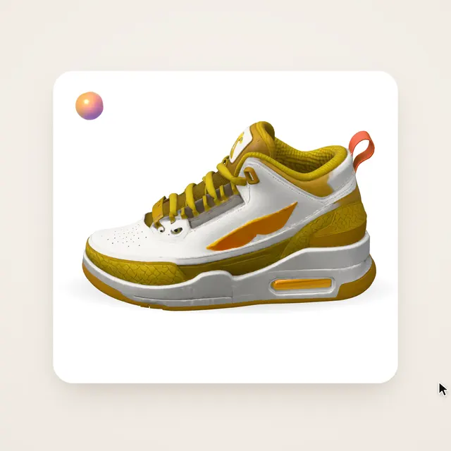</a>

**Claude Opus 5.5** · Анимация · автор [Wandy3D](https://wandy3d.com) · 2026-10-12

Бесшовный цикл на 16 секунд: AI-сфера, фото перетаскивается в карточку, живой прогресс и настоящая 3D-модель. Всё кодом, кадр за кадром.

<details>
<summary>Промпт</summary>

```text
Ask me for: (1) the product and its real interface copy (default: Wandy3D, wandy3d.com, an AI that turns one photo into a textured 3D model; use only strings that exist in its UI: "Upload a photo", "Drop to upload", "Textures" 1K / 2K / 4K, "Polygons" 10K–1M, "Generate", the progress rail "Start · Shape · Texture · Finish" with its step lines, "Model ready", "Drag to turn it", "GLB · FBX · OBJ · USDZ · STL", "Download GLB", "GLB is ready"); (2) one input photo and the GLB the product really made from it (default: the sneaker photo and sneaker.glb in ./assets; never show a model the product did not make, never invent numbers, speeds or user counts); (3) the palette (default: warm off-white canvas #F2EDE6, white cards, pure black/white UI; the orb is the only coloured thing: molten amber #E8A33D → coral → violet); (4) the music (default: compose an original 8-bar loop at 120 BPM in numpy, plus synthesized UI sounds; nothing downloaded). Use AskUserQuestion, at most 4 questions per round, recommended option first. If I answer "defaults", stop asking.

Make a Dribbble-grade UI-motion film, 16 s, 1440×1440, 60 fps, a seamless loop, for an AI that turns one photo into a 3D model. A single white card carries the whole story and never cuts: every state is the same element changing size, corner radius and content. The hero is a GLSL "AI orb", a fluid, breathing, iridescent blob that lives outside the card's content as the continuity element and changes job: idle hero → shrinks into the upload pill → sits beside "Generate" → swirls faster while the model is being made → becomes the knob of the download swipe → blooms when the file is ready → grows back into the idle hero. A cursor causes every change with real clicks and drags. The photo and the 3D model are real: the photo is dropped in by hand, dissolves into points that rise into 3D, and the real GLB, rendered live with Three.js, turns in the card. Type: Hanken Grotesk for UI, JetBrains Mono for numbers and file formats. Springs everywhere, at most a hint of overshoot; a virtual camera zooms so every state fills about 70 % of the frame; the orb pulses lightly on every beat; the last frame is the first frame. Banned: bouncy easing, particle bursts, glows or gradients on UI chrome (the orb, the photo and the model are content, not chrome), mismatched icon strokes, dead time, stock-template looks.

120 BPM, 8 bars = 32 beats = 16 s; beat n lands at (n−1)·0.5 s and something happens on every beat:

| Bar | Beat 1 | Beat 2 | Beat 3 | Beat 4 |
|---|---|---|---|---|
| 1 | Orb idle at hero size with a soft floor shadow, cursor resting lower right | Cursor glides in; hover, the orb leans toward it | Click: the white shape stretches out of the orb into a pill, the orb shrinks into its left end | "Upload a photo" (with an upload icon) fades in |
| 2 | Cursor leaves the frame to the right | It comes back carrying the real photo as a tilted file card | Over the pill: copy swaps to "Drop to upload", the pill swells and shows a dashed drop outline, the orb wobbles | Release: the photo flies into the shape, which becomes a photo card with the orb and a black "Generate" button under the photo |
| 3 | Settings slide in between photo and button: "Textures" 1K 2K 4K (2K selected) and "Polygons" (250K, ends labelled 10K and 1M) | Click 4K: the black indicator slides over | Grab the polygon knob and drag right, the readout rolls through the real rungs | Past 1M the knob rubber-bands; release, it springs back to 1M |
| 4 | Click "Generate": settings leave, the rail Start · Shape · Texture · Finish arrives, "Starting the engine", the orb starts to swirl | Shape, "Sculpting the shape": the photo dissolves into grey points that lift off the picture plane into 3D and turn | Texture, "Painting from your photo": a sweep paints the points in the model's own colours | Finish, "Finishing touches": the points condense into the solid textured model |
```

[… (дальше обрезано — полный промпт на Wandy3D)](https://wandy3d.com/ru/prompts/wandy-orb-photo-to-3d-ui-motion?utm_source=github&utm_medium=referral&utm_campaign=awesome_3d_prompts)

</details>

[Открыть на Wandy3D ↗](https://wandy3d.com/ru/prompts/wandy-orb-photo-to-3d-ui-motion?utm_source=github&utm_medium=referral&utm_campaign=awesome_3d_prompts)

---

### [Изометрический парящий остров с шахтой в Blender, зацикленная анимация](https://wandy3d.com/ru/prompts/isometric-floating-mine-island-in-blender-with-looping-2105672083908825404?utm_source=github&utm_medium=referral&utm_campaign=awesome_3d_prompts)

<a href="https://wandy3d.com/ru/prompts/isometric-floating-mine-island-in-blender-with-looping-2105672083908825404?utm_source=github&amp;utm_medium=referral&amp;utm_campaign=awesome_3d_prompts">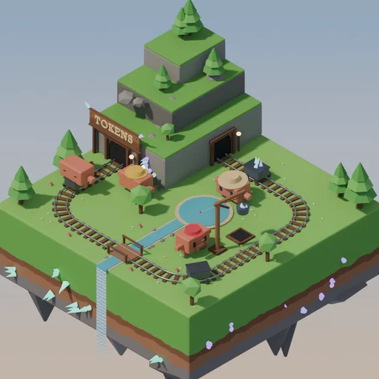</a>

**Claude Opus 5.5** · Сцены · автор [Koldo Huici](https://x.com/koldo2k) · 2026-10-01

Claude Opus 5.5 написал скрипт для Blender: парящий остров с шахтой, железной дорогой, водопадом, кристаллами и маленькими роботами-рабочими.

<details>
<summary>Промпт</summary>

```text
Make an isometric floating mini-world in Blender, animated with Python, as a seamless loop: a small mine island with a terraced mountain, two tunnels and a railway that loops through the mountain, a pond whose stream falls off the edge as a waterfall, and rock layers with glowing crystals on the cut sides. The workers are little Claude bots: one mines a crystal vein and gets startled by a bat, one runs a crane that dumps crystals into each passing cart, one fishes in the pond, and one rides a cart. Put a wooden "TOKENS" sign over the mine entrance. Sound synced to every action.
```

</details>

[Открыть на Wandy3D ↗](https://wandy3d.com/ru/prompts/isometric-floating-mine-island-in-blender-with-looping-2105672083908825404?utm_source=github&utm_medium=referral&utm_campaign=awesome_3d_prompts) · [Исходный пост](https://x.com/koldo2k/status/2105672083908825404)

---

### [Дракон атакует средневековый замок и деревню на Three.js, сравнение моделей](https://wandy3d.com/ru/prompts/three-js-dragon-attacking-a-medieval-castle-and-village-2105659005817462972?utm_source=github&utm_medium=referral&utm_campaign=awesome_3d_prompts)

<a href="https://wandy3d.com/ru/prompts/three-js-dragon-attacking-a-medieval-castle-and-village-2105659005817462972?utm_source=github&amp;utm_medium=referral&amp;utm_campaign=awesome_3d_prompts">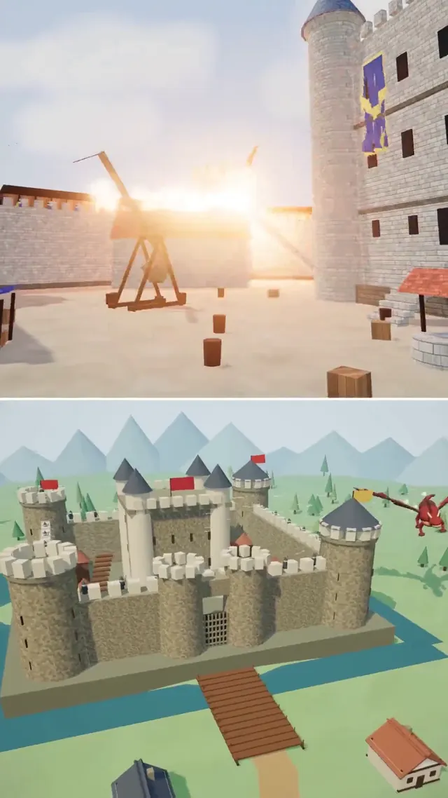</a>

**Claude Opus 5.5** · Сцены · автор [ReconScribe](https://x.com/ReconScribe) · 2026-10-01

Сравнение на одном промпте: Claude Opus 5.5 и GPT-6 Sol построили на Three.js налёт дракона на замок. Автор выбрал версию Opus.

<details>
<summary>Промпт</summary>

```text
a giant dragon attacking a medieval castle and its village, built in Three.js
```

</details>

[Открыть на Wandy3D ↗](https://wandy3d.com/ru/prompts/three-js-dragon-attacking-a-medieval-castle-and-village-2105659005817462972?utm_source=github&utm_medium=referral&utm_campaign=awesome_3d_prompts) · [Исходный пост](https://x.com/ReconScribe/status/2105659005817462972)

---

### [Тест арбуза с резинками: сжимаемая 3D-игрушка в браузере](https://wandy3d.com/ru/prompts/rubber-band-watermelon-test-a-squeezable-bursting-3d-browser-2105607558467559666?utm_source=github&utm_medium=referral&utm_campaign=awesome_3d_prompts)

<a href="https://wandy3d.com/ru/prompts/rubber-band-watermelon-test-a-squeezable-bursting-3d-browser-2105607558467559666?utm_source=github&amp;utm_medium=referral&amp;utm_campaign=awesome_3d_prompts">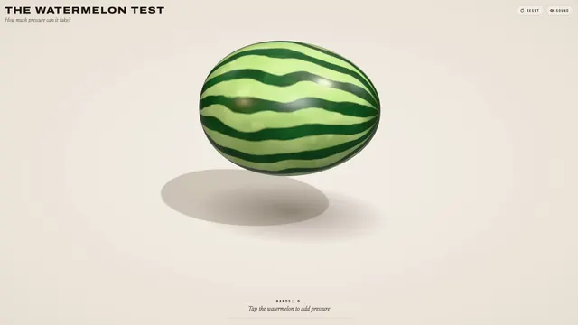</a>

**Claude Opus 5.5** · Интерактив · автор [林悦己Cheer](https://x.com/cheerselflin) · 2026-10-01

Claude Opus 5.5 воспроизвёл известный тест с арбузом: добавляйте резинки, арбуз сжимается в «песочные часы» и взрывается.

<details>
<summary>Бриф от Wandy3D</summary>

```text
Build a small browser toy that recreates the rubber-band watermelon test. Show a glossy striped watermelon centered on a warm off-white background with a soft ground shadow and a minimal editorial title in the corner. Each click or tap on the melon adds another rubber band around its middle. The bands tighten, the melon visibly squeezes into an hourglass shape and wobbles, and a small counter and a line of captions escalate the tension. After enough bands it bursts: red flesh chunks, rind wedges, seeds and rubber bands scatter across the floor, and a large italic caption appears with a restart button. Use real-time 3D rendering with soft studio lighting, deformable geometry and a particle burst. Deliver one self-contained HTML file. Done means adding bands is satisfying and the burst reads clearly.
```

</details>

[Открыть на Wandy3D ↗](https://wandy3d.com/ru/prompts/rubber-band-watermelon-test-a-squeezable-bursting-3d-browser-2105607558467559666?utm_source=github&utm_medium=referral&utm_campaign=awesome_3d_prompts) · [Исходный пост](https://x.com/cheerselflin/status/2105607558467559666)

---

### [Интерактивная 3D-симуляция вулкана в разрезе с магматической камерой](https://wandy3d.com/ru/prompts/interactive-3d-volcano-cutaway-simulation-with-magma-chamber-2105439105798513059?utm_source=github&utm_medium=referral&utm_campaign=awesome_3d_prompts)

<a href="https://wandy3d.com/ru/prompts/interactive-3d-volcano-cutaway-simulation-with-magma-chamber-2105439105798513059?utm_source=github&amp;utm_medium=referral&amp;utm_campaign=awesome_3d_prompts">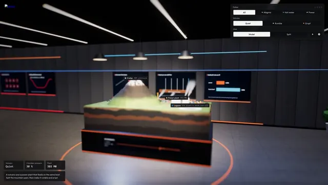</a>

**Claude Opus 5.5** · Интерактив · автор [Konstantin Saifoulline](https://x.com/konstantinsaifo) · 2026-09-30

Claude Opus 5.5 сделал браузерную симуляцию вулкана: слоистый разрез, магматическая камера на глубине 5 км и панели с данными.

<details>
<summary>Бриф от Wandy3D</summary>

```text
Build an interactive 3D volcano simulation as a browser page. Show a cutaway block of terrain with colored rock strata, a glowing magma chamber several kilometers below the surface, a conduit rising to a cone-shaped volcano with green slopes and a few small buildings and monitoring stations nearby. Animate magma pressure rising, glowing sparks and ejecta, steam vents and a camera that can orbit and zoom between a wide view and close views of the chamber. Add a dark control-room setting with wall screens, thin light strips, readout panels showing temperature and pressure, and a compact UI panel with mode toggles and short explanatory captions. Use real-time 3D rendering with particles and emissive materials. Done means the user can orbit, switch modes and watch an eruption sequence unfold.
```

</details>

[Открыть на Wandy3D ↗](https://wandy3d.com/ru/prompts/interactive-3d-volcano-cutaway-simulation-with-magma-chamber-2105439105798513059?utm_source=github&utm_medium=referral&utm_campaign=awesome_3d_prompts) · [Исходный пост](https://x.com/konstantinsaifo/status/2105439105798513059)

---

### [Золотой тилт-шифт диорама пирамид, растущая на глазах: сравнение моделей](https://wandy3d.com/ru/prompts/golden-tilt-shift-pyramid-diorama-that-builds-itself-two-2105412081692352654?utm_source=github&utm_medium=referral&utm_campaign=awesome_3d_prompts)

<a href="https://wandy3d.com/ru/prompts/golden-tilt-shift-pyramid-diorama-that-builds-itself-two-2105412081692352654?utm_source=github&amp;utm_medium=referral&amp;utm_campaign=awesome_3d_prompts">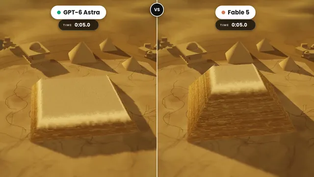</a>

**GPT-6 Astra** · Сцены · автор [demon](https://x.com/demonugc) · 2026-09-30

Сравнение на одном экране: GPT-6 Astra и Fable 5 анимировали золотую закатную диораму, где пирамида вырастает от основания к вершине.

<details>
<summary>Промпт</summary>

```text
{
  "task": "build the pyramids in 3D. rotate the camera",
  "video": { "duration": "15s", "ratio": "16:9", "layout": "split screen, 1 model per side" },
  "scene": "golden miniature diorama, tilt-shift, dark dusk lighting, smooth carved pyramid, temple, small pyramids, cracked plaza, contour terrain",
  "animation": "pyramid morphs in from base to tip, no workers, no ramps, no blocks",
  "camera": "continuous 150 degree orbit, synced on both sides",
  "overlay": "model name + timer only"
}
```

</details>

[Открыть на Wandy3D ↗](https://wandy3d.com/ru/prompts/golden-tilt-shift-pyramid-diorama-that-builds-itself-two-2105412081692352654?utm_source=github&utm_medium=referral&utm_campaign=awesome_3d_prompts) · [Исходный пост](https://x.com/demonugc/status/2105412081692352654)

---

### [Игрушка Jelly Press на WebGPU: желейные фрукты под гидравлическим прессом](https://wandy3d.com/ru/prompts/webgpu-jelly-press-toy-gummy-fruit-squashed-and-burst-by-a-2105353559327887843?utm_source=github&utm_medium=referral&utm_campaign=awesome_3d_prompts)

<a href="https://wandy3d.com/ru/prompts/webgpu-jelly-press-toy-gummy-fruit-squashed-and-burst-by-a-2105353559327887843?utm_source=github&amp;utm_medium=referral&amp;utm_campaign=awesome_3d_prompts">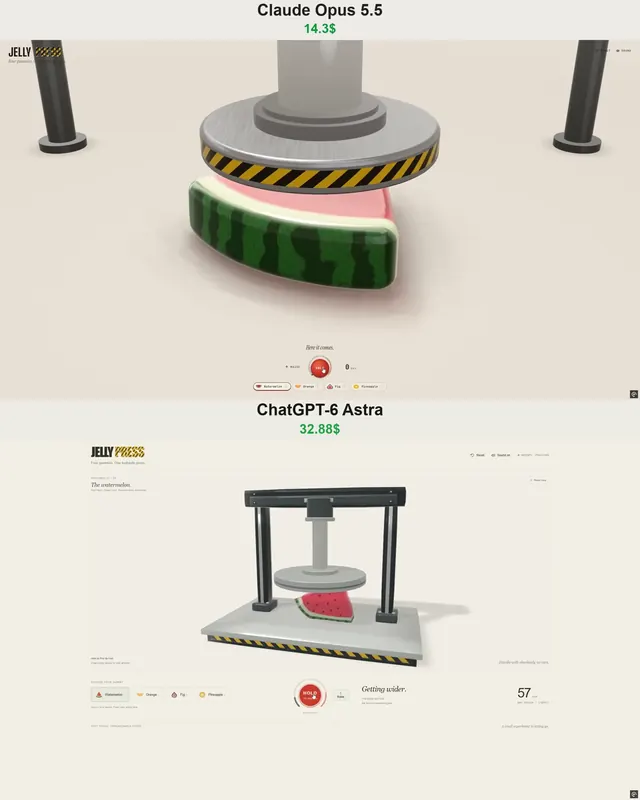</a>

**Claude Opus 5.5** · Интерактив · автор [Vib3Coded](https://x.com/vib3coded) · 2026-09-30

В сравнении двух моделей Claude Opus 5.5 с первой попытки собрал мягкое тело на WebGPU; сопернику понадобились две правки. Куски можно хватать и бросать.

<details>
<summary>Промпт</summary>

```text
Create "Jelly Press": a single-file interactive 3D toy in HTML (all JS, CSS and WGSL shaders inline, no external assets except Google Fonts). Render with WebGPU; if WebGPU or an adapter is missing, show a clean fallback message instead of a blank page.  CONCEPT Four translucent gummy jellies shaped like fruit slices sit one at a time on the steel bed of a hydraulic press. The player holds a big red button to lower the press. The jelly squashes and spreads, the pressure gauge climbs, and somewhere past half its height it bursts into pieces. After the burst the game does NOT end: the player can grab the pieces, drag them, throw them around, and squash them again.  THE JELLIES (chips at the bottom, keys 1–4) 1. Watermelon wedge (half-disc slab): red flesh with dark teardrop seeds, a pale rind band, a green striped skin. 2. Orange slice (half-disc): orange pulp segments separated by thin white membranes, pale pith, orange peel. 3. Fig half: pink flesh full of small golden seeds, a cream layer, a dark purple skin. 4. Pineapple ring: golden fibrous flesh with radial streaks and a hole in the middle. Each jelly should look like real gummy candy: subsurface scattering, soft translucency, glossy specular highlights, soft shadows on a warm studio floor (cream/beige, tone-mapped).  PHYSICS (CPU, fixed 60 Hz step) - XPBD tetrahedral soft body with 8 substeps: co-rotational per-tet shape matching, per-tet volume constraints, hard edge strain limits (0.35×–1.8×), edge velocity damping, floor contact with Coulomb friction, rolling resistance, and gentle settling when nearly still. - Render mesh skinned on the CPU through barycentric embedding in the tets; normals recomputed from triangles every frame. - The press die is a kinematic round platen (radius ~1.05, rounded edge, a thickness, a ram above it). It acts as a ceiling with friction below, a shelf on top, and a side wall at its rim. The two press posts are solid. - Pressure readout in bar comes from the platen's contact load, scaled per fruit.  THE BURST - Break at a random squash between 52% and 66% of the jelly's height. - Plan the fracture in the background shortly after each round starts, so the burst itself is instant. - 5–7 big pieces from 3D Voronoi cells with slightly tilted walls. On 3–4 of them, a far corner is chipped off by two cutting planes and split further into 2–4 small chips, which leaves jagged, notched edges. - Assign tets to cells by centroid. Duplicate particles per chunk. Merge tiny islands into their neighbours. - The new body adopts the old positions and velocities. - Clip the skin triangles against each cell's half-spaces, and fill every cut face with a clean flat cap showing the fruit's interior (flesh, seeds, membranes). No stretched triangles, no holes. - Kick pieces outward and upward from the press. Small chips fly faster and higher and tumble with random spin. - Show a big italic verdict for about 2.5 s, then fade it: "Splat." (melon), "Squeezed." (orange), "Well, that's jam." (fig), "Crushed." (pineapple). Include a stat line: "Gave up at N bar and N% of its height."  AFTER THE BURST: PLAY MODE - Picking: ray/triangle test against the skinned mesh, with a forgiving screen-space fallback for touch. - Grabbing pins the grabbed patch (radius ~0.4, only particles of that chunk) to a target on a camera-facing drag plane. Small chips move whole; big pieces stretch and swing like jelly. - Releasing throws the piece with the pointer's velocity. - Pieces collide with each other. A particle found inside another chunk's tet is pushed out through that chunk's nearest skin face, with friction. Use a chunk AABB broad phase and a spatial hash of skin tets. - Pieces stay on stage: side walls, plus an invisible front edge so nothing ends up under the controls or behind the camera. - The press still works: hold to squash the pieces again (no second fracture); Raise lifts the platen. - Wet "plop" sounds on landings; a small squelch on grab. - Cursor: open hand over pieces,
```

[… (дальше обрезано — полный промпт на Wandy3D)](https://wandy3d.com/ru/prompts/webgpu-jelly-press-toy-gummy-fruit-squashed-and-burst-by-a-2105353559327887843?utm_source=github&utm_medium=referral&utm_campaign=awesome_3d_prompts)

</details>

[Открыть на Wandy3D ↗](https://wandy3d.com/ru/prompts/webgpu-jelly-press-toy-gummy-fruit-squashed-and-burst-by-a-2105353559327887843?utm_source=github&utm_medium=referral&utm_campaign=awesome_3d_prompts) · [Исходный пост](https://x.com/vib3coded/status/2105353559327887843)

---

### [Сцена столярной мастерской в Isaac Sim для проверки манипуляций робота](https://wandy3d.com/ru/prompts/isaac-sim-carpentry-workbench-scene-for-robot-manipulation-2105323534398763307?utm_source=github&utm_medium=referral&utm_campaign=awesome_3d_prompts)

<a href="https://wandy3d.com/ru/prompts/isaac-sim-carpentry-workbench-scene-for-robot-manipulation-2105323534398763307?utm_source=github&amp;utm_medium=referral&amp;utm_campaign=awesome_3d_prompts">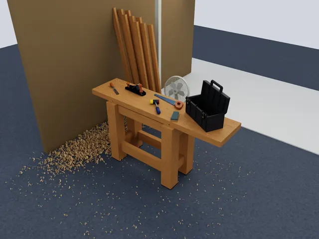</a>

**GPT-6 Astra** · Сцены · автор [Charles Wong](https://x.com/charleswongzx) · 2026-09-30

GPT-6 Astra воссоздал по фото угол с верстаком, инструментами, ящиком, досками и стружкой в Isaac Sim. Это базовый запуск без дополнительной обвязки.

<details>
<summary>Промпт</summary>

```text
Recreate this scene in Isaac Sim for the purposes of manipulation policy evaluation. Don't use Manifold.
```

</details>

[Открыть на Wandy3D ↗](https://wandy3d.com/ru/prompts/isaac-sim-carpentry-workbench-scene-for-robot-manipulation-2105323534398763307?utm_source=github&utm_medium=referral&utm_campaign=awesome_3d_prompts) · [Исходный пост](https://x.com/charleswongzx/status/2105323534398763307)

---

### [Живописная анимация в Blender: латунный мотылёк с кристаллом оживает на верстаке](https://wandy3d.com/ru/prompts/painterly-blender-animation-of-a-brass-crystal-moth-waking-2105317581695623329?utm_source=github&utm_medium=referral&utm_campaign=awesome_3d_prompts)

<a href="https://wandy3d.com/ru/prompts/painterly-blender-animation-of-a-brass-crystal-moth-waking-2105317581695623329?utm_source=github&amp;utm_medium=referral&amp;utm_campaign=awesome_3d_prompts">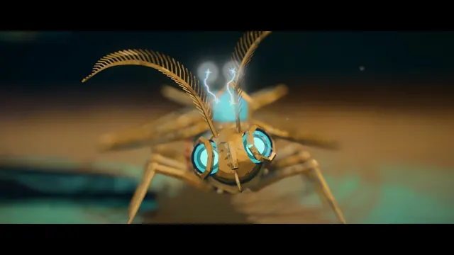</a>

**Claude Opus 5.5** · Анимация · автор [Shikhar](https://x.com/xikhar) · 2026-09-30

Claude Opus 5.5 собрал 15-секундный ролик в Blender в рукописной манере, близкой к Arcane: текстуры мазками из кода, 2D-искры и звук.

<details>
<summary>Промпт</summary>

```text
TITLE: "SPARK"

An around 15-second 3D animated shot in the painterly style of the show Arcane (Fortiche).

Made in Blender, or any other tool if superior. Widescreen, no dialogue.

GOAL

The top priority is replicating Arcane's visual and animation style as perfectly as possible, in every way. Someone watching should believe it came from the same studio.

Take as much time and effort as needed. Replicate the technique and look perfectly. Spend as much time as needed, ensuring it's perfect in every way.

SCENE (loose — adapt freely)

A small mechanical creature (not humanoid), something like a brass-and-crystal moth, wakes up on a cluttered inventor's workbench at night. Its crystal core ignites with glowing energy, and it bursts into the air in a swirl of sparks. Change the details, framing, or action if something else shows off the style better. You can animate something else completely different if you want—anything you pick, whatever you can do best—that will also look identical to Arcane.

PROCESS

1. RESEARCH: Before building anything, study Arcane's style in depth. Find references and breakdowns of Fortiche's technique (interviews, making-of material, artist breakdowns). Write down every defining element: textures, shading, line work, color, lighting, frame rate, effects, camera, compositing.

2. STYLE GUIDE: Turn that into a written checklist and a small style frame (a single still image) before animating. Compare it side by side with reference stills and revise until it matches.

3. BUILD: Model, texture, light, and animate following the checklist.

4. REVIEW: Compare frames against Arcane references repeatedly. List every difference you can see and fix it. Repeat until no noticeable differences remain.

STYLE ELEMENTS TO MATCH (at minimum)

- Hand-painted textures with visible brushstrokes on every surface; nothing looks procedural or photographic.

- Stylized, painterly shading with designed light/shadow shapes, not realistic falloff.

- Animation on 2s for characters/objects, with strong poses, snappy timing, anticipation, and smear frames; camera moves smooth on 1s.

- Hand-drawn 2D effects (sparks, energy, smoke, glints, glow) layered over the 3D, animated on 2s with graphic shape language.

- Bold, moody color: warm light vs. saturated glowing accents, rich colored shadows, strong rim light, bloom.

- Painterly compositing: brush-like filtering, grain, subtle texture over the image.

- Cinematic camera: shallow depth of field, purposeful movement, weight on impacts.

SOUND

Detailed, cinematic sound design that matches the action and mood.

Make everything as good as possible: animation, models, textures, effects, lighting, and sound. Use any tools or programs needed. You may study references online and imitate techniques, and copy things, but do not directly use assets you did not create. Keep the whole shot in one consistent style so the 3D, painted textures, and 2D effects feel like a single hand-crafted image.

Do not use memory or previous chats.

You can use any other tools, programs, plugins, literally anything. Use anything at your disposal.

You can use different processes than outlined in this, or animate something else than described, but it should absolutely look as close as possible to the TV show Arcane. Make it perfect in every way and identical.
```

</details>

[Открыть на Wandy3D ↗](https://wandy3d.com/ru/prompts/painterly-blender-animation-of-a-brass-crystal-moth-waking-2105317581695623329?utm_source=github&utm_medium=referral&utm_campaign=awesome_3d_prompts) · [Исходный пост](https://x.com/xikhar/status/2105317581695623329)

---

### [Three.js-анимация: светящийся шар прыгает по неоновым платформам в такт музыке](https://wandy3d.com/ru/prompts/beat-synced-three-js-animation-of-a-glowing-ball-bouncing-2105302007896797351?utm_source=github&utm_medium=referral&utm_campaign=awesome_3d_prompts)

<a href="https://wandy3d.com/ru/prompts/beat-synced-three-js-animation-of-a-glowing-ball-bouncing-2105302007896797351?utm_source=github&amp;utm_medium=referral&amp;utm_campaign=awesome_3d_prompts">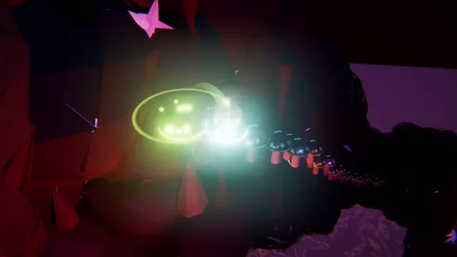</a>

**Claude Opus 5.5** · Анимация · автор [Gorden Sun](https://x.com/Gorden_Sun) · 2026-09-30

Claude Opus 5.5 сделал музыкальный ролик на Three.js: шар падает через сменяющиеся сцены и подсвечивает каждый объект в ритм.

<details>
<summary>Промпт</summary>

```text
卡点的3D球体下坠的动画视频：对标专业的Blender做的效果，音乐是多首经典的纯音乐，场景按音乐切换，3D球体下坠时在3D场景的物件中弹跳，按音乐的节奏点亮物件。带一些幽默的元素。
使用three.js制作，不要使用Blender制作
```

</details>

[Открыть на Wandy3D ↗](https://wandy3d.com/ru/prompts/beat-synced-three-js-animation-of-a-glowing-ball-bouncing-2105302007896797351?utm_source=github&utm_medium=referral&utm_campaign=awesome_3d_prompts) · [Исходный пост](https://x.com/Gorden_Sun/status/2105302007896797351)

---

### [Игрушка Jelly Press на WebGPU: пресс давит мягкие фруктовые мармеладки](https://wandy3d.com/ru/prompts/single-file-webgpu-jelly-press-toy-with-soft-body-fruit-2105286092651999619?utm_source=github&utm_medium=referral&utm_campaign=awesome_3d_prompts)

<a href="https://wandy3d.com/ru/prompts/single-file-webgpu-jelly-press-toy-with-soft-body-fruit-2105286092651999619?utm_source=github&amp;utm_medium=referral&amp;utm_campaign=awesome_3d_prompts">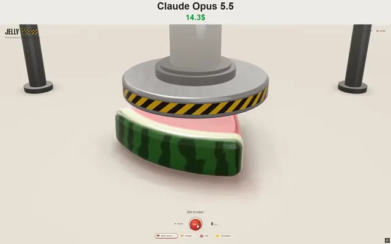</a>

**Claude Opus 5.5** · Интерактив · автор [Vib3Coded](https://x.com/vib3coded) · 2026-09-30

Claude Opus 5.5 собрал на WebGPU игрушку: гидравлический пресс давит мармеладные дольки, они лопаются на куски, которые можно хватать и бросать.

<details>
<summary>Промпт</summary>

```text
Create "Jelly Press": a single-file interactive 3D toy in HTML (all JS, CSS and WGSL shaders inline, no external assets except Google Fonts). Render with WebGPU; if WebGPU or an adapter is missing, show a clean fallback message instead of a blank page.

CONCEPT
Four translucent gummy jellies shaped like fruit slices sit one at a time on the steel bed of a hydraulic press. The player holds a big red button to lower the press. The jelly squashes and spreads, the pressure gauge climbs, and somewhere past half its height it bursts into pieces. After the burst the game does NOT end: the player can grab the pieces, drag them, throw them around, and squash them again.

THE JELLIES (chips at the bottom, keys 1–4)
1. Watermelon wedge (half-disc slab): red flesh with dark teardrop seeds, a pale rind band, a green striped skin.
2. Orange slice (half-disc): orange pulp segments separated by thin white membranes, pale pith, orange peel.
3. Fig half: pink flesh full of small golden seeds, a cream layer, a dark purple skin.
4. Pineapple ring: golden fibrous flesh with radial streaks and a hole in the middle.
Each jelly should look like real gummy candy: subsurface scattering, soft translucency, glossy specular highlights, soft shadows on a warm studio floor (cream/beige, tone-mapped).

PHYSICS (CPU, fixed 60 Hz step)
- XPBD tetrahedral soft body with 8 substeps: co-rotational per-tet shape matching, per-tet volume constraints, hard edge strain limits (0.35×–1.8×), edge velocity damping, floor contact with Coulomb friction, rolling resistance, and gentle settling when nearly still.
- Render mesh skinned on the CPU through barycentric embedding in the tets; normals recomputed from triangles every frame.
- The press die is a kinematic round platen (radius ~1.05, rounded edge, a thickness, a ram above it). It acts as a ceiling with friction below, a shelf on top, and a side wall at its rim. The two press posts are solid.
- Pressure readout in bar comes from the platen's contact load, scaled per fruit.

THE BURST
- Break at a random squash between 52% and 66% of the jelly's height.
- Plan the fracture in the background shortly after each round starts, so the burst itself is instant.
- 5–7 big pieces from 3D Voronoi cells with slightly tilted walls. On 3–4 of them, a far corner is chipped off by two cutting planes and split further into 2–4 small chips, which leaves jagged, notched edges.
- Assign tets to cells by centroid. Duplicate particles per chunk. Merge tiny islands into their neighbours.
- The new body adopts the old positions and velocities.
- Clip the skin triangles against each cell's half-spaces, and fill every cut face with a clean flat cap showing the fruit's interior (flesh, seeds, membranes). No stretched triangles, no holes.
- Kick pieces outward and upward from the press. Small chips fly faster and higher and tumble with random spin.
- Show a big italic verdict for about 2.5 s, then fade it: "Splat." (melon), "Squeezed." (orange), "Well, that's jam." (fig), "Crushed." (pineapple). Include a stat line: "Gave up at N bar and N% of its height."

AFTER THE BURST: PLAY MODE
- Picking: ray/triangle test against the skinned mesh, with a forgiving screen-space fallback for touch.
- Grabbing pins the grabbed patch (radius ~0.4, only particles of that chunk) to a target on a camera-facing drag plane. Small chips move whole; big pieces stretch and swing like jelly.
- Releasing throws the piece with the pointer's velocity.
- Pieces collide with each other. A particle found inside another chunk's tet is pushed out through that chunk's nearest skin face, with friction. Use a chunk AABB broad phase and a spatial hash of skin tets.
- Pieces stay on stage: side walls, plus an invisible front edge so nothing ends up under the controls or behind the camera.
- The press still works: hold to squash the pieces again (no second fracture); Raise lifts the platen.
- Wet "plop" sounds on landings; a small squelch on grab.
```

[… (дальше обрезано — полный промпт на Wandy3D)](https://wandy3d.com/ru/prompts/single-file-webgpu-jelly-press-toy-with-soft-body-fruit-2105286092651999619?utm_source=github&utm_medium=referral&utm_campaign=awesome_3d_prompts)

</details>

[Открыть на Wandy3D ↗](https://wandy3d.com/ru/prompts/single-file-webgpu-jelly-press-toy-with-soft-body-fruit-2105286092651999619?utm_source=github&utm_medium=referral&utm_campaign=awesome_3d_prompts) · [Исходный пост](https://x.com/vib3coded/status/2105286092651999619)

---

### [Мост Золотые Ворота в утреннем тумане: рендер в стиле Blender снизу](https://wandy3d.com/ru/prompts/golden-gate-bridge-in-morning-fog-low-angle-blender-style-2105279002793345069?utm_source=github&utm_medium=referral&utm_campaign=awesome_3d_prompts)

<a href="https://wandy3d.com/ru/prompts/golden-gate-bridge-in-morning-fog-low-angle-blender-style-2105279002793345069?utm_source=github&amp;utm_medium=referral&amp;utm_campaign=awesome_3d_prompts">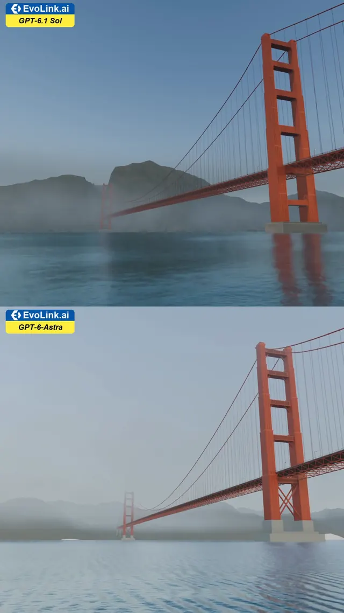</a>

**GPT-6 Astra** · Сцены · автор [EvoLink.ai](https://x.com/EvoLinkAi) · 2026-09-30

Сравнение: GPT-6-Astra и GPT-6.1 Sol получили один промпт про туманный мост снизу; у Astra цвета вышли более тонкими.

<details>
<summary>Промпт</summary>

```text
A Blender render of the Golden Gate Bridge.  A sweeping, extreme low-angle shot from the surface of San Francisco Bay, looking up at the colossal, intricate steel-truss towers piercing the foggy morning sky. The expansive roadway stretches across the span with countless tiny, detailed vehicles, highlighting the bridge's grand, imposing scale against the rugged coastal headlands.
```

</details>

[Открыть на Wandy3D ↗](https://wandy3d.com/ru/prompts/golden-gate-bridge-in-morning-fog-low-angle-blender-style-2105279002793345069?utm_source=github&utm_medium=referral&utm_campaign=awesome_3d_prompts) · [Исходный пост](https://x.com/EvoLinkAi/status/2105279002793345069)

---

### [Чёрно-белый sci-fi HUD обсерватории с вихрем светящихся нитей](https://wandy3d.com/ru/prompts/monochrome-sci-fi-observatory-hud-with-swirling-strand-rings-2105246199653482872?utm_source=github&utm_medium=referral&utm_campaign=awesome_3d_prompts)

<a href="https://wandy3d.com/ru/prompts/monochrome-sci-fi-observatory-hud-with-swirling-strand-rings-2105246199653482872?utm_source=github&amp;utm_medium=referral&amp;utm_campaign=awesome_3d_prompts">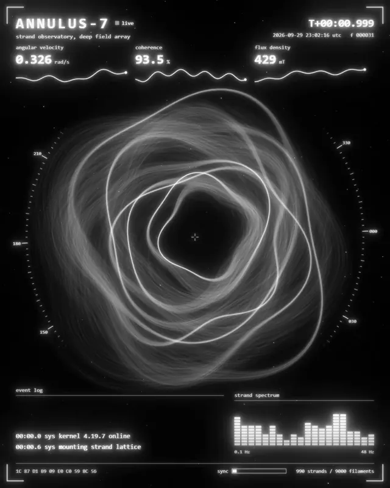</a>

**Claude Opus 5.5** · Анимация · автор [kriptoleidi](https://x.com/kriptoleidi) · 2026-09-30

Claude Opus 5.5 показан как автор этого анимированного экрана: вращающиеся кольца из светящихся нитей, показатели, журнал событий и спектр.

<details>
<summary>Бриф от Wandy3D</summary>

```text
Build a portrait-format monochrome sci-fi observatory display as a self-contained HTML page. Fill the centre with several concentric, slowly rotating rings made of thousands of thin glowing white strands that wobble and overlap, with a few brighter highlighted rings, on a black background with faint stars. Around it add a minimal technical interface: a title block at top left, a running timer at top right, three small metric readouts with live waveform lines, thin leader lines with small labels pointing at two rings, a degree scale around the circle, a scrolling event log at bottom left and an animated spectrum bar chart at bottom right. Use a thin condensed monospace type, white and grey only, and subtle bloom. Everything should animate smoothly and loop without interaction. Done means a convincing, readable control-room visualization.
```

</details>

[Открыть на Wandy3D ↗](https://wandy3d.com/ru/prompts/monochrome-sci-fi-observatory-hud-with-swirling-strand-rings-2105246199653482872?utm_source=github&utm_medium=referral&utm_campaign=awesome_3d_prompts) · [Исходный пост](https://x.com/kriptoleidi/status/2105246199653482872)

---

### [Фэнтези-мир в 3D: островная деревня, снежные горы и замок](https://wandy3d.com/ru/prompts/fantasy-world-flythrough-island-village-snowy-peaks-and-a-2105245648723562584?utm_source=github&utm_medium=referral&utm_campaign=awesome_3d_prompts)

<a href="https://wandy3d.com/ru/prompts/fantasy-world-flythrough-island-village-snowy-peaks-and-a-2105245648723562584?utm_source=github&amp;utm_medium=referral&amp;utm_campaign=awesome_3d_prompts">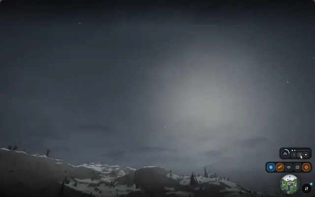</a>

**Claude Opus 5.5** · Сцены · автор [DrstaOne](https://x.com/DrstaOne) · 2026-09-30

Claude Opus 5.5 превратил короткий запрос про средневековый эпичный мир в 3D-пролёт от ночной деревни на острове к снежным горам и замку.

<details>
<summary>Промпт</summary>

```text
create Game of thrones world
```

</details>

[Открыть на Wandy3D ↗](https://wandy3d.com/ru/prompts/fantasy-world-flythrough-island-village-snowy-peaks-and-a-2105245648723562584?utm_source=github&utm_medium=referral&utm_campaign=awesome_3d_prompts) · [Исходный пост](https://x.com/DrstaOne/status/2105245648723562584)

---

### [Кинематографичный запуск ракеты на Three.js с телеметрией и камерой](https://wandy3d.com/ru/prompts/cinematic-three-js-rocket-launch-with-telemetry-ui-and-chase-2105047166733746209?utm_source=github&utm_medium=referral&utm_campaign=awesome_3d_prompts)

<a href="https://wandy3d.com/ru/prompts/cinematic-three-js-rocket-launch-with-telemetry-ui-and-chase-2105047166733746209?utm_source=github&amp;utm_medium=referral&amp;utm_campaign=awesome_3d_prompts">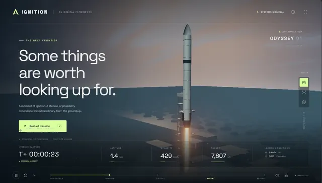</a>

**Claude Opus 5.5** · Сцены · автор [Matthew Lebo](https://x.com/MatthewLebo_) · 2026-09-29

Сравнение Claude Opus 5.5, GPT-6.1 Sol и GPT-6 Astra на одном промпте про запуск ракеты: Opus 5.5 выиграл за самую кинематографичную сцену.

<details>
<summary>Промпт</summary>

```text
Build a cinematic, photorealistic, beautifully textured rocket launch scene using Three.js
```

</details>

[Открыть на Wandy3D ↗](https://wandy3d.com/ru/prompts/cinematic-three-js-rocket-launch-with-telemetry-ui-and-chase-2105047166733746209?utm_source=github&utm_medium=referral&utm_campaign=awesome_3d_prompts) · [Исходный пост](https://x.com/MatthewLebo_/status/2105047166733746209)

---

### [Интерактивная тектоническая песочница: как возникает землетрясение](https://wandy3d.com/ru/prompts/interactive-tectonic-sandbox-explaining-how-an-earthquake-2105029713445949521?utm_source=github&utm_medium=referral&utm_campaign=awesome_3d_prompts)

<a href="https://wandy3d.com/ru/prompts/interactive-tectonic-sandbox-explaining-how-an-earthquake-2105029713445949521?utm_source=github&amp;utm_medium=referral&amp;utm_campaign=awesome_3d_prompts">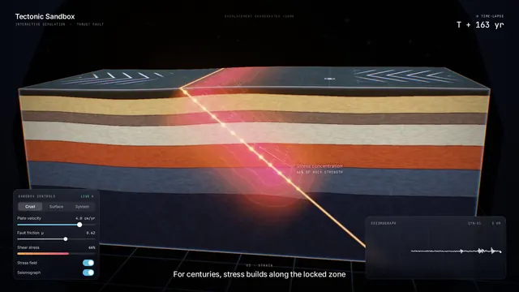</a>

**Claude Opus 5.5** · Анимация · автор [Ege](https://x.com/egeberkina) · 2026-09-29

Claude Opus 5.5 собрал 60-секундный motion-ролик: разрез коры, срыв разлома, P- и S-волны и тряска города на поверхности.

<details>
<summary>Промпт</summary>

```text
Create a visually stunning 60-second video explaining how an earthquake happens through an interactive tectonic sandbox.

Make it feel like we are watching someone explore a beautiful real-time simulation, not a slideshow or traditional educational video.

Start with a clean 3D cross-section of Earth’s crust. Two tectonic plates slowly move against each other. Visualize the fault between them and show friction locking the plates while stress gradually builds.

As pressure increases, make the simulation more intense: rock layers deform, stress zones glow, subtle vibrations begin, and a live seismograph starts reacting.

Then trigger the earthquake. The fault suddenly slips and releases a massive burst of energy. Show seismic waves radiating outward through the ground, then transition upward to the surface where the landscape and a small city begin shaking.

Visualize P-waves and S-waves traveling differently through the Earth, followed by the strongest surface waves. Show buildings reacting differently depending on distance from the epicenter.

End by zooming back underground to reveal smaller aftershocks around the fault, then pull out to show the complete tectonic system.

Use cinematic motion graphics, satisfying physics simulations, dramatic scale transitions, premium 3D scientific visualization, minimal typography, dynamic labels, smooth UI overlays and seamless transitions.

The pacing should constantly evolve and reveal something new every few seconds so the full 60 seconds stays visually engaging.

Make it feel like an Apple-quality interactive science visualization turned into a cinematic motion-design video.
```

</details>

[Открыть на Wandy3D ↗](https://wandy3d.com/ru/prompts/interactive-tectonic-sandbox-explaining-how-an-earthquake-2105029713445949521?utm_source=github&utm_medium=referral&utm_campaign=awesome_3d_prompts) · [Исходный пост](https://x.com/egeberkina/status/2105029713445949521)

---

### [Реалистичный F-22 Raptor из Blender, облетаемый в Godot](https://wandy3d.com/ru/prompts/realistic-f-22-raptor-modeled-in-blender-and-flown-in-godot-2105027152617918852?utm_source=github&utm_medium=referral&utm_campaign=awesome_3d_prompts)

<a href="https://wandy3d.com/ru/prompts/realistic-f-22-raptor-modeled-in-blender-and-flown-in-godot-2105027152617918852?utm_source=github&amp;utm_medium=referral&amp;utm_campaign=awesome_3d_prompts">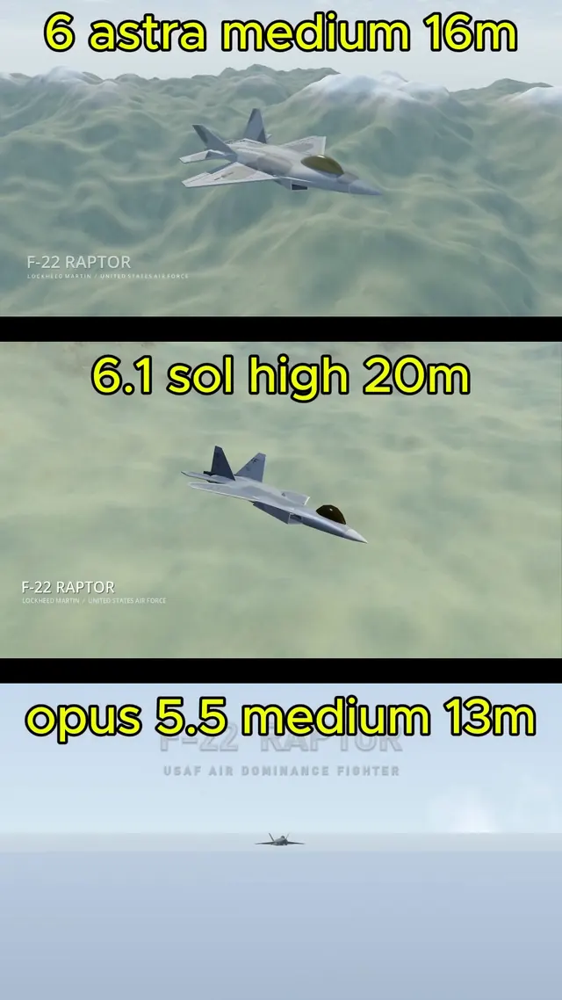</a>

**GPT-6.1 Sol** · Анимация · автор [Demetrius Greses Jr](https://x.com/dgresesjr) · 2026-09-29

Сравнение трёх моделей: GPT-6.1 Sol (названа первой) сделала F-22 в Blender и 60-секундный пролёт в Godot, рядом GPT-6 Astra и Opus 5.5.

<details>
<summary>Промпт</summary>

```text
Using blender mcp. Make me a realistic 3d model of the: Lockheed Martin F-22 Raptor (US only). Then create me 60 second mp4 of it flying around in Godot that I can upload to X.
```

</details>

[Открыть на Wandy3D ↗](https://wandy3d.com/ru/prompts/realistic-f-22-raptor-modeled-in-blender-and-flown-in-godot-2105027152617918852?utm_source=github&utm_medium=referral&utm_campaign=awesome_3d_prompts) · [Исходный пост](https://x.com/dgresesjr/status/2105027152617918852)

---

### [Механические часы, разбирающиеся при скролле, на чистом WebGPU в одном HTML](https://wandy3d.com/ru/prompts/scroll-driven-exploding-mechanical-watch-in-raw-webgpu-2105009470292013286?utm_source=github&utm_medium=referral&utm_campaign=awesome_3d_prompts)

<a href="https://wandy3d.com/ru/prompts/scroll-driven-exploding-mechanical-watch-in-raw-webgpu-2105009470292013286?utm_source=github&amp;utm_medium=referral&amp;utm_campaign=awesome_3d_prompts">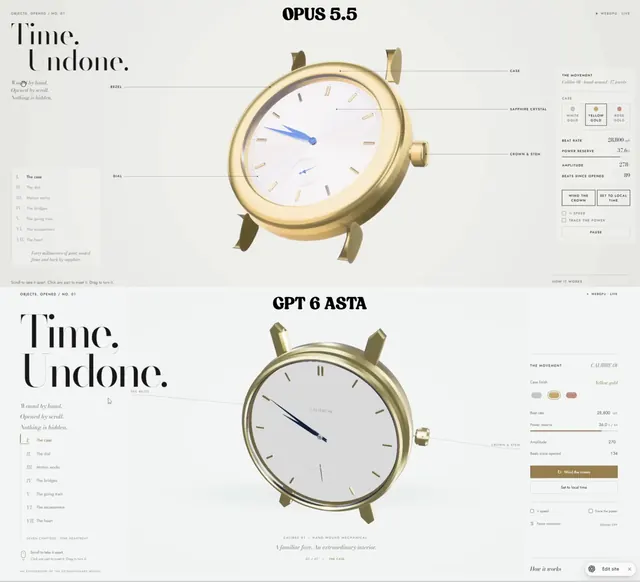</a>

**Claude Opus 5.5** · Интерактив · автор [Paruchh](https://x.com/theparuchh) · 2026-09-29

Сравнение Claude Opus 5.5 и GPT-6 Astra: обе сделали идущие часы на WebGPU, которые разбираются при прокрутке. Первой показана Opus 5.5.

<details>
<summary>Промпт</summary>

```text
Build "Time, Undone." - a single self-contained HTML file (embedded JS and CSS) running a genuine WebGPU + WGSL interactive 3D mechanical watch that takes itself apart as you scroll, while it keeps running. No 3D engine libraries; all geometry is generated in code. This is issue No. 01 of a series about objects everyone has seen from the outside and almost no one has seen from the inside.
THE OBJECT
An original, unbranded, hand-wound mechanical watch in a round 40 mm case, with a classic Swiss-lever movement about 30 mm across.
Layout: centre hours and minutes; small seconds sub-dial at 6 o'clock; crown at 3 o'clock.
Dial: silver-opaline with a fine guilloché sunburst, applied polished indices, dauphine hands, a railroad minute track.
Case: front sapphire crystal and a display caseback, so the movement is visible from behind.
No brand names, logos or real calibre names anywhere. Call it "Calibre 01".
THE MECHANISM (must be internally correct, not decorative)
Beat rate 28,800 vph (4 Hz balance).
Build a real going train with consistent tooth counts:mainspring barrel 96 teeth → centre pinion 12; the centre wheel turns once an hour and carries the minute hand;
centre wheel 80 → third pinion 10;
third wheel 75 → fourth pinion 10; the fourth wheel turns once a minute and carries the small seconds hand;
fourth wheel 84 → escape pinion 7;
escape wheel 20 teeth, turning once every 5 s.

Motion works under the dial: cannon pinion 12 → minute wheel 36; minute pinion 10 → hour wheel 40 (12:1).
Keyless works: crown, stem, crown wheel, ratchet wheel, click with spring.
Escapement: escape wheel, pallet fork with two ruby pallet stones and banking pins, balance wheel with hairspring and impulse roller.
Structure: mainplate, barrel bridge, train bridge, balance cock, ruby jewel bearings, blued screws.
Gears: watch-style cycloidal tooth profiles, spoked wheel crossings, pinions with leaves, arbors and pivots. Centre distances are derived from a common module so every pair meshes visibly correctly when assembled.
Motion, driven from ONE master clock:the balance oscillates as θ(t) = A·sin(2π·4·t), with amplitude A around 270° at full power;
at each beat, the pallet fork flicks between its banking pins and the escape wheel advances half a tooth in a short eased impulse, then locks;
every other wheel steps exactly by its ratio from the escape wheel;
the seconds hand ticks 8 times per second; the minute and hour hands follow the train.
On load, set the hands to the viewer's local time.

Power: a power reserve of about 44 h that drains in real time.Amplitude falls from 290° to 180° as the reserve empties; at 0 the watch stops, the balance settling rather than freezing.
Winding raises the reserve, with visible ratchet and click motion and a soft click sound (Web Audio, muted until the first user interaction).

The mechanism keeps running in every exploded state: wheels spin in mid-air, the balance keeps beating, the seconds hand keeps ticking.
THE EXPLODE (scroll-driven, with stops)
Page scroll maps to a progress value from 0 to 1, split into seven chapters. Each chapter eases into a resting "stop" where scroll briefly settles (a soft snap, never a hard lock). The camera moves smoothly between chapters.
Chapters:
I. The case: front 3/4 view, assembled.
II. The dial: the crystal and bezel lift away; the hands and dial rise.
III. Motion works: the wheels under the dial separate.
IV. The bridges: the watch turns over to show the back; the caseback lifts; the bridges and the balance cock rise, with their screws floating just above their holes.
V. The going train: barrel, centre, third and fourth wheels spread upward along their own axes like a technical drawing.
VI. The escapement: escape wheel, pallet fork and balance separate a little further, and the camera closes in.
VII. The heart: a macro view of the beating balance and hairspring, with the full exploded column behind.
```

[… (дальше обрезано — полный промпт на Wandy3D)](https://wandy3d.com/ru/prompts/scroll-driven-exploding-mechanical-watch-in-raw-webgpu-2105009470292013286?utm_source=github&utm_medium=referral&utm_campaign=awesome_3d_prompts)

</details>

[Открыть на Wandy3D ↗](https://wandy3d.com/ru/prompts/scroll-driven-exploding-mechanical-watch-in-raw-webgpu-2105009470292013286?utm_source=github&utm_medium=referral&utm_campaign=awesome_3d_prompts) · [Исходный пост](https://x.com/theparuchh/status/2105009470292013286)

---

### [Процедурная машина Голдберга с шестернями и рампами в Blender](https://wandy3d.com/ru/prompts/procedural-rube-goldberg-machine-with-gears-and-ramps-in-2104953406708175097?utm_source=github&utm_medium=referral&utm_campaign=awesome_3d_prompts)

<a href="https://wandy3d.com/ru/prompts/procedural-rube-goldberg-machine-with-gears-and-ramps-in-2104953406708175097?utm_source=github&amp;utm_medium=referral&amp;utm_campaign=awesome_3d_prompts">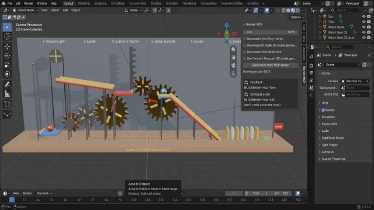</a>

**Claude Opus 5.5** · Сцены · автор [Atarax](https://x.com/Kwazikot) · 2026-09-29

Claude Opus 5.5 через Cursor и Blender MCP собрал на деревянной основе машину Голдберга из шестерён и рамп, проверяя собственную сцену.

<details>
<summary>Промпт</summary>

```text
Create a mechanical Rube Goldberg machine in Blender. Use gears, ramps, balls, and moving platforms. Build it procedurally, inspect the scene after each major step, and fix obvious geometry issues.
```

</details>

[Открыть на Wandy3D ↗](https://wandy3d.com/ru/prompts/procedural-rube-goldberg-machine-with-gears-and-ramps-in-2104953406708175097?utm_source=github&utm_medium=referral&utm_campaign=awesome_3d_prompts) · [Исходный пост](https://x.com/Kwazikot/status/2104953406708175097)

---

### [Браузерные картинг-гонки на Three.js: четыре трассы, предметы и Гран-при](https://wandy3d.com/ru/prompts/browser-kart-racer-in-three-js-with-four-tracks-items-and-2104947905442505205?utm_source=github&utm_medium=referral&utm_campaign=awesome_3d_prompts)

<a href="https://wandy3d.com/ru/prompts/browser-kart-racer-in-three-js-with-four-tracks-items-and-2104947905442505205?utm_source=github&amp;utm_medium=referral&amp;utm_campaign=awesome_3d_prompts">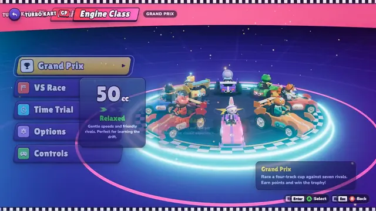</a>

**Claude Opus 5.5** · Игры · автор [Tony](https://x.com/EnvolDev) · 2026-09-29

Claude Opus 5.5 запустил параллельных субагентов и выдал картинг на Three.js: дрифт, восемь гонщиков, девять предметов, соперники и кубки.

<details>
<summary>Промпт</summary>

```text
I need you to launch five(Model) sub-agents and help me build a triple A quality game that is a clone of Mario Kart. What I want you to do is I want you to launch these sub-agents, build the game without asking me any questions at all, and use 3JS to build the game. And once you're done, report back to me.
```

</details>

[Открыть на Wandy3D ↗](https://wandy3d.com/ru/prompts/browser-kart-racer-in-three-js-with-four-tracks-items-and-2104947905442505205?utm_source=github&utm_medium=referral&utm_campaign=awesome_3d_prompts) · [Исходный пост](https://x.com/EnvolDev/status/2104947905442505205)

---

### [Мультяшная планета на Three.js с облаками, горами и городом, вокруг…](https://wandy3d.com/ru/prompts/cartoon-three-js-planet-with-clouds-mountains-and-a-city-you-2104919846953869421?utm_source=github&utm_medium=referral&utm_campaign=awesome_3d_prompts)

<a href="https://wandy3d.com/ru/prompts/cartoon-three-js-planet-with-clouds-mountains-and-a-city-you-2104919846953869421?utm_source=github&amp;utm_medium=referral&amp;utm_campaign=awesome_3d_prompts">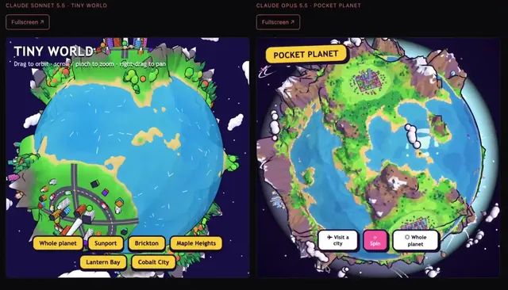</a>

**Claude Opus 5.5** · Сцены · автор [Aman](https://x.com/mdaman010) · 2026-09-29

Сравнение: Claude Opus 5.5 и Sonnet 5.5 получили один промпт на планету в комикс-стиле на Three.js. Можно вращать камеру и приближаться к городам.

<details>
<summary>Промпт</summary>

```text
Output a ThreeJS 3D cartoony/comics-like planet, with vibrant life on it: clouds, mountains, city buildings, cars and plane romaing it. It should be possible to orbit around and zoom and see the details. No harness is to be used
```

</details>

[Открыть на Wandy3D ↗](https://wandy3d.com/ru/prompts/cartoon-three-js-planet-with-clouds-mountains-and-a-city-you-2104919846953869421?utm_source=github&utm_medium=referral&utm_campaign=awesome_3d_prompts) · [Исходный пост](https://x.com/mdaman010/status/2104919846953869421)

---

### [30-секундный моушн-ролик для сайта: типографика, анимация интерфейса и логотип](https://wandy3d.com/ru/prompts/30-second-motion-graphics-promo-video-for-a-website-with-2104896328300134868?utm_source=github&utm_medium=referral&utm_campaign=awesome_3d_prompts)

<a href="https://wandy3d.com/ru/prompts/30-second-motion-graphics-promo-video-for-a-website-with-2104896328300134868?utm_source=github&amp;utm_medium=referral&amp;utm_campaign=awesome_3d_prompts">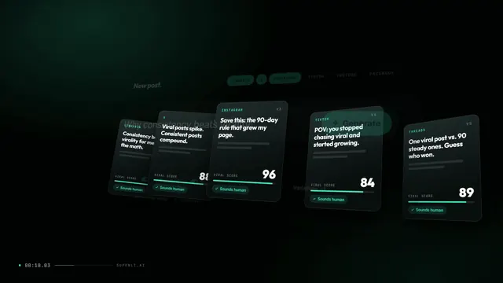</a>

**Claude Opus 5.5** · Анимация · автор [Awa K. Penn](https://x.com/TawohAwa) · 2026-09-29

Claude Opus 5.5 по адресу сайта собрал промо в стиле шоурила: динамичный текст, анимированный интерфейс, частицы и финальный логотип.

<details>
<summary>Промпт</summary>

```text
Create a stunning 30-second motion graphics video for http://supenli.ai that feels like an elite motion designer’s showreel. Study the website first and use the real brand, product UI, colours, and messaging. Use bold typography, 3D motion, animated UI, fast transitions, and a strong logo reveal.
```

</details>

[Открыть на Wandy3D ↗](https://wandy3d.com/ru/prompts/30-second-motion-graphics-promo-video-for-a-website-with-2104896328300134868?utm_source=github&utm_medium=referral&utm_campaign=awesome_3d_prompts) · [Исходный пост](https://x.com/TawohAwa/status/2104896328300134868)

---

### [Макро-модель человеческого глаза на Three.js: ресницы и веко следят за радужкой](https://wandy3d.com/ru/prompts/macro-style-3d-human-eye-in-three-js-with-lashes-and-a-lid-2104841727496323479?utm_source=github&utm_medium=referral&utm_campaign=awesome_3d_prompts)

<a href="https://wandy3d.com/ru/prompts/macro-style-3d-human-eye-in-three-js-with-lashes-and-a-lid-2104841727496323479?utm_source=github&amp;utm_medium=referral&amp;utm_campaign=awesome_3d_prompts">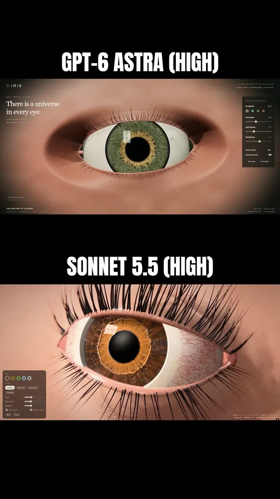</a>

**Claude Sonnet 5.5** · Ассеты · автор [Simonas](https://x.com/SimonasLTU1) · 2026-09-29

Сравнение: Claude Sonnet 5.5 и GPT-6 Astra получили один zero-shot промпт на глаз; у Sonnet веко двигается вслед за радужкой. Описан результат Sonnet.

<details>
<summary>Промпт</summary>

```text
Create a local HTML/CSS/JS file using Three.js. Make a highly detailed 3D model of a human eye that looks like a macro photograph of a real eye. Everything must be created from scratch.
```

</details>

[Открыть на Wandy3D ↗](https://wandy3d.com/ru/prompts/macro-style-3d-human-eye-in-three-js-with-lashes-and-a-lid-2104841727496323479?utm_source=github&utm_medium=referral&utm_campaign=awesome_3d_prompts) · [Исходный пост](https://x.com/SimonasLTU1/status/2104841727496323479)

---

### [Интерактивный атлас Земли на SVG в одном файле: глобус, экспедиции и разрез недр](https://wandy3d.com/ru/prompts/single-file-interactive-svg-earth-atlas-with-globe-2104837836507955401?utm_source=github&utm_medium=referral&utm_campaign=awesome_3d_prompts)

<a href="https://wandy3d.com/ru/prompts/single-file-interactive-svg-earth-atlas-with-globe-2104837836507955401?utm_source=github&amp;utm_medium=referral&amp;utm_campaign=awesome_3d_prompts">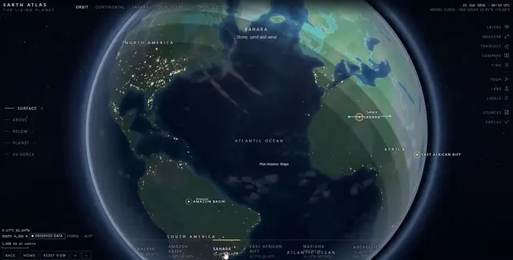</a>

**Claude Opus 5.5** · Интерактив · автор [Gadgetify](https://x.com/Gdgtify) · 2026-09-29

Claude Opus 5.5 с первой попытки собрал SVG-обсерваторию Земли в одном файле: вращаемый глобус, карты регионов, профили рельефа, погружение в океан и разрез недр.

<details>
<summary>Промпт</summary>

```text
Create an extraordinary interactive SVG experience titled “EARTH ATLAS: THE LIVING PLANET.”  Build a complete, deeply explorable Earth science observatory in ONE self-contained HTML file. I must be able to paste your entire output into a file, open it directly in Chrome, and use it without a server or network connection.  Use whatever libraries help, but bundle all required runtime code and curated data inside that one HTML file. The globe, regional maps, terrain, seafloor, cutaways, instruments, charts, annotations, and close-up illustrations must be rendered primarily in SVG.  Return ONLY the complete working HTML in ONE code block.  THE AMBITION  Create the visual quality of a flagship NASA Earth-science exhibition combined with the depth of an interactive atlas.  The viewer begins in orbit before a magnificent Earth. They can rotate the globe, move through daylight and darkness, choose a real place, zoom into its geography, draw a transect, descend through its surface or ocean, and understand how that location fits into the whole planet.  The experience must reward ten minutes of exploration. It should contain striking reveals, precise interactions, and connected views—not merely a rotating globe with informational popups.  The first frame must be beautiful enough to serve as a standalone scientific illustration.  A TRUE MULTISCALE EXPLORATION SYSTEM  Build an authored hierarchy of scales:  1. ORBITAL EARTH — the full globe, atmosphere, day–night boundary, large geographic forms, and global overlays. 2. CONTINENTAL — recognizable coastlines, relief, major rivers, ocean basins, and selected scientific features. 3. REGIONAL — detailed terrain, bathymetry, contours, labels, and measurement tools. 4. LOCAL SCENE — a richly illustrated landscape or ocean environment specific to the selected place. 5. SECTIONAL VIEW — a geographically linked cross-section through land, ice, ocean, or crust. 6. DETAIL VIEW — close examination of a feature such as a glacier layer, river channel, fault, sediment bed, or seafloor formation.  Each zoom level must reveal newly authored SVG detail appropriate to its scale. Do not simply magnify the same low-resolution geometry until it becomes empty.  Preserve geographic identity across transitions. A selected point on the globe must correspond to the regional map, the local scene, its transect, and its section.  Implement zoom toward the pointer, drag-to-rotate the globe, drag-to-pan regional views, pinch zoom, keyboard navigation, Back, Home, and Reset View. Keep camera movement bounded and smooth.  Show a discreet scale bar and location breadcrumb. Manual interaction must interrupt any automated camera journey gracefully.  VISUAL DIRECTION  Make Earth the dominant visual element.  Use deep ocean blue, shallow-water turquoise, varied vegetation greens, desert ochre, volcanic charcoal, mineral grays, glacial white, and fine warm-white annotation lines.  Build convincing planetary volume through projected coastline geometry, changing illumination, atmospheric scattering effects, cloud layers, and a carefully controlled night-light treatment where an appropriate dated source is embedded.  Use precise cartographic linework, elegant contours, subtle material patterns, readable depth shading, and thin leader lines. Make information appear when useful at the current zoom level rather than covering the globe with labels.  The interface should feel like a refined scientific instrument. Avoid generic dashboard cards, excessive neon, and large floating text panels.  GLOBAL EARTH  Provide a rotatable SVG globe with consistent geographic projection and coordinate handling.  As the globe turns, correctly project landforms, ocean features, labels, selected markers, routes, and the terminator. Hide geometry on the far side rather than drawing it through the planet.  Include switchable overlays for:  • Physical relief. • Ocean depth and seafloor structure. • Major rivers and drainage basins. • Plate boundaries. • Sel
```

[… (дальше обрезано — полный промпт на Wandy3D)](https://wandy3d.com/ru/prompts/single-file-interactive-svg-earth-atlas-with-globe-2104837836507955401?utm_source=github&utm_medium=referral&utm_campaign=awesome_3d_prompts)

</details>

[Открыть на Wandy3D ↗](https://wandy3d.com/ru/prompts/single-file-interactive-svg-earth-atlas-with-globe-2104837836507955401?utm_source=github&utm_medium=referral&utm_campaign=awesome_3d_prompts) · [Исходный пост](https://x.com/Gdgtify/status/2104837836507955401)

---

### [Дискретно-событийная модель производственной линии с KPI, OEE и законом Литтла](https://wandy3d.com/ru/prompts/production-line-discrete-event-simulator-with-live-kpis-oee-2104831051776335994?utm_source=github&utm_medium=referral&utm_campaign=awesome_3d_prompts)

<a href="https://wandy3d.com/ru/prompts/production-line-discrete-event-simulator-with-live-kpis-oee-2104831051776335994?utm_source=github&amp;utm_medium=referral&amp;utm_campaign=awesome_3d_prompts">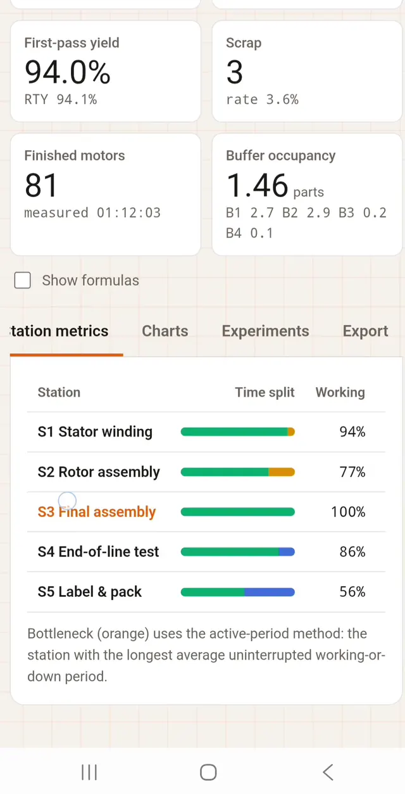</a>

**Claude Opus 5.5** · Интерактив · автор [أ.د. عبدالرحمن بن مشبب الأحمري](https://x.com/am_alahmari) · 2026-09-29

Claude Opus 5.5 собрал одним файлом Canvas-симулятор линии: анимированные станции и буферы плюс живая панель с выпуском, WIP и OEE.

<details>
<summary>Промпт</summary>

```text
Build an animated, interactive discrete-event simulation of a serial production line as a single self-contained HTML file (vanilla JS + Canvas, no external libraries except Chart.js from cdnjs). Purpose: teaching [Manufacturing Systems] students how variability, buffers, and breakdowns affect line performance.

LINE CONFIGURATION (user-adjustable)
- Number of stations: [2–6], default [3], each with a name (e.g., Machining, Assembly, Inspection)
- Per station: mean cycle time, distribution (Deterministic, Uniform, Normal, Triangular, Exponential, Lognormal), CV
- Breakdowns per station: MTBF and MTTR (exponential), on/off toggle
- Quality per station: defect rate (%), with scrap or rework-loop option
- Buffers between stations: capacity 0–10 (0 = blocking after service)
- Arrivals: unlimited raw material OR Poisson arrivals with rate λ
- Customer demand to compute takt time

ANIMATION
- Parts move along conveyors and change color by stage (raw, WIP, finished, scrap)
- Machine borders show state colors: Working (green), Blocked (amber), Starved (red), Down (gray), plus a rotating gear icon and a progress bar
- Buffer slots show occupancy and highlight when full
- Controls: Play/Pause, Step, Reset, speed 1x–50x, warm-up period

KEY PERFORMANCE MEASURES (live dashboard)
1. Throughput (parts/hr) vs theoretical bottleneck rate
2. Average WIP and WIP over time
3. Flow time / manufacturing lead time (mean and 95th percentile)
4. Little's Law check: WIP ≈ Throughput × Flow time
5. Per-station utilization with a time breakdown: working / blocked / starved / down (stacked bar)
6. OEE per station = Availability × Performance × Quality
7. Bottleneck detection (active-period method) and highlight the bottleneck
8. Takt time vs station cycle times (line balance chart)
9. Line balance efficiency = Σ cycle times / (N × max cycle time)
10. First-pass yield, rolled throughput yield, scrap count
11. Average buffer occupancy per buffer
12. Observed vs set cycle-time mean and CV per station

ANALYSIS FEATURES
- Replication mode: run N replications of length T after warm-up, report mean ± 95% confidence interval for throughput, WIP, and flow time
- Experiment mode: sweep buffer size (or one station's CV) and plot throughput vs parameter
- Export results to CSV
- Preset scenarios: Balanced line, Clear bottleneck, High variability, Unreliable machine

DESIGN
- Clean, responsive layout that works on mobile; light/dark mode
- Brief tooltip explaining each KPI and its formula
- Bilingual labels (English/Arabic) toggle
```

</details>

[Открыть на Wandy3D ↗](https://wandy3d.com/ru/prompts/production-line-discrete-event-simulator-with-live-kpis-oee-2104831051776335994?utm_source=github&utm_medium=referral&utm_campaign=awesome_3d_prompts) · [Исходный пост](https://x.com/am_alahmari/status/2104831051776335994)

---

### [Спорткар, превращающийся в робота, с рентген-режимом и разнесённым видом](https://wandy3d.com/ru/prompts/sports-car-that-transforms-into-a-humanoid-robot-with-x-ray-2104654448878387313?utm_source=github&utm_medium=referral&utm_campaign=awesome_3d_prompts)

<a href="https://wandy3d.com/ru/prompts/sports-car-that-transforms-into-a-humanoid-robot-with-x-ray-2104654448878387313?utm_source=github&amp;utm_medium=referral&amp;utm_campaign=awesome_3d_prompts">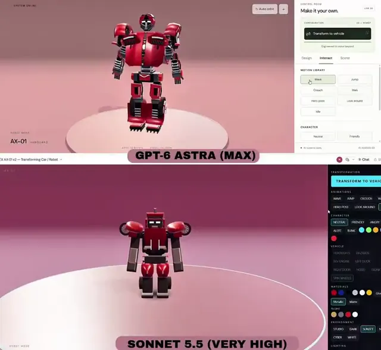</a>

**Claude Sonnet 5.5** · Интерактив · автор [Marcel](https://x.com/marcthecreatorr) · 2026-09-28

Сравнение: Claude Sonnet 5.5 и GPT-6 Astra получили один промпт на красный трансформер с рентген-режимом и интерактивным разнесённым видом.

<details>
<summary>Промпт</summary>

```text
Build a detailed sports car that transforms into a humanoid robot, with an x-ray mode and interactive exploded view
```

</details>

[Открыть на Wandy3D ↗](https://wandy3d.com/ru/prompts/sports-car-that-transforms-into-a-humanoid-robot-with-x-ray-2104654448878387313?utm_source=github&utm_medium=referral&utm_campaign=awesome_3d_prompts) · [Исходный пост](https://x.com/marcthecreatorr/status/2104654448878387313)

---

### [Лодка в лунных джунглях на Three.js с режимами рассвета и дождя](https://wandy3d.com/ru/prompts/moonlit-jungle-boat-ride-in-three-js-with-dawn-and-rain-2104613128017522813?utm_source=github&utm_medium=referral&utm_campaign=awesome_3d_prompts)

<a href="https://wandy3d.com/ru/prompts/moonlit-jungle-boat-ride-in-three-js-with-dawn-and-rain-2104613128017522813?utm_source=github&amp;utm_medium=referral&amp;utm_campaign=awesome_3d_prompts">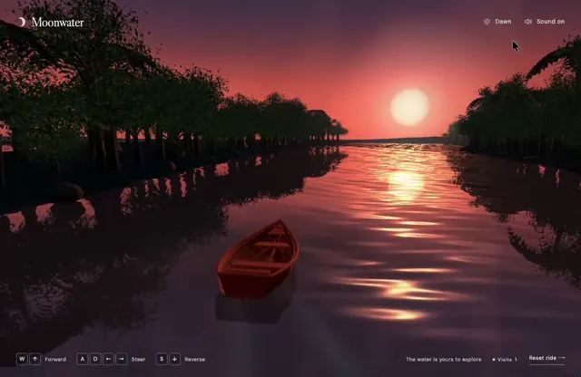</a>

**GPT-6 Sol** · Интерактив · автор [Fazley](https://x.com/itsfazley) · 2026-09-28

GPT-6 Sol собрал на Three.js поездку на лодке по джунглевой протоке: лунная вода, затухающий след и переключатель ночь, рассвет, дождь.

<details>
<summary>Промпт</summary>

```text
Build a fullscreen, responsive Three.js boat ride set in a narrow jungle waterway. Use a third-person camera following an empty wooden rowboat with a pointed bow, broad sides, flat stern, visible floorboards and seats, no oars, a dry interior, and a hull slightly submerged in the water. Let users steer with WASD or arrow keys and touch controls. Make the scene nocturnal and mystical: dense, varied, realistic dark-green trees on both banks, subtle wind, a detailed full moon, and broken moonlight reflected across animated water. Use convincing moving waves, distorted reflections of the boat and trees, and a wake that follows the boat’s traveled path and fades naturally no fixed glowing marks or hard circular borders. Add a weather toggle for moonlit night, warm dawn, and overcast rain; in rain mode, show falling drops and small, short-lived impact ripples shaped by the water’s waves. Add optional, subtle water, jungle, and rain ambience. Keep the interface minimal. Verify the visuals, controls, audio, counter, and all three weather modes on desktop and mobile.
```

</details>

[Открыть на Wandy3D ↗](https://wandy3d.com/ru/prompts/moonlit-jungle-boat-ride-in-three-js-with-dawn-and-rain-2104613128017522813?utm_source=github&utm_medium=referral&utm_campaign=awesome_3d_prompts) · [Исходный пост](https://x.com/itsfazley/status/2104613128017522813)

---

### [Интерактивная 3D-модель работы CRISPR с двойной спиралью ДНК](https://wandy3d.com/ru/prompts/interactive-3d-explainer-of-crispr-gene-editing-with-a-dna-2104605522640970208?utm_source=github&utm_medium=referral&utm_campaign=awesome_3d_prompts)

<a href="https://wandy3d.com/ru/prompts/interactive-3d-explainer-of-crispr-gene-editing-with-a-dna-2104605522640970208?utm_source=github&amp;utm_medium=referral&amp;utm_campaign=awesome_3d_prompts">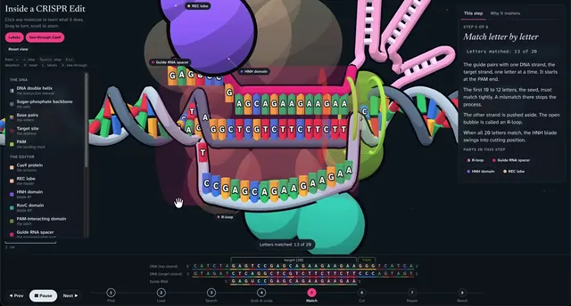</a>

**Claude Opus 5.5** · Интерактив · автор [Alejandro](https://x.com/AlejandroRomaan) · 2026-09-28

В сравнении с GPT-6 Astra Claude Opus 5.5 собрал кликабельный 3D-урок по CRISPR: спираль ДНК, Cas9, направляющая РНК и пошаговая шкала.

<details>
<summary>Промпт</summary>

```text
I want you to create an interactive educational 3d represenation how CRISPR DNA technology works. You can choose what ever technology you want as long as its clear readable and has a dna strand, you can see a full work of gene editing and what each piece is, I should be able to select any relevant part of it and learn something
```

</details>

[Открыть на Wandy3D ↗](https://wandy3d.com/ru/prompts/interactive-3d-explainer-of-crispr-gene-editing-with-a-dna-2104605522640970208?utm_source=github&utm_medium=referral&utm_campaign=awesome_3d_prompts) · [Исходный пост](https://x.com/AlejandroRomaan/status/2104605522640970208)

---

### [J-крюк для 3D-печати и испытания на нагрузку, код на OpenSCAD](https://wandy3d.com/ru/prompts/3d-printable-j-hook-for-a-load-test-written-as-openscad-2104590493191479337?utm_source=github&utm_medium=referral&utm_campaign=awesome_3d_prompts)

<a href="https://wandy3d.com/ru/prompts/3d-printable-j-hook-for-a-load-test-written-as-openscad-2104590493191479337?utm_source=github&amp;utm_medium=referral&amp;utm_campaign=awesome_3d_prompts">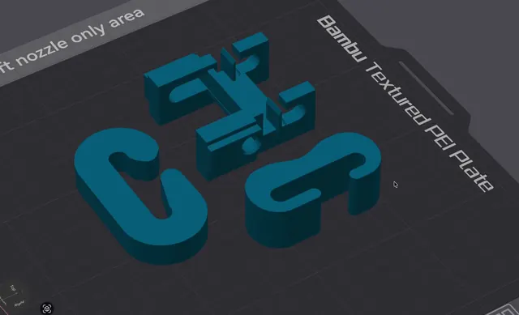</a>

**Grok 4.7** · Ассеты · автор [Wësche](https://x.com/WescheNex1q) · 2026-09-28

Сравнение J-крюков от Grok 4.7, Claude Opus 5.5 и GPT-6 Astra: у каждой модели файл OpenSCAD, экспорт в STL для теста прочности PLA.

<details>
<summary>Промпт</summary>

```text
Design one 3D-printable J-hook for a strength test.
The hook hangs from an 8 mm steel bar. An 8 mm pin sits in the bill and we hang weight from that pin. I want the highest breaking load I can get without the bar or the pin slipping out.
Rules:
- One printed part. No screws, inserts, glue, or extra pieces.
- Must clip onto the bar and the pin by hand. No closed rings.
- Pin seats 40 mm apart, center to center.
- PLA. Max 35 g as printed.
- Must fit 80 x 60 x 25 mm.
- The pin should have to lift at least 10 mm to come out. If it can roll out the side, that design is invalid.
Give me:
1. A short explanation of the shape.
2. A complete OpenSCAD file I can compile and export to STL for Bambu Studio.
No STL text. No G-code. OpenSCAD only. If the first idea would slip off, replace it in the same answer.
```

</details>

[Открыть на Wandy3D ↗](https://wandy3d.com/ru/prompts/3d-printable-j-hook-for-a-load-test-written-as-openscad-2104590493191479337?utm_source=github&utm_medium=referral&utm_campaign=awesome_3d_prompts) · [Исходный пост](https://x.com/WescheNex1q/status/2104590493191479337)

---

### [Шагающий павильон с тканевой крышей на стальных ногах, анимация в Blender](https://wandy3d.com/ru/prompts/walking-pavilion-with-a-fabric-roof-on-steel-legs-animated-2104590334152056983?utm_source=github&utm_medium=referral&utm_campaign=awesome_3d_prompts)

<a href="https://wandy3d.com/ru/prompts/walking-pavilion-with-a-fabric-roof-on-steel-legs-animated-2104590334152056983?utm_source=github&amp;utm_medium=referral&amp;utm_campaign=awesome_3d_prompts">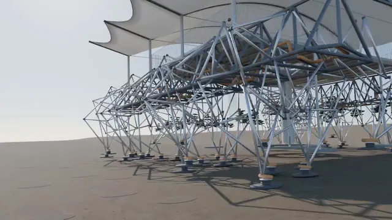</a>

**Claude Opus 5.5** · Анимация · автор [KOBATAKA｜Vibe Modeling](https://x.com/shion_takk) · 2026-09-28

Claude Opus 5.5 помог написать скрипт Blender: павильон на пляже шагает на решётке ног, а свет меняется от дня к освещённой ночи.

<details>
<summary>Бриф от Wandy3D</summary>

```text
Build a short rendered animation of a walking building using Blender scripting. Design a pavilion with a white tensile-fabric canopy in wavy ridges, carried by a lattice of slender steel struts that act as many legs, with a deck underneath where small human figures can stand. Place it on a wide sandy beach with sparse low trees and a distant shoreline. Animate the legs in a staggered, rolling gait so the whole structure slowly strides forward, leaving footprints in the sand. Use several camera shots: a high wide view, a low ground-level view of the legs, and a closer pass along the side. Let the lighting move from daylight through a warm sunset to a blue night, with interior lights glowing under the canopy. Render about thirty seconds and assemble the shots with titles in a video tool. Done when the gait looks physically believable, the legs never slide through the ground and the lighting change feels continuous.
```

</details>

[Открыть на Wandy3D ↗](https://wandy3d.com/ru/prompts/walking-pavilion-with-a-fabric-roof-on-steel-legs-animated-2104590334152056983?utm_source=github&utm_medium=referral&utm_campaign=awesome_3d_prompts) · [Исходный пост](https://x.com/shion_takk/status/2104590334152056983)

---

### [Пиксельный beat 'em up в Древнем Риме с боссом-слоном](https://wandy3d.com/ru/prompts/pixel-art-roman-beat-em-up-with-a-war-elephant-boss-2104571946989985812?utm_source=github&utm_medium=referral&utm_campaign=awesome_3d_prompts)

<a href="https://wandy3d.com/ru/prompts/pixel-art-roman-beat-em-up-with-a-war-elephant-boss-2104571946989985812?utm_source=github&amp;utm_medium=referral&amp;utm_campaign=awesome_3d_prompts">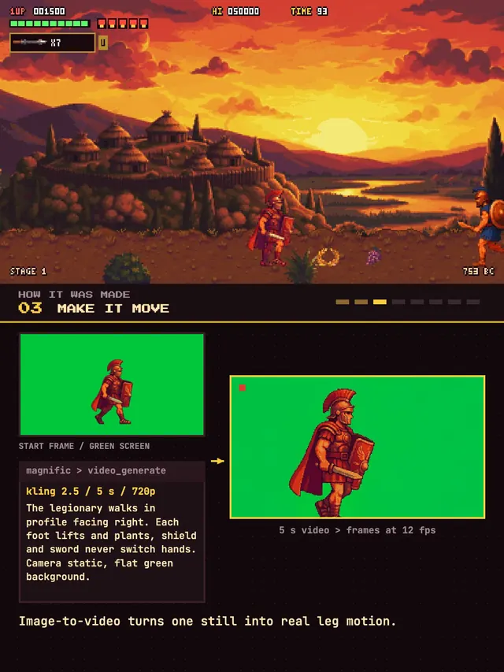</a>

**Claude Opus 5.5** · Игры · автор [Koldo Huici](https://x.com/koldo2k) · 2026-09-28

Claude Opus 5.5 с MCP для картинок и видео собрал мобильную аркаду: легионер, волки, боевой слон-босс и чиптюн-саундтрек.

<details>
<summary>Промпт</summary>

```text
Using the Magnific MCP, build a playable pixel-art beat 'em up set in ancient Rome, as one HTML file that works on mobile. Generate a key art first and use it as style reference for every asset: stage, hero, enemies, a war-elephant boss, items. Animate the characters with image-to-video on green screen, pick the frames that loop, key out the green and keep every animation on the same scale and palette. Add touch controls, combos, shield, dodge, a throwable pilum, pickups, a 1-minute demo mode and a chiptune soundtrack. Tell me the credit cost before each generation.
```

</details>

[Открыть на Wandy3D ↗](https://wandy3d.com/ru/prompts/pixel-art-roman-beat-em-up-with-a-war-elephant-boss-2104571946989985812?utm_source=github&utm_medium=referral&utm_campaign=awesome_3d_prompts) · [Исходный пост](https://x.com/koldo2k/status/2104571946989985812)

---

### [Low-poly приключение с открытым миром и редактором рельефа](https://wandy3d.com/ru/prompts/low-poly-open-world-adventure-with-a-built-in-terrain-editor-2104531704740512143?utm_source=github&utm_medium=referral&utm_campaign=awesome_3d_prompts)

<a href="https://wandy3d.com/ru/prompts/low-poly-open-world-adventure-with-a-built-in-terrain-editor-2104531704740512143?utm_source=github&amp;utm_medium=referral&amp;utm_campaign=awesome_3d_prompts">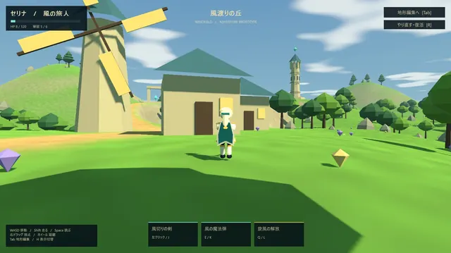</a>

**GPT-6 Astra** · Игры · автор [ふぐあい(ふぐおん)](https://x.com/fuguai1) · 2026-09-28

GPT-6 Astra по одной короткой фразе сделал low-poly экшен от третьего лица на холмистом острове и отдельный инструмент для лепки рельефа.

<details>
<summary>Промпт</summary>

```text
原神みたいなゲームとそれを地形編集できるツールを作って
```

</details>

[Открыть на Wandy3D ↗](https://wandy3d.com/ru/prompts/low-poly-open-world-adventure-with-a-built-in-terrain-editor-2104531704740512143?utm_source=github&utm_medium=referral&utm_campaign=awesome_3d_prompts) · [Исходный пост](https://x.com/fuguai1/status/2104531704740512143)

---

### [Мягкий клубничный торт на WebGPU: мнёте, бросаете и режете](https://wandy3d.com/ru/prompts/soft-body-strawberry-cake-you-can-squish-throw-and-slice-in-2104517586092458039?utm_source=github&utm_medium=referral&utm_campaign=awesome_3d_prompts)

<a href="https://wandy3d.com/ru/prompts/soft-body-strawberry-cake-you-can-squish-throw-and-slice-in-2104517586092458039?utm_source=github&amp;utm_medium=referral&amp;utm_campaign=awesome_3d_prompts">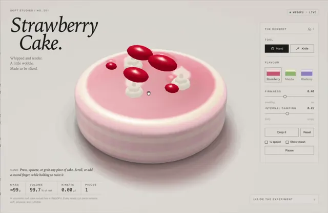</a>

**Claude Opus 5.5** · Интерактив · автор [Ima Studio](https://x.com/ImaStudio_ai) · 2026-09-28

Claude Opus 5.5 написал игрушку на WebGPU в одном файле: торт дрожит как желе и с каждым разрезом делится на новые мягкие куски.

<details>
<summary>Промпт</summary>

```text
Build immediately a complete interactive WebGPU site called “Strawberry Cake.” 
Use genuine WebGPU + WGSL, procedural geometry, mouse/touch, and real-time volumetric soft-body physics. No Three.js/Babylon.js, Canvas2D, external assets, video/GIF, or CSS-only deformation.
Visual: premium Korean/Japanese strawberry shortcake—low, wide, rounded, pillow-soft, with pink sponge, cream layers, pale frosting, piped cream, and strawberries. Warm ivory background, soft studio light, edible moist materials.
Layout: top-left “SOFT STUDIES / NO.001” + italic “Strawberry Cake.” Top-right “WEBGPU · LIVE”. Large centered cake. Right controls: Hand/Knife, presets, Firmness, Damping, Drop, Reset, Pause, ¼ speed, Show mesh. Bottom-left: Mass, Volume, Kinetic, Pieces.
Physics: stable XPBD/co-rotational soft body with tetrahedral sim mesh, smooth render mesh, volume preservation, damping, gravity, floor friction, and piece collisions. Cake feels soft/heavy and wobbles after release.
Hand: hold=Press, inward drag=Squeeze, outward drag=Grab, fast release=Throw. Use weighted grabs, smoothed 3D target, pointer velocity and momentum. Cake remains free; cake input overrides orbit.
Knife: procedural 3D knife. Draw a cut line; animate contact→compression→penetration→breakthrough→lift. Deform before splitting; keep seam thin.
Repeated cutting is mandatory: use a dynamic pieces list; every piece stays cuttable. Convert strokes to vertical cut planes, split crossed pieces, create new soft-body/render meshes, transfer deformation/velocity, preserve toppings, keep halves aligned, update Pieces. Support 14+ pieces and multi-piece cuts. No fixed whole/left/right states.
Drop releases all pieces. Reset restores one intact cake and Pieces=1. Use fixed timestep/substeps, DPR≤2, clamp instability, avoid NaNs/GPU errors. Expose window.__cake.
Run locally, test interactions and repeated cutting, and iterate until polished.
```

</details>

[Открыть на Wandy3D ↗](https://wandy3d.com/ru/prompts/soft-body-strawberry-cake-you-can-squish-throw-and-slice-in-2104517586092458039?utm_source=github&utm_medium=referral&utm_campaign=awesome_3d_prompts) · [Исходный пост](https://x.com/ImaStudio_ai/status/2104517586092458039)

---

### [Арбузное желе с мягкой физикой на WebGPU](https://wandy3d.com/ru/prompts/jelly-watermelon-slice-with-webgpu-soft-body-physics-2104505413857415515?utm_source=github&utm_medium=referral&utm_campaign=awesome_3d_prompts)

<a href="https://wandy3d.com/ru/prompts/jelly-watermelon-slice-with-webgpu-soft-body-physics-2104505413857415515?utm_source=github&amp;utm_medium=referral&amp;utm_campaign=awesome_3d_prompts">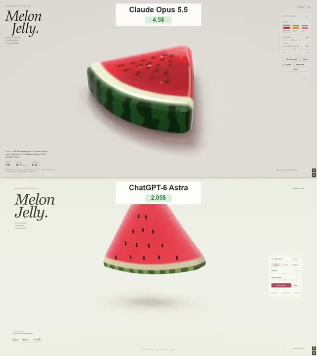</a>

**Claude Opus 5.5** · Интерактив · автор [基恩-Keane 🌊](https://x.com/esrhengwu) · 2026-09-28

Сравнение: один промпт для Claude Opus 5.5 и GPT-6 Astra — арбузная долька-желе, которую можно тянуть. Лучше получилось у Opus 5.5.

<details>
<summary>Промпт</summary>

```text
Create “Melon Jelly” - a polished, interactive 3D watermelon jelly slice that runs directly in the browser using genuine WebGPU and WGSL shaders.
Deliver a single, self-contained HTML file with embedded JavaScript and CSS. This must be an actual interactive 3D simulation, not a static render, video, or 2D imitation.
THE WATERMELON
Create a thick, rounded triangular watermelon wedge with:
Translucent ruby-red jelly flesh.
A pale, slightly translucent layer between the flesh and rind.
A glossy green outer rind with irregular dark-green stripes.

Individually modeled dark seeds embedded in both exposed sides.
Softly rounded corners and an appealing, substantial thickness.
Make it look like an expensive gummy candy photographed in a studio. It should feel juicy, soft, and almost edible. Keep the colors rich without overexposing the highlights.
SOFT-BODY PHYSICS
Use a volumetric soft-body simulation, such as a tetrahedral mesh with XPBD elastic and volume-preservation constraints.
The user must be able to:
Grab the tip, a corner, the flesh, or the rind.
Stretch, bend, lift, and gently twist the slice.

Release it and watch it wobble before gradually settling.
The slice must visibly deform locally, not simply move or scale as one rigid object. Make the rind slightly firmer than the flesh while keeping the whole slice flexible.
Preserve volume reasonably during stretching. Prevent inverted elements, explosive motion, and permanent collapse. Use a fixed simulation timestep and bounded substeps for stability.
After release, the motion should decay naturally - no instant snapping back and no endless oscillation.
Keep seeds attached to the deforming flesh. They must move and rotate with the surface rather than float independently or remain fixed in space.
Include ground contact, gentle friction, and soft bouncing. Avoid visible floor penetration.
RENDERING
Use native WebGPU with WGSL shaders.
Include:
Thickness-dependent light absorption.
Refraction through the jelly.

Fresnel reflections and glossy highlights.
Soft transmitted light through thin edges.
Subtle internal details and a few tiny air bubbles.

Soft contact shadows beneath the slice.
A light, neutral studio background.
The flesh, pale rind, and green skin should have distinct material responses. Avoid making everything look like clear glass or opaque plastic.
Keep the slice large and easy to inspect, with a three-quarter camera angle that reveals the flesh, seeds, and thickness.
INTERFACE
Use a minimal editorial layout with generous whitespace, thin borders, restrained controls, and no decorative UI gradients.
Top left:
“MATERIAL STUDIES / NO. 009”
A large italic serif heading split across two lines: “Melon” and “Jelly.”
Small caption:
“A slice of summer.”
“A little wobble.”
“Too soft to share.”
Top right:
A small status indicator showing “WEBGPU · LIVE” when the renderer is running.

Right-side panel:
“THE SPECIMEN”
Three coordinated watermelon-inspired color presets.
Firmness slider with its current value.
Internal damping slider with its current value.
“Give it a nudge” and “Reset” buttons.
“¼ speed” and “Show mesh” checkboxes.

Pause / Resume button.
Bottom left:
A short hint explaining that the slice can be grabbed and stretched.
Live mass, relative volume, and kinetic-energy readouts derived from the simulation. Clearly describe illustrative units or approximate values where appropriate.
Bottom right:

A collapsible “Inside the experiment” section briefly explaining the physics and rendering.
BEHAVIOR AND PERFORMANCE
Support both mouse and touch input. Use pointer capture so dragging remains reliable when the pointer leaves the object.
Make the layout work on desktop and mobile without controls covering the slice.
Reuse buffers and avoid rebuilding geometry or compiling shaders during dragging. Keep interaction smooth and responsive.
```

[… (дальше обрезано — полный промпт на Wandy3D)](https://wandy3d.com/ru/prompts/jelly-watermelon-slice-with-webgpu-soft-body-physics-2104505413857415515?utm_source=github&utm_medium=referral&utm_campaign=awesome_3d_prompts)

</details>

[Открыть на Wandy3D ↗](https://wandy3d.com/ru/prompts/jelly-watermelon-slice-with-webgpu-soft-body-physics-2104505413857415515?utm_source=github&utm_medium=referral&utm_campaign=awesome_3d_prompts) · [Исходный пост](https://x.com/esrhengwu/status/2104505413857415515)

---

### [LEGO Ford Model T с анимированной инструкцией на 155 шагов](https://wandy3d.com/ru/prompts/lego-ford-model-t-with-a-155-step-animated-build-manual-2104233375791718456?utm_source=github&utm_medium=referral&utm_campaign=awesome_3d_prompts)

<a href="https://wandy3d.com/ru/prompts/lego-ford-model-t-with-a-155-step-animated-build-manual-2104233375791718456?utm_source=github&amp;utm_medium=referral&amp;utm_campaign=awesome_3d_prompts">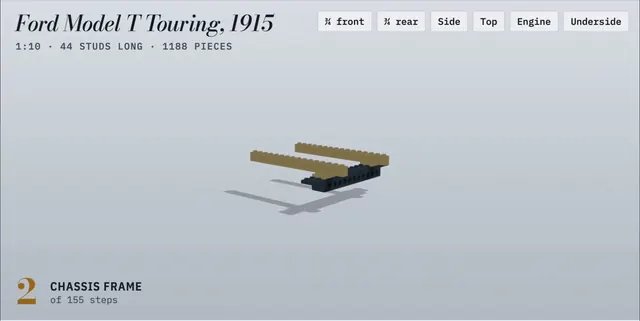</a>

**Claude Opus 5.5** · Ассеты · автор [Alex Lieberman](https://x.com/businessbarista) · 2026-09-27

По короткому промпту Claude Opus 5.5 спроектировал Model T 1915 года из кубиков со списком деталей и просмотрщиком, собирающим все 1188 деталей.

<details>
<summary>Промпт</summary>

```text
I want to build a lego set of the original ford motel T.

I want it to be feature complete, include motion/interactivity where possible, and be of the quality a lego master builder would be proud of.

I want the final output to include a rendering of the lego set, all of the pieces i need to order from lego, and the instruction manual to build it.
```

</details>

[Открыть на Wandy3D ↗](https://wandy3d.com/ru/prompts/lego-ford-model-t-with-a-155-step-animated-build-manual-2104233375791718456?utm_source=github&utm_medium=referral&utm_campaign=awesome_3d_prompts) · [Исходный пост](https://x.com/businessbarista/status/2104233375791718456)

---

### [Шутер от первого лица в заснеженном переулке с отдачей и прыжками](https://wandy3d.com/ru/prompts/snowy-alleyway-first-person-shooter-with-rifle-recoil-and-2104232358811676833?utm_source=github&utm_medium=referral&utm_campaign=awesome_3d_prompts)

<a href="https://wandy3d.com/ru/prompts/snowy-alleyway-first-person-shooter-with-rifle-recoil-and-2104232358811676833?utm_source=github&amp;utm_medium=referral&amp;utm_campaign=awesome_3d_prompts">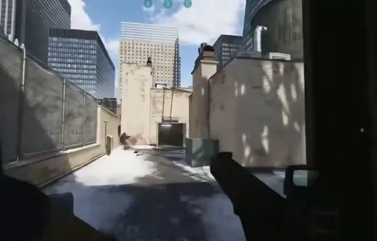</a>

**Claude Opus 5.5** · Игры · автор [Mark](https://x.com/vianoclub) · 2026-09-27

Claude Opus 5.5 собрал реалистичный FPS по одному промпту: кирпичный переулок в снегу, винтовка с прицелом, враги и перелезание через уступ.

<details>
<summary>Промпт</summary>

```text
Build me a hyper-realistic multiplayer FPS. Set it in a snowy city alleyway with brick buildings. Give me an assault rifle with crispy recoil and flying bullet casings. Add enemies to shoot, vaulting mechanics, and bloody screen damage effects. Make the gunplay hit-reg immaculate and just vibe it out into a full game.
```

</details>

[Открыть на Wandy3D ↗](https://wandy3d.com/ru/prompts/snowy-alleyway-first-person-shooter-with-rifle-recoil-and-2104232358811676833?utm_source=github&utm_medium=referral&utm_campaign=awesome_3d_prompts) · [Исходный пост](https://x.com/vianoclub/status/2104232358811676833)

---

### [Объяснение масштаба на Three.js: от видеокарты до атомов кремния](https://wandy3d.com/ru/prompts/three-js-scale-explainer-zooming-from-a-gpu-down-to-silicon-2104223449849761837?utm_source=github&utm_medium=referral&utm_campaign=awesome_3d_prompts)

<a href="https://wandy3d.com/ru/prompts/three-js-scale-explainer-zooming-from-a-gpu-down-to-silicon-2104223449849761837?utm_source=github&amp;utm_medium=referral&amp;utm_campaign=awesome_3d_prompts">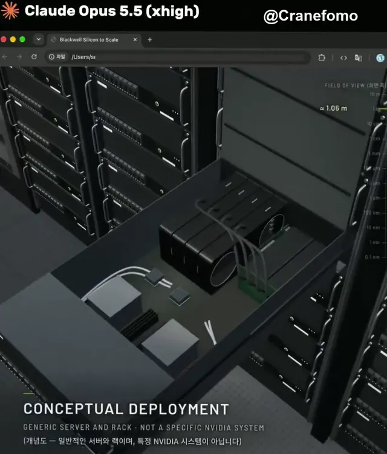</a>

**Claude Opus 5.5** · Сцены · автор [Crane](https://x.com/Cranefomo) · 2026-09-27

Claude Opus 5.5 написал однофайловый пролёт на Three.js: разбор GPU, погружение через ячейки транзисторов к кристаллической решётке со шкалой масштаба.

<details>
<summary>Промпт</summary>

```text
Give me a 55 second 3D scene. Camera flies into a data center, opens a rack, disassembles a GPU, zooms into the chip, passes through the transistors, lands on a single silicon atom. Scale rail on the right in meters. Labels in the client's language. Runs in a browser, one file, no dependencies.
```

</details>

[Открыть на Wandy3D ↗](https://wandy3d.com/ru/prompts/three-js-scale-explainer-zooming-from-a-gpu-down-to-silicon-2104223449849761837?utm_source=github&utm_medium=referral&utm_campaign=awesome_3d_prompts) · [Исходный пост](https://x.com/Cranefomo/status/2104223449849761837)

---

### [30-секундный воксельный моушн-ролик для приложения со звуками клавиатуры](https://wandy3d.com/ru/prompts/30-second-voxel-motion-graphics-promo-for-a-keyboard-sound-2104204318085931054?utm_source=github&utm_medium=referral&utm_campaign=awesome_3d_prompts)

<a href="https://wandy3d.com/ru/prompts/30-second-voxel-motion-graphics-promo-for-a-keyboard-sound-2104204318085931054?utm_source=github&amp;utm_medium=referral&amp;utm_campaign=awesome_3d_prompts">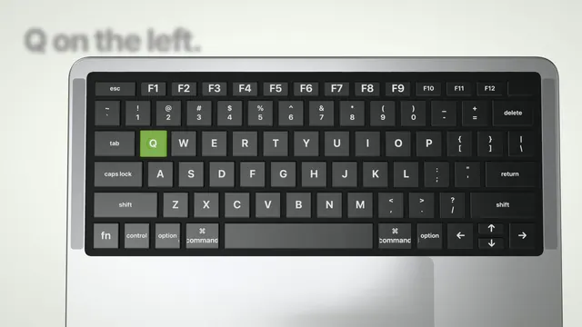</a>

**Claude Opus 5.5** · Анимация · автор [Iniyan (ini)](https://x.com/iniyanai) · 2026-09-27

Claude Opus 5.5 превратил одну строку в промо-ролик: стены из пиксельных блоков показывают плюсы, клавиатура подсвечивается, кубики разлетаются.

<details>
<summary>Промпт</summary>

```text
make a dynamic 30-second motion graphics video that shows what an incredible motion designer you are for https://kiiwi.app.
```

</details>

[Открыть на Wandy3D ↗](https://wandy3d.com/ru/prompts/30-second-voxel-motion-graphics-promo-for-a-keyboard-sound-2104204318085931054?utm_source=github&utm_medium=referral&utm_campaign=awesome_3d_prompts) · [Исходный пост](https://x.com/iniyanai/status/2104204318085931054)

---

### [Аниме-ролик в 3D: три машины соединяются в гигантского робота](https://wandy3d.com/ru/prompts/anime-style-3d-clip-of-three-vehicles-combining-into-a-giant-2104193522715029657?utm_source=github&utm_medium=referral&utm_campaign=awesome_3d_prompts)

<a href="https://wandy3d.com/ru/prompts/anime-style-3d-clip-of-three-vehicles-combining-into-a-giant-2104193522715029657?utm_source=github&amp;utm_medium=referral&amp;utm_campaign=awesome_3d_prompts">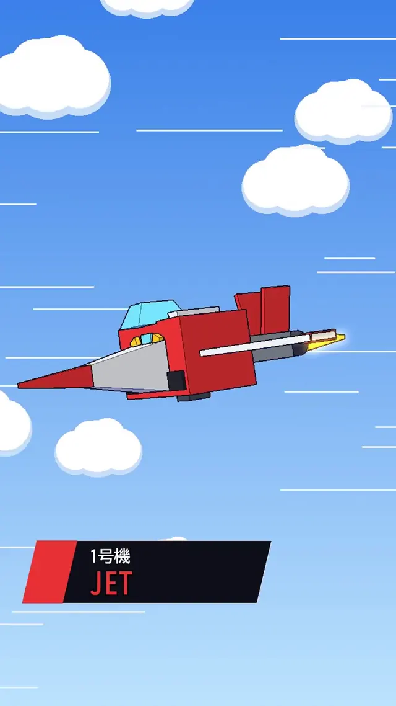</a>

**Claude Opus 5.5** · Анимация · автор [風の民@](https://x.com/allforbigfire) · 2026-09-27

Claude Opus 5.5 сгенерировал 25-секундную сцену в стиле cel-shading одним Python-файлом: джет, машина и экскаватор собираются в робота.

<details>
<summary>Промпт</summary>

```text
もしかしてロボットアニメみたいな3機の乗り物が変形合体してロボットになるシーンもアニメ風3D CGで作れますか。
```

</details>

[Открыть на Wandy3D ↗](https://wandy3d.com/ru/prompts/anime-style-3d-clip-of-three-vehicles-combining-into-a-giant-2104193522715029657?utm_source=github&utm_medium=referral&utm_campaign=awesome_3d_prompts) · [Исходный пост](https://x.com/allforbigfire/status/2104193522715029657)

---

### [Зацикленный UI-моушн ИИ-агента с GLSL-орбом и сценарием бронирования поездки](https://wandy3d.com/ru/prompts/looping-ai-agent-ui-motion-with-a-glsl-iridescent-orb-and-a-2104162483888062945?utm_source=github&utm_medium=referral&utm_campaign=awesome_3d_prompts)

<a href="https://wandy3d.com/ru/prompts/looping-ai-agent-ui-motion-with-a-glsl-iridescent-orb-and-a-2104162483888062945?utm_source=github&amp;utm_medium=referral&amp;utm_campaign=awesome_3d_prompts">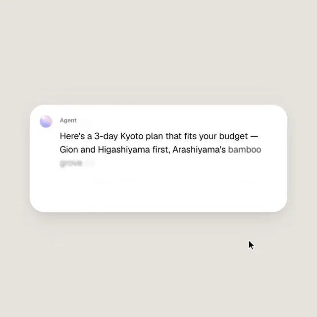</a>

**Claude Opus 5.5** · Анимация · автор [leolee](https://x.com/listudio) · 2026-09-27

В Claude Code модель Claude Opus 5.5 делает 16-секундный зацикленный UI-ролик: переливающийся орб ведёт запрос на поездку в Киото до уведомления о брони.

<details>
<summary>Промпт</summary>

```text
Ask me for: the task the AI agent completes for the user (default: plan + book a 3-day Kyoto trip), the palette (default: warm-gray canvas #E6E3DE, pure black/white UI, the orb is the only colored thing — pearl iridescent blue → violet → peach), and a royalty-free song around 120 BPM (search Mixkit yourself, measure BPM with numpy, show me 3 candidates with preview links before downloading the full track). Use AskUserQuestion, max 4 questions per round, recommended option first. Dribbble-level UI concept motion for an AI chat agent tool. One white shape, never cut: every state is the same element morphing its size, radius and color while its content swaps with a short blur. The star is a GLSL "AI orb" (fluid, breathing, iridescent blob — like the ChatGPT / Siri voice orb) that lives OUTSIDE the shape as a continuity element and changes role through the film: idle hero → reacts to voice while listening → shrinks into the input bar as an avatar → swirls faster while thinking → avatar on the answer → blooms when the task completes → back to idle. A cursor drives every change with real clicks and drags. One clean UI font (Geist). Springs everywhere, a tiny overshoot at most. The camera zooms so each state fills ~60–75% of the frame. The orb pulses subtly on every beat. The last frame is the first frame, so it loops. Banned: bouncy easing, particle bursts, glows or gradients on UI chrome (the orb is content, not chrome), mismatched icon strokes, dead time, anything that looks like a template. 120 BPM, 8 bars = 32 beats = 16s, something happens on every beat (beat n at (n-1)*0.5s): Bar 1: orb idle, cursor approaches | click orb → shape stretches into a "LISTENING" pill, orb moves to its left and wobbles with a syllable envelope | live transcript types "Plan 3 days in Kyoto" | "…under 1,500, the value rolls live | drag past the 1,248 "cheapest plan" Bar 6: slider → black swipe-to-confirm "Book trip · $1,248" | grab the knob, drag right | past the end → rubber band | release → snaps to the end, arrow becomes a spinner Bar 7: → toast "Trip booked" | chips "Flights ✓" "Ryokan ✓" pop in | orb blooms (color + scale) | toast collapses toward the orb Bar 8: shape fades, orb grows back to hero size | settles | breathes on the beat, cursor drifts out | back to idle (loop) 1. One self-contained HTML file, square 1440x1440, fonts and audio-free assets inlined as data URIs. Every style is computed from time inside a pure `seek(t)`: no CSS transitions, no timers, no state carried between frames, never create tracks inside seek. 2. Springs are closed-form step responses. A value that changes target many times is the sum of one spring per change; to loop, take the LAST target as the start value and also add the spring tails of the previous two cycles (t + L, t + 2L) so position AND velocity match at the seam. Damping ratio ≥ 0.72. 3. Content layers have their own enter/exit windows: exit lands exactly on the beat, enter starts ~80ms later (opacity + ~12px screen blur + 0.965→1 scale), or text overlaps. 4. Drags are direct manipulation: while held, the value = start + (cursorX − cursorX at press); past a limit apply rubber(over, R) = R·(1 − e^(−over/R)); on release a free spring runs from the release position AND velocity to the snap target. Cursor waypoints are [departure time, x, y] on a spring; the final waypoint equals the first so the cursor's position and speed are continuous across the loop. 5. The orb: WebGL fragment shader drawn on an OFFSCREEN 640×640 canvas, then synchronously drawImage'd into a visible 2D canvas inside seek (screenshotting the WebGL canvas directly is unreliable headless). Time must be periodic: uniforms (cos, sin)(2π·k·t/L) with integer k (e.g. k=2 and k=5), never raw t. Silhouette radius = 0.74 + amp·noise(direction·1.4 + T) sampled on the unit direction vector (no center seam); surface = low-frequency domain-warped 3D noise on the sphere normal → large smooth color bands; 16% pearl white, a bright inner core, a small
```

[… (дальше обрезано — полный промпт на Wandy3D)](https://wandy3d.com/ru/prompts/looping-ai-agent-ui-motion-with-a-glsl-iridescent-orb-and-a-2104162483888062945?utm_source=github&utm_medium=referral&utm_campaign=awesome_3d_prompts)

</details>

[Открыть на Wandy3D ↗](https://wandy3d.com/ru/prompts/looping-ai-agent-ui-motion-with-a-glsl-iridescent-orb-and-a-2104162483888062945?utm_source=github&utm_medium=referral&utm_campaign=awesome_3d_prompts) · [Исходный пост](https://x.com/listudio/status/2104162483888062945)

---

### [Интерактивная 3D-демо объектива: лучи света над горной долиной](https://wandy3d.com/ru/prompts/interactive-3d-camera-lens-demo-with-light-rays-over-a-2104077535315144878?utm_source=github&utm_medium=referral&utm_campaign=awesome_3d_prompts)

<a href="https://wandy3d.com/ru/prompts/interactive-3d-camera-lens-demo-with-light-rays-over-a-2104077535315144878?utm_source=github&amp;utm_medium=referral&amp;utm_campaign=awesome_3d_prompts">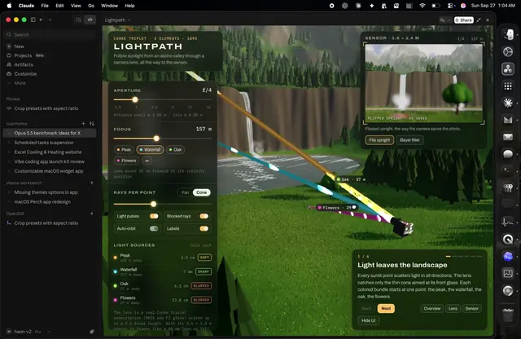</a>

**GPT-6 Astra** · Интерактив · автор [noah helms](https://x.com/haonv2) · 2026-09-27

Сравнение: GPT-6 Astra и Claude Opus 5.5 получили один промпт. Астра показала путь света через линзы на сенсор на фоне долины с водопадом.

<details>
<summary>Промпт</summary>

```text
i want you to create an interactive 3d render of how light travels through a camera lens and gets to the sensor. make the demo use a beautiful mountain scape with waterfalls and beautiful green grass
```

</details>

[Открыть на Wandy3D ↗](https://wandy3d.com/ru/prompts/interactive-3d-camera-lens-demo-with-light-rays-over-a-2104077535315144878?utm_source=github&utm_medium=referral&utm_campaign=awesome_3d_prompts) · [Исходный пост](https://x.com/haonv2/status/2104077535315144878)

---

### [Процедурная поимка ракеты-бустера башней в Blender, всё на Python](https://wandy3d.com/ru/prompts/procedural-blender-rocket-booster-catch-by-tower-arms-built-2103966922127630820?utm_source=github&utm_medium=referral&utm_campaign=awesome_3d_prompts)

<a href="https://wandy3d.com/ru/prompts/procedural-blender-rocket-booster-catch-by-tower-arms-built-2103966922127630820?utm_source=github&amp;utm_medium=referral&amp;utm_campaign=awesome_3d_prompts">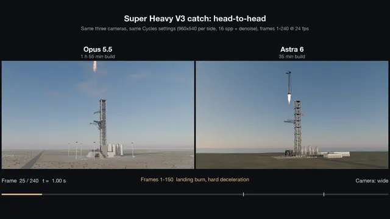</a>

**Claude Opus 5.5** · Анимация · автор [Vortlyn](https://x.com/Vortlyn) · 2026-09-26

Сравнение: Claude Opus 5.5 (назван первым) и GPT-6 Astra написали скрипты поимки бустера Super Heavy в Blender, без внешних ассетов.

<details>
<summary>Промпт</summary>

```text
build a Super Heavy booster catch in Blender using only Python. no downloaded models, no textures, no HDRIs, everything generated by code
```

</details>

[Открыть на Wandy3D ↗](https://wandy3d.com/ru/prompts/procedural-blender-rocket-booster-catch-by-tower-arms-built-2103966922127630820?utm_source=github&utm_medium=referral&utm_campaign=awesome_3d_prompts) · [Исходный пост](https://x.com/Vortlyn/status/2103966922127630820)

---

### [3D-сцена: озеро с домом на острове, мост, деревня и цветочные тропы](https://wandy3d.com/ru/prompts/3d-lake-village-scene-with-an-island-house-bridge-and-2103860776419111285?utm_source=github&utm_medium=referral&utm_campaign=awesome_3d_prompts)

<a href="https://wandy3d.com/ru/prompts/3d-lake-village-scene-with-an-island-house-bridge-and-2103860776419111285?utm_source=github&amp;utm_medium=referral&amp;utm_campaign=awesome_3d_prompts">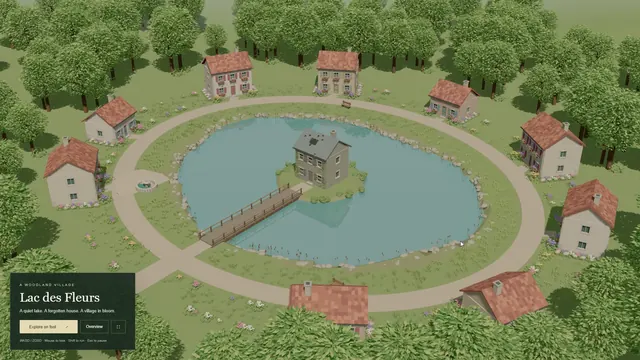</a>

**GPT-6 Astra** · Сцены · автор [Givros](https://x.com/givros) · 2026-09-26

Сравнение GPT-6 Luna, Sol и Astra Light: лучше всех сцена Astra Light, с лесом, озером, домом посередине и французской деревней.

<details>
<summary>Промпт</summary>

```text
A forest with a lake in the center. In the middle of the lake, an abandoned house. Around the lake, a flower-filled French village. Paths connecting the important points.
```

</details>

[Открыть на Wandy3D ↗](https://wandy3d.com/ru/prompts/3d-lake-village-scene-with-an-island-house-bridge-and-2103860776419111285?utm_source=github&utm_medium=referral&utm_campaign=awesome_3d_prompts) · [Исходный пост](https://x.com/givros/status/2103860776419111285)

---

### [Воксельный корабль в бутылке: волны, маяк и смена дня и ночи](https://wandy3d.com/ru/prompts/voxel-ship-in-a-bottle-with-waves-lighthouse-and-day-night-2103856049925071141?utm_source=github&utm_medium=referral&utm_campaign=awesome_3d_prompts)

<a href="https://wandy3d.com/ru/prompts/voxel-ship-in-a-bottle-with-waves-lighthouse-and-day-night-2103856049925071141?utm_source=github&amp;utm_medium=referral&amp;utm_campaign=awesome_3d_prompts">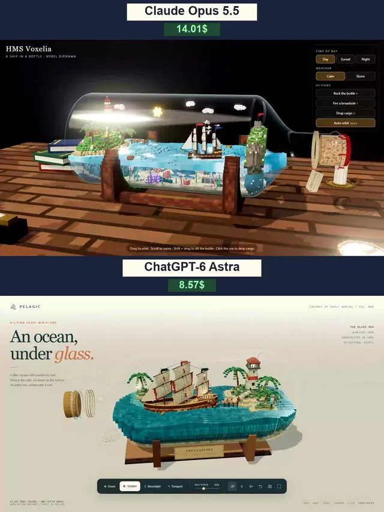</a>

**Claude Opus 5.5** · Сцены · автор [NinjaCodex](https://x.com/N1njaCodex) · 2026-09-26

Сравнение: Claude Opus 5.5 и GPT-6 Astra сделали воксельные корабли в бутылке. У Opus бутылку можно качать, внутри острова, дождь и ночь.

<details>
<summary>Промпт</summary>

```text
Design and create a very creative, elaborate, and detailed voxel art scene of a intricate ship sailing through the ocean inside of a bottle. Include waves and realistic physics, with the whole scene encapsulated inside of the bottle. Make the scene impressive and varied and use colorful voxels, modeled physics, and interesting props / landscapes all encapsulated inside of the bottle. Use WebGL and whatever libraries to get this done but make sure I can paste it all into a single HTML file and open it in Chrome
```

</details>

[Открыть на Wandy3D ↗](https://wandy3d.com/ru/prompts/voxel-ship-in-a-bottle-with-waves-lighthouse-and-day-night-2103856049925071141?utm_source=github&utm_medium=referral&utm_campaign=awesome_3d_prompts) · [Исходный пост](https://x.com/N1njaCodex/status/2103856049925071141)

---

### [Моушн-ролик на Python: прыгающий шар, сетка кубов и morph шрифта](https://wandy3d.com/ru/prompts/motion-design-reel-coded-in-python-bouncing-ball-cube-grid-2103847239885939019?utm_source=github&utm_medium=referral&utm_campaign=awesome_3d_prompts)

<a href="https://wandy3d.com/ru/prompts/motion-design-reel-coded-in-python-bouncing-ball-cube-grid-2103847239885939019?utm_source=github&amp;utm_medium=referral&amp;utm_campaign=awesome_3d_prompts">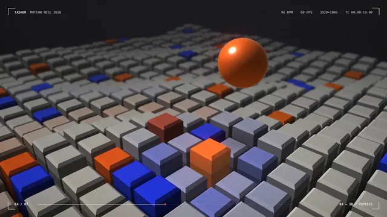</a>

**Claude Opus 5.5** · Анимация · автор [Tasher](https://x.com/Dannnnnok) · 2026-09-26

Claude Opus 5.5 написал код ролика на 60 к/с с собственным 3D-рендерером, шаром на кубах, меняющимся шрифтом и музыкой.

<details>
<summary>Промпт</summary>

```text
I’m curious to see how strong you are as a motion designer. To prove it, create a polished 15-second animated graphic video that showcases your motion design skills. This piece will be presented to 10,000 people on X, so make it visually compelling, professional, and memorable. Take full creative freedom and make the strongest result you can
```

</details>

[Открыть на Wandy3D ↗](https://wandy3d.com/ru/prompts/motion-design-reel-coded-in-python-bouncing-ball-cube-grid-2103847239885939019?utm_source=github&utm_medium=referral&utm_campaign=awesome_3d_prompts) · [Исходный пост](https://x.com/Dannnnnok/status/2103847239885939019)

---

### [Промо-ролик музыкального приложения: карточки, поиск, раскрытие лого](https://wandy3d.com/ru/prompts/music-app-promo-film-with-ui-cards-search-and-a-logo-reveal-2103801834930606193?utm_source=github&utm_medium=referral&utm_campaign=awesome_3d_prompts)

<a href="https://wandy3d.com/ru/prompts/music-app-promo-film-with-ui-cards-search-and-a-logo-reveal-2103801834930606193?utm_source=github&amp;utm_medium=referral&amp;utm_campaign=awesome_3d_prompts">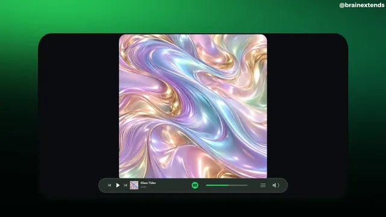</a>

**Claude Opus 5.5** · Анимация · автор [Brain](https://x.com/brainextends) · 2026-09-26

Claude Opus 5.5 собрал в коде 18-секундный рекламный ролик: тёмная сцена, обложка из жидкого стекла и финальный логотип.

<details>
<summary>Промпт</summary>

```text
Create a complete, polished Spotify-themed motion graphics video from the following brief. This prompt is self-contained: no reference video or supplied assets are required.

<deliverables> An 18-second MP4 at 1920×1080 and true 60 fps, with music and subtle sound effects Complete editable source Build, render, inspect, and refine the animation before delivering it Do not stop at a storyboard, still images, or an implementation plan </deliverables>
<art_direction>
A premium music-product film presented inside a large, nearly black rounded rectangular stage
The stage occupies roughly 80% of the canvas width and 75% of its height, centered horizontally and slightly below the vertical center
Outside the stage, use a soft atmospheric green background: luminous emerald near the upper-left corner, deeper forest green toward the sides, fading to near-black at the bottom
Inside the stage:
Near-black background
White primary typography
Muted gray secondary text
Spotify green # 1ED760 for emphasis and controls
One clean sans-serif font, such as Geist or Inter
Consistent icon strokes and restrained shadows
Keep compositions compact and centered, with substantial negative space
Text should feel like music-product advertising, not oversized presentation headings
Do not add an outer caption, creator watermark, decorative footer, or progress counter
</art_direction>

<artwork> Create original square album artwork for a fictional track called “Glass Tides” by “AURA”
The hero cover is an abstract macro image of flowing pearlescent liquid silk and molten glass
Use pastel lavender, powder cyan, blush pink, champagne gold, and subtle mint
Include broad three-dimensional folds, realistic reflective highlights, delicate striations, and a prominent sweeping S-shaped fold
Fill the square edge to edge
No text, logo, or border on this hero artwork
Use this same artwork consistently throughout the film

Create additional designed playlist sleeves:
“Late Nights” in mustard yellow
“Good Energy” in pink
“Deep Focus” in blue
“Daily Mix 1”, “Daily Mix 2”, and “Daily Mix 3” in complementary colors

These should look like finished graphic-design covers, with bold typography and simple geometric motifs
</artwork>

<timeline> 0.0–0.6 seconds: A green Spotify icon grows smoothly into the center of the dark stage Give it a confident arrival with minimal overshoot
0.6–1.5 seconds:
The icon transitions into a small Spotify identity above two centered lines:
“Discover”
“new music”
The first line is white; the second is green
Reveal them with short masked vertical movements
1.5–2.4 seconds:
A stylized Spotify desktop interface rises into view
Show a slim sidebar, “Made for you”, three album cards, and small supporting rows
Use a subtle perspective tilt during the entrance, settling toward a frontal view
2.4–3.2 seconds:
Move closer to the three featured covers
Show “New for you” above them
Keep the artwork crisp, with short album titles beneath
A narrow rounded player bar now anchors the bottom of the stage
3.2–4.0 seconds:
The featured cards withdraw into a compact “Fresh finds” list
Reveal four song rows with a slight stagger
Each row contains a thumbnail, short track title, artist, and a small menu icon
4.0–4.9 seconds:
Transition into a horizontal strip of colorful playlist covers
Heading: “Every mood”
Supporting line: “Find what moves you”
The strip slides smoothly sideways, with edge cards partially cropped by the stage
4.9–5.8 seconds:
A compact search field appears
Type “Glass Tides”
Reveal one selected result beneath it, with the iridescent artwork, “AURA”, and a green play icon

5.8–6.6 seconds:
The selected artwork expands into a large centered cover
Reveal “Glass Tides” underneath, followed by “AURA” in green
Keep the player bar visible
6.6–7.5 seconds:
The same cover slides left
Track information appears on the right:
“Glass Tides”
“AURA”
“A new frequency”
Add a rounded green Play button
Coordinate the cover movement and text reveals
7.5–8.3 seconds:
```

[… (дальше обрезано — полный промпт на Wandy3D)](https://wandy3d.com/ru/prompts/music-app-promo-film-with-ui-cards-search-and-a-logo-reveal-2103801834930606193?utm_source=github&utm_medium=referral&utm_campaign=awesome_3d_prompts)

</details>

[Открыть на Wandy3D ↗](https://wandy3d.com/ru/prompts/music-app-promo-film-with-ui-cards-search-and-a-logo-reveal-2103801834930606193?utm_source=github&utm_medium=referral&utm_campaign=awesome_3d_prompts) · [Исходный пост](https://x.com/brainextends/status/2103801834930606193)

---

### [Воксельная survival-песочница на WebGL2 в одном HTML-файле](https://wandy3d.com/ru/prompts/single-file-webgl2-voxel-survival-sandbox-with-crafting-and-2103524317443363241?utm_source=github&utm_medium=referral&utm_campaign=awesome_3d_prompts)

<a href="https://wandy3d.com/ru/prompts/single-file-webgl2-voxel-survival-sandbox-with-crafting-and-2103524317443363241?utm_source=github&amp;utm_medium=referral&amp;utm_campaign=awesome_3d_prompts">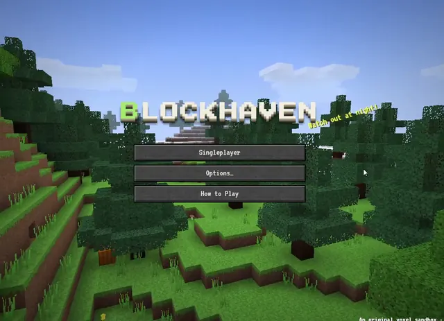</a>

**Claude Opus 5.5** · Игры · автор [kepo](https://x.com/kepochnik) · 2026-09-25

Claude Opus 5.5 написал целую блочную survival-игру в одном HTML без библиотек: биомы, крафт, инструменты и смена дня и ночи.

<details>
<summary>Промпт</summary>

```text
Build a browser sandbox game in the spirit of Minecraft that feels as close to the original as possible. All in-game text in English. Controls: keyboard and mouse (desktop).  TECH - A single HTML file, plain WebGL2, no third-party libraries. - All 16×16 textures generated in code as pixel art (stone, dirt, grass, planks, leaves, ores, glass, water, lava, etc.). - Sounds synthesized with WebAudio: digging, footsteps, placing blocks, damage, mobs, explosions, calm background music.  WORLD - Infinite world made of 16×16×128 chunks, with a seed. - Biomes: plains, forest, birch forest, taiga, snowy tundra, desert, mountains, oceans, beaches. - Caves (winding tunnels and large caverns), lava at the lower levels, ores by depth: coal, iron, gold, diamonds. - Three tree types, tall grass, flowers, cacti, sugar cane, pumpkins. - Minecraft-style lighting: sky light and block light (torches, glowstone, lava) that spreads cell by cell, with smooth lighting and ambient occlusion. - Day/night cycle: sun, moon, stars, sunsets, 3D clouds, distance fog, rain. - Water and lava flow by levels; two sources make infinite water; water + lava make obsidian or cobblestone. Sand and gravel fall.  PLAYER - First person, collisions, jumping, sprinting, sneaking (doesn't fall off edges), swimming, ladders, fall damage. - Block breaking with crack stages and particles; break time depends on the tool. - Visible hand and held item with a swing animation. Third-person view on F5.  SURVIVAL - Health, hunger, saturation, air underwater. - Tools in 5 materials with durability, armor in 4 materials. - Inventory with 2×2 crafting, 3×3 crafting table, furnace with fuel, chests, bed (skip the night and set spawn). - Item drops, death and respawn. - Mobs: pigs, cows, sheep, chickens (breeding, shearing); at night zombies, skeletons with bows, spiders. Zombies and skeletons burn in sunlight. - Farming: hoe, seeds, wheat growth, bread. Doors, fences, fence gates, TNT.  CREATIVE - Flying on double-tap Space, instant block breaking, a catalog of all blocks with tabs and search.  UI - Title screen with a world panorama, world list (create / delete / play), options (FOV, render distance, sensitivity, sound, brightness, GUI scale). - Pause menu, death screen, HUD (hotbar, hearts, hunger, armor, air bubbles), F3 debug screen. - Chat with commands: /gamemode, /time, /give, /tp, /summon, /weather. - Worlds saved in localStorage.  RESTRICTIONS - Do not use Minecraft's name, logo, textures or characters (Steve, Creeper, etc.): give the game its own name and design your own mobs.  TESTING - Run the game in a headless browser, check every system and fix bugs before delivering.
```

</details>

[Открыть на Wandy3D ↗](https://wandy3d.com/ru/prompts/single-file-webgl2-voxel-survival-sandbox-with-crafting-and-2103524317443363241?utm_source=github&utm_medium=referral&utm_campaign=awesome_3d_prompts) · [Исходный пост](https://x.com/kepochnik/status/2103524317443363241)

---

### [Воксельный японский сад с пагодой и сакурой на Three.js](https://wandy3d.com/ru/prompts/voxel-japanese-garden-with-pagoda-and-cherry-trees-in-three-2103486103831339269?utm_source=github&utm_medium=referral&utm_campaign=awesome_3d_prompts)

<a href="https://wandy3d.com/ru/prompts/voxel-japanese-garden-with-pagoda-and-cherry-trees-in-three-2103486103831339269?utm_source=github&amp;utm_medium=referral&amp;utm_campaign=awesome_3d_prompts">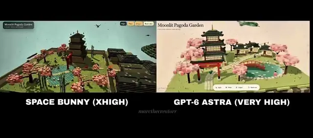</a>

**Space Bunny Alpha** · Сцены · автор [Marcel](https://x.com/marcthecreatorr) · 2026-09-25

Сравнение: Space Bunny Alpha и GPT-6 Astra получили один промпт на воксельный сад. Space Bunny, показанный первым, лучше проработал мелочи.

<details>
<summary>Промпт</summary>

```text
Build a detailed voxel-style Japanese garden in Three.js, with a pagoda, tiny villagers, a flying dragon and interactive details.
```

</details>

[Открыть на Wandy3D ↗](https://wandy3d.com/ru/prompts/voxel-japanese-garden-with-pagoda-and-cherry-trees-in-three-2103486103831339269?utm_source=github&utm_medium=referral&utm_campaign=awesome_3d_prompts) · [Исходный пост](https://x.com/marcthecreatorr/status/2103486103831339269)

---

### [3D-пагода, по которой можно ходить: сакура, горы и ночной режим](https://wandy3d.com/ru/prompts/walkable-3d-pagoda-with-cherry-trees-mountains-and-a-night-2103483174957597035?utm_source=github&utm_medium=referral&utm_campaign=awesome_3d_prompts)

<a href="https://wandy3d.com/ru/prompts/walkable-3d-pagoda-with-cherry-trees-mountains-and-a-night-2103483174957597035?utm_source=github&amp;utm_medium=referral&amp;utm_campaign=awesome_3d_prompts">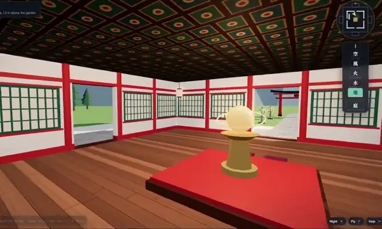</a>

**Claude Opus 5.5** · Сцены · автор [Build Fast with AI](https://x.com/BuildFastWithAI) · 2026-09-25

Claude Opus 5.5 по однострочному промпту собрал low-poly пагоду, где можно гулять снаружи и внутри. Ночной режим подсвечивает её фонарями.

<details>
<summary>Промпт</summary>

```text
Implement code to be able to navigate in a pagoda in 3D.
```

</details>

[Открыть на Wandy3D ↗](https://wandy3d.com/ru/prompts/walkable-3d-pagoda-with-cherry-trees-mountains-and-a-night-2103483174957597035?utm_source=github&utm_medium=referral&utm_campaign=awesome_3d_prompts) · [Исходный пост](https://x.com/BuildFastWithAI/status/2103483174957597035)

---

### [Пушистая морская свинка в Blender по одной короткой просьбе](https://wandy3d.com/ru/prompts/fluffy-guinea-pig-modeled-in-blender-from-a-single-short-2103482826519986544?utm_source=github&utm_medium=referral&utm_campaign=awesome_3d_prompts)

<a href="https://wandy3d.com/ru/prompts/fluffy-guinea-pig-modeled-in-blender-from-a-single-short-2103482826519986544?utm_source=github&amp;utm_medium=referral&amp;utm_campaign=awesome_3d_prompts">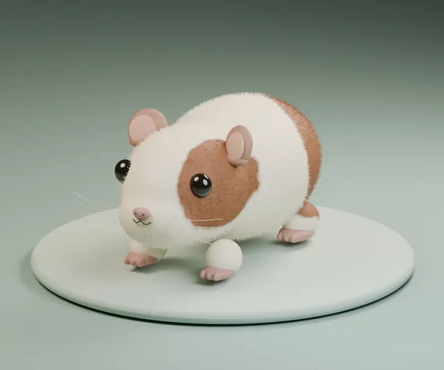</a>

**GPT-6 Astra** · Ассеты · автор [かよこ](https://x.com/kayokojoe) · 2026-09-25

GPT-6 Astra через Codex смоделировал в Blender бело-рыжую морскую свинку с шерстью без референсов, по одной короткой фразе.

<details>
<summary>Промпт</summary>

```text
Blenderでモルモットを作って
```

</details>

[Открыть на Wandy3D ↗](https://wandy3d.com/ru/prompts/fluffy-guinea-pig-modeled-in-blender-from-a-single-short-2103482826519986544?utm_source=github&utm_medium=referral&utm_campaign=awesome_3d_prompts) · [Исходный пост](https://x.com/kayokojoe/status/2103482826519986544)

---

**[Весь каталог →](docs/catalog.ru.1.md)**

Промпты, видео и картинки принадлежат их авторам ([RIGHTS.md](RIGHTS.md)). Наши тексты — [CC BY 4.0](LICENSE). Знаете хороший промпт с видимым результатом? [Предложите его](https://github.com/wornoxgames/awesome-3d-prompts/issues/new?template=suggest.md). Вы автор и хотите изменить или убрать запись? [Напишите нам](https://github.com/wornoxgames/awesome-3d-prompts/issues/new?template=removal.md).
