<!-- Generated file: edits are overwritten. -->

# Awesome 3D Prompts — Catalog 6/9

[← Awesome 3D Prompts](../README.md) · **English** · [Русский](catalog.ru.1.md) · [日本語](catalog.ja.1.md) · [中文](catalog.zh.1.md)

[← Previous](catalog.en.5.md) · page 6 of 9 · [Next →](catalog.en.7.md)

### [Interactive 3D portfolio with a Blender character and talk globe](https://wandy3d.com/prompts/interactive-3d-portfolio-with-a-blender-character-and-talk-2096023793772998704?utm_source=github&utm_medium=referral&utm_campaign=awesome_3d_prompts)

<a href="https://wandy3d.com/prompts/interactive-3d-portfolio-with-a-blender-character-and-talk-2096023793772998704?utm_source=github&amp;utm_medium=referral&amp;utm_campaign=awesome_3d_prompts">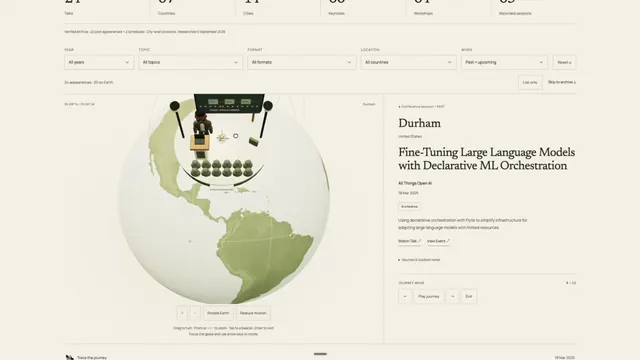</a>

**GPT-6 Astra** · Interactive · by [Shivay Lamba](https://x.com/HowDevelop) · 2026-09-04

GPT-6 Astra made a WebGL portfolio: a Blender character built from a photo and a revolving globe that maps speaking events around the world.

<details>
<summary>Build brief by Wandy3D</summary>

```text
Build an interactive 3D personal portfolio website with an editorial look: warm cream background, large serif name heading, small navigation list and quiet sans-serif details. Place a stylized 3D cartoon character, modeled in Blender from a reference photo and exported for the web, in the hero area, with a gentle idle motion that follows the cursor. Add a second section called a speaking orbit: a slowly revolving Earth globe in soft green and white tones with markers for talk locations around the world. Selecting or cycling through a marker updates a side panel with the city, event title, a short description and a link. Use WebGL, for example Three.js, and keep transitions smooth between hero and globe. Deliver a runnable web project plus the exported character model. It is done when the character renders cleanly, the globe rotates, and every marker updates the panel correctly.
```

</details>

[View on Wandy3D ↗](https://wandy3d.com/prompts/interactive-3d-portfolio-with-a-blender-character-and-talk-2096023793772998704?utm_source=github&utm_medium=referral&utm_campaign=awesome_3d_prompts) · [Original post](https://x.com/HowDevelop/status/2096023793772998704)

---

### [Painterly 5v5 first-person shooter in a Post-Impressionist world](https://wandy3d.com/prompts/painterly-5v5-first-person-shooter-in-a-post-impressionist-2096013280519016608?utm_source=github&utm_medium=referral&utm_campaign=awesome_3d_prompts)

<a href="https://wandy3d.com/prompts/painterly-5v5-first-person-shooter-in-a-post-impressionist-2096013280519016608?utm_source=github&amp;utm_medium=referral&amp;utm_campaign=awesome_3d_prompts">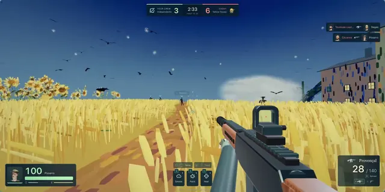</a>

**GPT-6 Astra** · Games · by [Peter Gostev](https://x.com/petergostev) · 2026-09-04

GPT-6 Astra built a playable browser FPS where villages, wheat fields and starry skies look brushed on canvas, with Blender-rendered fighters.

<details>
<summary>Build brief by Wandy3D</summary>

```text
Build a browser-based 5v5 first-person shooter with a Post-Impressionist painting look. Surfaces should read as thick, visible brushstrokes in blues, yellows and oranges, with swirling night skies, glowing lamp-lit windows, wheat fields, cypress trees and sunflowers. Include a team selection menu with painter-style character portraits, a match HUD showing health, ammo, team score and round timer, and a rifle with an optic viewmodel. Add bot opponents, smoke or paint-cloud effects, and a compact village map with a plaza, buildings and open fields. Render the characters in Blender and use them as sprites or models. Use WebGL and deliver a project that can be hosted statically. Controls are mouse look, WASD, jump, shoot and reload. It is done when a full match can be started, played and finished with working scoring.
```

</details>

[View on Wandy3D ↗](https://wandy3d.com/prompts/painterly-5v5-first-person-shooter-in-a-post-impressionist-2096013280519016608?utm_source=github&utm_medium=referral&utm_campaign=awesome_3d_prompts) · [Original post](https://x.com/petergostev/status/2096013280519016608)

---

### [Three.js model of a portable reel-dial recorder from photos](https://wandy3d.com/prompts/three-js-model-of-a-portable-reel-dial-recorder-from-photos-2096013228090245181?utm_source=github&utm_medium=referral&utm_campaign=awesome_3d_prompts)

<a href="https://wandy3d.com/prompts/three-js-model-of-a-portable-reel-dial-recorder-from-photos-2096013228090245181?utm_source=github&amp;utm_medium=referral&amp;utm_campaign=awesome_3d_prompts"></a>

**GPT-6 Astra** · Assets · by [Tykra](https://x.com/ty_kra_lab) · 2026-09-04

From one prompt and reference photos, GPT-6 Astra built a detailed Three.js model of the TP-7 recorder, shown on a slow turntable.

<details>
<summary>Build brief by Wandy3D</summary>

```text
Build a detailed 3D model of a compact portable audio recorder in Three.js, based on supplied reference photos of the device. Model a light grey aluminium body with a large circular tape-reel dial on the front, a small black display showing a timecode and a REC label, three square transport buttons for record, play and stop, a level meter with fine ticks, a knurled metal knob at the bottom corner, small round jacks along the top edge, a thin side lever, and an orange back panel. Add fine printed labels and markings. Show it on a neutral light grey background with soft studio lighting and a slow turntable rotation that reveals the front, sides and back. Deliver one self-contained HTML file. It is done when proportions, materials and markings closely match the references from every angle.
```

</details>

[View on Wandy3D ↗](https://wandy3d.com/prompts/three-js-model-of-a-portable-reel-dial-recorder-from-photos-2096013228090245181?utm_source=github&utm_medium=referral&utm_campaign=awesome_3d_prompts) · [Original post](https://x.com/ty_kra_lab/status/2096013228090245181)

---

### [Interactive exploded view of an electric SUV in 334 parts](https://wandy3d.com/prompts/interactive-exploded-view-of-an-electric-suv-in-334-parts-2096009146248122416?utm_source=github&utm_medium=referral&utm_campaign=awesome_3d_prompts)

<a href="https://wandy3d.com/prompts/interactive-exploded-view-of-an-electric-suv-in-334-parts-2096009146248122416?utm_source=github&amp;utm_medium=referral&amp;utm_campaign=awesome_3d_prompts"></a>

**GPT-6 Astra** · Interactive · by [ashe](https://x.com/ashebytes) · 2026-09-04

GPT-6 Astra built a 3D website that separates a Tesla Model X into 334 modeled parts, with a component list, info panel and explode slider.

<details>
<summary>Build brief by Wandy3D</summary>

```text
Build an interactive 3D website that shows an electric SUV and pulls it apart into several hundred individually modeled pieces. Start with the assembled car on a round turntable platform against a dark studio backdrop. An explode slider at the bottom separates every part outward in a smooth animation and brings them back together again. Add a left sidebar grouping components into categories such as body and structure, glass, drive unit, battery, suspension and wheels. Selecting a category or part highlights it, frames it with the camera and fills a right-hand panel with its name, a short description and key facts. Include orbit, zoom and reset controls, plus toggles for view modes. Use a restrained dark UI with thin type and soft panels. Use WebGL, for example Three.js, and deliver a runnable web project. It is done when the explode motion is smooth and every part is selectable.
```

</details>

[View on Wandy3D ↗](https://wandy3d.com/prompts/interactive-exploded-view-of-an-electric-suv-in-334-parts-2096009146248122416?utm_source=github&utm_medium=referral&utm_campaign=awesome_3d_prompts) · [Original post](https://x.com/ashebytes/status/2096009146248122416)

---

### [Bouncy translucent jelly you can pull and squish in WebGPU](https://wandy3d.com/prompts/bouncy-translucent-jelly-you-can-pull-and-squish-in-webgpu-2096008241104711698?utm_source=github&utm_medium=referral&utm_campaign=awesome_3d_prompts)

<a href="https://wandy3d.com/prompts/bouncy-translucent-jelly-you-can-pull-and-squish-in-webgpu-2096008241104711698?utm_source=github&amp;utm_medium=referral&amp;utm_campaign=awesome_3d_prompts">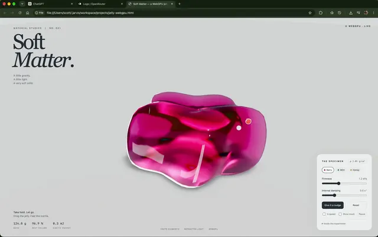</a>

**GPT-6 Astra** · Interactive · by [Scott](https://x.com/scottstts) · 2026-09-04

GPT-6 Astra produced a Three.js and WebGPU jelly toy: a glossy, translucent blob that wobbles, stretches and switches colours under a drag.

<details>
<summary>Prompt</summary>

```text
Asked Astra to make a delicious and bouncy jelly in @threejs and webgpu
```

</details>

[View on Wandy3D ↗](https://wandy3d.com/prompts/bouncy-translucent-jelly-you-can-pull-and-squish-in-webgpu-2096008241104711698?utm_source=github&utm_medium=referral&utm_campaign=awesome_3d_prompts) · [Original post](https://x.com/scottstts/status/2096008241104711698)

---

### [Anime-themed Smash-style platform fighter on a night city stage in Roblox](https://wandy3d.com/prompts/anime-themed-smash-style-platform-fighter-on-a-night-city-2095999578419929412?utm_source=github&utm_medium=referral&utm_campaign=awesome_3d_prompts)

<a href="https://wandy3d.com/prompts/anime-themed-smash-style-platform-fighter-on-a-night-city-2095999578419929412?utm_source=github&amp;utm_medium=referral&amp;utm_campaign=awesome_3d_prompts">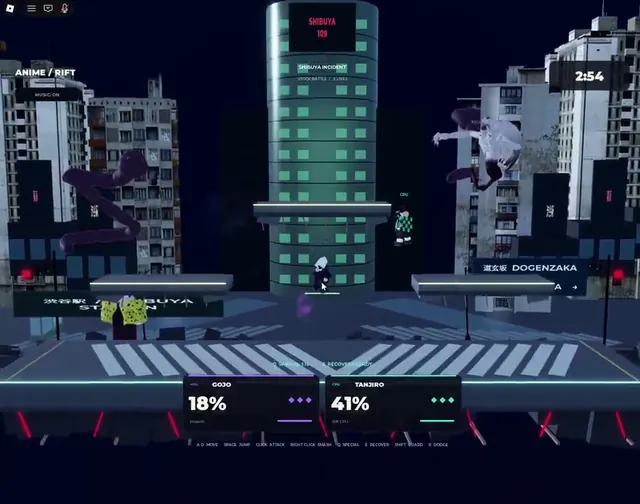</a>

**GPT-6 Astra** · Games · by [hiraeth](https://x.com/WoahWurdz) · 2026-09-04

GPT-6 Astra produced a Roblox brawler with damage percentages and energy attacks, set on a neon-lit city crossing and built with Blender assets.

<details>
<summary>Build brief by Wandy3D</summary>

```text
Build a Roblox platform fighter in the style of a classic crossover brawler, themed on popular anime. Set the arena on a night-time city crossing with a glowing teal skyscraper in the middle, apartment blocks on both sides, and a few floating ledges above a striped crosswalk stage. Use a dark navy palette with teal and purple accents. Create at least two playable anime-inspired fighters with distinct special attacks, such as glowing purple energy orbs and cyan slashes. Show a HUD with a match countdown, a start countdown and a damage percentage per fighter, where higher percentages mean they are knocked further. Add stocks or respawns when a fighter is knocked off the stage, and a camera that stays side-on and zooms to keep everyone in view. Create 3D assets in Blender and import them using the toolbox. Done means a full match can be started, played and reset in Roblox Studio.
```

</details>

[View on Wandy3D ↗](https://wandy3d.com/prompts/anime-themed-smash-style-platform-fighter-on-a-night-city-2095999578419929412?utm_source=github&utm_medium=referral&utm_campaign=awesome_3d_prompts) · [Original post](https://x.com/WoahWurdz/status/2095999578419929412)

---

### [Floor plan that rises into a 3D apartment you can walk through](https://wandy3d.com/prompts/floor-plan-that-rises-into-a-3d-apartment-you-can-walk-2095999282088378520?utm_source=github&utm_medium=referral&utm_campaign=awesome_3d_prompts)

<a href="https://wandy3d.com/prompts/floor-plan-that-rises-into-a-3d-apartment-you-can-walk-2095999282088378520?utm_source=github&amp;utm_medium=referral&amp;utm_campaign=awesome_3d_prompts">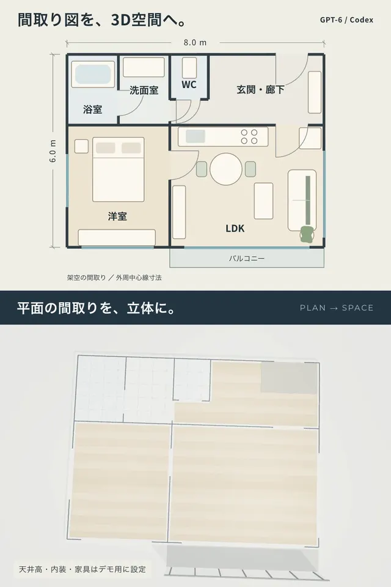</a>

**GPT-6 Astra** · Scenes · by [おのふみ\| 3D×動画生成×個人開発](https://x.com/onofumi_AI) · 2026-09-04

GPT-6 Astra built a one-bedroom floor plan and a matching 3D flat from the same dimensions, ending in a walkthrough tracked on the plan.

<details>
<summary>Build brief by Wandy3D</summary>

```text
Build an interactive visualisation that turns a floor plan into a 3D apartment. Show a clean 2D plan of a one-bedroom apartment with a living-dining-kitchen area, bedroom, bathroom, toilet, entrance hall and balcony, drawn in soft cream and wood tones with dimension labels. Generate both the plan and the 3D model from the same dimension data. In a lower panel, animate the build-up: floor first, then walls and windows rising, then furniture such as bed, sofa, table, TV and plants appearing. Orbit the camera around the cutaway model, then drop into a first-person walk through the rooms. While walking, display a marker with a view cone on the plan that follows the camera in real time. Add short step captions and a small note that heights and interiors are placeholders. Use a light, minimal palette. Done means one smooth sequence from plan to walkthrough.
```

</details>

[View on Wandy3D ↗](https://wandy3d.com/prompts/floor-plan-that-rises-into-a-3d-apartment-you-can-walk-2095999282088378520?utm_source=github&utm_medium=referral&utm_campaign=awesome_3d_prompts) · [Original post](https://x.com/onofumi_AI/status/2095999282088378520)

---

### [Interactive woodland river and pond scene with rippling water in the browser](https://wandy3d.com/prompts/interactive-woodland-river-and-pond-scene-with-rippling-2095993826569502785?utm_source=github&utm_medium=referral&utm_campaign=awesome_3d_prompts)

<a href="https://wandy3d.com/prompts/interactive-woodland-river-and-pond-scene-with-rippling-2095993826569502785?utm_source=github&amp;utm_medium=referral&amp;utm_campaign=awesome_3d_prompts">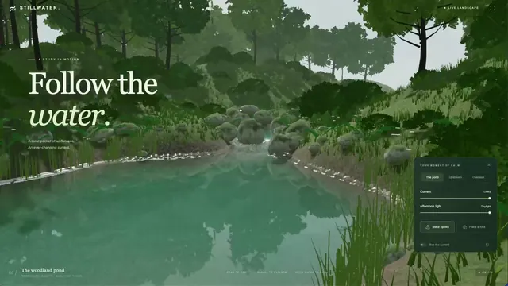</a>

**GPT-6 Astra** · Interactive · by [Dan Greenheck](https://x.com/dangreenheck) · 2026-09-04

GPT-6 Astra delivered a working prototype of a forest stream feeding a pond, with swirling water around mossy rocks and a live settings panel.

<details>
<summary>Build brief by Wandy3D</summary>

```text
Build an interactive woodland river scene that runs in the browser. Show a stream flowing into a clear green pond, seen from above with a slowly moving camera. Include rippling, reflective water with foam and swirls around mossy boulders, grassy banks, dense trees and small drifting particles. Overlay a large serif headline reading Follow the water, with a short caption and a small translucent control panel at the right with a few sliders and toggles for the environment. Use a deep green palette with soft sunlight and light shafts. Let the viewer move through the scene and change settings in real time. Deliver it as a web page using a 3D library and custom water shaders. Done means a working prototype where water, rocks and vegetation look convincing at smooth frame rates.
```

</details>

[View on Wandy3D ↗](https://wandy3d.com/prompts/interactive-woodland-river-and-pond-scene-with-rippling-2095993826569502785?utm_source=github&utm_medium=referral&utm_campaign=awesome_3d_prompts) · [Original post](https://x.com/dangreenheck/status/2095993826569502785)

---

### [Third-person Three.js hack-and-slash game in a gothic arena](https://wandy3d.com/prompts/third-person-three-js-hack-and-slash-game-in-a-gothic-arena-2095988972879335792?utm_source=github&utm_medium=referral&utm_campaign=awesome_3d_prompts)

<a href="https://wandy3d.com/prompts/third-person-three-js-hack-and-slash-game-in-a-gothic-arena-2095988972879335792?utm_source=github&amp;utm_medium=referral&amp;utm_campaign=awesome_3d_prompts">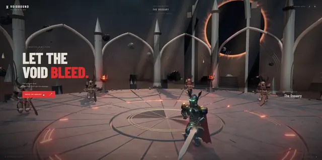</a>

**GPT-6 Astra** · Games · by [Alexey Fateev](https://x.com/superalesha) · 2026-09-04

GPT-6 Astra wrote a browser slasher with light combos, a heavy two-handed blade and area magic, as demon hordes swarm a cathedral arena.

<details>
<summary>Prompt</summary>

```text
Make me the most insane and blast of a third-person hack-and-slash action game you can possibly build on ThreeJS + Web shaders bro! The most important things are combat dynamics, swordplay, brutal hit impact, juicy blood and gore, magic effects, and insane graphics. It's a beautifully designed arena where enemies swarm in hordes. Must have a responsive third-person camera, dodging, and real weapon inertia/weight behind every swing. 3 attack types: fast light sword combos, a crushing heavy two-handed blade, and flashy area-of-effect magic spells. This is a Devil May Cry / God of War style AAA slasher in the browser. Do it right bro, I believe in you! An unusual setting for the game, pick it yourself.
Please don't read the memory, don't read anything. Start from a blank slate.
```

</details>

[View on Wandy3D ↗](https://wandy3d.com/prompts/third-person-three-js-hack-and-slash-game-in-a-gothic-arena-2095988972879335792?utm_source=github&utm_medium=referral&utm_campaign=awesome_3d_prompts) · [Original post](https://x.com/superalesha/status/2095988972879335792)

---

### [Cartoon city scene built inside a Unity project with Codex](https://wandy3d.com/prompts/cartoon-city-scene-built-inside-a-unity-project-with-codex-2095987508475834641?utm_source=github&utm_medium=referral&utm_campaign=awesome_3d_prompts)

<a href="https://wandy3d.com/prompts/cartoon-city-scene-built-inside-a-unity-project-with-codex-2095987508475834641?utm_source=github&amp;utm_medium=referral&amp;utm_campaign=awesome_3d_prompts">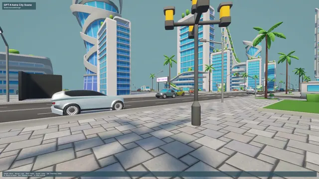</a>

**GPT-6 Astra** · Scenes · by [Andrew Walko](https://x.com/AndrewWalko) · 2026-09-04

GPT-6 Astra, driven through Codex, assembled a Unity city of towers, roads, billboards and traffic from a free asset pack in a single pass.

<details>
<summary>Prompt</summary>

```text
Build a new 3D city scene for me. I want several type of buildings (diff heights) and cars there. Also use roads, billboards and other elements that belong to a big city. Everything you need is in this folder Assets/ithappy/Cartoon_City_Free.
```

</details>

[View on Wandy3D ↗](https://wandy3d.com/prompts/cartoon-city-scene-built-inside-a-unity-project-with-codex-2095987508475834641?utm_source=github&utm_medium=referral&utm_campaign=awesome_3d_prompts) · [Original post](https://x.com/AndrewWalko/status/2095987508475834641)

---

### [Interactive 3D science simulation of Saturn's moon Titan](https://wandy3d.com/prompts/interactive-3d-science-simulation-of-saturn-s-moon-titan-2095986941753712841?utm_source=github&utm_medium=referral&utm_campaign=awesome_3d_prompts)

<a href="https://wandy3d.com/prompts/interactive-3d-science-simulation-of-saturn-s-moon-titan-2095986941753712841?utm_source=github&amp;utm_medium=referral&amp;utm_campaign=awesome_3d_prompts">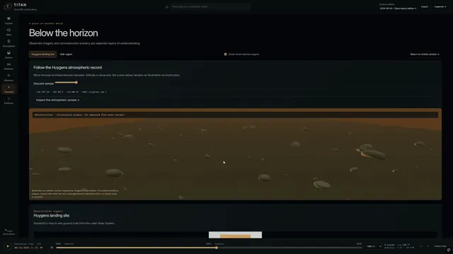</a>

**GPT-6 Astra** · Interactive · by [Arda Tuğsat](https://x.com/ArdaTugsat) · 2026-09-04

Made with GPT-6 Astra at medium reasoning in Codex: a Titan globe with changing phases, a descent view and mission-history panels.

<details>
<summary>Build brief by Wandy3D</summary>

```text
Build an interactive scientific 3D simulation of Saturn's largest moon, Titan, as a web app. Show a realistic hazy globe on a black space background with a lit and shadowed side, and let the viewer move through time so phases and eclipse-like views of the disc appear, with a thin glowing atmosphere ring. Add a dark, minimal interface with a large title, a side navigation, time controls along the bottom and small labels on surface features. Include explanatory sections, for example a descent view below the horizon showing an orange sky, a rugged landscape with rounded rocks and a surface map image, plus a chronological list of mission and discovery events. Use restrained typography, muted amber and grey colours and smooth camera motion. Deliver it as a self-contained project that opens in a browser. Done means the globe renders convincingly, time controls change the lighting, and every panel is readable and navigable.
```

</details>

[View on Wandy3D ↗](https://wandy3d.com/prompts/interactive-3d-science-simulation-of-saturn-s-moon-titan-2095986941753712841?utm_source=github&utm_medium=referral&utm_campaign=awesome_3d_prompts) · [Original post](https://x.com/ArdaTugsat/status/2095986941753712841)

---

### [Slingshot bird physics game with four birds and special powers](https://wandy3d.com/prompts/slingshot-bird-physics-game-with-four-birds-and-special-2095981655370666076?utm_source=github&utm_medium=referral&utm_campaign=awesome_3d_prompts)

<a href="https://wandy3d.com/prompts/slingshot-bird-physics-game-with-four-birds-and-special-2095981655370666076?utm_source=github&amp;utm_medium=referral&amp;utm_campaign=awesome_3d_prompts">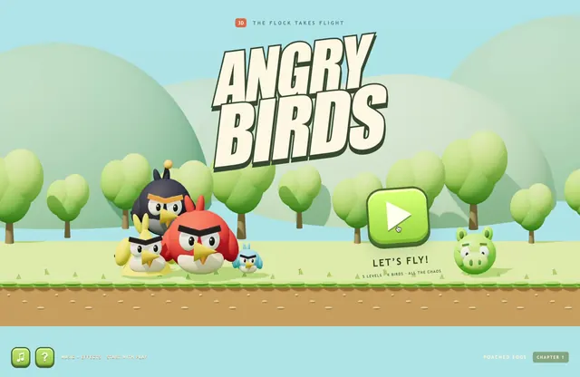</a>

**GPT-6 Astra** · Games · by [Maximus Spritius](https://x.com/MozeTech) · 2026-09-04

A GPT-6 Astra attempt at an Angry Birds-style game, with episode select, destructible towers and four birds; the author found Fable 5.1 prettier.

<details>
<summary>Build brief by Wandy3D</summary>

```text
Build a browser slingshot physics game in the style of a classic bird-launching puzzle, with a soft 3D-looking look. Provide an episode select screen with a few level cards, then levels where the player drags back a slingshot to fire birds at wooden and stone towers guarding green pigs. Include four bird types, each with its own tap-activated ability such as a shockwave, speed boost, triple split and explosion, shown in a button at the bottom corner. Use pastel layered hills, rounded trees and a bright sky, with a cream-and-green interface. Add scoring, a level-cleared card with one to three stars and replay or next options. Destructible structures must react with believable physics. Deliver it as a web project that runs on a static host. Done means several levels are playable from start to finish with all four birds.
```

</details>

[View on Wandy3D ↗](https://wandy3d.com/prompts/slingshot-bird-physics-game-with-four-birds-and-special-2095981655370666076?utm_source=github&utm_medium=referral&utm_campaign=awesome_3d_prompts) · [Original post](https://x.com/MozeTech/status/2095981655370666076)

---

### [Rube Goldberg machine in Three.js ending in a bomb blast](https://wandy3d.com/prompts/rube-goldberg-machine-in-three-js-ending-in-a-bomb-blast-2095980885732704629?utm_source=github&utm_medium=referral&utm_campaign=awesome_3d_prompts)

<a href="https://wandy3d.com/prompts/rube-goldberg-machine-in-three-js-ending-in-a-bomb-blast-2095980885732704629?utm_source=github&amp;utm_medium=referral&amp;utm_campaign=awesome_3d_prompts">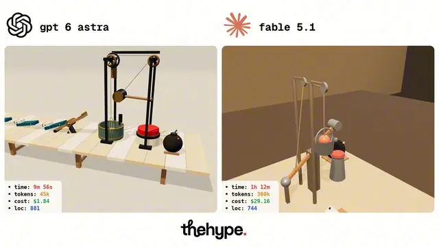</a>

**GPT-6 Astra** · Animation · by [thehype.](https://x.com/thehypedotnews) · 2026-09-04

A comparison: GPT-6 Astra and Fable 5.1 got the same brief for a domino, hammer and button chain that fires a bomb. Astra was cheaper and faster.

<details>
<summary>Build brief by Wandy3D</summary>

```text
Build a Rube Goldberg machine as one self-contained HTML file using Three.js loaded from a CDN, with everything procedural: no textures, no imported models, no physics engine. A ball rolls down a track and tips a row of dominoes; the last domino triggers a pulley-and-hammer contraption, the hammer strikes a red button and the button sets off a bomb that explodes with debris and a smoke cloud. Draw it on a wooden table in a warm beige room. Write every collision by hand: a piece may only start moving when the previous one actually overlaps it, checked each frame, never by a timer. Use one continuous camera whose speed follows the action. Keep the simulation deterministic with no random numbers, so it renders as exactly 20 seconds at 60 fps. Done means the chain runs unbroken from ball to blast.
```

</details>

[View on Wandy3D ↗](https://wandy3d.com/prompts/rube-goldberg-machine-in-three-js-ending-in-a-bomb-blast-2095980885732704629?utm_source=github&utm_medium=referral&utm_campaign=awesome_3d_prompts) · [Original post](https://x.com/thehypedotnews/status/2095980885732704629)

---

### [Floating voxel island with a blossom temple and day-night toggle](https://wandy3d.com/prompts/floating-voxel-island-with-a-blossom-temple-and-day-night-2095978925029556561?utm_source=github&utm_medium=referral&utm_campaign=awesome_3d_prompts)

<a href="https://wandy3d.com/prompts/floating-voxel-island-with-a-blossom-temple-and-day-night-2095978925029556561?utm_source=github&amp;utm_medium=referral&amp;utm_campaign=awesome_3d_prompts">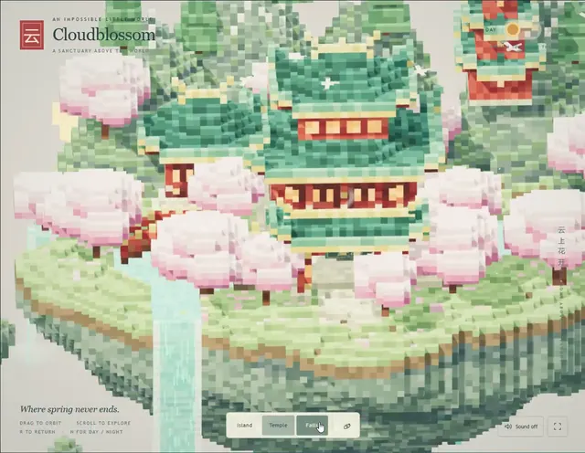</a>

**GPT-6 Astra** · Scenes · by [Philip Nora](https://x.com/PhilipNora7) · 2026-09-04

GPT-6 Astra produced a Three.js voxel island with a pagoda, waterfall and a switch that turns pastel daylight into a lantern-lit night.

<details>
<summary>Build brief by Wandy3D</summary>

```text
Build a single-page interactive 3D scene of a floating voxel island in the browser, using Three.js and delivered as one self-contained HTML file. The island carries a Japanese-style temple with tiered green roofs, a red pagoda, pink cherry-blossom trees, pine trees and a waterfall that spills off the edge into the clouds. Use a soft pastel daytime palette on a pale background, with a small sun made of pixels. Add a day/night toggle: at night the sky turns deep navy, blossoms turn lilac, lanterns and windows glow warm, and a pixel moon appears. Overlay a minimal editorial UI: a serif title, a short tagline that changes with the time of day, and a bottom bar with camera presets for the whole island, the temple and the falls. Support drag to orbit and scroll to zoom, with smooth camera transitions between presets. Done when the island reads clearly from every angle, the toggle fades lighting smoothly, and the camera presets glide to their targets.
```

</details>

[View on Wandy3D ↗](https://wandy3d.com/prompts/floating-voxel-island-with-a-blossom-temple-and-day-night-2095978925029556561?utm_source=github&utm_medium=referral&utm_campaign=awesome_3d_prompts) · [Original post](https://x.com/PhilipNora7/status/2095978925029556561)

---

### [Rigged sci-fi mech with a ten-second animation rendered in Blender](https://wandy3d.com/prompts/rigged-sci-fi-mech-with-a-ten-second-animation-rendered-in-2095975726558392570?utm_source=github&utm_medium=referral&utm_campaign=awesome_3d_prompts)

<a href="https://wandy3d.com/prompts/rigged-sci-fi-mech-with-a-ten-second-animation-rendered-in-2095975726558392570?utm_source=github&amp;utm_medium=referral&amp;utm_campaign=awesome_3d_prompts">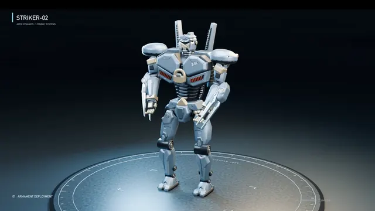</a>

**GPT-6 Astra** · Assets · by [Vatroslav Vrbanić](https://x.com/vatro_vrbanic) · 2026-09-04

With GPT-6 Astra in Codex and headless Blender, reference images became a rigged mech that moves on a lit platform in a 10-second render.

<details>
<summary>Build brief by Wandy3D</summary>

```text
Build a detailed, rigged 3D mech and a short rendered animation, driven headlessly through Blender Python scripts. Work from several reference images of the same robot, showing front, side and detail views, and match the silhouette: a pale blue-grey armored body with broad shoulder pauldrons, twin antenna-like back fins, exposed dark mechanical joints, gold accents and sturdy legs. Model the parts as separate meshes with believable panel detail and metal materials, then create an armature with controls for arms, torso, head and legs. Animate a ten-second sequence in which the mech shifts its weight, raises and lowers its arms and turns its upper body. Place it on a circular metallic platform in a dark studio with a strong spotlight, blue rim light and soft floor glow. Render the sequence to a video file. Done when the rig deforms cleanly without clipping, the motion loops sensibly and the render looks consistent across frames.
```

</details>

[View on Wandy3D ↗](https://wandy3d.com/prompts/rigged-sci-fi-mech-with-a-ten-second-animation-rendered-in-2095975726558392570?utm_source=github&utm_medium=referral&utm_campaign=awesome_3d_prompts) · [Original post](https://x.com/vatro_vrbanic/status/2095975726558392570)

---

### [Neon anti-gravity combat racer in Three.js with boost gates](https://wandy3d.com/prompts/neon-anti-gravity-combat-racer-in-three-js-with-boost-gates-2095967568825582044?utm_source=github&utm_medium=referral&utm_campaign=awesome_3d_prompts)

<a href="https://wandy3d.com/prompts/neon-anti-gravity-combat-racer-in-three-js-with-boost-gates-2095967568825582044?utm_source=github&amp;utm_medium=referral&amp;utm_campaign=awesome_3d_prompts">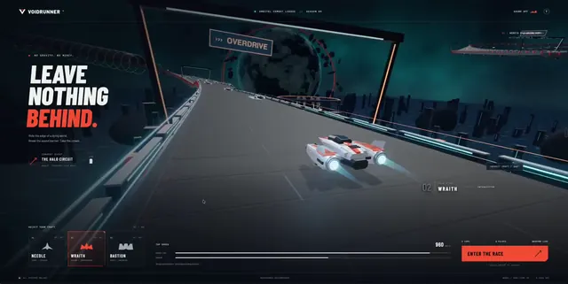</a>

**GPT-6 Astra** · Games · by [Alexey Fateev](https://x.com/superalesha) · 2026-09-04

Given a single long prompt, GPT-6 Astra wrote a browser Wipeout-style racer with neon shaders, a menu, speed readout and a space-themed track.

<details>
<summary>Prompt</summary>

```text
Make me the most insane and blast of a high-speed anti-gravity combat racer you can possibly build on ThreeJS + Web shaders bro! The most important things are blistering sense of speed, tight drifting, boost mechanics, track elevation drops, motion blur, and jaw-dropping neon shader lighting. It's an intense futuristic raceway high above a strange world where aggressive AI racers battle for first place. Must have smooth camera banking into turns, shield/weapon pickups, and punchy air-brake physics. 3 craft types: a featherlight glass-cannon speeder, an agile balanced interceptor, and a heavy armored ramming tank. This is a Wipeout / Redout style AAA arcade racer in the browser. Do it right bro, I believe in you! An unusual setting for the game, pick it yourself. Please don't read the memory, don't read anything. Start from a blank slate.
```

</details>

[View on Wandy3D ↗](https://wandy3d.com/prompts/neon-anti-gravity-combat-racer-in-three-js-with-boost-gates-2095967568825582044?utm_source=github&utm_medium=referral&utm_campaign=awesome_3d_prompts) · [Original post](https://x.com/superalesha/status/2095967568825582044)

---

### [Procedural PlayStation-style controller model rotating in Three.js](https://wandy3d.com/prompts/procedural-playstation-style-controller-model-rotating-in-2095967131573649552?utm_source=github&utm_medium=referral&utm_campaign=awesome_3d_prompts)

<a href="https://wandy3d.com/prompts/procedural-playstation-style-controller-model-rotating-in-2095967131573649552?utm_source=github&amp;utm_medium=referral&amp;utm_campaign=awesome_3d_prompts"></a>

**GPT-6 Astra** · Assets · by [bluedev](https://x.com/blueemi99) · 2026-09-04

GPT-6 Astra modelled a white gamepad in Three.js, with sticks, buttons and triggers, then turned it through front, side and back views.

<details>
<summary>Build brief by Wandy3D</summary>

```text
Build a realistic 3D game controller in the browser with Three.js, delivered as one self-contained HTML file with no external model files. Model it procedurally: a white two-tone body with a black lower section, a light bar along the touchpad, rounded grips, two analog sticks, a directional pad, four face buttons with symbols, shoulder buttons and triggers, and small details on the back. Use soft studio lighting on a dark blue-grey backdrop with a subtle floor shadow and reflections. Animate the controller so it slowly turns to show the front, sides and back, and tilts gently as if floating. Use smooth physically based materials with believable roughness for plastic and rubber. Done when every part is cleanly shaped, the silhouette reads correctly from all angles, and the motion loops smoothly without clipping or seams.
```

</details>

[View on Wandy3D ↗](https://wandy3d.com/prompts/procedural-playstation-style-controller-model-rotating-in-2095967131573649552?utm_source=github&utm_medium=referral&utm_campaign=awesome_3d_prompts) · [Original post](https://x.com/blueemi99/status/2095967131573649552)

---

### [Interactive 3D character card UI with hover glow and three worlds](https://wandy3d.com/prompts/interactive-3d-character-card-ui-with-hover-glow-and-three-2095963576049832347?utm_source=github&utm_medium=referral&utm_campaign=awesome_3d_prompts)

<a href="https://wandy3d.com/prompts/interactive-3d-character-card-ui-with-hover-glow-and-three-2095963576049832347?utm_source=github&amp;utm_medium=referral&amp;utm_campaign=awesome_3d_prompts">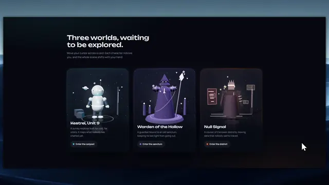</a>

**Claude Fable 5.1** · Interactive · by [Rejuanul Islam](https://x.com/Rejuanul_Islam9) · 2026-09-04

Claude Fable 5.1 built a dark page with three glass cards, each holding a 3D character — robot, wizard, hooded figure — that lights up on hover.

<details>
<summary>Build brief by Wandy3D</summary>

```text
Build an interactive web page with three character cards in a dark, cinematic style. Show a bold heading about three worlds waiting to be explored, with a short line of text beneath. Below it, place three glassy cards side by side, each with its own 3D character on a glowing pedestal: a friendly white robot, a purple wizard with a staff, and a hooded figure with a signboard in a reddish palette. Give each card its own accent colour, a name, a short description and an enter button. On hover, the card lifts, its glow strengthens, the character rotates or animates, and the other cards dim slightly. Follow the cursor with subtle parallax. Use Three.js or React Three Fiber for the characters, keep everything in a single page and make it responsive. Done when hover transitions feel smooth, each card has a distinct mood, and the characters render crisply.
```

</details>

[View on Wandy3D ↗](https://wandy3d.com/prompts/interactive-3d-character-card-ui-with-hover-glow-and-three-2095963576049832347?utm_source=github&utm_medium=referral&utm_campaign=awesome_3d_prompts) · [Original post](https://x.com/Rejuanul_Islam9/status/2095963576049832347)

---

### [Three.js rooftop third-person shooter in a noir night city](https://wandy3d.com/prompts/three-js-rooftop-third-person-shooter-in-a-noir-night-city-2095962376344309843?utm_source=github&utm_medium=referral&utm_campaign=awesome_3d_prompts)

<a href="https://wandy3d.com/prompts/three-js-rooftop-third-person-shooter-in-a-noir-night-city-2095962376344309843?utm_source=github&amp;utm_medium=referral&amp;utm_campaign=awesome_3d_prompts">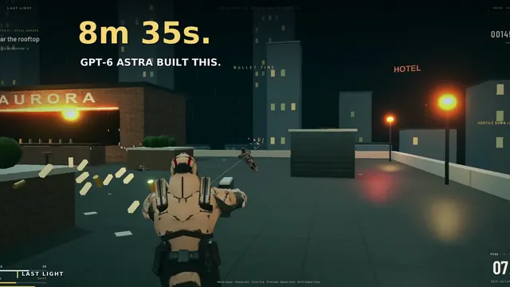</a>

**GPT-6 Astra** · Games · by [Andrei](https://x.com/HangoutWHAndrei) · 2026-09-04

GPT-6 Astra produced a playable Three.js shooter on a neon-lit rooftop in under nine minutes, with slow motion and casings. The author rated gunplay below Fable 5.1.

<details>
<summary>Build brief by Wandy3D</summary>

```text
Build a browser-based third-person shooter in Three.js, inspired by a gritty noir action game, delivered as a small web project that runs locally. The setting is a night-time city rooftop with dark skyscrapers in the background, warm orange street lamps, a glowing neon sign over a small building, hedges and low cover. The player controls an armored soldier seen from behind, moves around the rooftop and fires a firearm at enemy gunmen who appear across the roof. Shooting must feel punchy: visible muzzle flash, tracer lines, ejected brass casings that fall and bounce, hit feedback and a short slow-motion effect on key moments. Add a minimal HUD with ammo count, a score counter and a mission line such as clearing the rooftop. Use simple stylized lighting with fog and bloom for the night mood, and load character models from an online source if needed. Done when the rooftop is playable from start to cleared state, controls respond smoothly and gunplay reads clearly.
```

</details>

[View on Wandy3D ↗](https://wandy3d.com/prompts/three-js-rooftop-third-person-shooter-in-a-noir-night-city-2095962376344309843?utm_source=github&utm_medium=referral&utm_campaign=awesome_3d_prompts) · [Original post](https://x.com/HangoutWHAndrei/status/2095962376344309843)

---

### [Browser arcade racer with drift, near-miss combos and nitro](https://wandy3d.com/prompts/browser-arcade-racer-with-drift-near-miss-combos-and-nitro-2095916820431827408?utm_source=github&utm_medium=referral&utm_campaign=awesome_3d_prompts)

<a href="https://wandy3d.com/prompts/browser-arcade-racer-with-drift-near-miss-combos-and-nitro-2095916820431827408?utm_source=github&amp;utm_medium=referral&amp;utm_campaign=awesome_3d_prompts">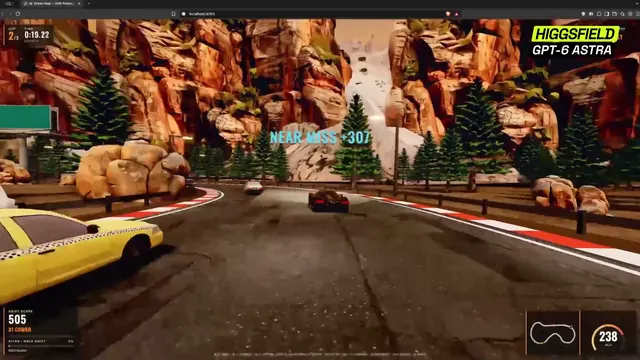</a>

**GPT-6 Astra** · Games · by [Higgsfield AI 🧩](https://x.com/higgsfield_ai) · 2026-09-04

A one-sentence game description became a canyon arcade racer in GPT-6 Astra, with drift physics, combo scoring, speed traps and nitro. The post comes from a tool vendor.

<details>
<summary>Build brief by Wandy3D</summary>

```text
Build a 3D arcade racing game that runs in the browser. The track winds through a red-rock desert canyon at sunset, with pine trees, guard rails, red-and-white curbs, roadside buildings and boulders. The player drives a low sports car from a chase camera against ordinary traffic. Implement arcade drift physics with tire smoke, a combo scoring system, bonus points for near misses with traffic, speed traps that award points when passed fast, and a nitro boost with visual speed effects. Show a HUD with the current score, a speedometer, a minimap of the track and short floating popups such as near miss values. Use warm golden lighting, soft shadows and a slight motion blur feel for speed. Controls are steering, accelerate, brake, handbrake for drifts and a nitro key. Done when a full lap is drivable, scoring reacts to drifts, near misses and speed traps, and the game feels fast and responsive.
```

</details>

[View on Wandy3D ↗](https://wandy3d.com/prompts/browser-arcade-racer-with-drift-near-miss-combos-and-nitro-2095916820431827408?utm_source=github&utm_medium=referral&utm_campaign=awesome_3d_prompts) · [Original post](https://x.com/higgsfield_ai/status/2095916820431827408)

---

### [Foggy third-person open-world game with dead trees and creatures](https://wandy3d.com/prompts/foggy-third-person-open-world-game-with-dead-trees-and-2095907526566990013?utm_source=github&utm_medium=referral&utm_campaign=awesome_3d_prompts)

<a href="https://wandy3d.com/prompts/foggy-third-person-open-world-game-with-dead-trees-and-2095907526566990013?utm_source=github&amp;utm_medium=referral&amp;utm_campaign=awesome_3d_prompts">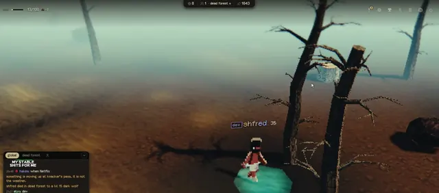</a>

**GPT-6 Astra** · Games · by [GLUNIVERSE™](https://x.com/gibglue) · 2026-09-04

GPT-6 Astra generated a misty wasteland world in a few minutes, with a walking avatar, name tags, a quest panel and a purple mount to meet.

<details>
<summary>Build brief by Wandy3D</summary>

```text
Build a third-person 3D open-world game that runs in the browser. The world is a barren, misty wasteland with dry brown ground, leafless dead trees, scattered rocks and small plants, soft volumetric fog and a muted teal-and-amber palette. A small avatar is controlled from an overhead chase camera, can walk around, use a glowing ring marker on the ground and interact with creatures such as a purple mount that appears nearby. Include name tags above characters, a compact chat or quest log panel in a corner and small interface icons along the top edge. Add subtle ambient motion: drifting fog, swaying grass, dust puffs when moving. Controls are click or keyboard movement plus an interact key. Done when the player can explore the foggy terrain, see other characters with name tags and interact with at least one creature, with a stable frame rate.
```

</details>

[View on Wandy3D ↗](https://wandy3d.com/prompts/foggy-third-person-open-world-game-with-dead-trees-and-2095907526566990013?utm_source=github&utm_medium=referral&utm_campaign=awesome_3d_prompts) · [Original post](https://x.com/gibglue/status/2095907526566990013)

---

### [Looped cyberpunk bedroom overlooking a rainy neon city in Blender](https://wandy3d.com/prompts/looped-cyberpunk-bedroom-overlooking-a-rainy-neon-city-in-2095898303019856230?utm_source=github&utm_medium=referral&utm_campaign=awesome_3d_prompts)

<a href="https://wandy3d.com/prompts/looped-cyberpunk-bedroom-overlooking-a-rainy-neon-city-in-2095898303019856230?utm_source=github&amp;utm_medium=referral&amp;utm_campaign=awesome_3d_prompts">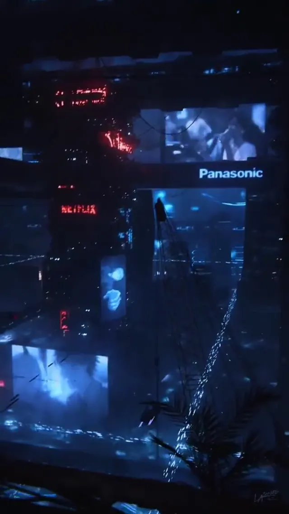</a>

**GPT-6 Astra** · Animation · by [Bayard](https://x.com/BayardXBT) · 2026-09-04

GPT-6 Astra built and rendered a seamless Blender loop: a dark bedroom facing a rainy neon skyline with animated billboards. The author says it took six hours.

<details>
<summary>Prompt</summary>

```text
Create a cinematic cyberpunk bedroom in Blender overlooking a rainy neon city at night. Add animated billboards and make it photorealistic and seamlessly looped.
```

</details>

[View on Wandy3D ↗](https://wandy3d.com/prompts/looped-cyberpunk-bedroom-overlooking-a-rainy-neon-city-in-2095898303019856230?utm_source=github&utm_medium=referral&utm_campaign=awesome_3d_prompts) · [Original post](https://x.com/BayardXBT/status/2095898303019856230)

---

### [Self-playing Eiffel Tower brick breaker with glowing window bricks](https://wandy3d.com/prompts/self-playing-eiffel-tower-brick-breaker-with-glowing-window-2095898198413922791?utm_source=github&utm_medium=referral&utm_campaign=awesome_3d_prompts)

<a href="https://wandy3d.com/prompts/self-playing-eiffel-tower-brick-breaker-with-glowing-window-2095898198413922791?utm_source=github&amp;utm_medium=referral&amp;utm_campaign=awesome_3d_prompts">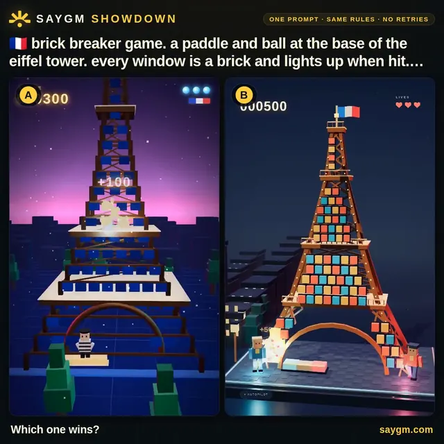</a>

**GPT-6 Astra** · Games · by [SayGM](https://x.com/say_gm_) · 2026-09-04

A comparison: Fable 5.1 and GPT-6 Astra got one prompt for a self-playing brick breaker at the Eiffel Tower. GPT-6 Astra's version was declared the winner.

<details>
<summary>Build brief by Wandy3D</summary>

```text
Build a self-playing arcade brick breaker game set at the base of the Eiffel Tower, delivered as a browser project. The tower is built from glowing coloured blocks, where every window is a brick that lights up when hit, set against a dusk sky with a pink-purple glow and a dark blue ground with small stylized figures and trees. A paddle at the bottom bounces a ball upward into the tower; an autopilot moves the paddle so the game plays itself without input. Show a score counter, remaining lives, a flag at the top of the tower, hit sparks with floating point values and a stylized game over screen that restarts the run. Use warm orange lattice, vivid brick colours and soft bloom. Done when the game runs unattended, bricks light and disappear on impact, score rises, and the loss and restart states work.
```

</details>

[View on Wandy3D ↗](https://wandy3d.com/prompts/self-playing-eiffel-tower-brick-breaker-with-glowing-window-2095898198413922791?utm_source=github&utm_medium=referral&utm_campaign=awesome_3d_prompts) · [Original post](https://x.com/say_gm_/status/2095898198413922791)

---

### [Low-poly open-world planet game you can walk around and orbit](https://wandy3d.com/prompts/low-poly-open-world-planet-game-you-can-walk-around-and-2095872986477908108?utm_source=github&utm_medium=referral&utm_campaign=awesome_3d_prompts)

<a href="https://wandy3d.com/prompts/low-poly-open-world-planet-game-you-can-walk-around-and-2095872986477908108?utm_source=github&amp;utm_medium=referral&amp;utm_campaign=awesome_3d_prompts">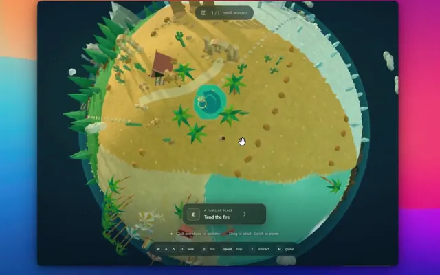</a>

**GPT-6 Astra** · Games · by [Ejaj AHmed 🦅](https://x.com/aeejazkhan) · 2026-09-04

GPT-6 Astra produced a small browser game on a round low-poly planet with forest, desert and snow zones, cabins and tiny interactive tasks.

<details>
<summary>Build brief by Wandy3D</summary>

```text
Build a cozy low-poly open-world game on a small spherical planet, delivered as one self-contained HTML file using Three.js. Split the globe into distinct biomes: green forest, sandy desert, snowy tundra with ice crystals and dark soil, each with matching trees, rocks and small wooden cabins, plus a winding river and footpaths. Use a soft, saturated palette against a dark teal space backdrop with drifting clouds. The player character walks across the surface with the planet curving beneath them, and the camera can orbit by dragging and zoom with the scroll wheel. Add keyboard controls for walking, jumping and interacting, shown in a slim control bar at the bottom of the screen. Include small quests or points of interest announced by a short caption card, such as tending a campfire. Done means you can wander across every biome, interact with objects, and orbit the whole planet smoothly at a steady frame rate.
```

</details>

[View on Wandy3D ↗](https://wandy3d.com/prompts/low-poly-open-world-planet-game-you-can-walk-around-and-2095872986477908108?utm_source=github&utm_medium=referral&utm_campaign=awesome_3d_prompts) · [Original post](https://x.com/aeejazkhan/status/2095872986477908108)

---

### [Van Gogh-style painterly town you can walk through in Three.js](https://wandy3d.com/prompts/van-gogh-style-painterly-town-you-can-walk-through-in-three-2095871735824339279?utm_source=github&utm_medium=referral&utm_campaign=awesome_3d_prompts)

<a href="https://wandy3d.com/prompts/van-gogh-style-painterly-town-you-can-walk-through-in-three-2095871735824339279?utm_source=github&amp;utm_medium=referral&amp;utm_campaign=awesome_3d_prompts">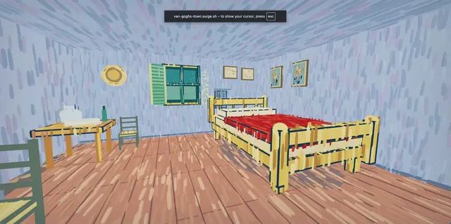</a>

**GPT-6 Astra** · Scenes · by [Fede(URU) 🇺🇾](https://x.com/RealFedeURU) · 2026-09-04

GPT-6 Astra (Max) made a brush-stroke world with a bedroom, cafe terrace, wheat field and sunflowers, plus a slider that changes the light.

<details>
<summary>Build brief by Wandy3D</summary>

```text
Build an explorable 3D town rendered as a living Van Gogh painting, delivered as one self-contained HTML file using Three.js. Recreate several recognisable settings: a small bedroom with a wooden bed, chair and shuttered window; a night cafe terrace with yellow awning, tables and seated figures; a golden wheat field with dirt tracks; and a patch of tall sunflowers in a vase and in the field. Replace smooth shading with thick directional brush strokes in swirling blues and warm yellows, with a starry swirling sky. Let the visitor move first-person through all the locations using mouse look and keyboard. Add a small floating panel with a time-of-day slider labelled with short poetic captions, so the painting shifts from morning to evening light. Done means the strokes read as paint from close up and far away, the scenes are connected so you can walk between them, and the lighting changes smoothly with the slider.
```

</details>

[View on Wandy3D ↗](https://wandy3d.com/prompts/van-gogh-style-painterly-town-you-can-walk-through-in-three-2095871735824339279?utm_source=github&utm_medium=referral&utm_campaign=awesome_3d_prompts) · [Original post](https://x.com/RealFedeURU/status/2095871735824339279)

---

### [Detailed steam locomotive modeled part by part in Blender](https://wandy3d.com/prompts/detailed-steam-locomotive-modeled-part-by-part-in-blender-2095868420327710840?utm_source=github&utm_medium=referral&utm_campaign=awesome_3d_prompts)

<a href="https://wandy3d.com/prompts/detailed-steam-locomotive-modeled-part-by-part-in-blender-2095868420327710840?utm_source=github&amp;utm_medium=referral&amp;utm_campaign=awesome_3d_prompts">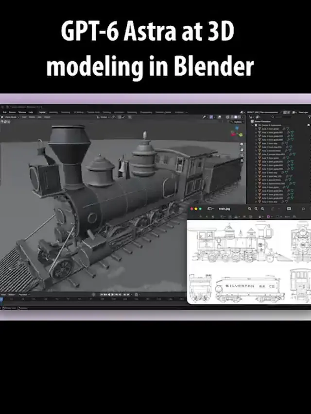</a>

**GPT-6 Astra** · Assets · by [sheemamoto](https://x.com/sheemamoto) · 2026-09-04

GPT-6 Astra modeled a steam locomotive in Blender from a blueprint, with hundreds of separate named parts such as axles, domes and suspension links.

<details>
<summary>Build brief by Wandy3D</summary>

```text
Build a detailed 3D model of a vintage steam locomotive with tender in Blender, driven by a Python script that you run inside Blender. Use a side-view blueprint as the reference for proportions. Construct the model from many separate, clearly named objects rather than one merged mesh: boiler, steam dome, sand dome, smokestack, cab, headlamp, bell, driving wheels, axles, journal boxes, stays, suspension links, rods, pilot, couplers and the tender with its lettering panel. Place every part exactly where it belongs mechanically so the wireframe looks like a real machine from any angle, and sit the locomotive on a stretch of railway track. Keep a neutral grey material and a simple ground plane with soft lighting. Organise the outliner with meaningful names. Done means the model is complete from all sides, parts can be selected individually, and the solid and wireframe views both hold up.
```

</details>

[View on Wandy3D ↗](https://wandy3d.com/prompts/detailed-steam-locomotive-modeled-part-by-part-in-blender-2095868420327710840?utm_source=github&utm_medium=referral&utm_campaign=awesome_3d_prompts) · [Original post](https://x.com/sheemamoto/status/2095868420327710840)

---

### [Three.js naval battle with warships, aircraft and rippling sea](https://wandy3d.com/prompts/three-js-naval-battle-with-warships-aircraft-and-rippling-2095840435319001278?utm_source=github&utm_medium=referral&utm_campaign=awesome_3d_prompts)

<a href="https://wandy3d.com/prompts/three-js-naval-battle-with-warships-aircraft-and-rippling-2095840435319001278?utm_source=github&amp;utm_medium=referral&amp;utm_campaign=awesome_3d_prompts">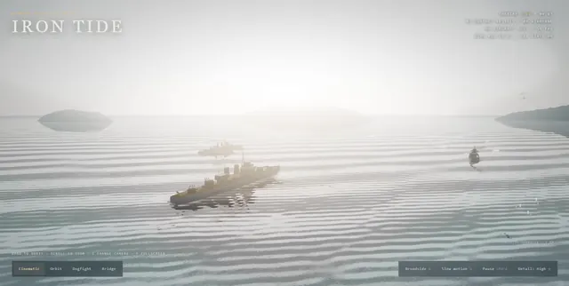</a>

**GPT-6 Astra** · Scenes · by [leo 🐾](https://x.com/synthwavedd) · 2026-09-04

In one turn, GPT-6 Astra (max) produced a Three.js sea battle where detailed warships and planes interact with animated water and several cameras.

<details>
<summary>Build brief by Wandy3D</summary>

```text
Build a cinematic naval battle scene as one self-contained HTML file using Three.js. Show a calm, hazy sea with fine rippling waves under a pale overcast sky and distant low islands. Fill it with several detailed warships: battleships and destroyers with gun turrets, funnels, masts and superstructure, moving across the water and leaving wakes. Add fighter aircraft flying overhead and diving toward the ships, with tracer fire, smoke trails and splashes where shots land. Ships should visibly interact with the water through bow waves and rocking. Provide a small bottom bar to switch between camera views such as an overview, a ship-chase camera and an aircraft-following camera, and a subtle title in the top corner. Done means the battle plays continuously without input, the camera modes work, and the ships and water look convincing in close and distant shots.
```

</details>

[View on Wandy3D ↗](https://wandy3d.com/prompts/three-js-naval-battle-with-warships-aircraft-and-rippling-2095840435319001278?utm_source=github&utm_medium=referral&utm_campaign=awesome_3d_prompts) · [Original post](https://x.com/synthwavedd/status/2095840435319001278)

---

### [Interactive Oval Office that changes across presidencies in Three.js](https://wandy3d.com/prompts/interactive-oval-office-that-changes-across-presidencies-in-2095830596069290077?utm_source=github&utm_medium=referral&utm_campaign=awesome_3d_prompts)

<a href="https://wandy3d.com/prompts/interactive-oval-office-that-changes-across-presidencies-in-2095830596069290077?utm_source=github&amp;utm_medium=referral&amp;utm_campaign=awesome_3d_prompts">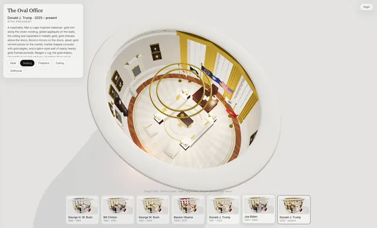</a>

**Claude Fable 5.1** · Interactive · by [Min Zhou](https://x.com/fMinZhou) · 2026-09-04

Claude Fable 5.1 produced a Three.js explorer of the Oval Office: pick a presidency, watch the decor change, then fly the camera inside the room.

<details>
<summary>Build brief by Wandy3D</summary>

```text
Build an interactive Three.js web app that shows how the Oval Office looked under different U.S. presidents. Start with a top-down cutaway view of the round room floating on a soft light-grey background, with a stylised, slightly toy-like look: cream walls, tall windows with drapes, a carpet, a desk, sofas, armchairs, lamps, flags and potted plants. Add a bottom bar of small thumbnail cards, one per presidency, and a small text panel at the top left with a short description of the selected era. Selecting a card swaps the carpet, drapes, furniture and decor to match that period with a smooth transition. Include view modes so the user can switch between the overhead cutaway and a first-person style camera that glides inside the room toward the desk, the fireplace with a portrait above it, and the ceiling seal. Use orbit-style mouse controls. Deliver a single web project that runs in the browser. Done when every era loads, the camera moves smoothly, and the room differences are clearly visible.
```

</details>

[View on Wandy3D ↗](https://wandy3d.com/prompts/interactive-oval-office-that-changes-across-presidencies-in-2095830596069290077?utm_source=github&utm_medium=referral&utm_campaign=awesome_3d_prompts) · [Original post](https://x.com/fMinZhou/status/2095830596069290077)

---

### [Layered 3D cheesecake explainer film with Three.js and a recipe card](https://wandy3d.com/prompts/layered-3d-cheesecake-explainer-film-with-three-js-and-a-2095829851206774987?utm_source=github&utm_medium=referral&utm_campaign=awesome_3d_prompts)

<a href="https://wandy3d.com/prompts/layered-3d-cheesecake-explainer-film-with-three-js-and-a-2095829851206774987?utm_source=github&amp;utm_medium=referral&amp;utm_campaign=awesome_3d_prompts"></a>

**Claude Fable 5.1** · Animation · by [سارة - تؤمن بالعدالة- Sara - believes in justice.](https://x.com/sarit69976) · 2026-09-04

Claude Fable 5.1 handled a minute-long film where a baked cheesecake photo becomes an exploding Three.js layer model and a coded recipe card.

<details>
<summary>Build brief by Wandy3D</summary>

```text
Build a one-minute explainer film that turns a photo of a home-baked cheesecake into a layered 3D model and a recipe. Open on the photo in a clean off-white frame, then show a chat-style message from the baker and short annotation labels pointing at features of the cake. Next, construct a real Three.js scene of the cake as separate layers: springform pan, parchment above the rim, cake body, crust, sweetener dusting and a ring of halved berries. Let the layers separate and reassemble while the camera orbits, first as a wireframe on a bold magenta background, then as a neutral grey model. Cut to a photoreal rendered shot of the finished cake. Build all on-screen text, such as the chat screens, annotations and a two-page recipe card with ingredients and seven method steps, as an HTML page captured in a browser, so the text stays crisp. Finish with a plain title card. Add a synthesised score. Deliver the scene code, the HTML pages and the final cut.
```

</details>

[View on Wandy3D ↗](https://wandy3d.com/prompts/layered-3d-cheesecake-explainer-film-with-three-js-and-a-2095829851206774987?utm_source=github&utm_medium=referral&utm_campaign=awesome_3d_prompts) · [Original post](https://x.com/sarit69976/status/2095829851206774987)

---

### [Interactive 3D turbocharger viewer with isolatable parts](https://wandy3d.com/prompts/interactive-3d-turbocharger-viewer-with-isolatable-parts-2095776712579571725?utm_source=github&utm_medium=referral&utm_campaign=awesome_3d_prompts)

<a href="https://wandy3d.com/prompts/interactive-3d-turbocharger-viewer-with-isolatable-parts-2095776712579571725?utm_source=github&amp;utm_medium=referral&amp;utm_campaign=awesome_3d_prompts">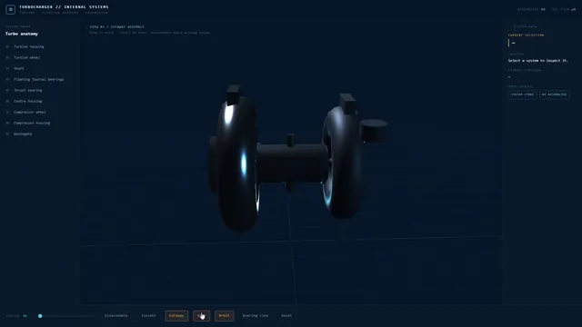</a>

**GPT-6 Astra** · Interactive · by [Feraser](https://x.com/Feraser8) · 2026-09-04

GPT-6 Astra produced a browser viewer of a turbocharger split into nine assemblies you can rotate, isolate and read about, floating bearings included.

<details>
<summary>Prompt</summary>

```text
Build an interactive 3D turbocharger. Separate every working system. Let me rotate it, isolate parts, and see what the machine is actually doing.
```

</details>

[View on Wandy3D ↗](https://wandy3d.com/prompts/interactive-3d-turbocharger-viewer-with-isolatable-parts-2095776712579571725?utm_source=github&utm_medium=referral&utm_campaign=awesome_3d_prompts) · [Original post](https://x.com/Feraser8/status/2095776712579571725)

---

### [Walkable Van Gogh town in Three.js built from six paintings](https://wandy3d.com/prompts/walkable-van-gogh-town-in-three-js-built-from-six-paintings-2095776685807346105?utm_source=github&utm_medium=referral&utm_campaign=awesome_3d_prompts)

<a href="https://wandy3d.com/prompts/walkable-van-gogh-town-in-three-js-built-from-six-paintings-2095776685807346105?utm_source=github&amp;utm_medium=referral&amp;utm_campaign=awesome_3d_prompts"></a>

**GPT-6 Astra** · Scenes · by [Peter Gostev](https://x.com/petergostev) · 2026-09-04

One walkable Three.js town stitched from six Van Gogh paintings by GPT-6 Astra, with brush-stroke surfaces and a slider that changes the light.

<details>
<summary>Build brief by Wandy3D</summary>

```text
Build a walkable 3D town in Three.js that merges six famous post-impressionist paintings into one connected world. Render everything with visible thick brush-stroke textures and a saturated palette of yellow ochre, deep cobalt blue and warm orange, so surfaces look painted rather than modelled. Include a bedroom interior with a bed, chair and wooden floor, a café terrace at night with small tables and seated figures, a sunflower field with a vase, wheat paths, and a swirling night sky with glowing stars above rooftops. Use first-person controls to stroll between the scenes without loading screens. Add a small floating panel with a lighting slider that shifts the same place between times of day, plus a few icon buttons for options. Deliver it as a web project that runs in the browser. Done means you can walk from one painting to the next, the brush-stroke look holds in every area, and the lighting slider visibly changes the mood.
```

</details>

[View on Wandy3D ↗](https://wandy3d.com/prompts/walkable-van-gogh-town-in-three-js-built-from-six-paintings-2095776685807346105?utm_source=github&utm_medium=referral&utm_campaign=awesome_3d_prompts) · [Original post](https://x.com/petergostev/status/2095776685807346105)

---

### [Editable Blender steam locomotive rebuilt from a line drawing](https://wandy3d.com/prompts/editable-blender-steam-locomotive-rebuilt-from-a-line-2095756085890310311?utm_source=github&utm_medium=referral&utm_campaign=awesome_3d_prompts)

<a href="https://wandy3d.com/prompts/editable-blender-steam-locomotive-rebuilt-from-a-line-2095756085890310311?utm_source=github&amp;utm_medium=referral&amp;utm_campaign=awesome_3d_prompts">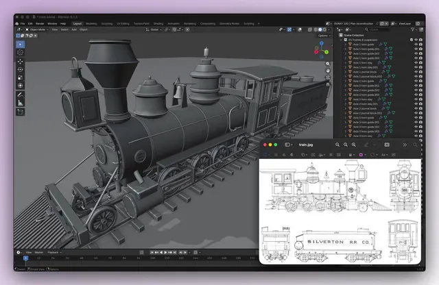</a>

**GPT-6 Astra** · Assets · by [Tom Krcha](https://x.com/tomkrcha) · 2026-09-04

GPT-6 Astra rebuilt a vintage steam train from a flat drawing in Blender, producing thousands of separate editable objects you can adjust.

<details>
<summary>Build brief by Wandy3D</summary>

```text
Build a detailed 3D steam locomotive with tender in Blender, reconstructed from a flat line drawing used as the reference image. Model every visible part as its own editable object with clean geometry and clear names: boiler, smokestack, domes, cab, headlamp, bell, wheels, rods, tender body and rail track. Keep a neutral gray clay-style material and a simple ground plane with soft shadows so the form is easy to read. Work through a Blender Python script or agent session that creates the objects, and let the detail level be adjustable from simplified to highly detailed. Deliver a .blend file with a tidy outliner hierarchy. Done means the locomotive's silhouette and proportions match the drawing, each part can be selected and moved separately, and it renders cleanly from several angles.
```

</details>

[View on Wandy3D ↗](https://wandy3d.com/prompts/editable-blender-steam-locomotive-rebuilt-from-a-line-2095756085890310311?utm_source=github&utm_medium=referral&utm_campaign=awesome_3d_prompts) · [Original post](https://x.com/tomkrcha/status/2095756085890310311)

---

### [Ramayana-inspired temple cinematic with a golden vanara guardian](https://wandy3d.com/prompts/ramayana-inspired-temple-cinematic-with-a-golden-vanara-2095729606066348290?utm_source=github&utm_medium=referral&utm_campaign=awesome_3d_prompts)

<a href="https://wandy3d.com/prompts/ramayana-inspired-temple-cinematic-with-a-golden-vanara-2095729606066348290?utm_source=github&amp;utm_medium=referral&amp;utm_campaign=awesome_3d_prompts">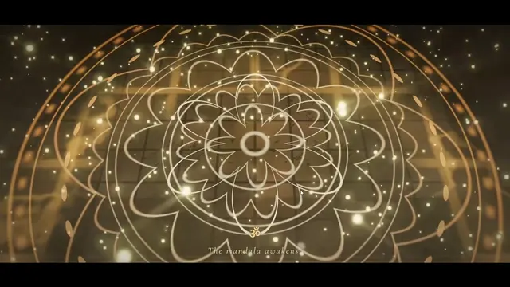</a>

**Claude Fable 5.1** · Animation · by [Build Fast with AI](https://x.com/BuildFastWithAI) · 2026-09-04

Fable 5.1 produced a two-minute Three.js film in one HTML file: a jungle temple, a glowing mandala and an awakening guardian. It beat Gemini 3.8 Flash in a same-prompt comparison.

<details>
<summary>Build brief by Wandy3D</summary>

```text
Build a cinematic, self-playing short film in a single self-contained HTML file using Three.js. Open on a moonlit jungle clearing and a forgotten stone temple, with soft god rays and drifting mist. Fade through dark title cards with Sanskrit-style lettering and short English subtitles that narrate the story. Inside the temple hall, reveal a glowing golden mandala made of fine concentric line work and floating sparks; let it spin up, brighten and flood the screen with warm light. Out of the glare, an ancient vanara guardian statue awakens, its golden armor lit by halos of rings and particles, then the sequence closes on a bold title card. Palette: deep black and teal shadows against molten gold. Use camera moves, fades, bloom and particle systems for pacing, and add no external assets. Done means the film plays from start to finish in the browser in about two minutes with smooth transitions.
```

</details>

[View on Wandy3D ↗](https://wandy3d.com/prompts/ramayana-inspired-temple-cinematic-with-a-golden-vanara-2095729606066348290?utm_source=github&utm_medium=referral&utm_campaign=awesome_3d_prompts) · [Original post](https://x.com/BuildFastWithAI/status/2095729606066348290)

---

### [Interactive voxel train table with harbor, roundhouse and day-night mode](https://wandy3d.com/prompts/interactive-voxel-train-table-with-harbor-roundhouse-and-day-2095719731860750613?utm_source=github&utm_medium=referral&utm_campaign=awesome_3d_prompts)

<a href="https://wandy3d.com/prompts/interactive-voxel-train-table-with-harbor-roundhouse-and-day-2095719731860750613?utm_source=github&amp;utm_medium=referral&amp;utm_campaign=awesome_3d_prompts">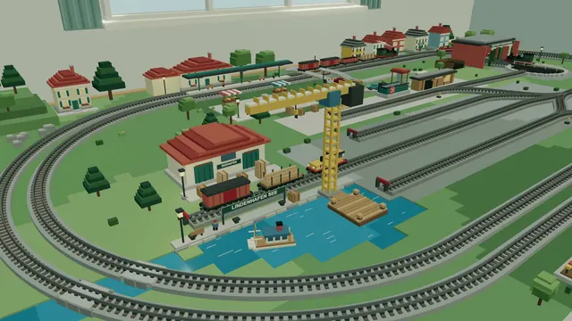</a>

**GPT-6 Astra** · Interactive · by [Derya Unutmaz, MD](https://x.com/DeryaTR_) · 2026-09-04

GPT-6 Astra made a Three.js model railway you can drive: steam trains, a crane harbor, a control panel and a night mode to explore from any angle.

<details>
<summary>Build brief by Wandy3D</summary>

```text
Build an interactive voxel model-railway table in Three.js, delivered as one self-contained HTML page. Place a wooden table with a green landscape board in a bright room with a window and shelves. On the board lay looping tracks, sidings, a roundhouse with turntable, a small town of red-roofed houses, trees, a station platform and a harbor with a crane and boats. Run steam locomotives with passenger and freight cars along the rails. Add a dark-green control panel with buttons to start and stop trains, switch between auto and manual modes, adjust speed, and toggle a day and night lighting mode with lit windows. Support orbit, pan and zoom so the viewer can inspect tiny details, and show a small title caption on load. Use a soft, toy-like palette of greens, warm wood and cream walls. Done means trains move smoothly, controls respond, and the scene runs at a steady frame rate.
```

</details>

[View on Wandy3D ↗](https://wandy3d.com/prompts/interactive-voxel-train-table-with-harbor-roundhouse-and-day-2095719731860750613?utm_source=github&utm_medium=referral&utm_campaign=awesome_3d_prompts) · [Original post](https://x.com/DeryaTR_/status/2095719731860750613)

---

### [Voxel ship in a bottle with rolling waves, gulls and a harbor town](https://wandy3d.com/prompts/voxel-ship-in-a-bottle-with-rolling-waves-gulls-and-a-harbor-2095699049722581065?utm_source=github&utm_medium=referral&utm_campaign=awesome_3d_prompts)

<a href="https://wandy3d.com/prompts/voxel-ship-in-a-bottle-with-rolling-waves-gulls-and-a-harbor-2095699049722581065?utm_source=github&amp;utm_medium=referral&amp;utm_campaign=awesome_3d_prompts">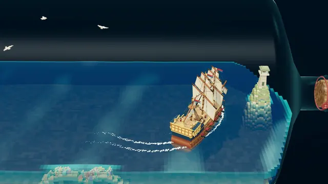</a>

**GPT-6 Astra** · Scenes · by [Derya Unutmaz, MD](https://x.com/DeryaTR_) · 2026-09-04

GPT-6 Astra built a Three.js diorama of a 17th-century galleon sailing inside a glass bottle, with wave physics, gulls, a lighthouse and coral reefs.

<details>
<summary>Build brief by Wandy3D</summary>

```text
Build a cinematic voxel diorama in Three.js as one self-contained HTML file: a ship in a bottle. Inside a glass bottle lying on its side, show a detailed 17th-century galleon made of voxels, with layered hulls, three masts, cream sails, flags and rigging. The ship sails over animated rolling waves that rock it realistically and leave a white wake. Add circling gulls, a small lighthouse near the cork, a harbor town with red roofs on a rocky cliff, and a colorful coral reef under the water. Use deep navy backgrounds, teal water, warm wood and coral accents. Move the camera through close-ups of the ship, the harbor and the reef, then pull back to reveal the whole bottle, with small elegant captions. Add soft ambient music if possible. Done means the film runs about two minutes smoothly, with believable wave motion and crisp voxel detail.
```

</details>

[View on Wandy3D ↗](https://wandy3d.com/prompts/voxel-ship-in-a-bottle-with-rolling-waves-gulls-and-a-harbor-2095699049722581065?utm_source=github&utm_medium=referral&utm_campaign=awesome_3d_prompts) · [Original post](https://x.com/DeryaTR_/status/2095699049722581065)

---

### [Procedural living ocean from storm surface to abyss, single HTML file](https://wandy3d.com/prompts/procedural-living-ocean-from-storm-surface-to-abyss-single-2095673885605630429?utm_source=github&utm_medium=referral&utm_campaign=awesome_3d_prompts)

<a href="https://wandy3d.com/prompts/procedural-living-ocean-from-storm-surface-to-abyss-single-2095673885605630429?utm_source=github&amp;utm_medium=referral&amp;utm_campaign=awesome_3d_prompts">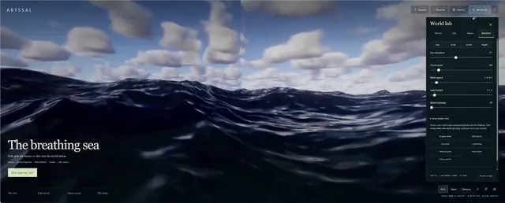</a>

**GPT-6 Astra** · Scenes · by [Ethan Mollick](https://x.com/emollick) · 2026-09-04

GPT-6 Astra extended an open ocean-surface generator into a full dive: reefs, whales and abyssal creatures, all with procedural animal behaviour.

<details>
<summary>Build brief by Wandy3D</summary>

```text
Build a single self-contained HTML file that renders a living ocean you can descend through. Start at a stormy, animated sea surface with rolling waves under heavy clouds, then let the viewer dive through named depth zones: sunlit coral ridges, open blue water, a continental slope, a pitch-black abyssal plain and a deep-sea garden with glowing creatures. Fade light and colour from bright teal to near black as depth increases. Populate each zone with procedurally simulated animals such as schools of fish, a humpback whale and drifting deep-sea organisms, each following simple behaviour rules like schooling, wandering and avoiding the camera. Add a minimal overlay with the zone title, a depth readout, a species info card and a settings panel for seed, lighting and surface options, plus URL parameters that restore a chosen site and seed. Done means the whole dive plays smoothly in a browser, the surface-to-abyss transition feels continuous and the animals visibly move on their own.
```

</details>

[View on Wandy3D ↗](https://wandy3d.com/prompts/procedural-living-ocean-from-storm-surface-to-abyss-single-2095673885605630429?utm_source=github&utm_medium=referral&utm_campaign=awesome_3d_prompts) · [Original post](https://x.com/emollick/status/2095673885605630429)

---

### [Low-poly garden planet game in Three.js with planting and paving](https://wandy3d.com/prompts/low-poly-garden-planet-game-in-three-js-with-planting-and-2095663498101662198?utm_source=github&utm_medium=referral&utm_campaign=awesome_3d_prompts)

<a href="https://wandy3d.com/prompts/low-poly-garden-planet-game-in-three-js-with-planting-and-2095663498101662198?utm_source=github&amp;utm_medium=referral&amp;utm_campaign=awesome_3d_prompts">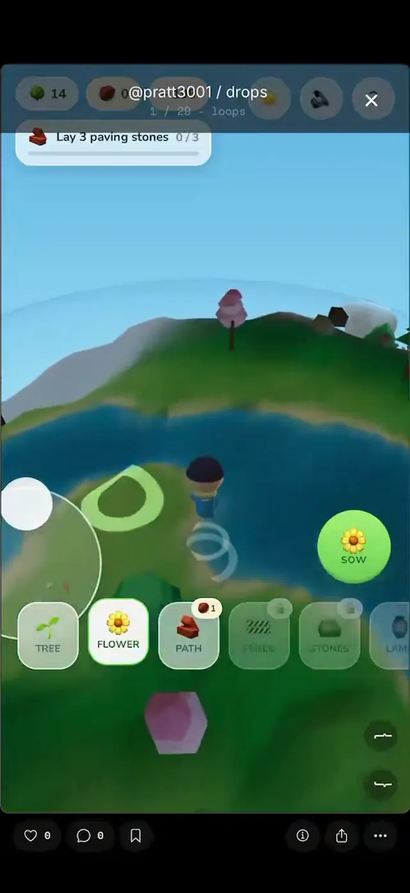</a>

**GPT-6 Astra** · Games · by [Prathamesh](https://x.com/pratt_builds) · 2026-09-04

Built with GPT-6 Astra in one shot, this Three.js game has you walk a tiny planet, plant, water and harvest, and finish small paving quests.

<details>
<summary>Build brief by Wandy3D</summary>

```text
Build a mobile-friendly 3D gardening game in Three.js that runs in the browser. The world is a small low-poly planet with green hills, rocky grey patches, pink and green trees and blue lakes. A chibi character walks around the curved surface with a virtual joystick while a third-person camera follows and tilts with the terrain. A bottom toolbar lets the player pick Tree, Flower, Path, Fence and Stones, and a large context button changes between Sow, Harvest, Water, Tend and Pave depending on what is underneath. Show a ring marker on the targeted spot, resource counters at the top and a small quest card such as laying a number of paving stones with a progress bar. Use soft lighting, a bright sky, gentle splash rings when walking in water and short toast messages after actions. Done means a player can plant, tend, harvest and pave on the planet and complete the first quest.
```

</details>

[View on Wandy3D ↗](https://wandy3d.com/prompts/low-poly-garden-planet-game-in-three-js-with-planting-and-2095663498101662198?utm_source=github&utm_medium=referral&utm_campaign=awesome_3d_prompts) · [Original post](https://x.com/pratt_builds/status/2095663498101662198)

---

### [Palace of Fine Arts rotunda at dusk, modelled and rendered in Blender](https://wandy3d.com/prompts/palace-of-fine-arts-rotunda-at-dusk-modelled-and-rendered-in-2095653641164329143?utm_source=github&utm_medium=referral&utm_campaign=awesome_3d_prompts)

<a href="https://wandy3d.com/prompts/palace-of-fine-arts-rotunda-at-dusk-modelled-and-rendered-in-2095653641164329143?utm_source=github&amp;utm_medium=referral&amp;utm_campaign=awesome_3d_prompts">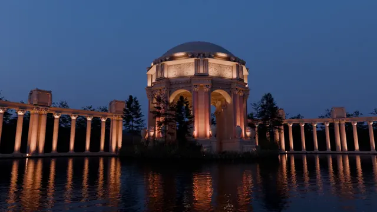</a>

**GPT-6 Astra** · Scenes · by [Sharif Shameem](https://x.com/sharifshameem) · 2026-09-03

GPT-6 Astra recreated a San Francisco landmark in Blender: a glowing rotunda and colonnade by a lagoon, shown in a slow dusk camera flight.

<details>
<summary>Build brief by Wandy3D</summary>

```text
Build a Blender Python script that recreates a classical rotunda and curved colonnade of a famous San Francisco exposition palace as a rendered dusk scene. Model the domed rotunda with its octagonal drum, arched openings, sculpted frieze panels and statues, plus the long row of columns on both sides, standing on the edge of a still lagoon with small trees and a dark treeline behind. Use a deep blue twilight sky and warm uplighting that makes the stone glow peach, with clear mirror-like reflections on the water. Animate a slow camera move that begins at a distance, glides closer to the dome and carved details, then pulls back to reveal the full colonnade. Render the sequence with a physically based renderer. Done means the script builds the geometry, materials, lights and camera path in one run and outputs a smooth video clip of the landmark.
```

</details>

[View on Wandy3D ↗](https://wandy3d.com/prompts/palace-of-fine-arts-rotunda-at-dusk-modelled-and-rendered-in-2095653641164329143?utm_source=github&utm_medium=referral&utm_campaign=awesome_3d_prompts) · [Original post](https://x.com/sharifshameem/status/2095653641164329143)

---

### [3D aquarium game with a submersible, fish shoals and coral, model comparison](https://wandy3d.com/prompts/3d-aquarium-game-with-a-submersible-fish-shoals-and-coral-2095650251902239139?utm_source=github&utm_medium=referral&utm_campaign=awesome_3d_prompts)

<a href="https://wandy3d.com/prompts/3d-aquarium-game-with-a-submersible-fish-shoals-and-coral-2095650251902239139?utm_source=github&amp;utm_medium=referral&amp;utm_campaign=awesome_3d_prompts">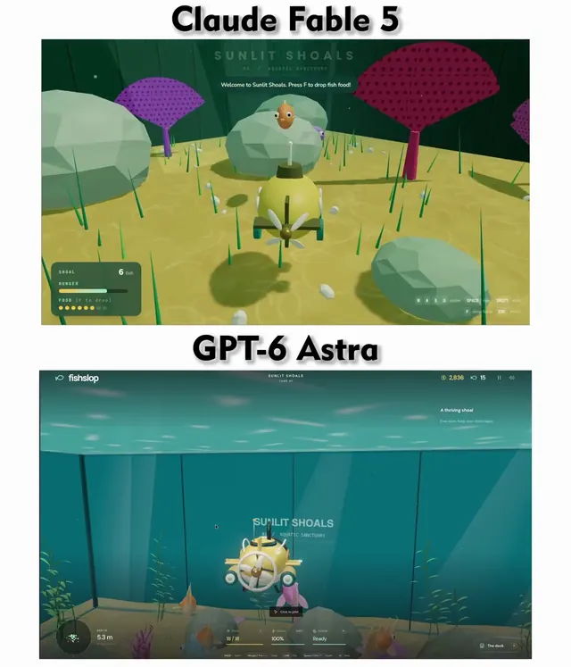</a>

**GPT-6 Astra** · Games · by [Tony出海](https://x.com/tonychuhai) · 2026-09-03

A comparison: GPT-6 Astra and Claude Fable 5 each built a 3D aquarium game from one prompt and a reference image. Astra's version is shown first.

<details>
<summary>Build brief by Wandy3D</summary>

```text
Build a browser-based 3D aquarium game in which the player pilots a small round yellow submersible inside a glass tank. Use a sandy floor, rounded grey-green rocks, branching coral, fan corals and swaying seagrass, with light rays falling through teal water. Fill the tank with colourful low-poly fish such as goldfish that swim in shoals and react to the submersible. Add a third-person follow camera, a minimal HUD with a score or fish counter, a progress bar, a depth or distance readout and a zone title like a sunlit shallows area. Show short messages when a new fish joins the shoal. Start from a reference image of the desired look and generate everything from a single prompt, using Three.js with no external assets. Done means the submersible steers smoothly, fish move believably and the tank looks lively and readable from the default camera.
```

</details>

[View on Wandy3D ↗](https://wandy3d.com/prompts/3d-aquarium-game-with-a-submersible-fish-shoals-and-coral-2095650251902239139?utm_source=github&utm_medium=referral&utm_campaign=awesome_3d_prompts) · [Original post](https://x.com/tonychuhai/status/2095650251902239139)

---

### [Foggy Three.js fantasy RPG with first- and third-person camera and army menu](https://wandy3d.com/prompts/foggy-three-js-fantasy-rpg-with-first-and-third-person-2095648440978174276?utm_source=github&utm_medium=referral&utm_campaign=awesome_3d_prompts)

<a href="https://wandy3d.com/prompts/foggy-three-js-fantasy-rpg-with-first-and-third-person-2095648440978174276?utm_source=github&amp;utm_medium=referral&amp;utm_campaign=awesome_3d_prompts">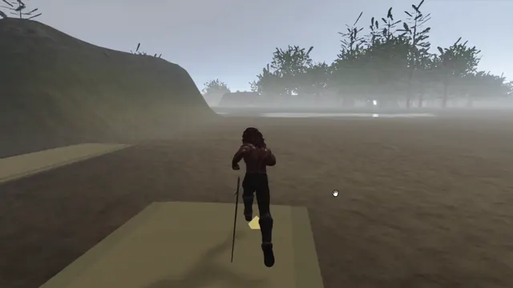</a>

**Claude Fable 5.1** · Games · by [Ryan Fitzpatrick](https://x.com/rfitzpatrick_io) · 2026-09-03

Claude Fable 5.1 updated a Three.js RPG prototype with switchable first- and third-person views, a misty castle road and a creature army screen.

<details>
<summary>Build brief by Wandy3D</summary>

```text
Extend a Three.js fantasy RPG prototype with switchable third-person and first-person cameras. Set the game in a misty, desaturated medieval landscape with a dirt road, rolling hills, reeds, stone buildings and a distant castle fading into fog. In third person, show a hooded warrior with a sword running along the road with a follow camera. In first person, show the hero's arm and blade in view with a small crosshair. Add a key to toggle the camera, smooth movement and a glowing ring marker for points of interest. Include a parchment-styled army screen with a row of creature cards, each opening a detail view with a portrait, stats and a short description, in the spirit of a classic turn-based strategy game combined with an open-world first-person RPG. Use a dark brown and gold UI. Done means the player can roam, switch views and open the army menus without errors.
```

</details>

[View on Wandy3D ↗](https://wandy3d.com/prompts/foggy-three-js-fantasy-rpg-with-first-and-third-person-2095648440978174276?utm_source=github&utm_medium=referral&utm_campaign=awesome_3d_prompts) · [Original post](https://x.com/rfitzpatrick_io/status/2095648440978174276)

---

### [Classic starship modeled in CAD with a bridge and 28 moving parts](https://wandy3d.com/prompts/classic-starship-modeled-in-cad-with-a-bridge-and-28-moving-2095641163441254676?utm_source=github&utm_medium=referral&utm_campaign=awesome_3d_prompts)

<a href="https://wandy3d.com/prompts/classic-starship-modeled-in-cad-with-a-bridge-and-28-moving-2095641163441254676?utm_source=github&amp;utm_medium=referral&amp;utm_campaign=awesome_3d_prompts">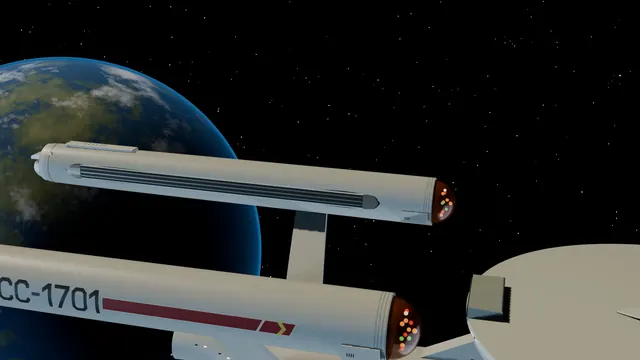</a>

**GPT-6 Astra** · Assets · by [Derya Unutmaz, MD](https://x.com/DeryaTR_) · 2026-09-03

GPT-6 Astra designed a retro-style Enterprise starship in a CAD program, then rendered an orbit video of it above Earth. The model is built for 3D printing.

<details>
<summary>Build brief by Wandy3D</summary>

```text
Build a detailed CAD model of a classic 1960s-style starship with a saucer section, a secondary hull, a connecting neck and two long engine nacelles with glowing copper-orange ends. Give it a pale grey hull with panel lines, a registry number and name painted on the saucer and nacelle, and a thin red stripe along the hull. Design it as an assembly of separate parts, around 28 of them moving, including a captain's bridge and a few interior areas, and keep the geometry clean enough to be 3D printed. Then render a cinematic fly-around of the finished model: a slow orbit past the saucer, a side pass along the nacelles, and a top-down pull-back, all set in front of a blue planet and a starfield. Open with a title card and close with a end card. Deliver the CAD files plus the rendered video of about 30 seconds. Done means the proportions read as the iconic ship from every angle and the camera moves are smooth.
```

</details>

[View on Wandy3D ↗](https://wandy3d.com/prompts/classic-starship-modeled-in-cad-with-a-bridge-and-28-moving-2095641163441254676?utm_source=github&utm_medium=referral&utm_campaign=awesome_3d_prompts) · [Original post](https://x.com/DeryaTR_/status/2095641163441254676)

---

### [Hillside villa with pool and sea view built in Blender, two-model comparison](https://wandy3d.com/prompts/hillside-villa-with-pool-and-sea-view-built-in-blender-two-2095636679264780481?utm_source=github&utm_medium=referral&utm_campaign=awesome_3d_prompts)

<a href="https://wandy3d.com/prompts/hillside-villa-with-pool-and-sea-view-built-in-blender-two-2095636679264780481?utm_source=github&amp;utm_medium=referral&amp;utm_campaign=awesome_3d_prompts">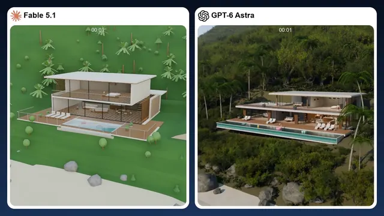</a>

**Claude Fable 5.1** · Scenes · by [Karan](https://x.com/karankendre) · 2026-09-03

Claude Fable 5.1 and GPT-6 Astra were given the same task: a Blender villa with pool and interiors. Compare their fly-throughs side by side.

<details>
<summary>Build brief by Wandy3D</summary>

```text
Build a Blender scene of a modern two-storey villa on a forested hillside above the sea. Use a flat white roof, large glass walls, a timber deck, a long infinity-style pool with loungers and a few floating pool toys, and an open living room with sofas, a kitchen island and a bedroom facing the water. Surround it with palm trees, dense green vegetation, rocks and a sandy bay. Deliver a Blender Python script that creates the geometry, materials and lighting, plus a camera path of about 20 seconds: start with an aerial view of the house, glide over the pool and terrace, move through the living room, kitchen and bedroom, then pull back out to the full exterior. Use bright daylight and soft interior light. Done means the house reads clearly from outside and inside, and the animated camera moves smoothly. If possible, run the same brief with a second model and compare the two results side by side.
```

</details>

[View on Wandy3D ↗](https://wandy3d.com/prompts/hillside-villa-with-pool-and-sea-view-built-in-blender-two-2095636679264780481?utm_source=github&utm_medium=referral&utm_campaign=awesome_3d_prompts) · [Original post](https://x.com/karankendre/status/2095636679264780481)

---

### [Vector-graphics trench run arcade shooter built in Unity](https://wandy3d.com/prompts/vector-graphics-trench-run-arcade-shooter-built-in-unity-2095630044102279312?utm_source=github&utm_medium=referral&utm_campaign=awesome_3d_prompts)

<a href="https://wandy3d.com/prompts/vector-graphics-trench-run-arcade-shooter-built-in-unity-2095630044102279312?utm_source=github&amp;utm_medium=referral&amp;utm_campaign=awesome_3d_prompts">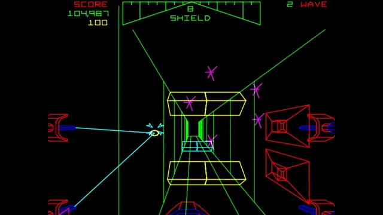</a>

**GPT-6 Astra** · Games · by [Ronald Mannak](https://x.com/ronaldmannak) · 2026-09-03

A Star Wars-style trench run was recreated by GPT-6 Astra in Unity as a wireframe arcade shooter with waves, towers and a shield HUD.

<details>
<summary>Build brief by Wandy3D</summary>

```text
Build a retro arcade space shooter in Unity that recreates a classic vector-graphics trench run. Render everything as glowing wireframe lines on a pure black background: enemy fighters, incoming fireballs, towers on a planetary surface, and a narrow trench with angular walls and obstacles. Use a first-person cockpit view with red frame brackets at the screen edges and a green HUD showing score, wave number, shield level and remaining towers. Let the player aim a crosshair and fire paired laser bolts at fighters and projectiles, with colorful line-burst explosions when targets die. Add waves of rising difficulty, bonus points for towers and a shield that drops on hits. Keep sound effects simple and arcade-like. Deliver a playable Unity project or build. Done means a full wave cycle plays from surface fighting to the trench, with readable HUD values and responsive aiming.
```

</details>

[View on Wandy3D ↗](https://wandy3d.com/prompts/vector-graphics-trench-run-arcade-shooter-built-in-unity-2095630044102279312?utm_source=github&utm_medium=referral&utm_campaign=awesome_3d_prompts) · [Original post](https://x.com/ronaldmannak/status/2095630044102279312)

---

### [Photoreal modern house walkthrough built in Unreal from a blueprint](https://wandy3d.com/prompts/photoreal-modern-house-walkthrough-built-in-unreal-from-a-2095624712244072551?utm_source=github&utm_medium=referral&utm_campaign=awesome_3d_prompts)

<a href="https://wandy3d.com/prompts/photoreal-modern-house-walkthrough-built-in-unreal-from-a-2095624712244072551?utm_source=github&amp;utm_medium=referral&amp;utm_campaign=awesome_3d_prompts">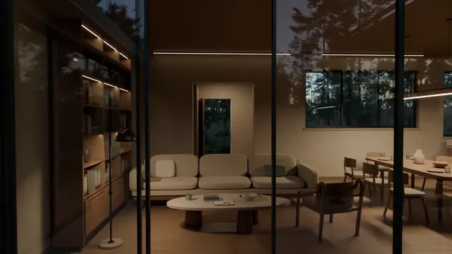</a>

**GPT-6 Astra** · Scenes · by [Linus ✦ Ekenstam](https://x.com/LinusEkenstam) · 2026-09-03

GPT-6 Astra took a blueprint, modeled the furniture in Blender and assembled an Unreal archviz: a dusk walkthrough of a wood-and-cream forest house.

<details>
<summary>Build brief by Wandy3D</summary>

```text
Build a photoreal architectural visualization of a small modern house in Unreal Engine, starting from a floor-plan blueprint. Model the furniture and props in Blender and import them. Rooms: an open living area with a low cream sofa, oval coffee table and wooden dining set; a kitchen with a pale counter island and bar stools; a study with a wooden desk, monitor, lamp and tall bookshelves; a bedroom with a green-and-cream bed and a sliding glass wall facing a pine forest terrace. Use a warm, muted palette of oak, cream and sage green, with soft evening lighting and lamps glowing against the dark woods outside. Add a slow camera path that glides through every room. Done when the whole house is furnished, lit consistently and the walkthrough plays smoothly from room to room.
```

</details>

[View on Wandy3D ↗](https://wandy3d.com/prompts/photoreal-modern-house-walkthrough-built-in-unreal-from-a-2095624712244072551?utm_source=github&utm_medium=referral&utm_campaign=awesome_3d_prompts) · [Original post](https://x.com/LinusEkenstam/status/2095624712244072551)

---

### [Explorable low-poly Unity city with glass towers, palms and traffic](https://wandy3d.com/prompts/explorable-low-poly-unity-city-with-glass-towers-palms-and-2095623452678144366?utm_source=github&utm_medium=referral&utm_campaign=awesome_3d_prompts)

<a href="https://wandy3d.com/prompts/explorable-low-poly-unity-city-with-glass-towers-palms-and-2095623452678144366?utm_source=github&amp;utm_medium=referral&amp;utm_campaign=awesome_3d_prompts">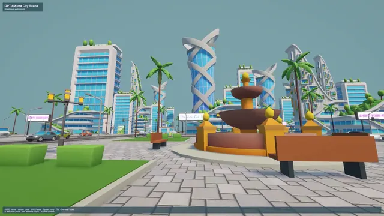</a>

**GPT-6 Astra** · Scenes · by [Md Ismail Šojal 🕷️](https://x.com/0x0SojalSec) · 2026-09-03

GPT-6 Astra assembled a stylized Unity city from a text request: spiral towers, palm-lined roads, a fountain plaza and cars you can wander past.

<details>
<summary>Build brief by Wandy3D</summary>

```text
Build an explorable stylized 3D city in Unity. Use a bright, cartoonish low-poly look with a pale teal sky, blue glass towers with spiral white frames and rooftop greenery, curved modern buildings, palm trees, street lamps, benches and a colorful orange fountain in a paved plaza. Lay out asphalt roads with lane markings, crosswalks and sidewalks, and populate them with colorful cars that drive along the lanes. Add billboards on posts. Provide a first-person camera that moves at street level so the user can wander through the plaza and along the avenues. Done when the city reads as one coherent scene, vehicles move, and the camera can travel from the plaza down the main road without clipping.
```

</details>

[View on Wandy3D ↗](https://wandy3d.com/prompts/explorable-low-poly-unity-city-with-glass-towers-palms-and-2095623452678144366?utm_source=github&utm_medium=referral&utm_campaign=awesome_3d_prompts) · [Original post](https://x.com/0x0SojalSec/status/2095623452678144366)

---

### [3D laptop mockup editor with pasted screens, camera and blur controls](https://wandy3d.com/prompts/3d-laptop-mockup-editor-with-pasted-screens-camera-and-blur-2095619319690400253?utm_source=github&utm_medium=referral&utm_campaign=awesome_3d_prompts)

<a href="https://wandy3d.com/prompts/3d-laptop-mockup-editor-with-pasted-screens-camera-and-blur-2095619319690400253?utm_source=github&amp;utm_medium=referral&amp;utm_campaign=awesome_3d_prompts">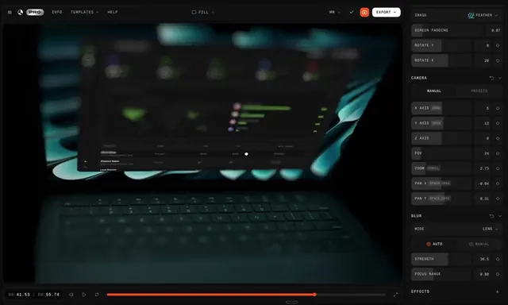</a>

**GPT-6 Astra** · Interactive · by [Josh Millgate](https://x.com/joshmillgate) · 2026-09-03

GPT-6 Astra one-shotted a dark mockup tool: paste an image onto a 3D laptop screen, then tune camera, blur and lighting and export the shot.

<details>
<summary>Build brief by Wandy3D</summary>

```text
Build a browser-based 3D mockup editor with a dark, minimal interface and orange accents. The main viewport shows a realistic laptop floating against a black background with teal rim lighting, soft depth-of-field blur and a faint reflection. A right-hand inspector offers sliders for camera angle, field of view, blur, lighting and effects, plus a timeline bar with playback and an Export button. Let the user paste or drop an image, choose to replace the screen media or add a new shot, and see it mapped onto the laptop display immediately. Animate smooth camera moves between shots. Done when pasting a screenshot updates the screen texture, sliders change the render live, and the sequence can be played back.
```

</details>

[View on Wandy3D ↗](https://wandy3d.com/prompts/3d-laptop-mockup-editor-with-pasted-screens-camera-and-blur-2095619319690400253?utm_source=github&utm_medium=referral&utm_campaign=awesome_3d_prompts) · [Original post](https://x.com/joshmillgate/status/2095619319690400253)

---

### [Cinematic real-estate tour of a modern redwood estate built from listing photos](https://wandy3d.com/prompts/cinematic-real-estate-tour-of-a-modern-redwood-estate-built-2095612137582526615?utm_source=github&utm_medium=referral&utm_campaign=awesome_3d_prompts)

<a href="https://wandy3d.com/prompts/cinematic-real-estate-tour-of-a-modern-redwood-estate-built-2095612137582526615?utm_source=github&amp;utm_medium=referral&amp;utm_campaign=awesome_3d_prompts">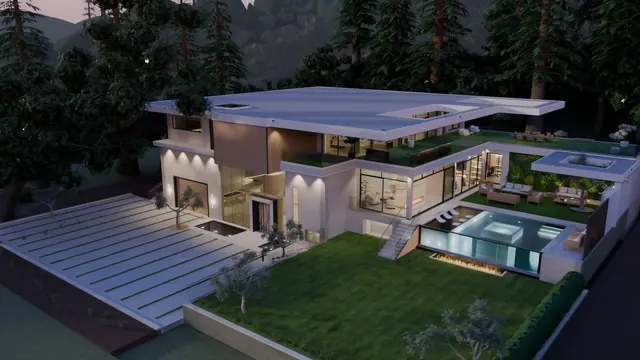</a>

**GPT-6 Astra** · Animation · by [Yunfan Ye](https://x.com/realYunfanYe) · 2026-09-03

GPT-6 Astra modeled a luxury house from listing photos and rendered a promo tour with title cards, interiors and a dusk aerial. A one-shot result.

<details>
<summary>Build brief by Wandy3D</summary>

```text
Build a cinematic real-estate promotion video from a set of listing photos of a modern luxury house. First reconstruct the house as a 3D model: a two-storey contemporary villa with flat cantilevered roofs, large glass walls, a pool, a lawn and a forest of tall redwoods around it. Furnish the interiors in a warm, minimal palette of cream, pale oak and soft stone, with a sunken round sofa lounge, a spiral staircase, a long stone kitchen island and a green plant wall. Light the scenes with warm indirect strips and a dusk sky. Then animate a camera tour of about a minute: an opening exterior shot with an elegant thin-type title card showing the address, smooth walk-throughs of the rooms, a rooftop pass, a night-time aerial over the pool and garden, and a closing title card. Render it as one continuous video with gentle ambient music. Done means the tour flows through the whole property without cuts that break continuity, and the architecture matches the supplied photos.
```

</details>

[View on Wandy3D ↗](https://wandy3d.com/prompts/cinematic-real-estate-tour-of-a-modern-redwood-estate-built-2095612137582526615?utm_source=github&utm_medium=referral&utm_campaign=awesome_3d_prompts) · [Original post](https://x.com/realYunfanYe/status/2095612137582526615)

---

### [Street-by-street Manhattan built in Unreal Engine, from aerial view to brick facades](https://wandy3d.com/prompts/street-by-street-manhattan-built-in-unreal-engine-from-2095609734845927525?utm_source=github&utm_medium=referral&utm_campaign=awesome_3d_prompts)

<a href="https://wandy3d.com/prompts/street-by-street-manhattan-built-in-unreal-engine-from-2095609734845927525?utm_source=github&amp;utm_medium=referral&amp;utm_campaign=awesome_3d_prompts">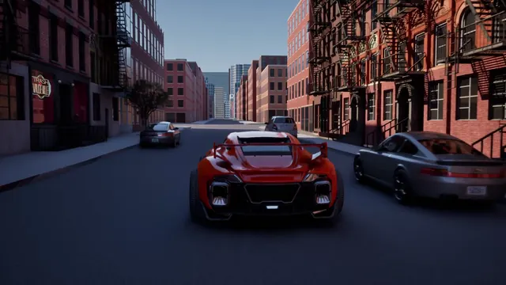</a>

**GPT-6 Astra** · Scenes · by [Matt Shumer](https://x.com/mattshumer_) · 2026-09-03

GPT-6 Astra assembled a Manhattan in Unreal Engine, detailing one street at a time. The clip runs from Central Park to fire escapes and a skyline.

<details>
<summary>Build brief by Wandy3D</summary>

```text
Build a detailed Manhattan open-world scene in Unreal Engine and record a short camera sequence through it. Start with a high aerial view of the island: the rivers, the long green rectangle of the park, dense blocks and a skyline of towers. Then work street by street at ground level: red brick tenement buildings with fire escapes, arched windows and cornices, a one-way street sign, a glowing neon shop sign, parked cars and a red sports car driving along the avenue. Use natural daylight with long soft shadows, realistic materials and believable street furniture. Keep the grid layout and landmarks recognisable. Deliver the Unreal project plus a roughly thirty-second video that cuts between the aerial view, signage close-ups, facade pans, the car chase shot and a final skyline pass over the water. Done means every street you show is dressed consistently, with no empty or placeholder blocks in frame.
```

</details>

[View on Wandy3D ↗](https://wandy3d.com/prompts/street-by-street-manhattan-built-in-unreal-engine-from-2095609734845927525?utm_source=github&utm_medium=referral&utm_campaign=awesome_3d_prompts) · [Original post](https://x.com/mattshumer_/status/2095609734845927525)

---

### [Browser 3D aquarium game: pilot a yellow submarine pod among goldfish and corals](https://wandy3d.com/prompts/browser-3d-aquarium-game-pilot-a-yellow-submarine-pod-among-2095599934766764338?utm_source=github&utm_medium=referral&utm_campaign=awesome_3d_prompts)

<a href="https://wandy3d.com/prompts/browser-3d-aquarium-game-pilot-a-yellow-submarine-pod-among-2095599934766764338?utm_source=github&amp;utm_medium=referral&amp;utm_campaign=awesome_3d_prompts">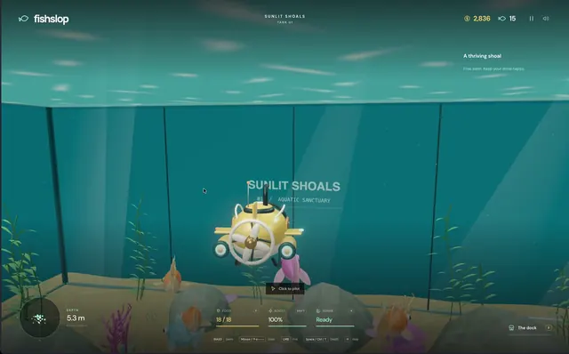</a>

**GPT-6 Astra** · Games · by [Theo - t3.gg](https://x.com/theo) · 2026-09-03

A one-shot browser game from GPT-6 Astra: a tiny submarine glides through a teal glass tank full of fish, coral and kelp, with a score HUD.

<details>
<summary>Build brief by Wandy3D</summary>

```text
Build a one-file browser 3D game set inside a glass aquarium tank. The player pilots a small round yellow submarine pod along a sandy floor dotted with smooth grey rocks, pink and purple corals, orange sea fans and swaying green kelp. Shoals of stylised goldfish and small coloured fish swim around and react to the pod. Use a calm teal-blue palette with light shafts from above, a rippling water surface seen from below and soft depth fog. Add a minimal HUD with a score counter, a distance readout, health or energy bars and a level title card reading Sunlit Shoals that fades in and out. Controls: keyboard to steer and move the pod, with a smooth chase camera. Give the pod a small interaction with the fish, such as scooping or scaring them, that raises the score. Model every object from simple procedural geometry so the game runs smoothly in the browser. Done means the scene loads instantly and can be played for several minutes.
```

</details>

[View on Wandy3D ↗](https://wandy3d.com/prompts/browser-3d-aquarium-game-pilot-a-yellow-submarine-pod-among-2095599934766764338?utm_source=github&utm_medium=referral&utm_campaign=awesome_3d_prompts) · [Original post](https://x.com/theo/status/2095599934766764338)

---

### [Beach villa rebuilt in Blender from one photo, with furniture and props, at 60 fps](https://wandy3d.com/prompts/beach-villa-rebuilt-in-blender-from-one-photo-with-furniture-2095598645190291775?utm_source=github&utm_medium=referral&utm_campaign=awesome_3d_prompts)

<a href="https://wandy3d.com/prompts/beach-villa-rebuilt-in-blender-from-one-photo-with-furniture-2095598645190291775?utm_source=github&amp;utm_medium=referral&amp;utm_campaign=awesome_3d_prompts">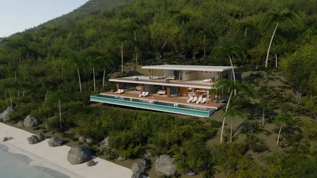</a>

**GPT-6 Astra** · Scenes · by [Tom Krcha](https://x.com/tomkrcha) · 2026-09-03

From a single house image, GPT-6 Astra rebuilt a tropical villa in Blender with editable geometry, interiors and toys, plus a real-time walkthrough.

<details>
<summary>Build brief by Wandy3D</summary>

```text
Build a full 3D reconstruction of a house from a single reference image, working in Blender. Recreate a modern two-storey beach villa on a forested tropical hillside with an infinity pool, sun loungers, a deck and large sliding glass walls facing the sea. Model the interior in detail: a living area with wood-framed sofas, a coffee table, a kitchen island, a bedroom with an ocean view, plus smaller objects such as toys, appliances, cushions and drinks. Use warm timber, cream stone and soft white fabrics, bright daylight and a turquoise sea with a sandy shore. Keep the geometry clean and editable so a person can adjust objects by hand. Export it so it runs at a smooth sixty frames per second as a locally rendered real-time walkthrough. Capture a camera path from a distant coastal aerial, down to the pool deck, through the living room to the bedroom, and back out. Done means furniture and small props match the reference image.
```

</details>

[View on Wandy3D ↗](https://wandy3d.com/prompts/beach-villa-rebuilt-in-blender-from-one-photo-with-furniture-2095598645190291775?utm_source=github&utm_medium=referral&utm_campaign=awesome_3d_prompts) · [Original post](https://x.com/tomkrcha/status/2095598645190291775)

---

[← Previous](catalog.en.5.md) · page 6 of 9 · [Next →](catalog.en.7.md)

Prompts, videos and images belong to their authors ([RIGHTS.md](../RIGHTS.md)). Our editorial text is [CC BY 4.0](../LICENSE). Know a great prompt with a visible result? [Suggest it](https://github.com/wornoxgames/awesome-3d-prompts/issues/new?template=suggest.md). Are you an author and want an entry changed or removed? [Tell us](https://github.com/wornoxgames/awesome-3d-prompts/issues/new?template=removal.md).
