<!-- Generated file: edits are overwritten. -->

# Awesome 3D Prompts — カタログ 2/9

[← Awesome 3D Prompts](../README.md) · [English](catalog.en.1.md) · [Русский](catalog.ru.1.md) · **日本語** · [中文](catalog.zh.1.md)

[← 前へ](catalog.ja.1.md) · 9 ページ中 2 ページ目 · [次へ →](catalog.ja.3.md)

### [一言の依頼でBlenderに作らせたふわふわモルモット](https://wandy3d.com/ja/prompts/fluffy-guinea-pig-modeled-in-blender-from-a-single-short-2103482826519986544?utm_source=github&utm_medium=referral&utm_campaign=awesome_3d_prompts)

<a href="https://wandy3d.com/ja/prompts/fluffy-guinea-pig-modeled-in-blender-from-a-single-short-2103482826519986544?utm_source=github&amp;utm_medium=referral&amp;utm_campaign=awesome_3d_prompts"></a>

**GPT-6 Astra** · アセット · 作者 [かよこ](https://x.com/kayokojoe) · 2026-09-25

CodexのGPT-6 Astraが、参考写真なしでBlender上に白と茶色の毛並みのモルモットをモデリングしました。

<details>
<summary>プロンプト</summary>

```text
Blenderでモルモットを作って
```

</details>

[Wandy3D で見る ↗](https://wandy3d.com/ja/prompts/fluffy-guinea-pig-modeled-in-blender-from-a-single-short-2103482826519986544?utm_source=github&utm_medium=referral&utm_campaign=awesome_3d_prompts) · [元の投稿](https://x.com/kayokojoe/status/2103482826519986544)

---

### [歩ける桜の街：商店街、神社、電車が走るアニメ調のタウン](https://wandy3d.com/ja/prompts/walkable-anime-cherry-blossom-town-with-shops-shrine-and-2103480085319942353?utm_source=github&utm_medium=referral&utm_campaign=awesome_3d_prompts)

<a href="https://wandy3d.com/ja/prompts/walkable-anime-cherry-blossom-town-with-shops-shrine-and-2103480085319942353?utm_source=github&amp;utm_medium=referral&amp;utm_campaign=awesome_3d_prompts">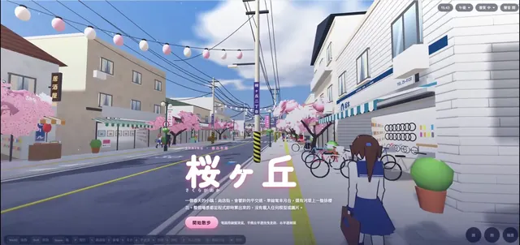</a>

**Claude Opus 5.5** · シーン · 作者 [Good FortuneX](https://x.com/pound75423) · 2026-09-25

Claude Opus 5.5が長い構成プロンプトから、商店街と神社、電車が停まる駅を備えたThree.js製の街を生成しました。

<details>
<summary>プロンプト</summary>

```text
Please use Three.js to build a "freely walkable 3D anime-style cherry blossom town" as a single HTML file, then publish it as a shareable web page.

[Technical constraints]
- Use only three.js r128 (UMD build) from cdnjs. Do not load any external models or images — generate all models, textures, and shop signs procedurally with code and Canvas.
- Use original content for all shop names, signs, and characters. Do not imitate any real brand or existing work.
- Use MeshStandardMaterial or MeshPhongMaterial. Avoid high metalness and environment reflection maps (on some computers they make objects render with no color).
- Merge static objects by material into a small number of meshes so it runs on ordinary computers; provide a High / Medium / Low quality switch.

[Scene: "桜ヶ丘 (Sakuragaoka)", a small Japanese town on a spring afternoon]
1. Shopping street: a north–south main street with 20+ shops on both sides (ramen shop, café, bicycle shop, bookstore, florist, Japanese sweets shop, drugstore, convenience store, etc.). Each shop has: a multi-line sign (shop name + English name + phone number), a striped awning with a scalloped valance, a recessed storefront with an interior that has visible depth, and a sidewalk display (fruit crates, magazine rack, food-sample case, a spinning barber pole). Upper floors have windows, AC units, balconies with hanging laundry, and rooftop TV antennas.
2. Street details: utility poles with lots of overhead wires, decorative street lamps with shopping-street banners, festival lantern strings, square sidewalk tiles with yellow tactile paving, drain grates, "止まれ" stop signs, and a bus stop.
3. Level crossing and trains: a double-track railway. When a train approaches, the crossing's red lights flash alternately, the bell rings, and the gates lower. A two-car commuter train stops at the station for about 14 seconds and then departs. The windows are transparent, so the seats and hand straps inside are visible.
4. Island-platform station: station name board, platform canopy, benches, and a vending machine.
5. Sakura plaza: a 100-year-old cherry tree with a circular bench around it.
6. Inari shrine: a large vermilion torii plus a row of small torii, stone lanterns, fox statues, a worship hall (copper-green roof, chigi, katsuogi, offering box, hanging bell), a purification fountain (temizuya), jizo statues, ema plaques, a sacred tree, and gravel ground.
7. Riverside levee: two rows of cherry trees forming a blossom tunnel, lanterns, a river, houses on the far bank, and distant mountains.

[How to build the cherry trees (key part)]
- Model them on Somei-Yoshino: the trunk splits low into 3–4 main limbs, which branch recursively three more levels. Branches spread outward and droop slightly at the tips, giving an overall umbrella shape.
- Build the canopy from tens of thousands of "blossom cluster cards": draw five-petal flowers on Canvas (notched petal tips, reddish centers, stamens) with a soft pink base layer behind the flowers. Use alphaTest and double-sided rendering for the cards.
- Add a few pink filler clumps inside the canopy for volume. The outer and upper parts are brighter; the inner and lower parts have warm rose-toned shadows.
- Use pale pink, not neon pink. The canopy sways gently in the wind, a carpet of fallen petals covers the ground under each tree, and petals keep falling through the air (done in a shader).

[Characters]
- 20+ anime-style students and townspeople: walking animation with knee and elbow joints, anime faces drawn on Canvas (large eyes, highlights, blush) that blink, bangs made of separate strands, a variety of hairstyles (long, bob, swinging ponytail, twin tails), sailor uniforms / blazer uniforms / casual clothes. Render characters with two-tone cel shading and a dark outline.
- People walk along the street, chat in the plaza, wait on the platform, pray at the shrine, and ride bicycles along the levee.

[Vehicles]
```

[…（以下省略。全文は Wandy3D で）](https://wandy3d.com/ja/prompts/walkable-anime-cherry-blossom-town-with-shops-shrine-and-2103480085319942353?utm_source=github&utm_medium=referral&utm_campaign=awesome_3d_prompts)

</details>

[Wandy3D で見る ↗](https://wandy3d.com/ja/prompts/walkable-anime-cherry-blossom-town-with-shops-shrine-and-2103480085319942353?utm_source=github&utm_medium=referral&utm_campaign=awesome_3d_prompts) · [元の投稿](https://x.com/pound75423/status/2103480085319942353)

---

### [BlenderでVRChat用ドレスを制作、Unityで踊らせたアバター衣装](https://wandy3d.com/ja/prompts/vrchat-avatar-dress-modeled-in-blender-shown-dancing-in-2103456264785424530?utm_source=github&utm_medium=referral&utm_campaign=awesome_3d_prompts)

<a href="https://wandy3d.com/ja/prompts/vrchat-avatar-dress-modeled-in-blender-shown-dancing-in-2103456264785424530?utm_source=github&amp;utm_medium=referral&amp;utm_campaign=awesome_3d_prompts">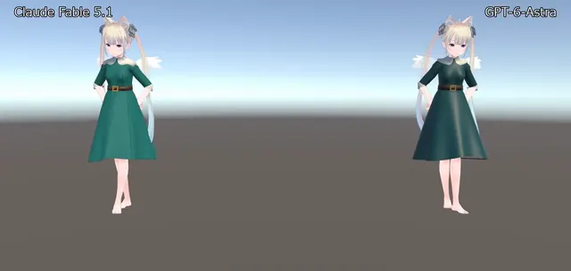</a>

**Claude Fable 5.1** · アセット · 作者 [のわ〜る👼🍆🐄](https://x.com/Noir4247) · 2026-09-25

比較作例：Claude Fable 5.1とGPT-6 Astraが、デザイン画を基にBlenderで緑のVRChat衣装を作成。ウェイトや物理の指示はなしです。

<details>
<summary>プロンプト</summary>

```text
VRChat用の衣装作って
```

</details>

[Wandy3D で見る ↗](https://wandy3d.com/ja/prompts/vrchat-avatar-dress-modeled-in-blender-shown-dancing-in-2103456264785424530?utm_source=github&utm_medium=referral&utm_campaign=awesome_3d_prompts) · [元の投稿](https://x.com/Noir4247/status/2103456264785424530)

---

### [キネティックタイポとドット表現の15秒モーションデザインリール](https://wandy3d.com/ja/prompts/15-second-motion-design-showreel-with-kinetic-type-and-dot-2103449416325890146?utm_source=github&utm_medium=referral&utm_campaign=awesome_3d_prompts)

<a href="https://wandy3d.com/ja/prompts/15-second-motion-design-showreel-with-kinetic-type-and-dot-2103449416325890146?utm_source=github&amp;utm_medium=referral&amp;utm_campaign=awesome_3d_prompts">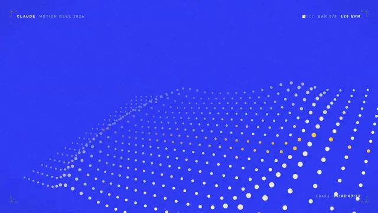</a>

**Claude Opus 5.5** · アニメーション · 作者 [Ajith](https://x.com/ajith_io) · 2026-09-25

Claude Opus 5.5 への一文の依頼で、動く文字、ドットの球体、ワイヤーキューブ、文字のリングを色面に重ねたリールが完成。

<details>
<summary>プロンプト</summary>

```text
make a dynamic 15-second motion graphics video that shows what an incredible motion designer you are, like it's your showreel for a résumé. go all out.
```

</details>

[Wandy3D で見る ↗](https://wandy3d.com/ja/prompts/15-second-motion-design-showreel-with-kinetic-type-and-dot-2103449416325890146?utm_source=github&utm_medium=referral&utm_campaign=awesome_3d_prompts) · [元の投稿](https://x.com/ajith_io/status/2103449416325890146)

---

### [WebGPUで動くソフトボディのジェリー・ドラゴンフルーツ](https://wandy3d.com/ja/prompts/interactive-webgpu-jelly-dragon-fruit-with-soft-body-physics-2103433535604265052?utm_source=github&utm_medium=referral&utm_campaign=awesome_3d_prompts)

<a href="https://wandy3d.com/ja/prompts/interactive-webgpu-jelly-dragon-fruit-with-soft-body-physics-2103433535604265052?utm_source=github&amp;utm_medium=referral&amp;utm_campaign=awesome_3d_prompts">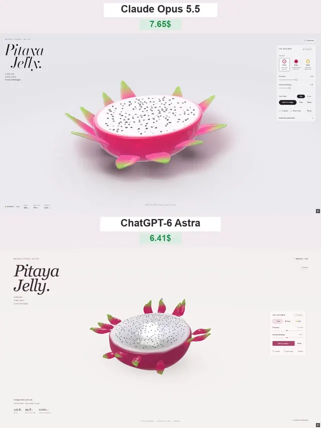</a>

**Claude Opus 5.5** · インタラクティブ · 作者 [Vib3Coded](https://x.com/vib3coded) · 2026-09-25

比較作例：Claude Opus 5.5とGPT-6 Astraが、引っ張れるジェリー状ドラゴンフルーツを制作。Opusは硬めで艶、Astraはより柔らかい挙動です。

<details>
<summary>プロンプト</summary>

```text
Create an interactive 3D scene called “Pitaya Jelly” — a dragon fruit half made of soft, translucent jelly. Build the entire project in a single HTML file using genuine WebGPU rendering and WGSL shaders. Do not use premade models or image assets.

APPEARANCE

A large dragon fruit half resting cut-side up on a light studio surface.
Rich raspberry-pink skin, a thin pale inner rind, and pearly white flesh.
Approximately 250 tiny black seeds distributed naturally across the flesh.
12–14 fleshy peel petals around the fruit, transitioning from pink bases to green tips.
A glossy, wet surface with light refraction, small internal bubbles, and a soft contact shadow.
The material should look like soft gummy candy, not rigid plastic. Preserve saturated colors without blown-out highlights.

PHYSICS AND INTERACTION

Implement genuine soft-body deformation using a volumetric mesh with elastic connections and volume-preserving constraints, such as XPBD.
Users can grab the flesh with a mouse or finger, stretch it, and release it.
Deformation should concentrate around the grabbed point rather than simply translating the entire object.
After release, the fruit should wobble, jiggle, and gradually recover its original shape.
Make the peel petals individually draggable. They should be softer than the flesh, bending and springing back while remaining attached to the fruit.
Seeds must follow the deforming surface without floating away or sinking into the flesh.
Keep the simulation stable during strong pulls, with floor contact and protection against inverted elements.

VISUAL DESIGN

Use a minimal, light-themed studio interface with an editorial aesthetic: generous whitespace, thin borders, restrained controls, and no unnecessary decoration.

Top left:
“MATERIAL STUDIES / NO. 019”
A large italic serif heading on two lines:
“Pitaya Jelly.”

Below it:
“A little wild.”
“A little sweet.”
“A very soft dragon.”
On the right, add a floating panel titled “THE SPECIMEN” containing:

Density badge: ρ 1.04 g/cm³.
Three presets:
Pearl — white flesh and pink skin.
Ruby — raspberry-colored flesh and pink skin.
Gold — pale flesh and golden skin.
Firmness and Internal damping sliders with visible values.
“Give it a nudge” and “Reset” buttons.

“¼ speed” and “Show mesh” checkboxes.

A “Pause” button.
Also include:
A fullscreen button with an exit option.
A “WEBGPU · LIVE” status indicator.
Live readouts for mass, percentage of rest volume, and kinetic energy.
A short interaction hint: “Pull the flesh. Tug a petal. Let go.”
A collapsible “Inside the experiment” section explaining the implementation accurately.
TECHNICAL REQUIREMENTS
Deliver one self-contained file named pitaya-jelly-webgpu.html.

Use actual WebGPU rendering, not a Canvas 2D imitation.

Build all geometry procedurally.
Use thickness-aware refraction, Fresnel reflections, and soft studio lighting.
Use a fixed simulation timestep for consistent behavior.
Support desktop and touch interaction with a responsive layout.
Avoid expensive geometry reconstruction or shader compilation during dragging.

Show a clear fallback message when WebGPU is unavailable.

Verify dragging, release, shape recovery, presets, reset, pause, fullscreen, and mobile layout.
The main priorities are convincing jelly-like behavior, beautiful materials, and satisfying interaction. The result should feel like a polished, playable material experiment.
```

</details>

[Wandy3D で見る ↗](https://wandy3d.com/ja/prompts/interactive-webgpu-jelly-dragon-fruit-with-soft-body-physics-2103433535604265052?utm_source=github&utm_medium=referral&utm_campaign=awesome_3d_prompts) · [元の投稿](https://x.com/vib3coded/status/2103433535604265052)

---

### [人生のサイクルを描く20秒のモーショングラフィックス](https://wandy3d.com/ja/prompts/20-second-motion-graphics-showreel-about-the-cycle-of-life-2103428454355980558?utm_source=github&utm_medium=referral&utm_campaign=awesome_3d_prompts)

<a href="https://wandy3d.com/ja/prompts/20-second-motion-graphics-showreel-about-the-cycle-of-life-2103428454355980558?utm_source=github&amp;utm_medium=referral&amp;utm_campaign=awesome_3d_prompts">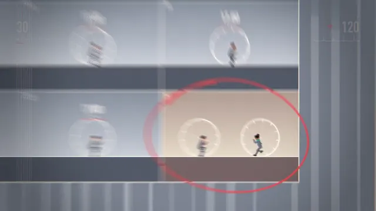</a>

**Claude Opus 5.5** · アニメーション · 作者 [Loïc](https://x.com/loicRambo) · 2026-09-25

Claude Opus 5.5が、子供時代から会社員、家族、老年までを一人の主人公で描くループ可能な2Dアニメを生成。心拍表示付きです。

<details>
<summary>プロンプト</summary>

```text
make a dynamic 20-second motion graphics and animation video that shows what an incredible motion designer and animator you are, like it's your showreel for a résumé. make it about the cycle of life showing the same individual going from childhood to adolescence to the 9-5 cycle, to family life to elder life and death, then cutting ready to loop to the beginning.  go all out , use whatever you need.
```

</details>

[Wandy3D で見る ↗](https://wandy3d.com/ja/prompts/20-second-motion-graphics-showreel-about-the-cycle-of-life-2103428454355980558?utm_source=github&utm_medium=referral&utm_campaign=awesome_3d_prompts) · [元の投稿](https://x.com/loicRambo/status/2103428454355980558)

---

### [月夜の糸杉の沼を漂う小舟、反射する水面のThree.jsシーン](https://wandy3d.com/ja/prompts/moonlit-cypress-swamp-in-three-js-with-reflective-water-and-2103310302993621090?utm_source=github&utm_medium=referral&utm_campaign=awesome_3d_prompts)

<a href="https://wandy3d.com/ja/prompts/moonlit-cypress-swamp-in-three-js-with-reflective-water-and-2103310302993621090?utm_source=github&amp;utm_medium=referral&amp;utm_campaign=awesome_3d_prompts">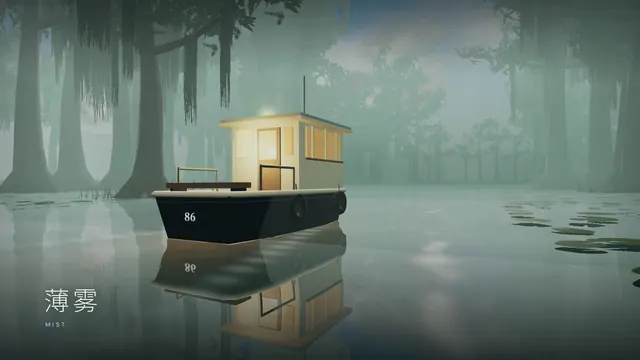</a>

**GPT-6 Astra** · シーン · 作者 [YouWare](https://x.com/YouWareAI) · 2026-09-25

GPT-6 Astraが、霧の沼を灯りの付いた小舟が漂う静かなWeb世界を生成。見どころは水のシェーダーで、昼夜の切り替えもあります。

<details>
<summary>プロンプト</summary>

```text
Build a browser experience in Three.js called STILLWATER.  Tone: a moonlit swamp you get lost in. Not a game with enemies. Not photoreal Unreal. A quiet, expensive-looking web world where the water reflections are the feature. People should stare at the water for an unhealthy amount of time.  SETTING - Location title: THE DEEP SWAMP - Time on the HUD: 19:26 - First named place: Heron bend - Tagline under the place name: "Leave a little room for the wild." - Discovery toast when you arrive: "Discovered: Heron bend"  WORLD A flooded cypress swamp at moonrise / late dusk. - Tall knobby-kneed trees standing in black-green water - Spanish moss hanging in long strands - Lily pads clustered along the banks - Narrow winding channel that opens into a wider bend - Thick volumetric fog, teal-green distance, purple-pink cloudy sky - A bright moon with a long broken reflection path on the water - A few birds crossing the sky - Warm cabin light from the boat punching through the gloom  WATER (do not cheap out) This is the hero. - Real-time reflections of trees, moon, fog and boat lights - Gentle swell, not ocean waves - Lily pads that sit on the surface and bob - Shoreline foam / dark tannin water near roots - Screen-space or planar reflections good enough that the moon path feels cinematic - Keep 60fps. LOD the trees, instanced foliage.  BOAT A small weathered cabin skiff / workboat. - Hull number 86 on the stern - White cabin, dark blue hull, warm interior lamps - Idle drift through the channel, optional slow guided tour - HUD speed around 15.9 KNOTS - Mode label: GUIDED DRIFT Player can look around. Boat can be followed from a cinematic chase / side orbit.  CAMERA - Start on a three-quarter of the boat in the trees - Drift behind the stern down the moonlit lane - Occasional side slide past a foreground trunk - Drag to look - Optional PHOTO MODE Feel like a nature documentary, not an FPS.  UI — editorial, not gamey Top-left: small mark + STILLWATER Top-center: THE DEEP SWAMP / 19:26, a compass heading (e.g. 314°) Top-right: quiet utility icons Bottom-left:   EXPLORING STILLWATER   Heron bend   Leave a little room for the wild.   15.9 KNOTS    GUIDED DRIFT Bottom-right: PHOTO MODE, fps, Pause Center-bottom: small toast "Discovered: Heron bend" Tiny hint row: shaders / water / drag to look / photos / wildlife  Look: dark filmic grade, muted greens, magenta clouds, one moon highlight. Taste over realism. No bloated debug GUI.  TECH Three.js in the browser. Procedural / instanced nature. Custom water shader. Fog. Soft shadows or baked-looking dusk lighting. No asset-store swamp pack if you can author it.  DO NOT add combat, inventory, jump scares, or a treasure hunt. Something can lurk underwater later — not now.
```

</details>

[Wandy3D で見る ↗](https://wandy3d.com/ja/prompts/moonlit-cypress-swamp-in-three-js-with-reflective-water-and-2103310302993621090?utm_source=github&utm_medium=referral&utm_campaign=awesome_3d_prompts) · [元の投稿](https://x.com/YouWareAI/status/2103310302993621090)

---

### [洋上プラットフォームからのロケット打ち上げ、Three.js単一HTML](https://wandy3d.com/ja/prompts/cinematic-ocean-platform-rocket-launch-in-one-three-js-html-2103303449831964679?utm_source=github&utm_medium=referral&utm_campaign=awesome_3d_prompts)

<a href="https://wandy3d.com/ja/prompts/cinematic-ocean-platform-rocket-launch-in-one-three-js-html-2103303449831964679?utm_source=github&amp;utm_medium=referral&amp;utm_campaign=awesome_3d_prompts">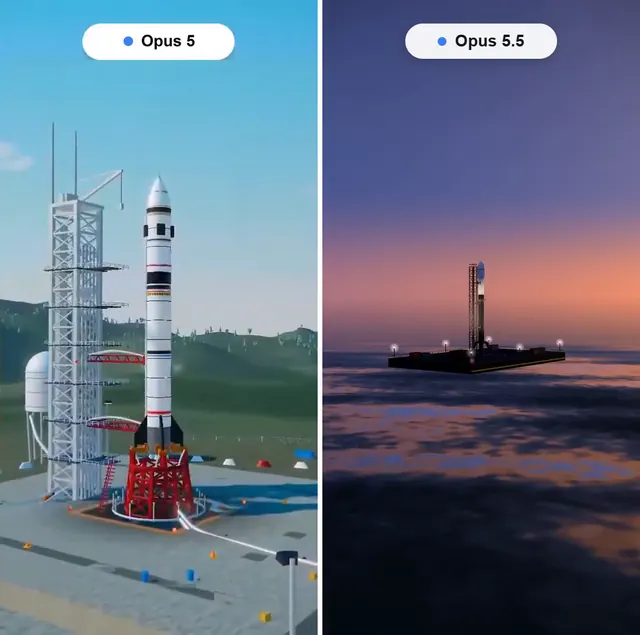</a>

**Claude Opus 5.5** · アニメーション · 作者 [NinjaCodex](https://x.com/N1njaCodex) · 2026-09-25

同じプロンプトで2つのOpusを比較。Claude Opus 5.5版は夜明けの発射から段分離、フェアリング分離、衛星の展開までを描きます。

<details>
<summary>プロンプト</summary>

```text
Create a cinematic, highly detailed, interactive 3D rocket launch from an ocean platform at dawn. Deliver the complete project in one HTML file that opens directly in Chrome. Use Three.js + WebGL and procedural assets. Embed assets wherever practical; a reliable CDN may be used for the rendering library.

ART DIRECTION
Create a dramatic transition from a dark, blue-violet ocean before sunrise to warm sunlight above the atmosphere. Use convincing proportions, detailed materials, atmospheric depth, and carefully composed camera angles. The result should feel like a polished miniature spaceflight film.
ROCKET AND LAUNCH PLATFORM
Build a convincing multistage rocket with a shaped nose cone, panel seams, structural rings, interstage connections, engine nozzles, and a payload fairing that separates into two halves.

Create a detailed floating launch platform with a support tower, retracting strongback, service arms, railings, ladders, pipes, equipment, floodlights, and blinking warning beacons. Keep all structures physically connected and correctly positioned.
LAUNCH SEQUENCE
Create an approximately 46-second sequence:

Establishing camera move around the platform.

Service arms and strongback retract.
Engines ignite, illuminating the rocket, platform, and nearby water.
Smoke spreads across the deck as the rocket lifts off and accelerates.
The camera follows the climb from the atmosphere toward space.
The first stage separates and falls away.
The second-stage engine ignites.
The fairing halves separate, revealing a satellite.
The engine shuts down, the satellite deploys, and its solar panels unfold.
Finish with an orbital view of the satellite against Earth’s curved horizon and sunrise.
Compress the flight timeline for presentation while maintaining coherent motion. Avoid sudden position changes, intersecting components, or disconnected effects.
OCEAN, ATMOSPHERE, AND EFFECTS
Use animated shader-driven ocean waves with Fresnel reflections and warm engine-light reflections. Create layered exhaust with a bright core, softer outer flame, and drifting smoke particles.
Smoke should expand, fade, and respond to wind. Exhaust must remain attached to the correct engine through staging. Transition smoothly from atmospheric haze to a dark star field and Earth’s illuminated limb.

CAMERA AND INTERACTION
Use smooth cinematic camera transitions: wide establishing view, low-angle ignition shot, ascent tracking, stage separation, and satellite close-up. Keep the main subject visible in both portrait and landscape layouts.

Include play/pause, replay, and a scrubber with event markers. Seeking must reconstruct the correct rocket configuration, particle state, camera position, and lighting. Replaying must reset the entire sequence cleanly.
Keep the interface minimal and unobtrusive. Allow it to be hidden for recording.

TECHNICAL QUALITY
Use frame-rate-independent animation and efficient particle systems. Reuse geometry and materials where appropriate, handle resizing correctly, and balance visual detail with smooth performance.

Test the final HTML in a desktop browser. Inspect the console and capture screenshots at ignition, liftoff, staging, and satellite deployment. Fix loading errors, clipping, geometry problems, broken seeking, and poor camera framing before delivering the file.
```

</details>

[Wandy3D で見る ↗](https://wandy3d.com/ja/prompts/cinematic-ocean-platform-rocket-launch-in-one-three-js-html-2103303449831964679?utm_source=github&utm_medium=referral&utm_campaign=awesome_3d_prompts) · [元の投稿](https://x.com/N1njaCodex/status/2103303449831964679)

---

### [跳ね橋・衛兵・昼夜切替付きの中世王国、Three.jsインタラクティブ](https://wandy3d.com/ja/prompts/interactive-three-js-medieval-kingdom-with-drawbridge-guards-2103257873203462412?utm_source=github&utm_medium=referral&utm_campaign=awesome_3d_prompts)

<a href="https://wandy3d.com/ja/prompts/interactive-three-js-medieval-kingdom-with-drawbridge-guards-2103257873203462412?utm_source=github&amp;utm_medium=referral&amp;utm_campaign=awesome_3d_prompts">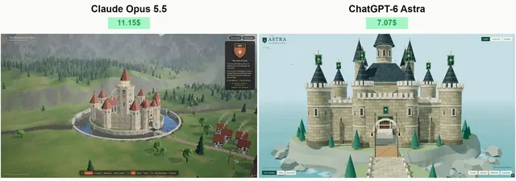</a>

**Claude Opus 5.5** · インタラクティブ · 作者 [Vib3Coded](https://x.com/vib3coded) · 2026-09-24

同じ城のプロンプトを2つのモデルで比較。Claude Opus 5.5は赤い屋根、堀、村、山々を備えた探索できる王国を作りました。

<details>
<summary>プロンプト</summary>

```text
Build your own medieval kingdom.
Your kingdom represents Claude Opus 5.5. Design a magnificent, historically inspired castle that expresses this model’s identity through architecture, heraldry, colors and atmosphere. You have complete artistic freedom within a believable medieval setting.
Do not simply place a logo on a generic castle. Give your kingdom a distinctive architectural character and a coherent visual identity. Invent its coat of arms, royal colors and an original heraldic emblem. Display them on animated banners, shields, gate decorations and the clothing of the castle guards. Place the kingdom’s name above the main entrance.
Create a richly detailed, interactive 3D scene using Three.js and WebGL. Deliver everything in one standalone HTML file that opens directly in Chrome.
THE CASTLE
Build a convincing fortress with a central keep, towers, battlements, curtain walls, an impressive gatehouse, a working drawbridge and a courtyard.
Include carefully modeled stonework, arched windows, wooden doors, roof structures, stairs, balconies, iron fittings and small architectural details. Make the structures believable: towers need interiors or convincing depth, stairs must connect to accessible floors, and bridges must have proper supports.
Surround the castle with an attractive landscape that suits your kingdom: cliffs, hills, a river, a moat, forests or a small village. Design a strong composition that looks beautiful from multiple angles.
LIFE AND INTERACTION
Bring the kingdom to life with guards patrolling the walls, villagers moving through the courtyard, gently waving banners, chimney smoke, birds and flickering lanterns.
Let the viewer:
Open and close the drawbridge and main gate.
Follow a guard on patrol.
Switch between a cinematic overview, the courtyard and the battlements.
Rotate and zoom freely.
Change between daylight, sunset and night.
Keep characters on walkable surfaces. Prevent them from passing through walls, doors or one another.
LIGHTING AND ATMOSPHERE
Create cinematic lighting that reveals the architecture clearly. Use soft shadows, atmospheric depth, convincing water where appropriate and restrained post-processing.
At night, illuminate windows, torches and lanterns while preserving enough visibility to appreciate the castle.
Aim for a sophisticated, finished 3D artwork with distinctive architecture and abundant detail. Avoid a collection of obvious primitive shapes or repetitive towers with no architectural purpose.
TECHNICAL QUALITY
Generate assets procedurally wherever practical. Embed textures and other assets inside the HTML. No local server or build step should be required.
Use instancing and geometry batching where appropriate. Keep animation and camera interaction smooth. Provide a minimal, elegant English interface and a button to hide it.
Actually test the result in desktop Chrome. Capture screenshots, inspect the console, test every interaction and fix rendering errors, floating objects, geometry intersections and camera problems.
Make this a castle people would recognize as YOUR kingdom, even before reading its name.
Return the completed standalone HTML file.
```

</details>

[Wandy3D で見る ↗](https://wandy3d.com/ja/prompts/interactive-three-js-medieval-kingdom-with-drawbridge-guards-2103257873203462412?utm_source=github&utm_medium=referral&utm_campaign=awesome_3d_prompts) · [元の投稿](https://x.com/vib3coded/status/2103257873203462412)

---

### [霧雨の秋の公園を歩いて探索できるThree.jsシーン](https://wandy3d.com/ja/prompts/misty-rainy-autumn-park-you-can-walk-through-in-three-js-2103211135214256350?utm_source=github&utm_medium=referral&utm_campaign=awesome_3d_prompts)

<a href="https://wandy3d.com/ja/prompts/misty-rainy-autumn-park-you-can-walk-through-in-three-js-2103211135214256350?utm_source=github&amp;utm_medium=referral&amp;utm_campaign=awesome_3d_prompts">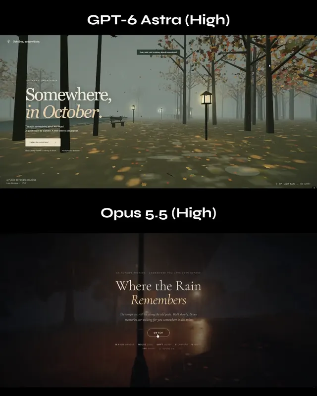</a>

**Claude Opus 5.5** · シーン · 作者 [Simonas](https://x.com/SimonasLTU1) · 2026-09-24

同じ雰囲気プロンプトをClaude Opus 5.5とGPT-6 Astraに与えた比較。Opusは灯りと赤い傘が映える、より濃密な雨の公園を作った。

<details>
<summary>プロンプト</summary>

```text
I want you to create me a misty, rainy, autumn-like mysterious atmosphere, nostalgic experience in an explorable Three.js in a single html/css/js file.
```

</details>

[Wandy3D で見る ↗](https://wandy3d.com/ja/prompts/misty-rainy-autumn-park-you-can-walk-through-in-three-js-2103211135214256350?utm_source=github&utm_medium=referral&utm_campaign=awesome_3d_prompts) · [元の投稿](https://x.com/SimonasLTU1/status/2103211135214256350)

---

### [北欧のフィヨルドをバイキング船で進むThree.js操縦シーン](https://wandy3d.com/ja/prompts/steerable-viking-longship-voyage-through-a-nordic-fjord-in-2103189762672611675?utm_source=github&utm_medium=referral&utm_campaign=awesome_3d_prompts)

<a href="https://wandy3d.com/ja/prompts/steerable-viking-longship-voyage-through-a-nordic-fjord-in-2103189762672611675?utm_source=github&amp;utm_medium=referral&amp;utm_campaign=awesome_3d_prompts">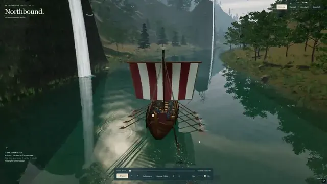</a>

**GPT-6 Astra** · インタラクティブ · 作者 [Vib3Coded](https://x.com/vib3coded) · 2026-09-24

GPT-6 Astraが単一HTMLでフィヨルドの航海を生成。反射する水面を櫂で漕ぐ船、滝、3種類の照明が楽しめる。

<details>
<summary>プロンプト</summary>

```text
Create “Northbound” - a beautiful, interactive 3D journey through a Nordic fjord aboard a detailed Viking longship.

Build a genuine real-time scene using Three.js and WebGL, delivered as a single standalone HTML file. This must be an explorable browser experience, not a pre-rendered video or a flat illustration.

VISUAL DIRECTION

Aim for a polished, cinematic environment with realistic materials, natural proportions, and restrained colors. Avoid a cartoon or low-poly appearance.

A wooden longship travels through deep green-blue water between towering cliffs, dense forests, waterfalls, and small Nordic settlements. Use atmospheric perspective, subtle mist, soft shadows, and convincing depth. Compose beautiful views throughout the journey, not just from the initial camera position.

THE LONGSHIP

Construct a detailed, watertight hull with overlapping wooden planks, visible grain, ribs, benches, and a continuous interior.
Add a carved dragon prow, striped cloth sail, mast, ropes, shields, supplies, and warm lanterns.
Include proportionate Viking passengers and rowers with layered clothing, believable seated poses, and hands positioned near their oars.
Keep every component physically connected. No floating passengers, intersecting accessories, or visible gaps through the hull.
Animate subtle buoyancy, pitch, and roll. The sail should respond gently to the wind.

WATER AND ROWING

Make the water a central visual feature.

Use a custom shader with planar reflections, refraction, Fresnel highlights, depth-dependent absorption, visible shallow areas, and layered surface ripples. Reflections must respond correctly to the moving camera and changing lighting.

Create a believable wake behind the ship.

Animate a complete rowing cycle: blades enter the water, pull backward, lift out, and return above the surface. Coordinate this with the rowers’ movement.

Generate ripples, foam, and small droplets at the actual blade-water contact points. Trails must remain in world space and gradually dissipate. Avoid effects appearing while the blades are in the air.

ENVIRONMENT AND MATERIALS

Use detailed terrain, irregular rock formations, natural tree silhouettes, branching trunks, and individual leaf or needle clusters.

Use PBR materials with normal and roughness maps for wood, stone, and ground. You may embed appropriately licensed textures; include attribution where required.

Ensure the underwater terrain continues beneath the surface. No bright seams, shoreline gaps, floating vegetation, or trees obstructing the navigable route.

CONTROLS

A/D or arrow keys: steer left and right.
W/S: adjust speed.
Mouse drag: look around.
Provide follow, orbit, and cinematic camera modes.
Include an optional automatic journey mode.
Add pause, reset, fullscreen, and hide-interface controls.
Support touch steering and speed controls on mobile.
Prevent the ship from passing through land and rocks.

ATMOSPHERE AND INTERFACE

Provide three smoothly transitioning lighting presets: Morning, Overcast, and Moonlight.

Add optional ambient water, wind, birds, and rowing sounds. Audio must begin only after user interaction.

Design a minimal editorial interface: “Northbound.” in an elegant serif typeface, subtle chapter labels, and a compact translucent control bar. Keep the scenery unobstructed.

PERFORMANCE AND DELIVERY

Use instancing, sensible geometry budgets, distance-based detail, and appropriately sized reflection targets. Adapt rendering quality to the device instead of promising a fixed frame rate.

Deliver one HTML file with scripts and required assets embedded so it can open directly in a modern browser.

Test steering, camera modes, lighting transitions, and rowing. Inspect the ship from multiple angles and check the shoreline from low viewpoints. Fix geometry intersections, reflection artifacts, excessive glare, and console errors before considering the scene finished.
```

[…（以下省略。全文は Wandy3D で）](https://wandy3d.com/ja/prompts/steerable-viking-longship-voyage-through-a-nordic-fjord-in-2103189762672611675?utm_source=github&utm_medium=referral&utm_campaign=awesome_3d_prompts)

</details>

[Wandy3D で見る ↗](https://wandy3d.com/ja/prompts/steerable-viking-longship-voyage-through-a-nordic-fjord-in-2103189762672611675?utm_source=github&utm_medium=referral&utm_campaign=awesome_3d_prompts) · [元の投稿](https://x.com/vib3coded/status/2103189762672611675)

---

### [言葉のブロックが外れ大聖堂にステンドグラスの光が満ちる縦型Three.js短編](https://wandy3d.com/ja/prompts/vertical-three-js-short-film-word-blocks-clear-and-a-stained-2103145567945986461?utm_source=github&utm_medium=referral&utm_campaign=awesome_3d_prompts)

<a href="https://wandy3d.com/ja/prompts/vertical-three-js-short-film-word-blocks-clear-and-a-stained-2103145567945986461?utm_source=github&amp;utm_medium=referral&amp;utm_campaign=awesome_3d_prompts">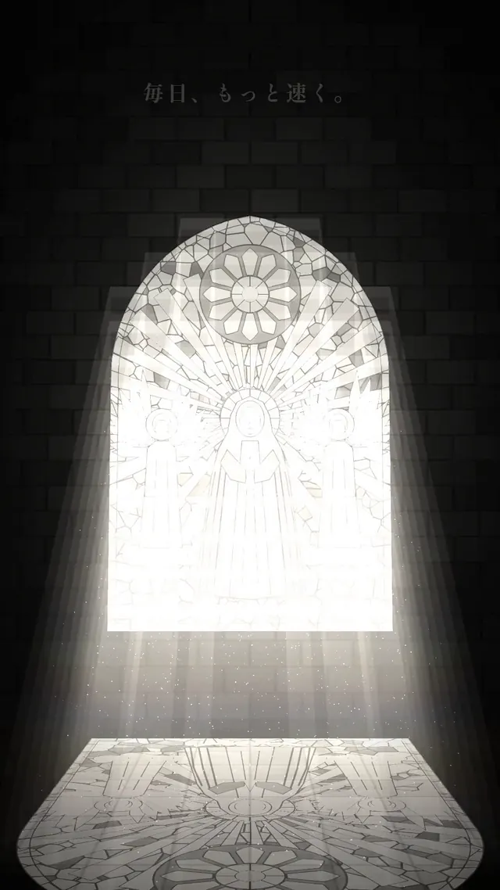</a>

**Claude Opus 5.5** · アニメーション · 作者 [AGIおやZ](https://x.com/AGIOyaZ) · 2026-09-24

Claude Opus 5.5がコードだけで36秒の縦型映像を描画。灰色のブロックで塞がれた窓が開き、床に色鮮やかな光が広がる。

<details>
<summary>プロンプト</summary>

```text
three.jsで、縦長1080×1920・30コマ/秒・約36秒の短編映像を作ってください。

【作品名】
余白

【見せたい体験】
効率化に追われて時間を失っていく感覚と、余白を手に入れた瞬間に人生が豊かな光で満たされていく感覚を、人物を一切登場させずに体感させる映像です。最後に床一面に浮かび上がるステンドグラスの光で、見た人が思わず息をのむことを目指します。

【舞台】
・薄暗い石造りの大聖堂の内部。正面の壁に、高さ15m・幅10mの尖頭アーチ型の窓が一つだけある
・窓の外からは、斜め45度の角度で強い光が差し込み、石の床に窓の形の光を落としている
・窓には、中央に聖母、両脇に翼を広げた二人の天使、上部にバラ窓を配したステンドグラスがはまっている。デザインは既存の作品を模さずオリジナルで、左右対称の構図にする

【時間の構成】
0〜3秒：窓から差す光は、まだ色のない白い光。床にやわらかな白い光の形
3〜11秒：「忙しい」「効率化」「至急」「締切」などの言葉が刻まれた灰色の立方体が、部屋の手前から次々と飛んできて窓を埋めていく。飛来のペースはどんどん加速し、窓が埋まるほど部屋は暗くなる
11〜14秒：窓は完全にふさがれ、闇と静寂
14〜19秒：「忙しい」のブロックが一つだけ窓から外れて落ち、光の粒になって消える。空いた穴から、鮮やかな色の一筋の光が差し込む
19〜26秒：最初の穴を中心に、ブロックが連鎖的に外れていく。穴が増えるたびに色とりどりの光の柱が増え、隠れていたステンドグラスが少しずつ姿を現す
26〜33秒：すべてのブロックが消え、カメラは光の柱をくぐり抜けて上昇し、真上から床を見下ろす。床一面に、聖母と天使のステンドグラスが色鮮やかな光として映し出されている
33〜36秒：画面全体がまばゆい光に包まれ、最後の言葉が浮かび、静かに終わる

【言葉（明朝体、控えめに浮かんでは消える）】
・「毎日、もっと速く。」
・「もっと、効率よく。」
・「気づけば、光が入らなくなっていた。」
・「ひとつ、手放してみる。」
・「空いたところから、光が入る。」
・「その光は、前より豊かだった。」
・最後に大きく：「豊かさは余白に宿る」

【光と質感】
・光の柱は、ステンドグラスのその場所の色に染まり、空中の塵がきらめく
・床の投影は、窓のどの穴が空いているかを正確に反映する（ブロックがある場所は影になる）
・ブロックは無機質なマットグレー。言葉は白く刻印されている
・前半は冷たく無彩色、後半は宝石のような赤・青・金。この色の対比で「豊かになった」ことを語る

【技術条件】
・ステンドグラスの絵柄は画像として生成し、床の光・光の柱・窓の表示はすべて同じ絵柄から計算して一致させる
・時間を1/30秒ずつ正確に進めて1コマずつ書き出し、MP4にする

【仕上げ】
各場面を実際に描画して確認し、ステンドグラスの絵柄が床の上で聖母と天使として読み取れるか、言葉が読めるか、動きが唐突でないかを直してから渡してください。
```

</details>

[Wandy3D で見る ↗](https://wandy3d.com/ja/prompts/vertical-three-js-short-film-word-blocks-clear-and-a-stained-2103145567945986461?utm_source=github&utm_medium=referral&utm_campaign=awesome_3d_prompts) · [元の投稿](https://x.com/AGIOyaZ/status/2103145567945986461)

---

### [サンフランシスコが舞台の原神風オープンワールドアクションゲーム](https://wandy3d.com/ja/prompts/genshin-style-open-world-action-game-set-in-san-francisco-2103144530157687114?utm_source=github&utm_medium=referral&utm_campaign=awesome_3d_prompts)

<a href="https://wandy3d.com/ja/prompts/genshin-style-open-world-action-game-set-in-san-francisco-2103144530157687114?utm_source=github&amp;utm_medium=referral&amp;utm_campaign=awesome_3d_prompts"></a>

**Claude Opus 5.5** · ゲーム · 作者 [Every 📧](https://x.com/every) · 2026-09-24

Claude Opus 5.5が一文のプロンプトから遊べるオープンワールドRPGを生成。サワードウの剣や資金調達の必殺技が登場する。

<details>
<summary>プロンプト</summary>

```text
Build a Genshin Impact–style game set in San Francisco.
```

</details>

[Wandy3D で見る ↗](https://wandy3d.com/ja/prompts/genshin-style-open-world-action-game-set-in-san-francisco-2103144530157687114?utm_source=github&utm_medium=referral&utm_campaign=awesome_3d_prompts) · [元の投稿](https://x.com/every/status/2103144530157687114)

---

### [Three.jsで作るエッフェル塔:4モデル同一プロンプトの比較](https://wandy3d.com/ja/prompts/eiffel-tower-in-three-js-four-models-one-prompt-2103106070549757960?utm_source=github&utm_medium=referral&utm_campaign=awesome_3d_prompts)

<a href="https://wandy3d.com/ja/prompts/eiffel-tower-in-three-js-four-models-one-prompt-2103106070549757960?utm_source=github&amp;utm_medium=referral&amp;utm_campaign=awesome_3d_prompts">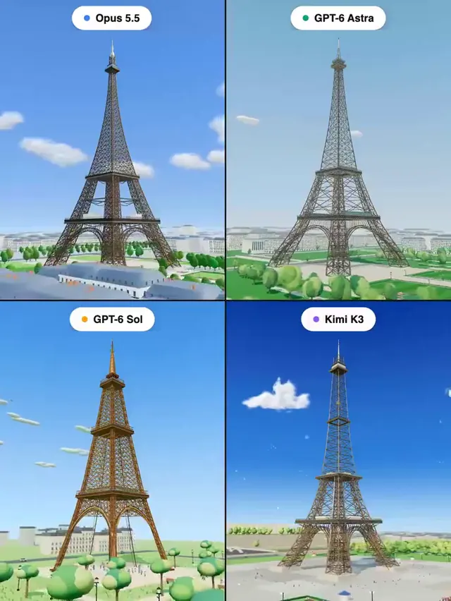</a>

**Claude Opus 5.5** · アセット · 作者 [Pascual ⚡](https://x.com/0xPascual) · 2026-09-24

4つのモデルにThree.jsでエッフェル塔を作らせた比較。Claude Opus 5.5が細部の作り込みで優位で、公園と雲の中に塔が立ちます。

<details>
<summary>プロンプト</summary>

```text
build the Eiffel Tower in Three.js
```

</details>

[Wandy3D で見る ↗](https://wandy3d.com/ja/prompts/eiffel-tower-in-three-js-four-models-one-prompt-2103106070549757960?utm_source=github&utm_medium=referral&utm_campaign=awesome_3d_prompts) · [元の投稿](https://x.com/0xPascual/status/2103106070549757960)

---

### [木製の文字タイルがクロスワードを完成させるThree.jsアニメ](https://wandy3d.com/ja/prompts/animated-short-of-wooden-letter-tiles-solving-a-crossword-in-2103087766662009118?utm_source=github&utm_medium=referral&utm_campaign=awesome_3d_prompts)

<a href="https://wandy3d.com/ja/prompts/animated-short-of-wooden-letter-tiles-solving-a-crossword-in-2103087766662009118?utm_source=github&amp;utm_medium=referral&amp;utm_campaign=awesome_3d_prompts">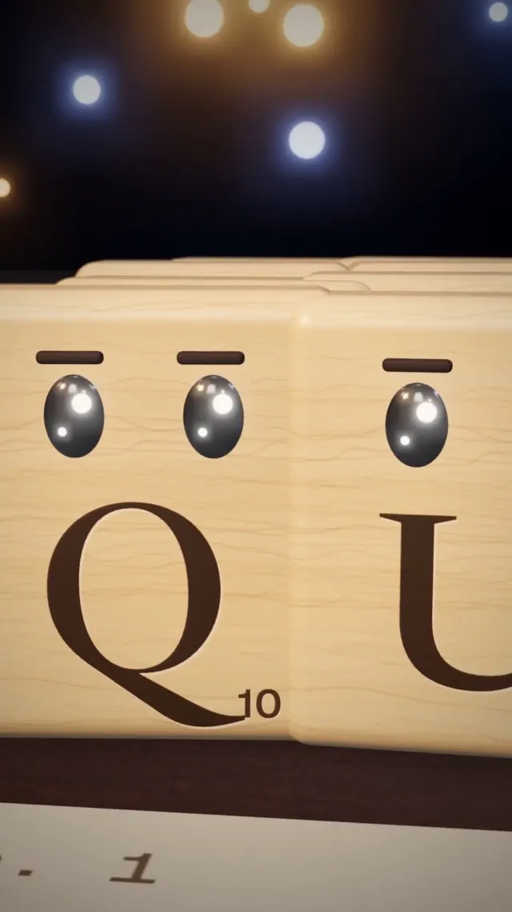</a>

**Claude Opus 5.5** · アニメーション · 作者 [Anil Rao K](https://x.com/Anilraok) · 2026-09-24

Claude Opus 5.5がストーリーから考え、Three.jsで短編を制作。目のある木製タイルがクロスワードの盤に並び、最後は紙吹雪で締めます。

<details>
<summary>プロンプト</summary>

```text
I want you to imagine a story, that subtly promotes grid genius. Or it can not even have grid genius, but something that aligns with our app and helps us get more eyeballs when posted on social media. Then using threejs/javascript I want you to create full animation, Pixar-level quality out of the story you imagine
```

</details>

[Wandy3D で見る ↗](https://wandy3d.com/ja/prompts/animated-short-of-wooden-letter-tiles-solving-a-crossword-in-2103087766662009118?utm_source=github&utm_medium=referral&utm_campaign=awesome_3d_prompts) · [元の投稿](https://x.com/Anilraok/status/2103087766662009118)

---

### [海沿いの道を自転車で走るペリカンの3Dゲーム](https://wandy3d.com/ja/prompts/seaside-3d-game-of-a-pelican-cycling-along-a-coast-road-2103083781490176212?utm_source=github&utm_medium=referral&utm_campaign=awesome_3d_prompts)

<a href="https://wandy3d.com/ja/prompts/seaside-3d-game-of-a-pelican-cycling-along-a-coast-road-2103083781490176212?utm_source=github&amp;utm_medium=referral&amp;utm_campaign=awesome_3d_prompts">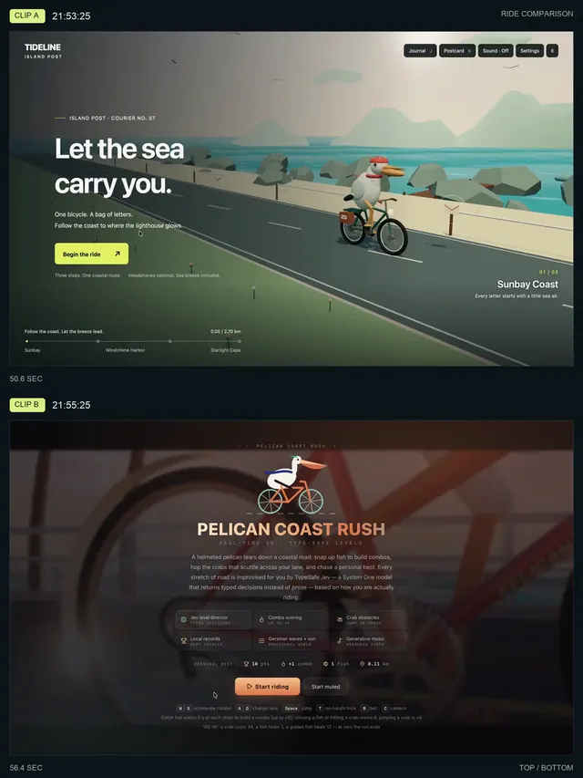</a>

**Claude Opus 5.5** · ゲーム · 作者 [Yaowei Zheng \| LlamaFactory](https://x.com/code_hiyouga) · 2026-09-24

Codexと同じプロンプトでClaude Opus 5.5を比較。採用側は自転車に乗るペリカン、波、天候変化を備えたブラウザゲームです。

<details>
<summary>プロンプト</summary>

```text
Build a real-time 3D game where a pelican cycles through a living seaside world, complete with physics, waves, fishing, dynamic weather, cinematic cameras, autopilot, and adaptive music.
```

</details>

[Wandy3D で見る ↗](https://wandy3d.com/ja/prompts/seaside-3d-game-of-a-pelican-cycling-along-a-coast-road-2103083781490176212?utm_source=github&utm_medium=referral&utm_campaign=awesome_3d_prompts) · [元の投稿](https://x.com/code_hiyouga/status/2103083781490176212)

---

### [引っ張って弾ませるソフトボディのグミ風柑橘スライス](https://wandy3d.com/ja/prompts/interactive-soft-body-gummy-citrus-slice-you-can-pull-and-2103062415533371646?utm_source=github&utm_medium=referral&utm_campaign=awesome_3d_prompts)

<a href="https://wandy3d.com/ja/prompts/interactive-soft-body-gummy-citrus-slice-you-can-pull-and-2103062415533371646?utm_source=github&amp;utm_medium=referral&amp;utm_campaign=awesome_3d_prompts">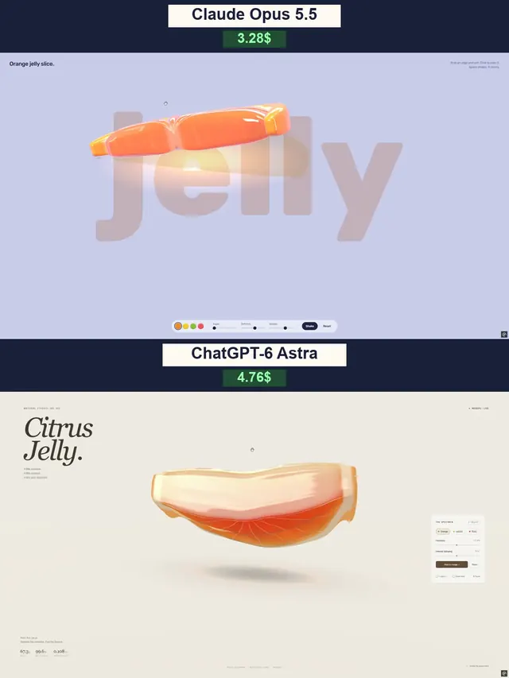</a>

**Claude Opus 5.5** · インタラクティブ · 作者 [Vib3Coded](https://x.com/vib3coded) · 2026-09-24

同じプロンプトでClaude Opus 5.5とGPT-6 Astraを比較。Opusは光沢のあるグミ風スライスをThree.jsで作り、揺れて元の形に戻ります。

<details>
<summary>プロンプト</summary>

```text
Create a beautiful, interactive 3D gummy citrus slice using WebGPU. Deliver the complete experience in one standalone HTML file with embedded JavaScript and WGSL shaders.

This must be a real-time 3D simulation, not a video, image, or looping animation.

APPEARANCE

Create a thick, semicircular orange slice with translucent, juicy flesh, eight distinct segments, delicate internal membranes, tiny bubbles, a pale pith layer, and a soft orange rind.

Make it look like premium gummy candy: saturated color, glossy highlights, light passing through the flesh, convincing refraction, and soft contact shadows. Avoid excessive bloom, washed-out colors, or a hard plastic appearance.

Use a warm, light studio background and a clean editorial interface with generous whitespace. Add the large italic serif title “Citrus Jelly.” Keep controls compact and the slice clearly visible.

SOFT-BODY PHYSICS

The jelly feel is the most important part.

- Grab any part of the slice with a mouse or finger.
- Pull, lift, stretch, twist, and release it.
- Make deformation local: pulling one edge should stretch nearby flesh while the rest follows naturally.
- After release, the slice should wobble, overshoot, and gradually recover its original shape.
- Include gravity, inertia, damping, ground collisions, and soft bouncing.
- Preserve volume approximately and prevent the mesh from collapsing or turning inside out.
- Make the rind slightly firmer than the flesh.
- Internal segments, membranes, and bubbles must follow the deformation without floating outside the body.

Use a stable volumetric soft-body solver, such as a tetrahedral mesh with XPBD constraints. Do not imitate softness by scaling or rotating the entire object.

CONTROLS

Include three color presets: Orange, Lemon, and Ruby.

Add:
- Firmness slider.
- Internal damping slider.
- “Give it a nudge” button.
- Reset button.
- Quarter-speed checkbox.
- Show mesh checkbox.
- Pause/resume button.

Display small live readouts for mass, percentage of rest volume, and kinetic energy.

TECHNICAL REQUIREMENTS

Use genuine WebGPU rendering with WGSL shaders. Generate all geometry and visual details procedurally, without imported models or image files.

Keep simulation updates independent of rendering frame rate. Support desktop and touch devices. Show a clear fallback message if WebGPU is unavailable.

Test strong dragging, repeated releases, all controls, and narrow screens. Fix unstable physics, broken geometry, and visual artifacts before delivering the finished HTML.

The result should feel like a tiny, tactile candy experiment that is genuinely satisfying to play with.
```

</details>

[Wandy3D で見る ↗](https://wandy3d.com/ja/prompts/interactive-soft-body-gummy-citrus-slice-you-can-pull-and-2103062415533371646?utm_source=github&utm_medium=referral&utm_campaign=awesome_3d_prompts) · [元の投稿](https://x.com/vib3coded/status/2103062415533371646)

---

### [巨大な白い塔がそびえる、歩ける3D帝都の島都市](https://wandy3d.com/ja/prompts/walkable-3d-imperial-island-city-with-a-giant-white-tower-2103046279253168554?utm_source=github&utm_medium=referral&utm_campaign=awesome_3d_prompts)

<a href="https://wandy3d.com/ja/prompts/walkable-3d-imperial-island-city-with-a-giant-white-tower-2103046279253168554?utm_source=github&amp;utm_medium=referral&amp;utm_campaign=awesome_3d_prompts">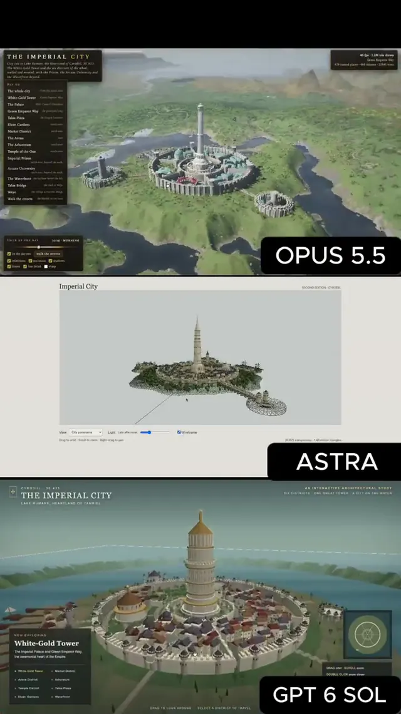</a>

**Claude Opus 5.5** · シーン · 作者 [EnzoXbt](https://x.com/Enzoxbt01) · 2026-09-24

3モデルの比較で、Claude Opus 5.5が最も密度の高い都市を制作。城壁とドーム、地区メニュー、街中を歩くモードを備えます。

<details>
<summary>Wandy3D による制作ブリーフ</summary>

```text
Build an interactive 3D fantasy imperial city as one browser project, using Three.js or a similar WebGL library. Place a walled island capital with a very tall white central tower, domed palaces, ring walls, an arena, gardens, bridges and a waterfront, surrounded by water, hills and distant mountains. Use a muted stone, white and green palette with teal domes and warm terracotta roofs, and a dark, elegant UI with serif lettering. Add a side menu listing named districts; clicking one flies the camera to it. Include an orbit view over the whole city and a street-level walking mode with small townsfolk. Add a day and night toggle with lit windows after dark. Done means the camera moves smoothly between districts, the city feels dense and readable from far away and up close, and it runs at a steady frame rate in a normal desktop browser.
```

</details>

[Wandy3D で見る ↗](https://wandy3d.com/ja/prompts/walkable-3d-imperial-island-city-with-a-giant-white-tower-2103046279253168554?utm_source=github&utm_medium=referral&utm_campaign=awesome_3d_prompts) · [元の投稿](https://x.com/Enzoxbt01/status/2103046279253168554)

---

### [Three.jsで作る空に浮かぶ島のボクセルロボットマスコット](https://wandy3d.com/ja/prompts/voxel-robot-mascot-on-a-floating-island-in-three-js-2102956424120979838?utm_source=github&utm_medium=referral&utm_campaign=awesome_3d_prompts)

<a href="https://wandy3d.com/ja/prompts/voxel-robot-mascot-on-a-floating-island-in-three-js-2102956424120979838?utm_source=github&amp;utm_medium=referral&amp;utm_campaign=awesome_3d_prompts">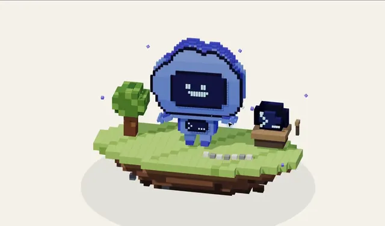</a>

**GPT-6 Luna** · アセット · 作者 [Arsh - 16 y/o builder](https://x.com/be_arsh) · 2026-09-24

GPT-6 Lunaが短いプロンプトから、画面の顔が動くボクセルロボットを生成。木とターミナル机のある浮島に立っています。

<details>
<summary>プロンプト</summary>

```text
make yourself, codex in threejs using voxels, make everything from scratch, dont use any skills
```

</details>

[Wandy3D で見る ↗](https://wandy3d.com/ja/prompts/voxel-robot-mascot-on-a-floating-island-in-three-js-2102956424120979838?utm_source=github&utm_medium=referral&utm_campaign=awesome_3d_prompts) · [元の投稿](https://x.com/be_arsh/status/2102956424120979838)

---

### [単一HTMLで作る砂漠の夜の写実的なたき火シーン](https://wandy3d.com/ja/prompts/realistic-desert-campfire-at-night-in-a-single-html-file-2102915567845794029?utm_source=github&utm_medium=referral&utm_campaign=awesome_3d_prompts)

<a href="https://wandy3d.com/ja/prompts/realistic-desert-campfire-at-night-in-a-single-html-file-2102915567845794029?utm_source=github&amp;utm_medium=referral&amp;utm_campaign=awesome_3d_prompts">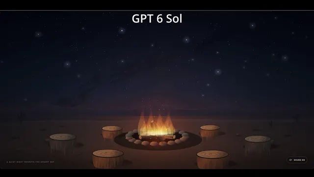</a>

**Claude Opus 5.5** · シーン · 作者 [Nick Gwood](https://x.com/Nixtrodamis) · 2026-09-24

比較: Claude Opus 5.5とGPT 6 Solに同じたき火のプロンプトを与え、火の粉やサボテン、星空、音まで作り込んだOpusの出来が際立ちました。

<details>
<summary>プロンプト</summary>

```text
Do not reference any other file or previous work. This task must be fully original and not built as a cheat from any other work here.

Create a single html file of a live campfire in the desert. It is night time and the stars are visible. there are log stumps set up as seats around the fire. no people are in the shot. different wildlife may periodically come into view and out.

noises should also match the scene and be of high quality.
Make everything hyper realistic

name the file (based on model)
```

</details>

[Wandy3D で見る ↗](https://wandy3d.com/ja/prompts/realistic-desert-campfire-at-night-in-a-single-html-file-2102915567845794029?utm_source=github&utm_medium=referral&utm_campaign=awesome_3d_prompts) · [元の投稿](https://x.com/Nixtrodamis/status/2102915567845794029)

---

### [ネオン調キッチンの一人称バーガー調理シミュレーター](https://wandy3d.com/ja/prompts/first-person-burger-cooking-simulator-with-a-neon-kitchen-2102897258983313712?utm_source=github&utm_medium=referral&utm_campaign=awesome_3d_prompts)

<a href="https://wandy3d.com/ja/prompts/first-person-burger-cooking-simulator-with-a-neon-kitchen-2102897258983313712?utm_source=github&amp;utm_medium=referral&amp;utm_campaign=awesome_3d_prompts">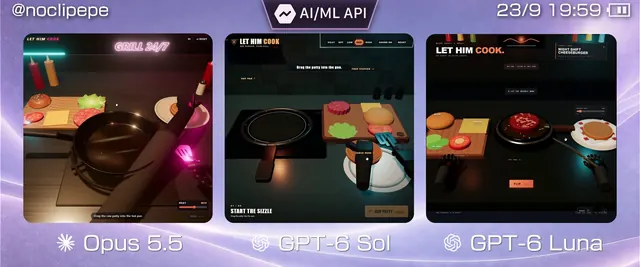</a>

**Claude Opus 5.5** · ゲーム · 作者 [noclipepe](https://x.com/noclipepe) · 2026-09-23

3モデルの比較: Claude Opus 5.5、GPT-6 Sol、GPT-6 Lunaが同じバーガーゲームを制作。照明、手、食材の描写はOpusが優勢でした。

<details>
<summary>プロンプト</summary>

```text
build a first-person burger simulator.
```

</details>

[Wandy3D で見る ↗](https://wandy3d.com/ja/prompts/first-person-burger-cooking-simulator-with-a-neon-kitchen-2102897258983313712?utm_source=github&utm_medium=referral&utm_campaign=awesome_3d_prompts) · [元の投稿](https://x.com/noclipepe/status/2102897258983313712)

---

### [Three.jsで作る手続き型の2トーンブルーのハイパーカー](https://wandy3d.com/ja/prompts/procedural-two-tone-blue-hypercar-built-in-three-js-2102828216289566725?utm_source=github&utm_medium=referral&utm_campaign=awesome_3d_prompts)

<a href="https://wandy3d.com/ja/prompts/procedural-two-tone-blue-hypercar-built-in-three-js-2102828216289566725?utm_source=github&amp;utm_medium=referral&amp;utm_campaign=awesome_3d_prompts">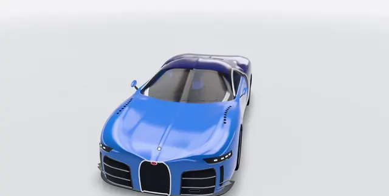</a>

**Claude Opus 5.5** · アセット · 作者 [Sree](https://x.com/srikanthvaluri) · 2026-09-23

Claude Opus 5.5がコードだけでBugatti Chiron Super Sportを造形。2トーンの青いボディ、銀のライン、ツインスポークのホイールが特徴です。

<details>
<summary>プロンプト</summary>

```text
build a Bugatti Chiron Super Sport in Three.js.
```

</details>

[Wandy3D で見る ↗](https://wandy3d.com/ja/prompts/procedural-two-tone-blue-hypercar-built-in-three-js-2102828216289566725?utm_source=github&utm_medium=referral&utm_campaign=awesome_3d_prompts) · [元の投稿](https://x.com/srikanthvaluri/status/2102828216289566725)

---

### [緑のタワーと道路が続く無限ソーラーパンク都市のシェーダー](https://wandy3d.com/ja/prompts/infinite-solarpunk-city-shader-with-green-towers-and-roads-2102826333550133520?utm_source=github&utm_medium=referral&utm_campaign=awesome_3d_prompts)

<a href="https://wandy3d.com/ja/prompts/infinite-solarpunk-city-shader-with-green-towers-and-roads-2102826333550133520?utm_source=github&amp;utm_medium=referral&amp;utm_campaign=awesome_3d_prompts">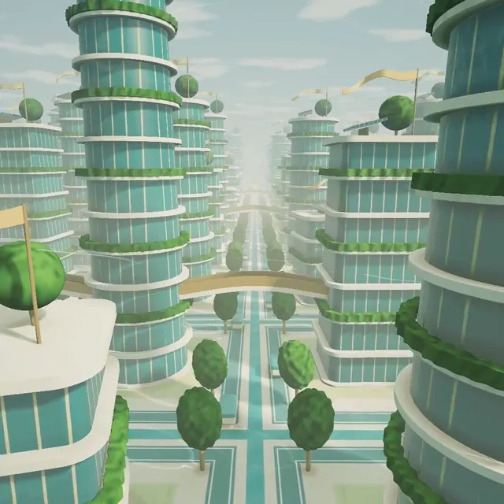</a>

**GPT-6 Pro** · シーン · 作者 [Jonas Fröller](https://x.com/jonasfroeller) · 2026-09-23

GPT-6 Proがtwigl用のGLSLシェーダーを生成。青緑のガラス塔、緑のテラス、並木道が風に揺れながら果てしなく続く都市です。

<details>
<summary>プロンプト</summary>

```text
create a visually interesting shader that can run in twigl-dot-app make it like an infinite city of solarpunk roads and towers with a visible breeze running continuously
```

</details>

[Wandy3D で見る ↗](https://wandy3d.com/ja/prompts/infinite-solarpunk-city-shader-with-green-towers-and-roads-2102826333550133520?utm_source=github&utm_medium=referral&utm_campaign=awesome_3d_prompts) · [元の投稿](https://x.com/jonasfroeller/status/2102826333550133520)

---

### [JavaScriptだけで作った30秒のトレーニングモンタージュ動画](https://wandy3d.com/ja/prompts/30-second-training-montage-animation-made-entirely-in-2102788832273801700?utm_source=github&utm_medium=referral&utm_campaign=awesome_3d_prompts)

<a href="https://wandy3d.com/ja/prompts/30-second-training-montage-animation-made-entirely-in-2102788832273801700?utm_source=github&amp;utm_medium=referral&amp;utm_campaign=awesome_3d_prompts">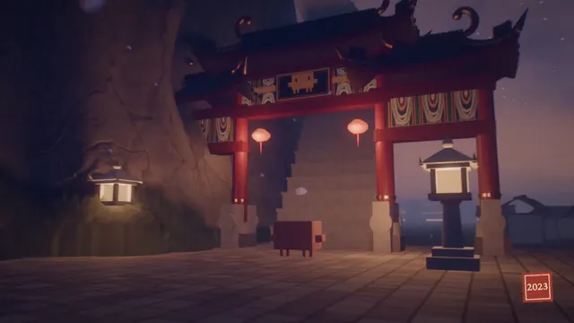</a>

**Claude Opus 5.5** · アニメーション · 作者 [Ishu Agrawal](https://x.com/ishuagra02) · 2026-09-23

Claude Opus 5.5がコードだけで、霧の山寺で修行する四角いマスコットの成長モンタージュを生成。モデルも音楽もプログラム生成です。

<details>
<summary>プロンプト</summary>

```text
Create a 30 second animation entirely in code featuring a growth montage, inspired by Kung Fu Panda's training sequence, with the Claude mascot as the main character, showcasing it getting more capable since its initial release across its skillset, such as searching the internet, writing code, creating 3D models, and solving humanity's hardest problems, with emotionally impactful music.
```

</details>

[Wandy3D で見る ↗](https://wandy3d.com/ja/prompts/30-second-training-montage-animation-made-entirely-in-2102788832273801700?utm_source=github&utm_medium=referral&utm_campaign=awesome_3d_prompts) · [元の投稿](https://x.com/ishuagra02/status/2102788832273801700)

---

### [Three.jsのアニメ短編：子ども部屋で出会うブリキのロボットと星](https://wandy3d.com/ja/prompts/three-js-animated-short-a-tin-robot-and-a-star-in-a-toy-2102788223835463902?utm_source=github&utm_medium=referral&utm_campaign=awesome_3d_prompts)

<a href="https://wandy3d.com/ja/prompts/three-js-animated-short-a-tin-robot-and-a-star-in-a-toy-2102788223835463902?utm_source=github&amp;utm_medium=referral&amp;utm_campaign=awesome_3d_prompts">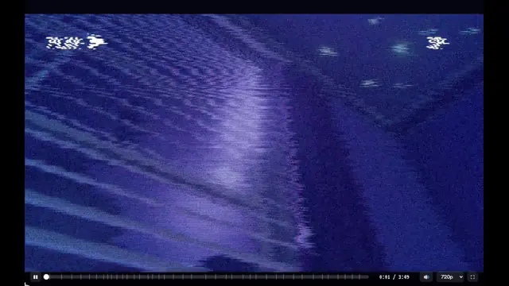</a>

**Claude Opus 5.5** · アニメーション · 作者 [Shimecki](https://x.com/scheemunai) · 2026-09-23

Claude Opus 5.5が自分で物語を考え、Three.jsでアニメ化。子ども部屋でおもちゃのロボットが光る星と友達になる約2分半の作品です。

<details>
<summary>プロンプト</summary>

```text
I want you to imagine a story. And then using threejs I want you to create full animation, Pixar-level quality 90s cartoon out of the story you imagine.
```

</details>

[Wandy3D で見る ↗](https://wandy3d.com/ja/prompts/three-js-animated-short-a-tin-robot-and-a-star-in-a-toy-2102788223835463902?utm_source=github&utm_medium=referral&utm_campaign=awesome_3d_prompts) · [元の投稿](https://x.com/scheemunai/status/2102788223835463902)

---

### [ギャンビットと変化を学べるインタラクティブ3Dチェス盤Webアプリ](https://wandy3d.com/ja/prompts/interactive-3d-chess-board-web-app-for-studying-gambits-and-2102788013902213508?utm_source=github&utm_medium=referral&utm_campaign=awesome_3d_prompts)

<a href="https://wandy3d.com/ja/prompts/interactive-3d-chess-board-web-app-for-studying-gambits-and-2102788013902213508?utm_source=github&amp;utm_medium=referral&amp;utm_campaign=awesome_3d_prompts">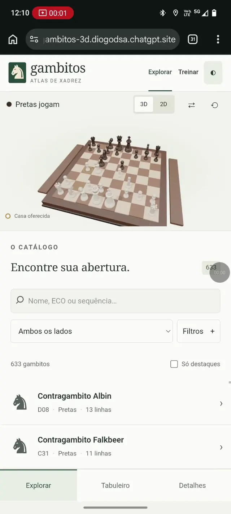</a>

**GPT-6 Astra** · インタラクティブ · 作者 [Diogo Santos](https://x.com/diogosantosbr) · 2026-09-23

GPT-6 Astraがチェスのギャンビット探索アプリを作成。回転できる3D盤、手の送り戻し、変化手順、数百のオープニング一覧を備えています。

<details>
<summary>プロンプト</summary>

```text
Crie uma aplicação web com um tabuleiro 3D interativo para estudar os principais gambitos do xadrez. Inclua animação dos movimentos, controles para avançar e voltar, variantes e explicações das ideias por trás de cada abertura.
```

</details>

[Wandy3D で見る ↗](https://wandy3d.com/ja/prompts/interactive-3d-chess-board-web-app-for-studying-gambits-and-2102788013902213508?utm_source=github&utm_medium=referral&utm_campaign=awesome_3d_prompts) · [元の投稿](https://x.com/diogosantosbr/status/2102788013902213508)

---

### [単一HTMLで動く、継ぎ目のないループ水循環アニメーション](https://wandy3d.com/ja/prompts/seamless-looping-water-cycle-animation-in-a-single-html-file-2102781807179735211?utm_source=github&utm_medium=referral&utm_campaign=awesome_3d_prompts)

<a href="https://wandy3d.com/ja/prompts/seamless-looping-water-cycle-animation-in-a-single-html-file-2102781807179735211?utm_source=github&amp;utm_medium=referral&amp;utm_campaign=awesome_3d_prompts">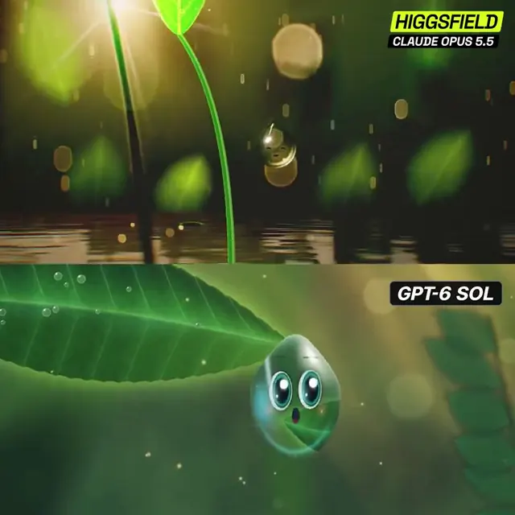</a>

**Claude Opus 5.5** · アニメーション · 作者 [Higgsfield AI 🧩](https://x.com/higgsfield_ai) · 2026-09-23

比較作品：Claude Opus 5.5とGPT-6 Solがそれぞれ、池・雲・雪・根を巡る水滴の旅をブラウザ上のループ映像として生成しました。

<details>
<summary>プロンプト</summary>

```text
Create a seamless looping animation of the water cycle, entirely in code.
```

</details>

[Wandy3D で見る ↗](https://wandy3d.com/ja/prompts/seamless-looping-water-cycle-animation-in-a-single-html-file-2102781807179735211?utm_source=github&utm_medium=referral&utm_campaign=awesome_3d_prompts) · [元の投稿](https://x.com/higgsfield_ai/status/2102781807179735211)

---

### [ブラウザで動く3D中世の城：水堀、跳ね橋、塔、森つき](https://wandy3d.com/ja/prompts/browser-3d-medieval-castle-with-moat-drawbridge-towers-and-2102780850706567390?utm_source=github&utm_medium=referral&utm_campaign=awesome_3d_prompts)

<a href="https://wandy3d.com/ja/prompts/browser-3d-medieval-castle-with-moat-drawbridge-towers-and-2102780850706567390?utm_source=github&amp;utm_medium=referral&amp;utm_campaign=awesome_3d_prompts">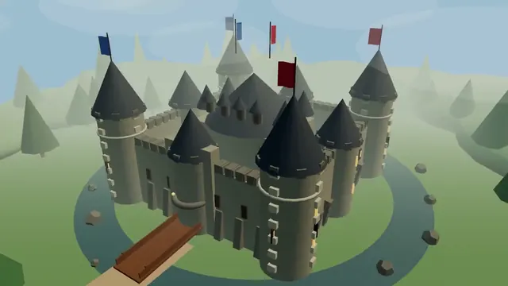</a>

**GPT-5.6 Terra** · シーン · 作者 [もぎ＠ボードゲーム](https://x.com/luxurytax150) · 2026-09-23

城ベンチマークとして、同じプロンプトをGPT-5.6 TerraとGPT-6 Astra Ultraで比較。塔と水堀、松林に囲まれた城が映ります。

<details>
<summary>プロンプト</summary>

```text
ブラウザで操作できる3Dの中世ヨーロッパ風の城を作る。水堀、跳ね橋、塔、石壁、旗、森、昼夜切替を入れる。 
これはベンチマークの一種であるから、どこまで見た目を盛れるか、3Dモデルの品質を最大限優先して。
```

</details>

[Wandy3D で見る ↗](https://wandy3d.com/ja/prompts/browser-3d-medieval-castle-with-moat-drawbridge-towers-and-2102780850706567390?utm_source=github&utm_medium=referral&utm_campaign=awesome_3d_prompts) · [元の投稿](https://x.com/luxurytax150/status/2102780850706567390)

---

### [夜の街を走る猫の3D横スクロールゲーム、ランタンの灯りが美しい](https://wandy3d.com/ja/prompts/night-street-cat-auto-runner-with-lantern-lighting-3d-side-2102775632933654585?utm_source=github&utm_medium=referral&utm_campaign=awesome_3d_prompts)

<a href="https://wandy3d.com/ja/prompts/night-street-cat-auto-runner-with-lantern-lighting-3d-side-2102775632933654585?utm_source=github&amp;utm_medium=referral&amp;utm_campaign=awesome_3d_prompts">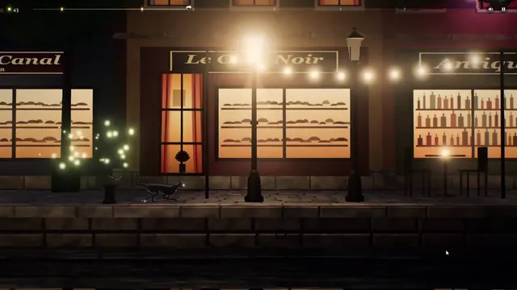</a>

**Claude Opus 5.5** · ゲーム · 作者 [BLITAST STUDIO](https://x.com/blitast_studio) · 2026-09-23

Claude Opus 5.5が一度の指示でCatWalkを作成。光る店先の前を猫が穴や障害物をジャンプで越える、雰囲気重視の自動スクロールゲーム。

<details>
<summary>プロンプト</summary>

```text
ゲームを開発しましょう
グラフィックは2D、3Dを問いませんがゲームのシステムなどを分析し開発しやすい方でいいです
個人的には3Dだが画面は横スクロールアクションみたいなものを想定してます
照明などでおしゃれな雰囲気などを出したいので3Dを使うことで美しい表現ができるのではないかと思っています（例：街灯やランタンのような表現など）
作りたいゲームは CatWalk というゲーム
名前の通りです
猫が横に進む
キャットウォークが続いており、画面は自動スクロールするので、その速さに合わせて障害物や穴をジャンプなどのシンプルな操作のみで越えていくスタイル。ある意味でフラッピー的な緊張感とシステムに近いかもしれない。
ただしグラフィックは大人かっこいい、雰囲気ゲーを目指したい
可能であれば猫のしなやかな歩き、走り、ジャンプが表現できればうれしい
ステージの世界観はお任せするが、最初は無難な夜のストリートなどでもいいかと
暗めにすることで間接照明などが美ししく表現できればかなり嬉しい
できることできないこと難しいことがあると思うので
この私の要望をヒントにあなたなりにできそうなものを開発してほしい
まずは１ステージのワンループができるように
```

</details>

[Wandy3D で見る ↗](https://wandy3d.com/ja/prompts/night-street-cat-auto-runner-with-lantern-lighting-3d-side-2102775632933654585?utm_source=github&utm_medium=referral&utm_campaign=awesome_3d_prompts) · [元の投稿](https://x.com/blitast_studio/status/2102775632933654585)

---

### [主役の列車が走るサイバーパンク巨大都市のBlenderアニメーション](https://wandy3d.com/ja/prompts/cyberpunk-megacity-with-a-hero-train-rendered-as-a-blender-2102740078347087940?utm_source=github&utm_medium=referral&utm_campaign=awesome_3d_prompts)

<a href="https://wandy3d.com/ja/prompts/cyberpunk-megacity-with-a-hero-train-rendered-as-a-blender-2102740078347087940?utm_source=github&amp;utm_medium=referral&amp;utm_campaign=awesome_3d_prompts">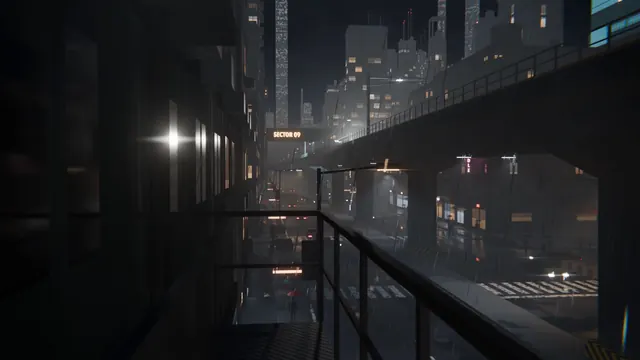</a>

**Claude Opus 5.5** · アニメーション · 作者 [BuilderHelm](https://x.com/builderhelmai) · 2026-09-23

Claude Opus 5.5がBlenderで雨の巨大都市を構築。高架線や駅、列車を複数カメラで撮った1080pのシネマティック映像。

<details>
<summary>Wandy3D による制作ブリーフ</summary>

```text
Build a complete cyberpunk megacity inside Blender using Python scripting, and render it as a short cinematic sequence. Include a hero train, procedurally generated skyscrapers with lit windows, elevated rail lines, a tunnel, and a large central station hall filled with small crowd figures. Set the mood with night rain, volumetric fog, neon and street lights and a dark, teal and warm orange palette. Define several camera setups and animate them: street-level shots, wide city reveals, a camera tracking the train, a tunnel transition, a station interior and a final pullback where the train looks tiny against the city. Deliver a .blend file or a Python script that regenerates the scene, plus a 1080p render of the animated sequence, with settings ready to raise to 4K. Done means the shots cut together into one coherent run with believable lighting and scale.
```

</details>

[Wandy3D で見る ↗](https://wandy3d.com/ja/prompts/cyberpunk-megacity-with-a-hero-train-rendered-as-a-blender-2102740078347087940?utm_source=github&utm_medium=referral&utm_campaign=awesome_3d_prompts) · [元の投稿](https://x.com/builderhelmai/status/2102740078347087940)

---

### [カラフルなスタジアムのボクセル風サッカーゴール演出（Three.js単一ファイル）](https://wandy3d.com/ja/prompts/voxel-soccer-goal-animation-in-a-colorful-stadium-one-three-2102739444256383089?utm_source=github&utm_medium=referral&utm_campaign=awesome_3d_prompts)

<a href="https://wandy3d.com/ja/prompts/voxel-soccer-goal-animation-in-a-colorful-stadium-one-three-2102739444256383089?utm_source=github&amp;utm_medium=referral&amp;utm_campaign=awesome_3d_prompts">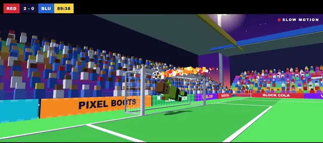</a>

**Claude Opus 5.5** · アニメーション · 作者 [Delusionals](https://x.com/AGI_FromWalmart) · 2026-09-23

Claude Opus 5.5が1つのHTMLで作成。ブロック状の選手が2人を抜いてゴールし、紙吹雪とスローモーションで祝う。

<details>
<summary>プロンプト</summary>

```text
Create a single HTML file with Three.js (CDN) for a simple voxel-style soccer animation. A blocky player dribbles past 2 defenders and scores a spectacular goal with celebration particles. Colorful stadium look. Output ONLY the full HTML code.
```

</details>

[Wandy3D で見る ↗](https://wandy3d.com/ja/prompts/voxel-soccer-goal-animation-in-a-colorful-stadium-one-three-2102739444256383089?utm_source=github&utm_medium=referral&utm_campaign=awesome_3d_prompts) · [元の投稿](https://x.com/AGI_FromWalmart/status/2102739444256383089)

---

### [架空の惑星を巡るインタラクティブサイト、2モデルの比較](https://wandy3d.com/ja/prompts/interactive-website-about-imaginary-planets-built-by-two-2102729710174196022?utm_source=github&utm_medium=referral&utm_campaign=awesome_3d_prompts)

<a href="https://wandy3d.com/ja/prompts/interactive-website-about-imaginary-planets-built-by-two-2102729710174196022?utm_source=github&amp;utm_medium=referral&amp;utm_campaign=awesome_3d_prompts">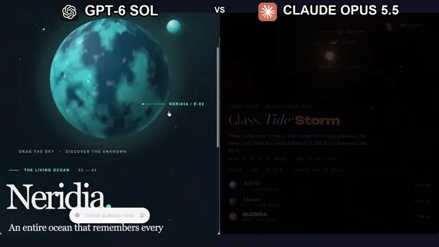</a>

**GPT-6 Sol** · インタラクティブ · 作者 [Kappaemme](https://x.com/Kappaemmedev) · 2026-09-23

GPT-6 SolとClaude Opus 5.5に同じプロンプトを実行した比較。Solは3惑星を速く、Opusは広く詳細な太陽系を作った。

<details>
<summary>プロンプト</summary>

```text
build an interactive website about imaginary planets.
```

</details>

[Wandy3D で見る ↗](https://wandy3d.com/ja/prompts/interactive-website-about-imaginary-planets-built-by-two-2102729710174196022?utm_source=github&utm_medium=referral&utm_campaign=awesome_3d_prompts) · [元の投稿](https://x.com/Kappaemmedev/status/2102729710174196022)

---

### [ループとドリフトのあるネオン3Dレーサー（単一HTML）、2モデル比較](https://wandy3d.com/ja/prompts/single-file-3d-neon-racer-with-loops-and-drift-two-models-2102652927177617564?utm_source=github&utm_medium=referral&utm_campaign=awesome_3d_prompts)

<a href="https://wandy3d.com/ja/prompts/single-file-3d-neon-racer-with-loops-and-drift-two-models-2102652927177617564?utm_source=github&amp;utm_medium=referral&amp;utm_campaign=awesome_3d_prompts">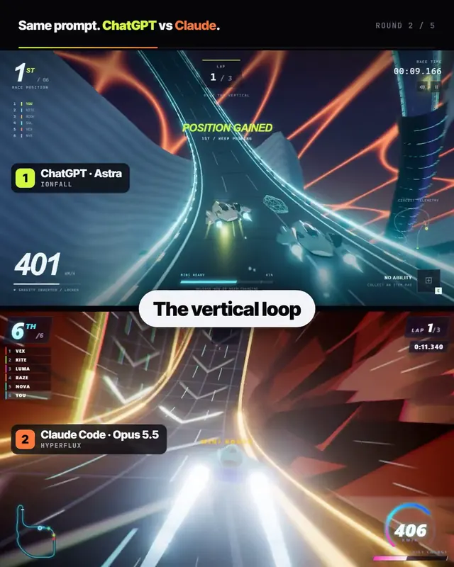</a>

**GPT-6 Astra** · ゲーム · 作者 [Anshul](https://x.com/realanshull) · 2026-09-23

GPT-6 AstraとClaude Opus 5.5が同じ指示で3Dレースゲームを1つのHTMLに構築。どちらも約120fps、Opusは描画コールが少なめ。

<details>
<summary>プロンプト</summary>

```text
build a 3D kart racer in a single HTML file.
```

</details>

[Wandy3D で見る ↗](https://wandy3d.com/ja/prompts/single-file-3d-neon-racer-with-loops-and-drift-two-models-2102652927177617564?utm_source=github&utm_medium=referral&utm_campaign=awesome_3d_prompts) · [元の投稿](https://x.com/realanshull/status/2102652927177617564)

---

### [依存ゼロの単一HTMLで動くGPUネオン流体シミュレーター](https://wandy3d.com/ja/prompts/gpu-neon-fluid-simulator-in-a-single-zero-dependency-html-2102565612874596411?utm_source=github&utm_medium=referral&utm_campaign=awesome_3d_prompts)

<a href="https://wandy3d.com/ja/prompts/gpu-neon-fluid-simulator-in-a-single-zero-dependency-html-2102565612874596411?utm_source=github&amp;utm_medium=referral&amp;utm_campaign=awesome_3d_prompts">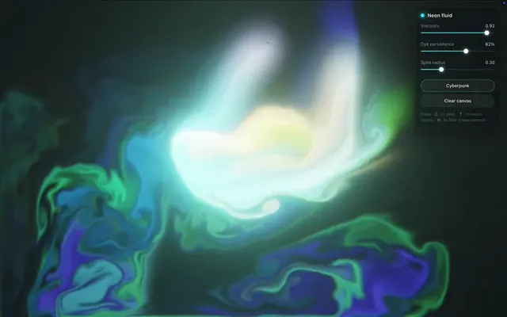</a>

**Claude Opus 5.5** · インタラクティブ · 作者 [theailoser](https://x.com/theailoser) · 2026-09-23

Claude Opus 5.5がWebGLの流体シムを生成。カーソルで光る染料を描くと渦を巻き、ガラス調パネルで物理パラメータを調整できる。

<details>
<summary>プロンプト</summary>

```text
Write a complete, single-file HTML document containing a high-performance, GPU-accelerated interactive Eulerian Neon Fluid Simulation.

Strict Technical & Aesthetic Requirements:

1. Architecture & Performance:
   - Single-file: All HTML, CSS, and JavaScript/GLSL shaders inline.
   - Zero external dependencies: Pure WebGL 1.0 or 2.0 (no Three.js, no Pixi, no external libraries).
   - GPU-Computed Fluid Dynamics: The simulation must run entirely via ping-pong Framebuffer Objects (FBOs) using custom fragment shaders for:
     a) Advection (velocity & dye)
     b) Divergence calculation
     c) Pressure Poisson solver (Jacobi iteration, 20-30 iterations per frame)
     d) Gradient subtraction / velocity projection
     e) Vorticity confinement (adds turbulent swirls and prevents the fluid from turning into dull, blurry mush).

2. Visual Fidelity (The "Neon Smoke" Look):
   - Pitch-black void background (`#050508`).
   - Additive / High-Dynamic-Range blending for dye injection.
   - Dynamic palette: Each cursor flick or touch drag injects high-luminosity neon dye that cycles smoothly through vivid cyber hues (electric cyan `#00F0FF`, hot magenta `#FF007F`, deep ultraviolet, and radiant gold).
   - Display shader enhancements: Include a post-processing pass directly in the final render shader that applies subtle bloom/glow, tone mapping, and chromatic aberration around the swirling edges of the fluid.

3. Interaction:
   - Mouse & Touch: Rapid cursor movement or dragging injects velocity proportional to mouse speed, along with dense glowing dye.
   - Passive Ambient Motion: When idle, generate subtle procedural curl noise or gentle drifting vortices so the canvas is never completely static.
   - Controls: A sleek, ultra-minimal glassmorphism HUD tucked into a corner (with auto-hide on inactivity):
     * Viscosity slider
     * Dye dissipation / persistence slider
     * Splat radius slider
     * "Clear Canvas" button
     * Toggle button to cycle color themes (Cyberpunk, Thermal Inferno, Bioluminescent Deep).

4. Production Polish:
   - Automatically handle high-DPI displays and `resize` events without stretching or clearing the FBO textures.
   - Graceful fallback check for floating-point texture support (`OES_texture_float` / `OES_texture_half_float`).
   - Clean, bug-free, fully implemented code with zero placeholders or truncated comments.

Return only the fully populated HTML file ready to run directly in Chrome/Safari/Firefox.
```

</details>

[Wandy3D で見る ↗](https://wandy3d.com/ja/prompts/gpu-neon-fluid-simulator-in-a-single-zero-dependency-html-2102565612874596411?utm_source=github&utm_medium=referral&utm_campaign=awesome_3d_prompts) · [元の投稿](https://x.com/theailoser/status/2102565612874596411)

---

### [川と赤い橋と五重塔のあるボクセル風の桜の谷](https://wandy3d.com/ja/prompts/voxel-cherry-blossom-valley-with-river-red-bridge-and-pagoda-2102565403109085669?utm_source=github&utm_medium=referral&utm_campaign=awesome_3d_prompts)

<a href="https://wandy3d.com/ja/prompts/voxel-cherry-blossom-valley-with-river-red-bridge-and-pagoda-2102565403109085669?utm_source=github&amp;utm_medium=referral&amp;utm_campaign=awesome_3d_prompts">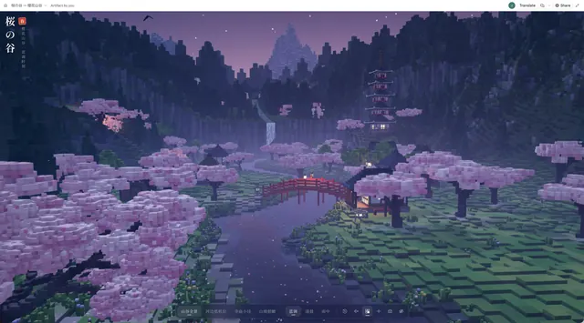</a>

**Claude Opus 5.5** · シーン · 作者 [宝玉](https://x.com/dotey) · 2026-09-23

比較企画:Claude Opus 5.5とGPT 6 Astraが同じプロンプトでThree.jsの桜の谷を制作。ここではOpus版を紹介。

<details>
<summary>プロンプト</summary>

```text
请直接制作一个可以在浏览器中实时交互的高完成度 3D 景观网页。

主题：日式樱花山谷。
使用 HTML、CSS、JavaScript 实现。不要生成图片，不要只给设计方案，
不要用一张背景图加视差效果冒充 3D。我要的是实际可运行、可游览的成品。

【一、作品定位】

这是一片完整、连续、有远近层次的山谷景观，
不是孤立的小摆件、悬浮岛、带底座的沙盘，也不是单纯的技术演示。

风格是现代精细体素 / voxel art：
保留立方体几何的造型语言，但画面应高分辨率、抗锯齿、光影细腻。
不要复古低分辨率像素化，不要粗大积木堆砌，不要给画面套像素滤镜。

视觉质量优先。宁可少几个功能，也不要牺牲构图、材质和光照。

【二、参考图的使用方式】

如果附有参考图，请先理解它的构图层次、尺度、光线和色彩关系。
仅借鉴氛围与视觉语言，重新设计场景，
不要照搬建筑、树木、山体和道路的位置，不要 1:1 复刻。

参考图不是网页里的背景素材。场景本身必须由真实 3D 几何构成。

【三、场景构图】

默认打开时就应呈现一幅完整、有吸引力的画面，
不需要用户先旋转镜头才能找到好看的角度。

采用透视相机，而不是沙盘式等距俯视相机。
画面有明确的前景、中景、远景：

前景：
一株有存在感的古老樱花树，配合岩石、草木、石灯笼和少量落花，
形成画面边缘的自然框景，但不能挡住河流、桥和主要建筑。

中景：
一条蜿蜒河流引导视线进入画面，红色木桥横跨河面；
村落、茶屋、神社和小径顺着地势分布，建筑之间有真实的通行关系。
地面有起伏、岸线和自然过渡，不是平面上均匀摆放模型。

远景：
山坡上的多层塔、不同距离的森林和山脊，以及远处的雪山。
用尺度变化、遮挡、冷暖变化和空气透视表现距离，
而不是仅仅把远处物体缩小。

不要把所有元素均匀铺满。需要主次、疏密、留白和清楚的视觉焦点。

【四、造型与画面质量】

樱花树：
树干有转折、分叉和根部，树冠由不规则花簇组成，
有间隙、厚薄变化和可见枝条。不要做成几个规则球体或方块团。

建筑：
屋顶有层叠瓦片、挑檐、梁柱和窗格；
不同建筑有用途、体量和高度差异，不要复制同一栋房子铺满山谷。

地形：
岸边有湿润石块、草丛和植被过渡。
避免过于规律的台阶、重复条纹、棋盘格和明显的程序生成网格。

水面：
必须能够反映周围景物，具有适度的波纹、深浅变化和岸边过渡。
尽量使用实际场景反射；需要性能降级时也应保持视觉可信。
不要用闪烁噪声、强烈扭曲或一整块蓝色平面代替水。

细节：
可以有少量锦鲤、落花、萤火虫、瀑布和远处飞鸟，
但都应服务于氛围，不能让画面显得嘈杂。
不要为了宣称模型数量而堆砌细节。

【五、色彩与氛围】

默认是蓝调时刻：
偏冷的山谷与远山，柔和的粉色樱花，温暖但不过曝的灯笼和窗光。
暖光集中在有人活动的地方，不要把整个环境染成橙色。

需要柔和阴影、物体接触处的明暗、合理的曝光、
克制的泛光、抗锯齿和有距离层次的薄雾。

避免发白、灰蒙、过度饱和、满屏浓雾、过曝灯光和明显锯齿。
方块几何可以清晰，但渲染本身不能粗糙。

另提供“清晨”和“雨中”两种氛围；
切换时应同步改变天空、环境光、雾和局部效果，
不是仅仅修改背景颜色。

【六、交互与界面】

提供四个经过设计的镜头：
山谷全景、河边低机位、寺庙小径、山坡俯瞰。
切换应平滑，每个镜头都需要有独立的构图价值。

基础交互：
鼠标拖动观察、滚轮缩放或前进，触屏支持拖动和双指缩放。
提供重置视角、隐藏界面和保存当前画面的功能。

可选增强：
自由探索、缓慢镜头巡游、环境音。
环境音默认关闭，只在用户主动点击后播放。
额外功能不能影响默认画面的完成度。

界面要克制、有设计感，以景观为主。
标题和控制条放在边缘，不遮挡视觉焦点。
桌面和手机都不能出现按钮越界、文字重叠或无法操作的问题。

【七、工程与性能】

允许使用 Three.js / WebGL，以及版本固定、互相兼容的 CDN 依赖。
优先使用成熟渲染能力，不要为了“零依赖”重写整套引擎。

自写的 HTML、CSS、JavaScript 尽量整理在一个 HTML 文件中。
景物由程序化几何和材质生成，不依赖外部图片或 3D 模型资源。

重复物体采用适合的批量或实例化绘制方式；
合理控制细分、阴影、反射和渲染分辨率。
提供高画质和轻量模式，手机默认使用较轻设置。
不要靠无限增加体素数量换取细节。

加入加载提示、WebGL 不支持时的提示和必要的错误处理。
没有开启声音时不要自动播放；尊重减少动态效果的系统偏好。

【八、交付前验收】

不要写完代码就立即交付。

如果当前环境支持浏览器运行和截图，请先实际打开页面，
检查默认镜头、四个视角、氛围切换、桌面和手机布局，
再根据截图修正明显的构图、曝光、遮挡和渲染问题。

重点检查：
是否存在空白画面、加载失败、控制台错误；
是否有穿模、闪烁、阴影条纹、过曝、水面异常；
默认画面是否真正像完整景观，而不是小型沙盘；
功能按钮是否实际可用，移动端是否越界。

可以使用浏览器截图验收，但不要调用图像生成工具。
没有完成的测试要如实说明，不要声称已经验证。

最终交付：
1. 实际存在、可以打开的 HTML 文件，或当前环境支持的交互预览。
2. 如能截图，附一张真实浏览器渲染截图。
3. 简短说明操作方式和必要的运行条件。

请直接完成制作；非关键细节自行作出一致的设计选择，
不要把可以自行解决的实现问题反复交给我决定。
```

</details>

[Wandy3D で見る ↗](https://wandy3d.com/ja/prompts/voxel-cherry-blossom-valley-with-river-red-bridge-and-pagoda-2102565403109085669?utm_source=github&utm_medium=referral&utm_campaign=awesome_3d_prompts) · [元の投稿](https://x.com/dotey/status/2102565403109085669)

---

### [Blenderで再現したヒンデンブルク号炎上の短編映像](https://wandy3d.com/ja/prompts/blender-film-recreating-the-hindenburg-airship-disaster-2102547809140355250?utm_source=github&utm_medium=referral&utm_campaign=awesome_3d_prompts)

<a href="https://wandy3d.com/ja/prompts/blender-film-recreating-the-hindenburg-airship-disaster-2102547809140355250?utm_source=github&amp;utm_medium=referral&amp;utm_campaign=awesome_3d_prompts">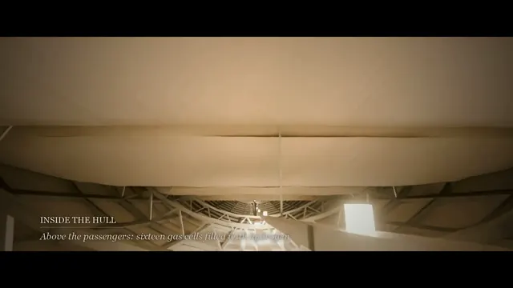</a>

**Claude Opus 5.5** · アニメーション · 作者 [AImanhasnoname](https://x.com/aimanhasnoname) · 2026-09-22

短い依頼からClaude Opus 5.5がBlenderで飛行船をモデリングし、船内、字幕、炎上場面までを含む映像をレンダリング。

<details>
<summary>プロンプト</summary>

```text
make me a model of the Hundenberg on blender make me a realistic video of the accident
```

</details>

[Wandy3D で見る ↗](https://wandy3d.com/ja/prompts/blender-film-recreating-the-hindenburg-airship-disaster-2102547809140355250?utm_source=github&utm_medium=referral&utm_campaign=awesome_3d_prompts) · [元の投稿](https://x.com/aimanhasnoname/status/2102547809140355250)

---

### [自前物理で自動再生する3Dルーブ・ゴールドバーグ・マシン](https://wandy3d.com/ja/prompts/self-running-3d-rube-goldberg-machine-with-hand-written-2102544081863717153?utm_source=github&utm_medium=referral&utm_campaign=awesome_3d_prompts)

<a href="https://wandy3d.com/ja/prompts/self-running-3d-rube-goldberg-machine-with-hand-written-2102544081863717153?utm_source=github&amp;utm_medium=referral&amp;utm_campaign=awesome_3d_prompts">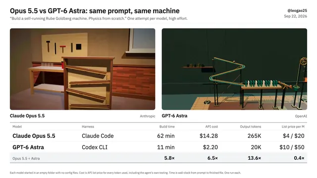</a>

**Claude Opus 5.5** · アニメーション · 作者 [leo](https://x.com/leogao25) · 2026-09-22

Claude Opus 5.5とGPT-6 Astraに同じプロンプトで自動再生のルーブ・ゴールドバーグ装置を作らせた比較。Opusは木工所を舞台にしました。

<details>
<summary>プロンプト</summary>

```text
Build a 3D Rube Goldberg machine that runs itself, as a single self-contained index.html in the current directory.

The chain, in order:
1. A marble is released at the top and rolls down a series of zig-zag ramps.
2. It knocks over a line of at least 12 dominoes.
3. The last domino tips a seesaw, which launches a small ball into a hanging bucket.
4. The bucket's weight pulls it down; its rope runs over a pulley and yanks a bell, which visibly swings.
5. The same motion raises a flag up a pole. The flag reaching the top is the finish.

Rules:
- Write the physics yourself: no physics library. Every motion after the marble is released must come from your simulation (rigid bodies, collisions, constraints, rope/pulley). No keyframed animation or tweened motion of any machine part.
- You may load three.js from a CDN for rendering. Nothing else external: no images, models, or fonts.
- It must run with no user input: start automatically on page load, use a cinematic camera that follows the action, and complete the whole chain in about 15–20 seconds. After the flag is up, hold for 2 seconds, then reset and replay.
- Deterministic: fixed timestep and no unseeded randomness, so every run looks the same.
- Fill the browser window. It will be screen-recorded at 1280×720.
- No on-screen text or UI of any kind.
- Make it look good: lighting, shadows, materials, and a setting that makes it feel like a real contraption.
```

</details>

[Wandy3D で見る ↗](https://wandy3d.com/ja/prompts/self-running-3d-rube-goldberg-machine-with-hand-written-2102544081863717153?utm_source=github&utm_medium=referral&utm_campaign=awesome_3d_prompts) · [元の投稿](https://x.com/leogao25/status/2102544081863717153)

---

### [絵本風3D牧場ゲーム:動物を選んで歩き回り、つついて遊べる](https://wandy3d.com/ja/prompts/storybook-3d-farm-animal-game-with-an-animal-picker-and-2102538764749037738?utm_source=github&utm_medium=referral&utm_campaign=awesome_3d_prompts)

<a href="https://wandy3d.com/ja/prompts/storybook-3d-farm-animal-game-with-an-animal-picker-and-2102538764749037738?utm_source=github&amp;utm_medium=referral&amp;utm_campaign=awesome_3d_prompts">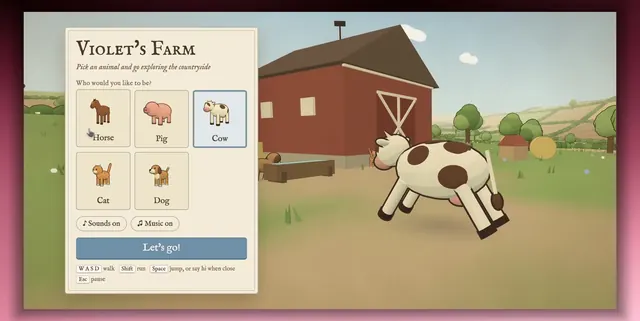</a>

**Claude Opus 5.5** · ゲーム · 作者 [mblaso](https://x.com/blaso96) · 2026-09-22

Claude Opus 5.5が短いプロンプト一つから、動物を選んで他の動物をつついたり果物や干し草を食べられる絵本風の牧場ゲームを作りました。

<details>
<summary>プロンプト</summary>

```text
Create a interactive farm animal game using the design/art style of "Peter Rabbit"
main menu = sounds on/off + animal picker (horse, pig, cow, cat, dog)
esc = pause: reset back to spawn/main menu/
wasd to move around
spacebar to jump and to interact with other animals when near
interactions are randomized upon proximity detection
interactions can be make sounds at the other animal (unique from their passive sounds) "boop them"
interactible with: water to drink, hay to eat, fruit to eat. 
3rd person but as if the camera was slightly behind the animal and above it
ambience animals are birds, airplanes in the sky (randomly)
setting= farmland, barn, farming village with houses (cant enter houses)
Enough assets to capture attention, but not enough that it needs to be deemed production grade, this is just to capture 15 minutes out of my day with my daughter and have fun
react, svg, js, webgl, threejs, whatever is necessary to make it feel "good"
```

</details>

[Wandy3D で見る ↗](https://wandy3d.com/ja/prompts/storybook-3d-farm-animal-game-with-an-animal-picker-and-2102538764749037738?utm_source=github&utm_medium=referral&utm_campaign=awesome_3d_prompts) · [元の投稿](https://x.com/blaso96/status/2102538764749037738)

---

### [夕焼けの海を進む映画風の海賊船(単一HTML)](https://wandy3d.com/ja/prompts/cinematic-pirate-ship-sailing-a-sunset-ocean-in-one-html-2102534606121746589?utm_source=github&utm_medium=referral&utm_campaign=awesome_3d_prompts)

<a href="https://wandy3d.com/ja/prompts/cinematic-pirate-ship-sailing-a-sunset-ocean-in-one-html-2102534606121746589?utm_source=github&amp;utm_medium=referral&amp;utm_campaign=awesome_3d_prompts">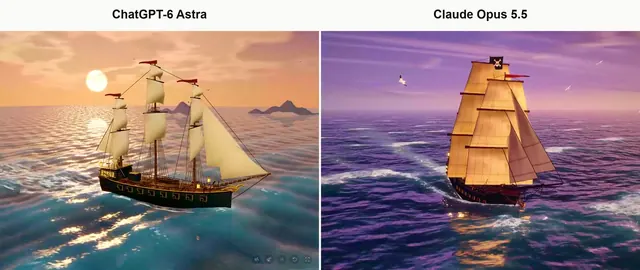</a>

**Claude Opus 5.5** · シーン · 作者 [Vib3Coded](https://x.com/vib3coded) · 2026-09-22

Claude Opus 5.5とGPT-6 Astraに夕暮れの海賊船シーンを作らせた比較。Opusは帆、ライティング、泡立つ航跡が際立っていました。

<details>
<summary>プロンプト</summary>

```text
Create from scratch a fully interactive 3D scene of a pirate ship sailing across a dynamic ocean at sunset. The visual style should be cinematic and stylized rather than photorealistic, while still being exceptionally rich, detailed, polished, and visually sophisticated. Build the ship, ocean, sky, lighting, materials, sails, rigging, cannons, small structural details, sea foam, wake, particles, animation, camera work, composition, atmospheric depth, and color grading. The final result should feel like a premium, high-production 3D artwork, not a prototype, technical demo, or low-quality scene. Start from a completely blank page. Do not reuse or depend on any previous project or scene. You may create the assets yourself or use reliable, trusted, open-source assets and libraries when necessary. Mandatory requirements: No text of any kind may appear anywhere inside the scene. No titles, names, logos, descriptions, credits, labels, or control instructions in any language. Deliver the entire project as one final standalone page file that can be opened directly in a web browser, with assets embedded inside it as much as reasonably possible. The ocean, ship, sails, and camera must all be animated naturally and smoothly. Avoid artificial slow motion or sluggish movement. The ship should feel like it is genuinely moving through the water. Do not rely on primitive geometric shapes as the finished result. Build a visually convincing and detailed pirate ship, including a carefully shaped hull, masts, sails, rigging, ropes, cannons, railings, lanterns, deck structures, and clearly visible small-scale details. Lighting must reveal the ship's geometry and materials clearly. Create a rich sunset atmosphere, deep ocean shading, reflections, convincing sea foam, and a detailed sailing wake behind and around the vessel. Maintain a strong balance between visual quality and real-time performance, preserving smooth interaction and animation without making an obvious sacrifice in quality. Automatically use the most appropriate skills, tools, libraries, techniques, and available assets needed to achieve the best result. Do not wait for me to specify which technologies to use. Actually test the finished result in a desktop web browser. Capture visual screenshots, inspect the browser console for errors, and fix every visible or technical issue you find, including distorted geometry, black screens, failed asset loading, broken animation, poor composition, rendering artifacts, or camera problems. At the end, verify that the final file opens and works directly, that the scene contains no text whatsoever, and that there are no remaining runtime or loading errors. Then finish the task with only a brief response.
```

</details>

[Wandy3D で見る ↗](https://wandy3d.com/ja/prompts/cinematic-pirate-ship-sailing-a-sunset-ocean-in-one-html-2102534606121746589?utm_source=github&utm_medium=referral&utm_campaign=awesome_3d_prompts) · [元の投稿](https://x.com/vib3coded/status/2102534606121746589)

---

### [Three.jsで歩き回れる無限のプロシージャル・ローポリ世界](https://wandy3d.com/ja/prompts/endless-procedural-low-poly-world-to-roam-in-three-js-2102529695908806728?utm_source=github&utm_medium=referral&utm_campaign=awesome_3d_prompts)

<a href="https://wandy3d.com/ja/prompts/endless-procedural-low-poly-world-to-roam-in-three-js-2102529695908806728?utm_source=github&amp;utm_medium=referral&amp;utm_campaign=awesome_3d_prompts">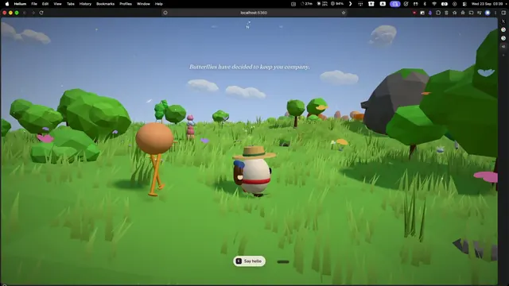</a>

**Claude Opus 5.5** · ゲーム · 作者 [🥔🥔🥔](https://x.com/argofowl) · 2026-09-22

Claude Opus 5.5が高い推論設定で、湖や木々、出会える生き物のある、落ち着いた手続き生成の探索ゲームを作りました。

<details>
<summary>プロンプト</summary>

```text
create a new project in my projects folder called "endless-game": an endless, procedurally generated world built with three.js in the browser that i can roam freely and just enjoy. every area should be randomly generated, with surprises everywhere no matter how long i play. it should feel calm, relaxing and genuinely fun, like the cozy, satisfying vibe of a supermarket simulator, but it shouldn't be a supermarket game. i want a really interesting world to walk around in, with entities i can meet and interact with, and really cool graphics. set a clear goal for the project, keep working until you reach it, and play a sound chime when it's done and ready for me to play and test.
```

</details>

[Wandy3D で見る ↗](https://wandy3d.com/ja/prompts/endless-procedural-low-poly-world-to-roam-in-three-js-2102529695908806728?utm_source=github&utm_medium=referral&utm_campaign=awesome_3d_prompts) · [元の投稿](https://x.com/argofowl/status/2102529695908806728)

---

### [Blenderで作った家具付きの2階建て郊外住宅モデル](https://wandy3d.com/ja/prompts/two-story-suburban-house-modeled-in-blender-with-a-furnished-2102473781830909995?utm_source=github&utm_medium=referral&utm_campaign=awesome_3d_prompts)

<a href="https://wandy3d.com/ja/prompts/two-story-suburban-house-modeled-in-blender-with-a-furnished-2102473781830909995?utm_source=github&amp;utm_medium=referral&amp;utm_campaign=awesome_3d_prompts">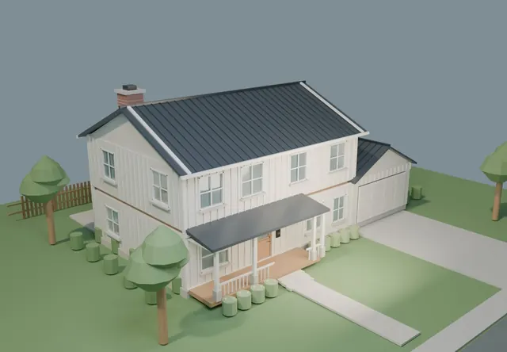</a>

**GPT-6 Sol** · アセット · 作者 [Azer](https://x.com/azer0lxm) · 2026-09-22

CodexのGPT-6 SolがBlenderでローポリの郊外住宅を制作。外観レンダーと、家具入りの部屋が見える断面図を紹介します。

<details>
<summary>プロンプト</summary>

```text
Hello. Please design the best possible 3D model using Blender of a two-story suburban house, interior and everything included.
```

</details>

[Wandy3D で見る ↗](https://wandy3d.com/ja/prompts/two-story-suburban-house-modeled-in-blender-with-a-furnished-2102473781830909995?utm_source=github&utm_medium=referral&utm_campaign=awesome_3d_prompts) · [元の投稿](https://x.com/azer0lxm/status/2102473781830909995)

---

### [断面で海中が見える、インタラクティブな先史時代の島](https://wandy3d.com/ja/prompts/interactive-prehistoric-island-with-underwater-cross-section-2102450842070569099?utm_source=github&utm_medium=referral&utm_campaign=awesome_3d_prompts)

<a href="https://wandy3d.com/ja/prompts/interactive-prehistoric-island-with-underwater-cross-section-2102450842070569099?utm_source=github&amp;utm_medium=referral&amp;utm_campaign=awesome_3d_prompts">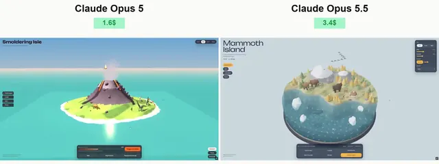</a>

**Claude Opus 5.5** · インタラクティブ · 作者 [Vib3Coded](https://x.com/vib3coded) · 2026-09-22

同じThree.jsプロンプトでClaude Opus 5.5とOpus 5を比較。新しい方は水の断面、海の生物、マンモス、オーロラまで描き込まれています。

<details>
<summary>プロンプト</summary>

```text
Create a beautiful, highly detailed, fully interactive 3D prehistoric island using Three.js and WebGL. Deliver everything in a single standalone HTML file that opens directly in Chrome. Embed assets wherever possible.

VISUAL DIRECTION
Build a large, rounded island surrounded by an ocean with a transparent underwater cross-section. The result should feel like a premium miniature world: lush vegetation, expressive dinosaurs, rich materials, atmospheric lighting, and polished animation. Use a cohesive, stylized art direction rather than basic geometric shapes.
ISLAND
Create varied terrain with beaches, rocky cliffs, dense prehistoric forests, giant ferns, a waterfall, a freshwater pond, and a volcano. Add a small research station, wooden walkways, observation platforms, supply crates, and dinosaur nests. Make the island spacious enough for dinosaurs to move naturally between distinct areas.

WATER CROSS-SECTION
The water must form a deep, rounded volume around the island, with clearly visible underwater scenery through its sides. Include a textured seabed, rocks, aquatic plants, fish, bubbles, and a green marine reptile swimming beneath the surface. Do not place ordinary land dinosaurs underwater, and do not add a submarine.
Use animated waves, Fresnel reflections, underwater light patterns, shoreline foam, and splashes. Avoid transparency sorting artifacts and visible gaps between the island and water.

DINOSAURS
Include several distinct species, such as a long-necked sauropod, Triceratops, Stegosaurus, a large theropod, and smaller herd animals. Add pterosaurs circling overhead.
Give every species recognizable anatomy, shaped bodies, articulated limbs, detailed heads, tails, and appropriate skin patterns. Avoid assembling the finished dinosaurs from obvious boxes or disconnected spheres.

NATURAL ANIMATION
Use hierarchical skeletons with correctly positioned joints. Walking must have distinct stance and swing phases: feet stay planted during contact and lift cleanly during each step. Match stride length to movement speed.

Use terrain sampling and inverse kinematics to keep feet on the ground. Add weight shifts, subtle body movement, balanced tail motion, head turns, and breathing. Dinosaurs must never float, slide, intersect the ground, or walk through buildings, rocks, trees, or each other.
Use obstacle avoidance and safe paths. Different species should have different movement speeds, gait patterns, and behaviors. Marine animals must face their direction of travel.

INTERACTION
Allow users to:

Rotate the camera freely, zoom, and inspect the underwater cross-section.
Select a dinosaur and follow it with a smoothly moving camera.

Place food in suitable locations and watch nearby dinosaurs approach and eat.

Trigger drinking, resting, calling, and herd movement.

Explore nests and watch a hatchling emerge.
Trigger a marine reptile surfacing with a splash.
Switch between daylight, sunset, and night.
Adjust rain, wind, and volcanic activity.
Pause the simulation and reset the scene.
Make every control produce a clear, visible response. Keep interactions repeatable and prevent overlapping animations from breaking character poses.
ATMOSPHERE AND AUDIO
Add moving foliage, drifting clouds, birds, insects, rain particles, and warm research-station lights at night. Include quiet atmospheric music and environmental sounds with a working music toggle and volume slider. Start audio only after user interaction.
INTERFACE
Use a compact, elegant interface with English labels. Keep the scene dominant and avoid large panels covering the island. Make the layout responsive for desktop and mobile.
TECHNICAL QUALITY
Use instancing for repeated vegetation and props, efficient geometry, appropriate shadows, and restrained post-processing. Balance visual richness with smooth real-time performance.
```

[…（以下省略。全文は Wandy3D で）](https://wandy3d.com/ja/prompts/interactive-prehistoric-island-with-underwater-cross-section-2102450842070569099?utm_source=github&utm_medium=referral&utm_campaign=awesome_3d_prompts)

</details>

[Wandy3D で見る ↗](https://wandy3d.com/ja/prompts/interactive-prehistoric-island-with-underwater-cross-section-2102450842070569099?utm_source=github&utm_medium=referral&utm_campaign=awesome_3d_prompts) · [元の投稿](https://x.com/vib3coded/status/2102450842070569099)

---

### [ハート型マップで大群が押し寄せる俯瞰タワーディフェンス](https://wandy3d.com/ja/prompts/top-down-tower-defense-game-with-swarm-waves-on-a-heart-2102411087002112256?utm_source=github&utm_medium=referral&utm_campaign=awesome_3d_prompts)

<a href="https://wandy3d.com/ja/prompts/top-down-tower-defense-game-with-swarm-waves-on-a-heart-2102411087002112256?utm_source=github&amp;utm_medium=referral&amp;utm_campaign=awesome_3d_prompts">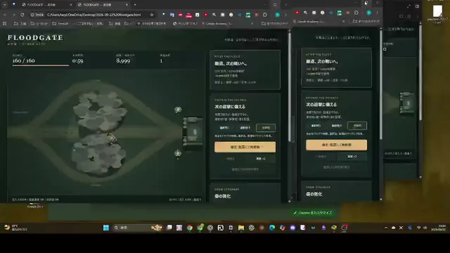</a>

**GPT-6 Astra** · ゲーム · 作者 [nkz/ぴたすぽ](https://x.com/nikzu_) · 2026-09-22

GPT-6 Astraがオーク襲撃風のタワーディフェンスをワンショットで生成。作者は別モデルの試作とも比べています。

<details>
<summary>Wandy3D による制作ブリーフ</summary>

```text
Build a polished top-down browser tower-defense game in the spirit of an orc-siege strategy title. Use a dark forest-green and muted gold palette with a refined, minimal look. The map is a symmetrical heart-shaped arena of ring paths and two large central islands, with a gate on the right that must be protected. Waves of many small units pour in from the left in a dense stream, split around the obstacles and rush the gate. Add a right-hand panel with wave counter, timer, score, gold, a start-wave button and upgrade or build options, plus a header showing remaining enemies out of a total. Render large crowds smoothly using instancing or a canvas particle approach. Deliver a single self-contained HTML file with JavaScript. Done when a full wave plays from start to finish, units visibly flow, thin out and reach the gate, and the interface updates live. Keep all interface text readable and consistent.
```

</details>

[Wandy3D で見る ↗](https://wandy3d.com/ja/prompts/top-down-tower-defense-game-with-swarm-waves-on-a-heart-2102411087002112256?utm_source=github&utm_medium=referral&utm_campaign=awesome_3d_prompts) · [元の投稿](https://x.com/nikzu_/status/2102411087002112256)

---

### [東京タワーの3D作品：鉄骨のクローズアップと昼夜の変化を収めた動画](https://wandy3d.com/ja/prompts/tokyo-tower-in-3d-steel-lattice-close-ups-and-a-day-to-night-2102276620124062065?utm_source=github&utm_medium=referral&utm_campaign=awesome_3d_prompts)

<a href="https://wandy3d.com/ja/prompts/tokyo-tower-in-3d-steel-lattice-close-ups-and-a-day-to-night-2102276620124062065?utm_source=github&amp;utm_medium=referral&amp;utm_campaign=awesome_3d_prompts">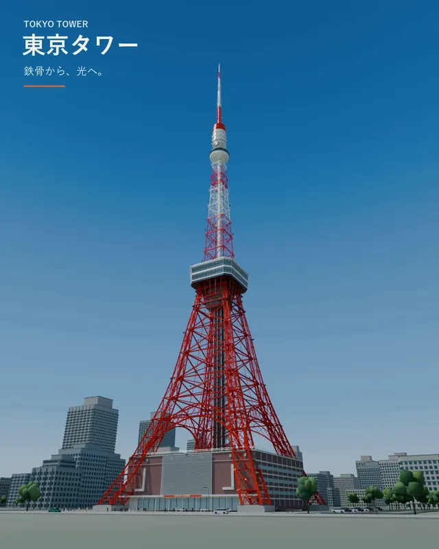</a>

**GPT-6 Astra** · アニメーション · 作者 [Wafffle](https://x.com/wafffle_dev) · 2026-09-22

GPT-6 Astraが制作ディレクターとして、地上からの見上げから夜のライトアップまでを描く約30秒のBlender映像を作りました。

<details>
<summary>プロンプト</summary>

```text
東京タワーを主役にした、見応えのある3D作品とX投稿用の約30秒動画を作ってください。

あなたは制作ディレクターです。必要なサブタスクを作成し、調査・制作を依頼してください。依頼内容の具体化、進行管理、成果物の確認、修正指示、最終的な取りまとめまで任せます。

【作ってほしいもの】
地上から見上げた高さと、近づいたときの鉄骨の細かさが伝わる東京タワーです。
昼と夜の両方を用意し、昼は構造や塗装、夜はライトアップの美しさを見せてください。

「東京タワーをよく見て作っている」と感じられる作品にしたいです。塔の形だけでなく、脚の開き方、鉄骨の組み方、展望台、足元の建物など、特徴的な細部を調べて反映してください。周辺の街は、塔の大きさと場所の雰囲気が伝わる範囲に絞って構いません。

【制作の進め方】
・公式資料や写真を調査し、再現する特徴と優先順位を決める。
・その調査を基に、各サブタスクへ具体的な制作指示を出す。
・早い段階で実際の3D試写を確認し、形・構図・明るさを調整する。
・完成画像や動画をメイン自身が見て、違和感や不足を見つけ、修正を依頼する。
・細かな技術選択や撮影構成は自主的に判断して、完成まで進める。

写真や生成画像を貼った背景だけで代用せず、実際の3D形状とカメラ移動で表現してください。確認できた事実と、資料不足による推定部分は記録してください。

【動画】
約30秒。地上からの見上げ、鉄骨や展望台の近接、塔全体が分かる引きを組み合わせ、昼夜の変化も見せてください。
細かな秒割りは、完成したモデルを見て最も魅力が伝わる構成を判断してください。

【納品】
・編集可能なBlenderデータ
・X投稿用MP4動画
・昼夜の全景と細部の確認画像
・短い投稿文案
・素材の出典、再現範囲、検証結果を記したREADME
```

</details>

[Wandy3D で見る ↗](https://wandy3d.com/ja/prompts/tokyo-tower-in-3d-steel-lattice-close-ups-and-a-day-to-night-2102276620124062065?utm_source=github&utm_medium=referral&utm_campaign=awesome_3d_prompts) · [元の投稿](https://x.com/wafffle_dev/status/2102276620124062065)

---

### [H145風のインタラクティブ3Dヘリコプター：塗装切替とホバーモード](https://wandy3d.com/ja/prompts/interactive-3d-h145-style-helicopter-with-liveries-and-hover-2102217028052377910?utm_source=github&utm_medium=referral&utm_campaign=awesome_3d_prompts)

<a href="https://wandy3d.com/ja/prompts/interactive-3d-h145-style-helicopter-with-liveries-and-hover-2102217028052377910?utm_source=github&amp;utm_medium=referral&amp;utm_campaign=awesome_3d_prompts">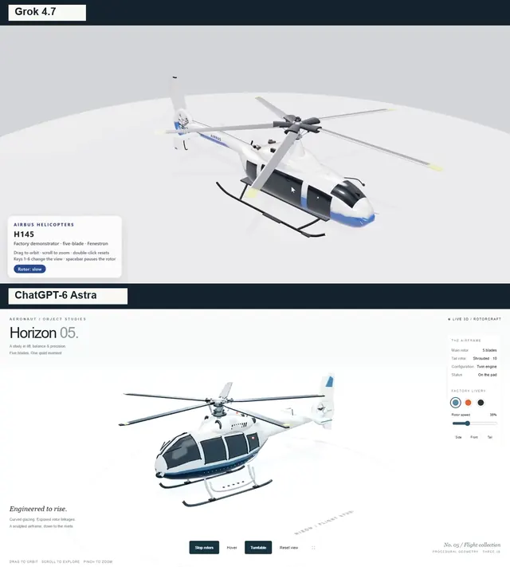</a>

**GPT-6 Astra** · インタラクティブ · 作者 [Vib3Coded](https://x.com/vib3coded) · 2026-09-22

同じプロンプトでGrok 4.7とGPT-6 Astraを比較。AstraのThree.js製ヘリは細部の作り込み、3種の塗装、ホバーモードが特長です。

<details>
<summary>プロンプト</summary>

```text
Create a detailed, interactive 3D scene of a modern helicopter in a single HTML file using Three.js and WebGL. Build genuine 3D geometry that can be viewed from every angle, not an image.

Visual style:
A premium aviation design presentation with a light gray studio background, a circular display platform, soft shadows, and realistic reflections.
Helicopter:

A smooth, streamlined fuselage inspired by light twin-engine helicopters such as the H145.
A white body with a dark navy underside and blue accent stripe.
Curved, tinted cockpit windows with reflections and carefully fitted window seals.
Side doors, handles, panel seams, rivets, boarding steps, and antennas.
Two engine housings with air intakes, ventilation grilles, and exhaust outlets.
A five-bladed main rotor with a detailed hub, attachment hardware, and pitch-control linkages.
A tapered tail boom, stabilizers, and a shrouded tail rotor with a genuine opening through its housing.
Curved landing skids attached to the fuselage with structural supports.
Navigation lights and a blinking beacon.
All components must connect physically. Avoid floating parts, gaps between sections, rotor blades intersecting the fuselage, or windows hovering above the body.

Interactions:

Mouse drag to orbit, scroll to zoom, and touch controls.
Start and stop both rotors with gradual acceleration and deceleration.
Adjustable rotor speed.
Hover mode: smoothly lift off the platform, gently sway in the air, and land softly when disabled.
Automatic camera orbit.
Front, side, and tail camera presets.
Reset camera and fullscreen controls.
Three liveries: glacier blue and white, rescue orange, and graphite.
Interface:

Top left: a small “AERONAUT / OBJECT STUDIES” label and a large “Horizon 05.” heading.
Right side: a compact panel with specifications, helicopter status, livery selection, and rotor speed.
Bottom: controls and interaction hints.
Restrained typography, thin borders, and generous whitespace. Keep the helicopter unobstructed.
All interface text in English.
Technical requirements:

Generate the geometry procedurally without downloading a prebuilt helicopter model.
Use PBR materials, a studio reflection environment, and soft shadows.
Make animation independent of frame rate.
Reuse geometry and materials where appropriate, and cap pixel ratio for performance.
Support desktop and mobile layouts, keeping the full rotor span visible in the initial view.
If possible, embed dependencies in the HTML so the file works offline.
Display a helpful fallback message if WebGL is unavailable.
Before finishing, inspect the model from every side, test every control, and check for console errors. Pay particular attention to the silhouette, structural connections, glazing, and rotor mechanisms.

Deliver the working HTML file, not just an explanation.
```

</details>

[Wandy3D で見る ↗](https://wandy3d.com/ja/prompts/interactive-3d-h145-style-helicopter-with-liveries-and-hover-2102217028052377910?utm_source=github&utm_medium=referral&utm_campaign=awesome_3d_prompts) · [元の投稿](https://x.com/vib3coded/status/2102217028052377910)

---

### [WebGPU製の手続き型レースゲーム：AIライバルと海沿いコース](https://wandy3d.com/ja/prompts/procedural-webgpu-racing-game-with-ai-rivals-and-coastal-2102150671340327384?utm_source=github&utm_medium=referral&utm_campaign=awesome_3d_prompts)

<a href="https://wandy3d.com/ja/prompts/procedural-webgpu-racing-game-with-ai-rivals-and-coastal-2102150671340327384?utm_source=github&amp;utm_medium=referral&amp;utm_campaign=awesome_3d_prompts">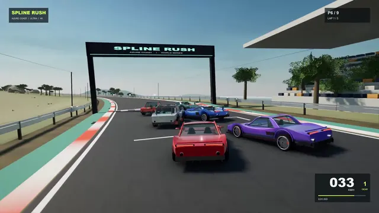</a>

**GPT-6 Astra** · ゲーム · 作者 [Maharajahu🪢](https://x.com/ToolBraidComp) · 2026-09-21

GPT-6 Astraがこの長いプロンプトからThree.jsのレースゲームを制作。海岸線、トンネル、スタンドを走る追従視点が見られます。高負荷です。

<details>
<summary>プロンプト</summary>

```text
Build a complete, production-quality browser racing game called Spline Rush using the latest Three.js (WebGPURenderer + TSL where possible). 100% procedural: no external models, textures, audio files or fonts. Everything generated in code at runtime.

CORE GAME
- 6 unique tracks with elevation, banking, tunnels, hairpins, named corners and distinct biomes (coastal day, mountain dusk, desert sunset, forest rain, night city neon, high-speed oval).
- Championship mode (qualifying + 3 races), Time Trial with ghosts, Quick Race.
- 8 AI opponents with personality, racing line, braking points, overtaking and defending.
- Best lap records, sector times, live event feed, replay camera.
- Garage: 5 parametric cars with clearcoat + metal-flake paint, panel gaps, working lights, animated suspension, damage states.

GRAPHICS TARGET (Ultra, worthy of RTX 5090 at 4K)
Renderer: THREE.WebGPURenderer. Physically based pipeline.
Lighting:
- Rayleigh/Mie physically based sky + starfield + moon + dynamic sun that drives a full day/night cycle.
- Cascaded shadow maps (4 cascades, stable texel snapping, high-res).
- IBL via PMREM updated with time of day.
- Volumetric fog + god rays + heat haze.
Materials:
- MeshPhysicalMaterial / TSL nodes: clearcoat, anisotropy, transmission on glass, metal-flake paint, wet-road shader that reacts to rain.
Post-processing chain (RenderPipeline / TSL or postprocessing library):
GTAO or high-quality SSAO → SSR → bloom (Karis) → motion blur (velocity) → DOF → god rays → auto-exposure → color grading + film grain + vignette → SMAA or TAA.
Effects:
- GPU particle pools: tyre smoke, sparks, dust, rain spray, grass/gravel kick-up, heat distortion.
- Skid marks that persist and fade.
- Dynamic wetness and puddle reflections when raining.

PHYSICS & FEEL
- Fixed-step 120 Hz simulation.
- Raycast or strut suspension, load transfer, combined-slip tyres, ABS/TC, surface types (asphalt, kerb, grass, gravel, wet).
- Camera: cinematic chase + hood + onboard with motion and collision shake.

AUDIO
- Fully synthesised Web Audio: multi-layer engine by RPM/load, wind, tyre screech, kerb rumble, crowd, dynamic music.

QUALITY SYSTEM
- Presets: Low / Medium / High / Ultra.
- Ultra assumes RTX 5090-class GPU: 4K, high shadow maps, max particles, all post effects on, no aggressive LOD.
- Adaptive quality that can drop effects if frame time exceeds target.

Start with a playable first version (one track, one car, basic lighting), then iterate feature-by-feature exactly as requested. Keep everything in a single clean HTML/JS (or Vite) project that runs locally. Comment major systems. Make it look expensive, not cute.
```

</details>

[Wandy3D で見る ↗](https://wandy3d.com/ja/prompts/procedural-webgpu-racing-game-with-ai-rivals-and-coastal-2102150671340327384?utm_source=github&utm_medium=referral&utm_campaign=awesome_3d_prompts) · [元の投稿](https://x.com/ToolBraidComp/status/2102150671340327384)

---

### [Three.jsで作る層構造の断面付きインタラクティブ3D太陽サイト](https://wandy3d.com/ja/prompts/interactive-3d-sun-website-with-a-layer-by-layer-cutaway-in-2102038474752766239?utm_source=github&utm_medium=referral&utm_campaign=awesome_3d_prompts)

<a href="https://wandy3d.com/ja/prompts/interactive-3d-sun-website-with-a-layer-by-layer-cutaway-in-2102038474752766239?utm_source=github&amp;utm_medium=referral&amp;utm_campaign=awesome_3d_prompts">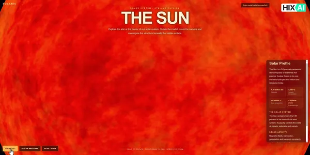</a>

**GPT-6 Astra** · インタラクティブ · 作者 [HIX.AI](https://x.com/HIX_AI_) · 2026-09-21

GPT-6 Astraが太陽の解説サイトを生成。回転とズームができ、断面図で核から コロナまでの各層を選んで説明を読めます。

<details>
<summary>プロンプト</summary>

```text
I want to build an interactive 3D Sun model website using Three.js.

First, please write a Python script that can be run directly in Blender to create a highly realistic 3D model of the Sun. The model should be based on the Sun's real physical and visual characteristics, including its spherical shape, surface texture, color, plasma-like appearance, solar granulation, and glowing atmosphere. It should not look like a simple orange sphere. Please use appropriate materials, shaders, textures, and lighting effects to create a realistic solar appearance.

Then, write the complete website code using Three.js. The Sun should occupy approximately 80% of the main visual area. Users should be able to rotate the Sun, move the view, and zoom in and out. The scene should include realistic lighting and glowing effects to make the Sun look dynamic and three-dimensional.

Add a zoom-in button that allows users to get closer to the Sun and observe its surface details.

The website should also include informative content about the Sun and its role in the solar system. The overall background should be a realistic cosmic galaxy/space environment.

In addition, add a button that opens an interactive internal anatomy view of the Sun. This view should show the major layers of the Sun, such as the core, radiative zone, convection zone, photosphere, chromosphere, and corona. Each layer should have a corresponding label and a short text description. Ideally, users should be able to interact with the diagram and select different layers to view their information.

Please make the website visually impressive, scientifically informative, and fully interactive, with a modern space-themed UI.
```

</details>

[Wandy3D で見る ↗](https://wandy3d.com/ja/prompts/interactive-3d-sun-website-with-a-layer-by-layer-cutaway-in-2102038474752766239?utm_source=github&utm_medium=referral&utm_campaign=awesome_3d_prompts) · [元の投稿](https://x.com/HIX_AI_/status/2102038474752766239)

---

### [Three.jsのWALL-Eモデル、GPT-6 AstraとGemini 4 Proの比較](https://wandy3d.com/ja/prompts/wall-e-robot-model-in-three-js-gpt-6-astra-versus-gemini-4-2101687900723106104?utm_source=github&utm_medium=referral&utm_campaign=awesome_3d_prompts)

<a href="https://wandy3d.com/ja/prompts/wall-e-robot-model-in-three-js-gpt-6-astra-versus-gemini-4-2101687900723106104?utm_source=github&amp;utm_medium=referral&amp;utm_campaign=awesome_3d_prompts">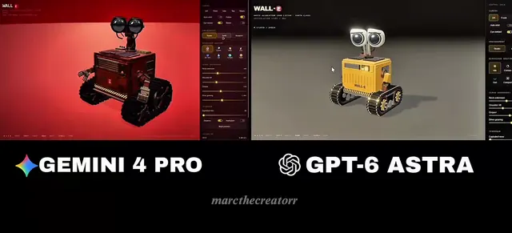</a>

**GPT-6 Astra** · アセット · 作者 [Marcel](https://x.com/marcthecreatorr) · 2026-09-20

同じ一行プロンプトの比較で、GPT-6 Astraは操作パネル付きで動く黄色いWALL-Eを生成し、Gemini 4 Pro版と並べて確認できます。

<details>
<summary>プロンプト</summary>

```text
create a 3d model of wall-e in three.js.
```

</details>

[Wandy3D で見る ↗](https://wandy3d.com/ja/prompts/wall-e-robot-model-in-three-js-gpt-6-astra-versus-gemini-4-2101687900723106104?utm_source=github&utm_medium=referral&utm_campaign=awesome_3d_prompts) · [元の投稿](https://x.com/marcthecreatorr/status/2101687900723106104)

---

### [断面ラグーン付き恐竜の島ジオラマを単一HTMLで作る](https://wandy3d.com/ja/prompts/dinosaur-island-diorama-with-cutaway-lagoon-in-a-single-html-2101570806702559235?utm_source=github&utm_medium=referral&utm_campaign=awesome_3d_prompts)

<a href="https://wandy3d.com/ja/prompts/dinosaur-island-diorama-with-cutaway-lagoon-in-a-single-html-2101570806702559235?utm_source=github&amp;utm_medium=referral&amp;utm_campaign=awesome_3d_prompts">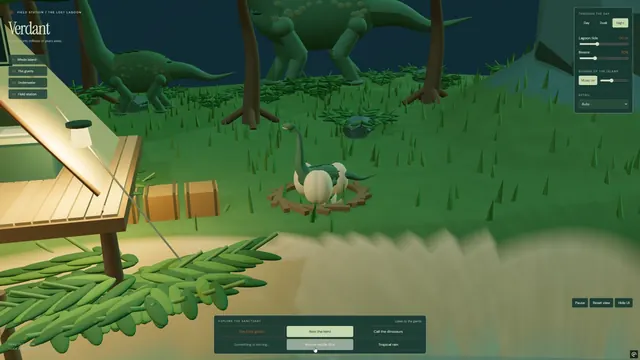</a>

**GPT-6 Astra** · インタラクティブ · 作者 [Vib3Coded](https://x.com/vib3coded) · 2026-09-20

GPT-6 AstraがThree.jsで島のジオラマ Verdantを制作。恐竜が歩き回り、潮や風、時間帯を変え、卵を孵して水中も見られます。

<details>
<summary>Wandy3D による制作ブリーフ</summary>

```text
Build an interactive 3D diorama of a tropical dinosaur island as one self-contained HTML file using Three.js and WebGL. Show the island as a floating slice of land with a cutaway lagoon at its base, in soft stylised low-poly style with lush greens, teal water and warm lamp light. Populate it with roaming dinosaurs, a waterfall, palm-like trees, a small wooden hut and a marine reptile swimming in the lagoon. Add a compact control panel with sliders for tide, wind and time of day, a rain toggle, and buttons to feed the herd and hatch a baby dinosaur. Let the user orbit the island and drop the camera underwater to watch the lagoon. Include gentle looping ambient music with a mute option. Animate creatures, water, foliage and weather smoothly. Done means everything runs offline in the browser with no external assets and the sky and lighting shift convincingly between day and night.
```

</details>

[Wandy3D で見る ↗](https://wandy3d.com/ja/prompts/dinosaur-island-diorama-with-cutaway-lagoon-in-a-single-html-2101570806702559235?utm_source=github&utm_medium=referral&utm_campaign=awesome_3d_prompts) · [元の投稿](https://x.com/vib3coded/status/2101570806702559235)

---

### [Three.jsで作る屋根ライダー付き自動運転SUVモデルの回転表示](https://wandy3d.com/ja/prompts/robotaxi-suv-model-with-roof-lidar-in-three-js-rotating-2101325346427842909?utm_source=github&utm_medium=referral&utm_campaign=awesome_3d_prompts)

<a href="https://wandy3d.com/ja/prompts/robotaxi-suv-model-with-roof-lidar-in-three-js-rotating-2101325346427842909?utm_source=github&amp;utm_medium=referral&amp;utm_campaign=awesome_3d_prompts">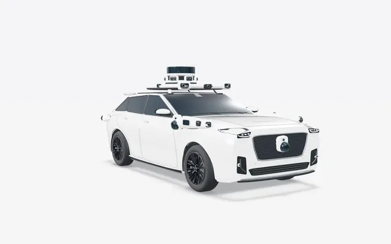</a>

**GPT-6 Astra** · アセット · 作者 [Harshith](https://x.com/HarshithLucky3) · 2026-09-19

Fable 5.1と比較されたGPT-6 Astraが、屋根にライダーを載せた白い自動運転SUVをThree.jsで生成。ただし再現度は不十分とのことです。

<details>
<summary>プロンプト</summary>

```text
3d model of Waymo Jaguar i-Pace using three js
```

</details>

[Wandy3D で見る ↗](https://wandy3d.com/ja/prompts/robotaxi-suv-model-with-roof-lidar-in-three-js-rotating-2101325346427842909?utm_source=github&utm_medium=referral&utm_campaign=awesome_3d_prompts) · [元の投稿](https://x.com/HarshithLucky3/status/2101325346427842909)

---

[← 前へ](catalog.ja.1.md) · 9 ページ中 2 ページ目 · [次へ →](catalog.ja.3.md)

プロンプト・動画・画像の権利は各作者に帰属します（[RIGHTS.md](../RIGHTS.md)）。編集テキストは [CC BY 4.0](../LICENSE) です。結果が見える良いプロンプトを知っていますか？[提案する](https://github.com/wornoxgames/awesome-3d-prompts/issues/new?template=suggest.md)。作者の方で掲載内容の修正・削除をご希望の場合は[こちら](https://github.com/wornoxgames/awesome-3d-prompts/issues/new?template=removal.md)。
