<!-- Generated file: edits are overwritten. -->

# Awesome 3D Prompts — カタログ 3/8

[← Awesome 3D Prompts](../README.md) · [English](catalog.en.1.md) · [Русский](catalog.ru.1.md) · **日本語** · [中文](catalog.zh.1.md)

[← 前へ](catalog.ja.2.md) · 8 ページ中 3 ページ目 · [次へ →](catalog.ja.4.md)

### [断面・X線・分解表示を備えたインタラクティブ3Dジェットエンジン](https://wandy3d.com/ja/prompts/interactive-3d-jet-engine-with-cutaway-x-ray-and-exploded-2101272224435253432?utm_source=github&utm_medium=referral&utm_campaign=awesome_3d_prompts)

<a href="https://wandy3d.com/ja/prompts/interactive-3d-jet-engine-with-cutaway-x-ray-and-exploded-2101272224435253432?utm_source=github&amp;utm_medium=referral&amp;utm_campaign=awesome_3d_prompts">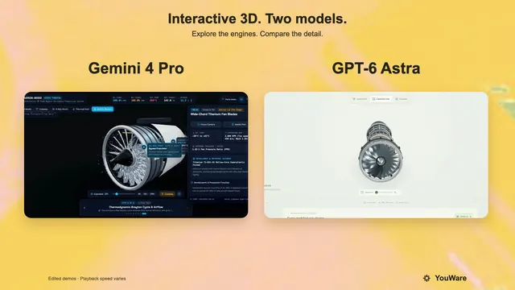</a>

**Gemini 4 Pro** · インタラクティブ · 作者 [YouWare](https://x.com/YouWareAI) · 2026-09-19

Gemini 4 Pro と GPT-6 Astra に同じプロンプトでThree.js製ジェットエンジンを作らせた比較。ディテールはGemini 4 Proが上回りました。

<details>
<summary>プロンプト</summary>

```text
Use three.js to build a 3D interactive display of an aircraft engine on a webpage. 
Please refer to Jigspace's interaction design philosophy to achieve a realistic model with near 1:1 high-fidelity restoration, fully preserving material and texture details such as metal, pipelines, and blades. Interactive features must include: step-by-step disassembly animation, exploded view of components, and part descriptions and principle explanations triggered by click or hover. 
Overall, it must support smooth camera control and friendly human-computer interaction, ensuring a smooth experience on the web that fully showcases the engine's structure and working principles.
```

</details>

[Wandy3D で見る ↗](https://wandy3d.com/ja/prompts/interactive-3d-jet-engine-with-cutaway-x-ray-and-exploded-2101272224435253432?utm_source=github&utm_medium=referral&utm_campaign=awesome_3d_prompts) · [元の投稿](https://x.com/YouWareAI/status/2101272224435253432)

---

### [1行の指示でAIエージェントがBlenderに作った写実的な環境シーン](https://wandy3d.com/ja/prompts/photorealistic-blender-environment-built-by-an-ai-agent-from-2101224659861590399?utm_source=github&utm_medium=referral&utm_campaign=awesome_3d_prompts)

<a href="https://wandy3d.com/ja/prompts/photorealistic-blender-environment-built-by-an-ai-agent-from-2101224659861590399?utm_source=github&amp;utm_medium=referral&amp;utm_campaign=awesome_3d_prompts"></a>

**GPT-6 Astra** · シーン · 作者 [Julian Goldie SEO](https://x.com/JulianGoldieSEO) · 2026-09-19

GPT-6 AstraがMCPとコンピュータ操作でBlenderを動かし、自らコンセプトを考えて茶室のシーンを細部まで構築。フライモードで見て回れます。

<details>
<summary>プロンプト</summary>

```text
Build a complete photorealistic 3D environment. Surprise me.
```

</details>

[Wandy3D で見る ↗](https://wandy3d.com/ja/prompts/photorealistic-blender-environment-built-by-an-ai-agent-from-2101224659861590399?utm_source=github&utm_medium=referral&utm_campaign=awesome_3d_prompts) · [元の投稿](https://x.com/JulianGoldieSEO/status/2101224659861590399)

---

### [32万個の星を持つ渦巻銀河を飛ぶ30秒のレンダリング映像](https://wandy3d.com/ja/prompts/rendered-30-second-flight-through-a-320-000-star-spiral-2101055500599054437?utm_source=github&utm_medium=referral&utm_campaign=awesome_3d_prompts)

<a href="https://wandy3d.com/ja/prompts/rendered-30-second-flight-through-a-320-000-star-spiral-2101055500599054437?utm_source=github&amp;utm_medium=referral&amp;utm_campaign=awesome_3d_prompts"></a>

**GPT-6 Astra** · アニメーション · 作者 [Argona](https://x.com/Argona0x) · 2026-09-18

CodexのGPT-6 Astraに一文を渡すだけで、軌道物理、レンダラー、カメラパスを備えたSF調HUD付きの銀河フライスルーが生成されました。

<details>
<summary>Wandy3D による制作ブリーフ</summary>

```text
Build a deterministic 30-second animated flight through a spiral galaxy, written as code that renders its own frames. Simulate roughly 320,000 stars with differential orbital speeds so the spiral arms stay wound, and add a core burst with polar jets and an outward shockwave that carves a cavity in the disc. Render stars as soft white-blue points around a warm glowing core on a black background, with a few cyan marker worlds and thin orbit lines. Overlay an amber sci-fi survey interface: top gauges and a target readout, a mini globe, and a scrolling telemetry log at the bottom, with labels for the main regions. Script a camera path that starts from an oblique overview, dives low along an arm, rises over the core and returns to a top-down view. Use a fixed random seed so every run produces the same galaxy, and export 1,800 frames at 60 fps into a finished video file. Done means the output plays smoothly and changing the seed gives a different galaxy.
```

</details>

[Wandy3D で見る ↗](https://wandy3d.com/ja/prompts/rendered-30-second-flight-through-a-320-000-star-spiral-2101055500599054437?utm_source=github&utm_medium=referral&utm_campaign=awesome_3d_prompts) · [元の投稿](https://x.com/Argona0x/status/2101055500599054437)

---

### [サファイアガラスと分解表示を備えたインタラクティブ3D機械式腕時計](https://wandy3d.com/ja/prompts/interactive-3d-mechanical-watch-with-sapphire-glass-and-2100958838350643553?utm_source=github&utm_medium=referral&utm_campaign=awesome_3d_prompts)

<a href="https://wandy3d.com/ja/prompts/interactive-3d-mechanical-watch-with-sapphire-glass-and-2100958838350643553?utm_source=github&amp;utm_medium=referral&amp;utm_campaign=awesome_3d_prompts"></a>

**Gemini 4 Pro** · インタラクティブ · 作者 [YouWare](https://x.com/YouWareAI) · 2026-09-18

Gemini 4 Pro、Claude Fable 5、GPT-6 Astraに同じプロンプトでThree.js製の腕時計ビューアを作らせた比較。最も精緻だったのはGemini 4 Proです。

<details>
<summary>プロンプト</summary>

```text
Use Three.js to develop a highly faithful 3D interactive watch model of an IWC Schaffhausen timepiece. Requirements: 1) The dial structure must be highly precise, with every mechanical component individually rendered and clearly distinguishable; 2) The watch face must use a sapphire glass material with realistic transparency, refraction, and reflection effects; 3) The minute hand and second hand must be correct hands that follow real timekeeping logic, with automatic continuous hand-sweep animation; 4) Support disassembly and reassembly of the watch, with each part able to be separated and viewed individually; 5) The overall level of detail must be extremely high, closely matching the structure and proportions of a real watch, with realistic material textures for screws, metal parts, and other components, and fine craftsmanship. Please ensure the model runs smoothly in the browser and interacts naturally.
```

</details>

[Wandy3D で見る ↗](https://wandy3d.com/ja/prompts/interactive-3d-mechanical-watch-with-sapphire-glass-and-2100958838350643553?utm_source=github&utm_medium=referral&utm_campaign=awesome_3d_prompts) · [元の投稿](https://x.com/YouWareAI/status/2100958838350643553)

---

### [一文でBlenderに作らせたフォトリアルな3D世界](https://wandy3d.com/ja/prompts/photorealistic-blender-world-built-by-an-agent-from-one-2100844566718926949?utm_source=github&utm_medium=referral&utm_campaign=awesome_3d_prompts)

<a href="https://wandy3d.com/ja/prompts/photorealistic-blender-world-built-by-an-agent-from-one-2100844566718926949?utm_source=github&amp;utm_medium=referral&amp;utm_campaign=awesome_3d_prompts"></a>

**GPT-6 Astra** · シーン · 作者 [Julian Goldie SEO](https://x.com/JulianGoldieSEO) · 2026-09-18

GPT-6 AstraがBlender MCP経由で、水辺に建つ夕暮れの茶室を構築。参考画像、レンダー、飛び回れるシーンまで揃います。

<details>
<summary>プロンプト</summary>

```text
Build a photorealistic 3D world. Surprise me.
```

</details>

[Wandy3D で見る ↗](https://wandy3d.com/ja/prompts/photorealistic-blender-world-built-by-an-agent-from-one-2100844566718926949?utm_source=github&utm_medium=referral&utm_campaign=awesome_3d_prompts) · [元の投稿](https://x.com/JulianGoldieSEO/status/2100844566718926949)

---

### [浮遊するローポリ島を結ぶ空中トラムのThree.jsゲーム](https://wandy3d.com/ja/prompts/three-js-aerial-tram-game-across-floating-low-poly-islands-2100838828433179037?utm_source=github&utm_medium=referral&utm_campaign=awesome_3d_prompts)

<a href="https://wandy3d.com/ja/prompts/three-js-aerial-tram-game-across-floating-low-poly-islands-2100838828433179037?utm_source=github&amp;utm_medium=referral&amp;utm_campaign=awesome_3d_prompts"></a>

**GPT-6 Astra** · ゲーム · 作者 [YouWare](https://x.com/YouWareAI) · 2026-09-18

同じプロンプトをGPT-6 AstraとGemini 4に与えた比較です。Astraの作品は、工房での改造画面も備えた心地よいトラムゲームです。

<details>
<summary>プロンプト</summary>

```text
Create a single-file HTML/JS 3D game (Three.js) that can be played directly in the browser, with a warm, low-poly but polished indie game style, evoking the feel of a Ghibli seaside town combined with the smoothness of Zelda's mine cart tracks.     
【Core Gameplay】  The player drives a retro aerial tram, traveling between islands floating above a sea of clouds and the ocean surface.  - The track is a continuous 3D railway, featuring straight sections, uphill slopes, downhill slopes, elevated curves, and long bridges across the sea  - Controls: W to accelerate (Power), S to brake (Brake), left and right for fine-tuning or switching the view  - Real-time display: speed in km/h, number of passengers on board (e.g., 12/16 aboard), road conditions (Steady / Crosswind)  - Passenger comfort system: sudden acceleration, hard braking, taking corners too fast, and crosswinds all reduce "leg comfort"; arriving at the destination smoothly earns bonus points (e.g., +75 at arrival)  - Streak: driving too bumpily will trigger the message "Streak broken. Find your balance to rebuild your tips."  - Arrive at the station, open the doors for passengers to get on and off. On the platform, there are townsfolk queuing up, with subtitles such as "Doors opening - Mango Tide," "Please wait…"     [World and Stations]  At least two routes/two islands:  1. Saltlight Terminus  2. Mango Tide  The island is a rocky island floating above the clouds, with small Mediterranean/Southern European-style houses with red-tiled roofs, a lighthouse, a dock, green trees, streetlights, and warm yellow windows at night. In the distance, there are more floating islands and circling orbits. The sky is a blue-purple gradient from dusk to night, with stars and thick clouds, and below is azure seawater.     [Tram Exterior]  Retro tram: dark green body, wood-colored chassis, curved glass windows, roof luggage, green awning/vine decorations, and various passengers sitting inside. While moving, there is a slight swaying motion and a sense of track sounds (which can be conveyed with simple sound effects or visual cues).     [Scene 2: Workshop Modification]  Switch to the top-down isometric view of the workshop "Cloudworks / Oliver Cloudworks / Oliver's home island."  Players can swap parts for the tram, with an interface like an upgrade pop-up:  - Hearth leaves — Lifting the old part  - Little Companion — Preparing the tram  Progress bar + "Sit back and watch the workshop."  Changes to the tram's appearance after modification (e.g., green roof, added luggage rack, lanterns, vines), then it drives out of the workshop, subtitles "All aboard." / "Next stop: the Coastal Line."     [UI]  Clean modern casual game UI: destination and currency/streak in the top-left, speed bar and Power/Brake buttons at the bottom, comfort progress bar connecting the two station names. No clutter, don't make it horror or cyberpunk.     [Technical Requirements]  - Single file or minimal files, Three.js  - Use curves for the track (CatmullRom, etc.) so the tram follows the rails, camera follows with a slight rail feel  - Simple physics feel: acceleration inertia, braking deceleration, body roll when cornering  - On mobile, try to also support tap to accelerate/brake  - Readable code, with comments, playable as soon as it's opened.
```

</details>

[Wandy3D で見る ↗](https://wandy3d.com/ja/prompts/three-js-aerial-tram-game-across-floating-low-poly-islands-2100838828433179037?utm_source=github&utm_medium=referral&utm_campaign=awesome_3d_prompts) · [元の投稿](https://x.com/YouWareAI/status/2100838828433179037)

---

### [Isaac Labの強化学習でロボットハンドがペン回しをする映像](https://wandy3d.com/ja/prompts/dexterous-robot-hand-spinning-a-pen-trained-with-rl-in-isaac-2100751369619820923?utm_source=github&utm_medium=referral&utm_campaign=awesome_3d_prompts)

<a href="https://wandy3d.com/ja/prompts/dexterous-robot-hand-spinning-a-pen-trained-with-rl-in-isaac-2100751369619820923?utm_source=github&amp;utm_medium=referral&amp;utm_campaign=awesome_3d_prompts"></a>

**GPT-6 Astra** · アニメーション · 作者 [AI Will](https://x.com/FinanceYF5) · 2026-09-18

短いプロンプト1つで、GPT-6 Astraが1日半自律的に作業し、ロボットハンドでペンを回すPPO方策を完成させました。

<details>
<summary>プロンプト</summary>

```text
让灵巧手完成转笔。使用 Isaac Lab 进行强化学习，采用 Sharpa hand，并自行创建笔的 3D 网格。最终交付训练好的策略和可视化视频。可以自由联网搜索、下载论文及所需资料。
```

</details>

[Wandy3D で見る ↗](https://wandy3d.com/ja/prompts/dexterous-robot-hand-spinning-a-pen-trained-with-rl-in-isaac-2100751369619820923?utm_source=github&utm_medium=referral&utm_campaign=awesome_3d_prompts) · [元の投稿](https://x.com/FinanceYF5/status/2100751369619820923)

---

### [夜の焚き火で休むピクセルアートの騎士 Three.js単一ファイル](https://wandy3d.com/ja/prompts/pixel-art-knight-at-a-night-campfire-in-a-single-file-three-2100350602316558428?utm_source=github&utm_medium=referral&utm_campaign=awesome_3d_prompts)

<a href="https://wandy3d.com/ja/prompts/pixel-art-knight-at-a-night-campfire-in-a-single-file-three-2100350602316558428?utm_source=github&amp;utm_medium=referral&amp;utm_campaign=awesome_3d_prompts"></a>

**GPT-6 Astra** · インタラクティブ · 作者 [Vib3Coded](https://x.com/vib3coded) · 2026-09-16

GPT-6 Astraが、ゆらめく焚き火のそばで体素の騎士が休む森の空き地を生成。6種類の動作を切り替えられる。

<details>
<summary>プロンプト</summary>

```text
You are a Senior Creative WebGL & Three.js Developer. Your task is to build a complete, production-ready, interactive 3D scene contained entirely within a single standalone HTML file (index.html) using Three.js + webgl

### 1. Visual Theme & Art Direction

- Atmosphere: Deep night forest, cozy glowing campfire, solitary weary knight resting at the campsite (Dark Souls bonfire / classic retro RPG aesthetic).
- Aesthetic: 3D Pixel Art / Voxel / Low-Poly aesthetic.
- Shading & Post-Processing: Integrate Three.js post-processing (RenderPixelatedPass or an equivalent low-resolution pixelation/dithering effect) to achieve an authentic 16-bit/32-bit retro look.

### 2. Scene Geometry & Assets (100% Procedural — No External .gltf/.obj Files)

All assets must be constructed procedurally using Three.js geometric primitives (BoxGeometry, CylinderGeometry, etc.) and basic materials so the file runs locally without CORS issues.

1. Forest Environment:

   - Ground: Dark stylized terrain with procedural voxel stones, mushrooms, and low-poly foliage.
   - Trees: Procedural pine/spruce or blocky canopy trees surrounding the clearing to create depth and seclusion.
   - Sky & Lighting: Deep midnight sky with flickering voxel stars and a cool moonlight DirectionalLight casting soft shadows.
   - Depth: THREE.FogExp2 with a dark atmospheric color to blend the horizon.

2. Campfire:

   - Stone circle surrounding smoldering logs and procedural ember embers.
   - Fire System: Animated pixelated particles (Points or pulsing voxel meshes) rising upward.
   - Dynamic Lighting: Warm orange-red PointLight with continuous, natural flicker logic (using Math.sin, noise, or pseudo-random variations).

3. The Knight:

   - Hierarchical scene graph (groups for head, torso, upper/lower arms, legs, cape, and sword) built from voxelized primitives.
   - Visual details: Slotted helmet, chest armor, pauldrons, gauntlets, and a sheath/sword.
   - Pivot points must be aligned correctly at joints (shoulders, elbows, hips, knees) for clean procedural rotation animations.

### 3. Interactive Knight State Machine

Implement smooth procedural animations using linear interpolation (lerp) or trigonometric curves inside the render loop for the following selectable states:

- Sit by Fire (Default Idle): Sits cross-legged or crouched, subtle breathing cycles, warming hands near the flames.
- Add Firewood: Knight stands up, retrieves a log, and tosses it onto the fire. The fire visibly flares up, expands its light radius temporarily, and emits a burst of sparks.
- Sword Practice: Stands up, draws the sword, executes a clean 3-part attack/parry routine, and returns to a combat guard stance.
- Look into the Distance: Walks to the edge of the clearing, plants the sword into the ground, and stares out into the dark while the cape sways.
- Sleep: Lies down on a bedroll beside the fire; floating animated pixel "Z z z" particles rise from the helmet.
- Roast Meat: Holds a stick with food over the flame; emits subtle procedural smoke/steam particles.

### 4. Camera System

Provide preset camera switches with smooth transition interpolation (lerping position and target):

- Cozy Close-up: Medium shot focusing on the knight and the firelight.
- Isometric RPG: Classic high 45-degree tactical overview of the clearing.
- Cinematic Ground: Low-angle dramatic shot looking upward at the knight against the starry sky and pine canopies.
- Free Orbit: Seamless switch to standard OrbitControls for interactive inspection.

### 5. UI & Audio

- UI Style: Retro 8-bit/16-bit RPG HUD layout using semi-transparent dark frames with pixelated borders and an embedded Google Font (e.g., 'Press Start 2P').
- Bottom Panel: Interactive action buttons triggering each knight state.
- Top-Right Panel: Camera angle switcher buttons.
- Firewood Counter: Tracks logs added and current fire intensity.
```

[…（以下省略。全文は Wandy3D で）](https://wandy3d.com/ja/prompts/pixel-art-knight-at-a-night-campfire-in-a-single-file-three-2100350602316558428?utm_source=github&utm_medium=referral&utm_campaign=awesome_3d_prompts)

</details>

[Wandy3D で見る ↗](https://wandy3d.com/ja/prompts/pixel-art-knight-at-a-night-campfire-in-a-single-file-three-2100350602316558428?utm_source=github&utm_medium=referral&utm_campaign=awesome_3d_prompts) · [元の投稿](https://x.com/vib3coded/status/2100350602316558428)

---

### [CADで設計したロボットの体：サーボ基台、配線、層状シェル](https://wandy3d.com/ja/prompts/robot-body-designed-in-cad-servo-base-wiring-and-layered-2100343136077877251?utm_source=github&utm_medium=referral&utm_campaign=awesome_3d_prompts)

<a href="https://wandy3d.com/ja/prompts/robot-body-designed-in-cad-servo-base-wiring-and-layered-2100343136077877251?utm_source=github&amp;utm_medium=referral&amp;utm_campaign=awesome_3d_prompts"></a>

**GPT-6 Astra** · アセット · 作者 [Vitaliy Duvalko](https://x.com/vitalduval) · 2026-09-16

GPT-6 Astraに自分の体を設計させた結果、サーボ付きの基台と配線、曲面の層状シェルを備えたCADアセンブリができました。

<details>
<summary>Wandy3D による制作ブリーフ</summary>

```text
Build a CAD model of a small robot body that a model designs for itself. Start from a flat dark circular base plate with an extended arm section. Mount two servo-style actuator pillars on it, one near the centre and one at the end of the arm, and add a small control board plus routed cables. Above the central pillar, create a curved, layered shell made of stacked cream and tan panels that sweep upward like a fin. Use parametric parts in a CAD tool so dimensions can be edited, and keep components as separate named bodies. Deliver the CAD file, exported meshes and a short rotating preview. Done means the assembly reads clearly as a mechanical body, with no overlapping parts and visible wiring.
```

</details>

[Wandy3D で見る ↗](https://wandy3d.com/ja/prompts/robot-body-designed-in-cad-servo-base-wiring-and-layered-2100343136077877251?utm_source=github&utm_medium=referral&utm_campaign=awesome_3d_prompts) · [元の投稿](https://x.com/vitalduval/status/2100343136077877251)

---

### [歩き回れてタイルを選べる3Dアパート Blenderモデルとウェブ表示](https://wandy3d.com/ja/prompts/walkable-3d-apartment-with-tile-options-modeled-in-blender-2100222426705453318?utm_source=github&utm_medium=referral&utm_campaign=awesome_3d_prompts)

<a href="https://wandy3d.com/ja/prompts/walkable-3d-apartment-with-tile-options-modeled-in-blender-2100222426705453318?utm_source=github&amp;utm_medium=referral&amp;utm_campaign=awesome_3d_prompts"></a>

**GPT-6 Astra** · インタラクティブ · 作者 [Shimecki](https://x.com/scheemunai) · 2026-09-16

GPT-6 AstraがBlenderでアパート一戸を作り、室内を歩きタイルを切り替えられるウェブビューアにまとめた。

<details>
<summary>プロンプト</summary>

```text
I want you to build a completely realistic HD 3D render model in blender, then build interactive web experience so I can walk within the apartment, and choose tile options.
```

</details>

[Wandy3D で見る ↗](https://wandy3d.com/ja/prompts/walkable-3d-apartment-with-tile-options-modeled-in-blender-2100222426705453318?utm_source=github&utm_medium=referral&utm_campaign=awesome_3d_prompts) · [元の投稿](https://x.com/scheemunai/status/2100222426705453318)

---

### [鉄橋ステージのインク塗りチームシューター PC向け](https://wandy3d.com/ja/prompts/ink-splatting-team-shooter-on-a-steel-bridge-arena-built-for-2100194321987461503?utm_source=github&utm_medium=referral&utm_campaign=awesome_3d_prompts)

<a href="https://wandy3d.com/ja/prompts/ink-splatting-team-shooter-on-a-steel-bridge-arena-built-for-2100194321987461503?utm_source=github&amp;utm_medium=referral&amp;utm_campaign=awesome_3d_prompts"></a>

**GPT-6 Astra** · ゲーム · 作者 [basio](https://x.com/basio39) · 2026-09-16

GPT-6 Astraが一つの目標コマンドから、タイマーやスコアHUD、ポーズ画面付きのインク塗りシューターを生成。遊びはまだ粗い。

<details>
<summary>プロンプト</summary>

```text
/goal PC版スプラトゥーンを開発してください。グラフィックは完全に再現してください。
```

</details>

[Wandy3D で見る ↗](https://wandy3d.com/ja/prompts/ink-splatting-team-shooter-on-a-steel-bridge-arena-built-for-2100194321987461503?utm_source=github&utm_medium=referral&utm_campaign=awesome_3d_prompts) · [元の投稿](https://x.com/basio39/status/2100194321987461503)

---

### [扉やパネルが開くBlenderの部屋シーンを動画にレンダリング](https://wandy3d.com/ja/prompts/blender-room-scene-with-opening-cabinet-doors-and-hinged-2100139076816916977?utm_source=github&utm_medium=referral&utm_campaign=awesome_3d_prompts)

<a href="https://wandy3d.com/ja/prompts/blender-room-scene-with-opening-cabinet-doors-and-hinged-2100139076816916977?utm_source=github&amp;utm_medium=referral&amp;utm_campaign=awesome_3d_prompts"></a>

**GPT-6 Astra** · シーン · 作者 [Wentao Zhu](https://x.com/walterzhu8) · 2026-09-16

GPT-6 AstraがBlender MCP経由で部屋の写真から家具付きシーンを作り、扉やパネルが開く様子をカメラで見せる。

<details>
<summary>プロンプト</summary>

```text
Given the room photo I provided, use Blender MCP to build an interactive 3D scene and render it into a demo video. Include articulated object motion (hinges, doors, drawers) and use sensible camera moves to show these effects.
```

</details>

[Wandy3D で見る ↗](https://wandy3d.com/ja/prompts/blender-room-scene-with-opening-cabinet-doors-and-hinged-2100139076816916977?utm_source=github&utm_medium=referral&utm_campaign=awesome_3d_prompts) · [元の投稿](https://x.com/walterzhu8/status/2100139076816916977)

---

### [昆虫の神経系を塗って3Dのミツバチを動かすインタラクティブパネル](https://wandy3d.com/ja/prompts/interactive-insect-nervous-system-panel-that-drives-a-rigged-2099719427990134984?utm_source=github&utm_medium=referral&utm_campaign=awesome_3d_prompts)

<a href="https://wandy3d.com/ja/prompts/interactive-insect-nervous-system-panel-that-drives-a-rigged-2099719427990134984?utm_source=github&amp;utm_medium=referral&amp;utm_campaign=awesome_3d_prompts"></a>

**GPT-6 Astra** · インタラクティブ · 作者 [AiMind](https://x.com/AIMind_Ai) · 2026-09-15

GPT-6 Astraが作ったラボ風ツール。神経マップの領域を塗ると、リグ付き3Dのハチが飛び立ち、着地し、触角を動かします。

<details>
<summary>プロンプト</summary>

```text
Interactive panel. Left: schematic nervous system of [organism], clickable regions. Right: procedurally rigged 3D [organism]. Clicking a region triggers a 2.5 second motor response. Dark UI, telemetry for speed and heading.
```

</details>

[Wandy3D で見る ↗](https://wandy3d.com/ja/prompts/interactive-insect-nervous-system-panel-that-drives-a-rigged-2099719427990134984?utm_source=github&utm_medium=referral&utm_campaign=awesome_3d_prompts) · [元の投稿](https://x.com/AIMind_Ai/status/2099719427990134984)

---

### [溶岩が流れ、船が逃げるインタラクティブな火山島](https://wandy3d.com/ja/prompts/interactive-volcanic-island-with-flowing-lava-and-fleeing-2099643231659012553?utm_source=github&utm_medium=referral&utm_campaign=awesome_3d_prompts)

<a href="https://wandy3d.com/ja/prompts/interactive-volcanic-island-with-flowing-lava-and-fleeing-2099643231659012553?utm_source=github&amp;utm_medium=referral&amp;utm_campaign=awesome_3d_prompts"></a>

**DeepSeek V4.1** · インタラクティブ · 作者 [Wësche](https://x.com/WescheNex1q) · 2026-09-14

同じ火山島の指示を4モデルで比較した投稿。作者の推しはローカル実行のDeepSeek V4.1で、溶岩と煙、逃げる船が動きます。

<details>
<summary>Wandy3D による制作ブリーフ</summary>

```text
Build an interactive volcanic island in the browser as one self-contained web page. A green island with trees and small huts sits in the sea, with a volcano in the middle. The user can trigger an eruption: glowing lava runs down the slopes, smoke and embers rise from the crater, and the sky darkens. Small boats around the island notice the eruption and sail away from it. Include a simple on-screen control for erupting and one for resetting the scene, plus orbit-style camera movement so the island can be viewed from different angles. Use a warm orange lava glow against dark smoke and calm blue water. Keep the scene light enough to run smoothly on an ordinary laptop. It is done when the eruption, flowing lava and fleeing boats all work and the scene can be reset.
```

</details>

[Wandy3D で見る ↗](https://wandy3d.com/ja/prompts/interactive-volcanic-island-with-flowing-lava-and-fleeing-2099643231659012553?utm_source=github&utm_medium=referral&utm_campaign=awesome_3d_prompts) · [元の投稿](https://x.com/WescheNex1q/status/2099643231659012553)

---

### [BlenderにMCPとPythonで作ったホテルの廊下シーン](https://wandy3d.com/ja/prompts/hotel-corridor-scene-built-in-blender-through-mcp-and-python-2099588840419651890?utm_source=github&utm_medium=referral&utm_campaign=awesome_3d_prompts)

<a href="https://wandy3d.com/ja/prompts/hotel-corridor-scene-built-in-blender-through-mcp-and-python-2099588840419651890?utm_source=github&amp;utm_medium=referral&amp;utm_campaign=awesome_3d_prompts"></a>

**GPT-6 Astra** · シーン · 作者 [West Lord](https://x.com/MyWestLord) · 2026-09-14

短いプロンプトだけで、GPT-6 AstraがBlenderにホテルの廊下を構築。柄入りカーペットと壁灯、試しレンダーで照明を調整します。

<details>
<summary>プロンプト</summary>

```text
create hotel corridor scene
```

</details>

[Wandy3D で見る ↗](https://wandy3d.com/ja/prompts/hotel-corridor-scene-built-in-blender-through-mcp-and-python-2099588840419651890?utm_source=github&utm_medium=referral&utm_campaign=awesome_3d_prompts) · [元の投稿](https://x.com/MyWestLord/status/2099588840419651890)

---

### [昼・夕暮れ・夜を切り替えられるブラウザ3D超高層ビル都市](https://wandy3d.com/ja/prompts/browser-3d-skyscraper-city-with-day-sunset-and-night-modes-2099487024256589970?utm_source=github&utm_medium=referral&utm_campaign=awesome_3d_prompts)

<a href="https://wandy3d.com/ja/prompts/browser-3d-skyscraper-city-with-day-sunset-and-night-modes-2099487024256589970?utm_source=github&amp;utm_medium=referral&amp;utm_campaign=awesome_3d_prompts"></a>

**GPT-6 Astra** · シーン · 作者 [Bilal Arshad](https://x.com/MohdBilalArshad) · 2026-09-14

GPT-6 Astraがネオンの縁取りを持つ超高層ビル群の3D都市を生成。時間帯の切り替えと、夕暮れのビル間飛行が見どころです。

<details>
<summary>Wandy3D による制作ブリーフ</summary>

```text
Build an explorable 3D city of very tall skyscrapers that runs in the browser as a single page with WebGL (Three.js). Use dark glass towers with thin neon cyan and magenta edge lines and scattered lit windows, set against a warm gradient sky that goes from amber at the horizon to violet above. Add a minimal futuristic HUD: a small title block, a time-of-day switch with Day, Sunset and Night modes, a local clock with a haze readout, a mini sector map, and buttons for changing viewpoint and travel mode. The mouse steers a camera that glides between and above the towers, so the player feels the height of the buildings. Vary tower shapes: spires, stepped tops, slanted roofs and wide slabs. Switching the time of day should change sky colour and window lighting. Done means a smooth, continuous flight through a dense skyline in all three lighting modes with the interface readable on top.
```

</details>

[Wandy3D で見る ↗](https://wandy3d.com/ja/prompts/browser-3d-skyscraper-city-with-day-sunset-and-night-modes-2099487024256589970?utm_source=github&utm_medium=referral&utm_campaign=awesome_3d_prompts) · [元の投稿](https://x.com/MohdBilalArshad/status/2099487024256589970)

---

### [200ポリゴン以下のローポリ針葉樹をBlenderで作成](https://wandy3d.com/ja/prompts/low-poly-conifer-tree-under-200-polygons-in-blender-2099472264270102705?utm_source=github&utm_medium=referral&utm_campaign=awesome_3d_prompts)

<a href="https://wandy3d.com/ja/prompts/low-poly-conifer-tree-under-200-polygons-in-blender-2099472264270102705?utm_source=github&amp;utm_medium=referral&amp;utm_campaign=awesome_3d_prompts"></a>

**GPT-6 Astra** · アセット · 作者 [わたもす / ゲーム制作](https://x.com/Watamos827) · 2026-09-14

GPT-6 Astraに200ポリゴン以下の針葉樹を依頼し、Blender上で段重ねの緑のツリーが生成されました。形を調整しながら改善しています。

<details>
<summary>プロンプト</summary>

```text
200ポリゴン以下で針葉樹を作ってみてくれませんか？
```

</details>

[Wandy3D で見る ↗](https://wandy3d.com/ja/prompts/low-poly-conifer-tree-under-200-polygons-in-blender-2099472264270102705?utm_source=github&utm_medium=referral&utm_campaign=awesome_3d_prompts) · [元の投稿](https://x.com/Watamos827/status/2099472264270102705)

---

### [3本の列車が衝突しない信号制御つき鉄道シミュレーション](https://wandy3d.com/ja/prompts/collision-free-railway-simulation-with-three-trains-and-2099362575339372780?utm_source=github&utm_medium=referral&utm_campaign=awesome_3d_prompts)

<a href="https://wandy3d.com/ja/prompts/collision-free-railway-simulation-with-three-trains-and-2099362575339372780?utm_source=github&amp;utm_medium=referral&amp;utm_campaign=awesome_3d_prompts"></a>

**Claude Fable 5.1** · インタラクティブ · 作者 [AI Guides](https://x.com/free_ai_guides) · 2026-09-14

Claude Fable 5.1とGPT-6 Astraに同じ指示を出し、閉塞信号で3本の列車が1つの線路を衝突せず走る鉄道を作らせた比較です。

<details>
<summary>Wandy3D による制作ブリーフ</summary>

```text
Build a self-running railway simulation in the browser as one self-contained HTML file, using Three.js. Create a small diorama landscape with green terrain, hills, trees, a village, a river and stations, crossed by a shared track layout with several junctions and switches. Run at least three trains on the same layout at once. Divide the track into blocks: a signal clears only when the block ahead is empty, and switches flip automatically so paths never conflict. Trains must never collide and the simulation must loop forever without any user input. Add working signals, a slowly moving camera that follows the trains or flies around the layout, and a small info panel listing each train and its status. Keep a clean low-poly look with soft daylight. Done means a long run with several trains crossing junctions, waiting at red signals and zero collisions.
```

</details>

[Wandy3D で見る ↗](https://wandy3d.com/ja/prompts/collision-free-railway-simulation-with-three-trains-and-2099362575339372780?utm_source=github&utm_medium=referral&utm_campaign=awesome_3d_prompts) · [元の投稿](https://x.com/free_ai_guides/status/2099362575339372780)

---

### [島の城から市松模様の大広間へ進む3Dフライスルー](https://wandy3d.com/ja/prompts/3d-fairytale-castle-fly-by-from-island-to-checkered-grand-2099359786865402019?utm_source=github&utm_medium=referral&utm_campaign=awesome_3d_prompts)

<a href="https://wandy3d.com/ja/prompts/3d-fairytale-castle-fly-by-from-island-to-checkered-grand-2099359786865402019?utm_source=github&amp;utm_medium=referral&amp;utm_campaign=awesome_3d_prompts"></a>

**GPT-6 Astra** · シーン · 作者 [Romain Huet](https://x.com/romainhuet) · 2026-09-14

Codex上のGPT-6 Astraで童話風の城を3Dで再構築。島から門をくぐり、赤い階段のある大広間へカメラが進みます。

<details>
<summary>Wandy3D による制作ブリーフ</summary>

```text
Build a 3D fly-by scene of a fairytale castle as an interactive browser demo or rendered video. Start with a wide orbit around the castle sitting on a small round island with grass, trees, a moat and a stone path, against a pale blue sky. Then move the camera along the path toward the front gate, showing round towers with red conical roofs, a stained-glass portrait above the door and round golden windows. Continue through the doors into a grand hall with a black and white checkered floor, a central red-carpeted staircase with white railings, walls painted with clouds and green hills, wooden doors and a star-shaped floor emblem. Use bright, saturated, toy-like colors and a smooth, continuous camera move of about 30 seconds. Done means a seamless fly-by from outside to the hall.
```

</details>

[Wandy3D で見る ↗](https://wandy3d.com/ja/prompts/3d-fairytale-castle-fly-by-from-island-to-checkered-grand-2099359786865402019?utm_source=github&utm_medium=referral&utm_campaign=awesome_3d_prompts) · [元の投稿](https://x.com/romainhuet/status/2099359786865402019)

---

### [レイヤーと神経信号を操作できるインタラクティブ3D猫脳エクスプローラー](https://wandy3d.com/ja/prompts/interactive-3d-cat-brain-explorer-with-layers-and-animated-2099206962344800541?utm_source=github&utm_medium=referral&utm_campaign=awesome_3d_prompts)

<a href="https://wandy3d.com/ja/prompts/interactive-3d-cat-brain-explorer-with-layers-and-animated-2099206962344800541?utm_source=github&amp;utm_medium=referral&amp;utm_campaign=awesome_3d_prompts"></a>

**GPT-6 Astra** · インタラクティブ · 作者 [BuBBliK](https://x.com/k1rallik) · 2026-09-13

GPT-6 Astraの助けで、黒猫が3Dの脳に変わり、回転や領域の分離、動く神経信号の観察ができるページを作りました。

<details>
<summary>Wandy3D による制作ブリーフ</summary>

```text
Build an interactive educational web page that explores a cat brain in 3D. Use a clean, light interface with a large 3D viewport and a floating side panel. Start with a black cat that fades away to reveal the brain. Let the user rotate and zoom, separate the brain into labeled regions, click a region for its name, and toggle layers such as surfaces, pathways, signal trails and labels with an opacity slider. Add a connections view that shows the two hemispheres linked by animated signals, and a neuron view showing a single neuron with an animated signal along its axon. Use soft pastel region colors on a white background and short educational captions. Base the anatomy on public atlas data. Done means smooth orbit controls, working layer toggles and animated signals across all three views.
```

</details>

[Wandy3D で見る ↗](https://wandy3d.com/ja/prompts/interactive-3d-cat-brain-explorer-with-layers-and-animated-2099206962344800541?utm_source=github&utm_medium=referral&utm_campaign=awesome_3d_prompts) · [元の投稿](https://x.com/k1rallik/status/2099206962344800541)

---

### [Three.jsで動く夕暮れの海辺地区と運転できる車のブラウザゲーム](https://wandy3d.com/ja/prompts/playable-sunset-shore-district-in-the-browser-with-three-js-2099172061092381027?utm_source=github&utm_medium=referral&utm_campaign=awesome_3d_prompts)

<a href="https://wandy3d.com/ja/prompts/playable-sunset-shore-district-in-the-browser-with-three-js-2099172061092381027?utm_source=github&amp;utm_medium=referral&amp;utm_campaign=awesome_3d_prompts"></a>

**GPT-6 Astra** · ゲーム · 作者 [Lummox](https://x.com/Lummox_eth) · 2026-09-13

GPT-6 Astraで、ヤシの木、濡れた路面、歩行者、運転できる車がある夕暮れの街の3Dブラウザ版を段階的に作りました。

<details>
<summary>プロンプト</summary>

```text
Build a playable 3D browser slice. Do not change this spec once it is locked. District and clip first. Controls after.
```

</details>

[Wandy3D で見る ↗](https://wandy3d.com/ja/prompts/playable-sunset-shore-district-in-the-browser-with-three-js-2099172061092381027?utm_source=github&utm_medium=referral&utm_campaign=awesome_3d_prompts) · [元の投稿](https://x.com/Lummox_eth/status/2099172061092381027)

---

### [兜を自動で折り上げる折り紙アニメーション](https://wandy3d.com/ja/prompts/self-folding-origami-animation-of-a-samurai-helmet-2098909584996057283?utm_source=github&utm_medium=referral&utm_campaign=awesome_3d_prompts)

<a href="https://wandy3d.com/ja/prompts/self-folding-origami-animation-of-a-samurai-helmet-2098909584996057283?utm_source=github&amp;utm_medium=referral&amp;utm_campaign=awesome_3d_prompts"></a>

**Claude Fable 5.1** · アニメーション · 作者 [AI Guides](https://x.com/free_ai_guides) · 2026-09-12

Claude Fable 5.1 と GPT-6 Astra に同じ自由課題を出した比較。Fable は兜を、Astra は紙飛行機を折り、UI はより洗練されていた。

<details>
<summary>Wandy3D による制作ブリーフ</summary>

```text
Build a self-folding origami animation in a single self-contained HTML file. A flat square sheet of paper with a printed pattern folds step by step into a recognizable traditional figure, such as a samurai helmet, then unfolds back to flat and repeats. Model every fold as a rotation around a crease line, keep track of which paper layers are on top and which faces are visible, and update the 3D shape after each step. Show a soft shadow under the paper on a dark, starry stage. Add a small caption naming the current step and the figure, plus a minimal editorial-style UI with play, pause and restart controls and a step progress bar. Use a warm red paper with a subtle pattern and a cream reverse side. Done means the full fold sequence plays smoothly without layers clipping, the figure is clearly identifiable at the end, and the loop restarts cleanly.
```

</details>

[Wandy3D で見る ↗](https://wandy3d.com/ja/prompts/self-folding-origami-animation-of-a-samurai-helmet-2098909584996057283?utm_source=github&utm_medium=referral&utm_campaign=awesome_3d_prompts) · [元の投稿](https://x.com/free_ai_guides/status/2098909584996057283)

---

### [26系統を切り替えられる原子炉建屋のインタラクティブ3D展示](https://wandy3d.com/ja/prompts/interactive-3d-exhibit-of-a-nuclear-reactor-building-with-26-2098841316591346006?utm_source=github&utm_medium=referral&utm_campaign=awesome_3d_prompts)

<a href="https://wandy3d.com/ja/prompts/interactive-3d-exhibit-of-a-nuclear-reactor-building-with-26-2098841316591346006?utm_source=github&amp;utm_medium=referral&amp;utm_campaign=awesome_3d_prompts"></a>

**GPT-6 Astra** · インタラクティブ · 作者 [BuBBliK](https://x.com/k1rallik) · 2026-09-12

GPT-6 Astra が作った探索型の3D原子炉展示。系統の表示切替、層ごとの分解、蒸気やタービンの動きを確認できる。

<details>
<summary>Wandy3D による制作ブリーフ</summary>

```text
Build an interactive 3D web exhibit of a nuclear power plant reactor building that visitors can explore. Model the structure from many small parts: reactor core with fuel channels, steam drums, pipes, turbine hall, frames and walls. Add a side panel with toggles to show or hide about two dozen systems, plus a slider that pulls the power block apart layer by layer into an exploded view. Include three modes: a plant view, a reactor close-up and a schematic titled around turning heat into motion that shows the loop from reactor to steam, turbine and generator. Animate steam flow, water movement and a spinning turbine. Use a clean light technical style with thin dark lines and a restrained palette, and a dark variant for the schematic mode. Orbit camera with labels on hover. Done means every system toggles correctly, the exploded view is smooth and the animations run in real time in the browser.
```

</details>

[Wandy3D で見る ↗](https://wandy3d.com/ja/prompts/interactive-3d-exhibit-of-a-nuclear-reactor-building-with-26-2098841316591346006?utm_source=github&utm_medium=referral&utm_campaign=awesome_3d_prompts) · [元の投稿](https://x.com/k1rallik/status/2098841316591346006)

---

### [鋼球が延々と模様を描くキネティック・サンドテーブル](https://wandy3d.com/ja/prompts/kinetic-sand-table-with-a-steel-ball-drawing-endless-2098831830002851846?utm_source=github&utm_medium=referral&utm_campaign=awesome_3d_prompts)

<a href="https://wandy3d.com/ja/prompts/kinetic-sand-table-with-a-steel-ball-drawing-endless-2098831830002851846?utm_source=github&amp;utm_medium=referral&amp;utm_campaign=awesome_3d_prompts"></a>

**Claude Fable 5.1** · アニメーション · 作者 [AI Guides](https://x.com/free_ai_guides) · 2026-09-12

Claude Fable 5.1 と GPT-6 Astra を同じ課題で比較。球が砂に渦や曲線を刻み、次の模様へ溶けるように移り変わる。

<details>
<summary>Wandy3D による制作ブリーフ</summary>

```text
Build a kinetic sand table simulation in a single self-contained HTML file. Show a round tray of fine sand inside a dark wooden rim, seen from above with soft lighting. A small steel ball rolls across the sand and carves a groove that remembers every pass; there is no eraser, so each new pattern is drawn over the previous one and the old design slowly smooths away into the next. Generate an endless sequence of mathematical patterns that never repeat, such as spirals, rose and flower curves and Lissajous figures, and show the current pattern name in a small caption. Add a minimal control bar with play, pause and skip, and a counter for the number of patterns drawn. Use warm sand tones with subtle grain and shading on the groove edges. Done means the groove looks believable, patterns blend smoothly into each other and the piece can run unattended.
```

</details>

[Wandy3D で見る ↗](https://wandy3d.com/ja/prompts/kinetic-sand-table-with-a-steel-ball-drawing-endless-2098831830002851846?utm_source=github&utm_medium=referral&utm_campaign=awesome_3d_prompts) · [元の投稿](https://x.com/free_ai_guides/status/2098831830002851846)

---

### [1893年シカゴ万博の会場をBlenderで再現した3Dシーン](https://wandy3d.com/ja/prompts/blender-reconstruction-of-the-1893-chicago-world-s-fair-2098795017955418202?utm_source=github&utm_medium=referral&utm_campaign=awesome_3d_prompts)

<a href="https://wandy3d.com/ja/prompts/blender-reconstruction-of-the-1893-chicago-world-s-fair-2098795017955418202?utm_source=github&amp;utm_medium=referral&amp;utm_campaign=awesome_3d_prompts">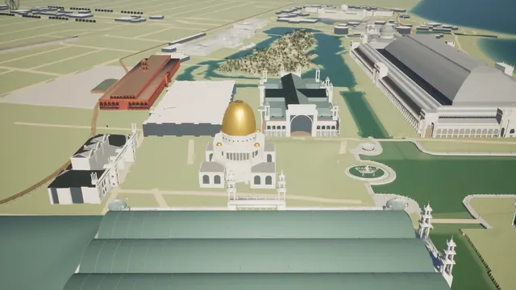</a>

**GPT-6 Astra** · シーン · 作者 [Dan Elton 🔍](https://x.com/moreisdifferent) · 2026-09-12

GPT-6 Astraが当時の写真や地図を調べ、白い街をBlenderで再現。各建物は歴史写真と見比べて検証されている。

<details>
<summary>Wandy3D による制作ブリーフ</summary>

```text
Build a 3D reconstruction of a historic world's fair in Blender, driven by a Python script. First gather historical photographs, maps and building dimensions, and note where sources disagree. Model each major hall as a simple white-plaster block with its dome, columns and portals, plus a lagoon, a basin, tree-lined paths, a railway with a steam locomotive and a terminal station, all placed according to an old fairground map. Use a pale palette of white buildings, green lawns and blue water under a clear sky. Render a side-by-side sheet for each building comparing the original photo with your model, then an aerial view of the whole grounds. Let the user walk or fly around the scene to feel its scale. Start with a rough minimum viable version of the layout, then refine facades one building at a time, checking each against its reference photo. Done means a navigable scene whose main buildings match the historical layout and proportions.
```

</details>

[Wandy3D で見る ↗](https://wandy3d.com/ja/prompts/blender-reconstruction-of-the-1893-chicago-world-s-fair-2098795017955418202?utm_source=github&utm_medium=referral&utm_campaign=awesome_3d_prompts) · [元の投稿](https://x.com/moreisdifferent/status/2098795017955418202)

---

### [3Dプリント用の額縁継手、4種類のクリアランスで試せるテスト部品](https://wandy3d.com/ja/prompts/3d-printable-picture-frame-joint-with-fit-test-coupons-in-2098774359926297011?utm_source=github&utm_medium=referral&utm_campaign=awesome_3d_prompts)

<a href="https://wandy3d.com/ja/prompts/3d-printable-picture-frame-joint-with-fit-test-coupons-in-2098774359926297011?utm_source=github&amp;utm_medium=referral&amp;utm_campaign=awesome_3d_prompts">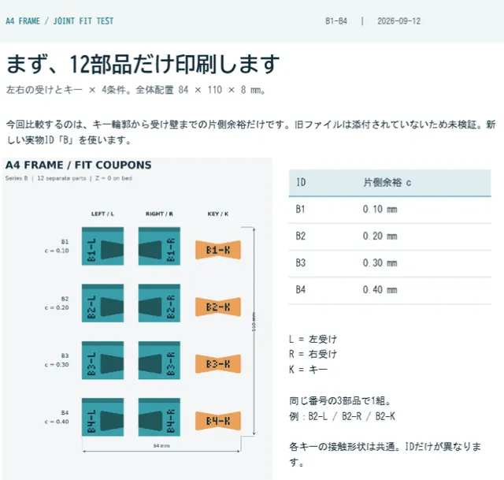</a>

**GPT-6 Astra** · アセット · 作者 [wada](https://x.com/wada) · 2026-09-12

分割印刷できる額縁を頼むと、GPT-6 AstraがID付きSTLを出力。受けとキーを4段階の余裕で作り、はめ合いを調整できる。

<details>
<summary>プロンプト</summary>

```text
3Dプリンターで額縁印刷したい、でも3Dプリンターちっちゃいから部品を繋いで完成させるやつがいい、なんか面白くないから継手で
```

</details>

[Wandy3D で見る ↗](https://wandy3d.com/ja/prompts/3d-printable-picture-frame-joint-with-fit-test-coupons-in-2098774359926297011?utm_source=github&utm_medium=referral&utm_campaign=awesome_3d_prompts) · [元の投稿](https://x.com/wada/status/2098774359926297011)

---

### [Unity製のスマホ3Dパズル、25ステージの箱ロック解除、APK出力付き](https://wandy3d.com/ja/prompts/unity-mobile-3d-lock-box-puzzle-game-with-25-stages-and-apk-2098715488369152087?utm_source=github&utm_medium=referral&utm_campaign=awesome_3d_prompts)

<a href="https://wandy3d.com/ja/prompts/unity-mobile-3d-lock-box-puzzle-game-with-25-stages-and-apk-2098715488369152087?utm_source=github&amp;utm_medium=referral&amp;utm_campaign=awesome_3d_prompts">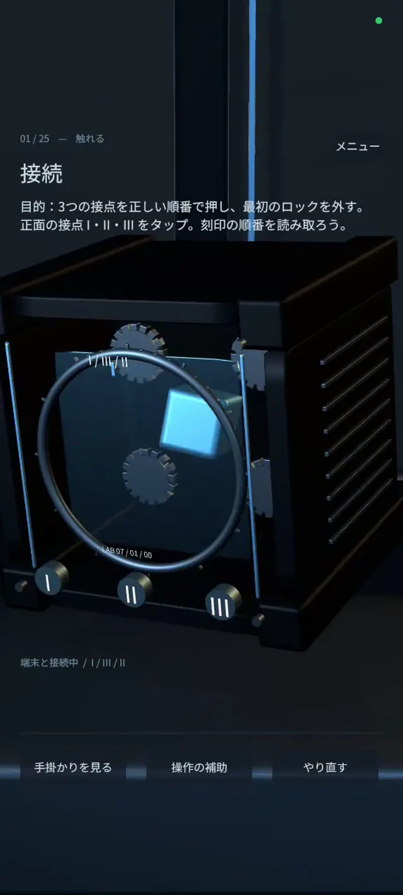</a>

**GPT-6 Astra** · ゲーム · 作者 [ひまねこ](https://x.com/00Nekonet) · 2026-09-12

GPT-6 Astraが企画をAndroid版まで仕上げた。光る鍵付きの箱を開けるタッチ操作パズル『DEVICE』は全25ステージ。

<details>
<summary>Wandy3D による制作ブリーフ</summary>

```text
Build a 25-level mobile 3D puzzle game in Unity for Android, delivered as a buildable project that exports an APK. The player faces a dark, high-tech lock box in a moody blue-black laboratory with soft rim lights. Each level shows a short objective and tutorial text on screen. Puzzles use touch: tap numbered contact points in the right order, drag to rotate the box and find a rear latch, press and hold, double-knock, and link separate contacts to complete a circuit. Add a title screen, a menu, hint and retry buttons, an input-assist toggle, and short story messages between stages from an AI character. Show a progress counter such as level 3 of 25. Keep visuals minimal and clean, with a glass door, rotating dial ring and glowing blue core. Done means all 25 stages can be played in sequence on a phone, with clear feedback when each lock opens.
```

</details>

[Wandy3D で見る ↗](https://wandy3d.com/ja/prompts/unity-mobile-3d-lock-box-puzzle-game-with-25-stages-and-apk-2098715488369152087?utm_source=github&utm_medium=referral&utm_campaign=awesome_3d_prompts) · [元の投稿](https://x.com/00Nekonet/status/2098715488369152087)

---

### [Three.jsで段階的に組み上がる等角投影の中国寺院ジオラマ](https://wandy3d.com/ja/prompts/isometric-chinese-temple-diorama-built-stage-by-stage-in-2098697876155076820?utm_source=github&utm_medium=referral&utm_campaign=awesome_3d_prompts)

<a href="https://wandy3d.com/ja/prompts/isometric-chinese-temple-diorama-built-stage-by-stage-in-2098697876155076820?utm_source=github&amp;utm_medium=referral&amp;utm_campaign=awesome_3d_prompts">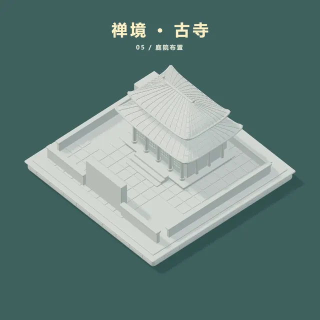</a>

**GPT-6 Astra** · アニメーション · 作者 [火山哥🕊️](https://x.com/huoshan007) · 2026-09-12

GPT-6 AstraがThree.jsで64秒の映像を生成。線の設計図から青緑の屋根の寺院が立ち上がり、ライティング済みのミニチュアに仕上がる。

<details>
<summary>プロンプト</summary>

```text
请直接制作一支“禅境·古寺”从设计到成品全过程的3D演示视频，并交付完整MP4。

画面要求：
1080×1080方形，45°俯视正交视角，微型2.5D卡通立体模型，完美居中。采用凸起的浅色石质底座、纯青绿色背景、柔和精致纹理、PBR材质和温和真实光照。

场景包含：
中式重檐寺庙、翘角琉璃瓦、青绿色屋顶、金色屋脊、朱红立柱、格栅门窗、山门、钟亭、香炉、石灯、石板庭院、松树、粉色花树与荷花池。

顶部标题为“禅境·古寺”，使用加粗、提亮的暖白色中文字体。

视频流程，共64秒：
0–8秒：逐笔绘制平面布局。
8–15秒：底座与建筑基础体块升起。
15–24秒：生成立柱、墙体、门窗等细节。
24–32秒：制作重檐、瓦片与翘角。
32–41秒：加入山门、庭院、树木和配景。
41–49秒：白模逐步赋予颜色与PBR材质。
49–54秒：调整光照、反射与柔和阴影。
54–64秒：完整成品缓慢环绕，伴随轻微落花、香烟与水波。

使用真实三维几何，在同一画面中连续展示构建过程。只显示简短阶段名，不做PPT式讲解页，不加旁白。

请用Three.js生成场景与动画，逐帧渲染后用FFmpeg导出30fps的H.264 MP4，并检查完整播放、阶段顺序、模型完整性和黑帧。
```

</details>

[Wandy3D で見る ↗](https://wandy3d.com/ja/prompts/isometric-chinese-temple-diorama-built-stage-by-stage-in-2098697876155076820?utm_source=github&utm_medium=referral&utm_campaign=awesome_3d_prompts) · [元の投稿](https://x.com/huoshan007/status/2098697876155076820)

---

### [波紋・雨・渦を操作できる真上視点のインタラクティブ錦鯉池](https://wandy3d.com/ja/prompts/interactive-top-down-koi-pond-with-ripples-rain-and-2098492771170722032?utm_source=github&utm_medium=referral&utm_campaign=awesome_3d_prompts)

<a href="https://wandy3d.com/ja/prompts/interactive-top-down-koi-pond-with-ripples-rain-and-2098492771170722032?utm_source=github&amp;utm_medium=referral&amp;utm_campaign=awesome_3d_prompts">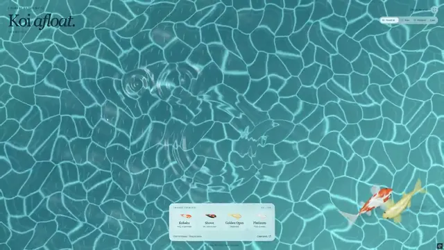</a>

**GPT-6 Astra** · インタラクティブ · 作者 [Vib3Coded](https://x.com/vib3coded) · 2026-09-11

GPT-6 AstraがThree.jsでブラウザの錦鯉池を制作。鯉を選んで放ち、雨や渦、カーソルで水面をかき乱せる。

<details>
<summary>Wandy3D による制作ブリーフ</summary>

```text
Build an interactive koi pond as a single web page using Three.js and WebGL. Show the pond from directly above: turquoise water with animated caustic light patterns on a tiled pool floor. Add a small floating panel at the bottom where the visitor picks one of four koi varieties, such as orange-white, white, golden and dark-spotted. Clicking the water drops the chosen fish in: a splash appears, turns into expanding ripples, and the koi dives and then swims on its own with smooth, natural body motion and avoidance of other fish. Add water interactions: a rain mode with droplets, a whirlpool that pulls fish and water into a spiral, and ripples that follow the cursor as it moves through the water. Add soft synthesized sounds for splashes, droplets and gentle water ambience, with a mute control. Done means many fish can swim together smoothly in the browser, and every interaction visibly disturbs the water surface.
```

</details>

[Wandy3D で見る ↗](https://wandy3d.com/ja/prompts/interactive-top-down-koi-pond-with-ripples-rain-and-2098492771170722032?utm_source=github&utm_medium=referral&utm_campaign=awesome_3d_prompts) · [元の投稿](https://x.com/vib3coded/status/2098492771170722032)

---

### [Blenderでアニメキャラの髪と顔テクスチャを自動生成・UVへ転写](https://wandy3d.com/ja/prompts/anime-character-hair-and-face-textures-generated-and-2098367087475577273?utm_source=github&utm_medium=referral&utm_campaign=awesome_3d_prompts)

<a href="https://wandy3d.com/ja/prompts/anime-character-hair-and-face-textures-generated-and-2098367087475577273?utm_source=github&amp;utm_medium=referral&amp;utm_campaign=awesome_3d_prompts">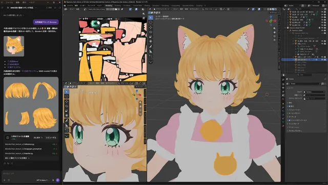</a>

**GPT-6 Astra** · アセット · 作者 [さ🥺](https://x.com/_sagyoai) · 2026-09-11

GPT-6 AstraがBlender MCP経由でアニメキャラの髪と顔をテクスチャリング。生成画像を並行投影で出力用UVに転写している。

<details>
<summary>プロンプト</summary>

```text
画像生成を利用して最強のテクスチャリングしてほしい
髪なし顔面正面をフラットシェーディングで影なしでレンダリングしてそれをリファレンスにテクスチャリング済み画像生成して並行投影でマッピングして出力用UVに転写
又はastraが思いついたもっといい方法あればそれで
```

</details>

[Wandy3D で見る ↗](https://wandy3d.com/ja/prompts/anime-character-hair-and-face-textures-generated-and-2098367087475577273?utm_source=github&utm_medium=referral&utm_campaign=awesome_3d_prompts) · [元の投稿](https://x.com/_sagyoai/status/2098367087475577273)

---

### [Unity向けにモジュラー設計した民間輸送シャトルをBlenderで作成](https://wandy3d.com/ja/prompts/modular-hard-surface-civilian-courier-shuttle-in-blender-2098225609558335846?utm_source=github&utm_medium=referral&utm_campaign=awesome_3d_prompts)

<a href="https://wandy3d.com/ja/prompts/modular-hard-surface-civilian-courier-shuttle-in-blender-2098225609558335846?utm_source=github&amp;utm_medium=referral&amp;utm_campaign=awesome_3d_prompts">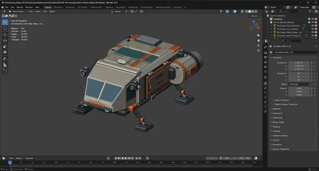</a>

**GPT-6 Astra** · アセット · 作者 [Jonathan Plumb — Spokane Valley](https://x.com/jonathanplumb) · 2026-09-11

GPT-6 AstraがBlenderで使い込まれた雰囲気の初期輸送船を制作。コックピット、スラスター、着陸脚を15,000三角形以内で構成している。

<details>
<summary>プロンプト</summary>

```text
In Blender, create Sol Horizon’s starter civilian courier ship. It should look used, repairable, affordable, and safe—not military. Create a cockpit, cargo hatch, visible maneuvering thrusters, main engine assembly, and four landing struts. Use a modular hard-surface style suitable for future variants. Keep the main render mesh under 15,000 triangles. Name objects clearly, set the forward direction for Unity, create simple collision geometry, apply transforms, save the .blend, and export a game-ready FBX. Show viewport screenshots for approval before export.
```

</details>

[Wandy3D で見る ↗](https://wandy3d.com/ja/prompts/modular-hard-surface-civilian-courier-shuttle-in-blender-2098225609558335846?utm_source=github&utm_medium=referral&utm_campaign=awesome_3d_prompts) · [元の投稿](https://x.com/jonathanplumb/status/2098225609558335846)

---

### [ロボットハンドが3Dピアノで「歓喜の歌」を演奏、音符タイムライン付き](https://wandy3d.com/ja/prompts/robotic-hand-plays-ode-to-joy-on-a-3d-piano-with-a-live-note-2098109252720078891?utm_source=github&utm_medium=referral&utm_campaign=awesome_3d_prompts)

<a href="https://wandy3d.com/ja/prompts/robotic-hand-plays-ode-to-joy-on-a-3d-piano-with-a-live-note-2098109252720078891?utm_source=github&amp;utm_medium=referral&amp;utm_campaign=awesome_3d_prompts">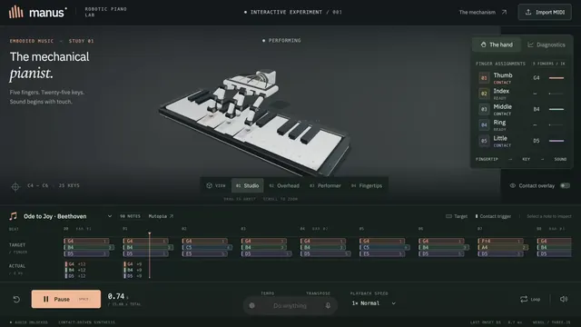</a>

**GPT-6 Astra** · インタラクティブ · 作者 [MSB](https://x.com/KeWai386772) · 2026-09-10

GPT-6 Astraがブラウザ上の3Dシーンを生成。ロボットハンドが「歓喜の歌」を自動演奏し、指の状態表示と下部のタイムラインが連動する。

<details>
<summary>Wandy3D による制作ブリーフ</summary>

```text
Build an interactive 3D web app showing a white robotic hand with five articulated fingers playing a piano keyboard. Use a dark, minimal interface with a title card reading like a mechanical pianist, a side panel listing each finger with its state, and a note timeline along the bottom showing targets for every finger. Load a built-in melody, Ode to Joy, and let the hand play it on its own: fingers press the correct keys in time, the wrist shifts along the keyboard, and keys depress visibly. Add play and pause, a tempo control, camera presets such as studio and overhead, and the ability to import a MIDI file. Add synthesized piano sound that matches the pressed keys. Deliver it as a self-contained project that runs in the browser. Done means the whole tune plays accurately with synchronized motion, sound and timeline cursor.
```

</details>

[Wandy3D で見る ↗](https://wandy3d.com/ja/prompts/robotic-hand-plays-ode-to-joy-on-a-3d-piano-with-a-live-note-2098109252720078891?utm_source=github&utm_medium=referral&utm_campaign=awesome_3d_prompts) · [元の投稿](https://x.com/KeWai386772/status/2098109252720078891)

---

### [708の構造を収めた頭部の3D解剖アトラス、単一HTMLで動作](https://wandy3d.com/ja/prompts/interactive-3d-human-head-anatomy-atlas-with-708-structures-2098105648106078541?utm_source=github&utm_medium=referral&utm_campaign=awesome_3d_prompts)

<a href="https://wandy3d.com/ja/prompts/interactive-3d-human-head-anatomy-atlas-with-708-structures-2098105648106078541?utm_source=github&amp;utm_medium=referral&amp;utm_campaign=awesome_3d_prompts">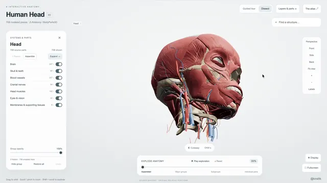</a>

**GPT-6 Astra** · インタラクティブ · 作者 [BuBBliK](https://x.com/k1rallik) · 2026-09-10

GPT-6 Astraがオフライン動作の頭部3Dアトラスを制作。頭蓋骨・脳・神経・血管を非表示、透過、分解して観察できる。

<details>
<summary>Wandy3D による制作ブリーフ</summary>

```text
Build an interactive 3D anatomy atlas of the human head as one self-contained HTML file that works offline. Use a clean light interface with a left panel of toggleable layers (bones, muscles, vessels, cranial nerves, brain, teeth, eyes and soft tissue), a visualization panel with transparency, and a bottom slider that controls how far the structures are separated. Load several hundred individually named structures from real anatomical mesh data, embedded in the file. Let the user orbit and zoom, hide the skull to reveal the brain, make layers translucent, isolate single structures such as the teeth or brain regions, and explode whole systems into parts. Show a label on hover or selection and offer a search field. Done means every structure can be toggled, labelled and viewed from any angle smoothly.
```

</details>

[Wandy3D で見る ↗](https://wandy3d.com/ja/prompts/interactive-3d-human-head-anatomy-atlas-with-708-structures-2098105648106078541?utm_source=github&utm_medium=referral&utm_campaign=awesome_3d_prompts) · [元の投稿](https://x.com/k1rallik/status/2098105648106078541)

---

### [SF都市の峡谷を飛ぶ宇宙船、Blenderグレーボックスから映像へ](https://wandy3d.com/ja/prompts/spaceship-chase-through-a-sci-fi-city-canyon-blender-graybox-2098079379297608050?utm_source=github&utm_medium=referral&utm_campaign=awesome_3d_prompts)

<a href="https://wandy3d.com/ja/prompts/spaceship-chase-through-a-sci-fi-city-canyon-blender-graybox-2098079379297608050?utm_source=github&amp;utm_medium=referral&amp;utm_campaign=awesome_3d_prompts">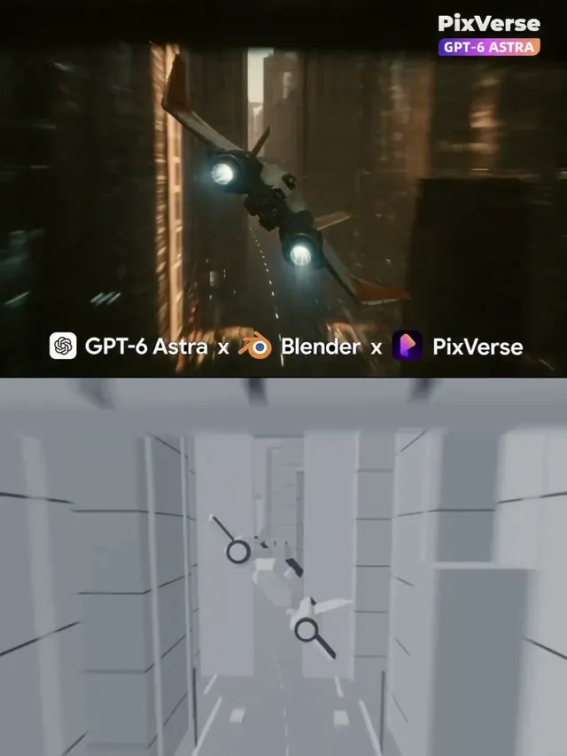</a>

**GPT-6 Astra** · アニメーション · 作者 [PixVerseCreators](https://x.com/PixVerseCreator) · 2026-09-10

GPT-6 AstraがBlenderで、高層ビルの谷間を飛ぶ宇宙船のグレーボックスを作成。動画モデルがそれを映画的なカットに仕上げました。

<details>
<summary>Wandy3D による制作ブリーフ</summary>

```text
Build a short cinematic previs in Blender, driven by Python scripts. Block out a narrow futuristic city canyon in plain gray geometry: tall slab towers on both sides, a road below, overhead bridges that cross the gap, and a small twin-engine spaceship with swept wings. Animate the ship flying forward through the canyon while a chase camera follows it with slight banking and shake. Keep everything in a neutral gray material with simple lighting so the layout, scale and camera timing read clearly. Render a roughly ten second clip at 16:9 and also export the gray frames so they can serve as a structural guide for a later stylisation or video-generation pass. Done means the ship, buildings and camera path are readable, the motion is smooth, and the blockout can be reused as a base for a photoreal sequence.
```

</details>

[Wandy3D で見る ↗](https://wandy3d.com/ja/prompts/spaceship-chase-through-a-sci-fi-city-canyon-blender-graybox-2098079379297608050?utm_source=github&utm_medium=referral&utm_campaign=awesome_3d_prompts) · [元の投稿](https://x.com/PixVerseCreator/status/2098079379297608050)

---

### [ドラゴンが舞う空中の城王国、Blenderグレーボックス](https://wandy3d.com/ja/prompts/floating-castle-kingdom-with-a-dragon-built-as-a-blender-2098071577309122854?utm_source=github&utm_medium=referral&utm_campaign=awesome_3d_prompts)

<a href="https://wandy3d.com/ja/prompts/floating-castle-kingdom-with-a-dragon-built-as-a-blender-2098071577309122854?utm_source=github&amp;utm_medium=referral&amp;utm_campaign=awesome_3d_prompts">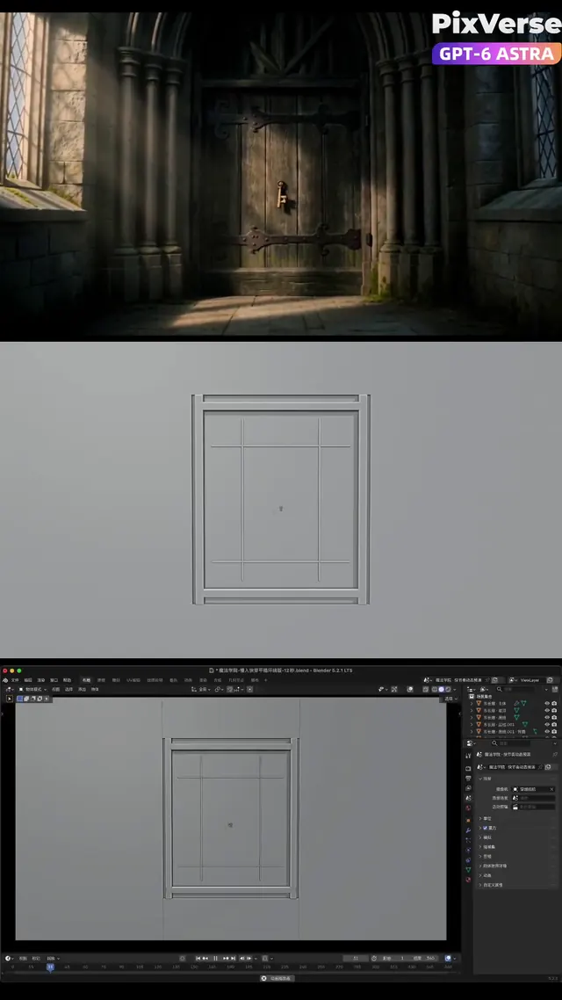</a>

**GPT-6 Astra** · アニメーション · 作者 [PixVerse](https://x.com/PixVerse) · 2026-09-10

GPT-6 AstraがBlenderで、雲上の城、塔、吊り橋、旋回するドラゴンをブロックアウト。ファンタジー映像の下地になります。

<details>
<summary>Wandy3D による制作ブリーフ</summary>

```text
Build a fantasy establishing shot in Blender using Python scripts. Start on a closed wooden door in a stone hall, modelled as simple gray blocks. Then cut to a floating island kingdom above a sea of clouds: a central keep with a large sphere on top, several tall spired towers, jagged rock bases tapering downward, and a rope bridge linking the outcrops. Add a flying dragon silhouette circling the castle and a slow camera push-in with slight orbit. Use only neutral gray materials and clean lighting so the composition, scale and camera moves are easy to judge. Render a roughly twelve second 16:9 clip. Done means the blockout clearly reads as door, castle, bridge and dragon, and could guide a later stylised render or video-generation pass.
```

</details>

[Wandy3D で見る ↗](https://wandy3d.com/ja/prompts/floating-castle-kingdom-with-a-dragon-built-as-a-blender-2098071577309122854?utm_source=github&utm_medium=referral&utm_campaign=awesome_3d_prompts) · [元の投稿](https://x.com/PixVerse/status/2098071577309122854)

---

### [NYタクシー1か月分のインタラクティブ3Dアトラス（Three.js）](https://wandy3d.com/ja/prompts/interactive-3d-atlas-of-a-month-of-nyc-taxi-trips-in-three-2098063352832610473?utm_source=github&utm_medium=referral&utm_campaign=awesome_3d_prompts)

<a href="https://wandy3d.com/ja/prompts/interactive-3d-atlas-of-a-month-of-nyc-taxi-trips-in-three-2098063352832610473?utm_source=github&amp;utm_medium=referral&amp;utm_campaign=awesome_3d_prompts">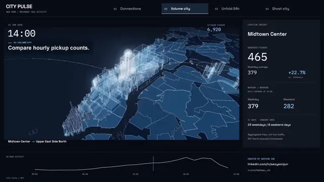</a>

**GPT-6 Astra** · インタラクティブ · 作者 [Seoyeon Jun 📊](https://x.com/tableau_viz) · 2026-09-10

AstraとThree.jsで、NYのタクシーデータ1か月分を3D化。時間ごとの再生、24時間の展開表示、日ごとの比較ができます。

<details>
<summary>Wandy3D による制作ブリーフ</summary>

```text
Build an interactive 3D data atlas of New York City taxi movement with Three.js. Draw the 263 taxi zones as dark blue extruded polygons on a night-style map, and show trip volume as glowing bars. Provide four view modes: connections between zones, volume by hour, all 24 hours unfolded side by side, and a comparison view that sets each day against its typical weekday or weekend pattern. Add an hour clock with play and scrub controls to replay a month of 31 days, orbit and zoom camera controls, and a side panel with the selected zone, pickup counts, percentage change and a small hourly line chart. Use a dark UI with cool blue and white highlights. Load the data from a prepared aggregate file. Done means switching views animates smoothly and the stats update with the hour and zone.
```

</details>

[Wandy3D で見る ↗](https://wandy3d.com/ja/prompts/interactive-3d-atlas-of-a-month-of-nyc-taxi-trips-in-three-2098063352832610473?utm_source=github&utm_medium=referral&utm_campaign=awesome_3d_prompts) · [元の投稿](https://x.com/tableau_viz/status/2098063352832610473)

---

### [警察車両のカーチェイスとクラッシュ爆発、Blenderグレーボックス](https://wandy3d.com/ja/prompts/police-chase-and-car-crash-with-explosion-from-a-blender-2098049032195293190?utm_source=github&utm_medium=referral&utm_campaign=awesome_3d_prompts)

<a href="https://wandy3d.com/ja/prompts/police-chase-and-car-crash-with-explosion-from-a-blender-2098049032195293190?utm_source=github&amp;utm_medium=referral&amp;utm_campaign=awesome_3d_prompts">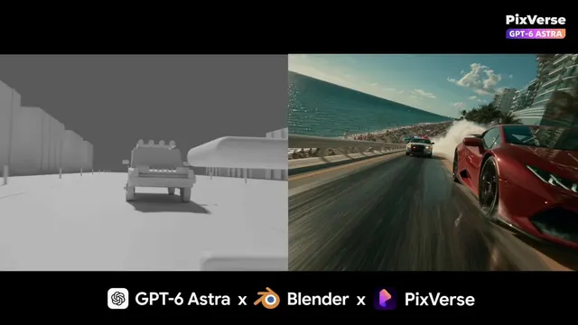</a>

**GPT-6 Astra** · アニメーション · 作者 [PixVerse](https://x.com/PixVerse) · 2026-09-10

GPT-6 AstraがBlenderでドリフトするカーチェイスと爆発のグレーボックスを作成。動画モデルがフォトリアルな映像に仕上げました。

<details>
<summary>Wandy3D による制作ブリーフ</summary>

```text
Build a car chase and crash previs in Blender with Python scripts. Block out a coastal city road lined with palm trees, tall buildings and a low wall in plain gray geometry. Add a sports car and a police car as simple gray vehicle shapes that drift through a bend one after the other. Animate the chase with a low tracking camera, close wheel shots, and a final crash into the wall followed by a fireball and smoke. Keep materials neutral and lighting simple so the layout, vehicle timing and camera angles are easy to read. Render a roughly eleven second 16:9 clip. Done means the chase, impact and explosion beats are clear and the footage can guide a later photoreal video-generation pass shown side by side with the blockout.
```

</details>

[Wandy3D で見る ↗](https://wandy3d.com/ja/prompts/police-chase-and-car-crash-with-explosion-from-a-blender-2098049032195293190?utm_source=github&utm_medium=referral&utm_campaign=awesome_3d_prompts) · [元の投稿](https://x.com/PixVerse/status/2098049032195293190)

---

### [数式で動く数千の点で描くイカの群れ、インタラクティブWebGL](https://wandy3d.com/ja/prompts/interactive-webgl-squid-shoal-drawn-from-thousands-of-math-2098043033446912315?utm_source=github&utm_medium=referral&utm_campaign=awesome_3d_prompts)

<a href="https://wandy3d.com/ja/prompts/interactive-webgl-squid-shoal-drawn-from-thousands-of-math-2098043033446912315?utm_source=github&amp;utm_medium=referral&amp;utm_campaign=awesome_3d_prompts">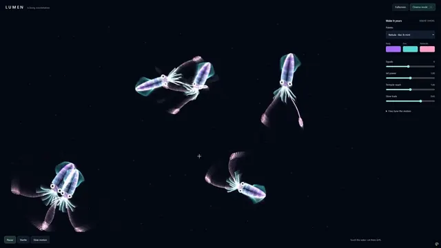</a>

**GPT-6 Astra** · インタラクティブ · 作者 [Vib3Coded](https://x.com/vib3coded) · 2026-09-10

Astraがモデルやスプライトなしで発光するイカの群れをWebGLで生成。ヒレ、噴射、触手は数式で動き、触れると群れが散ります。

<details>
<summary>Wandy3D による制作ブリーフ</summary>

```text
Build an interactive squid shoal in WebGL as one self-contained HTML page. Use no imported models, sprites or pre-rendered animation: every squid body is a cloud of thousands of points computed in real time from equations. One set of equations drives a rhythmic jet pulse of the mantle, another bends the fins, and the tentacles follow the squid's own past positions so they lag, curl and whip through turns. Give the shoal inertia and flocking-style movement on a deep dark background with soft glowing translucent bodies. Add a compact control panel with colour pickers and sliders for speed and count, and make the squids panic and scatter when the pointer touches the water. Done means a smooth, continuously animated school that reacts to input and recolours live.
```

</details>

[Wandy3D で見る ↗](https://wandy3d.com/ja/prompts/interactive-webgl-squid-shoal-drawn-from-thousands-of-math-2098043033446912315?utm_source=github&utm_medium=referral&utm_campaign=awesome_3d_prompts) · [元の投稿](https://x.com/vib3coded/status/2098043033446912315)

---

### [海沿い18ホールのゴルフコース3DモデルとBlenderフライスルー映像](https://wandy3d.com/ja/prompts/coastal-18-hole-golf-course-model-with-a-blender-flyover-2098038909514944562?utm_source=github&utm_medium=referral&utm_campaign=awesome_3d_prompts)

<a href="https://wandy3d.com/ja/prompts/coastal-18-hole-golf-course-model-with-a-blender-flyover-2098038909514944562?utm_source=github&amp;utm_medium=referral&amp;utm_campaign=awesome_3d_prompts">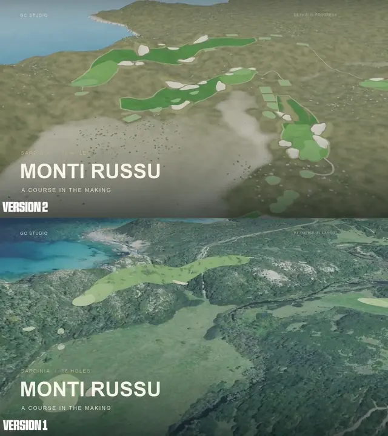</a>

**GPT-6 Astra** · シーン · 作者 [Rory Flynn](https://x.com/Ror_Fly) · 2026-09-10

GPT-6 Astraがサルデーニャのゴルフコースを一晩かけて改良し、全ホールを作り直してBlenderでビフォーアフターの映像を出力した。

<details>
<summary>Wandy3D による制作ブリーフ</summary>

```text
Build a detailed 3D model of an 18-hole coastal golf course on a rugged Mediterranean headland, viewable in the browser. Generate terrain from a heightfield, then shape fairways, greens, tees and many bunkers so that each hole offers a safe route and a bolder, riskier one. Add fixed viewpoints at golfer eye height, forward and back tees, and editable green contours. Use muted sandy and olive ground tones, bright green fairways, pale sand bunkers and a blue sea on the horizon. Also write a Blender script that renders a flyover film of all 18 holes, with a title card and each hole's name captioned on screen. Render a before-and-after version with identical camera paths and show them stacked in one video. Done when every hole is playable in the viewer, the terrain mesh is validated and the film runs about one minute.
```

</details>

[Wandy3D で見る ↗](https://wandy3d.com/ja/prompts/coastal-18-hole-golf-course-model-with-a-blender-flyover-2098038909514944562?utm_source=github&utm_medium=referral&utm_campaign=awesome_3d_prompts) · [元の投稿](https://x.com/Ror_Fly/status/2098038909514944562)

---

### [おやつボタンで大混乱になるセリフなしの3D猫ショート](https://wandy3d.com/ja/prompts/wordless-3d-cat-short-about-a-treat-button-that-causes-chaos-2097900087901106244?utm_source=github&utm_medium=referral&utm_campaign=awesome_3d_prompts)

<a href="https://wandy3d.com/ja/prompts/wordless-3d-cat-short-about-a-treat-button-that-causes-chaos-2097900087901106244?utm_source=github&amp;utm_medium=referral&amp;utm_campaign=awesome_3d_prompts"></a>

**GPT-6 Astra** · アニメーション · 作者 [AI実践ラボ](https://x.com/boboga777) · 2026-09-10

CodexでGPT-6 Astraが作ったループ3D短編。猫がボタンを押すと歯車仕掛けの機械が魚形のおやつを部屋中にまき散らす。

<details>
<summary>プロンプト</summary>

```text
Make a wordless 3D cat short: one treat button, total chaos, a tiny payoff. Add expressive acting, camera moves, music and a loop.
```

</details>

[Wandy3D で見る ↗](https://wandy3d.com/ja/prompts/wordless-3d-cat-short-about-a-treat-button-that-causes-chaos-2097900087901106244?utm_source=github&utm_medium=referral&utm_campaign=awesome_3d_prompts) · [元の投稿](https://x.com/boboga777/status/2097900087901106244)

---

### [ブラウザで遊べるマルチプレイのマイクラ風ボクセルサバイバル](https://wandy3d.com/ja/prompts/multiplayer-minecraft-style-voxel-survival-game-for-the-2097797479488246071?utm_source=github&utm_medium=referral&utm_campaign=awesome_3d_prompts)

<a href="https://wandy3d.com/ja/prompts/multiplayer-minecraft-style-voxel-survival-game-for-the-2097797479488246071?utm_source=github&amp;utm_medium=referral&amp;utm_campaign=awesome_3d_prompts">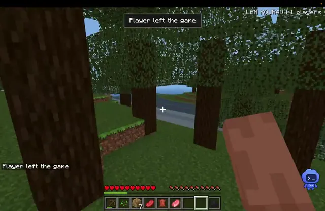</a>

**GPT-6 Astra** · ゲーム · 作者 [Armaan Jain](https://x.com/Armaan_Jain123) · 2026-09-09

GPT-6 Astraが1つのプロンプトから、クラフトや動物、2人協力プレイを備えたブロックワールドのサバイバルゲームを作った。

<details>
<summary>Wandy3D による制作ブリーフ</summary>

```text
Build a browser-based multiplayer voxel sandbox survival game in the style of a classic block-building game. Generate an endless block world with grassy terrain, trees, water, beaches and several biomes. Let the player punch trees to collect logs, open an inventory with a 2x2 and a 3x3 crafting grid and a recipe book, craft tools like a wooden pickaxe, and hold items in a first-person view. Add health and hunger bars, a hotbar, and animated passive mobs such as cows and pigs. Support at least two players joining the same world, each shown as a blocky character with a name tag. Use a pixel-art texture look and a bright blue sky. Deliver the game as a deployable web project with a single build step. Done when two browsers can join, gather wood, craft a pickaxe and walk around the same world.
```

</details>

[Wandy3D で見る ↗](https://wandy3d.com/ja/prompts/multiplayer-minecraft-style-voxel-survival-game-for-the-2097797479488246071?utm_source=github&utm_medium=referral&utm_campaign=awesome_3d_prompts) · [元の投稿](https://x.com/Armaan_Jain123/status/2097797479488246071)

---

### [数千の部品に分解できるインタラクティブ3D粒子衝突型加速器](https://wandy3d.com/ja/prompts/interactive-3d-particle-collider-that-opens-up-into-2097781208596029936?utm_source=github&utm_medium=referral&utm_campaign=awesome_3d_prompts)

<a href="https://wandy3d.com/ja/prompts/interactive-3d-particle-collider-that-opens-up-into-2097781208596029936?utm_source=github&amp;utm_medium=referral&amp;utm_campaign=awesome_3d_prompts">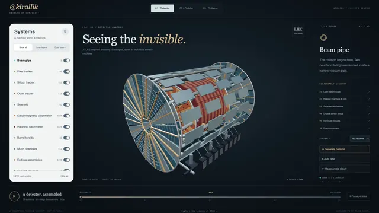</a>

**GPT-6 Astra** · インタラクティブ · 作者 [BuBBliK](https://x.com/k1rallik) · 2026-09-09

GPT-6 Astraが1つのプロンプトと数回の改良で、単一ファイルの加速器ビューアを作成。スクロールで検出器が層ごとに開き、衝突も再現する。

<details>
<summary>Wandy3D による制作ブリーフ</summary>

```text
Build an interactive 3D visualization of a particle collider and its detector as one self-contained HTML file that runs offline in a browser. Model the detector from thousands of separate components: end-cap wheels, large magnets, calorimeter modules and tiny sensors. Scrolling should open the detector layer by layer, sliding parts apart, and then bring them back together. Add a second view of the circular accelerator ring with two counter-rotating beams, and a third view that generates a synthetic collision and freezes its particle tracks. Use a dark navy background, muted metallic parts with copper accents, a serif headline with italic highlights, and a clean control panel with per-system toggles and a timeline. Done when the exploded view, ring view and collision view all work smoothly with a few thousand parts.
```

</details>

[Wandy3D で見る ↗](https://wandy3d.com/ja/prompts/interactive-3d-particle-collider-that-opens-up-into-2097781208596029936?utm_source=github&utm_medium=referral&utm_campaign=awesome_3d_prompts) · [元の投稿](https://x.com/k1rallik/status/2097781208596029936)

---

### [発射台10基のロケット工場を再現したThree.js 3Dシミュレーション](https://wandy3d.com/ja/prompts/live-3d-rocket-factory-with-ten-launch-pads-in-three-js-2097730920224534868?utm_source=github&utm_medium=referral&utm_campaign=awesome_3d_prompts)

<a href="https://wandy3d.com/ja/prompts/live-3d-rocket-factory-with-ten-launch-pads-in-three-js-2097730920224534868?utm_source=github&amp;utm_medium=referral&amp;utm_campaign=awesome_3d_prompts">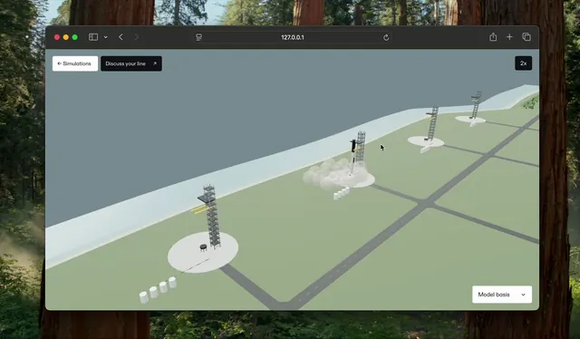</a>

**GPT-6 Astra** · インタラクティブ · 作者 [Konstantin Saifoulline](https://x.com/konstantinsaifo) · 2026-09-09

GPT-6 AstraがThree.jsでロケット工場を構築。資材が届き、完成したロケットが10基の発射台へ向かい打ち上がる。

<details>
<summary>Wandy3D による制作ブリーフ</summary>

```text
Build a live 3D factory simulation in Three.js that runs in the browser. Model a rocket production site with a large assembly hall, an internal production line with stations, a road network, a river and landscaped terrain, plus ten launch pads with gantry towers laid out along a strip of land. Animate the full flow: raw materials arrive, rockets are assembled inside the hall, each finished rocket drives out on a transporter to a free pad, stands upright and lifts off with a short exhaust effect. Use a clean, light palette with white buildings, soft green ground and pale blue water. Add an orbit camera so the viewer can fly from an overview of all pads to a close look inside the hall, and a small HUD with a clock and speed control. Apply lean-production ideas such as a steady pull flow and minimal waiting. Deliver one self-contained HTML file. Done means rockets are produced, dispatched and launched continuously without manual input.
```

</details>

[Wandy3D で見る ↗](https://wandy3d.com/ja/prompts/live-3d-rocket-factory-with-ten-launch-pads-in-three-js-2097730920224534868?utm_source=github&utm_medium=referral&utm_campaign=awesome_3d_prompts) · [元の投稿](https://x.com/konstantinsaifo/status/2097730920224534868)

---

### [増減ゲートと最終バリアを突破する群衆ランナーゲーム](https://wandy3d.com/ja/prompts/crowd-runner-game-with-plus-and-minus-gates-and-a-final-2097678911882809407?utm_source=github&utm_medium=referral&utm_campaign=awesome_3d_prompts)

<a href="https://wandy3d.com/ja/prompts/crowd-runner-game-with-plus-and-minus-gates-and-a-final-2097678911882809407?utm_source=github&amp;utm_medium=referral&amp;utm_campaign=awesome_3d_prompts">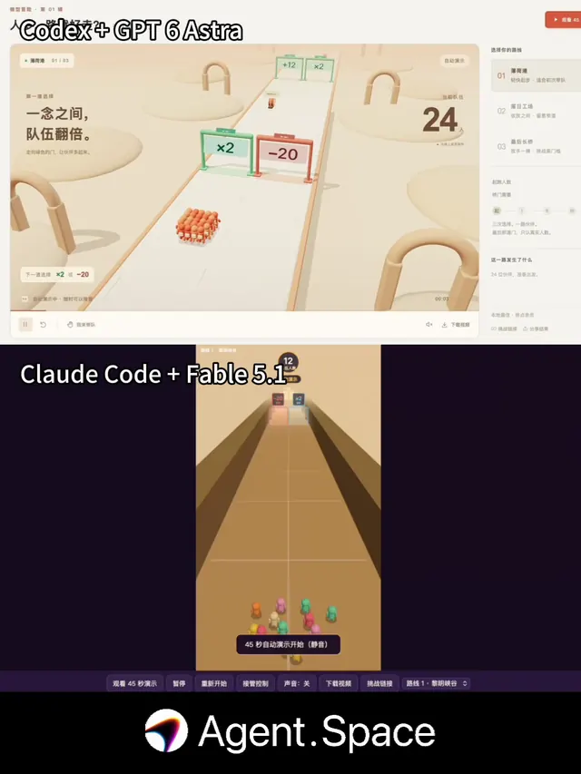</a>

**GPT-6 Astra** · ゲーム · 作者 [MSB](https://x.com/KeWai386772) · 2026-09-09

GPT-6 AstraとCodexで作ったパステル調のゲートランナー。Fable 5.1版との比較で、作者はAstraが上と評価した。

<details>
<summary>Wandy3D による制作ブリーフ</summary>

```text
Build a casual 3D crowd-runner game that plays in the browser. The player steers a small group of colorful characters down a long track and passes through gates that add or subtract members, such as plus twelve or minus twenty, and multiply gates. The goal is to arrive at the final barrier with enough people to meet its requirement, shown on a sign. Use a soft, warm pastel look with rounded arches and cream floors, a large live counter of the crowd size, short on-screen hints between gates, and a start and result panel. Keep the camera behind the crowd with a gentle tilt. Controls: left and right movement by mouse drag or arrow keys. Add simple sound cues for gates and the final check. Deliver a single playable project that runs without installation. Done means a full run from start to the final barrier with a clear win or lose message and a replay button. Make the interface text easy to translate.
```

</details>

[Wandy3D で見る ↗](https://wandy3d.com/ja/prompts/crowd-runner-game-with-plus-and-minus-gates-and-a-final-2097678911882809407?utm_source=github&utm_medium=referral&utm_campaign=awesome_3d_prompts) · [元の投稿](https://x.com/KeWai386772/status/2097678911882809407)

---

### [猫とロボットアームを複数カットで見せるBlenderブロックアウト](https://wandy3d.com/ja/prompts/blender-blockout-of-a-cat-and-robot-arm-with-multi-shot-2097675660873605422?utm_source=github&utm_medium=referral&utm_campaign=awesome_3d_prompts)

<a href="https://wandy3d.com/ja/prompts/blender-blockout-of-a-cat-and-robot-arm-with-multi-shot-2097675660873605422?utm_source=github&amp;utm_medium=referral&amp;utm_campaign=awesome_3d_prompts">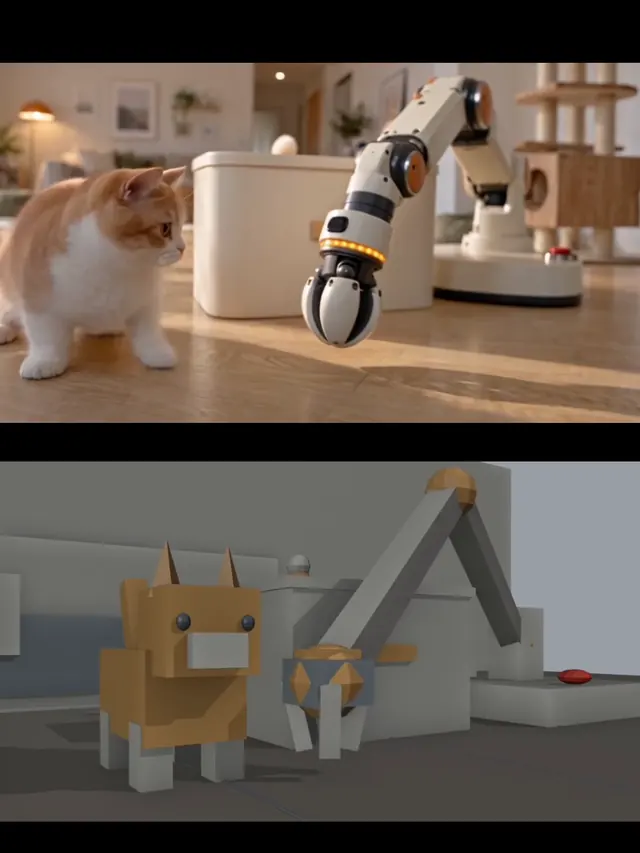</a>

**GPT-6 Astra** · アニメーション · 作者 [探路AI](https://x.com/TanLuAI) · 2026-09-09

GPT-6 Astraが猫とロボットアームの寸劇用にBlenderのシーンとカメラワークを構築し、動画生成モデルの仕上げの土台にした。

<details>
<summary>Wandy3D による制作ブリーフ</summary>

```text
Build a Blender Python script that sets up a previsualization scene and an animated multi-shot camera sequence. The scene is a bright living room reduced to simple blocky geometry: a low box with a small handle, a cat made of boxes, a robot arm on a round base with a gripper, a red button on the floor, and a feather toy on a spring with a round weight. Script the action: the cat walks in, the arm reaches over the box, grips the toy, lowers it, the cat presses the button, and the arm hands the toy over. Use several camera cuts with different angles, close-ups and slow pushes, soft daylight and simple grey materials. Keep timing tight, about ten seconds. Output a viewport render or image sequence that can serve as motion and camera reference for a video generator. Done means the blockout plays through every beat with readable cuts and consistent object positions.
```

</details>

[Wandy3D で見る ↗](https://wandy3d.com/ja/prompts/blender-blockout-of-a-cat-and-robot-arm-with-multi-shot-2097675660873605422?utm_source=github&utm_medium=referral&utm_campaign=awesome_3d_prompts) · [元の投稿](https://x.com/TanLuAI/status/2097675660873605422)

---

### [時間帯切替とゴールデンアワー付きのThree.js草原シーン](https://wandy3d.com/ja/prompts/three-js-grass-field-with-a-time-of-day-switch-and-golden-2097602565110419781?utm_source=github&utm_medium=referral&utm_campaign=awesome_3d_prompts)

<a href="https://wandy3d.com/ja/prompts/three-js-grass-field-with-a-time-of-day-switch-and-golden-2097602565110419781?utm_source=github&amp;utm_medium=referral&amp;utm_campaign=awesome_3d_prompts">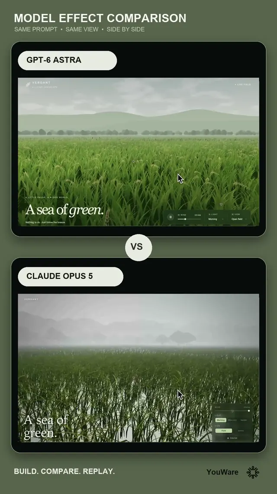</a>

**GPT-6 Astra** · シーン · 作者 [YouWare](https://x.com/YouWareAI) · 2026-09-09

同じプロンプトでGPT-6 AstraとClaude Opus 5を比較。風に揺れるThree.jsの草原が、霧の朝から夕方の黄金色へ変わる。

<details>
<summary>Wandy3D による制作ブリーフ</summary>

```text
Build an interactive Three.js landscape of a wide green field seen from ground level, with thousands of animated grass blades swaying in the wind, distant hills and trees fading into haze, and a soft sky. Overlay an elegant serif headline reading a sea of green in the lower left, and a compact control panel in the corner with a time-of-day selector offering morning, afternoon and golden hour. Changing the time of day smoothly shifts sky color, fog, light direction and grass tint, from cool misty morning to warm amber light. Add gentle automatic camera movement and short camera cuts for a cinematic feel. Use fog for depth and keep the frame rate smooth. Deliver one self-contained HTML file. Done means the field looks lush and natural, the lighting transitions work without jumps, and the interface stays minimal and readable over the scene.
```

</details>

[Wandy3D で見る ↗](https://wandy3d.com/ja/prompts/three-js-grass-field-with-a-time-of-day-switch-and-golden-2097602565110419781?utm_source=github&utm_medium=referral&utm_campaign=awesome_3d_prompts) · [元の投稿](https://x.com/YouWareAI/status/2097602565110419781)

---

### [BlenderでレンダリングしたBackroomsの一人称VHS逃走映像](https://wandy3d.com/ja/prompts/backrooms-first-person-vhs-chase-rendered-in-blender-2097534290112188602?utm_source=github&utm_medium=referral&utm_campaign=awesome_3d_prompts)

<a href="https://wandy3d.com/ja/prompts/backrooms-first-person-vhs-chase-rendered-in-blender-2097534290112188602?utm_source=github&amp;utm_medium=referral&amp;utm_campaign=awesome_3d_prompts">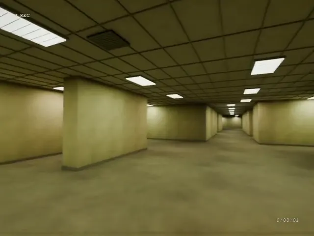</a>

**GPT-6 Astra** · アニメーション · 作者 [CHRIS FIRST](https://x.com/chrisfirst) · 2026-09-09

GPT-6 AstraがBlenderで30秒のBackrooms疾走を生成。黄色い部屋と終わりのない廊下が、荒いテープ映像として流れる。

<details>
<summary>プロンプト</summary>

```text
Render a scene in Blender that looks like a first person VHS tape recording of someone walking through the Backrooms. It should feel photorealistic and the motion handheld panic. They should be looking around then begin running through the maze that is the Backrooms. Some rooms big and open and others with endless hallways. Absolute panic. 30 seconds long.
```

</details>

[Wandy3D で見る ↗](https://wandy3d.com/ja/prompts/backrooms-first-person-vhs-chase-rendered-in-blender-2097534290112188602?utm_source=github&utm_medium=referral&utm_campaign=awesome_3d_prompts) · [元の投稿](https://x.com/chrisfirst/status/2097534290112188602)

---

### [漁師小屋のある湿地の湖を再現した Three.js 3Dシーン](https://wandy3d.com/ja/prompts/cozy-marshland-lake-with-a-fisherman-s-cabin-in-three-js-2097343467026289039?utm_source=github&utm_medium=referral&utm_campaign=awesome_3d_prompts)

<a href="https://wandy3d.com/ja/prompts/cozy-marshland-lake-with-a-fisherman-s-cabin-in-three-js-2097343467026289039?utm_source=github&amp;utm_medium=referral&amp;utm_campaign=awesome_3d_prompts">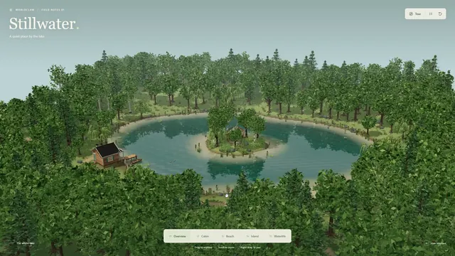</a>

**GPT-6 Astra** · シーン · 作者 [Givros](https://x.com/givros) · 2026-09-08

GPT-6 Astra が Blender と Three.js で湖の風景を構築。高床の小屋、ボート、島の廃屋、葦やスイレンが森に囲まれて並びます。

<details>
<summary>プロンプト</summary>

```text
Create a cozy lake with a fisherman’s cabin on the marshy shore. Put a small island in the middle of the water, with an abandoned house hidden among the trees. Add a fishing boat beside the cabin, lily pads, reeds, jumping fish, typical wetland wildlife, a small beach, one path leading to the beach and cabin, another path returning into the forest, and a tree line around the entire scene.
```

</details>

[Wandy3D で見る ↗](https://wandy3d.com/ja/prompts/cozy-marshland-lake-with-a-fisherman-s-cabin-in-three-js-2097343467026289039?utm_source=github&utm_medium=referral&utm_campaign=awesome_3d_prompts) · [元の投稿](https://x.com/givros/status/2097343467026289039)

---

### [天壇・祈年殿の3Dモデルと分解表示を備えた Three.js ページ](https://wandy3d.com/ja/prompts/temple-of-heaven-prayer-hall-3d-model-with-exploded-view-in-2097323734504017936?utm_source=github&utm_medium=referral&utm_campaign=awesome_3d_prompts)

<a href="https://wandy3d.com/ja/prompts/temple-of-heaven-prayer-hall-3d-model-with-exploded-view-in-2097323734504017936?utm_source=github&amp;utm_medium=referral&amp;utm_campaign=awesome_3d_prompts">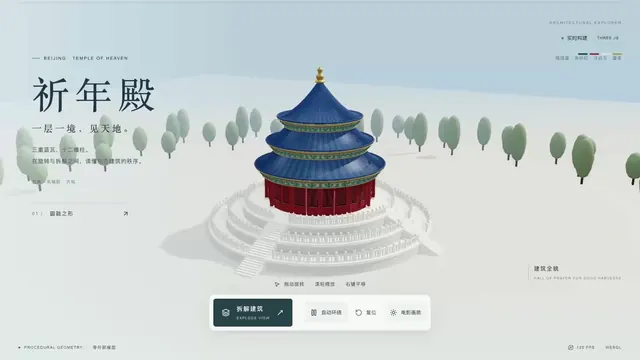</a>

**GPT-6 Astra** · インタラクティブ · 作者 [govin.eth \| G哥](https://x.com/goan999999) · 2026-09-08

GPT-6 Astra が祈年殿を Three.js でモデリングし、屋根や柱を分解して見せるアニメ付きの紹介ページに仕上げました。

<details>
<summary>Wandy3D による制作ブリーフ</summary>

```text
Build a single-page web showcase for a 3D model of a traditional Chinese circular temple hall, the Hall of Prayer for Good Harvests, using Three.js. Model a three-tier white marble base, a ring of red pillars and a triple-eave conical roof in deep blue tiles with gold trim and a gilded finial. Place it on a pale misty background with soft stylized rounded trees around it. Add elegant overlay typography with the Chinese hall name as a large title, a short subtitle and a small bottom toolbar of buttons. Let the model rotate slowly, and include an exploded view button that lifts the roof layers and pillars apart, then reassembles them smoothly. Keep the look calm, light and editorial. Deliver everything as one self-contained HTML file. Done when the model reads clearly as the temple, the exploded animation plays both ways and the page looks polished at desktop size.
```

</details>

[Wandy3D で見る ↗](https://wandy3d.com/ja/prompts/temple-of-heaven-prayer-hall-3d-model-with-exploded-view-in-2097323734504017936?utm_source=github&utm_medium=referral&utm_campaign=awesome_3d_prompts) · [元の投稿](https://x.com/goan999999/status/2097323734504017936)

---

### [Three.jsで作る北欧風の山村ローポリジオラマ](https://wandy3d.com/ja/prompts/low-poly-nordic-mountain-village-diorama-in-three-js-2097167383576383502?utm_source=github&utm_medium=referral&utm_campaign=awesome_3d_prompts)

<a href="https://wandy3d.com/ja/prompts/low-poly-nordic-mountain-village-diorama-in-three-js-2097167383576383502?utm_source=github&amp;utm_medium=referral&amp;utm_campaign=awesome_3d_prompts">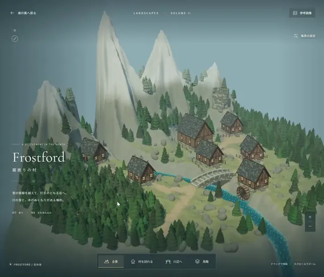</a>

**GPT-6 Astra** · シーン · 作者 [Kichitaro (Kichi Shotaro)](https://x.com/TaroKichijo) · 2026-09-08

GPT-6 AstraがSkyrim風の村をThree.jsで生成。丸太小屋、石橋、水車、川があり、カメラ切り替えで見て回れます。

<details>
<summary>プロンプト</summary>

```text
img2threejs/img2threejs を使って、立体的なSkyrimにあるような村の地形を作って。参考画像は自分で作ってください。
```

</details>

[Wandy3D で見る ↗](https://wandy3d.com/ja/prompts/low-poly-nordic-mountain-village-diorama-in-three-js-2097167383576383502?utm_source=github&utm_medium=referral&utm_campaign=awesome_3d_prompts) · [元の投稿](https://x.com/TaroKichijo/status/2097167383576383502)

---

[← 前へ](catalog.ja.2.md) · 8 ページ中 3 ページ目 · [次へ →](catalog.ja.4.md)

プロンプト・動画・画像の権利は各作者に帰属します（[RIGHTS.md](../RIGHTS.md)）。編集テキストは [CC BY 4.0](../LICENSE) です。結果が見える良いプロンプトを知っていますか？[提案する](https://github.com/wornoxgames/awesome-3d-prompts/issues/new?template=suggest.md)。作者の方で掲載内容の修正・削除をご希望の場合は[こちら](https://github.com/wornoxgames/awesome-3d-prompts/issues/new?template=removal.md)。
