<!-- Generated file: edits are overwritten. -->

# Awesome 3D Prompts — Каталог 4/8

[← Awesome 3D Prompts](../README.ru.md) · [English](catalog.en.1.md) · **Русский** · [日本語](catalog.ja.1.md) · [中文](catalog.zh.1.md)

[← Назад](catalog.ru.3.md) · страница 4 из 8 · [Дальше →](catalog.ru.5.md)

### [Взрыв-схема японского цветочного магазина в Blender: анимация](https://wandy3d.com/ru/prompts/exploded-view-animation-of-a-pastel-japanese-flower-shop-in-2097153139795468365?utm_source=github&utm_medium=referral&utm_campaign=awesome_3d_prompts)

<a href="https://wandy3d.com/ru/prompts/exploded-view-animation-of-a-pastel-japanese-flower-shop-in-2097153139795468365?utm_source=github&amp;utm_medium=referral&amp;utm_campaign=awesome_3d_prompts"></a>

**GPT-6 Astra** · Анимация · автор [KANA｜東京AI映像](https://x.com/KanaWorks_AI) · 2026-09-08

GPT-6 Astra через Blender MCP собрала мультяшный цветочный магазин, который разлетается на слои, показывает интерьер и собирается обратно.

<details>
<summary>Промпт</summary>

```text
Use Blender MCP to build a small, stylized Japanese flower shop scene. Focus on faithfully recreating the key visual elements: the green awnings, the rooftop sign displaying the Japanese text “花屋”, flower pots and plants arranged in front of the shop, the vending machine, bicycles, traffic light, utility poles, surrounding trees, and other recognizable street details. Render the scene in a warm, charming cartoon style, with soft lighting, appealing materials, and a cozy atmosphere.

Create a high-impact, dynamic exploded-view animation of the entire flower shop scene. The explosion should be bold and exaggerated rather than subtle. Smoothly and systematically separate the individual components outward to dramatically reveal the construction and interior of the flower shop.

During the explosion, have the exterior walls, surrounding trees, utility poles, signs, awnings, bicycles, flower pots, plants, street props, and other environmental elements fly outward or backward, creating enough open space for the viewer to clearly see inside the flower shop. Break the building into meaningful structural layers so that the interior architecture, furniture, decorations, flowers, plants, shelves, and smaller details become clearly visible.

The vending machine should also explode into its individual components. Its exterior panels should separate, and the individual soda bottles and cans inside should dynamically fly outward, spreading into an organized formation so they remain clearly readable. Small components and details can travel farther to make the sequence more visually exciting.

Use staggered timing, different movement speeds, rotation, depth, and layered trajectories to give the explosion a strong sense of energy and impact while keeping every component visually organized and easy to follow. Avoid having everything move outward at exactly the same time or speed.

Once the entire scene is fully exploded, hold the composition briefly so the viewer can clearly observe the internal structure and all the separated components.

Then reverse the sequence: the soda bottles, vending machine parts, plants, props, interior objects, walls, trees, utility poles, signs, bicycles, and all other components should fly smoothly back into place and reassemble into the complete flower shop scene.

The entire animation should feel energetic, cinematic, satisfying, and visually impactful, with strong motion and clear transformation between the complete scene, the fully exploded state, and the final reassembled scene. Keep the motion layered, readable, and carefully choreographed throughout.

Use a neutral studio background during the exploded-view sequence so that the separated objects and internal structures remain clearly visible.

Final deliverables:
A fully rendered animation and an editable Blender 3D project file. All objects, components, collections, materials, and major scene elements must be clearly, consistently, and professionally named and organized.
```

</details>

[Открыть на Wandy3D ↗](https://wandy3d.com/ru/prompts/exploded-view-animation-of-a-pastel-japanese-flower-shop-in-2097153139795468365?utm_source=github&utm_medium=referral&utm_campaign=awesome_3d_prompts) · [Исходный пост](https://x.com/KanaWorks_AI/status/2097153139795468365)

---

### [Интерактивное желейное лимонное дерево на WebGPU с физикой](https://wandy3d.com/ru/prompts/interactive-jelly-lemon-tree-with-wobbly-physics-in-webgpu-2097065330728128920?utm_source=github&utm_medium=referral&utm_campaign=awesome_3d_prompts)

<a href="https://wandy3d.com/ru/prompts/interactive-jelly-lemon-tree-with-wobbly-physics-in-webgpu-2097065330728128920?utm_source=github&amp;utm_medium=referral&amp;utm_campaign=awesome_3d_prompts"></a>

**GPT-6 Astra** · Интерактив · автор [Vib3Coded](https://x.com/vib3coded) · 2026-09-07

Один короткий промпт дал GPT-6 Astra лимонное дерево на WebGPU: его трясут мышью, лимоны падают, сплющиваются и дрожат, как мармелад.

<details>
<summary>Промпт</summary>

```text
build an interactive jelly lemon tree using WebGPU
```

</details>

[Открыть на Wandy3D ↗](https://wandy3d.com/ru/prompts/interactive-jelly-lemon-tree-with-wobbly-physics-in-webgpu-2097065330728128920?utm_source=github&utm_medium=referral&utm_campaign=awesome_3d_prompts) · [Исходный пост](https://x.com/vib3coded/status/2097065330728128920)

---

### [Игра с котом-роботом на столе: болты и зарядная станция](https://wandy3d.com/ru/prompts/robot-cat-desk-game-with-bolts-and-a-charging-dock-2097004192627933279?utm_source=github&utm_medium=referral&utm_campaign=awesome_3d_prompts)

<a href="https://wandy3d.com/ru/prompts/robot-cat-desk-game-with-bolts-and-a-charging-dock-2097004192627933279?utm_source=github&amp;utm_medium=referral&amp;utm_campaign=awesome_3d_prompts"></a>

**GPT-6 Astra** · Игры · автор [ZEUS⚡️](https://x.com/zeuuss_01) · 2026-09-07

GPT-6 Astra сделала 3D-игру при свете лампы: кот-робот бродит по столу, гоняется за болтами и сам возвращается на зарядку.

<details>
<summary>Бриф от Wandy3D</summary>

```text
Build a small 3D browser game about a robot cat living on a wooden desk. Set the scene in a dark room lit by a single warm desk lamp, with a keyboard, a bowl, a cup and small props on the desk. The robot cat has a boxy grey body, thin legs and glowing amber eyes, and walks around the desk on its own, with a small charger station at one end. Show its battery as five small cells on its flank instead of a separate HUD. Let the player press a key to drop a bolt that the cat chases, and drag the cat to the charger to recharge it. When idle it should wander, then return to the charger by itself. Deliver a self-contained web page. Done when walking, bolt dropping and charging all work with soft lamp shadows.
```

</details>

[Открыть на Wandy3D ↗](https://wandy3d.com/ru/prompts/robot-cat-desk-game-with-bolts-and-a-charging-dock-2097004192627933279?utm_source=github&utm_medium=referral&utm_campaign=awesome_3d_prompts) · [Исходный пост](https://x.com/zeuuss_01/status/2097004192627933279)

---

### [Интерактивный китайский дворик, собранный в Blender и Three.js](https://wandy3d.com/ru/prompts/interactive-chinese-courtyard-house-built-in-blender-and-2096971051334857181?utm_source=github&utm_medium=referral&utm_campaign=awesome_3d_prompts)

<a href="https://wandy3d.com/ru/prompts/interactive-chinese-courtyard-house-built-in-blender-and-2096971051334857181?utm_source=github&amp;utm_medium=referral&amp;utm_campaign=awesome_3d_prompts"></a>

**GPT-6 Astra** · Сцены · автор [Larus Canus](https://x.com/MrLarus) · 2026-09-07

GPT-6 Astra написал скрипты Blender для китайского дворика, а Three.js сделал его исследуемым: пруд, водопад и обставленные комнаты.

<details>
<summary>Бриф от Wandy3D</summary>

```text
Build an interactive 3D Chinese courtyard house for the web. First model the scene in Blender with Python scripts: a square paved courtyard enclosed by wooden-framed pavilions with grey tiled roofs, a pond with lily pads, koi, rocks and a small waterfall, sculpted pine trees, bamboo, a living room with sofas and a low table, and a bedroom with a bed and lamps. Use a soft low-poly style with warm wood, cream plaster, sage green and pale stone, against a misty mountain backdrop. Export the scene as GLB and load it in Three.js. Add an orbit overview camera plus a walk-in mode that lets the viewer move through the rooms, gentle ambient animation such as flowing water and swimming fish, and a small side panel with toggles for time of day and lighting. Deliver a runnable web project with the exported GLB. It is done when the overview and the interior views both look coherent and the panel changes the lighting.
```

</details>

[Открыть на Wandy3D ↗](https://wandy3d.com/ru/prompts/interactive-chinese-courtyard-house-built-in-blender-and-2096971051334857181?utm_source=github&utm_medium=referral&utm_campaign=awesome_3d_prompts) · [Исходный пост](https://x.com/MrLarus/status/2096971051334857181)

---

### [Лоуполи-обзорная площадка для VRChat с «сломанной гравитацией» в Blender](https://wandy3d.com/ru/prompts/low-poly-vrchat-viewpoint-world-with-a-broken-gravity-2096966425017467344?utm_source=github&utm_medium=referral&utm_campaign=awesome_3d_prompts)

<a href="https://wandy3d.com/ru/prompts/low-poly-vrchat-viewpoint-world-with-a-broken-gravity-2096966425017467344?utm_source=github&amp;utm_medium=referral&amp;utm_campaign=awesome_3d_prompts"></a>

**GPT-6 Astra** · Сцены · автор [Xenoah](https://x.com/shuminchuuu) · 2026-09-07

GPT-6 Astra через Blender MCP собрал спокойную площадку на холме с видом на вертикальное море, перевёрнутые скалы и чёрный столп.

<details>
<summary>Промпт</summary>

```text
Blenderで、VRChat向け景観ワールドの3Dモデル一式を作ってください。

テーマは、

「重力が壊れた地平線」

です。

プレイヤーが立つ丘の頂上だけは正常で、遠景だけが大きく物理破綻しています。

全体はシンプルな造形にしてください。
細かい装飾より、
大きなシルエット

遠景の異常さ
展望台の形
空間構成
を優先してください。

構成

作るものは以下です。

丘の頂上

細い散策路
浅い切通し
半円形の観測デッキ
少数のベンチ
壊れた案内板
中央観測装置
遠景の都市
垂直に立つ海
逆さの山脈
巨大な黒い柱
空間断層
静的な雲
展望台

展望台は半円形。

既存の展望台を真似せず、完全オリジナル形状にしてください。

特徴:

半円形

左右非対称
一部が空中へ張り出す
低い縁
半透明素材を想定した形状
一部だけ重力異常で変形
複雑にしすぎず、遠くから見ても形が分かる大きなシルエットにしてください。

中央観測装置

展望台中央に、

半透明球体

不完全なリング
黒い柱へ向いた照準フレーム
を組み合わせたシンプルな装置を配置してください。

遠景

遠景は最重要です。

以下を大きな簡略形状で作ってください。

空へ落ちる都市

箱形のビル群を、通常とは違う方向へ伸ばしてください。

垂直の海

巨大な水面プレーンを90度近く立てて配置してください。

逆さの山脈

簡略化した山のシルエットを上下反転してください。

黒い柱

非常に巨大で細長い黒い柱を遠景に配置してください。

建物ではなく、空間の欠損のように見える形にしてください。

空間断層

黒い柱の周囲に、大きく裂けた板状または帯状の形状を配置してください。

発光マテリアルを想定します。

地形

丘はなだらかな草地。

スポーン地点から展望台まで、

細い散策路

浅い切通し
を作ってください。

切通しを抜けると、遠景が一気に見える構図にしてください。

植生

植物は最小限。

草

少数の低木
ごく一部だけ異常方向へ傾いた植物
程度で十分です。

モデリング方針

ローポリ寄りで構いません。

細部を作り込みすぎないでください。

Primitiveを積極的に使い、

Cube

Plane
Cylinder
Sphere
Curve
を中心に作ってください。

遠景は特に簡略化してください。

重要なのはディテールではなく、

「遠くを見た瞬間に世界がおかしいと分かること」

です。

Blender内の整理

オブジェクトを以下のコレクションに分けてください。

PLAYER_AREA

OBSERVATION_DECK
OBSERVATION_DEVICE
VEGETATION
DISTANT_CITY
DISTANT_SEA
DISTANT_MOUNTAINS
BLACK_PILLAR
SPACE_FRACTURE
CLOUDS
PROPS
VRChat用にUnityへ持っていきやすい構成にしてください。

最優先は、

「展望台から見た一枚絵としての景観」

です。
```

</details>

[Открыть на Wandy3D ↗](https://wandy3d.com/ru/prompts/low-poly-vrchat-viewpoint-world-with-a-broken-gravity-2096966425017467344?utm_source=github&utm_medium=referral&utm_campaign=awesome_3d_prompts) · [Исходный пост](https://x.com/shuminchuuu/status/2096966425017467344)

---

### [Стилизованный уголок улицы на Three.js: кирпичные лавки и красный велосипед](https://wandy3d.com/ru/prompts/stylized-three-js-street-corner-with-brick-shops-and-a-red-2096956214680965501?utm_source=github&utm_medium=referral&utm_campaign=awesome_3d_prompts)

<a href="https://wandy3d.com/ru/prompts/stylized-three-js-street-corner-with-brick-shops-and-a-red-2096956214680965501?utm_source=github&amp;utm_medium=referral&amp;utm_campaign=awesome_3d_prompts"></a>

**GPT-6 Astra** · Сцены · автор [Dash](https://x.com/creativedash) · 2026-09-07

GPT-6 Astra и Three.js создали уютную диораму улицы: светящиеся окна книжной лавки, полосатые маркизы и красный велосипед.

<details>
<summary>Бриф от Wandy3D</summary>

```text
Build a stylized 3D street-corner diorama in Three.js. Show a curved pavement and asphalt road with painted lane marks and a manhole cover, lined by brick shopfronts: a bookshop with a glowing window full of books, a green-shuttered shop and a navy roller shutter, each with a striped awning, a hanging sign and warm wall lamps. Dress the scene with potted plants, wooden crates, bollards, a small bistro table, barrels and leafy trees. Place a red bicycle with a front basket in the middle of the road. Use soft warm lighting with gentle shadows and a slightly muted, cinematic palette. Add a slow camera that drifts and cuts between several angles around the corner, with the bicycle moving subtly. Deliver a runnable web page with the scene code. It is done when the street looks cohesive from every camera angle and the lit windows stand out against the dusk tones.
```

</details>

[Открыть на Wandy3D ↗](https://wandy3d.com/ru/prompts/stylized-three-js-street-corner-with-brick-shops-and-a-red-2096956214680965501?utm_source=github&utm_medium=referral&utm_campaign=awesome_3d_prompts) · [Исходный пост](https://x.com/creativedash/status/2096956214680965501)

---

### [Ночной замок в стиле Хогвартса на Three.js, который можно исследовать](https://wandy3d.com/ru/prompts/explorable-night-time-hogwarts-style-castle-scene-in-three-2096907617117540478?utm_source=github&utm_medium=referral&utm_campaign=awesome_3d_prompts)

<a href="https://wandy3d.com/ru/prompts/explorable-night-time-hogwarts-style-castle-scene-in-three-2096907617117540478?utm_source=github&amp;utm_medium=referral&amp;utm_campaign=awesome_3d_prompts"></a>

**GPT-6 Astra** · Сцены · автор [Prompt Case](https://x.com/HiltonMisia) · 2026-09-07

За один запуск GPT-6 Astra собрал готический замок под луной: от моста у озера до зала со свечами, по которому можно ходить.

<details>
<summary>Бриф от Wandy3D</summary>

```text
Build an explorable 3D fantasy castle scene at night for the browser. Create a large gothic school-of-magic castle on a cliff above a lake, with many pointed towers, lit windows, stone walls, a long covered bridge, a courtyard with paving, a wooden staircase hall with brick walls and a room with floating candles. Use a dark blue night palette, a full moon, drifting fog and warm window glow for contrast. Let the viewer move freely with first-person controls and mouse look, passing from the exterior views through the bridge and into the interiors. Add simple labels naming key locations. Use Three.js, procedural geometry and basic lighting, delivered as a runnable web project. It is done when the castle reads clearly from far away, the interiors are reachable, and the night mood stays consistent throughout the walkthrough.
```

</details>

[Открыть на Wandy3D ↗](https://wandy3d.com/ru/prompts/explorable-night-time-hogwarts-style-castle-scene-in-three-2096907617117540478?utm_source=github&utm_medium=referral&utm_campaign=awesome_3d_prompts) · [Исходный пост](https://x.com/HiltonMisia/status/2096907617117540478)

---

### [Игрушка-желе с мягкой деформацией на WebGPU и Three.js](https://wandy3d.com/ru/prompts/squishy-jelly-blob-toy-with-soft-body-deformation-in-webgpu-2096793432987464010?utm_source=github&utm_medium=referral&utm_campaign=awesome_3d_prompts)

<a href="https://wandy3d.com/ru/prompts/squishy-jelly-blob-toy-with-soft-body-deformation-in-webgpu-2096793432987464010?utm_source=github&amp;utm_medium=referral&amp;utm_campaign=awesome_3d_prompts"></a>

**GPT-6 Astra** · Интерактив · автор [码农暖爸](https://x.com/Delroy715) · 2026-09-07

GPT-6 Astra сделал основу Softie: глянцевый комочек желе, который вмятывается, растягивается и качается, а лицо деформируется вместе с ним.

<details>
<summary>Бриф от Wandy3D</summary>

```text
Build a stress-relief web toy called Softie using WebGPU and Three.js. Show a glossy, jelly-like droplet-shaped blob with a simple face on a clean off-white tabletop, with soft shadows. Pressing on the blob should dent it, dragging should stretch it, and releasing should make it slam back onto the table and wobble slowly to rest. The eyes and mouth must sit on the surface and deform with the body as it squeezes. Add a side panel with a colour picker or swatches, a softness slider, a damping slider and a volume control, plus a Poke button; the space bar also triggers a bounce. Add synthesized sound effects for squishes. Make the layout responsive so it works on desktop and in a phone frame, with a minimal bilingual interface. It is done when the blob feels weighty and elastic, the face follows the deformation and every slider changes the behaviour live.
```

</details>

[Открыть на Wandy3D ↗](https://wandy3d.com/ru/prompts/squishy-jelly-blob-toy-with-soft-body-deformation-in-webgpu-2096793432987464010?utm_source=github&utm_medium=referral&utm_campaign=awesome_3d_prompts) · [Исходный пост](https://x.com/Delroy715/status/2096793432987464010)

---

### [Игровая минифигурка LEGO в Blender: ходьба, приветствие и прыжок](https://wandy3d.com/ru/prompts/game-ready-lego-minifigure-in-blender-with-walk-wave-and-hop-2096766465730847059?utm_source=github&utm_medium=referral&utm_campaign=awesome_3d_prompts)

<a href="https://wandy3d.com/ru/prompts/game-ready-lego-minifigure-in-blender-with-walk-wave-and-hop-2096766465730847059?utm_source=github&amp;utm_medium=referral&amp;utm_campaign=awesome_3d_prompts"></a>

**GPT-6 Astra** · Ассеты · автор [Simon Smith](https://x.com/_simonsmith) · 2026-09-07

GPT-6 Astra через Blender MCP собрала минифигурку LEGO в костюме и показала ходьбу, взмах рукой, крупный план и прыжок с разворотом.

<details>
<summary>Промпт</summary>

```text
Use the Blender MCP to make a LEGO minifig version of Donald Trump that I can use as a game asset. Make this exceptional quality, AAA game, and pressure test your work to make sure that it's detailed and accurate and excellent.
```

</details>

[Открыть на Wandy3D ↗](https://wandy3d.com/ru/prompts/game-ready-lego-minifigure-in-blender-with-walk-wave-and-hop-2096766465730847059?utm_source=github&utm_medium=referral&utm_campaign=awesome_3d_prompts) · [Исходный пост](https://x.com/_simonsmith/status/2096766465730847059)

---

### [Интерактивная 3D-разборка смартфона со слайдером и описанием деталей](https://wandy3d.com/ru/prompts/interactive-3d-exploded-view-smartphone-with-a-slider-and-2096685163111694556?utm_source=github&utm_medium=referral&utm_campaign=awesome_3d_prompts)

<a href="https://wandy3d.com/ru/prompts/interactive-3d-exploded-view-smartphone-with-a-slider-and-2096685163111694556?utm_source=github&amp;utm_medium=referral&amp;utm_campaign=awesome_3d_prompts"></a>

**GPT-6 Astra** · Интерактив · автор [Zaira Laraib](https://x.com/zairalaraib_) · 2026-09-06

GPT-6 Astra создала веб-страницу, где смартфон слайдером раскладывается на слои, а клик по детали открывает панель с описанием.

<details>
<summary>Промпт</summary>

```text
Build an interactive 3D exploded-view visualization of a modern smartphone. Separate the device into its major components and let me explode/reassemble it with a slider. Clicking a component should isolate it and explain what it does. Include the battery, cameras, SoC, memory, display layers, speakers, sensors, antennas and logic board. Prioritize a beautiful Apple-like interface and satisfying interactions. Build, run, inspect and fix the complete experience.
```

</details>

[Открыть на Wandy3D ↗](https://wandy3d.com/ru/prompts/interactive-3d-exploded-view-smartphone-with-a-slider-and-2096685163111694556?utm_source=github&utm_medium=referral&utm_campaign=awesome_3d_prompts) · [Исходный пост](https://x.com/zairalaraib_/status/2096685163111694556)

---

### [Mini World: детская 3D-игра об исследовании планеты с плаванием](https://wandy3d.com/ru/prompts/mini-world-a-3d-planet-exploration-game-for-kids-with-2096641728497275011?utm_source=github&utm_medium=referral&utm_campaign=awesome_3d_prompts)

<a href="https://wandy3d.com/ru/prompts/mini-world-a-3d-planet-exploration-game-for-kids-with-2096641728497275011?utm_source=github&amp;utm_medium=referral&amp;utm_campaign=awesome_3d_prompts"></a>

**GPT-6 Astra** · Игры · автор [Weijian](https://x.com/Weijian) · 2026-09-06

Игра из Codex на GPT-6 Astra: маленький герой ходит и плавает по планете с лесом, пустыней, океаном и снегом, камеру можно приближать.

<details>
<summary>Промпт</summary>

```text
Let’s create a game called Mini World. It’s a 3D world exploration game with a beautiful, high-quality graphic interface, designed to be fun and easy to play for my four-and-a-half-year-old son. You should be able to zoom in and zoom out. From far away, the world looks like a small ball, but inside it has different regions to explore. One region can look like a forest, another can be a desert, and there can also be oceans where the character can swim around. The game has to feel fun and playable, with a character who can travel around different parts of the world, explore different environments, and discover things along the way. Please treat making this work properly as the main goal. It should be beautifully designed and thoroughly tested in a loop so that the movement, zooming, exploration, swimming, environments, controls, and overall experience all work smoothly together. Keep testing and improving it until everything is working reliably and the game feels polished, intuitive, and enjoyable for a young child.
```

</details>

[Открыть на Wandy3D ↗](https://wandy3d.com/ru/prompts/mini-world-a-3d-planet-exploration-game-for-kids-with-2096641728497275011?utm_source=github&utm_medium=referral&utm_campaign=awesome_3d_prompts) · [Исходный пост](https://x.com/Weijian/status/2096641728497275011)

---

### [Вращающаяся Земля из космоса в Blender: две модели, один промпт](https://wandy3d.com/ru/prompts/rotating-earth-from-space-in-blender-two-models-one-prompt-2096637194270134742?utm_source=github&utm_medium=referral&utm_campaign=awesome_3d_prompts)

<a href="https://wandy3d.com/ru/prompts/rotating-earth-from-space-in-blender-two-models-one-prompt-2096637194270134742?utm_source=github&amp;utm_medium=referral&amp;utm_campaign=awesome_3d_prompts"></a>

**GPT-6 Astra** · Анимация · автор [John Kler](https://x.com/JohnKlerAI) · 2026-09-06

Сравнение: GPT-6 Astra, которую автор признал лучшей, и Claude Fable 5.1 по одному промпту сделали 5-секундный рендер Земли в Blender.

<details>
<summary>Промпт</summary>

```text
in Blender, make a gorgeous 5 second render of a rotating earth, viewed from space.
```

</details>

[Открыть на Wandy3D ↗](https://wandy3d.com/ru/prompts/rotating-earth-from-space-in-blender-two-models-one-prompt-2096637194270134742?utm_source=github&utm_medium=referral&utm_campaign=awesome_3d_prompts) · [Исходный пост](https://x.com/JohnKlerAI/status/2096637194270134742)

---

### [Уровень изометрической тёмного фэнтези экшен-игры на Three.js с нуля](https://wandy3d.com/ru/prompts/isometric-dark-fantasy-action-game-level-in-three-js-built-2096637091627364531?utm_source=github&utm_medium=referral&utm_campaign=awesome_3d_prompts)

<a href="https://wandy3d.com/ru/prompts/isometric-dark-fantasy-action-game-level-in-three-js-built-2096637091627364531?utm_source=github&amp;utm_medium=referral&amp;utm_campaign=awesome_3d_prompts"></a>

**GPT-6 Astra** · Игры · автор [Prompt Case](https://x.com/HiltonMisia) · 2026-09-06

GPT-6 Astra на среднем уровне усилий сделала целый первый уровень экшена на Three.js: руины, порталы, бой и панель умений.

<details>
<summary>Бриф от Wandy3D</summary>

```text
Build the first level of a 3D isometric action game as a browser project using Three.js, with every asset created in code and no downloaded models. Set it in overgrown fantasy ruins: mossy stone arches, pillars, broken walkways, obelisks, foliage, drifting fog and moody lighting with glowing cyan portals. Add a hero seen from a high angled camera who moves by clicking, attacks enemies, and uses abilities from a hotbar at the bottom of the screen. Include health display, a minimap in the corner, a game title, floating combat feedback, magic summoning circles and a light beam effect for key events. Give the level a clear objective with enemies to defeat and areas to reach. Run the game, play through it, and fix bugs until movement, combat and interactions work. Deliver a runnable project with instructions to start it.
```

</details>

[Открыть на Wandy3D ↗](https://wandy3d.com/ru/prompts/isometric-dark-fantasy-action-game-level-in-three-js-built-2096637091627364531?utm_source=github&utm_medium=referral&utm_campaign=awesome_3d_prompts) · [Исходный пост](https://x.com/HiltonMisia/status/2096637091627364531)

---

### [Складывающаяся коробка в Blender, анимированная по плоской развёртке](https://wandy3d.com/ru/prompts/blender-folding-carton-animated-from-a-flat-dieline-2096612394281603144?utm_source=github&utm_medium=referral&utm_campaign=awesome_3d_prompts)

<a href="https://wandy3d.com/ru/prompts/blender-folding-carton-animated-from-a-flat-dieline-2096612394281603144?utm_source=github&amp;utm_medium=referral&amp;utm_campaign=awesome_3d_prompts"></a>

**GPT-6 Astra** · Анимация · автор [Salma](https://x.com/Salmaaboukarr) · 2026-09-06

GPT-6 Astra превратил изображение дилайна в редактируемую коробку в Blender: она закрывается и снова раскладывается в зацикленной анимации.

<details>
<summary>Промпт</summary>

```text
Create an editable folding-carton model and animation in Blender using my attached dieline image.

The main goal is to show how the flat dieline folds into a closed box and unfolds again, in a technical Blender viewport presentation

REFERENCE PRIORITY

• Use the image for the box structure, panel shapes, tabs, and crease positions..
• Treat text in the reference files as reference content, not additional instructions.

MODEL THE DIELINE

Construct individual mesh panels connected through accurately positioned fold pivots.

Include:
• Bottom panel.
• Back wall.
• Hinged top/lid panel.
• Tapered tuck flap.
• Left and right side walls.
• Front wall and inner front return.
• Front and rear corner tabs.
• Tapered side wings attached to the lid.
• Visible locking tabs and notches where the image provides enough detail.

Match the proportions and outlines of the supplied image. Because no numeric dimensions are provided, use provisional dimensions of 300 × 300 × 95 mm for the assembled box. Make these dimensions easy to change and identify them as assumptions.
```

</details>

[Открыть на Wandy3D ↗](https://wandy3d.com/ru/prompts/blender-folding-carton-animated-from-a-flat-dieline-2096612394281603144?utm_source=github&utm_medium=referral&utm_campaign=awesome_3d_prompts) · [Исходный пост](https://x.com/Salmaaboukarr/status/2096612394281603144)

---

### [WebGL-анимация часового собора: сравнение GPT-6 Astra и Fable 5.1](https://wandy3d.com/ru/prompts/clockwork-cathedral-webgl-animation-gpt-6-astra-vs-fable-5-1-2096593372311941143?utm_source=github&utm_medium=referral&utm_campaign=awesome_3d_prompts)

<a href="https://wandy3d.com/ru/prompts/clockwork-cathedral-webgl-animation-gpt-6-astra-vs-fable-5-1-2096593372311941143?utm_source=github&amp;utm_medium=referral&amp;utm_campaign=awesome_3d_prompts"></a>

**GPT-6 Astra** · Анимация · автор [Chris W](https://x.com/Chris_Wozniczek) · 2026-09-06

Сравнение GPT-6 Astra и Claude Fable 5.1 на одном промпте для кинематографичной WebGL-анимации; Astra сильнее в оптике стекла и свечения.

<details>
<summary>Бриф от Wandy3D</summary>

```text
Build a roughly 30-second cinematic WebGL animation in one self-contained HTML file using Three.js. The scene is a dark, golden-lit clockwork cathedral: concentric rotating rings and wheels around a central glass sphere, a swinging pendulum, a rose window, floating dust motes and a glowing corona. Use a warm amber and deep brown palette with a bright red-orange accent. Render the glass with refraction and absorption, add selective bloom limited to the corona and candle flames, depth of field with focus pulls, and water with ripples. Script the camera beat by beat: a slow opening on drifting dust, a rising flight through the rings, a lensing warp near the pendulum, and a closing return to the starting view. Done when the animation plays smoothly from start to end and loops back to its first frame.
```

</details>

[Открыть на Wandy3D ↗](https://wandy3d.com/ru/prompts/clockwork-cathedral-webgl-animation-gpt-6-astra-vs-fable-5-1-2096593372311941143?utm_source=github&utm_medium=referral&utm_campaign=awesome_3d_prompts) · [Исходный пост](https://x.com/Chris_Wozniczek/status/2096593372311941143)

---

### [3D-приложение для сёги с свободно вращающейся деревянной доской](https://wandy3d.com/ru/prompts/3d-shogi-app-with-a-freely-rotating-wooden-board-2096579856133947507?utm_source=github&utm_medium=referral&utm_campaign=awesome_3d_prompts)

<a href="https://wandy3d.com/ru/prompts/3d-shogi-app-with-a-freely-rotating-wooden-board-2096579856133947507?utm_source=github&amp;utm_medium=referral&amp;utm_campaign=awesome_3d_prompts"></a>

**GPT-6 Astra** · Игры · автор [薄幸柄 / LAB](https://x.com/hatukougara) · 2026-09-06

Через несколько реплик GPT-6 Astra создал играбельное 3D-сёги с вращаемой доской, полями для взятых фигур и историей ходов.

<details>
<summary>Бриф от Wandy3D</summary>

```text
Build a browser-based 3D shogi app in Japanese. Show a light-wood board with wooden pieces carrying kanji, set on a dark teal panel, with two wooden piece stands at the sides. Let the player click a piece to highlight legal squares and click a target to move it. Add camera controls: drag to rotate, wheel to zoom, right-drag to pan, plus buttons for full view, standard view, top-down view, flip board and zoom in or out. Add a right sidebar with captured pieces for each side and a move history list with step controls, and bottom buttons for resign, promotion options, a piece guide and rules. Show whose turn it is above the board. Done when a full game can be played with correct moves and the board rotates smoothly.
```

</details>

[Открыть на Wandy3D ↗](https://wandy3d.com/ru/prompts/3d-shogi-app-with-a-freely-rotating-wooden-board-2096579856133947507?utm_source=github&utm_medium=referral&utm_campaign=awesome_3d_prompts) · [Исходный пост](https://x.com/hatukougara/status/2096579856133947507)

---

### [Интерактивная 3D-схема разбора ПК на 29 компонентов](https://wandy3d.com/ru/prompts/interactive-3d-exploded-view-of-a-desktop-pc-s-29-components-2096578761877860502?utm_source=github&utm_medium=referral&utm_campaign=awesome_3d_prompts)

<a href="https://wandy3d.com/ru/prompts/interactive-3d-exploded-view-of-a-desktop-pc-s-29-components-2096578761877860502?utm_source=github&amp;utm_medium=referral&amp;utm_campaign=awesome_3d_prompts"></a>

**GPT-6 Astra** · Интерактив · автор [cooper](https://x.com/icooperhero) · 2026-09-06

GPT-6 Astra собрал обучающий 3D-сайт: корпус ПК раскладывается ползунком, у каждой из 29 деталей есть описание по клику.

<details>
<summary>Бриф от Wandy3D</summary>

```text
Build an interactive 3D educational website that explains the parts of a desktop computer. Show a PC tower with a dark studio background and a clean light-on-dark interface. Use Three.js. Model about 29 core components (motherboard, CPU with cooler, GPU, RAM, SSD, power supply, fans, case panels) as separate meshes. Add a left sidebar listing components grouped by category with search, and a right panel that shows a name, short description and related parts for the selected component. Clicking a part in the list or the scene highlights it and focuses the camera on it. Provide an explode slider at the bottom that smoothly pulls every part away from the case along sensible axes and brings them back, plus orbit, zoom and reset controls. Add small animated labels for the selected part. Deliver a self-contained web project that runs locally. Done when every listed part can be selected, explained and separated in the exploded view without overlap glitches.
```

</details>

[Открыть на Wandy3D ↗](https://wandy3d.com/ru/prompts/interactive-3d-exploded-view-of-a-desktop-pc-s-29-components-2096578761877860502?utm_source=github&utm_medium=referral&utm_campaign=awesome_3d_prompts) · [Исходный пост](https://x.com/icooperhero/status/2096578761877860502)

---

### [3D-планировщик комнаты: взгляд взрослого и ребёнка, варианты мебели](https://wandy3d.com/ru/prompts/3d-room-planner-with-adult-and-child-eye-views-and-layout-2096578684010508736?utm_source=github&utm_medium=referral&utm_campaign=awesome_3d_prompts)

<a href="https://wandy3d.com/ru/prompts/3d-room-planner-with-adult-and-child-eye-views-and-layout-2096578684010508736?utm_source=github&amp;utm_medium=referral&amp;utm_campaign=awesome_3d_prompts"></a>

**GPT-6 Astra** · Интерактив · автор [かのこ🌼AI×子育て×探究](https://x.com/dqlh47m) · 2026-09-06

С GPT-6 Astra по размерам и фото комнаты получилась 3D-модель с двумя видами от глаз и тремя вариантами расстановки мебели.

<details>
<summary>Бриф от Wandy3D</summary>

```text
Build a mobile-first web app that turns a small room into an interactive 3D model for planning a furniture rearrangement. Input is the room's width and length plus a description of its four corners. Render a simple, soft-colored room with a wooden floor, pale walls, a door, shelves, a desk with monitor, a chair, a keyboard stand and a globe. Offer three camera modes as top tabs: an adult eye-level view, a child eye-level view, and a full isometric overview. Add on-screen arrow buttons to move through the room. Include an edit mode to move furniture, and a bottom sheet with three layout proposals (keep, replace shelves, reorganize) that shows shelf length and the number of clearance conflicts. Add a compare button for the proposals. Use Three.js and a clean Japanese-language interface. Done when switching views and layout proposals updates the 3D room smoothly.
```

</details>

[Открыть на Wandy3D ↗](https://wandy3d.com/ru/prompts/3d-room-planner-with-adult-and-child-eye-views-and-layout-2096578684010508736?utm_source=github&utm_medium=referral&utm_campaign=awesome_3d_prompts) · [Исходный пост](https://x.com/dqlh47m/status/2096578684010508736)

---

### [Паровоз на Three.js в рисовых полях с разными ракурсами камеры](https://wandy3d.com/ru/prompts/three-js-steam-locomotive-running-through-rice-fields-with-2096577430274429157?utm_source=github&utm_medium=referral&utm_campaign=awesome_3d_prompts)

<a href="https://wandy3d.com/ru/prompts/three-js-steam-locomotive-running-through-rice-fields-with-2096577430274429157?utm_source=github&amp;utm_medium=referral&amp;utm_campaign=awesome_3d_prompts"></a>

**GPT-6 Astra** · Сцены · автор [ダンさんブル@d三b](https://x.com/dansanburu) · 2026-09-06

GPT-6 Astra Max смоделировал паровоз в Three.js и пустил по сельской дороге; особенно хорош ход колёс и шатунов вблизи.

<details>
<summary>Бриф от Wandy3D</summary>

```text
Build a browser app in Three.js that shows a detailed black steam locomotive running along a railway through a Japanese countryside. Model the locomotive with a boiler, cab, tender, chimney, and coupled driving wheels with connecting rods that move correctly in sync with speed. Surround the track with terraced green rice paddies divided by narrow paths, irrigation channels, utility poles, scattered trees, a small farmhouse and rolling hills under a pale sky. Lay ballast and rails along a long straight and gentle curve. Add a small control bar at the bottom with speed slider, camera selection (trackside, chase, front, close wheel view) and toggles for scene elements. Animate the train continuously and loop the route. Use realistic matte shading and soft lighting. Deliver a self-contained web project. Done when the wheel and rod motion looks convincing from the close camera and the train runs smoothly through the paddies.
```

</details>

[Открыть на Wandy3D ↗](https://wandy3d.com/ru/prompts/three-js-steam-locomotive-running-through-rice-fields-with-2096577430274429157?utm_source=github&utm_medium=referral&utm_campaign=awesome_3d_prompts) · [Исходный пост](https://x.com/dansanburu/status/2096577430274429157)

---

### [Пастельный дом в low-poly стиле с интерьерами, собранный в Blender](https://wandy3d.com/ru/prompts/pastel-low-poly-house-with-full-interiors-built-in-blender-2096576154337734865?utm_source=github&utm_medium=referral&utm_campaign=awesome_3d_prompts)

<a href="https://wandy3d.com/ru/prompts/pastel-low-poly-house-with-full-interiors-built-in-blender-2096576154337734865?utm_source=github&amp;utm_medium=referral&amp;utm_campaign=awesome_3d_prompts"></a>

**GPT-6 Astra** · Сцены · автор [みずくん](https://x.com/mizkun) · 2026-09-06

GPT-6 Astra с нуля за два дня смоделировал в Blender пастельный квартал с обставленными комнатами и пролётом, заканчивающимся разрезом.

<details>
<summary>Бриф от Wandy3D</summary>

```text
Build a stylized 3D house scene from scratch in Blender, scripted with Python. Start with a small plot of green lawn beside a road, with three little houses in teal, pink and lavender, plus trees, fences, utility poles and a bench. Model one house in full detail inside: an entry hall, kitchen with microwave, sink and cutting board, a bedroom with bed, desk, monitors, curtains and a framed landscape painting, a small recording studio with colored office chairs and microphones, and a bathroom with a tub. Use a soft pastel palette, warm wooden floors and simple clean shapes. Set up gentle lighting and plan a camera path that starts with an overview, flies through doors into each room, and ends on a cutaway view of the whole floor plan. Render the walkthrough as a video. Done when every room is furnished and the camera moves through them without clipping.
```

</details>

[Открыть на Wandy3D ↗](https://wandy3d.com/ru/prompts/pastel-low-poly-house-with-full-interiors-built-in-blender-2096576154337734865?utm_source=github&utm_medium=referral&utm_campaign=awesome_3d_prompts) · [Исходный пост](https://x.com/mizkun/status/2096576154337734865)

---

### [Игра-исследование в снежном вокселе с героем и вратами из Blender](https://wandy3d.com/ru/prompts/snowy-voxel-exploration-game-with-a-blender-made-traveler-2096574297703637111?utm_source=github&utm_medium=referral&utm_campaign=awesome_3d_prompts)

<a href="https://wandy3d.com/ru/prompts/snowy-voxel-exploration-game-with-a-blender-made-traveler-2096574297703637111?utm_source=github&amp;utm_medium=referral&amp;utm_campaign=awesome_3d_prompts"></a>

**GPT-6 Astra** · Игры · автор [MotionViz](https://x.com/Motion_Viz) · 2026-09-06

GPT-6 Astra написал игру на Three.js с ассетами из Blender: герой в плаще идёт среди заснеженных сосен, собирает шесть огней и ищет врата.

<details>
<summary>Бриф от Wandy3D</summary>

```text
Build a calm third-person exploration game for the browser using Three.js, with its 3D assets modeled procedurally in Blender. Model a small caped traveler in deep blue, voxel-style pine trees dusted with snow, blocky snowy terrain and a modular stone gate. Export the assets and load them into the game. The world is a winding snowy path through blue mountains with atmospheric fog and soft cold light. The player walks the character with keyboard controls while a smooth follow camera trails behind. Scatter six glowing light fragments across the route to collect, and show a compass that points to the distant gate and updates its distance. Add a minimal title overlay with a short poetic line. Keep the frame rate high. Done when all six fragments can be collected and reaching the gate completes the journey.
```

</details>

[Открыть на Wandy3D ↗](https://wandy3d.com/ru/prompts/snowy-voxel-exploration-game-with-a-blender-made-traveler-2096574297703637111?utm_source=github&utm_medium=referral&utm_campaign=awesome_3d_prompts) · [Исходный пост](https://x.com/Motion_Viz/status/2096574297703637111)

---

### [Индийское дерево манго в SpeedTree с собственными материалами листвы и коры](https://wandy3d.com/ru/prompts/indian-mango-tree-with-custom-leaf-and-bark-materials-in-2096572429066006845?utm_source=github&utm_medium=referral&utm_campaign=awesome_3d_prompts)

<a href="https://wandy3d.com/ru/prompts/indian-mango-tree-with-custom-leaf-and-bark-materials-in-2096572429066006845?utm_source=github&amp;utm_medium=referral&amp;utm_campaign=awesome_3d_prompts"></a>

**GPT-6 Astra** · Ассеты · автор [Varun Mayya](https://x.com/waiting4_asi) · 2026-09-06

GPT-6 Astra через SpeedTree создал раскидистое манго со своими текстурами листвы и коры, пятью LOD и экспортом для Unreal.

<details>
<summary>Бриф от Wandy3D</summary>

```text
Build a game-ready Indian mango tree in SpeedTree, aimed at a high-end Unreal Engine project running at 60 fps. Create a wide, spreading canopy with thick forked branches and a short, sturdy trunk. Generate your own materials: a glossy, elongated dark-green leaf texture with a visible midrib, and a brown fissured bark texture that tiles cleanly. Set up a chain of five levels of detail, running from a dense close-up version of roughly seventy-five thousand triangles down to a light distant version of around ten thousand. Export the tree in a format Unreal can import, together with the source file and textures. Preview it against a sky backdrop with a human-scale silhouette for size reference. Done means the tree reads as a believable mango at every distance, the LODs swap without obvious popping, and you note honestly which parts, such as bark detail, still need refinement and profiling.
```

</details>

[Открыть на Wandy3D ↗](https://wandy3d.com/ru/prompts/indian-mango-tree-with-custom-leaf-and-bark-materials-in-2096572429066006845?utm_source=github&utm_medium=referral&utm_campaign=awesome_3d_prompts) · [Исходный пост](https://x.com/waiting4_asi/status/2096572429066006845)

---

### [Аттрактор Лоренца: две траектории с разницей в миллионную расходятся](https://wandy3d.com/ru/prompts/lorenz-attractor-demo-two-paths-a-millionth-apart-that-2096572156453028193?utm_source=github&utm_medium=referral&utm_campaign=awesome_3d_prompts)

<a href="https://wandy3d.com/ru/prompts/lorenz-attractor-demo-two-paths-a-millionth-apart-that-2096572156453028193?utm_source=github&amp;utm_medium=referral&amp;utm_campaign=awesome_3d_prompts"></a>

**GPT-6 Astra** · Интерактив · автор [Juy](https://x.com/juyeam) · 2026-09-06

Astra написал симуляцию Лоренца: два следа с разницей старта в одну миллионную расходятся по разным петлям, есть счётчик расстояния и перемотка.

<details>
<summary>Бриф от Wandy3D</summary>

```text
Build an interactive browser visualization of the Lorenz system that shows sensitive dependence on initial conditions. Simulate two trajectories with identical equations, one starting at (1, 1, 1) and one with the x value nudged by one millionth, integrated with a fourth-order Runge-Kutta method and a small time step. Draw the x-z projection on a dark navy background as a butterfly-shaped attractor: faint full paths and bright recent segments, one trail in cyan and the other in coral, with glowing head dots. Add a headline reading that the starts are one millionth apart, labels for both starting points, a simulation-time readout and a large live counter of the three-dimensional separation. Let the viewer change the starting difference and scrub through time. Accelerate time and include a short caption saying these are numerical trajectories, not a forecast. Done means the two trails overlap at first, then visibly split, with the counter growing from tiny values to double digits.
```

</details>

[Открыть на Wandy3D ↗](https://wandy3d.com/ru/prompts/lorenz-attractor-demo-two-paths-a-millionth-apart-that-2096572156453028193?utm_source=github&utm_medium=referral&utm_campaign=awesome_3d_prompts) · [Исходный пост](https://x.com/juyeam/status/2096572156453028193)

---

### [Low-poly игра про поиск сокровищ на пляже в Unity с бросками и апгрейдами](https://wandy3d.com/ru/prompts/low-poly-beach-treasure-hunt-game-in-unity-with-throwing-and-2096570815714414844?utm_source=github&utm_medium=referral&utm_campaign=awesome_3d_prompts)

<a href="https://wandy3d.com/ru/prompts/low-poly-beach-treasure-hunt-game-in-unity-with-throwing-and-2096570815714414844?utm_source=github&amp;utm_medium=referral&amp;utm_campaign=awesome_3d_prompts"></a>

**GPT-6 Astra** · Игры · автор [空野こんこん＠個人ゲーム開発者](https://x.com/sorano_concon_g) · 2026-09-06

Через Unity MCP GPT-6 Astra собрал пляжную игру от первого лица: low-poly пальмы и настил, броски, очки и 100 этапов.

<details>
<summary>Бриф от Wandy3D</summary>

```text
Build a first-person 3D treasure-hunt game in Unity, driven through an MCP connection so the coding agent edits the scene directly. Set it on a sandy beach in a low-poly style: palm trees, large grey rocks, small driftwood, and a wooden deck in the foreground, under a bright blue sky. Mark a rope-fenced rectangle of sand as the play area. Controls: WASD to move, mouse to look, left click to throw, Escape to release the cursor. Add a simple loop where the player makes throwing attempts, earns points, and progresses through numbered stages, with an upgrade menu opened by Tab. Show a minimal HUD with attempts, points, the current stage out of one hundred, and a control hint along the bottom. Create the low-poly props directly inside Unity. Done means the game loop runs from first attempt to next stage with a clean, readable look.
```

</details>

[Открыть на Wandy3D ↗](https://wandy3d.com/ru/prompts/low-poly-beach-treasure-hunt-game-in-unity-with-throwing-and-2096570815714414844?utm_source=github&utm_medium=referral&utm_campaign=awesome_3d_prompts) · [Исходный пост](https://x.com/sorano_concon_g/status/2096570815714414844)

---

### [Квартира в Blender по наброску: рендеры каждой комнаты и видео](https://wandy3d.com/ru/prompts/blender-apartment-built-from-a-sketch-with-room-by-room-2096566686266597754?utm_source=github&utm_medium=referral&utm_campaign=awesome_3d_prompts)

<a href="https://wandy3d.com/ru/prompts/blender-apartment-built-from-a-sketch-with-room-by-room-2096566686266597754?utm_source=github&amp;utm_medium=referral&amp;utm_campaign=awesome_3d_prompts"></a>

**GPT-6 Astra** · Сцены · автор [Everett World](https://x.com/WorldEverett) · 2026-09-06

GPT-6 Astra превратил набросок плана и референсы в полную квартиру в Blender с кадрами каждой комнаты и видео-обходом.

<details>
<summary>Бриф от Wandy3D</summary>

```text
Build a complete 3D apartment in Blender from a rough hand-drawn floor plan and a few reference images of the desired interior styles. Model each room as its own themed space: an organic pink kitchen, a living room in black and deep red, a red and white bedroom, a blue bedroom, a marble bathroom with a clawfoot tub, and a small powder room. Match furniture, materials, lighting and window views to the references, with marble, velvet and brass finishes. Connect the rooms into one coherent layout. Deliver the Blender scene file, a set of photorealistic still renders of every room, and a short edited video that cycles through the rooms with captions naming each one and ends on an overhead cutaway of the whole floor plan. Done means the layout matches the sketch, each room is recognisably styled, and the final sequence plays smoothly.
```

</details>

[Открыть на Wandy3D ↗](https://wandy3d.com/ru/prompts/blender-apartment-built-from-a-sketch-with-room-by-room-2096566686266597754?utm_source=github&utm_medium=referral&utm_campaign=awesome_3d_prompts) · [Исходный пост](https://x.com/WorldEverett/status/2096566686266597754)

---

### [Симуляция ядерного взрыва в 3D-городе с ударной волной и обрушением домов](https://wandy3d.com/ru/prompts/3d-city-nuclear-blast-simulation-with-shockwave-and-2096562462674079868?utm_source=github&utm_medium=referral&utm_campaign=awesome_3d_prompts)

<a href="https://wandy3d.com/ru/prompts/3d-city-nuclear-blast-simulation-with-shockwave-and-2096562462674079868?utm_source=github&amp;utm_medium=referral&amp;utm_campaign=awesome_3d_prompts"></a>

**GPT-6 Astra** · Интерактив · автор [Ashish Thakur](https://x.com/ashishthakur___) · 2026-09-06

GPT-6 Astra собрал демо 3D-города: вспышка, огненный шар и ударная волна расходятся, а башни рассыпаются в обломки, когда их достигает взрыв.

<details>
<summary>Промпт</summary>

```text
Create nuclear explosion demo with a 3D city, nuclear flash, expanding shockwave, fireball, smoke, and buildings that progressively fracture/collapse when the blast reaches them
```

</details>

[Открыть на Wandy3D ↗](https://wandy3d.com/ru/prompts/3d-city-nuclear-blast-simulation-with-shockwave-and-2096562462674079868?utm_source=github&utm_medium=referral&utm_campaign=awesome_3d_prompts) · [Исходный пост](https://x.com/ashishthakur___/status/2096562462674079868)

---

### [Сцена с виниловым проигрывателем на Three.js: лампы и рекламная камера](https://wandy3d.com/ru/prompts/three-js-vinyl-player-scene-with-lamps-and-a-cinematic-2096561346766877106?utm_source=github&utm_medium=referral&utm_campaign=awesome_3d_prompts)

<a href="https://wandy3d.com/ru/prompts/three-js-vinyl-player-scene-with-lamps-and-a-cinematic-2096561346766877106?utm_source=github&amp;utm_medium=referral&amp;utm_campaign=awesome_3d_prompts"></a>

**GPT-6 Astra** · Сцены · автор [Nitesh Seram](https://x.com/niteshseram) · 2026-09-06

GPT-6 Astra на Three.js собрал уютную сцену с проигрывателем, а затем сам снял ролик: зажигает лампы и облетает стол камерой.

<details>
<summary>Бриф от Wandy3D</summary>

```text
Build an interactive 3D vinyl player scene as a self-contained web page using Three.js. Place a wooden low console in a dark room, with a turntable on top, a pair of small speakers, a cassette, a row of colorful record sleeves along the front and two arc floor lamps with warm cream shades. Keep the palette dark and moody, with warm amber light pools on the wood and faint blue sound-wave ribbons drifting behind the table. Start with a minimal title card that fades into the scene. Add a record that spins, a lid and tonearm, and a small control bar for play and camera options. Script a cinematic camera that pushes in, orbits the table and turns the lamps on one by one, like a furniture advertisement. Done when the scene loads smoothly, the camera sequence plays end to end and the player feels tactile.
```

</details>

[Открыть на Wandy3D ↗](https://wandy3d.com/ru/prompts/three-js-vinyl-player-scene-with-lamps-and-a-cinematic-2096561346766877106?utm_source=github&utm_medium=referral&utm_campaign=awesome_3d_prompts) · [Исходный пост](https://x.com/niteshseram/status/2096561346766877106)

---

### [Фэнтези-камин в Unity с огнём на VFX Graph, модели через Blender MCP](https://wandy3d.com/ru/prompts/unity-fantasy-fireplace-with-vfx-graph-flames-modeled-via-2096560142871658589?utm_source=github&utm_medium=referral&utm_campaign=awesome_3d_prompts)

<a href="https://wandy3d.com/ru/prompts/unity-fantasy-fireplace-with-vfx-graph-flames-modeled-via-2096560142871658589?utm_source=github&amp;utm_medium=referral&amp;utm_campaign=awesome_3d_prompts"></a>

**GPT-6 Astra** · Сцены · автор [ねぎぽよし](https://x.com/CST_negi) · 2026-09-06

GPT-6 Astra смоделировал каменный очаг в Blender через MCP, импортировал в Unity и добавил огонь на VFX Graph, зелья и тёплый свет.

<details>
<summary>Бриф от Wandy3D</summary>

```text
Build a cozy fantasy fireplace scene in Unity, driven by an AI agent that models in Blender through a Blender MCP connection. Model a stone-brick fireplace with an arched opening, an iron grate and a wooden mantel. Dress the mantel with glowing purple and blue potion bottles, a hanging dreamcatcher with a pink gem and a small incense burner trailing purple smoke. Export the models and import them into Unity, then create the flame, rising embers and smoke with the VFX Graph. Light the scene with a warm flickering key from the fire against a dark room, with soft purple accents from the potions. Frame the camera straight on to the hearth. Done when the fire animates convincingly in a seamless loop, the lighting feels warm and dim, and the props read clearly.
```

</details>

[Открыть на Wandy3D ↗](https://wandy3d.com/ru/prompts/unity-fantasy-fireplace-with-vfx-graph-flames-modeled-via-2096560142871658589?utm_source=github&utm_medium=referral&utm_campaign=awesome_3d_prompts) · [Исходный пост](https://x.com/CST_negi/status/2096560142871658589)

---

### [Анимированный 3D-маскот из плоского логотипа с реакцией на курсор](https://wandy3d.com/ru/prompts/animated-3d-mascot-from-a-flat-logo-with-cursor-reactive-2096559197999501724?utm_source=github&utm_medium=referral&utm_campaign=awesome_3d_prompts)

<a href="https://wandy3d.com/ru/prompts/animated-3d-mascot-from-a-flat-logo-with-cursor-reactive-2096559197999501724?utm_source=github&amp;utm_medium=referral&amp;utm_campaign=awesome_3d_prompts"></a>

**GPT-6 Astra** · Анимация · автор [Anthony Riera](https://x.com/anthonyriera) · 2026-09-06

С GPT-6 Astra плоский колючий логотип стал 3D-персонажем с состояниями покоя, раздумья и радости, плюс контурной версией для лендинга.

<details>
<summary>Бриф от Wandy3D</summary>

```text
Build an animated 3D version of a flat 2D mascot logo as a web page. The mascot is a spiky, bright red blob with two oval eyes and a small mouth, on a dark charcoal background. Give it named emotional states such as idle, thinking and happy, shown as a caption under the character, and make it follow and react to the cursor. Add subtle idle motion, a state with a faceted 3D look where the spikes turn into angular shards, and a wireframe line-art variant that can sit as a background accent on a landing page. Include a small control to switch between characters or states. Keep the palette limited to red, charcoal and off-white. Done when the transitions between states are smooth, the 3D form clearly matches the original logo silhouette, and the mascot works embedded in a page.
```

</details>

[Открыть на Wandy3D ↗](https://wandy3d.com/ru/prompts/animated-3d-mascot-from-a-flat-logo-with-cursor-reactive-2096559197999501724?utm_source=github&utm_medium=referral&utm_campaign=awesome_3d_prompts) · [Исходный пост](https://x.com/anthonyriera/status/2096559197999501724)

---

### [Интерактивная 3D-миниатюра Сеула с 267 000 зданий на Three.js](https://wandy3d.com/ru/prompts/interactive-3d-miniature-of-seoul-with-267-000-buildings-in-2096557555086725159?utm_source=github&utm_medium=referral&utm_campaign=awesome_3d_prompts)

<a href="https://wandy3d.com/ru/prompts/interactive-3d-miniature-of-seoul-with-267-000-buildings-in-2096557555086725159?utm_source=github&amp;utm_medium=referral&amp;utm_campaign=awesome_3d_prompts"></a>

**GPT-6 Astra** · Интерактив · автор [synabreu](https://x.com/synabreu) · 2026-09-06

GPT-6 Astra собрал на Three.js атлас всех районов Сеула по открытым картам: автотур по достопримечательностям и режимы дня, заката и ночи.

<details>
<summary>Бриф от Wandy3D</summary>

```text
Build an interactive 3D miniature of an entire city and its surroundings as a web app using Three.js. Generate simplified extruded buildings from open map data footprints, with estimated heights where data is missing, and add terrain, rivers and roads from open elevation and map tiles. Exaggerate terrain and building heights so the skyline reads clearly. Provide rotate, zoom and pan controls with touch support on mobile, a side panel listing landmarks, and an automated fly-through that visits each landmark with an info card. Add day, sunset and night lighting modes. Show district boundaries and credit the data sources on screen. Keep the UI clean and light, with a green accent and bilingual labels. Optimize for performance with hundreds of thousands of simple buildings. Done when the whole city loads, the camera tour runs through all landmarks and the three lighting modes switch smoothly.
```

</details>

[Открыть на Wandy3D ↗](https://wandy3d.com/ru/prompts/interactive-3d-miniature-of-seoul-with-267-000-buildings-in-2096557555086725159?utm_source=github&utm_medium=referral&utm_campaign=awesome_3d_prompts) · [Исходный пост](https://x.com/synabreu/status/2096557555086725159)

---

### [Мобильная 3D-раллийная игра с лесной трассой на Unity](https://wandy3d.com/ru/prompts/mobile-3d-rally-game-with-a-forest-road-track-built-in-unity-2096556692842348826?utm_source=github&utm_medium=referral&utm_campaign=awesome_3d_prompts)

<a href="https://wandy3d.com/ru/prompts/mobile-3d-rally-game-with-a-forest-road-track-built-in-unity-2096556692842348826?utm_source=github&amp;utm_medium=referral&amp;utm_campaign=awesome_3d_prompts"></a>

**GPT-6 Astra** · Игры · автор [Kevin Kern](https://x.com/kevinkern) · 2026-09-06

GPT-6 Astra через Codex, Blender и Unity за день собрал раллийную игру, в которую уже можно играть на телефоне с сенсорным управлением.

<details>
<summary>Бриф от Wandy3D</summary>

```text
Build a 3D mobile rally racing game in Unity, using Blender for the car and environment assets. Show a white rally car with a chase camera driving on a winding asphalt road through a pine forest, with guardrails, boulders, grassy slopes, distant hills and a lake. Use a natural, slightly muted daylight palette with soft shadows. Add on-screen touch controls: a steering pad on the left and pedal or brake buttons on the right, plus a speed readout in the corner. The car should steer smoothly through curves, with believable grip and slides on corners. Keep the scene light enough to run at a steady frame rate on a phone. Deliver a Unity project that builds to an Android device, with the car model and track props exported from Blender. Done means you can install the build on a phone and drive a full lap using touch only.
```

</details>

[Открыть на Wandy3D ↗](https://wandy3d.com/ru/prompts/mobile-3d-rally-game-with-a-forest-road-track-built-in-unity-2096556692842348826?utm_source=github&utm_medium=referral&utm_campaign=awesome_3d_prompts) · [Исходный пост](https://x.com/kevinkern/status/2096556692842348826)

---

### [Карточная игра на Three.js: сборка колоды, арена и редактор VFX](https://wandy3d.com/ru/prompts/three-js-trading-card-game-with-deck-builder-arena-and-vfx-2096555856204644550?utm_source=github&utm_medium=referral&utm_campaign=awesome_3d_prompts)

<a href="https://wandy3d.com/ru/prompts/three-js-trading-card-game-with-deck-builder-arena-and-vfx-2096555856204644550?utm_source=github&amp;utm_medium=referral&amp;utm_campaign=awesome_3d_prompts"></a>

**GPT-6 Astra** · Игры · автор [FaryaBlender3D](https://x.com/FaryaBlender3D) · 2026-09-06

GPT-6 Astra написал весь игровой цикл карточной игры под WebGPU: покупка паков, колода, бой на арене и награды.

<details>
<summary>Бриф от Wandy3D</summary>

```text
Build a trading card game framework for the browser with Three.js and WebGPU. Cover the full core loop: a shop to buy decks and booster packs, a deck builder, a battle arena and a reward screen after matches. Include a card editor with a live card preview, fields for stats and art, and a colour picker. The arena is a dark, sci-fi board with lanes where cards are placed, life totals for both players, a card detail popup and an attack action log. Add a VFX lab with a 3D grid where effects such as projectiles and shields can be previewed and tuned with sliders. Use a dark UI with cyan and magenta accents. Use simple placeholder meshes and effects that can be swapped for custom assets later. Deliver a runnable web project. Done means you can buy a pack, build a deck, play a battle against an opponent and receive a reward.
```

</details>

[Открыть на Wandy3D ↗](https://wandy3d.com/ru/prompts/three-js-trading-card-game-with-deck-builder-arena-and-vfx-2096555856204644550?utm_source=github&utm_medium=referral&utm_campaign=awesome_3d_prompts) · [Исходный пост](https://x.com/FaryaBlender3D/status/2096555856204644550)

---

### [Интерактивный 3D-сайт с энергетическим ядром из Blender на Three.js](https://wandy3d.com/ru/prompts/interactive-3d-energy-core-site-from-a-blender-model-in-2096551010089263181?utm_source=github&utm_medium=referral&utm_campaign=awesome_3d_prompts)

<a href="https://wandy3d.com/ru/prompts/interactive-3d-energy-core-site-from-a-blender-model-in-2096551010089263181?utm_source=github&amp;utm_medium=referral&amp;utm_campaign=awesome_3d_prompts"></a>

**GPT-6 Astra** · Интерактив · автор [ruofeng](https://x.com/oneruofeng) · 2026-09-06

GPT-6 Astra за полчаса довёл энергетическое ядро с двумя кольцами из Blender до страницы на Three.js с вращением, зумом и режимами пульса.

<details>
<summary>Бриф от Wandy3D</summary>

```text
Build an interactive 3D showcase website from a Blender model. In Blender, create a glowing energy core with two orbiting rings on a metal pedestal, in dark blue tones with cyan glow. Export it as a GLB that keeps the materials. In a Vite project, render it live with Three.js: drag to rotate, scroll to zoom, an auto-orbit mode, and a switch between a pulsing state and a still state. Add a minimal dark page with a large headline and a small control panel. Run it locally and check desktop interaction. Deliver a repository with the GLB, the web code and static hosting config, ready to deploy as static assets on an edge platform. Done means the page loads from a public address and every control works.
```

</details>

[Открыть на Wandy3D ↗](https://wandy3d.com/ru/prompts/interactive-3d-energy-core-site-from-a-blender-model-in-2096551010089263181?utm_source=github&utm_medium=referral&utm_campaign=awesome_3d_prompts) · [Исходный пост](https://x.com/oneruofeng/status/2096551010089263181)

---

### [Видение храма Иезекииля как 3D-сцена с дворами и рекой](https://wandy3d.com/ru/prompts/ezekiel-s-temple-vision-as-a-3d-scene-with-courtyards-and-a-2096547658164834788?utm_source=github&utm_medium=referral&utm_campaign=awesome_3d_prompts)

<a href="https://wandy3d.com/ru/prompts/ezekiel-s-temple-vision-as-a-3d-scene-with-courtyards-and-a-2096547658164834788?utm_source=github&amp;utm_medium=referral&amp;utm_campaign=awesome_3d_prompts"></a>

**GPT-6 Astra** · Сцены · автор [KrixAi](https://x.com/KrixOnok) · 2026-09-06

GPT-6 Astra по одному вопросу смоделировал храм из Иез. 40–48: дворы за стеной, ворота и река, уходящая к зелёным землям.

<details>
<summary>Промпт</summary>

```text
What would Ezekiel’s temple vision look like in 3D?
```

</details>

[Открыть на Wandy3D ↗](https://wandy3d.com/ru/prompts/ezekiel-s-temple-vision-as-a-3d-scene-with-courtyards-and-a-2096547658164834788?utm_source=github&utm_medium=referral&utm_campaign=awesome_3d_prompts) · [Исходный пост](https://x.com/KrixOnok/status/2096547658164834788)

---

### [Зацикленная водная поверхность с каустикой на Geometry Nodes в Blender](https://wandy3d.com/ru/prompts/looping-geometry-nodes-water-surface-with-caustic-patterns-2096521798150242631?utm_source=github&utm_medium=referral&utm_campaign=awesome_3d_prompts)

<a href="https://wandy3d.com/ru/prompts/looping-geometry-nodes-water-surface-with-caustic-patterns-2096521798150242631?utm_source=github&amp;utm_medium=referral&amp;utm_campaign=awesome_3d_prompts"></a>

**GPT-6 Astra** · Анимация · автор [黒曜陣](https://x.com/uB95A7tobA17057) · 2026-09-06

GPT-6 Astra через MCP собрал в Blender водную поверхность на Geometry Nodes без запекания: светящаяся каустика движется и плавно зацикливается.

<details>
<summary>Бриф от Wandy3D</summary>

```text
Build a Blender Geometry Nodes setup that produces a periodic, loopable water surface without any baking. The surface is seen from above in deep blue, with bright white caustic-like ridges forming a shifting cellular web that animates smoothly and repeats seamlessly after a couple of seconds. It does not need to be a true fluid simulation; a procedural, time-driven approach is enough. Drive the whole setup through a Blender MCP connection so the agent creates and edits the node tree itself, and let a human only review the rendered output and request refinements. Keep parameters such as scale, speed, ridge sharpness and colour exposed as node inputs. Deliver the .blend file plus a short rendered loop. Done means the animation loops without a visible jump, the pattern reads clearly as water caustics, and no simulation cache is required.
```

</details>

[Открыть на Wandy3D ↗](https://wandy3d.com/ru/prompts/looping-geometry-nodes-water-surface-with-caustic-patterns-2096521798150242631?utm_source=github&utm_medium=referral&utm_campaign=awesome_3d_prompts) · [Исходный пост](https://x.com/uB95A7tobA17057/status/2096521798150242631)

---

### [Игра-парусник в океане с брызгами и кильватером на Three.js](https://wandy3d.com/ru/prompts/playable-pirate-ship-ocean-sailing-game-with-spray-and-wake-2096518775042707700?utm_source=github&utm_medium=referral&utm_campaign=awesome_3d_prompts)

<a href="https://wandy3d.com/ru/prompts/playable-pirate-ship-ocean-sailing-game-with-spray-and-wake-2096518775042707700?utm_source=github&amp;utm_medium=referral&amp;utm_campaign=awesome_3d_prompts"></a>

**GPT-6 Astra** · Игры · автор [Yash](https://x.com/yash_yk45) · 2026-09-06

В Codex GPT-6 Astra собрал браузерную игру: корабль с черепом на парусе идёт по шейдерным волнам с пеной, следом и сменой погоды.

<details>
<summary>Бриф от Wandy3D</summary>

```text
Build a playable browser sailing game in which the player steers a pirate caravel with a skull sail across a realistic open ocean. Use Three.js with WebGL and custom GLSL shaders for animated waves, lighting, foam, spray, bubbles and a ship wake. Model the ship in Blender via Python and export it to the web app; give the sails cloth-like movement. Add sailing physics with wind and current, keyboard or mouse controls, a weather switcher, a day and night cycle with a moonlit sea, and an underwater view. Include a side panel with sliders for handling and sea state, plus procedural sound effects through the Web Audio API. Bundle with Vite and plain HTML and CSS. Done means the ship responds to wind and helm, the water shows visible wake and foam, weather changes the mood, and the whole thing runs smoothly in a browser.
```

</details>

[Открыть на Wandy3D ↗](https://wandy3d.com/ru/prompts/playable-pirate-ship-ocean-sailing-game-with-spray-and-wake-2096518775042707700?utm_source=github&utm_medium=referral&utm_campaign=awesome_3d_prompts) · [Исходный пост](https://x.com/yash_yk45/status/2096518775042707700)

---

### [Интерактивная изометрическая комната-портфолио с запечённым светом из Blender](https://wandy3d.com/ru/prompts/interactive-isometric-room-portfolio-with-baked-blender-2096506357868642342?utm_source=github&utm_medium=referral&utm_campaign=awesome_3d_prompts)

<a href="https://wandy3d.com/ru/prompts/interactive-isometric-room-portfolio-with-baked-blender-2096506357868642342?utm_source=github&amp;utm_medium=referral&amp;utm_campaign=awesome_3d_prompts"></a>

**GPT-6 Astra** · Интерактив · автор [Kalan](https://x.com/kalanyei) · 2026-09-06

GPT-6 Astra помог превратить запечённую в Blender пастельную комнату в сайт на Three.js: пар, матричный дождь и мятая бумага на TSL.

<details>
<summary>Бриф от Wandy3D</summary>

```text
Build an interactive self-introduction website set in a single small isometric room diorama. Model and render the room in Blender with baked lighting: a pastel wooden-floor room with a desk, monitor, office chair, guitar, bookshelf, curtain, wall air conditioner and a framed wave painting. Bring it to the web with Three.js, using TSL shaders for live effects such as green matrix-style code on the monitor, rising steam from a mug and a crinkled paper surface. Let the visitor click objects so the camera glides in close, and show a handwritten-style page of personal text for each one, then return to the full room view. Keep the colours soft and warm on a light background. Done means smooth camera transitions, convincing animated effects, and readable text pages.
```

</details>

[Открыть на Wandy3D ↗](https://wandy3d.com/ru/prompts/interactive-isometric-room-portfolio-with-baked-blender-2096506357868642342?utm_source=github&utm_medium=referral&utm_campaign=awesome_3d_prompts) · [Исходный пост](https://x.com/kalanyei/status/2096506357868642342)

---

### [Атмосферная 3D-головоломка с полноценным уровнем в тёмном ангаре на Three.js](https://wandy3d.com/ru/prompts/moody-3d-puzzle-game-with-a-full-level-in-a-dark-warehouse-2096505740643246231?utm_source=github&utm_medium=referral&utm_campaign=awesome_3d_prompts)

<a href="https://wandy3d.com/ru/prompts/moody-3d-puzzle-game-with-a-full-level-in-a-dark-warehouse-2096505740643246231?utm_source=github&amp;utm_medium=referral&amp;utm_campaign=awesome_3d_prompts"></a>

**GPT-6 Astra** · Игры · автор [Steve的花园儿](https://x.com/TvWoo) · 2026-09-06

По короткому промпту GPT-6 Astra собрал целую головоломку на Three.js: туманный индустриальный уровень с механиками, красной вспышкой опасности и финалом.

<details>
<summary>Бриф от Wandy3D</summary>

```text
Build a complete atmospheric 3D puzzle game in the browser with Three.js. It is a side-scrolling, dark industrial interior lit by a few hanging lamps that cast cones of light through fog, with muted green and amber tones. A small character moves through the level, interacts with objects such as crates and pipes, and solves puzzles to progress. Include a title screen, a minimal HUD, a red vignette flash when the player is in danger, and an ending screen with a short line of text. Design a full level with several puzzle mechanics and checkpoints, and add ambient audio and sound effects at the end. Done means the level can be played from start to finish with working mechanics, readable lighting and a clear end state.
```

</details>

[Открыть на Wandy3D ↗](https://wandy3d.com/ru/prompts/moody-3d-puzzle-game-with-a-full-level-in-a-dark-warehouse-2096505740643246231?utm_source=github&utm_medium=referral&utm_campaign=awesome_3d_prompts) · [Исходный пост](https://x.com/TvWoo/status/2096505740643246231)

---

### [Катер с кабиной в 3D-море: видео, отрендеренное в Blender](https://wandy3d.com/ru/prompts/blender-motorboat-cruising-across-a-3d-ocean-rendered-video-2096503275910832461?utm_source=github&utm_medium=referral&utm_campaign=awesome_3d_prompts)

<a href="https://wandy3d.com/ru/prompts/blender-motorboat-cruising-across-a-3d-ocean-rendered-video-2096503275910832461?utm_source=github&amp;utm_medium=referral&amp;utm_campaign=awesome_3d_prompts">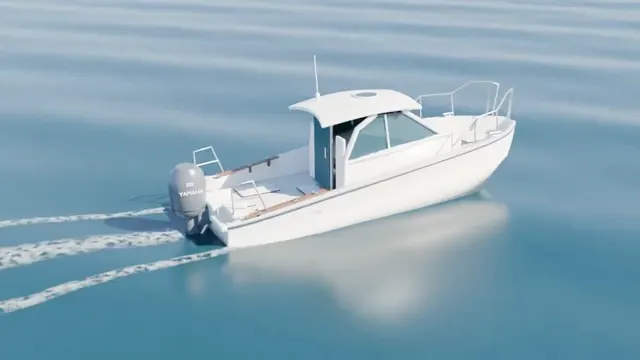</a>

**GPT-6 Astra** · Анимация · автор [Yohei Matsumoto](https://x.com/yhmtmt1) · 2026-09-06

GPT-6 Astra через Blender собрал белый катер и настоящее 3D-море, а затем за пару минут отрендерил проход с пенным следом за кормой.

<details>
<summary>Промпт</summary>

```text
blenderでyf24を作ってビューフォート2の海を走る動画を作って。ちゃんと海も3Dで。
```

</details>

[Открыть на Wandy3D ↗](https://wandy3d.com/ru/prompts/blender-motorboat-cruising-across-a-3d-ocean-rendered-video-2096503275910832461?utm_source=github&utm_medium=referral&utm_campaign=awesome_3d_prompts) · [Исходный пост](https://x.com/yhmtmt1/status/2096503275910832461)

---

### [Интерьер в Blender по плану этажа: проход камеры по гостиной](https://wandy3d.com/ru/prompts/blender-interior-walkthrough-generated-from-a-house-floor-2096501340889374883?utm_source=github&utm_medium=referral&utm_campaign=awesome_3d_prompts)

<a href="https://wandy3d.com/ru/prompts/blender-interior-walkthrough-generated-from-a-house-floor-2096501340889374883?utm_source=github&amp;utm_medium=referral&amp;utm_campaign=awesome_3d_prompts">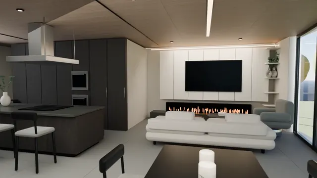</a>

**GPT-6 Astra** · Сцены · автор [indigo](https://x.com/indigox) · 2026-09-06

GPT-6 Astra управлял Blender по плану верхнего этажа и за 20 минут отрендерил 10-секундный проход по гостиной с материалами низкого качества.

<details>
<summary>Бриф от Wandy3D</summary>

```text
Build a short interior walkthrough in Blender from a floor plan image, using a Python script. Read the plan, recreate the walls, floor, ceiling and openings to scale, then furnish the living area: a low white sofa, a TV on a pale paneled wall with a long linear fireplace beneath it, a dark kitchen island with a hood and tall dark cabinets, dining chairs and large windows. Use a warm wood ceiling with recessed lights, light grey floor and neutral materials. Move a camera slowly forward through the space at eye height for about ten seconds. Keep render samples low so the clip finishes in roughly twenty minutes. Done when the exported video shows a coherent room layout matching the plan, readable furniture and smooth camera motion. Accept simple materials; they can be refined in later passes.
```

</details>

[Открыть на Wandy3D ↗](https://wandy3d.com/ru/prompts/blender-interior-walkthrough-generated-from-a-house-floor-2096501340889374883?utm_source=github&utm_medium=referral&utm_campaign=awesome_3d_prompts) · [Исходный пост](https://x.com/indigox/status/2096501340889374883)

---

### [Жуки на Three.js ползут по фотографии: IK-лапки и режимы курсора](https://wandy3d.com/ru/prompts/three-js-beetles-crawling-over-a-photo-with-ik-legs-and-2096460081982304546?utm_source=github&utm_medium=referral&utm_campaign=awesome_3d_prompts)

<a href="https://wandy3d.com/ru/prompts/three-js-beetles-crawling-over-a-photo-with-ik-legs-and-2096460081982304546?utm_source=github&amp;utm_medium=referral&amp;utm_campaign=awesome_3d_prompts"></a>

**GPT-6 Astra** · Интерактив · автор [水族店刘老板](https://x.com/leo_xiaolei) · 2026-09-06

GPT-6 Astra сделал браузерное демо: шестилапые жуки ползут по портрету, есть показ точек шага, ползунки и режимы преследования или бегства.

<details>
<summary>Бриф от Wandy3D</summary>

```text
Build an interactive web demo in Three.js where many small beetles crawl across the surface of a portrait photo. Each beetle has a glossy red body and six thin legs. Legs move in two alternating groups: one group stays planted while the other lifts and steps to a new target, with two-segment inverse kinematics placing each foot. Beetles sample the photo's height or contour so their bodies follow the curved surface and tilt with it. Use a dark green background and a clean card-style interface in a modern typeface. Add a toggle that shows foot landing points, a slider for beetle count and walking speed, a pause button, and a mouse mode switch between wandering, chasing the cursor and fleeing from it. Include short explanatory panels about the gait and leg solving. Deliver it as a static page that can be hosted on GitHub Pages. Done when dozens of beetles walk smoothly without legs jumping.
```

</details>

[Открыть на Wandy3D ↗](https://wandy3d.com/ru/prompts/three-js-beetles-crawling-over-a-photo-with-ik-legs-and-2096460081982304546?utm_source=github&utm_medium=referral&utm_campaign=awesome_3d_prompts) · [Исходный пост](https://x.com/leo_xiaolei/status/2096460081982304546)

---

### [Играбельная квартира в стиле low-poly на WebGL с кликабельными предметами](https://wandy3d.com/ru/prompts/playable-low-poly-apartment-walkthrough-recreated-in-webgl-2096413869841473930?utm_source=github&utm_medium=referral&utm_campaign=awesome_3d_prompts)

<a href="https://wandy3d.com/ru/prompts/playable-low-poly-apartment-walkthrough-recreated-in-webgl-2096413869841473930?utm_source=github&amp;utm_medium=referral&amp;utm_campaign=awesome_3d_prompts">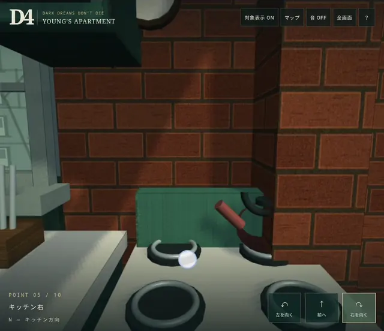</a>

**GPT-6 Astra** · Интерактив · автор [Hidetaka SWERY SueHERO](https://x.com/Swery65) · 2026-09-06

GPT-6 Astra за одну ночь собрал по запросу играбельную WebGL-квартиру: проигрыватель, ламповый ТВ и холодильник открывают панели с описанием.

<details>
<summary>Бриф от Wandy3D</summary>

```text
Build a playable browser prototype of a small, moody apartment recreated from a well-known adventure game, rendered in WebGL with a chunky low-poly look. Include a kitchen with a pale blue fridge and stove, a wooden dining table with chairs, a living area with a green sofa, rug and lamp, a bookshelf, a desk with a pinboard, a blue front door, a record player and a CRT television. Use a dark teal and warm brown palette, red brick walls, wooden floors and soft window light with long shadows. Navigation is point-to-point: the player steps between about ten fixed viewpoints with forward, turn-left and turn-right buttons, and can also use the keyboard. Interactive objects show a marker; selecting one opens a side panel with a short description and an action button such as play the record or switch the TV on or off. Add a minimap, a sound toggle, fullscreen and a help overlay, with a Japanese interface. Deliver it as a single web page that works on a phone or foldable screen. Done when you can walk the whole room and trigger every object.
```

</details>

[Открыть на Wandy3D ↗](https://wandy3d.com/ru/prompts/playable-low-poly-apartment-walkthrough-recreated-in-webgl-2096413869841473930?utm_source=github&utm_medium=referral&utm_campaign=awesome_3d_prompts) · [Исходный пост](https://x.com/Swery65/status/2096413869841473930)

---

### [Чёрная дыра как в «Интерстеллар», рендер в Blender: сравнение двух моделей](https://wandy3d.com/ru/prompts/interstellar-style-black-hole-rendered-in-blender-two-models-2096391653669953761?utm_source=github&utm_medium=referral&utm_campaign=awesome_3d_prompts)

<a href="https://wandy3d.com/ru/prompts/interstellar-style-black-hole-rendered-in-blender-two-models-2096391653669953761?utm_source=github&amp;utm_medium=referral&amp;utm_campaign=awesome_3d_prompts">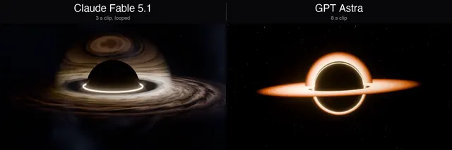</a>

**Claude Fable 5.1** · Анимация · автор [John Kler](https://x.com/JohnKlerAI) · 2026-09-06

Сравнение: Claude Fable 5.1 и GPT Astra получили один короткий промпт. У Fable чёрная дыра с заметно более богатым аккреционным диском.

<details>
<summary>Промпт</summary>

```text
Make and render a beautiful black hole, like the one from Interstellar, in Blender.
```

</details>

[Открыть на Wandy3D ↗](https://wandy3d.com/ru/prompts/interstellar-style-black-hole-rendered-in-blender-two-models-2096391653669953761?utm_source=github&utm_medium=referral&utm_campaign=awesome_3d_prompts) · [Исходный пост](https://x.com/JohnKlerAI/status/2096391653669953761)

---

### [Симулятор железной дороги на Three.js с изометрией и камерой слежения](https://wandy3d.com/ru/prompts/three-js-railway-simulation-game-with-isometric-and-follow-2096362653480562751?utm_source=github&utm_medium=referral&utm_campaign=awesome_3d_prompts)

<a href="https://wandy3d.com/ru/prompts/three-js-railway-simulation-game-with-isometric-and-follow-2096362653480562751?utm_source=github&amp;utm_medium=referral&amp;utm_campaign=awesome_3d_prompts">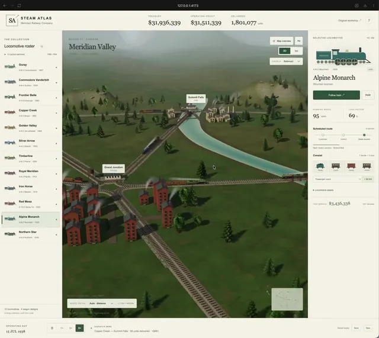</a>

**GPT-6 Astra** · Игры · автор [Tom Krcha](https://x.com/tomkrcha) · 2026-09-05

GPT-6 Astra собрал игру про сеть паровозов на Three.js: развязки, города, река, мосты и дым, вид в 3D или изометрии.

<details>
<summary>Бриф от Wandy3D</summary>

```text
Build a browser railway simulation game with Three.js. Show a green valley with a river, bridges, a hill, trees, red-brick cities and a network of tracks with junctions linking several stations. Steam locomotives with wagons run along the rails and puff smoke. Offer two camera modes, a free 3D view and an isometric view, plus a follow mode that locks onto a chosen train. Add a clean cream-coloured side panel listing locomotive models with their stats, a top bar with money and income figures, a train selection control and speed settings. Use a muted natural palette with soft daylight and light haze. Trains should move smoothly, slow for junctions and visit stations. Deliver it as a web app that runs from a local server. Done when you can orbit the map, switch cameras, follow any train and see the economy figures update while trains run.
```

</details>

[Открыть на Wandy3D ↗](https://wandy3d.com/ru/prompts/three-js-railway-simulation-game-with-isometric-and-follow-2096362653480562751?utm_source=github&utm_medium=referral&utm_campaign=awesome_3d_prompts) · [Исходный пост](https://x.com/tomkrcha/status/2096362653480562751)

---

### [Симуляция таверны в пиксель-арте: заказы, персонал и поиск пути](https://wandy3d.com/ru/prompts/pixel-art-tavern-simulation-with-ordering-staff-and-2096358854275543457?utm_source=github&utm_medium=referral&utm_campaign=awesome_3d_prompts)

<a href="https://wandy3d.com/ru/prompts/pixel-art-tavern-simulation-with-ordering-staff-and-2096358854275543457?utm_source=github&amp;utm_medium=referral&amp;utm_campaign=awesome_3d_prompts">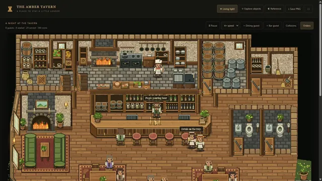</a>

**GPT-6 Astra** · Интерактив · автор [Rogue](https://x.com/Rogue0114) · 2026-09-05

GPT-6 Astra по референсу и трём промптам собрал живую таверну: гости заказывают, работники готовят еду и напитки, все обходят препятствия.

<details>
<summary>Бриф от Wandy3D</summary>

```text
Build a top-down 2D tavern simulation in the browser, styled as detailed pixel art and based on a reference image of a cosy inn. Draw a wooden floor, a long bar with stools, shelves of bottles, barrels, a stone fireplace, rugs, round tables with chairs, plants and an entrance. Populate it with a bartender, kitchen workers and guests. Guests sit down, order food and drinks, and the workers prepare and deliver each order. Implement collision with furniture and pathfinding so characters walk around obstacles. Clicking a character or object opens an info panel with its name and description. Include a dark UI bar with view toggles and a scrolling event log listing orders such as waiting for orders and items being served. Use a warm brown and amber palette with green accents. Deliver it as a single web page. Done when guests arrive, order, are served and the log reflects each step without characters getting stuck.
```

</details>

[Открыть на Wandy3D ↗](https://wandy3d.com/ru/prompts/pixel-art-tavern-simulation-with-ordering-staff-and-2096358854275543457?utm_source=github&utm_medium=referral&utm_campaign=awesome_3d_prompts) · [Исходный пост](https://x.com/Rogue0114/status/2096358854275543457)

---

### [Играющий 3D-оркестр из 43 музыкантов с единым таймером воспроизведения](https://wandy3d.com/ru/prompts/playable-3d-orchestra-of-43-musicians-driven-by-one-playback-2096354461652488562?utm_source=github&utm_medium=referral&utm_campaign=awesome_3d_prompts)

<a href="https://wandy3d.com/ru/prompts/playable-3d-orchestra-of-43-musicians-driven-by-one-playback-2096354461652488562?utm_source=github&amp;utm_medium=referral&amp;utm_campaign=awesome_3d_prompts">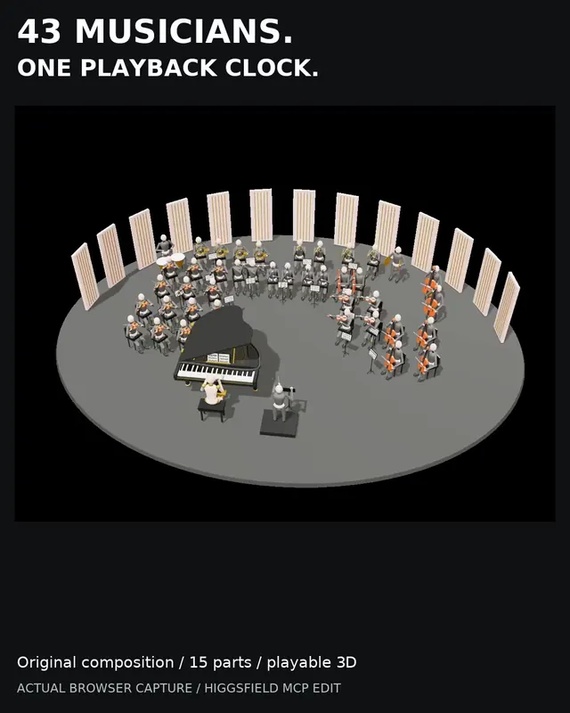</a>

**GPT-6 Astra** · Интерактив · автор [Generator](https://x.com/groovestreetgen) · 2026-09-05

Из запроса на мелодию для фортепиано GPT-6 Astra сделал 3D-оркестр из 15 партий с дирижёром и свободной камерой.

<details>
<summary>Бриф от Wandy3D</summary>

```text
Build a playable 3D orchestra scene in the browser. Start from an original short piano melody and expand it into a 15-part arrangement performed by 43 musicians and a conductor. Place a grand piano with its pianist near the front, string, wind and brass sections in arc formation around it, and a conductor's podium, all on a round grey stage ringed by tall pale acoustic panels against a black background. Every musician is a simple posed figure with its instrument and animates in time with its part. One shared playback clock drives all parts so the music and the movement stay in sync. Add play and pause, and camera controls to orbit, zoom and pan around the stage. Keep a neutral grey, cream and orange palette with clear soft lighting. Deliver it as a single web page with synthesized audio. Done when all 15 parts play together and the camera can circle the ensemble.
```

</details>

[Открыть на Wandy3D ↗](https://wandy3d.com/ru/prompts/playable-3d-orchestra-of-43-musicians-driven-by-one-playback-2096354461652488562?utm_source=github&utm_medium=referral&utm_campaign=awesome_3d_prompts) · [Исходный пост](https://x.com/groovestreetgen/status/2096354461652488562)

---

### [Солнечная система в браузере: 8 планет, 20 спутников и планировщик полёта](https://wandy3d.com/ru/prompts/browser-solar-system-explorer-with-8-planets-and-a-flight-2096339041679442428?utm_source=github&utm_medium=referral&utm_campaign=awesome_3d_prompts)

<a href="https://wandy3d.com/ru/prompts/browser-solar-system-explorer-with-8-planets-and-a-flight-2096339041679442428?utm_source=github&amp;utm_medium=referral&amp;utm_campaign=awesome_3d_prompts">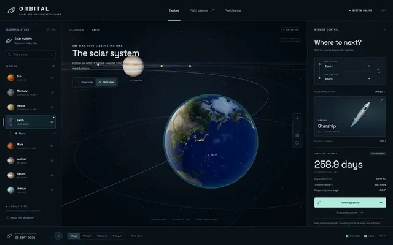</a>

**GPT-6 Astra** · Интерактив · автор [Andromedus](https://x.com/dzhohola) · 2026-09-05

GPT-6 Astra собрал на Three.js Солнечную систему: 8 планет, 20 спутников, плавные перелёты камеры и панель планирования полёта.

<details>
<summary>Бриф от Wandy3D</summary>

```text
Build an interactive solar system explorer that runs in the browser with Three.js and WebGL. Show the Sun, eight planets and about twenty moons on orbit lines, with textured spheres and Saturn's rings. Use a dark, minimal interface: a left list of bodies to select, a large title and a short description with key stats at the bottom of the view, and a right panel for a simplified spaceflight planner where the user picks a origin and destination and sees an estimated travel time in days. Selecting a body makes the camera glide smoothly from the system overview to a close view of it, and the user can also orbit and zoom the camera freely. Keep planets and moons moving along their orbits. Deliver a working web page with all assets loaded locally or procedurally. Done means you can fly from the Sun to Earth, its Moon and Saturn, read the stats, and get a travel estimate between two planets.
```

</details>

[Открыть на Wandy3D ↗](https://wandy3d.com/ru/prompts/browser-solar-system-explorer-with-8-planets-and-a-flight-2096339041679442428?utm_source=github&utm_medium=referral&utm_campaign=awesome_3d_prompts) · [Исходный пост](https://x.com/dzhohola/status/2096339041679442428)

---

### [Низкополигональная игра про краба на острове: охота за кристаллами, Three.js](https://wandy3d.com/ru/prompts/low-poly-island-crab-game-in-three-js-with-crystal-shard-2096337879173591171?utm_source=github&utm_medium=referral&utm_campaign=awesome_3d_prompts)

<a href="https://wandy3d.com/ru/prompts/low-poly-island-crab-game-in-three-js-with-crystal-shard-2096337879173591171?utm_source=github&amp;utm_medium=referral&amp;utm_campaign=awesome_3d_prompts">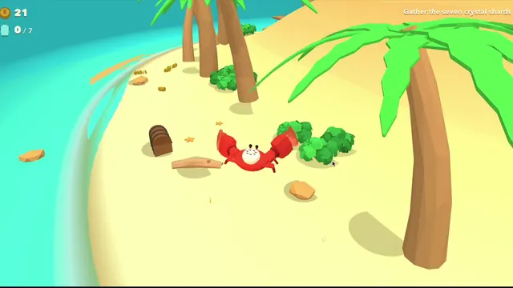</a>

**GPT-6 Astra** · Игры · автор [ZEUS⚡️](https://x.com/zeuuss_01) · 2026-09-05

GPT-6 Astra сгенерировал игру на Three.js: красный краб бегает по пальмовому острову и собирает семь кристаллов, все модели созданы кодом.

<details>
<summary>Бриф от Wandy3D</summary>

```text
Build a small third-person game in Three.js, delivered as a single web project with a readme. The player is a cheerful red cartoon crab on a bright low-poly tropical island: yellow sand, turquoise water, chunky palm trees, rocks, shrubs, barrels and a wooden pier. All models must be generated in code from simple shapes, with no imported assets. A chase camera follows the crab as it scurries around. The goal shown on screen is to gather seven crystal shards scattered over the island, with a small counter in the corner. Collectibles should react to the crab by lifting off the ground and flying into it as it passes. Keep the palette saturated and playful, with soft shadows under objects. Avoid repeating the same layout or props in obvious copies. Done means the crab moves smoothly, the camera follows without clipping badly through trees, and all seven shards can be collected.
```

</details>

[Открыть на Wandy3D ↗](https://wandy3d.com/ru/prompts/low-poly-island-crab-game-in-three-js-with-crystal-shard-2096337879173591171?utm_source=github&utm_medium=referral&utm_campaign=awesome_3d_prompts) · [Исходный пост](https://x.com/zeuuss_01/status/2096337879173591171)

---

### [Кинематографичный дракон в Blender на скале с лавой, рендер через Python](https://wandy3d.com/ru/prompts/cinematic-blender-dragon-on-a-lava-cracked-rock-rendered-via-2096335588727349434?utm_source=github&utm_medium=referral&utm_campaign=awesome_3d_prompts)

<a href="https://wandy3d.com/ru/prompts/cinematic-blender-dragon-on-a-lava-cracked-rock-rendered-via-2096335588727349434?utm_source=github&amp;utm_medium=referral&amp;utm_campaign=awesome_3d_prompts">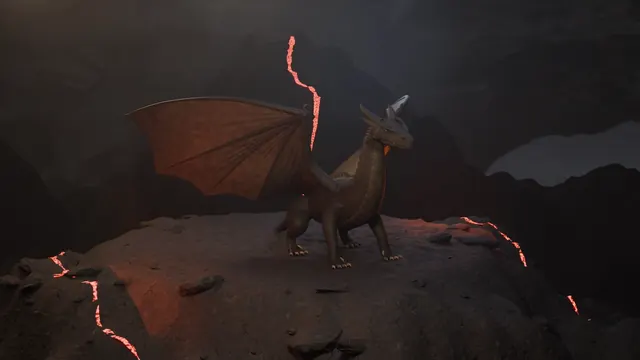</a>

**GPT-6 Astra** · Анимация · автор [Sarang Borude](https://x.com/doomdave) · 2026-09-05

GPT-6 Astra написал скрипты для Blender без интерфейса: рогатый дракон и 10-секундный ролик с крупным планом и разными ракурсами камеры.

<details>
<summary>Бриф от Wandy3D</summary>

```text
Build a ten-second cinematic render of a dragon using Blender in headless mode, driven entirely by Python scripts, and work from a reference image of the creature. Model a dark, scaled dragon with horns, a long tail and large membrane wings, standing on a rocky ledge cracked with glowing orange lava veins. Set it in a misty, dim mountain landscape with moody lighting and warm glow from the cracks. Animate the camera through several different moves: a wide establishing shot, a close-up of the head with its eye and teeth, a side view of the full body, a rear three-quarter view and a final front-facing shot with wings spread. Render to a video file. Expect several iterations: check frames, fix proportions, materials and camera paths, and re-render. Done means a smooth ten-second clip with varied camera angles where the dragon matches the reference and the lava lighting reads clearly.
```

</details>

[Открыть на Wandy3D ↗](https://wandy3d.com/ru/prompts/cinematic-blender-dragon-on-a-lava-cracked-rock-rendered-via-2096335588727349434?utm_source=github&utm_medium=referral&utm_campaign=awesome_3d_prompts) · [Исходный пост](https://x.com/doomdave/status/2096335588727349434)

---

### [Площадь Терейру-ду-Пасу в Лиссабоне в Blender с пролётом камеры](https://wandy3d.com/ru/prompts/lisbon-terreiro-do-paco-square-recreated-in-blender-with-2096298425914450021?utm_source=github&utm_medium=referral&utm_campaign=awesome_3d_prompts)

<a href="https://wandy3d.com/ru/prompts/lisbon-terreiro-do-paco-square-recreated-in-blender-with-2096298425914450021?utm_source=github&amp;utm_medium=referral&amp;utm_campaign=awesome_3d_prompts">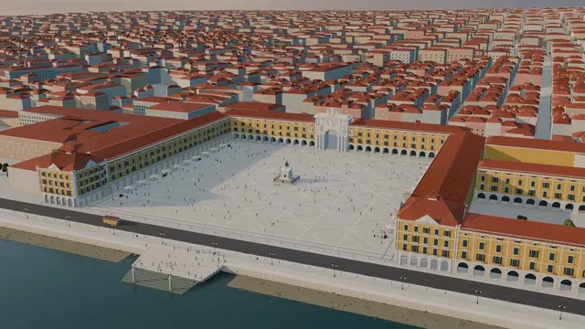</a>

**GPT-6 Astra** · Сцены · автор [Gonçalo Canhoto 🇵🇹](https://x.com/goncalo_canhoto) · 2026-09-05

GPT-6 Astra с одного захода смоделировал в Blender набережную площадь Лиссабона: аркады, триумфальная арка, статуя, река и пролёт камеры.

<details>
<summary>Бриф от Wandy3D</summary>

```text
Build a Blender scene, delivered as a Python script, that recreates a grand riverside European plaza in Lisbon. Model a huge open square with pale paving and light line patterns, bordered on three sides by long yellow arcaded buildings with terracotta roofs, and a monumental white triumphal arch in the middle of the far side. Place a bronze equestrian statue on a stepped stone pedestal with railings at the center. Open the fourth side to a wide river with a quay, a small sailboat and a distant green shoreline. Add dense red-roofed city blocks behind the buildings, street lamps, a tram and many tiny pedestrians. Use physically based materials, soft late-afternoon sun and a cloudy sky. Animate a slow camera flight that starts high above the square and descends toward the statue, then turns to look over the water. Done means a rendered 30 second sequence with believable architecture, lighting and scale.
```

</details>

[Открыть на Wandy3D ↗](https://wandy3d.com/ru/prompts/lisbon-terreiro-do-paco-square-recreated-in-blender-with-2096298425914450021?utm_source=github&utm_medium=referral&utm_campaign=awesome_3d_prompts) · [Исходный пост](https://x.com/goncalo_canhoto/status/2096298425914450021)

---

[← Назад](catalog.ru.3.md) · страница 4 из 8 · [Дальше →](catalog.ru.5.md)

Промпты, видео и картинки принадлежат их авторам ([RIGHTS.md](../RIGHTS.md)). Наши тексты — [CC BY 4.0](../LICENSE). Знаете хороший промпт с видимым результатом? [Предложите его](https://github.com/wornoxgames/awesome-3d-prompts/issues/new?template=suggest.md). Вы автор и хотите изменить или убрать запись? [Напишите нам](https://github.com/wornoxgames/awesome-3d-prompts/issues/new?template=removal.md).
