<!-- Generated file: edits are overwritten. -->

# Awesome 3D Prompts — Каталог 7/8

[← Awesome 3D Prompts](../README.ru.md) · [English](catalog.en.1.md) · **Русский** · [日本語](catalog.ja.1.md) · [中文](catalog.zh.1.md)

[← Назад](catalog.ru.6.md) · страница 7 из 8 · [Дальше →](catalog.ru.8.md)

### [Воксельная игра на выживание от первого лица с крафтом, деревнями и фермой](https://wandy3d.com/ru/prompts/first-person-voxel-survival-game-with-crafting-villages-and-2095597137849446688?utm_source=github&utm_medium=referral&utm_campaign=awesome_3d_prompts)

<a href="https://wandy3d.com/ru/prompts/first-person-voxel-survival-game-with-crafting-villages-and-2095597137849446688?utm_source=github&amp;utm_medium=referral&amp;utm_campaign=awesome_3d_prompts">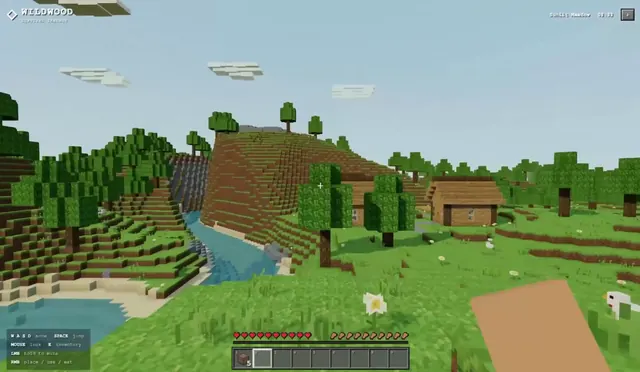</a>

**GPT-6 Astra** · Игры · автор [Flavio Adamo](https://x.com/flavioAd) · 2026-09-03

Тест GPT-6 Astra на популярном задании в стиле Minecraft: блочный мир, деревни, сетка крафта, инструменты и пшеничное поле.

<details>
<summary>Бриф от Wandy3D</summary>

```text
Build a first-person blocky sandbox survival game in the style of classic voxel crafting games. Generate rolling grass terrain with cube trees, drifting clouds, small wooden villages with interiors holding bookshelves and chests, and a planted wheat field. Use crisp pixelated textures, bright daylight and a simple HUD with a hotbar, hearts and hunger bar. Include an inventory screen and a crafting grid that turns collected items into wooden tools such as a pickaxe and sword, shown held in the player's hand. Controls: WASD to move, mouse to look, click to break and place blocks, a key to open the inventory. Deliver everything as one runnable project. Done means a player can walk through a village, open the inventory, craft a tool, harvest crops and mine blocks without errors.
```

</details>

[Открыть на Wandy3D ↗](https://wandy3d.com/ru/prompts/first-person-voxel-survival-game-with-crafting-villages-and-2095597137849446688?utm_source=github&utm_medium=referral&utm_campaign=awesome_3d_prompts) · [Исходный пост](https://x.com/flavioAd/status/2095597137849446688)

---

### [Сюжетное приключение с открытым миром от первого лица: квесты и меню локаций](https://wandy3d.com/ru/prompts/story-driven-first-person-open-world-adventure-with-quests-2095596341422440714?utm_source=github&utm_medium=referral&utm_campaign=awesome_3d_prompts)

<a href="https://wandy3d.com/ru/prompts/story-driven-first-person-open-world-adventure-with-quests-2095596341422440714?utm_source=github&amp;utm_medium=referral&amp;utm_campaign=awesome_3d_prompts">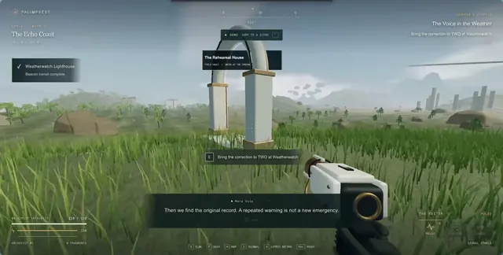</a>

**GPT-6 Astra** · Игры · автор [Peter Gostev](https://x.com/petergostev) · 2026-09-03

GPT-6 Astra (Ultra) создал открытый мир с озвученными квестами, субтитрами диалогов и меню для перехода между названными локациями.

<details>
<summary>Бриф от Wandy3D</summary>

```text
Build a first-person open-world adventure game with a story. Create a large landscape of grassy hills, dry red plains, a sandy beach and sea, dotted with trees and strange landmarks such as a glass cathedral and an orchard. The player carries a white pistol. Add a quest log and objective markers, narrated dialogue shown as subtitles, and a calm muted HUD with a compass strip and location titles that appear when entering an area. Include a menu titled like a world-jump screen that lists named locations as cards so the player can teleport between them. Use soft daylight, a restrained teal and green palette and clean thin UI typography. Deliver it as one runnable project with WASD movement, mouse look and click to fire. Done means the player can pick a location, explore, trigger dialogue and complete an objective.
```

</details>

[Открыть на Wandy3D ↗](https://wandy3d.com/ru/prompts/story-driven-first-person-open-world-adventure-with-quests-2095596341422440714?utm_source=github&utm_medium=referral&utm_campaign=awesome_3d_prompts) · [Исходный пост](https://x.com/petergostev/status/2095596341422440714)

---

### [Мир выживания в Unreal Engine с говорящими ИИ-агентами](https://wandy3d.com/ru/prompts/unreal-engine-survival-world-run-by-talking-ai-agents-2095596175705399482?utm_source=github&utm_medium=referral&utm_campaign=awesome_3d_prompts)

<a href="https://wandy3d.com/ru/prompts/unreal-engine-survival-world-run-by-talking-ai-agents-2095596175705399482?utm_source=github&amp;utm_medium=referral&amp;utm_campaign=awesome_3d_prompts">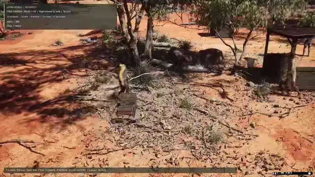</a>

**GPT-6 Astra** · Сцены · автор [Matt Shumer](https://x.com/mattshumer_) · 2026-09-03

GPT-6 Astra создала в Unreal Engine мир, где каждый житель — отдельный агент. Они разговаривают и вместе выживают, реплики видны в субтитрах.

<details>
<summary>Бриф от Wandy3D</summary>

```text
Build a small survival world in Unreal Engine set in a sunlit semi-arid woodland: red dirt ground, scattered eucalyptus-like trees, dry grass tufts, fallen logs and a few rough wooden shelters and stalls. Populate it with several humanoid characters, each driven by its own language-model agent with a short persona and a shared goal: the group must cooperate to survive by finding food, water and shelter. Let the agents talk to each other and decide what to do, and show their speech as captions at the bottom of the screen with a small status overlay in the corner. Use a third-person camera that follows individual characters and cuts between them, with natural daylight and long shadows. Characters should walk between locations, stand together in conversation and react to each other. Deliver a runnable Unreal project plus a short script that connects each character to the model. Done means you can leave the simulation running and watch the characters plan, talk and act without any input from you.
```

</details>

[Открыть на Wandy3D ↗](https://wandy3d.com/ru/prompts/unreal-engine-survival-world-run-by-talking-ai-agents-2095596175705399482?utm_source=github&utm_medium=referral&utm_campaign=awesome_3d_prompts) · [Исходный пост](https://x.com/mattshumer_/status/2095596175705399482)

---

### [Воксельная симуляция колонии на Марсе с энергосетью и пылевыми бурями](https://wandy3d.com/ru/prompts/voxel-mars-colony-simulation-with-power-grids-and-dust-2095595678214873212?utm_source=github&utm_medium=referral&utm_campaign=awesome_3d_prompts)

<a href="https://wandy3d.com/ru/prompts/voxel-mars-colony-simulation-with-power-grids-and-dust-2095595678214873212?utm_source=github&amp;utm_medium=referral&amp;utm_campaign=awesome_3d_prompts">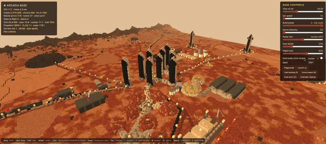</a>

**Claude Fable 5.1** · Интерактив · автор [Knowix](https://x.com/knowixbuilds) · 2026-09-03

Claude Fable 5.1 собрала в браузере марсианскую базу из миллионов вокселей: ракеты, роботы-строители, энергетика и жизнеобеспечение, которые ломают бури.

<details>
<summary>Бриф от Wandy3D</summary>

```text
Build an interactive voxel simulation of a Mars colony that runs in the browser. Show a large red-rock voxel terrain with a base growing on it: tall rocket landing towers, launch and landing vehicles, solar fields, a nuclear power plant, battery banks, fuel, oxygen and water facilities, rovers and humanoid robot workers that construct buildings in phases. Model resource flows so power, fuel, oxygen and water levels change over time, and let weather events such as dust storms, blackouts and night frost disrupt the base. Use a warm orange and rust palette with a hazy sky that thickens during storms. Provide a free orbit camera and a side control panel with sliders for time of day, speed and disaster triggers, plus a small status bar. Keep it as one web project with an efficient voxel renderer able to handle millions of voxels. Done means you can watch the colony operate on its own, then trigger failures and see the systems react.
```

</details>

[Открыть на Wandy3D ↗](https://wandy3d.com/ru/prompts/voxel-mars-colony-simulation-with-power-grids-and-dust-2095595678214873212?utm_source=github&utm_medium=referral&utm_campaign=awesome_3d_prompts) · [Исходный пост](https://x.com/knowixbuilds/status/2095595678214873212)

---

### [Водопад на WebGPU и Three.js с туманом, озером и ползунками](https://wandy3d.com/ru/prompts/webgpu-waterfall-scene-in-three-js-with-mist-pool-and-live-2095510069047660636?utm_source=github&utm_medium=referral&utm_campaign=awesome_3d_prompts)

<a href="https://wandy3d.com/ru/prompts/webgpu-waterfall-scene-in-three-js-with-mist-pool-and-live-2095510069047660636?utm_source=github&amp;utm_medium=referral&amp;utm_campaign=awesome_3d_prompts">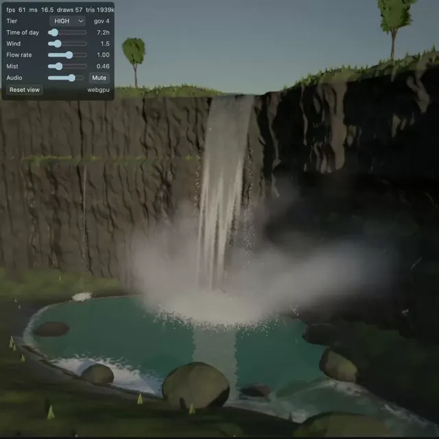</a>

**Claude Fable 5.1** · Сцены · автор [Fede(URU) 🇺🇾](https://x.com/RealFedeURU) · 2026-09-03

Сравнение двух моделей: Claude Fable 5.1, названная первой, сделала водопад на Three.js с брызгами, туманом и озером.

<details>
<summary>Бриф от Wandy3D</summary>

```text
Build a real-time waterfall scene with Three.js using WebGPU. Show a tall rocky cliff with layered rock texture, a ribbon of falling water made of streaks and spray particles, a rolling mist cloud at the base, and a turquoise plunge pool ringed by boulders, foam and grass, with a lone tree on the clifftop. Light it with a warm low sun and a gradient sky. Add a small panel with sliders for time of day, wind, flow rate, mist amount and audio volume, plus a mute button and a reset-view button, and show a tiny stats readout. Let the user orbit and zoom the camera freely, and include ambient waterfall sound. Keep everything procedural, in a single web page with no external assets. Done means the water looks continuous and the mist reacts to the sliders as the camera moves in close and pulls back.
```

</details>

[Открыть на Wandy3D ↗](https://wandy3d.com/ru/prompts/webgpu-waterfall-scene-in-three-js-with-mist-pool-and-live-2095510069047660636?utm_source=github&utm_medium=referral&utm_campaign=awesome_3d_prompts) · [Исходный пост](https://x.com/RealFedeURU/status/2095510069047660636)

---

### [Парящий воксельный остров с мельницей, маяком и сменой дня и ночи](https://wandy3d.com/ru/prompts/floating-voxel-island-with-windmill-lighthouse-and-day-night-2095493630421340200?utm_source=github&utm_medium=referral&utm_campaign=awesome_3d_prompts)

<a href="https://wandy3d.com/ru/prompts/floating-voxel-island-with-windmill-lighthouse-and-day-night-2095493630421340200?utm_source=github&amp;utm_medium=referral&amp;utm_campaign=awesome_3d_prompts">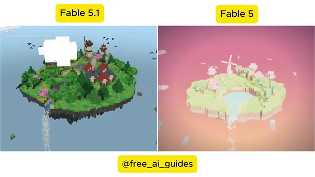</a>

**Claude Fable 5.1** · Сцены · автор [AI Guides](https://x.com/free_ai_guides) · 2026-09-03

Сравнение: Claude Fable 5.1, названная первой, сама придумала воксельный остров на Three.js; рядом пастельный остров от Fable 5.

<details>
<summary>Бриф от Wandy3D</summary>

```text
Build a small voxel world as a single self-contained web page, using Three.js, that the viewer can rotate around. Create a floating island with a rocky underside, a windmill with turning sails, a lighthouse whose beam sweeps at night, a village of red-roofed houses, a river that runs to the edge and drops as a waterfall, trees, flocks of birds circling and drifting clouds. Add a day and night cycle in which the sky darkens, windows glow and the lighthouse lights up. Use blocky voxel geometry with soft lighting, saturated greens and a pale blue sky by day, deep navy at night. Provide orbit controls with mouse drag and zoom, and a small title label. Everything should move on its own without input. Done means the island looks charming from every angle and the full day cycle plays smoothly.
```

</details>

[Открыть на Wandy3D ↗](https://wandy3d.com/ru/prompts/floating-voxel-island-with-windmill-lighthouse-and-day-night-2095493630421340200?utm_source=github&utm_medium=referral&utm_campaign=awesome_3d_prompts) · [Исходный пост](https://x.com/free_ai_guides/status/2095493630421340200)

---

### [Кинематографичная чёрная дыра на ray marching в одном файле WebGL2](https://wandy3d.com/ru/prompts/cinematic-ray-marched-black-hole-in-a-single-webgl2-file-2095409039005933910?utm_source=github&utm_medium=referral&utm_campaign=awesome_3d_prompts)

<a href="https://wandy3d.com/ru/prompts/cinematic-ray-marched-black-hole-in-a-single-webgl2-file-2095409039005933910?utm_source=github&amp;utm_medium=referral&amp;utm_campaign=awesome_3d_prompts">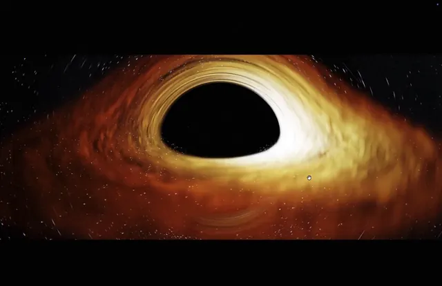</a>

**Claude Fable 5.1** · Сцены · автор [eki](https://x.com/ekibuilds) · 2026-09-03

Claude Fable 5.1 по короткому запросу собрал чёрную дыру с гравитационным линзированием, диском с эффектом Доплера и орбитальными частицами без ассетов.

<details>
<summary>Промпт</summary>

```text
build me a cinematic black hole
```

</details>

[Открыть на Wandy3D ↗](https://wandy3d.com/ru/prompts/cinematic-ray-marched-black-hole-in-a-single-webgl2-file-2095409039005933910?utm_source=github&utm_medium=referral&utm_campaign=awesome_3d_prompts) · [Исходный пост](https://x.com/ekibuilds/status/2095409039005933910)

---

### [Прототип open-world гонки по Нью-Йорку с миникартой](https://wandy3d.com/ru/prompts/open-world-new-york-driving-game-prototype-with-minimap-2095187868746383758?utm_source=github&utm_medium=referral&utm_campaign=awesome_3d_prompts)

<a href="https://wandy3d.com/ru/prompts/open-world-new-york-driving-game-prototype-with-minimap-2095187868746383758?utm_source=github&amp;utm_medium=referral&amp;utm_campaign=awesome_3d_prompts">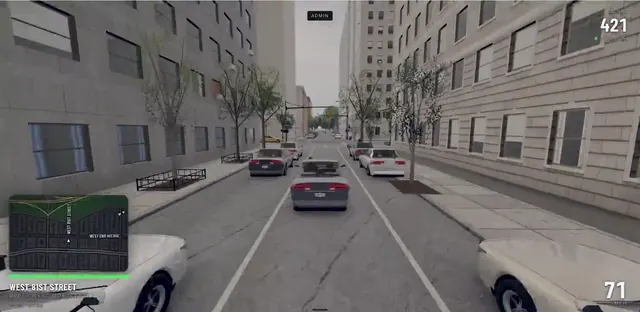</a>

**Claude Fable 5.1** · Игры · автор [Matt Shumer](https://x.com/mattshumer_) · 2026-09-02

Ранний превью игры в духе GTA на Claude Fable 5.1: седан едет по детальным улицам Манхэттена и выезжает в парк у реки.

<details>
<summary>Бриф от Wandy3D</summary>

```text
Build a third-person open-world driving game set in a realistic version of New York City. The player steers a grey sedan through avenues lined with stone apartment buildings, parked cars, traffic lights, crosswalks and street trees, then out onto a grassy riverside park with a waterfront railing. Use a naturalistic, slightly desaturated daylight palette with a pale sky. Add a HUD with a corner minimap showing the road network, a label for the current street name, and a speed readout. Use a chase camera behind the car, keyboard driving controls, and background traffic. Stream or tile the city so the player can drive continuously through several districts. Deliver it as a browser-playable 3D project with clear run instructions. Done means the car drives smoothly along streets and into the park, the minimap and street names update as you move, and the frame rate stays playable.
```

</details>

[Открыть на Wandy3D ↗](https://wandy3d.com/ru/prompts/open-world-new-york-driving-game-prototype-with-minimap-2095187868746383758?utm_source=github&utm_medium=referral&utm_campaign=awesome_3d_prompts) · [Исходный пост](https://x.com/mattshumer_/status/2095187868746383758)

---

### [Вестерн-платформер в стиле комикса на Three.js с ганфайтером](https://wandy3d.com/ru/prompts/comic-book-western-side-scroller-with-a-gunslinger-in-three-2095180091257209148?utm_source=github&utm_medium=referral&utm_campaign=awesome_3d_prompts)

<a href="https://wandy3d.com/ru/prompts/comic-book-western-side-scroller-with-a-gunslinger-in-three-2095180091257209148?utm_source=github&amp;utm_medium=referral&amp;utm_campaign=awesome_3d_prompts">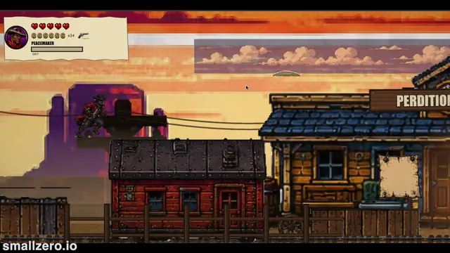</a>

**Claude Fable 5.1** · Игры · автор [smallzero](https://x.com/Smallzero) · 2026-09-02

Claude Fable 5.1 собрал раннюю версию аркадного ковбойского шутера: комиксная графика, закаты в пустыне, салун и сюжетные подписи.

<details>
<summary>Бриф от Wandy3D</summary>

```text
Build a side-scrolling western action game in the browser using Three.js. Take inspiration from classic arcade cowboy shooters, rendered with a comic-book look: inked outlines, painterly desert sunsets in purple, orange and gold, and detailed wooden frontier buildings. The player is a gunslinger walking through a town with a saloon, sheriff's office, freight depot and water tower, with cacti, barrels and hay bales as scenery. Add shooting, a kick or melee action, a horse-riding moment, enemies that react to hits, and context prompts for reading signs or talking to townsfolk. Include a HUD with a portrait, health and ammo, plus narrated story text boxes and speech bubbles. Deliver it as a playable web project with keyboard controls. Done means you can walk through the street, enter the saloon, fight outlaws and see story text appear.
```

</details>

[Открыть на Wandy3D ↗](https://wandy3d.com/ru/prompts/comic-book-western-side-scroller-with-a-gunslinger-in-three-2095180091257209148?utm_source=github&utm_medium=referral&utm_campaign=awesome_3d_prompts) · [Исходный пост](https://x.com/Smallzero/status/2095180091257209148)

---

### [Шутер от первого лица на Three.js против мятежного ИИ и роботов](https://wandy3d.com/ru/prompts/first-person-three-js-shooter-against-a-rogue-agi-and-its-2095180071221002441?utm_source=github&utm_medium=referral&utm_campaign=awesome_3d_prompts)

<a href="https://wandy3d.com/ru/prompts/first-person-three-js-shooter-against-a-rogue-agi-and-its-2095180071221002441?utm_source=github&amp;utm_medium=referral&amp;utm_campaign=awesome_3d_prompts">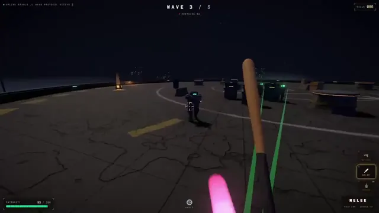</a>

**Claude Fable 5.1** · Игры · автор [Lucas Bai](https://x.com/lucasybai) · 2026-09-02

Claude Fable 5.1 собрал волновой шутер на Three.js: человек на ночной крыше бьётся с роботами и боссом, чьи лучи заливают весь экран.

<details>
<summary>Бриф от Wandy3D</summary>

```text
Build a browser first-person wave shooter in Three.js. The player is a human fighting an unaligned AGI and its robot minions on a dark, cracked-asphalt rooftop arena at night. Show a title screen with a game name and an engage button, then a HUD with wave counter, health bar, ammo count and weapon slots. Include a firearm and a melee bat, small robot enemies and a larger boss machine with a glowing green screen face. Enemies telegraph attacks with glowing red laser lines on the floor and a large beam attack that floods the screen with orange-white light. Use a dim palette with neon red, orange and green accents, fog and bloom. Deliver one runnable web project with mouse-look and WASD controls, wave progression, win and lose states. Done when a player can start, clear several waves and see the boss attack.
```

</details>

[Открыть на Wandy3D ↗](https://wandy3d.com/ru/prompts/first-person-three-js-shooter-against-a-rogue-agi-and-its-2095180071221002441?utm_source=github&utm_medium=referral&utm_campaign=awesome_3d_prompts) · [Исходный пост](https://x.com/lucasybai/status/2095180071221002441)

---

### [Обрушение кирпичной башни шаром-молотом: физический тест в Blender](https://wandy3d.com/ru/prompts/wrecking-ball-brick-tower-collapse-as-a-blender-physics-test-2095177102400081940?utm_source=github&utm_medium=referral&utm_campaign=awesome_3d_prompts)

<a href="https://wandy3d.com/ru/prompts/wrecking-ball-brick-tower-collapse-as-a-blender-physics-test-2095177102400081940?utm_source=github&amp;utm_medium=referral&amp;utm_campaign=awesome_3d_prompts">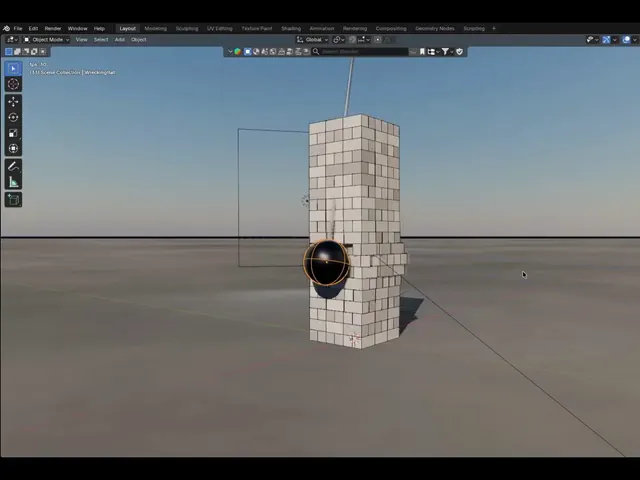</a>

**Claude Fable 5.1** · Анимация · автор [Abyssal](https://x.com/abyssallD) · 2026-09-02

Через Blender MCP Claude Fable 5.1 собрал башню из кирпичей, шар на тросе, землю и камеру; симуляция разбивает стену на отдельные кирпичи.

<details>
<summary>Бриф от Wandy3D</summary>

```text
Build a Blender rigid-body physics test driven through a Blender MCP connection. Create a tall tower made of many separate bricks laid in staggered courses, a heavy dark sphere hanging from a thin cable that swings like a pendulum, a flat ground plane and a camera framing the whole action. Make the bricks active rigid bodies and the ball a driven or pendulum body so it swings into the tower and the wall breaks apart into individual bricks that settle into a pile. Use neutral grey bricks, a plain ground and a soft sky backdrop for a clean render. Keep it a single focused physics check with no cinematic grading. Deliver a saved .blend file where the collapsed pile remains as real objects. Done when playing the timeline shows the swing, the impact and the bricks coming to rest.
```

</details>

[Открыть на Wandy3D ↗](https://wandy3d.com/ru/prompts/wrecking-ball-brick-tower-collapse-as-a-blender-physics-test-2095177102400081940?utm_source=github&utm_medium=referral&utm_campaign=awesome_3d_prompts) · [Исходный пост](https://x.com/abyssallD/status/2095177102400081940)

---

### [Тяжёлый перехватчик в форме орла на Three.js: рендеры 3-го ранга](https://wandy3d.com/ru/prompts/armoured-eagle-interceptor-ship-built-in-three-js-rank-3-2095176360238915978?utm_source=github&utm_medium=referral&utm_campaign=awesome_3d_prompts)

<a href="https://wandy3d.com/ru/prompts/armoured-eagle-interceptor-ship-built-in-three-js-rank-3-2095176360238915978?utm_source=github&amp;utm_medium=referral&amp;utm_campaign=awesome_3d_prompts">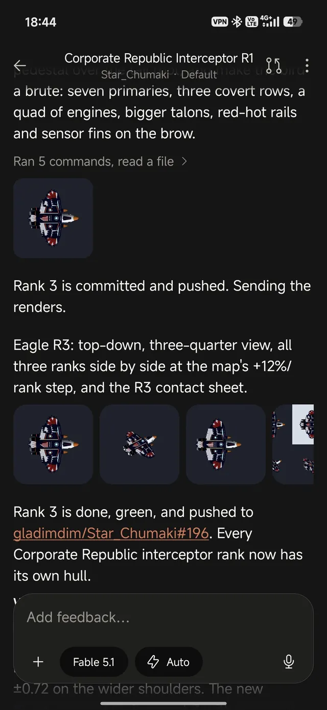</a>

**Claude Fable 5.1** · Ассеты · автор [Dmytro Gladkyi 🔳](https://x.com/gladimdim) · 2026-09-02

Claude Fable 5.1 сделал в Three.js тяжёлый корабль-орёл и лист проекций сверху в разных ракурсах и масштабах.

<details>
<summary>Бриф от Wandy3D</summary>

```text
Build a stylised top-down sci-fi interceptor ship as a Three.js model for a space game. Design a heavy winged craft shaped like an armoured eagle, with a dark navy hull, red-hot rails and talons, white and orange engine glow, a row of primary weapons, covert launcher rows, a quad of engines and sensor fins on the brow. Make it a rank-three variant of a ship family, bulkier than lower ranks, scaled about twelve percent larger per rank. Render it from a top-down three-quarter view and produce a contact sheet showing the ship from several angles and sizes on dark and light backgrounds. Deliver Three.js code that builds the ship from primitives plus a script that exports the renders. Done when the silhouette reads clearly at small size and the three ranks look like one family.
```

</details>

[Открыть на Wandy3D ↗](https://wandy3d.com/ru/prompts/armoured-eagle-interceptor-ship-built-in-three-js-rank-3-2095176360238915978?utm_source=github&utm_medium=referral&utm_campaign=awesome_3d_prompts) · [Исходный пост](https://x.com/gladimdim/status/2095176360238915978)

---

### [3D-мир в стиле Frutiger Aero: пузыри, стекло и зелёные холмы](https://wandy3d.com/ru/prompts/explorable-frutiger-aero-3d-world-with-bubbles-glass-and-2095171470607728926?utm_source=github&utm_medium=referral&utm_campaign=awesome_3d_prompts)

<a href="https://wandy3d.com/ru/prompts/explorable-frutiger-aero-3d-world-with-bubbles-glass-and-2095171470607728926?utm_source=github&amp;utm_medium=referral&amp;utm_campaign=awesome_3d_prompts">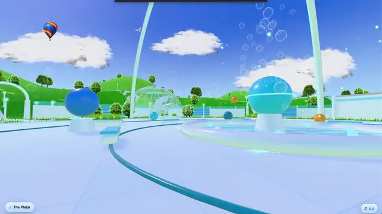</a>

**Claude Fable 5.1** · Сцены · автор [Oliver Benns](https://x.com/oliverbenns) · 2026-09-02

Двух запросов к Claude Fable 5.1 хватило на браузерный 3D-мир в духе Frutiger Aero 2000-х: глянцевая площадь, фонтаны, стеклянные купола и пузыри.

<details>
<summary>Бриф от Wandy3D</summary>

```text
Build an explorable 3D world in the Frutiger Aero style of the early 2000s, running in the browser with WebGL. Place the viewer in a clean plaza with glossy white curved paths edged in teal, round pools with mushroom-shaped fountains, glass domes and glass-walled buildings. Surround it with rolling bright green hills dotted with round trees, tall grass blades, floating soap bubbles, soft clouds, distant hot air balloons and birds under a vivid blue sky with a lens-flare sun. Use a saturated sky blue, aqua, lime and white palette with soft reflections. Add a small location label in the corner. Let the user walk or glide through the scene with mouse or touch controls. Deliver a deployable web page. Done when the world feels airy, optimistic and nostalgic from every viewpoint.
```

</details>

[Открыть на Wandy3D ↗](https://wandy3d.com/ru/prompts/explorable-frutiger-aero-3d-world-with-bubbles-glass-and-2095171470607728926?utm_source=github&utm_medium=referral&utm_campaign=awesome_3d_prompts) · [Исходный пост](https://x.com/oliverbenns/status/2095171470607728926)

---

### [Киносайт из десяти сцен: ренессанс и журнальная вёрстка на GSAP](https://wandy3d.com/ru/prompts/ten-scene-renaissance-meets-editorial-film-site-with-gsap-2095167881004908897?utm_source=github&utm_medium=referral&utm_campaign=awesome_3d_prompts)

<a href="https://wandy3d.com/ru/prompts/ten-scene-renaissance-meets-editorial-film-site-with-gsap-2095167881004908897?utm_source=github&amp;utm_medium=referral&amp;utm_campaign=awesome_3d_prompts">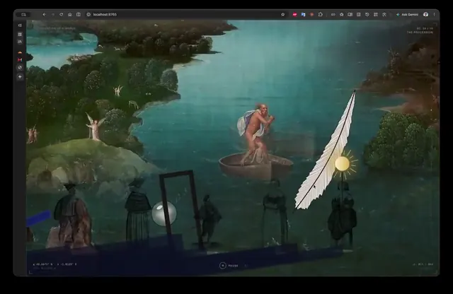</a>

**Claude Fable 5.1** · Анимация · автор [Henry Fan](https://x.com/Henry_Fan_lh) · 2026-09-02

Claude Fable 5.1 собрал браузерный фильм на HTML, CSS и JS, заменил рисованную графику гравюрами из общественного достояния; автоплей длится 82 секунды.

<details>
<summary>Бриф от Wandy3D</summary>

```text
Build a ten-scene cinematic website that runs in the browser with plain HTML, CSS and JavaScript, GSAP for motion and a WebGL grain overlay. The theme is the invention of a world, blending Renaissance painting with editorial layout: warm cream paper pages, serif display titles with italic accents, thin grid lines, small captions and a fixed frame with scene counter. Use no baked video. Start with scenes drawn in code, then replace procedural art with public-domain engravings and paintings from museum archives. Include scene titles such as an archive, an eye, a sky tower and a hand, a dark blue sphere motif and falling blue ribbons. Add a play button that autoplays the whole film as a camera-like director, about eighty seconds long. Keep per-frame work light, moving heavy image filters off the frame loop. Done when pressing play walks through all ten scenes smoothly.
```

</details>

[Открыть на Wandy3D ↗](https://wandy3d.com/ru/prompts/ten-scene-renaissance-meets-editorial-film-site-with-gsap-2095167881004908897?utm_source=github&utm_medium=referral&utm_campaign=awesome_3d_prompts) · [Исходный пост](https://x.com/Henry_Fan_lh/status/2095167881004908897)

---

### [Лоу-поли остров с козой, по которому можно бегать и прыгать, на Three.js](https://wandy3d.com/ru/prompts/low-poly-pet-goat-island-you-can-walk-and-jump-around-in-2095165578042335442?utm_source=github&utm_medium=referral&utm_campaign=awesome_3d_prompts)

<a href="https://wandy3d.com/ru/prompts/low-poly-pet-goat-island-you-can-walk-and-jump-around-in-2095165578042335442?utm_source=github&amp;utm_medium=referral&amp;utm_campaign=awesome_3d_prompts">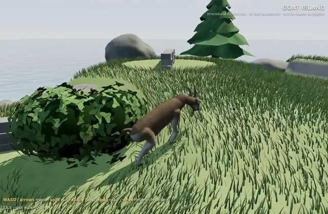</a>

**Claude Fable 5.1** · Интерактив · автор [Alix Ollivier](https://x.com/aollivier82) · 2026-09-02

Fable 5.1 сделал крошечный остров на Three.js с управляемой козой: она ходит, прыгает и залезает на камни, бревно и стену. Интересна анимация движения.

<details>
<summary>Бриф от Wandy3D</summary>

```text
Build a small interactive 3D island toy in a single self-contained HTML file using Three.js. The island is low-poly: a grassy hill with swaying grass blades, stylized pine trees, bushes, boulders, a fallen log, a low stone wall and a sandy shore surrounded by calm water under a pale sky. Place a controllable pet goat on the island. The goat walks with WASD, can sprint with Shift, jumps with Space, and climbs or hops up onto rocks, walls and other obstacles instead of clipping through them, with simple leg animation. Add an orbiting third-person camera that follows the goat, with drag to orbit and mouse wheel to zoom, and a small on-screen hint line listing the controls. Use soft daylight, gentle shadows and a muted green, grey and blue palette. Done means the goat moves smoothly around the whole island, reacts to terrain height and obstacles, and the scene runs at a steady frame rate in a desktop browser.
```

</details>

[Открыть на Wandy3D ↗](https://wandy3d.com/ru/prompts/low-poly-pet-goat-island-you-can-walk-and-jump-around-in-2095165578042335442?utm_source=github&utm_medium=referral&utm_campaign=awesome_3d_prompts) · [Исходный пост](https://x.com/aollivier82/status/2095165578042335442)

---

### [Интерактивная 3D-модель Солнечной системы с орбитами и камерой наведения](https://wandy3d.com/ru/prompts/interactive-3d-solar-system-with-orbiting-planets-and-a-2095165395841999222?utm_source=github&utm_medium=referral&utm_campaign=awesome_3d_prompts)

<a href="https://wandy3d.com/ru/prompts/interactive-3d-solar-system-with-orbiting-planets-and-a-2095165395841999222?utm_source=github&amp;utm_medium=referral&amp;utm_campaign=awesome_3d_prompts">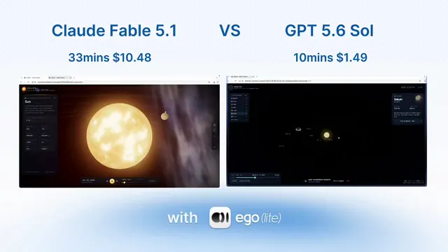</a>

**Claude Fable 5.1** · Интерактив · автор [ego](https://x.com/ego_agent) · 2026-09-02

Сравнение: Claude Fable 5.1 и GPT 5.6 Sol по одной задаче собрали 3D-Солнечную систему. Версия Fable детальнее, но дольше и дороже.

<details>
<summary>Бриф от Wandy3D</summary>

```text
Build an interactive 3D solar system explorer that runs in the browser. Show a bright glowing sun at the centre of a dark starfield, with the planets orbiting it on visible orbit lines at different speeds. Each planet should have a detailed textured surface, and the camera should be able to fly in close to the sun or to any planet, such as the reddish Mars, and zoom back out to the full system view. Add a side panel listing the bodies, so selecting one focuses the camera on it and shows basic facts, plus controls to pause or speed up time. Keep the interface dark and minimal, with clean light typography. Use WebGL, preferably Three.js, and deliver everything as a self-contained web page. Done means the whole system animates smoothly, planets can be selected from the list, the camera transitions are fluid, and the sun glow and planet textures look convincing in close-up.
```

</details>

[Открыть на Wandy3D ↗](https://wandy3d.com/ru/prompts/interactive-3d-solar-system-with-orbiting-planets-and-a-2095165395841999222?utm_source=github&utm_medium=referral&utm_campaign=awesome_3d_prompts) · [Исходный пост](https://x.com/ego_agent/status/2095165395841999222)

---

### [Городской перекрёсток в Blender по панораме, собранный через MCP](https://wandy3d.com/ru/prompts/blender-city-street-modeled-from-an-equirectangular-panorama-2095159781883597031?utm_source=github&utm_medium=referral&utm_campaign=awesome_3d_prompts)

<a href="https://wandy3d.com/ru/prompts/blender-city-street-modeled-from-an-equirectangular-panorama-2095159781883597031?utm_source=github&amp;utm_medium=referral&amp;utm_campaign=awesome_3d_prompts">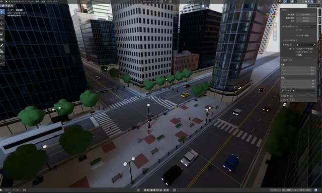</a>

**Claude Fable 5.1** · Сцены · автор [ハヤシモン｜AI × 個人開発](https://x.com/hayashimon1) · 2026-09-02

Claude Fable 5.1 через Blender MCP за один проход воссоздал плотный городской перекрёсток по панораме: башни, дороги, деревья и машины.

<details>
<summary>Бриф от Wandy3D</summary>

```text
Build a 3D city street scene in Blender, driven through a Blender MCP connection, using an equirectangular panorama photo of a downtown intersection as the reference. Study the panorama and reconstruct what it shows: glass and concrete skyscrapers of varied heights around a crossroads, asphalt roads with lane markings and crosswalks, sidewalks with brick-pattern paving, street lamps, traffic lights, benches, round-canopy trees and a few cars and a bus. Model everything with simple but information-rich geometry and basic materials, place it so that the view from the intersection matches the panorama, and group objects in tidy collections. Keep the lighting natural with a soft overcast sky. Done means the viewport shows a dense, believable city block with correct proportions, clear road layout and many small props, produced in a single run, ready for further refinement and rendering.
```

</details>

[Открыть на Wandy3D ↗](https://wandy3d.com/ru/prompts/blender-city-street-modeled-from-an-equirectangular-panorama-2095159781883597031?utm_source=github&utm_medium=referral&utm_campaign=awesome_3d_prompts) · [Исходный пост](https://x.com/hayashimon1/status/2095159781883597031)

---

### [Логово дракона с грудой золота: черновая сцена в Blender](https://wandy3d.com/ru/prompts/work-in-progress-dragon-lair-with-a-gold-hoard-built-in-2095149546187653547?utm_source=github&utm_medium=referral&utm_campaign=awesome_3d_prompts)

<a href="https://wandy3d.com/ru/prompts/work-in-progress-dragon-lair-with-a-gold-hoard-built-in-2095149546187653547?utm_source=github&amp;utm_medium=referral&amp;utm_campaign=awesome_3d_prompts">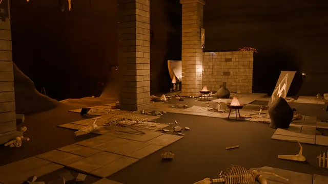</a>

**Claude Fable 5.1** · Сцены · автор [Majid Manzarpour](https://x.com/majidmanzarpour) · 2026-09-02

Claude Fable 5.1 вместе с Blender собрал каменное логово дракона при свете жаровен: кости на полу и гора монет на переднем плане.

<details>
<summary>Бриф от Wandy3D</summary>

```text
Build a moody 3D dragon lair environment in Blender, scripted with Python so it can be rerun. The set is a large underground hall of weathered stone brick walls, square columns, stairs and rough cave rock overhead. Scatter props across the floor: skeleton bones, broken slabs, clay urns and iron braziers with live flames. In one corner heap a huge hoard of thousands of individual gold coins with a chalice, a sword and other treasure on top. Light the scene almost entirely with warm amber firelight and small glows, leaving deep shadows in the corners and a hint of a bright opening in the distance. Use physically based materials, soft depth of field and a slight film grain. Provide several camera angles: a wide hall view, a stair view looking down into the hall, and a close macro shot of the coins. Deliver the .py script plus rendered stills. Done means the hall reads clearly as a dragon's treasure room and the coin pile catches highlights.
```

</details>

[Открыть на Wandy3D ↗](https://wandy3d.com/ru/prompts/work-in-progress-dragon-lair-with-a-gold-hoard-built-in-2095149546187653547?utm_source=github&utm_medium=referral&utm_campaign=awesome_3d_prompts) · [Исходный пост](https://x.com/majidmanzarpour/status/2095149546187653547)

---

### [Многопользовательский мир парусных кораблей на Three.js](https://wandy3d.com/ru/prompts/multiplayer-pirate-ship-sailing-world-in-three-js-2095137561283010600?utm_source=github&utm_medium=referral&utm_campaign=awesome_3d_prompts)

<a href="https://wandy3d.com/ru/prompts/multiplayer-pirate-ship-sailing-world-in-three-js-2095137561283010600?utm_source=github&amp;utm_medium=referral&amp;utm_campaign=awesome_3d_prompts">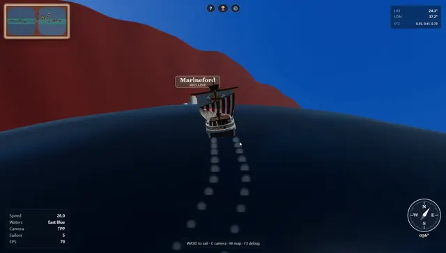</a>

**Claude Fable 5.1** · Игры · автор [Aman](https://x.com/aman_kambojj) · 2026-09-02

Claude Fable 5.1 собрал общий low-poly океан на Three.js: игроки ведут корабли мимо островов и регионов, есть компас и HUD.

<details>
<summary>Бриф от Wandy3D</summary>

```text
Build a multiplayer sailing game as a Three.js web app. The player steers a wooden pirate ship with striped sails across a large low-poly ocean with rolling dark-blue waves, foam trails behind the hull and a bright sky with chunky white floating rocks. Scatter islands, named regions and other players' ships, each with a floating name label. Use a chase camera that can also swing close to the deck, a compass in a corner, and a small HUD showing speed, region, camera mode and crew count. Change the sky and water tint by region, including a dark starry area. Add a server using WebSockets so several players see each other's ships move in real time. Keep the art simple: flat-shaded geometry, soft fog and a limited palette. Done when two browser tabs can sail the same sea, the ship rides the waves, and the HUD and compass update as you travel.
```

</details>

[Открыть на Wandy3D ↗](https://wandy3d.com/ru/prompts/multiplayer-pirate-ship-sailing-world-in-three-js-2095137561283010600?utm_source=github&utm_medium=referral&utm_campaign=awesome_3d_prompts) · [Исходный пост](https://x.com/aman_kambojj/status/2095137561283010600)

---

### [Современная стеклянная вилла с бассейном: фотореалистичный рендер в Blender](https://wandy3d.com/ru/prompts/modern-glass-villa-with-pool-rendered-photorealistically-in-2095132939667255657?utm_source=github&utm_medium=referral&utm_campaign=awesome_3d_prompts)

<a href="https://wandy3d.com/ru/prompts/modern-glass-villa-with-pool-rendered-photorealistically-in-2095132939667255657?utm_source=github&amp;utm_medium=referral&amp;utm_campaign=awesome_3d_prompts">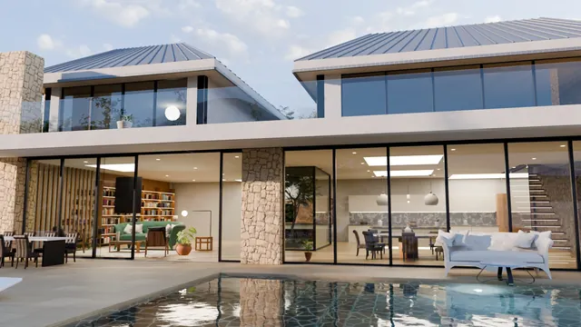</a>

**Claude Fable 5.1** · Сцены · автор [Ben](https://x.com/alafrayme) · 2026-09-02

Claude Fable 5.1 вместе с Blender создал аккуратный рендер виллы: каменные колонны, стеклянные стены, обставленный интерьер и бассейн.

<details>
<summary>Бриф от Wandy3D</summary>

```text
Build a photorealistic architectural visualization in Blender, scripted with Python. Model a modern two-storey villa with a white concrete slab between floors, two pitched standing-seam metal roofs, floor-to-ceiling glass sliding doors and tall stone-clad pillars. Furnish the open interior: a dining table with chairs, a green sofa, a bookcase wall, a kitchen with pendant lamps, a staircase, a plant and a white lounge sofa. Add a terrace and a swimming pool in the foreground with rippled water reflecting the facade. Light with a soft daytime sky, warm interior lamps and ceiling panels. Frame a wide, straight-on camera at eye level from the pool edge, and render with Cycles at a sharp resolution. Done when the script produces the house, furniture, pool and a clean still render, and every element can be tweaked by changing named parameters.
```

</details>

[Открыть на Wandy3D ↗](https://wandy3d.com/ru/prompts/modern-glass-villa-with-pool-rendered-photorealistically-in-2095132939667255657?utm_source=github&utm_medium=referral&utm_campaign=awesome_3d_prompts) · [Исходный пост](https://x.com/alafrayme/status/2095132939667255657)

---

### [Интерактивная 3D-модель: как растёт, прорастает и распространяется опухоль](https://wandy3d.com/ru/prompts/interactive-3d-explainer-of-how-a-tumour-grows-invades-and-2095130778342408331?utm_source=github&utm_medium=referral&utm_campaign=awesome_3d_prompts)

<a href="https://wandy3d.com/ru/prompts/interactive-3d-explainer-of-how-a-tumour-grows-invades-and-2095130778342408331?utm_source=github&amp;utm_medium=referral&amp;utm_campaign=awesome_3d_prompts">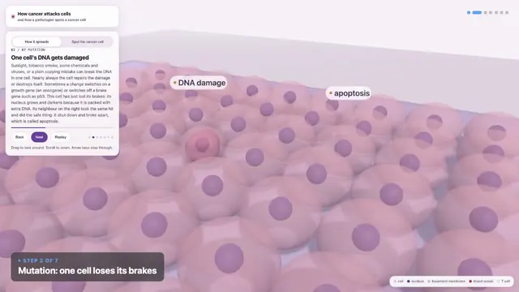</a>

**Claude Fable 5.1** · Интерактив · автор [Not Harris \| Builds Apps](https://x.com/viewsfrom02108) · 2026-09-02

Claude Fable 5.1 собрал пошаговую 3D-симуляцию: от одной мутировавшей клетки до ангиогенеза и инвазии, с подписями и метками.

<details>
<summary>Бриф от Wandy3D</summary>

```text
Build an interactive 3D educational simulation that explains how cancer develops and spreads, as a self-contained web app. Show a layer of soft pink cells sitting on a translucent basement membrane above a blood vessel with red blood cells. Guide the viewer through numbered steps: healthy tissue, one cell with DNA damage that escapes cell death, uncontrolled division into a tumour, a necrotic core releasing VEGF signals, new blood vessels growing toward it, invasion through the membrane, and spread to other places. Each step has a short caption at the bottom, a text panel in a corner with a plain explanation, floating labels on key structures, and a progress indicator. Add play, pause, replay and step controls, plus orbit camera control. Use a calm pastel palette with deeper reds and purples for diseased cells. Done when all steps play in order with smooth camera moves and readable text.
```

</details>

[Открыть на Wandy3D ↗](https://wandy3d.com/ru/prompts/interactive-3d-explainer-of-how-a-tumour-grows-invades-and-2095130778342408331?utm_source=github&utm_medium=referral&utm_campaign=awesome_3d_prompts) · [Исходный пост](https://x.com/viewsfrom02108/status/2095130778342408331)

---

### [Улучшение VFX распада метеороида в космической игре на Three.js](https://wandy3d.com/ru/prompts/meteoroid-break-up-vfx-upgrade-for-a-three-js-space-game-2095127248470692320?utm_source=github&utm_medium=referral&utm_campaign=awesome_3d_prompts)

<a href="https://wandy3d.com/ru/prompts/meteoroid-break-up-vfx-upgrade-for-a-three-js-space-game-2095127248470692320?utm_source=github&amp;utm_medium=referral&amp;utm_campaign=awesome_3d_prompts">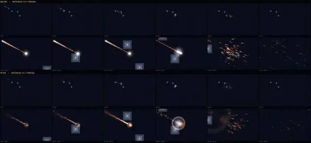</a>

**Claude Fable 5.1** · Анимация · автор [Dmytro Gladkyi 🔳](https://x.com/gladimdim) · 2026-09-02

Claude Fable 5.1 получил одну короткую просьбу улучшить распад метеороида и выдал насыщенный шлейф, ударную волну, осколки и оптимизацию.

<details>
<summary>Промпт</summary>

```text
check the existing meteoroid break up vfx, enhance it
```

</details>

[Открыть на Wandy3D ↗](https://wandy3d.com/ru/prompts/meteoroid-break-up-vfx-upgrade-for-a-three-js-space-game-2095127248470692320?utm_source=github&utm_medium=referral&utm_campaign=awesome_3d_prompts) · [Исходный пост](https://x.com/gladimdim/status/2095127248470692320)

---

### [Процедурный десантный корабль с двумя LOD на Three.js](https://wandy3d.com/ru/prompts/procedural-assault-pod-spaceship-with-two-lods-in-three-js-2095126622319845478?utm_source=github&utm_medium=referral&utm_campaign=awesome_3d_prompts)

<a href="https://wandy3d.com/ru/prompts/procedural-assault-pod-spaceship-with-two-lods-in-three-js-2095126622319845478?utm_source=github&amp;utm_medium=referral&amp;utm_campaign=awesome_3d_prompts">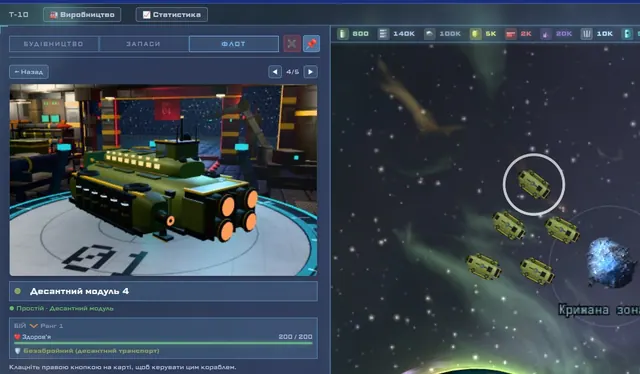</a>

**Claude Fable 5.1** · Ассеты · автор [Dmytro Gladkyi 🔳](https://x.com/gladimdim) · 2026-09-02

Claude Fable 5.1 по одному промпту перерисовал десантный корабль для игры: детальная и low-poly версии в коде, в рамках лимита треугольников.

<details>
<summary>Промпт</summary>

```text
redesign from scratch the 3D models (high and low fidelity) for the assault pod. they look ugly atm. It must be an ship carying thousands of infantry and tanks to drop onto space stations, planets, etc. I give you 20000  tris budget for high fidelity and 4000 for low LOD
```

</details>

[Открыть на Wandy3D ↗](https://wandy3d.com/ru/prompts/procedural-assault-pod-spaceship-with-two-lods-in-three-js-2095126622319845478?utm_source=github&utm_medium=referral&utm_campaign=awesome_3d_prompts) · [Исходный пост](https://x.com/gladimdim/status/2095126622319845478)

---

### [Интерактивный 3D-стадион для продажи билетов с видом с места](https://wandy3d.com/ru/prompts/interactive-3d-football-stadium-ticketing-site-with-seat-2095123216419459454?utm_source=github&utm_medium=referral&utm_campaign=awesome_3d_prompts)

<a href="https://wandy3d.com/ru/prompts/interactive-3d-football-stadium-ticketing-site-with-seat-2095123216419459454?utm_source=github&amp;utm_medium=referral&amp;utm_campaign=awesome_3d_prompts">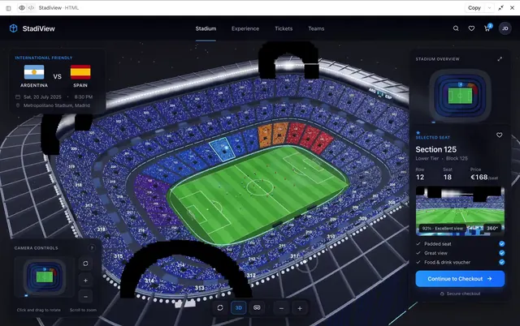</a>

**Claude Fable 5.1** · Сцены · автор [The Bugged Dev](https://x.com/thebuggeddev) · 2026-09-02

Claude Fable 5.1 заново собрал сайт со стадионом: 3D-чаша с выбором секторов и видом с места. Автор счёл итог слабее прошлой версии.

<details>
<summary>Бриф от Wandy3D</summary>

```text
Build a single-page ticketing website around an interactive 3D football stadium. Use a dark navy interface with blue accents: a top navigation bar, a match header with two team flags, and a side panel that shows the selected section, seat and price with a checkout button. In the main view render a full stadium bowl with a green pitch, tiers of colour-coded seating sections, floodlights and a roof ring. Let visitors orbit and zoom the camera, click a section to highlight it, and switch to a first-person seat view that shows the pitch and crowd from that seat. Add camera controls and view toggles at the bottom. Use Three.js with procedurally generated geometry. Done means the stadium is smooth to navigate, sections are selectable, the seat view works, and the side panel updates with each choice.
```

</details>

[Открыть на Wandy3D ↗](https://wandy3d.com/ru/prompts/interactive-3d-football-stadium-ticketing-site-with-seat-2095123216419459454?utm_source=github&utm_medium=referral&utm_campaign=awesome_3d_prompts) · [Исходный пост](https://x.com/thebuggeddev/status/2095123216419459454)

---

### [Голографический дино-декс с живыми 3D-динозаврами и GLSL-шейдером](https://wandy3d.com/ru/prompts/holographic-dino-dex-with-live-3d-dinosaurs-and-a-glsl-2095121568297083067?utm_source=github&utm_medium=referral&utm_campaign=awesome_3d_prompts)

<a href="https://wandy3d.com/ru/prompts/holographic-dino-dex-with-live-3d-dinosaurs-and-a-glsl-2095121568297083067?utm_source=github&amp;utm_medium=referral&amp;utm_campaign=awesome_3d_prompts">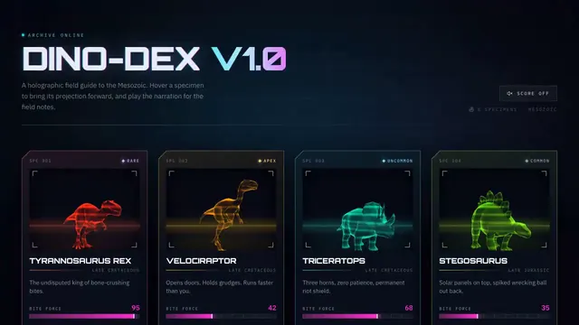</a>

**Claude Fable 5.1** · Интерактив · автор [Benji Viz](https://x.com/_Benviz) · 2026-09-02

Claude Fable 5.1 собрал неоновый дино-декс: восемь динозавров рендерятся в WebGL в реальном времени с собственным френелевским шейдером без света.

<details>
<summary>Бриф от Wandy3D</summary>

```text
Build a single web page called a dino-dex: a holographic field guide to dinosaurs. Use a dark background with neon gradient title text and a responsive grid of cards. Each card has a live 3D dinosaur rendered in the browser, tinted in its own neon colour such as red, orange, cyan, green, blue, pink and violet, shaded with a custom GLSL fresnel rim effect and scan lines instead of a lighting rig. Under each model show the species name, a one-line description and glowing stat bars like bite force, speed and armour. Use one small WebGL canvas per card, around eight in total, and slowly rotate each dinosaur. Add hover highlights and smooth scrolling. Done means all eight species render in the browser at once, look clearly holographic, and the page stays responsive.
```

</details>

[Открыть на Wandy3D ↗](https://wandy3d.com/ru/prompts/holographic-dino-dex-with-live-3d-dinosaurs-and-a-glsl-2095121568297083067?utm_source=github&utm_medium=referral&utm_campaign=awesome_3d_prompts) · [Исходный пост](https://x.com/_Benviz/status/2095121568297083067)

---

### [Живой воксельный шторм в стеклянной бутылке на Three.js](https://wandy3d.com/ru/prompts/living-voxel-ocean-storm-inside-a-glass-bottle-in-three-js-2095111213927510131?utm_source=github&utm_medium=referral&utm_campaign=awesome_3d_prompts)

<a href="https://wandy3d.com/ru/prompts/living-voxel-ocean-storm-inside-a-glass-bottle-in-three-js-2095111213927510131?utm_source=github&amp;utm_medium=referral&amp;utm_campaign=awesome_3d_prompts">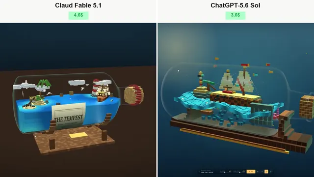</a>

**Claude Fable 5.1** · Сцены · автор [Vib3Coded](https://x.com/vib3coded) · 2026-09-02

В сравнении двух моделей на одном задании Claude Fable 5.1 собрал воксельное море в бутылке: корабль, маяк, дождь, молнии и морской змей.

<details>
<summary>Бриф от Wandy3D</summary>

```text
Build a living, interactive voxel diorama inside a glass bottle lying on a wooden dock, as one self-contained Three.js page. Fill the bottle with about 1,700 animated voxel columns forming a rolling blue ocean, a wooden sailing ship, a striped lighthouse, a small palm island, an old shipwreck, seagulls and jumping fish. Add a storm cycle: dark sky, falling rain, lightning flashes and a giant sea serpent rising from the waves. Include a paper label on the dock reading the name of the scene. Keep every element clipped inside the glass so nothing pokes through. Let the user orbit the camera with the mouse. Use warm wood tones against deep teal water and a glass material with subtle reflections. Done means the scene runs smoothly, the weather changes, and no geometry leaves the bottle.
```

</details>

[Открыть на Wandy3D ↗](https://wandy3d.com/ru/prompts/living-voxel-ocean-storm-inside-a-glass-bottle-in-three-js-2095111213927510131?utm_source=github&utm_medium=referral&utm_campaign=awesome_3d_prompts) · [Исходный пост](https://x.com/vib3coded/status/2095111213927510131)

---

### [3D-анимация клавиатуры: клавиши с логотипами и пролёт камеры](https://wandy3d.com/ru/prompts/3d-keyboard-animation-with-popping-logo-keycaps-and-camera-2095111032171876470?utm_source=github&utm_medium=referral&utm_campaign=awesome_3d_prompts)

<a href="https://wandy3d.com/ru/prompts/3d-keyboard-animation-with-popping-logo-keycaps-and-camera-2095111032171876470?utm_source=github&amp;utm_medium=referral&amp;utm_campaign=awesome_3d_prompts">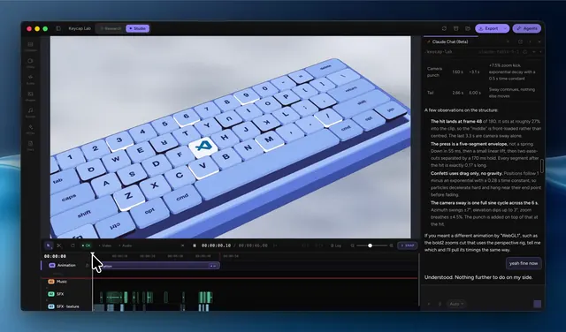</a>

**Claude Fable 5.1** · Анимация · автор [rege](https://x.com/rege_dev) · 2026-09-02

Claude Fable 5.1 собрал редактируемую 3D-анимацию синей клавиатуры: клавиши с логотипами выскакивают по очереди, камера летит над рядами, летит конфетти.

<details>
<summary>Бриф от Wandy3D</summary>

```text
Build an animated 3D short of a chunky pastel-blue mechanical keyboard on a soft grey backdrop. Keycaps are rounded and white, with a few dark ones carrying simple app-style logos. The keys pop up one after another with a springy motion while the camera glides low across the rows, swoops in close on single keys, and finally pulls back to reveal keycaps spelling a short title. Add small confetti bursts when keys land and gentle depth of field. Structure the scene so every key, camera move and effect sits on an editable timeline with clear parameters, so an AI agent or a person can retime or restyle it later. Deliver a single project that plays in the browser, about 30 seconds long, with play and scrub controls. Done means the camera path is smooth, the key animation is readable, and the final title is legible.
```

</details>

[Открыть на Wandy3D ↗](https://wandy3d.com/ru/prompts/3d-keyboard-animation-with-popping-logo-keycaps-and-camera-2095111032171876470?utm_source=github&utm_medium=referral&utm_campaign=awesome_3d_prompts) · [Исходный пост](https://x.com/rege_dev/status/2095111032171876470)

---

### [Конфигуратор мехов в стиле Gundam на Three.js со сменными деталями](https://wandy3d.com/ru/prompts/gundam-inspired-mecha-configurator-with-swappable-parts-in-2095106919530930221?utm_source=github&utm_medium=referral&utm_campaign=awesome_3d_prompts)

<a href="https://wandy3d.com/ru/prompts/gundam-inspired-mecha-configurator-with-swappable-parts-in-2095106919530930221?utm_source=github&amp;utm_medium=referral&amp;utm_campaign=awesome_3d_prompts">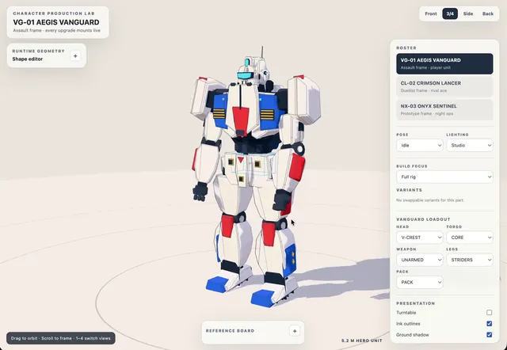</a>

**Claude Fable 5.1** · Интерактив · автор [Crayon](https://x.com/usecrayon) · 2026-09-02

Claude Fable 5.1 собрал на Three.js просмотрщик бело-сине-красного меха: выбор юнитов, смена головы и оружия, вращение камеры.

<details>
<summary>Бриф от Wandy3D</summary>

```text
Build an interactive 3D mecha configurator as a single web page using Three.js. Show a blocky, hard-surface robot in white with blue and red accents, standing on a pale warm-beige floor with a soft shadow. Add a clean light side panel with a roster of three mech units, dropdowns for head crest, weapon and back pack, a presentation section with turntable, hard outlines and ground shadow toggles, and front, three-quarter, side and back camera buttons. Changing a dropdown should instantly swap the matching part on the model, such as a beam rifle or a heavy cannon. Support drag to orbit and scroll to zoom. Include a small readout with part and colour counts. Done means switching units and parts works smoothly and the mech reads clearly from every angle.
```

</details>

[Открыть на Wandy3D ↗](https://wandy3d.com/ru/prompts/gundam-inspired-mecha-configurator-with-swappable-parts-in-2095106919530930221?utm_source=github&utm_medium=referral&utm_campaign=awesome_3d_prompts) · [Исходный пост](https://x.com/usecrayon/status/2095106919530930221)

---

### [Интерактивный просмотрщик истребителя F-35A с форсажем и HUD-панелями](https://wandy3d.com/ru/prompts/interactive-f-35a-fighter-jet-viewer-with-afterburner-and-2095094543339446572?utm_source=github&utm_medium=referral&utm_campaign=awesome_3d_prompts)

<a href="https://wandy3d.com/ru/prompts/interactive-f-35a-fighter-jet-viewer-with-afterburner-and-2095094543339446572?utm_source=github&amp;utm_medium=referral&amp;utm_campaign=awesome_3d_prompts">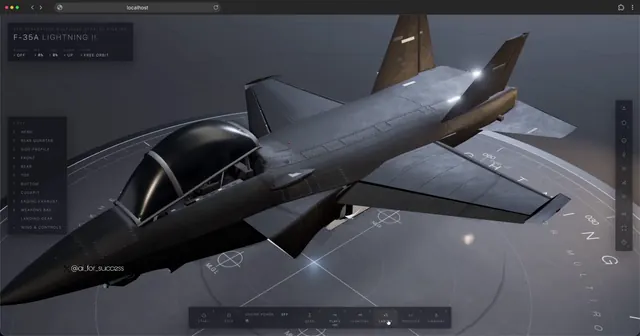</a>

**Claude Fable 5.1** · Интерактив · автор [Edgex](https://x.com/SahilExec) · 2026-09-02

Fable 5.1 за один запуск написал F-35A целиком кодом: тёмный самолёт на полу-компасе, вращение камеры и светящийся форсаж.

<details>
<summary>Бриф от Wandy3D</summary>

```text
Build an interactive 3D viewer for a detailed F-35A fighter jet, generated entirely in code with no external model files. Model the stealth airframe in dark matte grey with canopy, twin tails, intake and exhaust nozzle. Place it on a dark studio floor with a circular compass dial etched into the ground and a soft spotlight. Add a slim HUD-style interface with a left list of controls and a bottom toolbar. Support orbit, zoom to fine details, and a showcase camera that circles the jet. Include toggles for engine afterburner glow, landing gear and lighting. Done means the aircraft looks convincing from every angle, the controls respond smoothly and the afterburner flame appears when switched on. Deliver it as a single web page.
```

</details>

[Открыть на Wandy3D ↗](https://wandy3d.com/ru/prompts/interactive-f-35a-fighter-jet-viewer-with-afterburner-and-2095094543339446572?utm_source=github&utm_medium=referral&utm_campaign=awesome_3d_prompts) · [Исходный пост](https://x.com/SahilExec/status/2095094543339446572)

---

### [Блочный зелёный мех Zaku II на Three.js на белой мобильной странице](https://wandy3d.com/ru/prompts/blocky-green-zaku-ii-mech-in-three-js-on-a-clean-white-2095085944391270759?utm_source=github&utm_medium=referral&utm_campaign=awesome_3d_prompts)

<a href="https://wandy3d.com/ru/prompts/blocky-green-zaku-ii-mech-in-three-js-on-a-clean-white-2095085944391270759?utm_source=github&amp;utm_medium=referral&amp;utm_campaign=awesome_3d_prompts">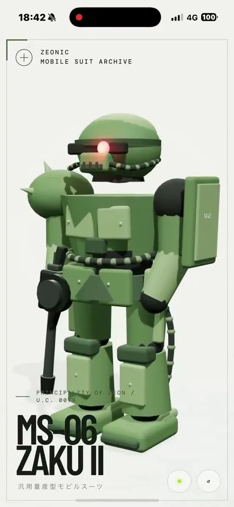</a>

**Claude Fable 5.1** · Ассеты · автор [Hakuei](https://x.com/akiba_tokyo_jp) · 2026-09-02

В Fable 5.1 Max автор собрал на Three.js зелёный Zaku II: светящийся красный глаз, шипастое плечо и обзор вращением на белом фоне.

<details>
<summary>Бриф от Wandy3D</summary>

```text
Build a mobile-first 3D showcase of a green blocky mobile-suit style mech inspired by a classic anime robot, using Three.js. Construct the model from simple rounded primitives: a domed head with a glowing red mono-eye and a visor slit, a spiked shoulder pauldron, a shield panel on the other arm, ribbed hose details, dark joints and a hand-held machine gun. Use a clean off-white background so the robot stands out, with soft shadows beneath it. Add a large bold title at the bottom with a small Japanese subtitle, small monospace labels in the corners, and two round buttons. The camera slowly orbits and tilts through front, side, back and top-down views, and the user can drag to rotate. Done means the silhouette and the eye read clearly on a phone screen.
```

</details>

[Открыть на Wandy3D ↗](https://wandy3d.com/ru/prompts/blocky-green-zaku-ii-mech-in-three-js-on-a-clean-white-2095085944391270759?utm_source=github&utm_medium=referral&utm_campaign=awesome_3d_prompts) · [Исходный пост](https://x.com/akiba_tokyo_jp/status/2095085944391270759)

---

### [Симуляция живой вселенной в одном HTML-файле на WebGL](https://wandy3d.com/ru/prompts/living-universe-simulation-in-a-single-webgl-html-file-2095054116372508955?utm_source=github&utm_medium=referral&utm_campaign=awesome_3d_prompts)

<a href="https://wandy3d.com/ru/prompts/living-universe-simulation-in-a-single-webgl-html-file-2095054116372508955?utm_source=github&amp;utm_medium=referral&amp;utm_campaign=awesome_3d_prompts">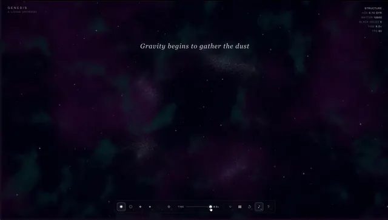</a>

**Claude Fable 5.1** · Интерактив · автор [Alex Luhchenko](https://x.com/tiny_frontier) · 2026-09-02

Claude Fable 5.1 с нуля собрал автономный космос: галактики под действием гравитации, чёрные дыры, рождение планет и синтезированный звук.

<details>
<summary>Промпт</summary>

```text
build a living universe in one HTML file.

No npm, libraries, CDN, assets or network requests.
```

</details>

[Открыть на Wandy3D ↗](https://wandy3d.com/ru/prompts/living-universe-simulation-in-a-single-webgl-html-file-2095054116372508955?utm_source=github&utm_medium=referral&utm_campaign=awesome_3d_prompts) · [Исходный пост](https://x.com/tiny_frontier/status/2095054116372508955)

---

### [Готическая souls-like игра на чистом C++ с туманными улицами](https://wandy3d.com/ru/prompts/gothic-souls-like-action-game-in-native-c-with-foggy-streets-2095053114600755576?utm_source=github&utm_medium=referral&utm_campaign=awesome_3d_prompts)

<a href="https://wandy3d.com/ru/prompts/gothic-souls-like-action-game-in-native-c-with-foggy-streets-2095053114600755576?utm_source=github&amp;utm_medium=referral&amp;utm_campaign=awesome_3d_prompts">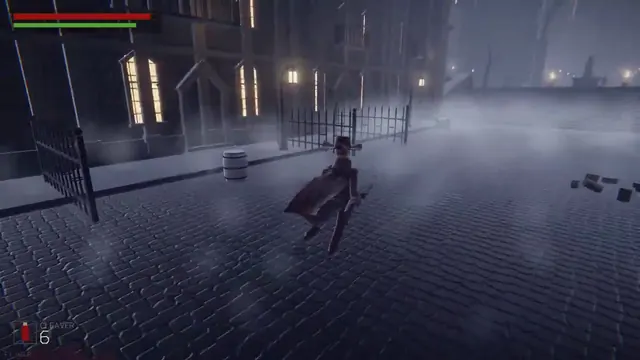</a>

**Claude Fable 5.1** · Игры · автор [wbk ᕦ(ò\_ó )ᕤ](https://x.com/wizardbrainz) · 2026-09-02

Claude Fable 5.1 написал игру в духе Bloodborne на C++ без движка: охотник в плаще, туман, враги и босс. Анимация ног пока глючит.

<details>
<summary>Бриф от Wandy3D</summary>

```text
Build a third-person gothic action game in native C++ with no game engine. Set it in a foggy Victorian city at night: cobblestone streets, gas lamps, iron fences, coffins, barrels, carts and tall dark buildings with lit windows. Use a cold blue-grey palette with warm lamp glows and red blood effects. The player is a hunter in a red coat and hat with a melee weapon, a dodge, a health bar, a stamina bar and a consumable counter. Add enemies with their own animations and a large boss with a visible health bar at the end of a street. Include basic progression, hit effects, sound effects and music, all generated in code. Controls: move, camera, attack, dodge, use item. Deliver a buildable C++ project with instructions. Done means you can explore the street, fight enemies, and reach and fight the boss with believable character animation.
```

</details>

[Открыть на Wandy3D ↗](https://wandy3d.com/ru/prompts/gothic-souls-like-action-game-in-native-c-with-foggy-streets-2095053114600755576?utm_source=github&utm_medium=referral&utm_campaign=awesome_3d_prompts) · [Исходный пост](https://x.com/wizardbrainz/status/2095053114600755576)

---

### [3D-игра «Змеи и лестницы» с облётом камеры и журналом ходов](https://wandy3d.com/ru/prompts/3d-snakes-and-ladders-board-game-with-orbit-camera-and-move-2095050993184669825?utm_source=github&utm_medium=referral&utm_campaign=awesome_3d_prompts)

<a href="https://wandy3d.com/ru/prompts/3d-snakes-and-ladders-board-game-with-orbit-camera-and-move-2095050993184669825?utm_source=github&amp;utm_medium=referral&amp;utm_campaign=awesome_3d_prompts">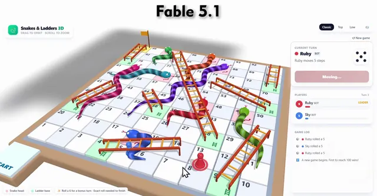</a>

**Claude Fable 5.1** · Игры · автор [KC](https://x.com/karanC_12) · 2026-09-02

Claude Fable 5.1 сделал игру для двоих: полосатые 3D-змеи, деревянные лестницы, бросок кубика и журнал ходов сбоку.

<details>
<summary>Бриф от Wandy3D</summary>

```text
Build a playable 3D Snakes and Ladders board game that runs in the browser. Show a square wooden board with a numbered grid, wooden ladders and thick, colorful striped snakes connecting squares, plus a physical dice that rolls beside the board. Support two players, Ruby and Sky, with coloured pawns that move square by square, climb ladders and slide down snakes. Add a clean light side panel with the current turn, a roll button, player progress bars and a scrolling move log. Let the user orbit and zoom the camera around the board, with soft shadows under it. Use a bright, friendly palette on a white background. Deliver one self-contained web project. Done means a full game can be played from start to finish with a winner declared.
```

</details>

[Открыть на Wandy3D ↗](https://wandy3d.com/ru/prompts/3d-snakes-and-ladders-board-game-with-orbit-camera-and-move-2095050993184669825?utm_source=github&utm_medium=referral&utm_campaign=awesome_3d_prompts) · [Исходный пост](https://x.com/karanC_12/status/2095050993184669825)

---

### [Студия 3D-вокселей из фото с волновой анимацией на Three.js](https://wandy3d.com/ru/prompts/photo-to-3d-voxel-studio-with-wave-motion-in-three-js-2095048967092625663?utm_source=github&utm_medium=referral&utm_campaign=awesome_3d_prompts)

<a href="https://wandy3d.com/ru/prompts/photo-to-3d-voxel-studio-with-wave-motion-in-three-js-2095048967092625663?utm_source=github&amp;utm_medium=referral&amp;utm_campaign=awesome_3d_prompts">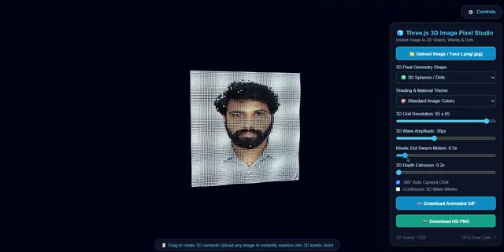</a>

**Claude Fable 5.1** · Интерактив · автор [Manoj Builds](https://x.com/TenthPrime) · 2026-09-02

Claude Fable 5.1 помог собрать инструмент на Three.js: портрет превращается в 10 000+ инстансных 3D-фигур с волнами и экспортом GIF и PNG.

<details>
<summary>Бриф от Wandy3D</summary>

```text
Build a browser tool in Three.js that turns an uploaded photo into an interactive field of more than ten thousand 3D pixels. Sample the image on a grid and render each cell as an instanced sphere, cube or cylinder coloured from the photo, so the whole field costs a single draw call and stays near 60 FPS. Add a dark background and a compact control panel with an image upload, a shape selector, a material theme selector (original colours, metallic, neon), sliders for grid resolution, wave amplitude, wave speed and depth extrusion, an auto-rotate toggle, and buttons to export an animated GIF and a high-resolution PNG. Animate the voxels with a travelling 3D wave displacement and allow orbiting and zooming close to see individual shapes. Done means any portrait can be dropped in and explored live.
```

</details>

[Открыть на Wandy3D ↗](https://wandy3d.com/ru/prompts/photo-to-3d-voxel-studio-with-wave-motion-in-three-js-2095048967092625663?utm_source=github&utm_medium=referral&utm_campaign=awesome_3d_prompts) · [Исходный пост](https://x.com/TenthPrime/status/2095048967092625663)

---

### [Лоукост-замок на парящем острове с днём и ночью на Three.js](https://wandy3d.com/ru/prompts/low-poly-floating-island-castle-with-day-and-night-in-three-2095048818203275584?utm_source=github&utm_medium=referral&utm_campaign=awesome_3d_prompts)

<a href="https://wandy3d.com/ru/prompts/low-poly-floating-island-castle-with-day-and-night-in-three-2095048818203275584?utm_source=github&amp;utm_medium=referral&amp;utm_campaign=awesome_3d_prompts">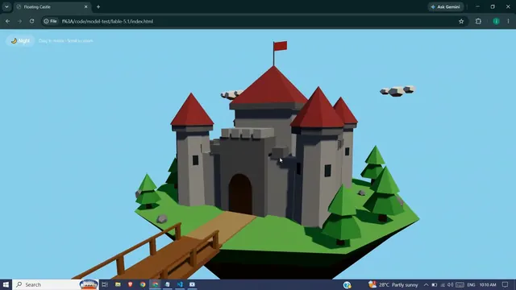</a>

**Claude Fable 5.1** · Сцены · автор [Jigs](https://x.com/debugsenpai) · 2026-09-02

Claude Fable 5.1 собрал на Three.js замок на парящем острове с мостом и деревьями; ночью появляются звёзды и светящиеся окна.

<details>
<summary>Бриф от Wandy3D</summary>

```text
Build an interactive low-poly 3D castle scene with Three.js. Place a stone castle with several round and square towers, red pointed roofs, a gate with an arched door, battlements and a flag on a small floating grass island with rocky underside, pine trees and a wooden bridge. Add drifting clouds in a light blue sky. Include a day and night toggle: at night the sky turns deep navy with stars and a moon, and the windows and gate glow warm orange. Let the user orbit and zoom around the castle with the mouse, with a small on-screen hint about the controls. Use flat shading and a simple, clean palette. Deliver one self-contained web project. Done means smooth camera control and a clear visual change between day and night.
```

</details>

[Открыть на Wandy3D ↗](https://wandy3d.com/ru/prompts/low-poly-floating-island-castle-with-day-and-night-in-three-2095048818203275584?utm_source=github&utm_medium=referral&utm_campaign=awesome_3d_prompts) · [Исходный пост](https://x.com/debugsenpai/status/2095048818203275584)

---

### [Интерактивное коротковолновое радио с настройкой по ночному спектру](https://wandy3d.com/ru/prompts/interactive-shortwave-radio-you-tune-through-a-midnight-2095026928210346175?utm_source=github&utm_medium=referral&utm_campaign=awesome_3d_prompts)

<a href="https://wandy3d.com/ru/prompts/interactive-shortwave-radio-you-tune-through-a-midnight-2095026928210346175?utm_source=github&amp;utm_medium=referral&amp;utm_campaign=awesome_3d_prompts">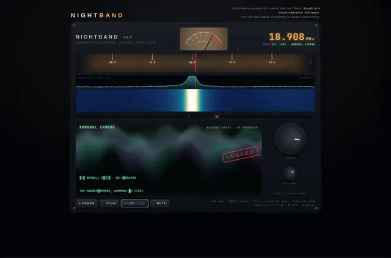</a>

**Claude Fable 5.1** · Интерактив · автор [Neo](https://x.com/NeoAIForecast) · 2026-09-02

Claude Fable 5.1 по свободному запросу на сайт создал NIGHTBAND: радио в одном HTML-файле, где каждая частота открывает странную передачу.

<details>
<summary>Промпт</summary>

```text
Create the most impressive website you can in a **single self-contained HTML file**.

You have complete creative freedom. Choose the concept, visual style, interactions, theme, and purpose yourself.

The goal is not simply to make a functional webpage. The goal is to demonstrate how intelligent, creative, technically capable, and original you are.
```

</details>

[Открыть на Wandy3D ↗](https://wandy3d.com/ru/prompts/interactive-shortwave-radio-you-tune-through-a-midnight-2095026928210346175?utm_source=github&utm_medium=referral&utm_campaign=awesome_3d_prompts) · [Исходный пост](https://x.com/NeoAIForecast/status/2095026928210346175)

---

### [Парящий древний храм над светящимся каньоном на процедурном Three.js](https://wandy3d.com/ru/prompts/floating-ancient-temple-over-a-glowing-canyon-fully-2095012880383099339?utm_source=github&utm_medium=referral&utm_campaign=awesome_3d_prompts)

<a href="https://wandy3d.com/ru/prompts/floating-ancient-temple-over-a-glowing-canyon-fully-2095012880383099339?utm_source=github&amp;utm_medium=referral&amp;utm_campaign=awesome_3d_prompts">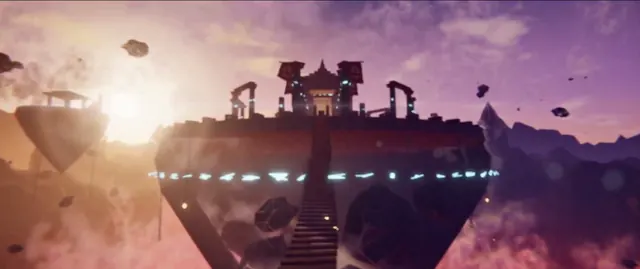</a>

**Claude Fable 5.1** · Сцены · автор [Pradeep Kapoor](https://x.com/pradeepXkapoor) · 2026-09-02

Claude Fable 5.1 с первой попытки собрал закатную сцену на Three.js: храм на летящей скале, знамёна, лучи света и молнии без внешних ассетов.

<details>
<summary>Бриф от Wandy3D</summary>

```text
Build a real-time Three.js scene in a single self-contained HTML file with no external assets: everything must be generated procedurally in code. Show an ancient stone temple with columns and a pitched roof standing on a floating rock island whose underside tapers into a jagged point. Add glowing cyan rune lines along the stonework, lit braziers and hanging banners that move as cloth in the wind. Surround it with floating rock fragments, chains and distant rock spires above a canyon filled with glowing red-orange haze. Set it at dusk with a low sun, purple-orange sky, volumetric god rays and occasional lightning. Open with an elegant title card, then run a slow cinematic camera that moves from the temple front, along the island and underside, to a wide shot of the whole canyon. Done means smooth real-time rendering in a desktop browser with continuous wind, light shafts and drifting debris.
```

</details>

[Открыть на Wandy3D ↗](https://wandy3d.com/ru/prompts/floating-ancient-temple-over-a-glowing-canyon-fully-2095012880383099339?utm_source=github&utm_medium=referral&utm_campaign=awesome_3d_prompts) · [Исходный пост](https://x.com/pradeepXkapoor/status/2095012880383099339)

---

### [Интерактивный воксельный город с сезонами, погодой и ночным режимом](https://wandy3d.com/ru/prompts/interactive-voxel-city-skyline-with-seasons-weather-and-2095000329561485584?utm_source=github&utm_medium=referral&utm_campaign=awesome_3d_prompts)

<a href="https://wandy3d.com/ru/prompts/interactive-voxel-city-skyline-with-seasons-weather-and-2095000329561485584?utm_source=github&amp;utm_medium=referral&amp;utm_campaign=awesome_3d_prompts">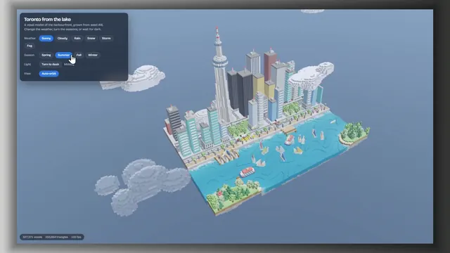</a>

**Claude Fable 5.1** · Сцены · автор [Kevin](https://x.com/bienjamyn) · 2026-09-02

Claude Fable 5.1 с одной попытки собрал воксельную диораму города: её можно вращать и переключать дождь, снег, туман, закат и ночь.

<details>
<summary>Бриф от Wandy3D</summary>

```text
Build an interactive voxel city diorama that runs in the browser, preferably with Three.js. Show a compact floating slab of land with a dense downtown of colorful blocky towers, one tall landmark tower with an observation pod, a waterfront with small boats, parks with trees and puffy voxel clouds. Let the user orbit, zoom and pan around the model. Add a small translucent control panel with buttons for seasons and for weather and time of day: clear, rain, snow, fog, sunset and night. Each choice changes sky color, lighting, particles and the look of the ground, for example falling snow, rain streaks, foggy depth, warm evening light and lit windows at night. Keep a soft muted blue-gray background and a clean minimal interface. Done means smooth camera control, readable buildings at every setting and transitions between moods that feel polished.
```

</details>

[Открыть на Wandy3D ↗](https://wandy3d.com/ru/prompts/interactive-voxel-city-skyline-with-seasons-weather-and-2095000329561485584?utm_source=github&utm_medium=referral&utm_campaign=awesome_3d_prompts) · [Исходный пост](https://x.com/bienjamyn/status/2095000329561485584)

---

### [Изометрическая 3D-симуляция жизни в браузере с пятью самостоятельными жильцами](https://wandy3d.com/ru/prompts/isometric-3d-life-sim-in-the-browser-with-five-autonomous-2094949450196090988?utm_source=github&utm_medium=referral&utm_campaign=awesome_3d_prompts)

<a href="https://wandy3d.com/ru/prompts/isometric-3d-life-sim-in-the-browser-with-five-autonomous-2094949450196090988?utm_source=github&amp;utm_medium=referral&amp;utm_campaign=awesome_3d_prompts">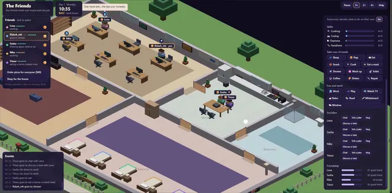</a>

**Claude Fable 5.1** · Игры · автор [Ridark](https://x.com/ridark_eth) · 2026-09-02

Claude Fable 5.1 сделал игру в духе The Sims: пятеро героев с потребностями, навыками и дружбой живут в 3D-доме в разрезе.

<details>
<summary>Бриф от Wandy3D</summary>

```text
Build a browser-based life simulation in an isometric 3D view with no game engine. Show a cutaway house with a kitchen, bedroom, bathroom and office, a garden, a road with passing cars, and five small blocky characters who live there. Each character has needs such as hunger, energy, social, hygiene, fun and bladder that decay over time, plus skills like cooking, coding, charisma and handiness that level up with practice. Characters choose actions on their own: cook, eat, sleep, shower, work, chat, hug, argue or joke, shown in speech bubbles. Add friendship levels between characters, a simple economy with jobs, weekly bills, deliveries and shopping, a day and night cycle, speed controls and an event log. Provide a side panel to inspect a selected character, and let the camera pan, zoom and orbit. Done means the household keeps running without input and the panels update live.
```

</details>

[Открыть на Wandy3D ↗](https://wandy3d.com/ru/prompts/isometric-3d-life-sim-in-the-browser-with-five-autonomous-2094949450196090988?utm_source=github&utm_medium=referral&utm_campaign=awesome_3d_prompts) · [Исходный пост](https://x.com/ridark_eth/status/2094949450196090988)

---

### [Воксельная деревня, где жителями управляет локальная LLM](https://wandy3d.com/ru/prompts/voxel-village-whose-villagers-are-driven-by-a-local-llm-2094930970675741171?utm_source=github&utm_medium=referral&utm_campaign=awesome_3d_prompts)

<a href="https://wandy3d.com/ru/prompts/voxel-village-whose-villagers-are-driven-by-a-local-llm-2094930970675741171?utm_source=github&amp;utm_medium=referral&amp;utm_campaign=awesome_3d_prompts">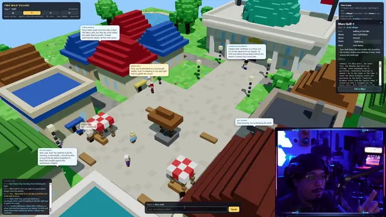</a>

**Claude Fable 5.1** · Интерактив · автор [Tech2Wild](https://x.com/Tech2Wild) · 2026-09-01

Claude Fable 5.1 собрал воксельный городок: шестеро жителей работают на локальной языковой модели и разносят сплетни после одной команды.

<details>
<summary>Бриф от Wandy3D</summary>

```text
Build a browser-based voxel village simulation. Show a small grass island seen from a tilted overhead camera, with blocky houses in red, blue, green, purple and brown roofs, a domed town hall with a flag on a central plaza, trees, ponds, market stalls and benches. Populate it with tiny villagers who follow scripted routines between homes, workplaces and the plaza. Wire a handful of them to a locally hosted language model through an OpenAI-compatible endpoint so each has a home, a job, a daily routine and a memory, and can chat with neighbours and pass news along. Float speech bubbles above villagers when they talk. Add a side panel listing the selected villager's name, role, mood and recent memories, plus an input where the user can give an instruction to one villager and watch it spread by gossip. Camera: orbit and zoom with the mouse. Deliver one project that runs with a single start command, using Three.js. Done when villagers walk around, talk, and a spoken instruction visibly changes what others do.
```

</details>

[Открыть на Wandy3D ↗](https://wandy3d.com/ru/prompts/voxel-village-whose-villagers-are-driven-by-a-local-llm-2094930970675741171?utm_source=github&utm_medium=referral&utm_campaign=awesome_3d_prompts) · [Исходный пост](https://x.com/Tech2Wild/status/2094930970675741171)

---

### [Процедурный подъём к парящим островам с тории на фоне Фудзи](https://wandy3d.com/ru/prompts/procedural-ascent-to-floating-torii-islands-facing-mt-fuji-2094930804296274414?utm_source=github&utm_medium=referral&utm_campaign=awesome_3d_prompts)

<a href="https://wandy3d.com/ru/prompts/procedural-ascent-to-floating-torii-islands-facing-mt-fuji-2094930804296274414?utm_source=github&amp;utm_medium=referral&amp;utm_campaign=awesome_3d_prompts">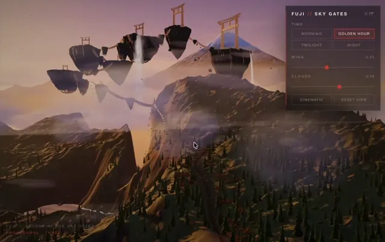</a>

**Claude Fable 5.1** · Сцены · автор [Techartist](https://x.com/techartist_) · 2026-09-01

Claude Fable 5.1 за один заход собрал на Three.js полёт от закатной долины к парящим островам с воротами тории над облаками и Фудзи вдали.

<details>
<summary>Бриф от Wandy3D</summary>

```text
Build a procedural fantasy world in code as one web page using Three.js, with no external assets. Start in a golden-hour mountain valley with pine forests, a small lake, a wooden fence and warm low sun. Then fly the camera along a path up into the sky past floating rock islands linked by thin bridges or cables, each topped with a red torii gate, with waterfalls pouring off the edges into a sea of clouds. In the distance show a snow-capped Mt. Fuji silhouette, with layered purple and pink haze and a sunset gradient sky. Add soft fog, volumetric-looking light and slow drifting debris. Include a small control panel with presets such as golden hour, night and cinematic camera, sliders for fog and clouds, and a reset button. Style: moody, painterly low-poly shapes with a warm orange-to-violet palette. Done when the cinematic ascent plays smoothly from valley to the gates and the panel changes the lighting live.
```

</details>

[Открыть на Wandy3D ↗](https://wandy3d.com/ru/prompts/procedural-ascent-to-floating-torii-islands-facing-mt-fuji-2094930804296274414?utm_source=github&utm_medium=referral&utm_campaign=awesome_3d_prompts) · [Исходный пост](https://x.com/techartist_/status/2094930804296274414)

---

### [Гоночная игра в Godot с машиной из Blender и закатной трассой](https://wandy3d.com/ru/prompts/godot-racing-game-with-blender-made-car-and-sunset-road-2094925359372284022?utm_source=github&utm_medium=referral&utm_campaign=awesome_3d_prompts)

<a href="https://wandy3d.com/ru/prompts/godot-racing-game-with-blender-made-car-and-sunset-road-2094925359372284022?utm_source=github&amp;utm_medium=referral&amp;utm_campaign=awesome_3d_prompts">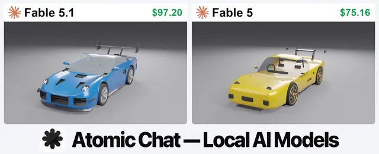</a>

**Claude Fable 5.1** · Игры · автор [atomic.chat](https://x.com/atomic_chat_hq) · 2026-09-01

Сравнение: Claude Fable 5.1 и предыдущая версия получили один brief на гонку; у новой модели машина и закатный мир выглядят богаче.

<details>
<summary>Бриф от Wandy3D</summary>

```text
Build a playable racing game in Godot, using Blender through a Blender MCP connection to create the assets. Model a detailed sports car with a spoiler, wheels and body paint, plus roadside environment pieces such as trees, fences and hills. Create a large map with a long winding road suited to extended driving sessions. Implement realistic car handling: acceleration, braking, steering, gears, grip and weight transfer, with a chase camera. Add a simple HUD showing speed, gear and rpm, plus a hint line for controls. Give the world a warm sunset sky with soft lighting so it feels alive while driving. Run it as a standalone Godot project that launches into the drive immediately. Done when the car feels smooth to steer on the whole map, the HUD updates correctly and the models look clearly detailed rather than plain boxes.
```

</details>

[Открыть на Wandy3D ↗](https://wandy3d.com/ru/prompts/godot-racing-game-with-blender-made-car-and-sunset-road-2094925359372284022?utm_source=github&utm_medium=referral&utm_campaign=awesome_3d_prompts) · [Исходный пост](https://x.com/atomic_chat_hq/status/2094925359372284022)

---

### [Прогулка по офису в Blender, собранному по одному плану этажа](https://wandy3d.com/ru/prompts/blender-office-walkthrough-built-from-a-single-floor-plan-2094925117344428232?utm_source=github&utm_medium=referral&utm_campaign=awesome_3d_prompts)

<a href="https://wandy3d.com/ru/prompts/blender-office-walkthrough-built-from-a-single-floor-plan-2094925117344428232?utm_source=github&amp;utm_medium=referral&amp;utm_campaign=awesome_3d_prompts">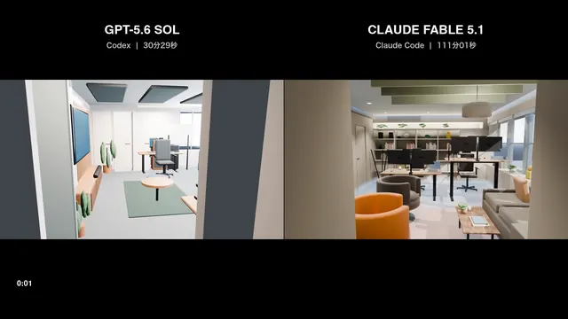</a>

**Claude Fable 5.1** · Сцены · автор [AGIラボ](https://x.com/ctgptlb) · 2026-09-01

Claude Fable 5.1 по плану этажа сделал обставленный 3D-офис, кадры и видеопрогулку; в посте это сравнение с GPT-5.6 Sol.

<details>
<summary>Бриф от Wandy3D</summary>

```text
Build a Blender project from a single floor plan image. Read the plan and model the interior in 3D: walls, doors, windows, a ceiling with recessed lights, wood floor, and furniture such as sit-stand desks, dual monitors, office chairs, bookshelves filled with props, sofas, a round table, plants and a wall-mounted TV. Use a clean modern palette of soft whites, wood, sage green and orange accents. Set up lighting and materials, then render a set of still images from different rooms and angles. Finally animate a smooth camera walkthrough through the rooms and render it as a video of about 40 seconds. Deliver a Python script or a .blend file plus the rendered stills and the video. Done when the layout matches the plan, rooms are furnished convincingly, and the walkthrough moves through them without clipping into walls.
```

</details>

[Открыть на Wandy3D ↗](https://wandy3d.com/ru/prompts/blender-office-walkthrough-built-from-a-single-floor-plan-2094925117344428232?utm_source=github&utm_medium=referral&utm_campaign=awesome_3d_prompts) · [Исходный пост](https://x.com/ctgptlb/status/2094925117344428232)

---

### [Воксельный сад с пагодой в одном файле Three.js, день и сумерки](https://wandy3d.com/ru/prompts/seeded-voxel-pagoda-garden-in-one-three-js-file-with-day-and-2094916609219461211?utm_source=github&utm_medium=referral&utm_campaign=awesome_3d_prompts)

<a href="https://wandy3d.com/ru/prompts/seeded-voxel-pagoda-garden-in-one-three-js-file-with-day-and-2094916609219461211?utm_source=github&amp;utm_medium=referral&amp;utm_campaign=awesome_3d_prompts">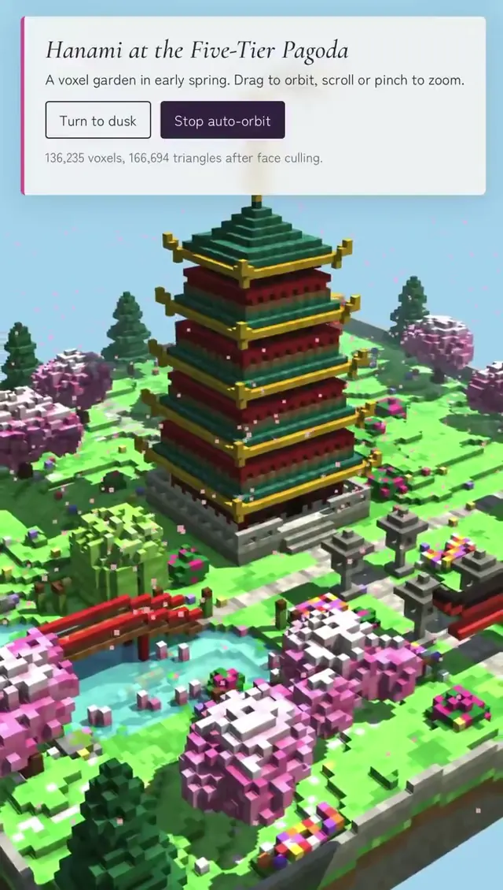</a>

**Claude Fable 5.1** · Сцены · автор [FHILY👑](https://x.com/Oluwaphilemon1) · 2026-09-01

Fable 5.1 написал компактный файл Three.js: воксельный сад вокруг пятиярусной пагоды с орбитальной камерой и переключением день/сумерки.

<details>
<summary>Бриф от Wandy3D</summary>

```text
Build a procedural voxel diorama in one self-contained HTML file using Three.js, with no downloaded assets or prebuilt models. Show a floating square island garden in early spring with a tall five-tier pagoda in green, red and gold, pink and white cherry trees, pines, bamboo, a small pond with a red arched bridge, a torii gate, stone lanterns, a small tiled-roof house and scattered flowers. Generate everything from a fixed random seed so every load gives the same scene. Merge voxels into a single mesh and cull hidden faces to keep it light. Add a day and dusk lighting toggle: at dusk the sky darkens, lanterns glow and petals drift. Provide orbit by dragging, zoom by scroll or pinch, and an auto-orbit button, with a small title card showing voxel and triangle counts. Done when the scene loads quickly, looks identical on each reload and switches smoothly between day and dusk.
```

</details>

[Открыть на Wandy3D ↗](https://wandy3d.com/ru/prompts/seeded-voxel-pagoda-garden-in-one-three-js-file-with-day-and-2094916609219461211?utm_source=github&utm_medium=referral&utm_campaign=awesome_3d_prompts) · [Исходный пост](https://x.com/Oluwaphilemon1/status/2094916609219461211)

---

### [Двуногий робот в стиле hard-surface, собранный в Blender через MCP](https://wandy3d.com/ru/prompts/hard-surface-bipedal-robot-modelled-in-blender-through-mcp-2094909825561805003?utm_source=github&utm_medium=referral&utm_campaign=awesome_3d_prompts)

<a href="https://wandy3d.com/ru/prompts/hard-surface-bipedal-robot-modelled-in-blender-through-mcp-2094909825561805003?utm_source=github&amp;utm_medium=referral&amp;utm_campaign=awesome_3d_prompts">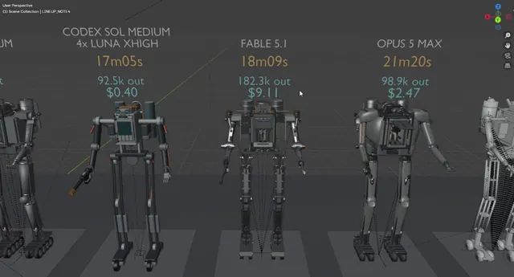</a>

**Claude Fable 5.1** · Ассеты · автор [Spectro](https://x.com/Spectromachina) · 2026-09-01

Claude Fable 5.1 собрал в Blender через MCP двуногого робота с пластинами и кабелями; в посте его сравнивают с другими моделями по времени и токенам.

<details>
<summary>Бриф от Wandy3D</summary>

```text
Build a detailed bipedal robot model in Blender, driven by a coding agent that talks to Blender through an MCP connection. The robot should be a hard-surface machine in neutral grey metal: a torso block with a backpack frame, articulated legs with pistons and foot plates, slim arms, and organised cables and armour plates that follow a clear design rather than random shapes. Place it on a flat grey pad in a plain studio-style scene with a grid floor. Work step by step: block out the main masses, name and group every part, then add plates, wires and joints, checking the viewport after each stage. Keep to the given design brief and do not add extra parts that were not requested. Deliver the finished .blend scene with a tidy outliner, readable object names and a posed front view. Done means the robot reads as one coherent machine from every angle and each wire and plate has an obvious purpose.
```

</details>

[Открыть на Wandy3D ↗](https://wandy3d.com/ru/prompts/hard-surface-bipedal-robot-modelled-in-blender-through-mcp-2094909825561805003?utm_source=github&utm_medium=referral&utm_campaign=awesome_3d_prompts) · [Исходный пост](https://x.com/Spectromachina/status/2094909825561805003)

---

### [Low-poly игра с открытым городом: пешком, на машине, с миникартой](https://wandy3d.com/ru/prompts/low-poly-open-world-city-game-with-walking-driving-and-a-2094907986942591338?utm_source=github&utm_medium=referral&utm_campaign=awesome_3d_prompts)

<a href="https://wandy3d.com/ru/prompts/low-poly-open-world-city-game-with-walking-driving-and-a-2094907986942591338?utm_source=github&amp;utm_medium=referral&amp;utm_campaign=awesome_3d_prompts">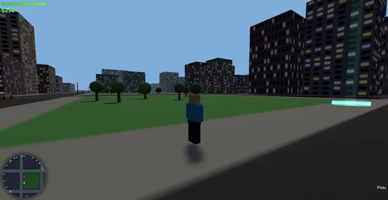</a>

**Claude Fable 5.1** · Игры · автор [Veee](https://x.com/vikktorrrre) · 2026-09-01

По запросу на клон GTA Claude Fable 5.1 сделал блочный открытый город: можно ходить, водить машины, есть миникарта и звёзды розыска.

<details>
<summary>Промпт</summary>

```text
GTA 6 clone game
```

</details>

[Открыть на Wandy3D ↗](https://wandy3d.com/ru/prompts/low-poly-open-world-city-game-with-walking-driving-and-a-2094907986942591338?utm_source=github&utm_medium=referral&utm_campaign=awesome_3d_prompts) · [Исходный пост](https://x.com/vikktorrrre/status/2094907986942591338)

---

### [2D-шутер с реактивным ранцем и выбором оружия, сравнение с Kimi K3](https://wandy3d.com/ru/prompts/side-scrolling-jetpack-shooter-with-loadouts-shown-against-2094900523900219725?utm_source=github&utm_medium=referral&utm_campaign=awesome_3d_prompts)

<a href="https://wandy3d.com/ru/prompts/side-scrolling-jetpack-shooter-with-loadouts-shown-against-2094900523900219725?utm_source=github&amp;utm_medium=referral&amp;utm_campaign=awesome_3d_prompts">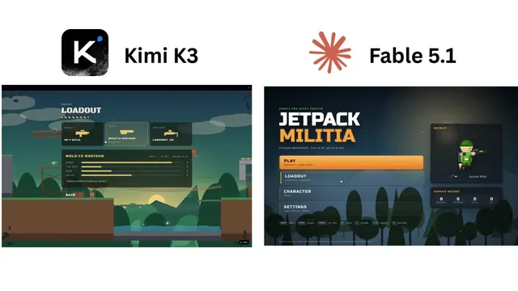</a>

**Claude Fable 5.1** · Игры · автор [Md Ismail Šojal 🕷️](https://x.com/0x0SojalSec) · 2026-09-01

Claude Fable 5.1 и Kimi K3 по одному промпту собрали шутер в духе Mini Militia с меню, снаряжением и матчами против ботов.

<details>
<summary>Бриф от Wandy3D</summary>

```text
Build a 2D side-scrolling jetpack shooter in the spirit of a classic doodle-army arena game, playable in the browser. Include a title screen with a bold logo and a menu for play, loadout, character and settings. The player is a small soldier with a jetpack who flies between floating platforms and a ground level over a layered forest-and-mountain backdrop with a glowing sun. Provide weapon selection with stat bars, a character colour customiser, a match timer, a health and fuel readout, kill and elimination messages and a score for the opposing bots. Add simple smoke and explosion effects when shots land. Keep the art flat and colourful with parallax scenery. Deliver one self-contained HTML file with keyboard and mouse controls for moving, thrusting, aiming and firing. Done means a full match can be played from the title screen to an elimination and a restart.
```

</details>

[Открыть на Wandy3D ↗](https://wandy3d.com/ru/prompts/side-scrolling-jetpack-shooter-with-loadouts-shown-against-2094900523900219725?utm_source=github&utm_medium=referral&utm_campaign=awesome_3d_prompts) · [Исходный пост](https://x.com/0x0SojalSec/status/2094900523900219725)

---

### [Интерактивная 3D-песочница с штормовым океаном и ползунками](https://wandy3d.com/ru/prompts/interactive-3d-ocean-storm-sandbox-with-sliders-and-a-glass-2094900247000654222?utm_source=github&utm_medium=referral&utm_campaign=awesome_3d_prompts)

<a href="https://wandy3d.com/ru/prompts/interactive-3d-ocean-storm-sandbox-with-sliders-and-a-glass-2094900247000654222?utm_source=github&amp;utm_medium=referral&amp;utm_campaign=awesome_3d_prompts">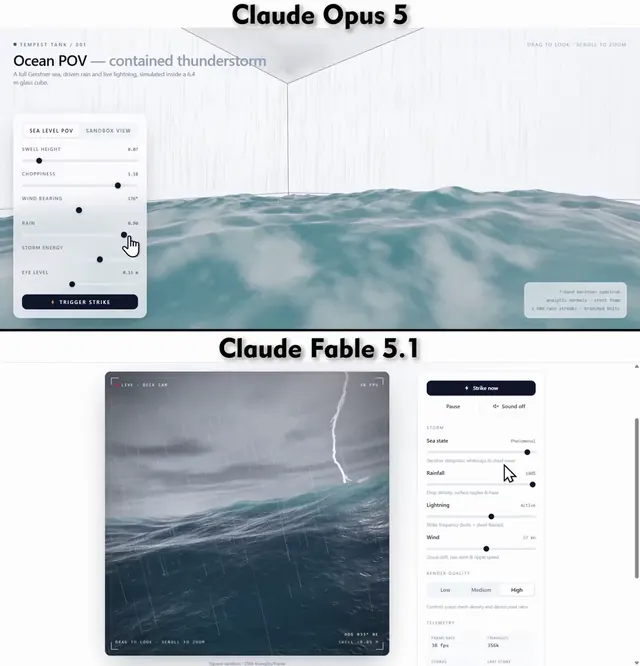</a>

**Claude Fable 5.1** · Интерактив · автор [Tim Jayas](https://x.com/TimJayas) · 2026-09-01

Один промпт, две модели: Claude Fable 5.1 нарисовал штормовое море с дождём и молниями, и автор поставил его выше Claude Opus 5.

<details>
<summary>Бриф от Wandy3D</summary>

```text
Build an interactive 3D ocean sandbox that runs in the browser. Show a first-person view from sea level looking over rolling waves under a heavy grey storm sky, with teal water, foam, falling rain and occasional lightning strikes. Add a side control panel with sliders for swell height, wind, rainfall, lightning frequency and a storm intensity, plus a button to trigger a strike and quality presets for low, medium and high. Offer a second view that shows the sea as a cutaway block inside a glass tank so the wave shape can be seen from outside. Let the user drag to look around and scroll to change the camera. Keep the interface clean and light with small labels and readouts. Deliver one self-contained HTML file using Three.js and custom water shaders. Done means changing any slider visibly alters the waves and weather in real time without dropping the frame rate.
```

</details>

[Открыть на Wandy3D ↗](https://wandy3d.com/ru/prompts/interactive-3d-ocean-storm-sandbox-with-sliders-and-a-glass-2094900247000654222?utm_source=github&utm_medium=referral&utm_campaign=awesome_3d_prompts) · [Исходный пост](https://x.com/TimJayas/status/2094900247000654222)

---

### [Осенний парящий воксельный остров с мельницей и водопадом](https://wandy3d.com/ru/prompts/autumn-floating-voxel-island-with-a-windmill-and-waterfall-2094899802588713418?utm_source=github&utm_medium=referral&utm_campaign=awesome_3d_prompts)

<a href="https://wandy3d.com/ru/prompts/autumn-floating-voxel-island-with-a-windmill-and-waterfall-2094899802588713418?utm_source=github&amp;utm_medium=referral&amp;utm_campaign=awesome_3d_prompts">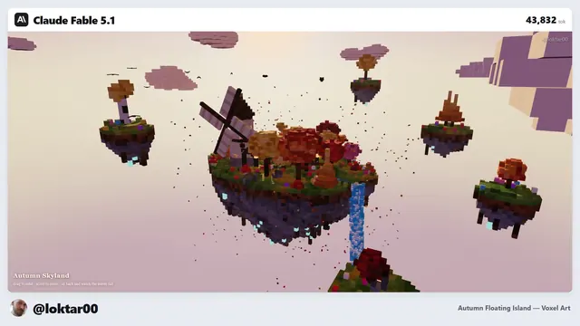</a>

**Claude Fable 5.1** · Сцены · автор [Loktar 🇺🇸](https://x.com/loktar00) · 2026-09-01

Claude Fable 5.1 собрал воксельную диораму парящего осеннего острова с вращающейся мельницей; автор счёл результат неплохим, но дорогим по токенам.

<details>
<summary>Бриф от Wandy3D</summary>

```text
Build an autumn floating voxel island scene that runs in the browser. Show a large central island of blocky earth with a dark rocky underside, covered in red, orange and golden trees, bushes and a wooden windmill whose sails turn slowly. Let a narrow waterfall spill from the edge into the air. Surround it with several smaller floating islands, each with a tree or small structure, and drifting purple voxel clouds against a soft pink and cream sky. Add falling leaves and tiny floating particles around the island. Use a camera that orbits slowly around the scene, with warm soft lighting and gentle shadows. Keep every object built from cubes with a consistent voxel size. Deliver one self-contained HTML file using Three.js with a small caption in the corner naming the scene. Done means the scene loops smoothly, the windmill rotates and the islands look balanced from every angle.
```

</details>

[Открыть на Wandy3D ↗](https://wandy3d.com/ru/prompts/autumn-floating-voxel-island-with-a-windmill-and-waterfall-2094899802588713418?utm_source=github&utm_medium=referral&utm_campaign=awesome_3d_prompts) · [Исходный пост](https://x.com/loktar00/status/2094899802588713418)

---

### [Разрушаемое воксельное средневековое королевство с NPC и драконом](https://wandy3d.com/ru/prompts/destructible-medieval-voxel-kingdom-with-npcs-and-a-dragon-2094899477626720403?utm_source=github&utm_medium=referral&utm_campaign=awesome_3d_prompts)

<a href="https://wandy3d.com/ru/prompts/destructible-medieval-voxel-kingdom-with-npcs-and-a-dragon-2094899477626720403?utm_source=github&amp;utm_medium=referral&amp;utm_campaign=awesome_3d_prompts">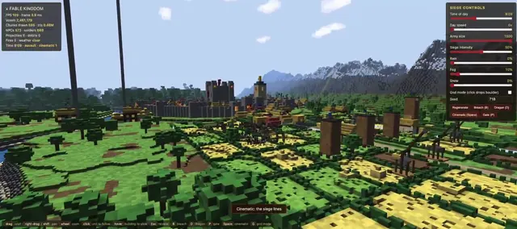</a>

**Claude Fable 5.1** · Сцены · автор [Knowix](https://x.com/knowixbuilds) · 2026-09-01

Claude Fable 5.1 создал огромное воксельное королевство: город-крепость, NPC с работой, осадные машины и разрушаемые здания.

<details>
<summary>Бриф от Wandy3D</summary>

```text
Build a large medieval voxel kingdom that runs in the browser, ideally as a single self-contained HTML file with a WebGL engine such as Three.js. Generate a terrain of grass, farmland patches in yellow and green, a winding river and a snowy mountain range on the horizon. At the centre place a walled castle city in concentric rings, with a keep, a church with a spire, and hundreds of houses with red, blue and yellow roofs; every building should have a purpose and an interior. Populate it with soldiers and townsfolk who have jobs and react to an invasion, include siege equipment, a fire-breathing dragon and voxel-level destruction. Add a free-flying camera that can move through the streets and rise over the whole map, plus a small side panel of settings sliders. Aim for millions of voxels at a smooth frame rate. Done means the kingdom loads, the camera can roam freely, characters move around, and buildings can be destroyed.
```

</details>

[Открыть на Wandy3D ↗](https://wandy3d.com/ru/prompts/destructible-medieval-voxel-kingdom-with-npcs-and-a-dragon-2094899477626720403?utm_source=github&utm_medium=referral&utm_campaign=awesome_3d_prompts) · [Исходный пост](https://x.com/knowixbuilds/status/2094899477626720403)

---

[← Назад](catalog.ru.6.md) · страница 7 из 8 · [Дальше →](catalog.ru.8.md)

Промпты, видео и картинки принадлежат их авторам ([RIGHTS.md](../RIGHTS.md)). Наши тексты — [CC BY 4.0](../LICENSE). Знаете хороший промпт с видимым результатом? [Предложите его](https://github.com/wornoxgames/awesome-3d-prompts/issues/new?template=suggest.md). Вы автор и хотите изменить или убрать запись? [Напишите нам](https://github.com/wornoxgames/awesome-3d-prompts/issues/new?template=removal.md).
