<!-- Generated file: edits are overwritten. -->

# Awesome 3D Prompts — 目录 3/3

[← Awesome 3D Prompts](../README.md) · [English](catalog.en.1.md) · [Русский](catalog.ru.1.md) · [日本語](catalog.ja.1.md) · **中文**

[← 上一页](catalog.zh.2.md) · 第 3 页，共 3 页

### [AI 代理一句话在 Blender 中搭建的写实环境场景](https://wandy3d.com/zh/prompts/photorealistic-blender-environment-built-by-an-ai-agent-from-2101224659861590399?utm_source=github&utm_medium=referral&utm_campaign=awesome_3d_prompts)

<a href="https://wandy3d.com/zh/prompts/photorealistic-blender-environment-built-by-an-ai-agent-from-2101224659861590399?utm_source=github&amp;utm_medium=referral&amp;utm_campaign=awesome_3d_prompts"></a>

**GPT-6 Astra** · 场景 · 作者 [Julian Goldie SEO](https://x.com/JulianGoldieSEO) · 2026-09-19

GPT-6 Astra 通过 MCP 与计算机操作控制 Blender,自行构思并搭出细节丰富的茶室场景,可用飞行模式漫游。

<details>
<summary>提示词</summary>

```text
Build a complete photorealistic 3D environment. Surprise me.
```

</details>

[在 Wandy3D 查看 ↗](https://wandy3d.com/zh/prompts/photorealistic-blender-environment-built-by-an-ai-agent-from-2101224659861590399?utm_source=github&utm_medium=referral&utm_campaign=awesome_3d_prompts) · [原帖](https://x.com/JulianGoldieSEO/status/2101224659861590399)

---

### [飞越32万颗恒星旋涡星系的30秒渲染动画](https://wandy3d.com/zh/prompts/rendered-30-second-flight-through-a-320-000-star-spiral-2101055500599054437?utm_source=github&utm_medium=referral&utm_campaign=awesome_3d_prompts)

<a href="https://wandy3d.com/zh/prompts/rendered-30-second-flight-through-a-320-000-star-spiral-2101055500599054437?utm_source=github&amp;utm_medium=referral&amp;utm_campaign=awesome_3d_prompts">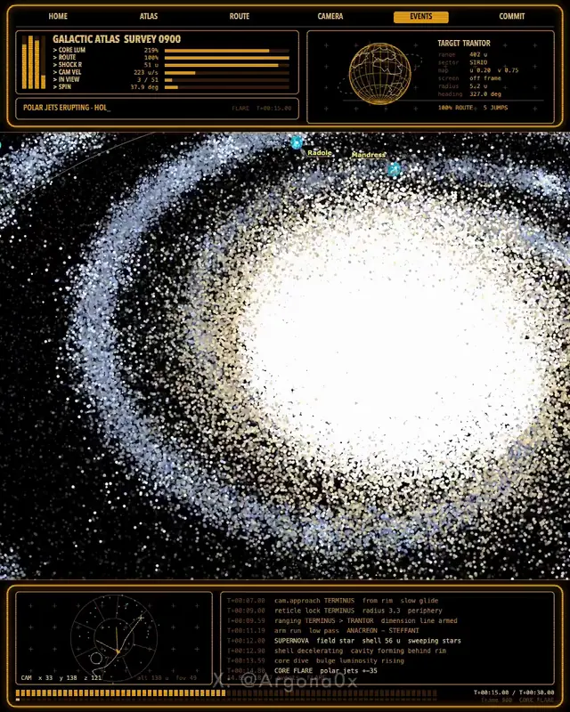</a>

**GPT-6 Astra** · 动画 · 作者 [Argona](https://x.com/Argona0x) · 2026-09-18

在 Codex 中给 GPT-6 Astra 一句话,它就写出轨道物理、渲染器和相机路径,生成带科幻勘测界面的星系飞行动画。

<details>
<summary>Wandy3D 制作简报</summary>

```text
Build a deterministic 30-second animated flight through a spiral galaxy, written as code that renders its own frames. Simulate roughly 320,000 stars with differential orbital speeds so the spiral arms stay wound, and add a core burst with polar jets and an outward shockwave that carves a cavity in the disc. Render stars as soft white-blue points around a warm glowing core on a black background, with a few cyan marker worlds and thin orbit lines. Overlay an amber sci-fi survey interface: top gauges and a target readout, a mini globe, and a scrolling telemetry log at the bottom, with labels for the main regions. Script a camera path that starts from an oblique overview, dives low along an arm, rises over the core and returns to a top-down view. Use a fixed random seed so every run produces the same galaxy, and export 1,800 frames at 60 fps into a finished video file. Done means the output plays smoothly and changing the seed gives a different galaxy.
```

</details>

[在 Wandy3D 查看 ↗](https://wandy3d.com/zh/prompts/rendered-30-second-flight-through-a-320-000-star-spiral-2101055500599054437?utm_source=github&utm_medium=referral&utm_campaign=awesome_3d_prompts) · [原帖](https://x.com/Argona0x/status/2101055500599054437)

---

### [带蓝宝石玻璃与拆解功能的交互式3D机械腕表](https://wandy3d.com/zh/prompts/interactive-3d-mechanical-watch-with-sapphire-glass-and-2100958838350643553?utm_source=github&utm_medium=referral&utm_campaign=awesome_3d_prompts)

<a href="https://wandy3d.com/zh/prompts/interactive-3d-mechanical-watch-with-sapphire-glass-and-2100958838350643553?utm_source=github&amp;utm_medium=referral&amp;utm_campaign=awesome_3d_prompts">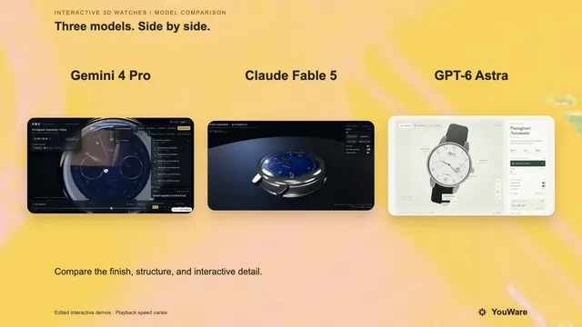</a>

**Gemini 4 Pro** · 互动 · 作者 [YouWare](https://x.com/YouWareAI) · 2026-09-18

三模型对比:Gemini 4 Pro、Claude Fable 5 与 GPT-6 Astra 用同一提示词做出 Three.js 腕表展示,Gemini 4 Pro 的细节最丰富。

<details>
<summary>提示词</summary>

```text
Use Three.js to develop a highly faithful 3D interactive watch model of an IWC Schaffhausen timepiece. Requirements: 1) The dial structure must be highly precise, with every mechanical component individually rendered and clearly distinguishable; 2) The watch face must use a sapphire glass material with realistic transparency, refraction, and reflection effects; 3) The minute hand and second hand must be correct hands that follow real timekeeping logic, with automatic continuous hand-sweep animation; 4) Support disassembly and reassembly of the watch, with each part able to be separated and viewed individually; 5) The overall level of detail must be extremely high, closely matching the structure and proportions of a real watch, with realistic material textures for screws, metal parts, and other components, and fine craftsmanship. Please ensure the model runs smoothly in the browser and interacts naturally.
```

</details>

[在 Wandy3D 查看 ↗](https://wandy3d.com/zh/prompts/interactive-3d-mechanical-watch-with-sapphire-glass-and-2100958838350643553?utm_source=github&utm_medium=referral&utm_campaign=awesome_3d_prompts) · [原帖](https://x.com/YouWareAI/status/2100958838350643553)

---

### [一句话让智能体在 Blender 中搭建写实 3D 世界](https://wandy3d.com/zh/prompts/photorealistic-blender-world-built-by-an-agent-from-one-2100844566718926949?utm_source=github&utm_medium=referral&utm_campaign=awesome_3d_prompts)

<a href="https://wandy3d.com/zh/prompts/photorealistic-blender-world-built-by-an-agent-from-one-2100844566718926949?utm_source=github&amp;utm_medium=referral&amp;utm_campaign=awesome_3d_prompts">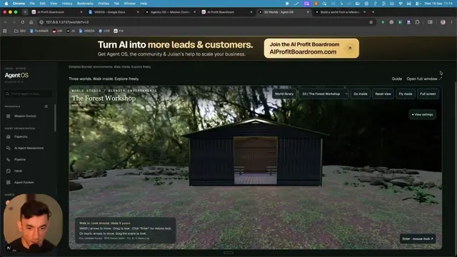</a>

**GPT-6 Astra** · 场景 · 作者 [Julian Goldie SEO](https://x.com/JulianGoldieSEO) · 2026-09-18

GPT-6 Astra 通过 Blender MCP 做出一座黄昏水边茶屋，附带参考图、渲染图和可自由飞行浏览的场景。

<details>
<summary>提示词</summary>

```text
Build a photorealistic 3D world. Surprise me.
```

</details>

[在 Wandy3D 查看 ↗](https://wandy3d.com/zh/prompts/photorealistic-blender-world-built-by-an-agent-from-one-2100844566718926949?utm_source=github&utm_medium=referral&utm_campaign=awesome_3d_prompts) · [原帖](https://x.com/JulianGoldieSEO/status/2100844566718926949)

---

### [Three.js 空中缆车游戏：穿梭于漂浮低多边形岛屿之间](https://wandy3d.com/zh/prompts/three-js-aerial-tram-game-across-floating-low-poly-islands-2100838828433179037?utm_source=github&utm_medium=referral&utm_campaign=awesome_3d_prompts)

<a href="https://wandy3d.com/zh/prompts/three-js-aerial-tram-game-across-floating-low-poly-islands-2100838828433179037?utm_source=github&amp;utm_medium=referral&amp;utm_campaign=awesome_3d_prompts">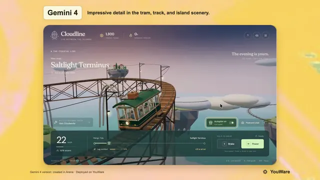</a>

**GPT-6 Astra** · 游戏 · 作者 [YouWare](https://x.com/YouWareAI) · 2026-09-18

这是一次对比：同一提示词交给 GPT-6 Astra 和 Gemini 4。Astra 的版本是带工坊改装界面的温馨电车游戏。

<details>
<summary>提示词</summary>

```text
Create a single-file HTML/JS 3D game (Three.js) that can be played directly in the browser, with a warm, low-poly but polished indie game style, evoking the feel of a Ghibli seaside town combined with the smoothness of Zelda's mine cart tracks.     
【Core Gameplay】  The player drives a retro aerial tram, traveling between islands floating above a sea of clouds and the ocean surface.  - The track is a continuous 3D railway, featuring straight sections, uphill slopes, downhill slopes, elevated curves, and long bridges across the sea  - Controls: W to accelerate (Power), S to brake (Brake), left and right for fine-tuning or switching the view  - Real-time display: speed in km/h, number of passengers on board (e.g., 12/16 aboard), road conditions (Steady / Crosswind)  - Passenger comfort system: sudden acceleration, hard braking, taking corners too fast, and crosswinds all reduce "leg comfort"; arriving at the destination smoothly earns bonus points (e.g., +75 at arrival)  - Streak: driving too bumpily will trigger the message "Streak broken. Find your balance to rebuild your tips."  - Arrive at the station, open the doors for passengers to get on and off. On the platform, there are townsfolk queuing up, with subtitles such as "Doors opening - Mango Tide," "Please wait…"     [World and Stations]  At least two routes/two islands:  1. Saltlight Terminus  2. Mango Tide  The island is a rocky island floating above the clouds, with small Mediterranean/Southern European-style houses with red-tiled roofs, a lighthouse, a dock, green trees, streetlights, and warm yellow windows at night. In the distance, there are more floating islands and circling orbits. The sky is a blue-purple gradient from dusk to night, with stars and thick clouds, and below is azure seawater.     [Tram Exterior]  Retro tram: dark green body, wood-colored chassis, curved glass windows, roof luggage, green awning/vine decorations, and various passengers sitting inside. While moving, there is a slight swaying motion and a sense of track sounds (which can be conveyed with simple sound effects or visual cues).     [Scene 2: Workshop Modification]  Switch to the top-down isometric view of the workshop "Cloudworks / Oliver Cloudworks / Oliver's home island."  Players can swap parts for the tram, with an interface like an upgrade pop-up:  - Hearth leaves — Lifting the old part  - Little Companion — Preparing the tram  Progress bar + "Sit back and watch the workshop."  Changes to the tram's appearance after modification (e.g., green roof, added luggage rack, lanterns, vines), then it drives out of the workshop, subtitles "All aboard." / "Next stop: the Coastal Line."     [UI]  Clean modern casual game UI: destination and currency/streak in the top-left, speed bar and Power/Brake buttons at the bottom, comfort progress bar connecting the two station names. No clutter, don't make it horror or cyberpunk.     [Technical Requirements]  - Single file or minimal files, Three.js  - Use curves for the track (CatmullRom, etc.) so the tram follows the rails, camera follows with a slight rail feel  - Simple physics feel: acceleration inertia, braking deceleration, body roll when cornering  - On mobile, try to also support tap to accelerate/brake  - Readable code, with comments, playable as soon as it's opened.
```

</details>

[在 Wandy3D 查看 ↗](https://wandy3d.com/zh/prompts/three-js-aerial-tram-game-across-floating-low-poly-islands-2100838828433179037?utm_source=github&utm_medium=referral&utm_campaign=awesome_3d_prompts) · [原帖](https://x.com/YouWareAI/status/2100838828433179037)

---

### [灵巧机械手转笔：在 Isaac Lab 中用强化学习训练](https://wandy3d.com/zh/prompts/dexterous-robot-hand-spinning-a-pen-trained-with-rl-in-isaac-2100751369619820923?utm_source=github&utm_medium=referral&utm_campaign=awesome_3d_prompts)

<a href="https://wandy3d.com/zh/prompts/dexterous-robot-hand-spinning-a-pen-trained-with-rl-in-isaac-2100751369619820923?utm_source=github&amp;utm_medium=referral&amp;utm_campaign=awesome_3d_prompts">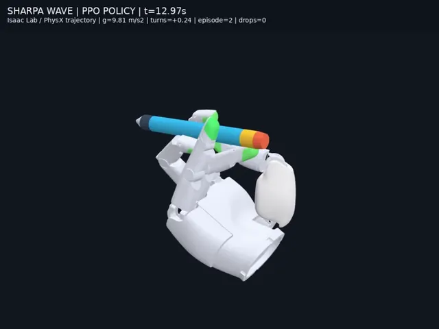</a>

**GPT-6 Astra** · 动画 · 作者 [AI Will](https://x.com/FinanceYF5) · 2026-09-18

仅凭一段简短提示词，GPT-6 Astra 自主运行一天半，交付了能让机械手转笔的 PPO 策略和演示视频。

<details>
<summary>提示词</summary>

```text
让灵巧手完成转笔。使用 Isaac Lab 进行强化学习，采用 Sharpa hand，并自行创建笔的 3D 网格。最终交付训练好的策略和可视化视频。可以自由联网搜索、下载论文及所需资料。
```

</details>

[在 Wandy3D 查看 ↗](https://wandy3d.com/zh/prompts/dexterous-robot-hand-spinning-a-pen-trained-with-rl-in-isaac-2100751369619820923?utm_source=github&utm_medium=referral&utm_campaign=awesome_3d_prompts) · [原帖](https://x.com/FinanceYF5/status/2100751369619820923)

---

### [夜间篝火旁的像素风骑士:单文件 Three.js 场景](https://wandy3d.com/zh/prompts/pixel-art-knight-at-a-night-campfire-in-a-single-file-three-2100350602316558428?utm_source=github&utm_medium=referral&utm_campaign=awesome_3d_prompts)

<a href="https://wandy3d.com/zh/prompts/pixel-art-knight-at-a-night-campfire-in-a-single-file-three-2100350602316558428?utm_source=github&amp;utm_medium=referral&amp;utm_campaign=awesome_3d_prompts"></a>

**GPT-6 Astra** · 互动 · 作者 [Vib3Coded](https://x.com/vib3coded) · 2026-09-16

GPT-6 Astra 生成了像素风森林空地:体素骑士在摇曳的篝火旁休息,可切换六种动作。

<details>
<summary>提示词</summary>

```text
You are a Senior Creative WebGL & Three.js Developer. Your task is to build a complete, production-ready, interactive 3D scene contained entirely within a single standalone HTML file (index.html) using Three.js + webgl

### 1. Visual Theme & Art Direction

- Atmosphere: Deep night forest, cozy glowing campfire, solitary weary knight resting at the campsite (Dark Souls bonfire / classic retro RPG aesthetic).
- Aesthetic: 3D Pixel Art / Voxel / Low-Poly aesthetic.
- Shading & Post-Processing: Integrate Three.js post-processing (RenderPixelatedPass or an equivalent low-resolution pixelation/dithering effect) to achieve an authentic 16-bit/32-bit retro look.

### 2. Scene Geometry & Assets (100% Procedural — No External .gltf/.obj Files)

All assets must be constructed procedurally using Three.js geometric primitives (BoxGeometry, CylinderGeometry, etc.) and basic materials so the file runs locally without CORS issues.

1. Forest Environment:

   - Ground: Dark stylized terrain with procedural voxel stones, mushrooms, and low-poly foliage.
   - Trees: Procedural pine/spruce or blocky canopy trees surrounding the clearing to create depth and seclusion.
   - Sky & Lighting: Deep midnight sky with flickering voxel stars and a cool moonlight DirectionalLight casting soft shadows.
   - Depth: THREE.FogExp2 with a dark atmospheric color to blend the horizon.

2. Campfire:

   - Stone circle surrounding smoldering logs and procedural ember embers.
   - Fire System: Animated pixelated particles (Points or pulsing voxel meshes) rising upward.
   - Dynamic Lighting: Warm orange-red PointLight with continuous, natural flicker logic (using Math.sin, noise, or pseudo-random variations).

3. The Knight:

   - Hierarchical scene graph (groups for head, torso, upper/lower arms, legs, cape, and sword) built from voxelized primitives.
   - Visual details: Slotted helmet, chest armor, pauldrons, gauntlets, and a sheath/sword.
   - Pivot points must be aligned correctly at joints (shoulders, elbows, hips, knees) for clean procedural rotation animations.

### 3. Interactive Knight State Machine

Implement smooth procedural animations using linear interpolation (lerp) or trigonometric curves inside the render loop for the following selectable states:

- Sit by Fire (Default Idle): Sits cross-legged or crouched, subtle breathing cycles, warming hands near the flames.
- Add Firewood: Knight stands up, retrieves a log, and tosses it onto the fire. The fire visibly flares up, expands its light radius temporarily, and emits a burst of sparks.
- Sword Practice: Stands up, draws the sword, executes a clean 3-part attack/parry routine, and returns to a combat guard stance.
- Look into the Distance: Walks to the edge of the clearing, plants the sword into the ground, and stares out into the dark while the cape sways.
- Sleep: Lies down on a bedroll beside the fire; floating animated pixel "Z z z" particles rise from the helmet.
- Roast Meat: Holds a stick with food over the flame; emits subtle procedural smoke/steam particles.

### 4. Camera System

Provide preset camera switches with smooth transition interpolation (lerping position and target):

- Cozy Close-up: Medium shot focusing on the knight and the firelight.
- Isometric RPG: Classic high 45-degree tactical overview of the clearing.
- Cinematic Ground: Low-angle dramatic shot looking upward at the knight against the starry sky and pine canopies.
- Free Orbit: Seamless switch to standard OrbitControls for interactive inspection.

### 5. UI & Audio

- UI Style: Retro 8-bit/16-bit RPG HUD layout using semi-transparent dark frames with pixelated borders and an embedded Google Font (e.g., 'Press Start 2P').
- Bottom Panel: Interactive action buttons triggering each knight state.
- Top-Right Panel: Camera angle switcher buttons.
- Firewood Counter: Tracks logs added and current fire intensity.
```

[……（以下省略，完整提示词见 Wandy3D）](https://wandy3d.com/zh/prompts/pixel-art-knight-at-a-night-campfire-in-a-single-file-three-2100350602316558428?utm_source=github&utm_medium=referral&utm_campaign=awesome_3d_prompts)

</details>

[在 Wandy3D 查看 ↗](https://wandy3d.com/zh/prompts/pixel-art-knight-at-a-night-campfire-in-a-single-file-three-2100350602316558428?utm_source=github&utm_medium=referral&utm_campaign=awesome_3d_prompts) · [原帖](https://x.com/vib3coded/status/2100350602316558428)

---

### [CAD 设计的机器人躯体：舵机底座、走线与分层外壳](https://wandy3d.com/zh/prompts/robot-body-designed-in-cad-servo-base-wiring-and-layered-2100343136077877251?utm_source=github&utm_medium=referral&utm_campaign=awesome_3d_prompts)

<a href="https://wandy3d.com/zh/prompts/robot-body-designed-in-cad-servo-base-wiring-and-layered-2100343136077877251?utm_source=github&amp;utm_medium=referral&amp;utm_campaign=awesome_3d_prompts">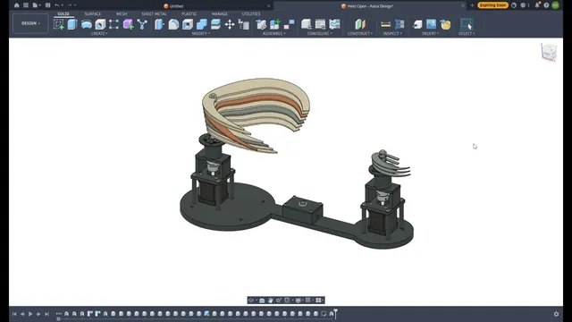</a>

**GPT-6 Astra** · 资产 · 作者 [Vitaliy Duvalko](https://x.com/vitalduval) · 2026-09-16

让 GPT-6 Astra 为自己设计身体，得到一套 CAD 装配体：带舵机和走线的底板，上方是弧形分层外壳。

<details>
<summary>Wandy3D 制作简报</summary>

```text
Build a CAD model of a small robot body that a model designs for itself. Start from a flat dark circular base plate with an extended arm section. Mount two servo-style actuator pillars on it, one near the centre and one at the end of the arm, and add a small control board plus routed cables. Above the central pillar, create a curved, layered shell made of stacked cream and tan panels that sweep upward like a fin. Use parametric parts in a CAD tool so dimensions can be edited, and keep components as separate named bodies. Deliver the CAD file, exported meshes and a short rotating preview. Done means the assembly reads clearly as a mechanical body, with no overlapping parts and visible wiring.
```

</details>

[在 Wandy3D 查看 ↗](https://wandy3d.com/zh/prompts/robot-body-designed-in-cad-servo-base-wiring-and-layered-2100343136077877251?utm_source=github&utm_medium=referral&utm_campaign=awesome_3d_prompts) · [原帖](https://x.com/vitalduval/status/2100343136077877251)

---

### [可漫游并选择瓷砖的 3D 公寓:Blender 建模加网页体验](https://wandy3d.com/zh/prompts/walkable-3d-apartment-with-tile-options-modeled-in-blender-2100222426705453318?utm_source=github&utm_medium=referral&utm_campaign=awesome_3d_prompts)

<a href="https://wandy3d.com/zh/prompts/walkable-3d-apartment-with-tile-options-modeled-in-blender-2100222426705453318?utm_source=github&amp;utm_medium=referral&amp;utm_campaign=awesome_3d_prompts">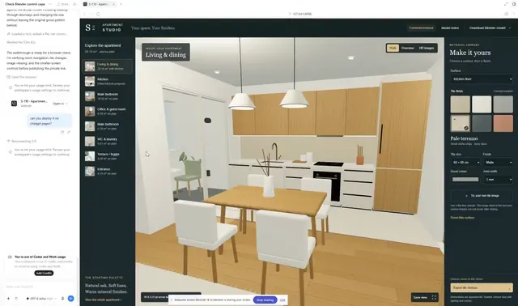</a>

**GPT-6 Astra** · 互动 · 作者 [Shimecki](https://x.com/scheemunai) · 2026-09-16

GPT-6 Astra 在 Blender 中建出整套公寓,并做成可在网页里漫游、切换瓷砖方案的查看器。

<details>
<summary>提示词</summary>

```text
I want you to build a completely realistic HD 3D render model in blender, then build interactive web experience so I can walk within the apartment, and choose tile options.
```

</details>

[在 Wandy3D 查看 ↗](https://wandy3d.com/zh/prompts/walkable-3d-apartment-with-tile-options-modeled-in-blender-2100222426705453318?utm_source=github&utm_medium=referral&utm_campaign=awesome_3d_prompts) · [原帖](https://x.com/scheemunai/status/2100222426705453318)

---

### [钢桥竞技场上的涂墨团队射击游戏(PC 版)](https://wandy3d.com/zh/prompts/ink-splatting-team-shooter-on-a-steel-bridge-arena-built-for-2100194321987461503?utm_source=github&utm_medium=referral&utm_campaign=awesome_3d_prompts)

<a href="https://wandy3d.com/zh/prompts/ink-splatting-team-shooter-on-a-steel-bridge-arena-built-for-2100194321987461503?utm_source=github&amp;utm_medium=referral&amp;utm_campaign=awesome_3d_prompts">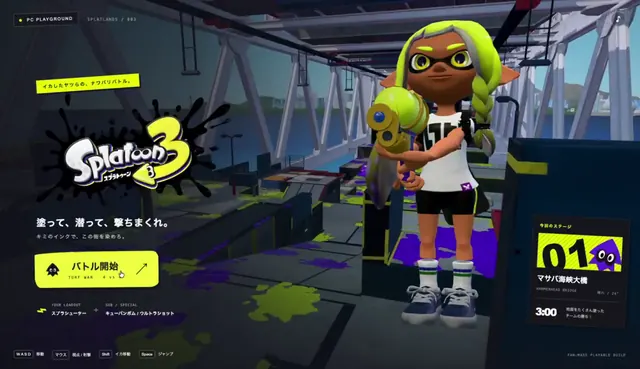</a>

**GPT-6 Astra** · 游戏 · 作者 [basio](https://x.com/basio39) · 2026-09-16

GPT-6 Astra 仅凭一条目标指令就做出带计时、得分界面和暂停菜单的涂墨射击游戏,玩法仍显粗糙。

<details>
<summary>提示词</summary>

```text
/goal PC版スプラトゥーンを開発してください。グラフィックは完全に再現してください。
```

</details>

[在 Wandy3D 查看 ↗](https://wandy3d.com/zh/prompts/ink-splatting-team-shooter-on-a-steel-bridge-arena-built-for-2100194321987461503?utm_source=github&utm_medium=referral&utm_campaign=awesome_3d_prompts) · [原帖](https://x.com/basio39/status/2100194321987461503)

---

### [Blender 房间场景:柜门与铰链面板可开合,渲染成演示视频](https://wandy3d.com/zh/prompts/blender-room-scene-with-opening-cabinet-doors-and-hinged-2100139076816916977?utm_source=github&utm_medium=referral&utm_campaign=awesome_3d_prompts)

<a href="https://wandy3d.com/zh/prompts/blender-room-scene-with-opening-cabinet-doors-and-hinged-2100139076816916977?utm_source=github&amp;utm_medium=referral&amp;utm_campaign=awesome_3d_prompts">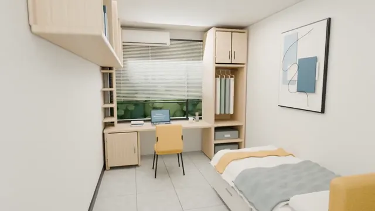</a>

**GPT-6 Astra** · 场景 · 作者 [Wentao Zhu](https://x.com/walterzhu8) · 2026-09-16

GPT-6 Astra 通过 Blender MCP 把一张房间照片做成带家具的场景,柜门和面板在镜头前依次打开。

<details>
<summary>提示词</summary>

```text
Given the room photo I provided, use Blender MCP to build an interactive 3D scene and render it into a demo video. Include articulated object motion (hinges, doors, drawers) and use sensible camera moves to show these effects.
```

</details>

[在 Wandy3D 查看 ↗](https://wandy3d.com/zh/prompts/blender-room-scene-with-opening-cabinet-doors-and-hinged-2100139076816916977?utm_source=github&utm_medium=referral&utm_campaign=awesome_3d_prompts) · [原帖](https://x.com/walterzhu8/status/2100139076816916977)

---

### [可涂抹神经系统驱动3D蜜蜂的交互式面板](https://wandy3d.com/zh/prompts/interactive-insect-nervous-system-panel-that-drives-a-rigged-2099719427990134984?utm_source=github&utm_medium=referral&utm_campaign=awesome_3d_prompts)

<a href="https://wandy3d.com/zh/prompts/interactive-insect-nervous-system-panel-that-drives-a-rigged-2099719427990134984?utm_source=github&amp;utm_medium=referral&amp;utm_campaign=awesome_3d_prompts">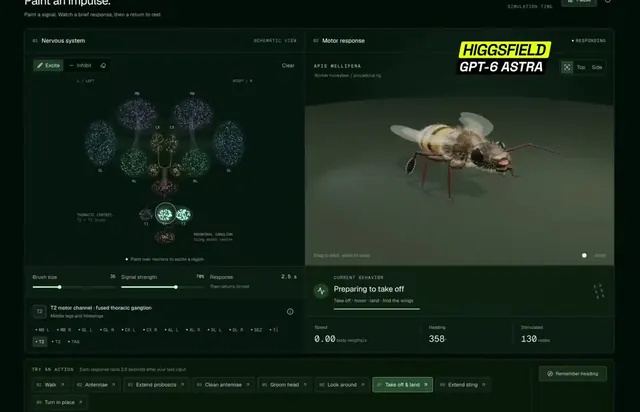</a>

**GPT-6 Astra** · 互动 · 作者 [AiMind](https://x.com/AIMind_Ai) · 2026-09-15

GPT-6 Astra做出实验室风格工具：在神经图上涂抹区域，程序化绑定的3D蜜蜂就会起飞、降落或摆动触角。

<details>
<summary>提示词</summary>

```text
Interactive panel. Left: schematic nervous system of [organism], clickable regions. Right: procedurally rigged 3D [organism]. Clicking a region triggers a 2.5 second motor response. Dark UI, telemetry for speed and heading.
```

</details>

[在 Wandy3D 查看 ↗](https://wandy3d.com/zh/prompts/interactive-insect-nervous-system-panel-that-drives-a-rigged-2099719427990134984?utm_source=github&utm_medium=referral&utm_campaign=awesome_3d_prompts) · [原帖](https://x.com/AIMind_Ai/status/2099719427990134984)

---

### [熔岩流淌、船只逃离的交互式火山岛](https://wandy3d.com/zh/prompts/interactive-volcanic-island-with-flowing-lava-and-fleeing-2099643231659012553?utm_source=github&utm_medium=referral&utm_campaign=awesome_3d_prompts)

<a href="https://wandy3d.com/zh/prompts/interactive-volcanic-island-with-flowing-lava-and-fleeing-2099643231659012553?utm_source=github&amp;utm_medium=referral&amp;utm_campaign=awesome_3d_prompts">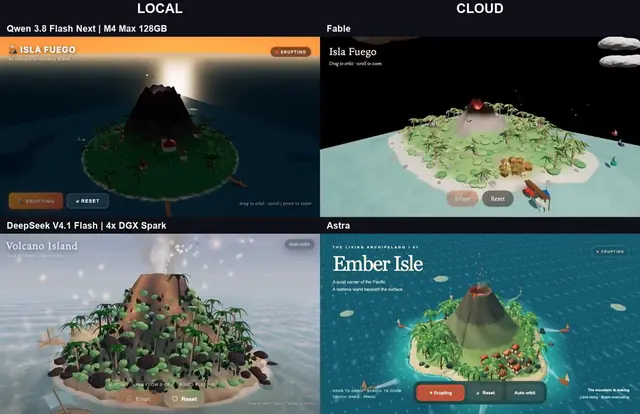</a>

**DeepSeek V4.1** · 互动 · 作者 [Wësche](https://x.com/WescheNex1q) · 2026-09-14

同一火山岛提示在四个模型上的对比。作者最推崇本地运行的DeepSeek V4.1，有熔岩、烟雾和逃离的船只。

<details>
<summary>Wandy3D 制作简报</summary>

```text
Build an interactive volcanic island in the browser as one self-contained web page. A green island with trees and small huts sits in the sea, with a volcano in the middle. The user can trigger an eruption: glowing lava runs down the slopes, smoke and embers rise from the crater, and the sky darkens. Small boats around the island notice the eruption and sail away from it. Include a simple on-screen control for erupting and one for resetting the scene, plus orbit-style camera movement so the island can be viewed from different angles. Use a warm orange lava glow against dark smoke and calm blue water. Keep the scene light enough to run smoothly on an ordinary laptop. It is done when the eruption, flowing lava and fleeing boats all work and the scene can be reset.
```

</details>

[在 Wandy3D 查看 ↗](https://wandy3d.com/zh/prompts/interactive-volcanic-island-with-flowing-lava-and-fleeing-2099643231659012553?utm_source=github&utm_medium=referral&utm_campaign=awesome_3d_prompts) · [原帖](https://x.com/WescheNex1q/status/2099643231659012553)

---

### [通过MCP和Python在Blender中搭建的酒店走廊场景](https://wandy3d.com/zh/prompts/hotel-corridor-scene-built-in-blender-through-mcp-and-python-2099588840419651890?utm_source=github&utm_medium=referral&utm_campaign=awesome_3d_prompts)

<a href="https://wandy3d.com/zh/prompts/hotel-corridor-scene-built-in-blender-through-mcp-and-python-2099588840419651890?utm_source=github&amp;utm_medium=referral&amp;utm_campaign=awesome_3d_prompts">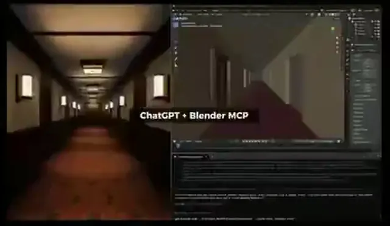</a>

**GPT-6 Astra** · 场景 · 作者 [West Lord](https://x.com/MyWestLord) · 2026-09-14

仅凭一句简短提示，GPT-6 Astra在Blender中脚本生成酒店走廊：花纹地毯、壁灯，并用测试渲染校正灯光。

<details>
<summary>提示词</summary>

```text
create hotel corridor scene
```

</details>

[在 Wandy3D 查看 ↗](https://wandy3d.com/zh/prompts/hotel-corridor-scene-built-in-blender-through-mcp-and-python-2099588840419651890?utm_source=github&utm_medium=referral&utm_campaign=awesome_3d_prompts) · [原帖](https://x.com/MyWestLord/status/2099588840419651890)

---

### [可切换白天、黄昏与夜晚的浏览器3D摩天楼城市](https://wandy3d.com/zh/prompts/browser-3d-skyscraper-city-with-day-sunset-and-night-modes-2099487024256589970?utm_source=github&utm_medium=referral&utm_campaign=awesome_3d_prompts)

<a href="https://wandy3d.com/zh/prompts/browser-3d-skyscraper-city-with-day-sunset-and-night-modes-2099487024256589970?utm_source=github&amp;utm_medium=referral&amp;utm_campaign=awesome_3d_prompts">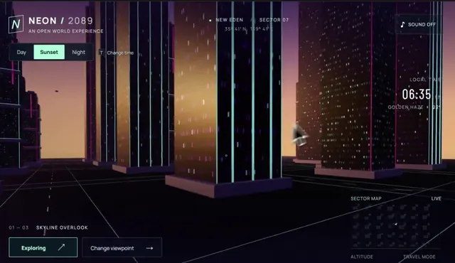</a>

**GPT-6 Astra** · 场景 · 作者 [Bilal Arshad](https://x.com/MohdBilalArshad) · 2026-09-14

GPT-6 Astra生成了可探索的3D城市,高耸摩天楼带霓虹边线并可切换时段,黄昏时在楼群间飞行最值得一试。

<details>
<summary>Wandy3D 制作简报</summary>

```text
Build an explorable 3D city of very tall skyscrapers that runs in the browser as a single page with WebGL (Three.js). Use dark glass towers with thin neon cyan and magenta edge lines and scattered lit windows, set against a warm gradient sky that goes from amber at the horizon to violet above. Add a minimal futuristic HUD: a small title block, a time-of-day switch with Day, Sunset and Night modes, a local clock with a haze readout, a mini sector map, and buttons for changing viewpoint and travel mode. The mouse steers a camera that glides between and above the towers, so the player feels the height of the buildings. Vary tower shapes: spires, stepped tops, slanted roofs and wide slabs. Switching the time of day should change sky colour and window lighting. Done means a smooth, continuous flight through a dense skyline in all three lighting modes with the interface readable on top.
```

</details>

[在 Wandy3D 查看 ↗](https://wandy3d.com/zh/prompts/browser-3d-skyscraper-city-with-day-sunset-and-night-modes-2099487024256589970?utm_source=github&utm_medium=referral&utm_campaign=awesome_3d_prompts) · [原帖](https://x.com/MohdBilalArshad/status/2099487024256589970)

---

### [Blender中200面以内的低多边形针叶树](https://wandy3d.com/zh/prompts/low-poly-conifer-tree-under-200-polygons-in-blender-2099472264270102705?utm_source=github&utm_medium=referral&utm_campaign=awesome_3d_prompts)

<a href="https://wandy3d.com/zh/prompts/low-poly-conifer-tree-under-200-polygons-in-blender-2099472264270102705?utm_source=github&amp;utm_medium=referral&amp;utm_campaign=awesome_3d_prompts">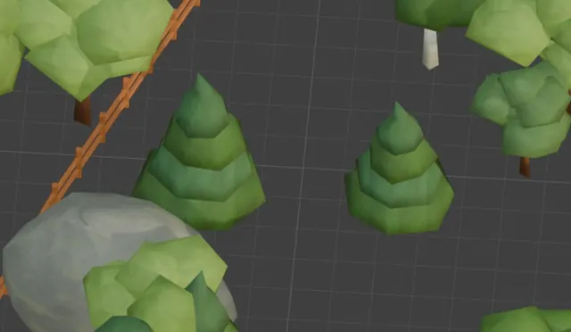</a>

**GPT-6 Astra** · 资产 · 作者 [わたもす / ゲーム制作](https://x.com/Watamos827) · 2026-09-14

向GPT-6 Astra要求生成200面以内的针叶树,它在Blender中做出了层叠的绿色树冠,作者还在反复优化外形。

<details>
<summary>提示词</summary>

```text
200ポリゴン以下で針葉樹を作ってみてくれませんか？
```

</details>

[在 Wandy3D 查看 ↗](https://wandy3d.com/zh/prompts/low-poly-conifer-tree-under-200-polygons-in-blender-2099472264270102705?utm_source=github&utm_medium=referral&utm_campaign=awesome_3d_prompts) · [原帖](https://x.com/Watamos827/status/2099472264270102705)

---

### [三列火车共用轨道且零碰撞的信号铁路模拟](https://wandy3d.com/zh/prompts/collision-free-railway-simulation-with-three-trains-and-2099362575339372780?utm_source=github&utm_medium=referral&utm_campaign=awesome_3d_prompts)

<a href="https://wandy3d.com/zh/prompts/collision-free-railway-simulation-with-three-trains-and-2099362575339372780?utm_source=github&amp;utm_medium=referral&amp;utm_campaign=awesome_3d_prompts">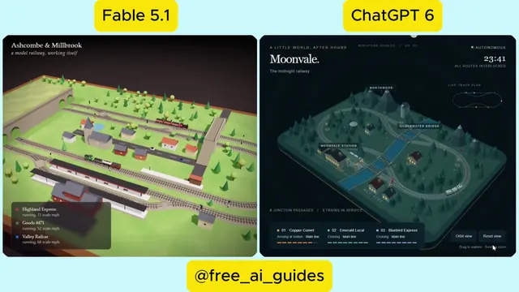</a>

**Claude Fable 5.1** · 互动 · 作者 [AI Guides](https://x.com/free_ai_guides) · 2026-09-14

对比:Claude Fable 5.1 与 GPT-6 Astra 各自用闭塞信号做出铁路,三列火车共用轨道,始终不会相撞。

<details>
<summary>Wandy3D 制作简报</summary>

```text
Build a self-running railway simulation in the browser as one self-contained HTML file, using Three.js. Create a small diorama landscape with green terrain, hills, trees, a village, a river and stations, crossed by a shared track layout with several junctions and switches. Run at least three trains on the same layout at once. Divide the track into blocks: a signal clears only when the block ahead is empty, and switches flip automatically so paths never conflict. Trains must never collide and the simulation must loop forever without any user input. Add working signals, a slowly moving camera that follows the trains or flies around the layout, and a small info panel listing each train and its status. Keep a clean low-poly look with soft daylight. Done means a long run with several trains crossing junctions, waiting at red signals and zero collisions.
```

</details>

[在 Wandy3D 查看 ↗](https://wandy3d.com/zh/prompts/collision-free-railway-simulation-with-three-trains-and-2099362575339372780?utm_source=github&utm_medium=referral&utm_campaign=awesome_3d_prompts) · [原帖](https://x.com/free_ai_guides/status/2099362575339372780)

---

### [童话城堡3D飞越:从小岛到黑白格大厅](https://wandy3d.com/zh/prompts/3d-fairytale-castle-fly-by-from-island-to-checkered-grand-2099359786865402019?utm_source=github&utm_medium=referral&utm_campaign=awesome_3d_prompts)

<a href="https://wandy3d.com/zh/prompts/3d-fairytale-castle-fly-by-from-island-to-checkered-grand-2099359786865402019?utm_source=github&amp;utm_medium=referral&amp;utm_campaign=awesome_3d_prompts">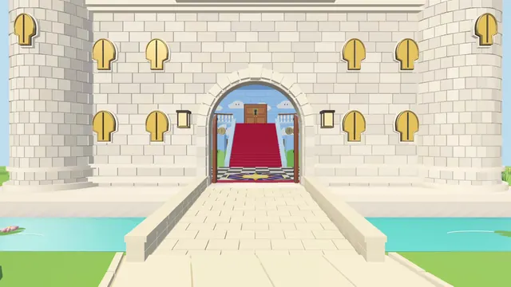</a>

**GPT-6 Astra** · 场景 · 作者 [Romain Huet](https://x.com/romainhuet) · 2026-09-14

在 Codex 中用 GPT-6 Astra 重新构建童话城堡的3D场景,镜头从小岛穿过大门,进入铺红地毯的大厅。

<details>
<summary>Wandy3D 制作简报</summary>

```text
Build a 3D fly-by scene of a fairytale castle as an interactive browser demo or rendered video. Start with a wide orbit around the castle sitting on a small round island with grass, trees, a moat and a stone path, against a pale blue sky. Then move the camera along the path toward the front gate, showing round towers with red conical roofs, a stained-glass portrait above the door and round golden windows. Continue through the doors into a grand hall with a black and white checkered floor, a central red-carpeted staircase with white railings, walls painted with clouds and green hills, wooden doors and a star-shaped floor emblem. Use bright, saturated, toy-like colors and a smooth, continuous camera move of about 30 seconds. Done means a seamless fly-by from outside to the hall.
```

</details>

[在 Wandy3D 查看 ↗](https://wandy3d.com/zh/prompts/3d-fairytale-castle-fly-by-from-island-to-checkered-grand-2099359786865402019?utm_source=github&utm_medium=referral&utm_campaign=awesome_3d_prompts) · [原帖](https://x.com/romainhuet/status/2099359786865402019)

---

### [可交互的3D猫脑浏览器,支持图层与神经信号动画](https://wandy3d.com/zh/prompts/interactive-3d-cat-brain-explorer-with-layers-and-animated-2099206962344800541?utm_source=github&utm_medium=referral&utm_campaign=awesome_3d_prompts)

<a href="https://wandy3d.com/zh/prompts/interactive-3d-cat-brain-explorer-with-layers-and-animated-2099206962344800541?utm_source=github&amp;utm_medium=referral&amp;utm_campaign=awesome_3d_prompts">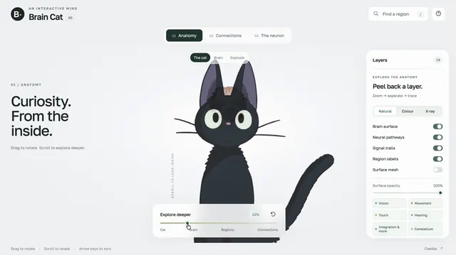</a>

**GPT-6 Astra** · 互动 · 作者 [BuBBliK](https://x.com/k1rallik) · 2026-09-13

借助 GPT-6 Astra 做出的网页:黑猫渐隐显出3D大脑,可旋转、拆分脑区,并观看流动的神经信号。

<details>
<summary>Wandy3D 制作简报</summary>

```text
Build an interactive educational web page that explores a cat brain in 3D. Use a clean, light interface with a large 3D viewport and a floating side panel. Start with a black cat that fades away to reveal the brain. Let the user rotate and zoom, separate the brain into labeled regions, click a region for its name, and toggle layers such as surfaces, pathways, signal trails and labels with an opacity slider. Add a connections view that shows the two hemispheres linked by animated signals, and a neuron view showing a single neuron with an animated signal along its axon. Use soft pastel region colors on a white background and short educational captions. Base the anatomy on public atlas data. Done means smooth orbit controls, working layer toggles and animated signals across all three views.
```

</details>

[在 Wandy3D 查看 ↗](https://wandy3d.com/zh/prompts/interactive-3d-cat-brain-explorer-with-layers-and-animated-2099206962344800541?utm_source=github&utm_medium=referral&utm_campaign=awesome_3d_prompts) · [原帖](https://x.com/k1rallik/status/2099206962344800541)

---

### [Three.js 浏览器可玩日落海滨街区,可驾驶汽车](https://wandy3d.com/zh/prompts/playable-sunset-shore-district-in-the-browser-with-three-js-2099172061092381027?utm_source=github&utm_medium=referral&utm_campaign=awesome_3d_prompts)

<a href="https://wandy3d.com/zh/prompts/playable-sunset-shore-district-in-the-browser-with-three-js-2099172061092381027?utm_source=github&amp;utm_medium=referral&amp;utm_campaign=awesome_3d_prompts">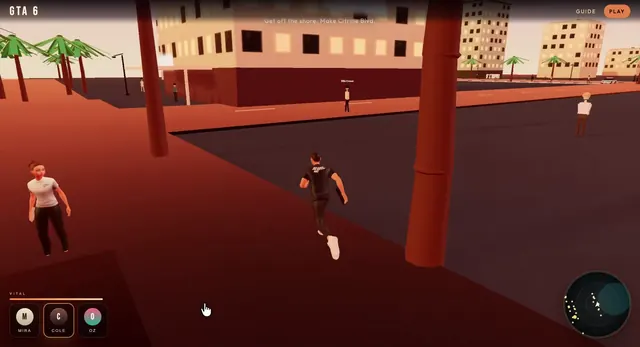</a>

**GPT-6 Astra** · 游戏 · 作者 [Lummox](https://x.com/Lummox_eth) · 2026-09-13

GPT-6 Astra 分步做出的3D浏览器切片:日落海滨城区,有棕榈树、湿沥青、行人和可驾驶的汽车。

<details>
<summary>提示词</summary>

```text
Build a playable 3D browser slice. Do not change this spec once it is locked. District and clip first. Controls after.
```

</details>

[在 Wandy3D 查看 ↗](https://wandy3d.com/zh/prompts/playable-sunset-shore-district-in-the-browser-with-three-js-2099172061092381027?utm_source=github&utm_medium=referral&utm_campaign=awesome_3d_prompts) · [原帖](https://x.com/Lummox_eth/status/2099172061092381027)

---

### [自动折叠的折纸动画:武士头盔 kabuto](https://wandy3d.com/zh/prompts/self-folding-origami-animation-of-a-samurai-helmet-2098909584996057283?utm_source=github&utm_medium=referral&utm_campaign=awesome_3d_prompts)

<a href="https://wandy3d.com/zh/prompts/self-folding-origami-animation-of-a-samurai-helmet-2098909584996057283?utm_source=github&amp;utm_medium=referral&amp;utm_campaign=awesome_3d_prompts">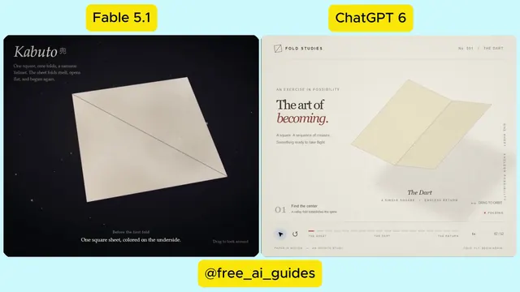</a>

**Claude Fable 5.1** · 动画 · 作者 [AI Guides](https://x.com/free_ai_guides) · 2026-09-12

对比:Claude Fable 5.1 与 GPT-6 Astra 接到同一个开放式提示。Fable 折出武士头盔,Astra 选了纸飞镖,界面更精致。

<details>
<summary>Wandy3D 制作简报</summary>

```text
Build a self-folding origami animation in a single self-contained HTML file. A flat square sheet of paper with a printed pattern folds step by step into a recognizable traditional figure, such as a samurai helmet, then unfolds back to flat and repeats. Model every fold as a rotation around a crease line, keep track of which paper layers are on top and which faces are visible, and update the 3D shape after each step. Show a soft shadow under the paper on a dark, starry stage. Add a small caption naming the current step and the figure, plus a minimal editorial-style UI with play, pause and restart controls and a step progress bar. Use a warm red paper with a subtle pattern and a cream reverse side. Done means the full fold sequence plays smoothly without layers clipping, the figure is clearly identifiable at the end, and the loop restarts cleanly.
```

</details>

[在 Wandy3D 查看 ↗](https://wandy3d.com/zh/prompts/self-folding-origami-animation-of-a-samurai-helmet-2098909584996057283?utm_source=github&utm_medium=referral&utm_campaign=awesome_3d_prompts) · [原帖](https://x.com/free_ai_guides/status/2098909584996057283)

---

### [可切换26个系统的核反应堆厂房交互式3D展览](https://wandy3d.com/zh/prompts/interactive-3d-exhibit-of-a-nuclear-reactor-building-with-26-2098841316591346006?utm_source=github&utm_medium=referral&utm_campaign=awesome_3d_prompts)

<a href="https://wandy3d.com/zh/prompts/interactive-3d-exhibit-of-a-nuclear-reactor-building-with-26-2098841316591346006?utm_source=github&amp;utm_medium=referral&amp;utm_campaign=awesome_3d_prompts">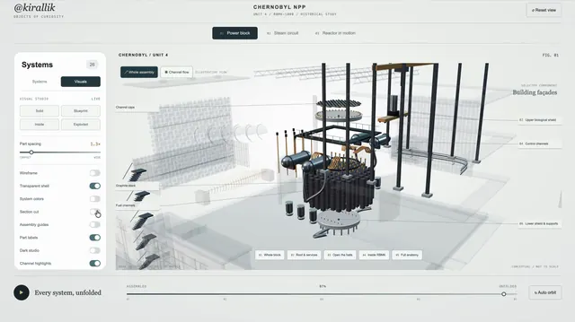</a>

**GPT-6 Astra** · 互动 · 作者 [BuBBliK](https://x.com/k1rallik) · 2026-09-12

GPT-6 Astra 生成了可探索的3D反应堆展览:可显示或隐藏各系统,动力块逐层展开,蒸汽与汽轮机持续运动。

<details>
<summary>Wandy3D 制作简报</summary>

```text
Build an interactive 3D web exhibit of a nuclear power plant reactor building that visitors can explore. Model the structure from many small parts: reactor core with fuel channels, steam drums, pipes, turbine hall, frames and walls. Add a side panel with toggles to show or hide about two dozen systems, plus a slider that pulls the power block apart layer by layer into an exploded view. Include three modes: a plant view, a reactor close-up and a schematic titled around turning heat into motion that shows the loop from reactor to steam, turbine and generator. Animate steam flow, water movement and a spinning turbine. Use a clean light technical style with thin dark lines and a restrained palette, and a dark variant for the schematic mode. Orbit camera with labels on hover. Done means every system toggles correctly, the exploded view is smooth and the animations run in real time in the browser.
```

</details>

[在 Wandy3D 查看 ↗](https://wandy3d.com/zh/prompts/interactive-3d-exhibit-of-a-nuclear-reactor-building-with-26-2098841316591346006?utm_source=github&utm_medium=referral&utm_campaign=awesome_3d_prompts) · [原帖](https://x.com/k1rallik/status/2098841316591346006)

---

### [钢珠不断绘制图案的动态沙盘模拟](https://wandy3d.com/zh/prompts/kinetic-sand-table-with-a-steel-ball-drawing-endless-2098831830002851846?utm_source=github&utm_medium=referral&utm_campaign=awesome_3d_prompts)

<a href="https://wandy3d.com/zh/prompts/kinetic-sand-table-with-a-steel-ball-drawing-endless-2098831830002851846?utm_source=github&amp;utm_medium=referral&amp;utm_campaign=awesome_3d_prompts">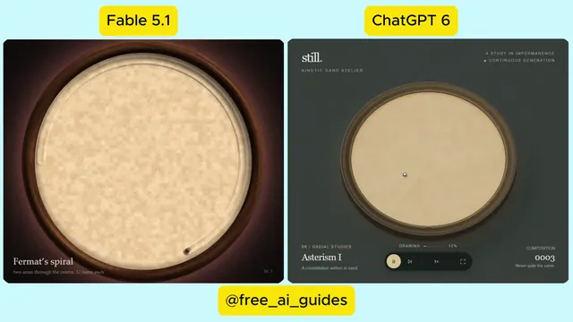</a>

**Claude Fable 5.1** · 动画 · 作者 [AI Guides](https://x.com/free_ai_guides) · 2026-09-12

又一组对比:Claude Fable 5.1 与 GPT-6 Astra 模拟沙盘,钢珠刻出螺旋和曲线,旧图案慢慢融入下一幅。

<details>
<summary>Wandy3D 制作简报</summary>

```text
Build a kinetic sand table simulation in a single self-contained HTML file. Show a round tray of fine sand inside a dark wooden rim, seen from above with soft lighting. A small steel ball rolls across the sand and carves a groove that remembers every pass; there is no eraser, so each new pattern is drawn over the previous one and the old design slowly smooths away into the next. Generate an endless sequence of mathematical patterns that never repeat, such as spirals, rose and flower curves and Lissajous figures, and show the current pattern name in a small caption. Add a minimal control bar with play, pause and skip, and a counter for the number of patterns drawn. Use warm sand tones with subtle grain and shading on the groove edges. Done means the groove looks believable, patterns blend smoothly into each other and the piece can run unattended.
```

</details>

[在 Wandy3D 查看 ↗](https://wandy3d.com/zh/prompts/kinetic-sand-table-with-a-steel-ball-drawing-endless-2098831830002851846?utm_source=github&utm_medium=referral&utm_campaign=awesome_3d_prompts) · [原帖](https://x.com/free_ai_guides/status/2098831830002851846)

---

[← 上一页](catalog.zh.2.md) · 第 3 页，共 3 页

提示词、视频和图片的权利归原作者所有（[RIGHTS.md](../RIGHTS.md)）。我们撰写的文字采用 [CC BY 4.0](../LICENSE) 许可。知道有成果展示的好提示词？[推荐给我们](https://github.com/wornoxgames/awesome-3d-prompts/issues/new?template=suggest.md)。如果你是作者并希望修改或删除条目，请[联系我们](https://github.com/wornoxgames/awesome-3d-prompts/issues/new?template=removal.md)。
