<!-- Generated file: edits are overwritten. -->

# Awesome 3D Prompts — 目录 5/8

[← Awesome 3D Prompts](../README.md) · [English](catalog.en.1.md) · [Русский](catalog.ru.1.md) · [日本語](catalog.ja.1.md) · **中文**

[← 上一页](catalog.zh.4.md) · 第 5 页，共 8 页 · [下一页 →](catalog.zh.6.md)

### [用Next.js和Three.js做的发光水母3D落地页](https://wandy3d.com/zh/prompts/bioluminescent-jellyfish-3d-landing-page-with-next-js-and-2096269057544831175?utm_source=github&utm_medium=referral&utm_campaign=awesome_3d_prompts)

<a href="https://wandy3d.com/zh/prompts/bioluminescent-jellyfish-3d-landing-page-with-next-js-and-2096269057544831175?utm_source=github&amp;utm_medium=referral&amp;utm_campaign=awesome_3d_prompts"></a>

**GPT-6 Astra** · 互动 · 作者 [Himanshu Hingorani](https://x.com/himanshubuildss) · 2026-09-05

GPT-6 Astra通过Claude Code做出代理公司主页：首屏是WebGL发光水母，叠加玻璃拟态界面。

<details>
<summary>Wandy3D 制作简报</summary>

```text
Build a deep-sea themed agency landing page with an interactive 3D hero. Use Next.js and React, with Three.js rendering a large bioluminescent jellyfish in glowing purple and magenta that drifts and pulses in a dark navy water scene, with soft particles and light scattering. Overlay a dark glassmorphism interface in Tailwind CSS: a rounded navigation bar, a big two-line headline on the left, a primary call-to-action button, two white stat cards, a small side card with a jellyfish thumbnail and a budget figure, social icons and a short agency description at the bottom. Add scroll choreography and small hover micro-interactions with Framer Motion. The jellyfish should react gently to pointer movement and keep animating when idle. Keep text readable over the 3D layer and make the layout responsive. Done means a running project where the jellyfish moves smoothly behind the interface at a steady frame rate.
```

</details>

[在 Wandy3D 查看 ↗](https://wandy3d.com/zh/prompts/bioluminescent-jellyfish-3d-landing-page-with-next-js-and-2096269057544831175?utm_source=github&utm_medium=referral&utm_campaign=awesome_3d_prompts) · [原帖](https://x.com/himanshubuildss/status/2096269057544831175)

---

### [用Three.js做的薄雾密林：数千棵树与海量实例化草丛](https://wandy3d.com/zh/prompts/dense-misty-three-js-forest-with-thousands-of-trees-and-2096263046918197609?utm_source=github&utm_medium=referral&utm_campaign=awesome_3d_prompts)

<a href="https://wandy3d.com/zh/prompts/dense-misty-three-js-forest-with-thousands-of-trees-and-2096263046918197609?utm_source=github&amp;utm_medium=referral&amp;utm_campaign=awesome_3d_prompts">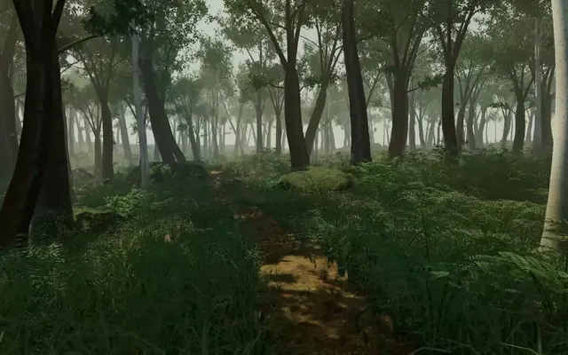</a>

**GPT-6 Astra** · 场景 · 作者 [Leon Lin](https://x.com/LexnLin) · 2026-09-05

GPT-6 Astra花数小时做出实时Three.js森林，含自定义着色器、数百万草丛、蕨类和蜿蜒小径。

<details>
<summary>Wandy3D 制作简报</summary>

```text
Build a highly detailed procedural forest in Three.js that the viewer explores from a first-person camera. Fill a large terrain with thousands of individual trees of varied shapes, millions of instanced grass clumps and tens of thousands of ferns, plus moss-covered logs, small white flowers and a worn dirt path winding between the trunks. Use custom GLSL shaders for wind-swayed grass and foliage, soft misty fog that fades distant trees into pale green haze, and filtered light coming through the canopy. Keep the palette natural: deep greens, brown bark, warm earth tones and a bright overcast sky. Use instancing and level of detail so it runs smoothly in a browser. Let the camera walk along the path and tilt up to show branches and leaves against the sky. Done means a web page that loads and runs in real time with convincing density and depth.
```

</details>

[在 Wandy3D 查看 ↗](https://wandy3d.com/zh/prompts/dense-misty-three-js-forest-with-thousands-of-trees-and-2096263046918197609?utm_source=github&utm_medium=referral&utm_campaign=awesome_3d_prompts) · [原帖](https://x.com/LexnLin/status/2096263046918197609)

---

### [体素版克卢日-纳波卡广场飞越：同一提示词双模型对比](https://wandy3d.com/zh/prompts/voxel-cluj-napoca-square-flyover-same-prompt-two-models-2096262733259837681?utm_source=github&utm_medium=referral&utm_campaign=awesome_3d_prompts)

<a href="https://wandy3d.com/zh/prompts/voxel-cluj-napoca-square-flyover-same-prompt-two-models-2096262733259837681?utm_source=github&amp;utm_medium=referral&amp;utm_campaign=awesome_3d_prompts">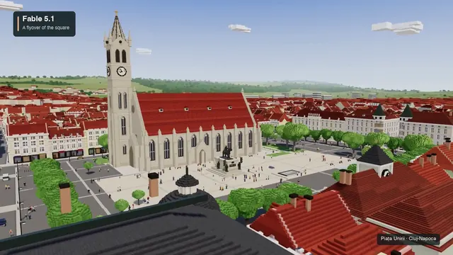</a>

**Claude Fable 5.1** · 场景 · 作者 [Dan Manastireanu](https://x.com/danmana) · 2026-09-05

对比：Claude Fable 5.1与GPT-6 Astra用同一提示词各做了体素城市广场，Fable的版本被认为更好。

<details>
<summary>Wandy3D 制作简报</summary>

```text
Build an interactive voxel-style 3D world of a real historic city square in Romania, viewable in the browser. Show a large pale paved plaza dominated by a tall Gothic church with a steep red roof and a slender clock tower, an equestrian statue, fountains or water features, rows of trees with blocky green crowns, and surrounding buildings with terracotta roofs, plus streets with small cars and many tiny pedestrians. Use a soft blue sky with blocky clouds and distant green hills. Add a guided flyover camera that circles the church and sweeps across the square, with a small caption showing the location name, and let the user also take control of the camera. Use Three.js with instanced cubes or boxes for performance, in a single HTML file if possible. Done means a recognizable, lively square that runs smoothly and can be compared against another model's version built from the same brief.
```

</details>

[在 Wandy3D 查看 ↗](https://wandy3d.com/zh/prompts/voxel-cluj-napoca-square-flyover-same-prompt-two-models-2096262733259837681?utm_source=github&utm_medium=referral&utm_campaign=awesome_3d_prompts) · [原帖](https://x.com/danmana/status/2096262733259837681)

---

### [用C\#和WASM实现的赛车物理引擎，在Three.js中渲染](https://wandy3d.com/zh/prompts/racing-car-physics-engine-in-c-and-wasm-rendered-in-three-js-2096258619574513880?utm_source=github&utm_medium=referral&utm_campaign=awesome_3d_prompts)

<a href="https://wandy3d.com/zh/prompts/racing-car-physics-engine-in-c-and-wasm-rendered-in-three-js-2096258619574513880?utm_source=github&amp;utm_medium=referral&amp;utm_campaign=awesome_3d_prompts">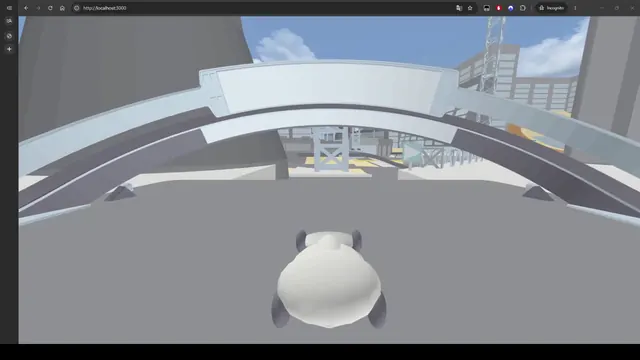</a>

**GPT-6 Astra** · 互动 · 作者 [achepta](https://x.com/achepta_tm) · 2026-09-05

GPT-6 Astra大约一天就用纯C#重写了赛车物理，视频里赛车在浏览器中通过Three.js行驶于网格赛道。

<details>
<summary>Wandy3D 制作简报</summary>

```text
Build a browser-based vehicle physics demo. Write the car physics engine in pure C# and compile it to WebAssembly as the backend, and render the result with Three.js. Load a racing track as collidable meshes: grey stylized road surfaces, banked curves, ramps, tubes, steel gantries and cranes against a harbor skyline with a blue sky. Show a small white car from a chase camera behind it. The physics must handle wheel contact, grip on different surface zones (coloured patches such as sand or boost areas should change behavior), jumps, wall collisions and recovery after landing. Drive the car with keyboard input and show smooth camera follow. Keep the visuals simple and flat-shaded so the focus stays on movement. Done means the car runs laps through the track in the browser with stable, believable handling and no falling through the geometry.
```

</details>

[在 Wandy3D 查看 ↗](https://wandy3d.com/zh/prompts/racing-car-physics-engine-in-c-and-wasm-rendered-in-three-js-2096258619574513880?utm_source=github&utm_medium=referral&utm_campaign=awesome_3d_prompts) · [原帖](https://x.com/achepta_tm/status/2096258619574513880)

---

### [用 Three.js 制作的 Hyperloop 胶囊模拟器与实时速度面板](https://wandy3d.com/zh/prompts/hyperloop-pod-simulator-with-live-speed-panel-in-three-js-2096250748099068377?utm_source=github&utm_medium=referral&utm_campaign=awesome_3d_prompts)

<a href="https://wandy3d.com/zh/prompts/hyperloop-pod-simulator-with-live-speed-panel-in-three-js-2096250748099068377?utm_source=github&amp;utm_medium=referral&amp;utm_campaign=awesome_3d_prompts">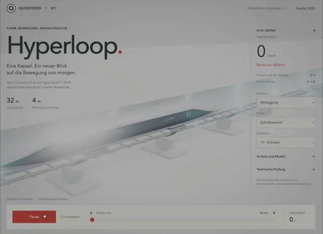</a>

**GPT-6 Astra** · 互动 · 作者 [Amir](https://x.com/hbanay98) · 2026-09-05

GPT-6 Astra 用 Three.js 做出 Hyperloop 演示:胶囊沿管道轨道加速飞驰,控制面板实时显示速度并可切换视角选项。

<details>
<summary>Wandy3D 制作简报</summary>

```text
Build an interactive Hyperloop demo web page with Three.js. Show a sleek capsule pod travelling along an elevated tube track on concrete pylons, in a pale, minimal studio setting with soft fog and a muted palette accented by a single red highlight. Place a large Hyperloop headline and short intro text on the left, and a side control panel on the right with a live speed readout in km/h and several dropdown options for the view and the pod configuration. Add a bottom bar with a pause button, a progress slider and a numeric value. The pod should accelerate smoothly while the readout climbs, and the camera should drift along the track so the scene feels cinematic. Deliver a single page that runs in the browser, with responsive layout and clean typography. Done when the pod animates continuously, the speed counter matches the motion, and the controls change what is displayed.
```

</details>

[在 Wandy3D 查看 ↗](https://wandy3d.com/zh/prompts/hyperloop-pod-simulator-with-live-speed-panel-in-three-js-2096250748099068377?utm_source=github&utm_medium=referral&utm_campaign=awesome_3d_prompts) · [原帖](https://x.com/hbanay98/status/2096250748099068377)

---

### [滚动驱动的 3D 工作室网站:玻璃丝带与漂浮卡片](https://wandy3d.com/zh/prompts/scroll-driven-3d-studio-website-with-glass-ribbon-and-2096245759121277132?utm_source=github&utm_medium=referral&utm_campaign=awesome_3d_prompts)

<a href="https://wandy3d.com/zh/prompts/scroll-driven-3d-studio-website-with-glass-ribbon-and-2096245759121277132?utm_source=github&amp;utm_medium=referral&amp;utm_campaign=awesome_3d_prompts">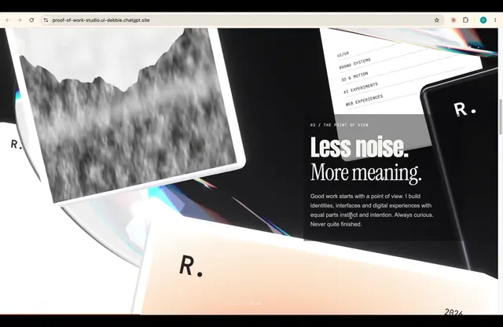</a>

**GPT-6 Astra** · 互动 · 作者 [ui.debbie](https://x.com/mx_debbiee) · 2026-09-05

GPT-6 Astra 根据一张参考图用 Three.js 做出工作室网站:滚动时漂浮卡片与玻璃环依次穿过三种色调。

<details>
<summary>Wandy3D 制作简报</summary>

```text
Build a smooth scroll-driven portfolio website for a design studio using Three.js, translating a supplied reference image into a real-time 3D scene. Open with a bold red hero where a translucent, glassy ribbon ring circles several floating white and black cards carrying short slogans, with large outlined headline lettering behind them. As the visitor scrolls, the background fades from red to grey to near-black, the cards fly into an organised grid titled selected work, and the camera finally turns the ring edge-on for a closing call-to-action screen with big white type and a contact line. Use a minimal top navigation, small monospace captions, handwritten blue accent notes and a custom cursor. Deliver one web project that runs in the browser. Done when scrolling drives every camera and object transition smoothly with no jumps, and the layout matches the reference mood.
```

</details>

[在 Wandy3D 查看 ↗](https://wandy3d.com/zh/prompts/scroll-driven-3d-studio-website-with-glass-ribbon-and-2096245759121277132?utm_source=github&utm_medium=referral&utm_campaign=awesome_3d_prompts) · [原帖](https://x.com/mx_debbiee/status/2096245759121277132)

---

### [用 Three.js 制作的动漫风 3D 皮划艇漂流游戏,音乐由代码生成](https://wandy3d.com/zh/prompts/anime-style-3d-river-kayaking-game-in-three-js-with-code-2096244208533455049?utm_source=github&utm_medium=referral&utm_campaign=awesome_3d_prompts)

<a href="https://wandy3d.com/zh/prompts/anime-style-3d-river-kayaking-game-in-three-js-with-code-2096244208533455049?utm_source=github&amp;utm_medium=referral&amp;utm_campaign=awesome_3d_prompts">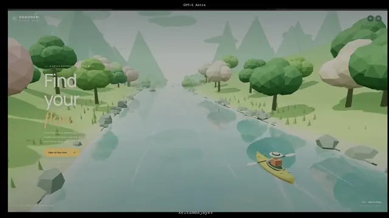</a>

**GPT-6 Astra** · 游戏 · 作者 [AJ](https://x.com/ItsmeAjayKV) · 2026-09-05

一句简短提示词,GPT-6 Astra 就做出浏览器皮划艇游戏:顺流躲开木头和岩石,场景与音效都由代码生成。

<details>
<summary>提示词</summary>

```text
build me a 3D river kayaking game with anime-ish aesthetics, where i paddle left or right to avoid obstacles.
```

</details>

[在 Wandy3D 查看 ↗](https://wandy3d.com/zh/prompts/anime-style-3d-river-kayaking-game-in-three-js-with-code-2096244208533455049?utm_source=github&utm_medium=referral&utm_campaign=awesome_3d_prompts) · [原帖](https://x.com/ItsmeAjayKV/status/2096244208533455049)

---

### [随滚动旋转的 3D 玻璃瓶产品页(React Three Fiber)](https://wandy3d.com/zh/prompts/scroll-rotating-3d-glass-bottle-product-page-in-react-three-2096243989439713677?utm_source=github&utm_medium=referral&utm_campaign=awesome_3d_prompts)

<a href="https://wandy3d.com/zh/prompts/scroll-rotating-3d-glass-bottle-product-page-in-react-three-2096243989439713677?utm_source=github&amp;utm_medium=referral&amp;utm_campaign=awesome_3d_prompts">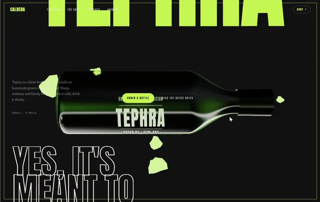</a>

**GPT-6 Astra** · 互动 · 作者 [Himanshu Hingorani](https://x.com/himanshubuildss) · 2026-09-05

GPT-6 Astra 做出 WebGL 产品网站:滚动时玻璃瓶旋转,青柠色标题与碎片从旁掠过,玻璃反射由 GLSL 着色器实现。

<details>
<summary>Wandy3D 制作简报</summary>

```text
Build a scroll-driven 3D product landing page for a fictional herbal liqueur using React Three Fiber, Three.js, Tailwind CSS and Framer Motion. Centre a glossy dark glass bottle with a printed label on a near-black background with thin frame lines. The bottle should rotate through a full turn as the visitor scrolls, with glass reflections and refraction created by custom GLSL shaders. Surround it with floating acid-lime shards. Overlay very large condensed headlines, alternating solid lime and outlined white, that slide past and interlock with the bottle, plus small captions with tasting notes and a pill-shaped order button. Keep the palette to black, lime and white. Deliver a React project that runs in the browser and stays smooth on mobile. Done when scrolling drives the bottle rotation and text transitions without stutter and the glass looks convincingly reflective.
```

</details>

[在 Wandy3D 查看 ↗](https://wandy3d.com/zh/prompts/scroll-rotating-3d-glass-bottle-product-page-in-react-three-2096243989439713677?utm_source=github&utm_medium=referral&utm_campaign=awesome_3d_prompts) · [原帖](https://x.com/himanshubuildss/status/2096243989439713677)

---

### [会掉出随机回忆胶囊的粉彩3D扭蛋机](https://wandy3d.com/zh/prompts/pastel-gashapon-machine-that-drops-random-memory-capsules-in-2096241295949975602?utm_source=github&utm_medium=referral&utm_campaign=awesome_3d_prompts)

<a href="https://wandy3d.com/zh/prompts/pastel-gashapon-machine-that-drops-random-memory-capsules-in-2096241295949975602?utm_source=github&amp;utm_medium=referral&amp;utm_campaign=awesome_3d_prompts">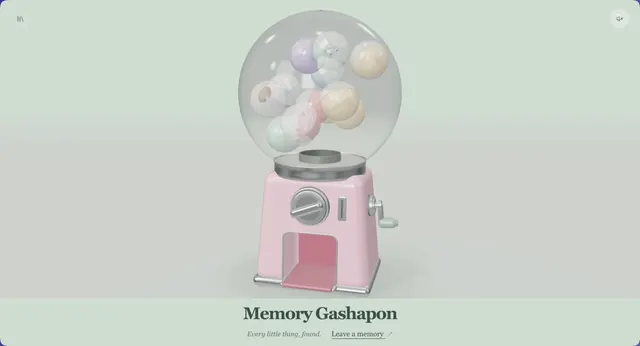</a>

**GPT-6 Astra** · 互动 · 作者 [Gloria Zhang](https://x.com/gloria_zwq) · 2026-09-05

GPT-6 Astra 通过 Blender 做出扭蛋玩具：转动旋钮，胶囊按物理规律掉落，随后弹出带音效的3D小物件。

<details>
<summary>Wandy3D 制作简报</summary>

```text
Build an interactive web toy called Memory Gashapon: a pastel pink capsule machine with a glass dome full of colorful balls, set on a soft sage-green background with a serif title under it. Model the machine and its prizes in 3D (Blender for assets, exported to a web viewer). The user turns the crank knob; the machine physically drops a capsule into the tray, it opens, and a small cute object appears, such as a handheld console, a shovel in soil, a box of fries, a plush llama or a mini fan, with a short caption and buttons to replay or collect another. Capsules should tumble with believable physics, and the knob, dome and prize reveal should animate smoothly. Add soft sound effects with a few hidden surprises. Done when the knob turn reliably yields a random prize with convincing motion and a clean, calm look.
```

</details>

[在 Wandy3D 查看 ↗](https://wandy3d.com/zh/prompts/pastel-gashapon-machine-that-drops-random-memory-capsules-in-2096241295949975602?utm_source=github&utm_medium=referral&utm_campaign=awesome_3d_prompts) · [原帖](https://x.com/gloria_zwq/status/2096241295949975602)

---

### [带跑道起飞、HUD和追尾镜头的浏览器飞行模拟器](https://wandy3d.com/zh/prompts/browser-flight-simulator-with-runway-takeoff-hud-and-chase-2096236137266512181?utm_source=github&utm_medium=referral&utm_campaign=awesome_3d_prompts)

<a href="https://wandy3d.com/zh/prompts/browser-flight-simulator-with-runway-takeoff-hud-and-chase-2096236137266512181?utm_source=github&amp;utm_medium=referral&amp;utm_campaign=awesome_3d_prompts">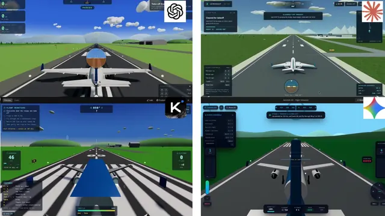</a>

**GPT-6 Astra** · 游戏 · 作者 [aditya](https://x.com/adxtyahq) · 2026-09-05

对比测试：同一飞行模拟器提示词交给 GPT-6 Astra、Kimi K3、Fable 5.1 和 Gemini，Astra 排名第一，但有卡顿。

<details>
<summary>Wandy3D 制作简报</summary>

```text
Build a browser-based 3D flight simulator. Start with a title screen and a Start Flight button, then place a passenger airliner at the end of a long runway in a bright green countryside under a blue sky. The player controls throttle, pitch, roll and yaw with the keyboard, accelerates down the runway, rotates and takes off, then flies freely. Include a HUD showing speed, altitude, heading and throttle, plus a chase camera that follows the aircraft. Add simple terrain, runway markings and a few buildings for scale. Flight physics should feel smooth, with no stutter or jitter at normal frame rates. Deliver one project that runs in the browser, and finish when takeoff, climbing, banking and landing all work reliably.
```

</details>

[在 Wandy3D 查看 ↗](https://wandy3d.com/zh/prompts/browser-flight-simulator-with-runway-takeoff-hud-and-chase-2096236137266512181?utm_source=github&utm_medium=referral&utm_campaign=awesome_3d_prompts) · [原帖](https://x.com/adxtyahq/status/2096236137266512181)

---

### [用 Three.js 程序化生成的拿破仑石膏半身像，可旋转展示](https://wandy3d.com/zh/prompts/procedural-three-js-bust-of-napoleon-in-marble-with-2096234355395903672?utm_source=github&utm_medium=referral&utm_campaign=awesome_3d_prompts)

<a href="https://wandy3d.com/zh/prompts/procedural-three-js-bust-of-napoleon-in-marble-with-2096234355395903672?utm_source=github&amp;utm_medium=referral&amp;utm_campaign=awesome_3d_prompts">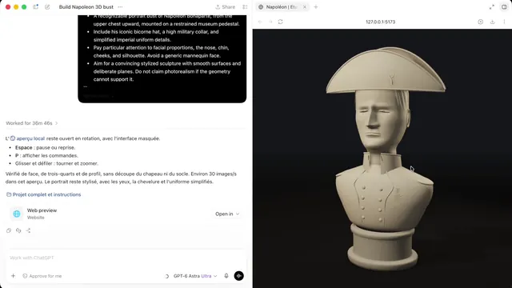</a>

**GPT-6 Astra** · 资产 · 作者 [Le PLOUTOS](https://x.com/leploutos) · 2026-09-05

GPT-6 Astra 用 Three.js 雕出拿破仑半身像，并从多个角度检查、修正比例。视频包含成品和制作延时。

<details>
<summary>Wandy3D 制作简报</summary>

```text
Build a 3D sculpture viewer in Three.js showing a stylized museum-style bust of a historical emperor in a bicorne hat and uniform with high collar, on a plain pedestal. Use a matte pale stone material, a dark studio background, and soft key lighting that shows the form. Construct the head, hat, shoulders and uniform details procedurally from simple geometry with smooth surfaces, aiming for a convincing stylized look rather than photorealism. Add a minimal title panel with the name, and controls to rotate, pause turntable motion and toggle a presentation view. Render the bust from several angles, compare against the intended look, and fix proportions that appear off. Done when the bust reads clearly from front, side and three-quarter views.
```

</details>

[在 Wandy3D 查看 ↗](https://wandy3d.com/zh/prompts/procedural-three-js-bust-of-napoleon-in-marble-with-2096234355395903672?utm_source=github&utm_medium=referral&utm_campaign=awesome_3d_prompts) · [原帖](https://x.com/leploutos/status/2096234355395903672)

---

### [火车站大厅双版本场景：Blender CLI 对比 Three.js](https://wandy3d.com/zh/prompts/railway-station-concourse-built-twice-blender-cli-vs-three-2096226711222546461?utm_source=github&utm_medium=referral&utm_campaign=awesome_3d_prompts)

<a href="https://wandy3d.com/zh/prompts/railway-station-concourse-built-twice-blender-cli-vs-three-2096226711222546461?utm_source=github&amp;utm_medium=referral&amp;utm_campaign=awesome_3d_prompts">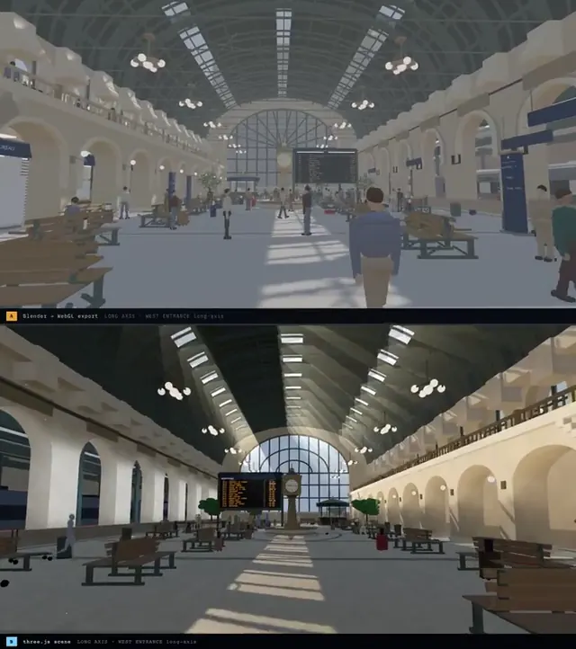</a>

**GPT-6 Astra** · 场景 · 作者 [Wormhole404](https://x.com/0xWormhole404) · 2026-09-05

GPT-6 Astra 分别用 Blender CLI 和 Three.js 搭建同一座车站大厅。作者认为 Blender 上限更高，但 Three.js 成片更好看。

<details>
<summary>Wandy3D 制作简报</summary>

```text
Build a detailed 3D scene of a grand railway station concourse and present it as a camera walkthrough. Include a vaulted glass-and-steel roof with skylights letting in sun shafts, arched windows, cream stone walls, a central freestanding double-faced clock on a round plinth, large departure boards, wooden benches, potted plants, ticket kiosks, signage and many low-poly travelers carrying luggage. Use warm beige and muted blue tones with soft shadows. Create it twice for comparison: once by scripting Blender through its command line, once directly in Three.js. Use the same layout for both, record a smooth camera path through the hall with close-ups of the clock and boards, and judge which version gives the better final picture.
```

</details>

[在 Wandy3D 查看 ↗](https://wandy3d.com/zh/prompts/railway-station-concourse-built-twice-blender-cli-vs-three-2096226711222546461?utm_source=github&utm_medium=referral&utm_campaign=awesome_3d_prompts) · [原帖](https://x.com/0xWormhole404/status/2096226711222546461)

---

### [带6自由度物理的实时轨道交会对接模拟器](https://wandy3d.com/zh/prompts/real-time-orbital-rendezvous-and-docking-simulator-with-6-2096225621303042258?utm_source=github&utm_medium=referral&utm_campaign=awesome_3d_prompts)

<a href="https://wandy3d.com/zh/prompts/real-time-orbital-rendezvous-and-docking-simulator-with-6-2096225621303042258?utm_source=github&amp;utm_medium=referral&amp;utm_campaign=awesome_3d_prompts">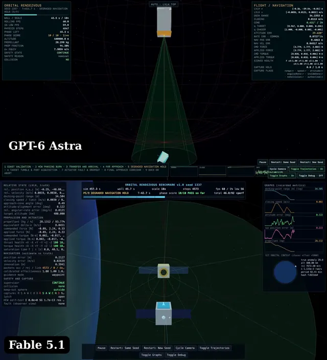</a>

**GPT-6 Astra** · 互动 · 作者 [Alican Kiraz](https://x.com/AlicanKiraz0) · 2026-09-05

在正面对比测试中，GPT-6 Astra 胜过 Fable 5.1，做出带遥测HUD和自评分的浏览器轨道对接模拟器。

<details>
<summary>Wandy3D 制作简报</summary>

```text
Build a real-time orbital rendezvous and docking simulator in the browser. A chaser spacecraft must approach and dock with a target spacecraft in orbit around Earth. Propagate true motion with two-body physics in an Earth-centered inertial frame, and use a Hill-Clohessy-Wiltshire model in the local orbital frame only for guidance and transfer planning. Give the chaser full six-degree-of-freedom rigid-body dynamics with quaternions, fuel use, and force and torque limits, so all motion comes from closed-loop control rather than set positions. Add a navigation estimator, a safety and capture check with a docking cone, and a self-grading panel. Provide a dark HUD with telemetry, phase indicator, live graphs, several camera views and buttons to pause, restart with a new seed and toggle debug. Done when it docks reliably across seeds.
```

</details>

[在 Wandy3D 查看 ↗](https://wandy3d.com/zh/prompts/real-time-orbital-rendezvous-and-docking-simulator-with-6-2096225621303042258?utm_source=github&utm_medium=referral&utm_campaign=awesome_3d_prompts) · [原帖](https://x.com/AlicanKiraz0/status/2096225621303042258)

---

### [玻璃办公室等距小场景，灯光从白天过渡到夜晚](https://wandy3d.com/zh/prompts/isometric-glass-office-diorama-with-a-day-to-night-lighting-2096222790894661841?utm_source=github&utm_medium=referral&utm_campaign=awesome_3d_prompts)

<a href="https://wandy3d.com/zh/prompts/isometric-glass-office-diorama-with-a-day-to-night-lighting-2096222790894661841?utm_source=github&amp;utm_medium=referral&amp;utm_campaign=awesome_3d_prompts">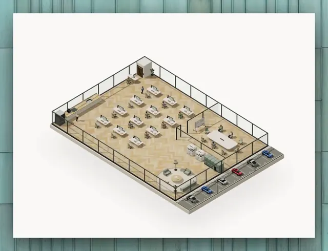</a>

**GPT-6 Astra** · 场景 · 作者 [Emil](https://x.com/EmilHovv) · 2026-09-05

GPT-6 Astra 在 Blender 中建模办公室，并用 Three.js 让它动起来：桌椅、汽车和小人，日光渐变为温暖的夜晚。

<details>
<summary>Wandy3D 制作简报</summary>

```text
Build an isometric 3D diorama of a modern single-storey office for a web onboarding page. Model the building in Blender (or procedurally) and export it for Three.js: glass walls, a wooden floor, rows of desks with chairs and computers, a meeting table, a lounge corner and a small parking strip with colourful cars along one side. Use a clean white page background with soft shadows under the floor slab. Add a day-to-evening transition: bright neutral daylight first, then warm interior lights glowing while the exterior goes dark. Animate small people walking between desks. Use a fixed isometric orthographic camera. Deliver one web project that loads the model and plays the lighting change in a loop. Done when the scene renders smoothly, the evening lighting looks warm and readable, and the figures move without clipping.
```

</details>

[在 Wandy3D 查看 ↗](https://wandy3d.com/zh/prompts/isometric-glass-office-diorama-with-a-day-to-night-lighting-2096222790894661841?utm_source=github&utm_medium=referral&utm_campaign=awesome_3d_prompts) · [原帖](https://x.com/EmilHovv/status/2096222790894661841)

---

### [可拆解为 2,234 个部件的交互式 3D 人体解剖浏览器](https://wandy3d.com/zh/prompts/interactive-3d-anatomy-explorer-with-an-exploded-view-of-2-2096221988763173186?utm_source=github&utm_medium=referral&utm_campaign=awesome_3d_prompts)

<a href="https://wandy3d.com/zh/prompts/interactive-3d-anatomy-explorer-with-an-exploded-view-of-2-2096221988763173186?utm_source=github&amp;utm_medium=referral&amp;utm_campaign=awesome_3d_prompts">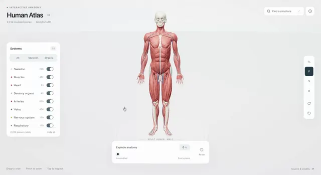</a>

**GPT-6 Astra** · 互动 · 作者 [ashe](https://x.com/ashebytes) · 2026-09-05

GPT-6 Astra 制作的 3D 解剖网站：人体可拆成 2,234 个零件，带系统开关和每个部件的说明卡片。

<details>
<summary>Wandy3D 制作简报</summary>

```text
Build an interactive 3D anatomy explorer as a website. Show a full human body figure with muscles on a clean light-grey background. A side panel lists body systems (skeleton, muscles, heart, sensory organs, arteries, veins, nervous system, respiratory, digestive) with toggles to show or hide each one. An explode slider pulls the figure apart into thousands of individually modelled pieces laid out in a grid, and reassembles them when released. Clicking a piece highlights it and opens a floating card with its name, a short description and a button to isolate it. Support orbit, zoom and pan, and a filter or search box for structures. Use a minimal, clinical UI with small type and rounded panels. Deliver a web project using WebGL with Three.js. Done when every piece can be selected, the systems toggle correctly, and the explode and reassemble motion stays smooth.
```

</details>

[在 Wandy3D 查看 ↗](https://wandy3d.com/zh/prompts/interactive-3d-anatomy-explorer-with-an-exploded-view-of-2-2096221988763173186?utm_source=github&utm_medium=referral&utm_campaign=awesome_3d_prompts) · [原帖](https://x.com/ashebytes/status/2096221988763173186)

---

### [困在玻璃立方体里的风暴，天气可在 Three.js 中控制](https://wandy3d.com/zh/prompts/storm-trapped-in-a-glass-cube-with-controllable-weather-in-2096220264413409648?utm_source=github&utm_medium=referral&utm_campaign=awesome_3d_prompts)

<a href="https://wandy3d.com/zh/prompts/storm-trapped-in-a-glass-cube-with-controllable-weather-in-2096220264413409648?utm_source=github&amp;utm_medium=referral&amp;utm_campaign=awesome_3d_prompts">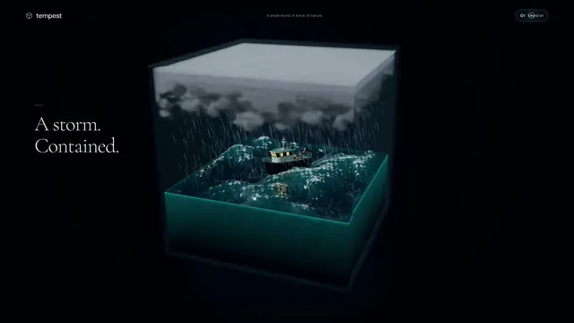</a>

**GPT-6 Astra** · 互动 · 作者 [zcw](https://x.com/zwb44) · 2026-09-05

一句简短提示，GPT-6 Astra 就在立方体里生成了带船、雨和闪电的风暴海面，并配有强度旋钮来控制天气。

<details>
<summary>提示词</summary>

```text
generate a storm trapped in a cube with weather you can control in threejs
```

</details>

[在 Wandy3D 查看 ↗](https://wandy3d.com/zh/prompts/storm-trapped-in-a-glass-cube-with-controllable-weather-in-2096220264413409648?utm_source=github&utm_medium=referral&utm_campaign=awesome_3d_prompts) · [原帖](https://x.com/zwb44/status/2096220264413409648)

---

### [在 Roblox Studio 中构建的马里奥赛车风阿尔卑斯卡丁车游戏](https://wandy3d.com/zh/prompts/mario-kart-style-alpine-kart-racer-built-inside-roblox-2096219700879331665?utm_source=github&utm_medium=referral&utm_campaign=awesome_3d_prompts)

<a href="https://wandy3d.com/zh/prompts/mario-kart-style-alpine-kart-racer-built-inside-roblox-2096219700879331665?utm_source=github&amp;utm_medium=referral&amp;utm_campaign=awesome_3d_prompts">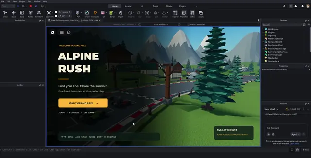</a>

**GPT-6 Astra** · 游戏 · 作者 [Givros](https://x.com/givros) · 2026-09-05

GPT-6 Astra 约 30 分钟在 Roblox Studio 中做出可玩的卡丁车游戏：AI 对手、漂移、加速、三圈比赛和结算界面。

<details>
<summary>Wandy3D 制作简报</summary>

```text
Build a complete Mario Kart-style kart racer inside Roblox Studio. Create a looping alpine circuit with red-and-white kerbs, pine trees, chalets and snowy mountains in a bright low-poly style. Implement kart driving with drifting, speed boosts and collisions, AI opponent karts, a three-lap race with lap tracking and position, a start countdown, a results screen and a restart option. Add a HUD with lap counter, race timer, speedometer, a position list and a circuit minimap, plus a track name banner at the start line. Create any needed assets such as karts, track pieces and scenery inside the project. Deliver working Luau scripts and place assets in the Studio. Done when a player can start a race, drift and boost around three laps against AI, and see results.
```

</details>

[在 Wandy3D 查看 ↗](https://wandy3d.com/zh/prompts/mario-kart-style-alpine-kart-racer-built-inside-roblox-2096219700879331665?utm_source=github&utm_medium=referral&utm_campaign=awesome_3d_prompts) · [原帖](https://x.com/givros/status/2096219700879331665)

---

### [浏览器里骑自行车的 3D 鹈鹕，带速度滑块和缩放](https://wandy3d.com/zh/prompts/3d-pelican-riding-a-bicycle-with-speed-slider-and-zoom-in-2096213850383331489?utm_source=github&utm_medium=referral&utm_campaign=awesome_3d_prompts)

<a href="https://wandy3d.com/zh/prompts/3d-pelican-riding-a-bicycle-with-speed-slider-and-zoom-in-2096213850383331489?utm_source=github&amp;utm_medium=referral&amp;utm_campaign=awesome_3d_prompts">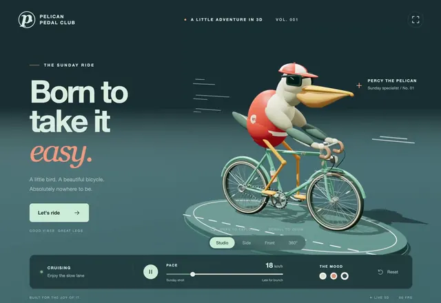</a>

**GPT-6 Astra** · 互动 · 作者 [AI Builder Club](https://x.com/aibuilderclub_) · 2026-09-05

GPT-6 Astra 用一个提示做出风格化的骑车鹈鹕，可调节速度、切换配色并自由缩放，蹬车动作很自然。

<details>
<summary>Wandy3D 制作简报</summary>

```text
Build a single-page 3D landing site in the browser featuring a stylised pelican riding a bicycle. Model the pelican with a round red body, long orange beak, red cap and dark sunglasses, and a mint-green bicycle with visible frame, spoked wheels, chain and pedals. Place it on a round platform with road markings against a dark teal background. Animate pedalling, spinning wheels, bobbing body and speed lines. Add a large headline with a call-to-action button, a pace slider that changes riding speed, a mood colour picker and a reset button. Allow orbit and zoom so the bike can be inspected closely, and a presentation mode that hides the interface. Deliver a web project using Three.js. Done when pedal motion matches wheel speed and close-ups stay clean.
```

</details>

[在 Wandy3D 查看 ↗](https://wandy3d.com/zh/prompts/3d-pelican-riding-a-bicycle-with-speed-slider-and-zoom-in-2096213850383331489?utm_source=github&utm_medium=referral&utm_campaign=awesome_3d_prompts) · [原帖](https://x.com/aibuilderclub_/status/2096213850383331489)

---

### [Three.js 温馨儿童游戏室:小男孩在玩具间随机玩耍](https://wandy3d.com/zh/prompts/cozy-three-js-toddler-playroom-where-a-child-wanders-between-2096201415051911597?utm_source=github&utm_medium=referral&utm_campaign=awesome_3d_prompts)

<a href="https://wandy3d.com/zh/prompts/cozy-three-js-toddler-playroom-where-a-child-wanders-between-2096201415051911597?utm_source=github&amp;utm_medium=referral&amp;utm_campaign=awesome_3d_prompts">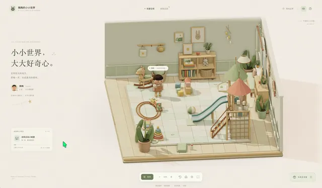</a>

**GPT-6 Astra** · 互动 · 作者 [AI少年](https://x.com/aehyok) · 2026-09-05

GPT-6 Astra 用 Three.js 生成圆润柔和的游戏室场景:小男孩随机挑选玩具玩耍,视角可缩放和旋转。

<details>
<summary>提示词</summary>

```text
新项目，网页3D，threejs。陶陶是一个可爱的2岁亚洲小男孩，页面是一个温暖的环境空间，聚焦中心是一个爬爬垫，大概60平方米，爬爬垫上有各种各样的玩具，有小的在地上，也有别的类型例如书，在地上和架子上，爬爬垫中间相对空，不但有平面还有立体的大型的，例如城堡繁的爬爬架等。画面中，陶陶会随机去一个玩具开始玩耍，注意动作的不同。受限于threejs，我们的整体设计风格可以类似动森，塞尔达系列，巧妙利用圆角、像素化，二次元规避js框架的短板。支持视角放大缩小和旋转，极高设计质量，尤其是贴图和动作细腻。注意提取玩具，动作的建模，方便后期扩展。采用vite构建，支持本地运行和热刷新。
```

</details>

[在 Wandy3D 查看 ↗](https://wandy3d.com/zh/prompts/cozy-three-js-toddler-playroom-where-a-child-wanders-between-2096201415051911597?utm_source=github&utm_medium=referral&utm_campaign=awesome_3d_prompts) · [原帖](https://x.com/aehyok/status/2096201415051911597)

---

### [参考图生成的生锈拖船 Blender 模型(双模型对比)](https://wandy3d.com/zh/prompts/rusty-tugboat-modelled-in-blender-from-reference-images-2096180220839760375?utm_source=github&utm_medium=referral&utm_campaign=awesome_3d_prompts)

<a href="https://wandy3d.com/zh/prompts/rusty-tugboat-modelled-in-blender-from-reference-images-2096180220839760375?utm_source=github&amp;utm_medium=referral&amp;utm_campaign=awesome_3d_prompts">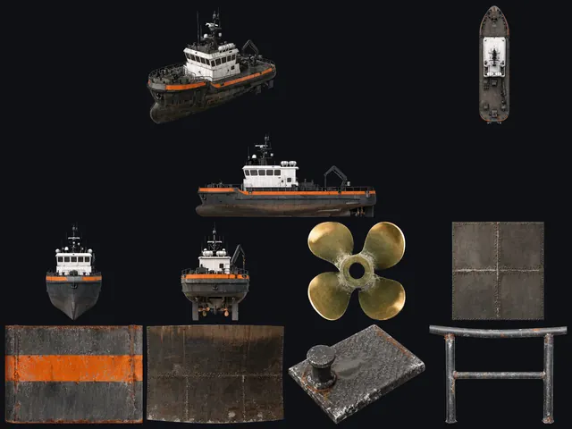</a>

**GPT-6 Astra** · 资产 · 作者 [Alex](https://x.com/NarvisAlex) · 2026-09-05

对比作品:GPT-6 Astra 与 Fable 5.1 用同一提示和参考图在 Blender 中建模拖船,Astra 更快,也更贴近参考图。

<details>
<summary>Wandy3D 制作简报</summary>

```text
Build a detailed 3D model of a working tugboat in Blender by driving it through Python (bpy), using a set of reference images: several side, top and front views of the boat plus close-ups of a propeller, hull plating, a bollard and a railing. Model the hull with the correct curved lower shape, an orange stripe along the waterline, a white wheelhouse with a sloped front and rows of windows, deck fittings such as a winch drum, hinges and a towing hook, handrails, a mast with radar and lights. Apply weathered, rusty dark-steel materials and clean white paint on the superstructure. Work from the references but correct their inconsistencies using your own knowledge of tugboats. Render a few views against a neutral grey backdrop, including a wheelhouse close-up and a three-quarter view of the whole boat. Done means a coherent, recognisable tug with believable proportions and detailed deck equipment.
```

</details>

[在 Wandy3D 查看 ↗](https://wandy3d.com/zh/prompts/rusty-tugboat-modelled-in-blender-from-reference-images-2096180220839760375?utm_source=github&utm_medium=referral&utm_campaign=awesome_3d_prompts) · [原帖](https://x.com/NarvisAlex/status/2096180220839760375)

---

### [咖啡杯中跃出海豚:Three.js 镜头穿越场景](https://wandy3d.com/zh/prompts/dolphins-leaping-from-a-coffee-cup-in-a-three-js-camera-2096174858837074198?utm_source=github&utm_medium=referral&utm_campaign=awesome_3d_prompts)

<a href="https://wandy3d.com/zh/prompts/dolphins-leaping-from-a-coffee-cup-in-a-three-js-camera-2096174858837074198?utm_source=github&amp;utm_medium=referral&amp;utm_campaign=awesome_3d_prompts">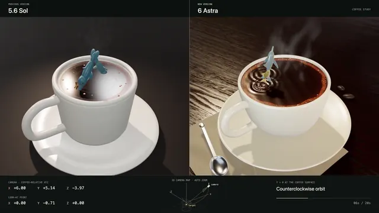</a>

**GPT-6 Astra** · 场景 · 作者 [Sagi Polaczek 🦜](https://x.com/PolaczekSagi) · 2026-09-05

对比作品:GPT-6 Astra 与另一模型各用 Three.js 做出咖啡杯里的海洋生物场景,含环绕与潜入的镜头脚本。

<details>
<summary>Wandy3D 制作简报</summary>

```text
Build a Three.js scene showing marine life inside a cup of coffee. A white ceramic cup on a saucer sits on a dark wooden table with a spoon beside it, steam rising from the surface. Dolphins and small fish leap out of the dark coffee, creating ripples and splashes. Use realistic materials for ceramic, liquid and wood, soft moody lighting and a shallow depth of field. Script a camera path with labelled stages: a counterclockwise orbit around the cup, a descent into the cup, a pass beneath the dolphins close to the liquid surface, and a final move over the rim. Add a small HUD with camera coordinates and the current stage name. Deliver one self-contained HTML file that plays the camera sequence automatically. Done means smooth camera motion and a convincing coffee surface.
```

</details>

[在 Wandy3D 查看 ↗](https://wandy3d.com/zh/prompts/dolphins-leaping-from-a-coffee-cup-in-a-three-js-camera-2096174858837074198?utm_source=github&utm_medium=referral&utm_campaign=awesome_3d_prompts) · [原帖](https://x.com/PolaczekSagi/status/2096174858837074198)

---

### [从水族箱到大海的3D小鱼生存游戏](https://wandy3d.com/zh/prompts/3d-fish-survival-game-across-aquarium-river-reef-and-ocean-2096156244180664627?utm_source=github&utm_medium=referral&utm_campaign=awesome_3d_prompts)

<a href="https://wandy3d.com/zh/prompts/3d-fish-survival-game-across-aquarium-river-reef-and-ocean-2096156244180664627?utm_source=github&amp;utm_medium=referral&amp;utm_campaign=awesome_3d_prompts">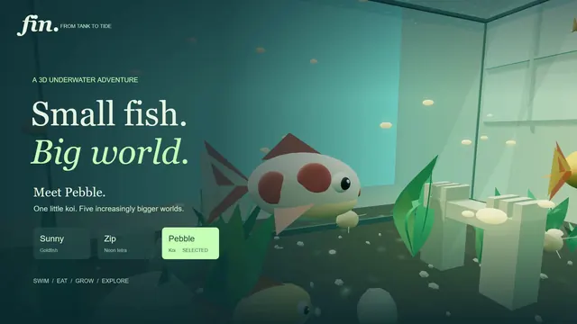</a>

**GPT-6 Astra** · 游戏 · 作者 [Ayush Vachaspati](https://x.com/AVachaspat92841) · 2026-09-05

GPT-6 Astra 生成了一款浏览器游戏：玩家操控不断长大的小鱼穿过五个场景，捕食猎物并躲避天敌，模型还自己通关了一遍。

<details>
<summary>Wandy3D 制作简报</summary>

```text
Build a fully 3D browser game in which the player is a small fish that eats, grows and avoids predators. Structure it as five chapters: a home aquarium, a garden pond, a flowing river, a coral reef and the open ocean. Use a soft low-poly look with teal and green water, tinted light shafts, rounded rocks, plants, coral and drifting particles. Third-person camera follows the fish. Controls: swim with keyboard or mouse, eat smaller creatures to grow in size, dodge larger fish and hazards that shrink you. Add a clean HUD with the fish name, current length, a growth bar, a small radar and chapter title cards with short hint lines. Ship it as a self-contained web project using Three.js that runs in a browser. Done means all five levels are reachable in order, growth changes what you can eat, and a full run from aquarium to ocean is playable.
```

</details>

[在 Wandy3D 查看 ↗](https://wandy3d.com/zh/prompts/3d-fish-survival-game-across-aquarium-river-reef-and-ocean-2096156244180664627?utm_source=github&utm_medium=referral&utm_campaign=awesome_3d_prompts) · [原帖](https://x.com/AVachaspat92841/status/2096156244180664627)

---

### [带风暴圈与筑墙功能的低多边形3D吃鸡射击游戏](https://wandy3d.com/zh/prompts/low-poly-3d-battle-royale-shooter-with-storm-circle-and-wall-2096155883122413946?utm_source=github&utm_medium=referral&utm_campaign=awesome_3d_prompts)

<a href="https://wandy3d.com/zh/prompts/low-poly-3d-battle-royale-shooter-with-storm-circle-and-wall-2096155883122413946?utm_source=github&amp;utm_medium=referral&amp;utm_campaign=awesome_3d_prompts">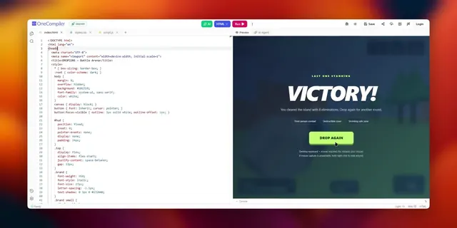</a>

**GPT-6 Astra** · 游戏 · 作者 [MotionViz](https://x.com/Motion_Viz) · 2026-09-05

录屏中，GPT-6 Astra 写出了浏览器大逃杀游戏：有机器人对手、缩圈风暴、脉冲步枪，按 Q 键可建掩体墙。

<details>
<summary>Wandy3D 制作简报</summary>

```text
Build a playable third-person battle royale shooter that runs in a browser, written as plain HTML, CSS and JavaScript with 3D rendering. Use a bright low-poly island with green terrain, trees, small houses and rocks under a blue sky, with soft shadows. The player is a blocky character with a chase camera. Include about nine bot opponents, an elimination counter, a shrinking storm circle with a countdown, a health bar and a pulse rifle with ammo count, recoil and reload. Pressing Q places a wooden cover wall in front of the player. Show a compact HUD with players left, kills and storm timer. When only the player remains, show a Victory screen with a Drop Again button. Done means a full match can be started, fought and won, and restarted without errors.
```

</details>

[在 Wandy3D 查看 ↗](https://wandy3d.com/zh/prompts/low-poly-3d-battle-royale-shooter-with-storm-circle-and-wall-2096155883122413946?utm_source=github&utm_medium=referral&utm_campaign=awesome_3d_prompts) · [原帖](https://x.com/Motion_Viz/status/2096155883122413946)

---

### [飞越农田与雪山的低多边形3D螺旋桨飞行游戏](https://wandy3d.com/zh/prompts/low-poly-3d-crop-duster-flight-game-with-takeoff-over-fields-2096149823216898445?utm_source=github&utm_medium=referral&utm_campaign=awesome_3d_prompts)

<a href="https://wandy3d.com/zh/prompts/low-poly-3d-crop-duster-flight-game-with-takeoff-over-fields-2096149823216898445?utm_source=github&amp;utm_medium=referral&amp;utm_campaign=awesome_3d_prompts">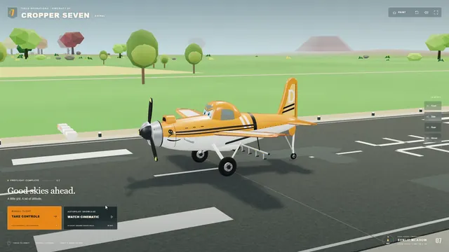</a>

**GPT-6 Astra** · 游戏 · 作者 [Givros](https://x.com/givros) · 2026-09-05

GPT-6 Astra 从空文件夹生成了可玩的浏览器飞行游戏：黄色螺旋桨飞机起飞后飞越农田、湖泊和雪山。

<details>
<summary>Wandy3D 制作简报</summary>

```text
Build a complete browser-based 3D flight game. The player flies a yellow single-engine propeller plane, starting on an asphalt runway at a small airfield with a hangar and markings. Use a bright low-poly world: rolling green fields, scattered trees in varied colors, ponds, hay bales, snowy mountains in the distance, soft clouds and haze. Provide takeoff, free flight and landing, a chase camera, and a minimal HUD along the top and bottom edges showing flight data. Add subtle plane shadows, propeller motion and fog for depth. Deliver it as a self-contained web project using Three.js that runs from a local folder. Done means the plane can taxi, take off, fly across varied terrain and land again, with smooth frame rate and no console errors.
```

</details>

[在 Wandy3D 查看 ↗](https://wandy3d.com/zh/prompts/low-poly-3d-crop-duster-flight-game-with-takeoff-over-fields-2096149823216898445?utm_source=github&utm_medium=referral&utm_campaign=awesome_3d_prompts) · [原帖](https://x.com/givros/status/2096149823216898445)

---

### [依据照片在 Blender 中重建的咖啡店与镜头漫游](https://wandy3d.com/zh/prompts/coffee-shop-rebuilt-in-blender-from-a-photo-with-a-camera-2096143359505269079?utm_source=github&utm_medium=referral&utm_campaign=awesome_3d_prompts)

<a href="https://wandy3d.com/zh/prompts/coffee-shop-rebuilt-in-blender-from-a-photo-with-a-camera-2096143359505269079?utm_source=github&amp;utm_medium=referral&amp;utm_campaign=awesome_3d_prompts">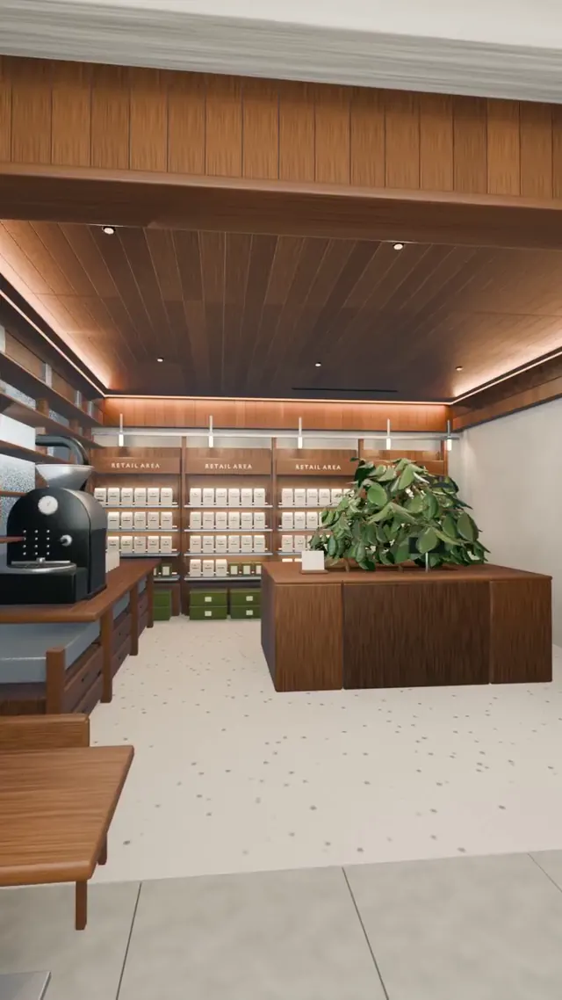</a>

**GPT-6 Astra** · 场景 · 作者 [森叔](https://x.com/harrisonitsme) · 2026-09-05

GPT-6 Astra 根据一张照片在 Blender 中重建了带木质吊顶、货架和烘豆机的咖啡店，并生成 15 秒竖屏漫游。

<details>
<summary>Wandy3D 制作简报</summary>

```text
Build a Blender scene that recreates a coffee shop interior from a reference photo. Model everything as real 3D geometry: a wooden slat ceiling with warm indirect LED strips and small spotlights, wall shelving full of white coffee bags with a Retail Area sign, green storage boxes, a coffee roaster, wooden tables, a speckled light terrazzo floor and a leafy potted plant on a wooden display counter. Use a warm brown, cream and green palette with soft realistic lighting. Animate the camera in a vertical 9:16 frame so it pushes forward and curves around the display counter over about 15 seconds. Deliver a Blender Python script or editable .blend project plus the rendered vertical clip. Done means the layout matches the photo reasonably, materials look natural, and the camera move is smooth.
```

</details>

[在 Wandy3D 查看 ↗](https://wandy3d.com/zh/prompts/coffee-shop-rebuilt-in-blender-from-a-photo-with-a-camera-2096143359505269079?utm_source=github&utm_medium=referral&utm_campaign=awesome_3d_prompts) · [原帖](https://x.com/harrisonitsme/status/2096143359505269079)

---

### [自动绑骨的熊猫武者：网页查看器中的行走、奔跑与功夫动作](https://wandy3d.com/zh/prompts/auto-rigged-panda-warrior-with-walk-run-and-kung-fu-moves-in-2096141728487178503?utm_source=github&utm_medium=referral&utm_campaign=awesome_3d_prompts)

<a href="https://wandy3d.com/zh/prompts/auto-rigged-panda-warrior-with-walk-run-and-kung-fu-moves-in-2096141728487178503?utm_source=github&amp;utm_medium=referral&amp;utm_campaign=awesome_3d_prompts">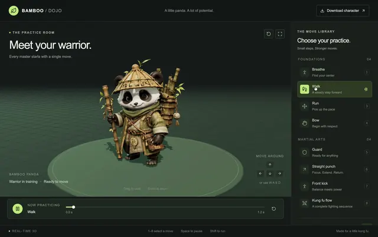</a>

**GPT-6 Astra** · 动画 · 作者 [The Bugged Dev](https://x.com/thebuggeddev) · 2026-09-05

GPT-6 Astra 为给定的 3D 熊猫模型自动绑骨，并在查看器中加入行走、奔跑和功夫动作；作者称部分效果仍有问题。

<details>
<summary>Wandy3D 制作简报</summary>

```text
Build a web-based character practice room that rigs and animates a supplied 3D model. Auto-rig a stylized panda warrior in a straw hat with a backpack, then add a move library with idle breathing, walk, run, bow, guard, straight punch, front kick and a longer kung fu sequence. Present it in a dark green, minimal interface: a large 3D viewport with the character on a circular stage, a heading, a list of moves grouped into foundations and martial arts on the right, a playback timeline with the current move name, and controls for orbit and fullscreen. Add a button to download the rigged character. Use Three.js with skeletal animation. Done means each listed move plays on the rigged model, switching moves is smooth, and obvious skinning problems are noted for later fixes.
```

</details>

[在 Wandy3D 查看 ↗](https://wandy3d.com/zh/prompts/auto-rigged-panda-warrior-with-walk-run-and-kung-fu-moves-in-2096141728487178503?utm_source=github&utm_medium=referral&utm_campaign=awesome_3d_prompts) · [原帖](https://x.com/thebuggeddev/status/2096141728487178503)

---

### [在 Blender 中制作的持战斧维京战士角色](https://wandy3d.com/zh/prompts/viking-warrior-character-with-battle-axe-modeled-in-blender-2096140378777010278?utm_source=github&utm_medium=referral&utm_campaign=awesome_3d_prompts)

<a href="https://wandy3d.com/zh/prompts/viking-warrior-character-with-battle-axe-modeled-in-blender-2096140378777010278?utm_source=github&amp;utm_medium=referral&amp;utm_campaign=awesome_3d_prompts">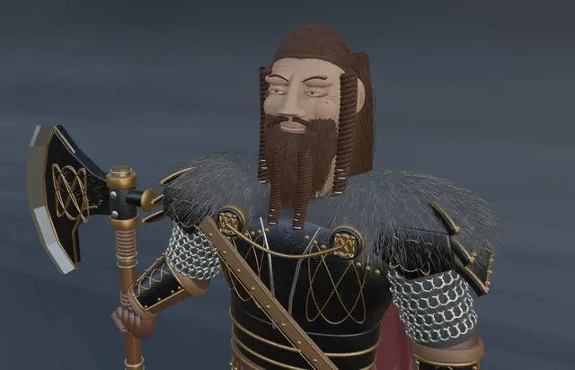</a>

**GPT-6 Astra** · 资产 · 作者 [Emil](https://x.com/fre4kspace) · 2026-09-05

GPT-6 Astra 在 Blender 里建出了留胡子的维京人：金饰黑甲、锁子甲、毛皮领和战斧。做工略显粗糙，但辨识度很高。

<details>
<summary>Wandy3D 制作简报</summary>

```text
Build a 3D Viking warrior character in Blender, using a Blender Python script that creates the whole model. Show a bearded male fighter with braided hair and a thick beard, a fur-trimmed shoulder collar, dark leather and plate armor decorated with gold knotwork lines and rivets, chainmail sleeves, a red cape at the back, and a tall battle axe with an ornate gold-trimmed head held in one hand. Use simple procedural materials: matte black armor, brushed gold trim, metallic chain links, coarse grey fur. Frame the bust from the chest up against a neutral grey-blue background with soft studio lighting. Deliverable: a runnable script plus a viewport render of the character. Done means the figure reads clearly as a Viking, the proportions are coherent, and the materials and the axe are recognizable. Expect rough edges in the face and iterate on those.
```

</details>

[在 Wandy3D 查看 ↗](https://wandy3d.com/zh/prompts/viking-warrior-character-with-battle-axe-modeled-in-blender-2096140378777010278?utm_source=github&utm_medium=referral&utm_campaign=awesome_3d_prompts) · [原帖](https://x.com/fre4kspace/status/2096140378777010278)

---

### [Three.js 浮岛 3D 平台跳跃游戏，带回旋帽子攻击](https://wandy3d.com/zh/prompts/three-js-3d-platformer-on-floating-islands-with-a-cap-throw-2096135808243876152?utm_source=github&utm_medium=referral&utm_campaign=awesome_3d_prompts)

<a href="https://wandy3d.com/zh/prompts/three-js-3d-platformer-on-floating-islands-with-a-cap-throw-2096135808243876152?utm_source=github&amp;utm_medium=referral&amp;utm_campaign=awesome_3d_prompts">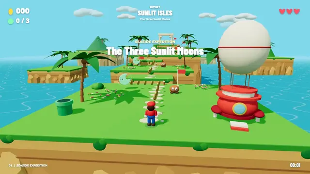</a>

**GPT-6 Astra** · 游戏 · 作者 [AIHubmix](https://x.com/AiHubMix) · 2026-09-05

GPT-6 Astra 自行构建、测试并录制了基于 Rapier 物理的 Three.js 平台游戏：八个岛屿平台、三颗月亮和会飞回的帽子。

<details>
<summary>Wandy3D 制作简报</summary>

```text
Build a 3D platformer level in the spirit of a classic plumber adventure, as a browser game using Three.js, Rapier physics and WebAudio. Create a set of floating grassy islands in a bright blue sea, with palm trees, flowers, stone steps, a red balloon airship at the start and a stone arch with a flag at the end. The player is a small hero with a red cap who runs, jumps and throws the cap as a returning projectile. Include 8 platforms, 3 collectible moons, coins, walking enemies, checkpoints, a hearts display, a timer and short on-screen hints. Make all models procedural from primitives, add original synthesized music and sound effects, and support keyboard and touch controls. Use a cheerful, saturated cartoon palette. Done means the level can be finished from start to the completion banner without falling, with stable physics.
```

</details>

[在 Wandy3D 查看 ↗](https://wandy3d.com/zh/prompts/three-js-3d-platformer-on-floating-islands-with-a-cap-throw-2096135808243876152?utm_source=github&utm_medium=referral&utm_campaign=awesome_3d_prompts) · [原帖](https://x.com/AiHubMix/status/2096135808243876152)

---

### [浏览器中的 3D 办公室漫游，带骨骼人物和蓝图模式](https://wandy3d.com/zh/prompts/browser-3d-office-walkthrough-with-rigged-people-and-2096131961345720477?utm_source=github&utm_medium=referral&utm_campaign=awesome_3d_prompts)

<a href="https://wandy3d.com/zh/prompts/browser-3d-office-walkthrough-with-rigged-people-and-2096131961345720477?utm_source=github&amp;utm_medium=referral&amp;utm_campaign=awesome_3d_prompts">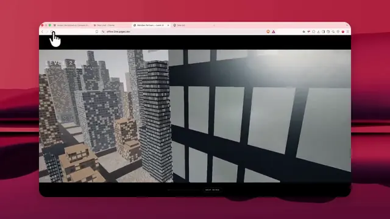</a>

**Claude Fable 5.1** · 互动 · 作者 [Parithosh-varma](https://x.com/demgufever82151) · 2026-09-05

Claude Fable 5.1 做出了 Three.js 高层办公室：第一人称漫游、会打招呼的员工、可点击的门，以及环绕和蓝图视图。

<details>
<summary>Wandy3D 制作简报</summary>

```text
Build an interactive 3D office walkthrough that runs in the browser with Three.js. Model a modern high-rise office floor with a reception desk and glowing logo wall, open-plan desks with chairs and monitors, a conference room, a private office with big windows onto a night city skyline, corridors and restrooms, with dark wood, white marble and warm accent lighting. Populate it with about thirty rigged people in suits who sit, stand and greet the visitor by name when approached. Offer a first-person mode with keyboard and mouse movement, clickable doors that open, an orbit view that shows the whole floor, and a blueprint view that shows a flat plan. Add small room labels and a minimal HUD. Deliver a deployable static site. Done means you can walk from the reception through every room, doors respond to clicks, and view modes switch smoothly.
```

</details>

[在 Wandy3D 查看 ↗](https://wandy3d.com/zh/prompts/browser-3d-office-walkthrough-with-rigged-people-and-2096131961345720477?utm_source=github&utm_medium=referral&utm_campaign=awesome_3d_prompts) · [原帖](https://x.com/demgufever82151/status/2096131961345720477)

---

### [山丘广场上的巨型雕像：30 秒 Blender 飞越镜头](https://wandy3d.com/zh/prompts/giant-statue-on-a-hilltop-plaza-30-second-blender-flythrough-2096128774203171021?utm_source=github&utm_medium=referral&utm_campaign=awesome_3d_prompts)

<a href="https://wandy3d.com/zh/prompts/giant-statue-on-a-hilltop-plaza-30-second-blender-flythrough-2096128774203171021?utm_source=github&amp;utm_medium=referral&amp;utm_campaign=awesome_3d_prompts">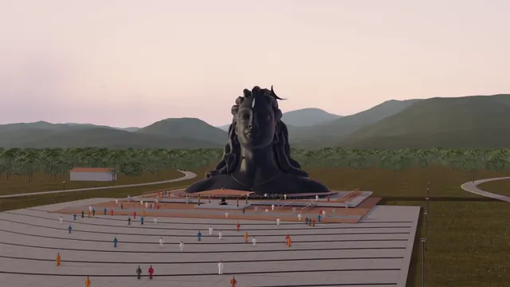</a>

**GPT-6 Astra** · 场景 · 作者 [Adi](https://x.com/thejothiram) · 2026-09-05

Codex 搭配 GPT-6 Astra 建出黄昏中巨型雕像的可编辑 Blender 场景，并渲染了从远景推到特写的 1080p 飞越影片。

<details>
<summary>Wandy3D 制作简报</summary>

```text
Build a Blender scene of a monumental dark bust statue of a meditating figure standing on a terraced stone plaza, and render a 30-second camera flythrough. Surround it with rolling green hills, farmland, winding paths, a few small buildings and tiny visitors on the terraces. Use warm evening light with a soft pink sky and gentle haze. Plan the camera as a continuous move: start with a wide shot of the grounds, glide closer to show the face, hair and plaza details, then pull out to a wide closing view. Write it as a Blender Python script that creates geometry, materials, lighting and camera animation. Deliverables: an editable .blend scene and a 1080p video render. Done means the statue reads clearly from every distance, the lighting stays consistent, and the camera motion is smooth with no clipping.
```

</details>

[在 Wandy3D 查看 ↗](https://wandy3d.com/zh/prompts/giant-statue-on-a-hilltop-plaza-30-second-blender-flythrough-2096128774203171021?utm_source=github&utm_medium=referral&utm_campaign=awesome_3d_prompts) · [原帖](https://x.com/thejothiram/status/2096128774203171021)

---

### [通过 computer use 在 Blender 中建模的一级方程式赛车](https://wandy3d.com/zh/prompts/formula-one-car-modeled-in-blender-through-computer-use-2096125193580113957?utm_source=github&utm_medium=referral&utm_campaign=awesome_3d_prompts)

<a href="https://wandy3d.com/zh/prompts/formula-one-car-modeled-in-blender-through-computer-use-2096125193580113957?utm_source=github&amp;utm_medium=referral&amp;utm_campaign=awesome_3d_prompts">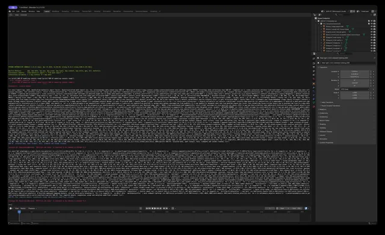</a>

**GPT-6 Astra** · 资产 · 作者 [Conor Dart](https://x.com/Conor_D_Dart) · 2026-09-05

GPT-6 Astra 自行操作 Blender，根据一句提示词在约 23 分钟内做出放在转盘上的绿色一级方程式赛车。

<details>
<summary>提示词</summary>

```text
Create a 3d Formula one Model in blender with computer use.
```

</details>

[在 Wandy3D 查看 ↗](https://wandy3d.com/zh/prompts/formula-one-car-modeled-in-blender-through-computer-use-2096125193580113957?utm_source=github&utm_medium=referral&utm_campaign=awesome_3d_prompts) · [原帖](https://x.com/Conor_D_Dart/status/2096125193580113957)

---

### [用 Three.js 构建的实时 3D 喷气飞机工厂模拟](https://wandy3d.com/zh/prompts/live-3d-jet-factory-simulation-in-three-js-with-assembly-2096122429319852319?utm_source=github&utm_medium=referral&utm_campaign=awesome_3d_prompts)

<a href="https://wandy3d.com/zh/prompts/live-3d-jet-factory-simulation-in-three-js-with-assembly-2096122429319852319?utm_source=github&amp;utm_medium=referral&amp;utm_campaign=awesome_3d_prompts">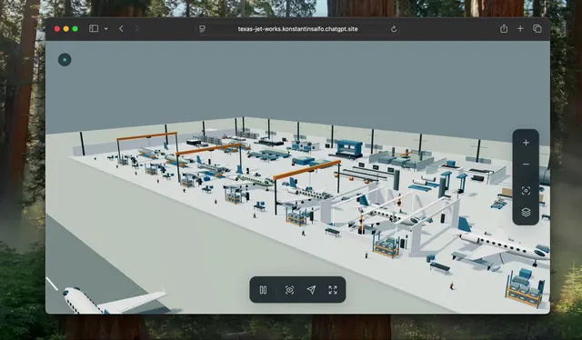</a>

**GPT-6 Astra** · 互动 · 作者 [Konstantin Saifoulline](https://x.com/konstantinsaifo) · 2026-09-05

GPT-6 Astra 先研究精益生产，再用 Three.js 做出带起重机、工人、装配线和跑道的飞机工厂实时模拟。

<details>
<summary>Wandy3D 制作简报</summary>

```text
Build a live 3D simulation of a small jet aircraft factory that runs in the browser with Three.js. Show a large pale factory floor with several parallel assembly lines, overhead gantry cranes in orange, workstation benches, parts racks, and partly assembled white jets moving from station to station. Use a clean, light palette with blue and orange accents and soft daylight. Add tiny worker figures that walk between stations and a runway outside where finished jets appear. Provide orbit camera controls with zoom and pan, and a small on-screen toolbar for switching views and toggling layers. Base the layout on lean production principles: a clear one-directional flow from raw parts to final assembly to delivery. Deliver a deployable web page, test that it loads without errors, and consider the task done when the moving plant can be viewed from above and up close without glitches.
```

</details>

[在 Wandy3D 查看 ↗](https://wandy3d.com/zh/prompts/live-3d-jet-factory-simulation-in-three-js-with-assembly-2096122429319852319?utm_source=github&utm_medium=referral&utm_campaign=awesome_3d_prompts) · [原帖](https://x.com/konstantinsaifo/status/2096122429319852319)

---

### [根据手游广告还原的等距视角可玩浏览器游戏](https://wandy3d.com/zh/prompts/playable-isometric-browser-game-rebuilt-from-a-mobile-game-2096111709496680842?utm_source=github&utm_medium=referral&utm_campaign=awesome_3d_prompts)

<a href="https://wandy3d.com/zh/prompts/playable-isometric-browser-game-rebuilt-from-a-mobile-game-2096111709496680842?utm_source=github&amp;utm_medium=referral&amp;utm_campaign=awesome_3d_prompts">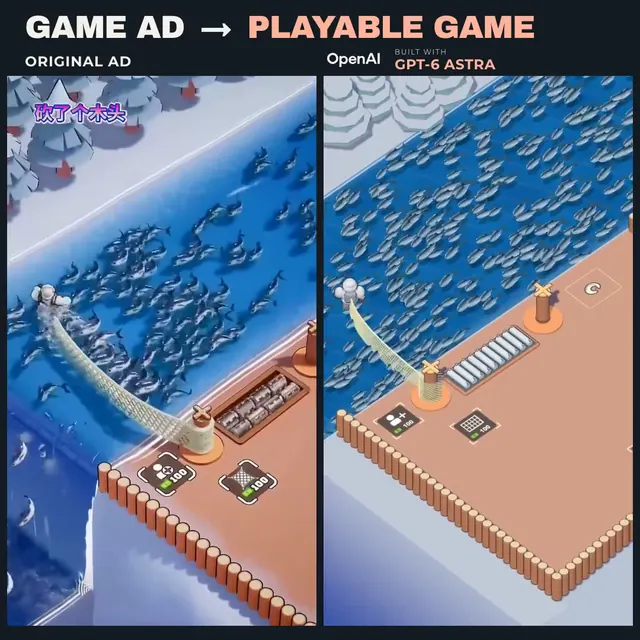</a>

**GPT-6 Astra** · 游戏 · 作者 [daniel](https://x.com/buildingadlicio) · 2026-09-05

GPT-6 Astra 把一则手游广告做成了带堆叠玩法的竖屏浏览器游戏，并与原广告并排对比展示。

<details>
<summary>Wandy3D 制作简报</summary>

```text
Build a small browser game that recreates the mechanics seen in a mobile game ad. Use an isometric, portrait-oriented view of an orange wooden platform with a fence along its edge, next to a large field packed with tiny crowd figures on a snowy blue backdrop. The player character walks around the platform, picks up items from a station and carries them as a growing vertical stack, then drops them at a drop-off point. Include small icons over workstations, a bridge or ramp that extends toward the field, and a crowd that reacts as the player progresses. Use a bright, saturated casual-game palette with soft shadows and chunky low-poly models, optionally prepared in Blender. Support touch or mouse drag controls with a virtual joystick. Deliver a self-contained web build that runs on a phone, and treat it as done when the core loop of collecting, stacking and delivering feels playable and visually close to the ad.
```

</details>

[在 Wandy3D 查看 ↗](https://wandy3d.com/zh/prompts/playable-isometric-browser-game-rebuilt-from-a-mobile-game-2096111709496680842?utm_source=github&utm_medium=referral&utm_campaign=awesome_3d_prompts) · [原帖](https://x.com/buildingadlicio/status/2096111709496680842)

---

### [根据 2D 参考图还原的风格化 3D 动漫角色](https://wandy3d.com/zh/prompts/stylized-3d-anime-character-recreated-from-a-2d-reference-2096107343268257953?utm_source=github&utm_medium=referral&utm_campaign=awesome_3d_prompts)

<a href="https://wandy3d.com/zh/prompts/stylized-3d-anime-character-recreated-from-a-2d-reference-2096107343268257953?utm_source=github&amp;utm_medium=referral&amp;utm_campaign=awesome_3d_prompts"></a>

**GPT-6 Astra** · 资产 · 作者 [NOCTAVIA™](https://x.com/noctav1a) · 2026-09-05

GPT-6 Astra 依据一张平面参考图，把蓝发动漫角色重建为 3D 模型，并与原图并排对比。

<details>
<summary>Wandy3D 制作简报</summary>

```text
Build a stylized 3D character model from a single 2D reference image of an anime-style young person. Reproduce the short, layered dark blue hair with a long side fringe over one eye, bright green eyes, pale skin, a calm expression, and a navy track jacket with white shoulder stripes and a high collar. Use smooth toon-like shading, clean geometry and simple materials so the model reads clearly against a plain black background. Set the character up for real-time use: a sensible polygon count, a neutral pose, and a rig that allows walking so it can later be controlled in a playable scene. Render a front three-quarter view for comparison with the reference. Deliver the model in a common format along with the scene file, and treat it as done when hair shape, colors and outfit match the reference closely from the front.
```

</details>

[在 Wandy3D 查看 ↗](https://wandy3d.com/zh/prompts/stylized-3d-anime-character-recreated-from-a-2d-reference-2096107343268257953?utm_source=github&utm_medium=referral&utm_campaign=awesome_3d_prompts) · [原帖](https://x.com/noctav1a/status/2096107343268257953)

---

### [在 Blender 中制作的自由塔 3D 模型与环绕镜头渲染](https://wandy3d.com/zh/prompts/azadi-tower-3d-model-in-blender-with-an-orbiting-camera-2096107322536051057?utm_source=github&utm_medium=referral&utm_campaign=awesome_3d_prompts)

<a href="https://wandy3d.com/zh/prompts/azadi-tower-3d-model-in-blender-with-an-orbiting-camera-2096107322536051057?utm_source=github&amp;utm_medium=referral&amp;utm_campaign=awesome_3d_prompts">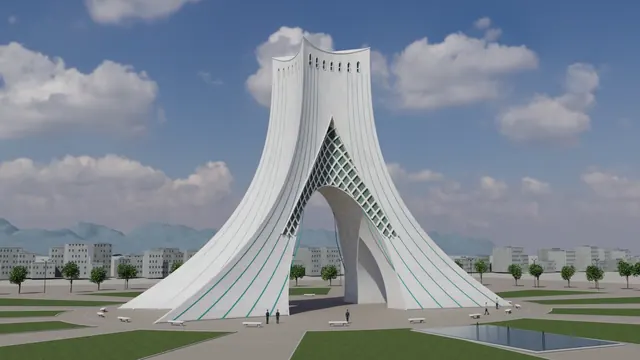</a>

**GPT-6 Astra** · 资产 · 作者 [taesiri](https://x.com/taesiri) · 2026-09-05

GPT-6 Astra 凭一条提示词在 Blender 里建出德黑兰自由塔，作者指出轮廓接近，但部分比例不够准确。

<details>
<summary>Wandy3D 制作简报</summary>

```text
Build a 3D model of the Azadi Tower in Blender and render it as a short orbiting camera shot. Model the white, curved monument with its four splayed legs rising into a tall central arch, fine vertical ribbing on the surface, a lattice of green-tinted glass in the upper arch and a crown of small towers at the top. Place it on a paved plaza with lawn, scattered trees, a shallow reflecting pool, low city buildings and distant mountains on the horizon. Use bright daylight, a blue sky with soft clouds and realistic materials. Animate the camera moving around the tower for about ten seconds. Focus on getting the overall silhouette and proportions right, check them against reference photos and correct any mismatch in the arch curvature and leg shape. Deliver the Blender file and the rendered clip.
```

</details>

[在 Wandy3D 查看 ↗](https://wandy3d.com/zh/prompts/azadi-tower-3d-model-in-blender-with-an-orbiting-camera-2096107322536051057?utm_source=github&utm_medium=referral&utm_campaign=awesome_3d_prompts) · [原帖](https://x.com/taesiri/status/2096107322536051057)

---

### [用 Blender 还原苏州博物馆庭园的 60 秒夜景连续漫游](https://wandy3d.com/zh/prompts/suzhou-museum-garden-recreated-in-blender-as-a-60-second-2096096998092841449?utm_source=github&utm_medium=referral&utm_campaign=awesome_3d_prompts)

<a href="https://wandy3d.com/zh/prompts/suzhou-museum-garden-recreated-in-blender-as-a-60-second-2096096998092841449?utm_source=github&amp;utm_medium=referral&amp;utm_campaign=awesome_3d_prompts">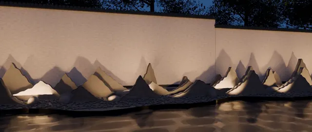</a>

**GPT-6 Astra** · 场景 · 作者 [amber](https://x.com/whosamberella) · 2026-09-05

GPT-6 Astra 在 Blender 中重建了苏州一座博物馆及其庭园，渲染出无剪辑的夜景漫游视频，并配有生成的配乐。

<details>
<summary>Wandy3D 制作简报</summary>

```text
Build a continuous 60-second 3D walkthrough of a modern museum set in a traditional Chinese garden, using Blender (Python scripting) and render it as a video. Show a dusk-to-night mood: a deep blue sky, warm lit interiors, a wooden pavilion with a dark hipped roof over a reflective pond, low white-roofed galleries with glass walls, pruned pines, and a long white wall in front of which a landscape of sculpted grey stone peaks forms an abstract mountain scene. Move the camera slowly and smoothly through the garden: past the pavilion, along the wall, over the water and back toward the pavilion. Add subtle title cards at the start and end. Keep lighting soft with reflections on the water. Optionally add a calm soundtrack of traditional plucked strings, soft piano and cello. Done means a rendered video with no cuts, readable architecture and a consistent atmosphere throughout.
```

</details>

[在 Wandy3D 查看 ↗](https://wandy3d.com/zh/prompts/suzhou-museum-garden-recreated-in-blender-as-a-60-second-2096096998092841449?utm_source=github&utm_medium=referral&utm_campaign=awesome_3d_prompts) · [原帖](https://x.com/whosamberella/status/2096096998092841449)

---

### [WebGL 幻灯片讲述黑洞诞生：从濒死恒星到吸积盘](https://wandy3d.com/zh/prompts/webgl-slideshow-of-a-black-hole-forming-from-dying-star-to-2096093614397170104?utm_source=github&utm_medium=referral&utm_campaign=awesome_3d_prompts)

<a href="https://wandy3d.com/zh/prompts/webgl-slideshow-of-a-black-hole-forming-from-dying-star-to-2096093614397170104?utm_source=github&amp;utm_medium=referral&amp;utm_campaign=awesome_3d_prompts">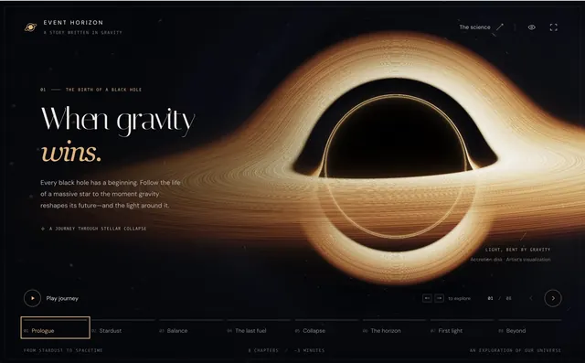</a>

**GPT-6 Astra** · 互动 · 作者 [ゼン🍣🐟🇳🇿](https://x.com/zeeeeeen) · 2026-09-05

GPT-6 Astra 约 20 分钟生成了分章节的 WebGL 故事：恒星燃尽、坍缩，最终成为会弯曲光线的黑洞。

<details>
<summary>Wandy3D 制作简报</summary>

```text
Build an interactive WebGL slide presentation that tells how a black hole is born, as a single web page. Use a near-black space background and elegant serif headlines with one italic accent phrase in warm amber, small caption text, and a bottom chapter navigation with a play-journey button. Chapters: a star inside a nebula, a balanced white-blue star, a swelling orange star as fuel runs out, a collapse with an expanding shockwave ring, a dark event horizon, and finally a glowing accretion disk bending light around the hole. Animate smooth transitions of the central 3D object between chapters, with a procedural star surface, subtle star field and a lensed accretion disk. Let viewers play automatically or jump between chapters. Done means a polished, readable, continuous story that runs smoothly in the browser.
```

</details>

[在 Wandy3D 查看 ↗](https://wandy3d.com/zh/prompts/webgl-slideshow-of-a-black-hole-forming-from-dying-star-to-2096093614397170104?utm_source=github&utm_medium=referral&utm_campaign=awesome_3d_prompts) · [原帖](https://x.com/zeeeeeen/status/2096093614397170104)

---

### [用 Blender 制作的未来电动摩托与坦克，配机库拍摄背景](https://wandy3d.com/zh/prompts/futuristic-electric-bike-and-tank-modeled-in-blender-with-a-2096083014845636816?utm_source=github&utm_medium=referral&utm_campaign=awesome_3d_prompts)

<a href="https://wandy3d.com/zh/prompts/futuristic-electric-bike-and-tank-modeled-in-blender-with-a-2096083014845636816?utm_source=github&amp;utm_medium=referral&amp;utm_campaign=awesome_3d_prompts">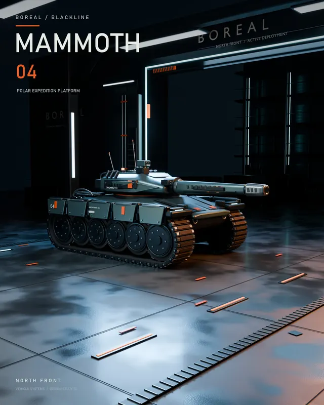</a>

**GPT-6 Astra** · 资产 · 作者 [ステスロス@2号機](https://x.com/StelsRay2) · 2026-09-05

GPT-6 Astra 在 Blender 中建模了科幻摩托、坦克和摄影棚式机库，并渲染出多角度海报风镜头。

<details>
<summary>提示词</summary>

```text
モデル性能評価試験
blenderを使用してデザインや見た目重視の近未来バイク、近未来戦車、それに合う撮影用背景のモデルを作成して複数カットのスクショを撮って MCPも使えるはずだけど一番クォリティーを出せる使い方を任せる
```

</details>

[在 Wandy3D 查看 ↗](https://wandy3d.com/zh/prompts/futuristic-electric-bike-and-tank-modeled-in-blender-with-a-2096083014845636816?utm_source=github&utm_medium=referral&utm_campaign=awesome_3d_prompts) · [原帖](https://x.com/StelsRay2/status/2096083014845636816)

---

### [Three.js 程序化生成的两台蒸汽机车，带爆炸分解与复原动画](https://wandy3d.com/zh/prompts/two-procedural-steam-locomotives-in-three-js-with-an-explode-2096082580554777041?utm_source=github&utm_medium=referral&utm_campaign=awesome_3d_prompts)

<a href="https://wandy3d.com/zh/prompts/two-procedural-steam-locomotives-in-three-js-with-an-explode-2096082580554777041?utm_source=github&amp;utm_medium=referral&amp;utm_campaign=awesome_3d_prompts">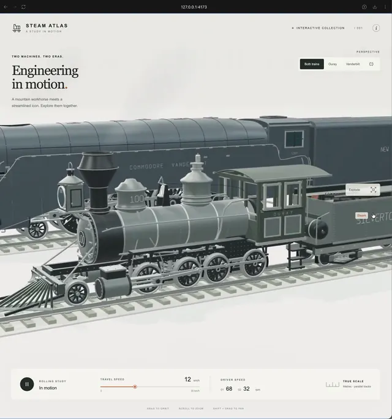</a>

**GPT-6 Astra** · 互动 · 作者 [Tom Krcha](https://x.com/tomkrcha) · 2026-09-05

GPT-6 Astra 编写 TypeScript，在运行时生成两列火车，无需模型文件，车轮与零件分解动画均由代码驱动。

<details>
<summary>Wandy3D 制作简报</summary>

```text
Build an interactive browser showcase of two steam locomotives, one classic and one streamlined, using TypeScript and Three.js with no external 3D model files. Generate every part at runtime from dimensions, profiles and geometry helper functions: boiler, cab, wheels, rods, tender and rails. Use a clean light interface with a serif headline, a small panel for travel speed, view buttons and a play toggle. Animate the wheels and the trains rolling along the track, with a speed slider. Add an explode and reassemble animation that separates all parts in the air and puts them back together, driven entirely by code. Allow orbiting the camera around the trains with soft shadows on a pale ground. Done means smooth performance in the browser and recognizable, detailed locomotives.
```

</details>

[在 Wandy3D 查看 ↗](https://wandy3d.com/zh/prompts/two-procedural-steam-locomotives-in-three-js-with-an-explode-2096082580554777041?utm_source=github&utm_medium=referral&utm_campaign=awesome_3d_prompts) · [原帖](https://x.com/tomkrcha/status/2096082580554777041)

---

### [Three.js 3D 地球仪仪表盘：航线、2D/3D 切换与昼夜模式](https://wandy3d.com/zh/prompts/three-js-3d-globe-dashboard-with-flight-routes-2d-3d-switch-2096082432197837065?utm_source=github&utm_medium=referral&utm_campaign=awesome_3d_prompts)

<a href="https://wandy3d.com/zh/prompts/three-js-3d-globe-dashboard-with-flight-routes-2d-3d-switch-2096082432197837065?utm_source=github&amp;utm_medium=referral&amp;utm_campaign=awesome_3d_prompts">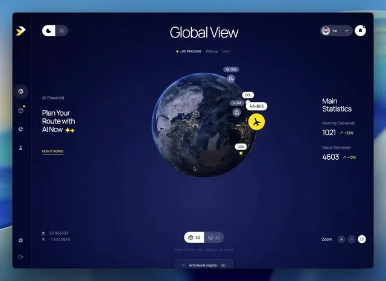</a>

**GPT-6 Astra** · 互动 · 作者 [Kai](https://x.com/hqmank) · 2026-09-05

GPT-6 Astra 仅凭一张参考截图，就还原了带航线标记、2D 备用视图和昼夜切换的玻璃质感 Three.js 地球仪仪表盘。

<details>
<summary>Wandy3D 制作简报</summary>

```text
Build a logistics dashboard web page with an interactive 3D Earth globe in Three.js, recreated from a reference screenshot. Use a deep navy background, a large centered Global View title, glass-style panels, yellow accent buttons and clean sans-serif type. Place a textured globe in the center with day and night lighting, atmosphere glow and flight route arcs with labelled markers that animate. Add a left icon sidebar, a statistics column on the right, a zoom control, and a toggle between 3D globe and a flat 2D map view. Include a day and night mode switch, an activities table with a risk panel that slides up from the bottom, and a welcome dialog with three short steps. Done means the layout, lighting and depth closely match the reference and both views work in the browser.
```

</details>

[在 Wandy3D 查看 ↗](https://wandy3d.com/zh/prompts/three-js-3d-globe-dashboard-with-flight-routes-2d-3d-switch-2096082432197837065?utm_source=github&utm_medium=referral&utm_campaign=awesome_3d_prompts) · [原帖](https://x.com/hqmank/status/2096082432197837065)

---

### [KiCad 中布线完成的 50×20 mm 双层 PCB 与 3D 渲染](https://wandy3d.com/zh/prompts/routed-50-x-20-mm-two-layer-kicad-pcb-with-3d-renders-2096079976433082502?utm_source=github&utm_medium=referral&utm_campaign=awesome_3d_prompts)

<a href="https://wandy3d.com/zh/prompts/routed-50-x-20-mm-two-layer-kicad-pcb-with-3d-renders-2096079976433082502?utm_source=github&amp;utm_medium=referral&amp;utm_campaign=awesome_3d_prompts">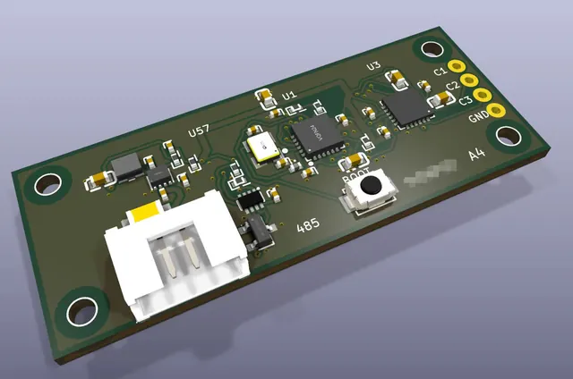</a>

**GPT-6 Astra** · 其他 · 作者 [Titlist400](https://x.com/swjtutl) · 2026-09-05

GPT-6 Astra 在 KiCad 中把原理图 PDF 改成新电路,并布出 DRC 零违规的双层板,同时生成 3D 渲染图。

<details>
<summary>Wandy3D 制作简报</summary>

```text
Build a small sensor-board design project in KiCad starting from a supplied schematic PDF. Redraw the schematic so it follows the PDF's layout and style, change only the sensor-interface section the user specifies, and keep every other part and connection unchanged. Review component datasheets and run the electrical rules check. Then lay out and route a 50 x 20 mm two-layer PCB with four corner mounting holes, a four-pin connector on one short edge, a microcontroller, a few small ICs, a boot button and labelled test pads. Use a dark green solder mask with silk-screen labels. Finish by running the design rule check until it reports zero violations, and export a 3D board render plus front and mirrored back layout views. Deliver the KiCad project, the schematic PDF and the renders, with a short note listing unresolved checks and the fact that hardware testing has not yet been done.
```

</details>

[在 Wandy3D 查看 ↗](https://wandy3d.com/zh/prompts/routed-50-x-20-mm-two-layer-kicad-pcb-with-3d-renders-2096079976433082502?utm_source=github&utm_medium=referral&utm_campaign=awesome_3d_prompts) · [原帖](https://x.com/swjtutl/status/2096079976433082502)

---

### [通过 Blender MCP 搭建的雨夜低多边形反乌托邦小巷](https://wandy3d.com/zh/prompts/rainy-low-poly-dystopian-alley-at-night-built-through-2096068401294929940?utm_source=github&utm_medium=referral&utm_campaign=awesome_3d_prompts)

<a href="https://wandy3d.com/zh/prompts/rainy-low-poly-dystopian-alley-at-night-built-through-2096068401294929940?utm_source=github&amp;utm_medium=referral&amp;utm_campaign=awesome_3d_prompts">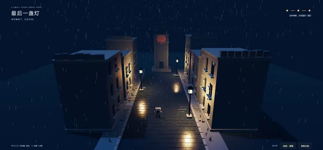</a>

**GPT-6 Astra** · 场景 · 作者 [陈硕KAI（思考中）](https://x.com/ChenshuoAI) · 2026-09-05

GPT-6 Astra 在 Codex 中配合 Blender MCP,按自己生成的概念图建出冷蓝色调、暖橙路灯的雨夜小巷场景。

<details>
<summary>提示词</summary>

```text
悲伤但美丽的反乌托邦世界，体素 / Low Poly 风格，雨夜、薄雾、湿地反射、冷蓝色环境 + 暖橙色灯光，灯光要尽量真实、有电影感
```

</details>

[在 Wandy3D 查看 ↗](https://wandy3d.com/zh/prompts/rainy-low-poly-dystopian-alley-at-night-built-through-2096068401294929940?utm_source=github&utm_medium=referral&utm_campaign=awesome_3d_prompts) · [原帖](https://x.com/ChenshuoAI/status/2096068401294929940)

---

### [支持 BASIC 与磁带加载的 Sinclair ZX Spectrum 48K 模拟器](https://wandy3d.com/zh/prompts/sinclair-zx-spectrum-48k-simulator-with-basic-and-cassette-2096062355692048605?utm_source=github&utm_medium=referral&utm_campaign=awesome_3d_prompts)

<a href="https://wandy3d.com/zh/prompts/sinclair-zx-spectrum-48k-simulator-with-basic-and-cassette-2096062355692048605?utm_source=github&amp;utm_medium=referral&amp;utm_campaign=awesome_3d_prompts">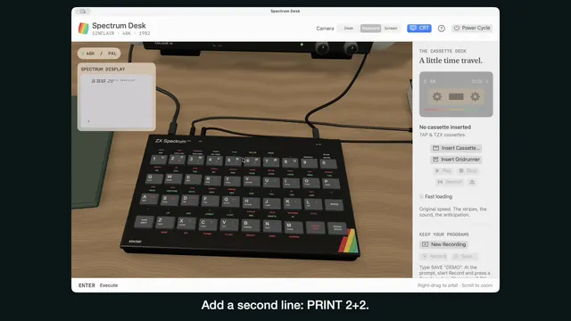</a>

**GPT-6 Astra** · 互动 · 作者 [Derya Unutmaz, MD](https://x.com/DeryaTR_) · 2026-09-05

GPT-6 Astra 借助 Blender 做出一款 Mac 应用,复刻经典 48K 家用电脑:橡胶键盘、可用的 BASIC 和可加载的磁带游戏。

<details>
<summary>Wandy3D 制作简报</summary>

```text
Build a Mac app that simulates a vintage 48K home computer on a 3D desk. Model the computer with its rubber keyboard of 40 clickable, animated keys that also respond to the real keyboard, a small CRT monitor with optional scanlines and a clean-picture mode, and a cassette player beside it. Boot into a copyright screen and BASIC prompt, with a power-cycle button that clears memory. Implement a BASIC interpreter for numbered programs with variables, loops, calculations, simple graphics and beeper sound. Let the user insert tape files, type the load command, hear loading tones and play a bundled arcade game with original-style graphics and keyboard controls. Allow recording programs to a tape file and reloading them later. Add camera controls, a side panel for the cassette and a caption for each step. Done means the machine boots, runs BASIC and loads and plays the bundled game.
```

</details>

[在 Wandy3D 查看 ↗](https://wandy3d.com/zh/prompts/sinclair-zx-spectrum-48k-simulator-with-basic-and-cassette-2096062355692048605?utm_source=github&utm_medium=referral&utm_campaign=awesome_3d_prompts) · [原帖](https://x.com/DeryaTR_/status/2096062355692048605)

---

### [仅凭一张参考图在 Blender 中建模的无线电钻](https://wandy3d.com/zh/prompts/cordless-drill-modeled-in-blender-from-a-single-reference-2096059736693305794?utm_source=github&utm_medium=referral&utm_campaign=awesome_3d_prompts)

<a href="https://wandy3d.com/zh/prompts/cordless-drill-modeled-in-blender-from-a-single-reference-2096059736693305794?utm_source=github&amp;utm_medium=referral&amp;utm_campaign=awesome_3d_prompts">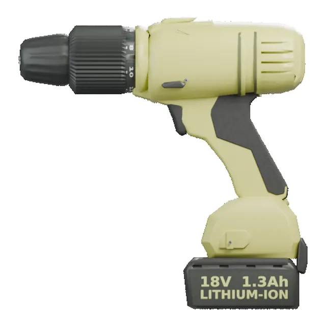</a>

**GPT-6 Astra** · 资产 · 作者 [Utah teapot 🫖](https://x.com/SkyeSharkie) · 2026-09-05

GPT-6 Astra 在不使用图像生成的情况下，仅凭一个角度的参考图，多轮对话在 Blender 中建出细节丰富的 18V 无线电钻。

<details>
<summary>Wandy3D 制作简报</summary>

```text
Build a Blender Python script that models a cordless drill driver from a single reference image of its side view, with no image generation. Work in several turns: block out the main housing, then refine. Model the cylindrical motor housing with vent slots, a keyless chuck with ribbed grip rings and a short bit, a trigger and a small switch, an angled pistol grip with a dark rubberised insert, and a rectangular battery pack at the base embossed with the text 18V 1.3Ah LITHIUM-ION. Use a pale yellow-green plastic body with matte black rubber and metal parts, and set up simple studio lighting and a neutral background. Render the drill from the reference angle and from a second three-quarter angle. Done means the silhouette, proportions and details closely match the reference and the file renders cleanly in Blender.
```

</details>

[在 Wandy3D 查看 ↗](https://wandy3d.com/zh/prompts/cordless-drill-modeled-in-blender-from-a-single-reference-2096059736693305794?utm_source=github&utm_medium=referral&utm_campaign=awesome_3d_prompts) · [原帖](https://x.com/SkyeSharkie/status/2096059736693305794)

---

### [用 Godot 制作的热带海岸索尼克风格 3D 高速平台游戏](https://wandy3d.com/zh/prompts/3d-sonic-style-speed-platformer-on-a-tropical-coast-in-godot-2096056285896536086?utm_source=github&utm_medium=referral&utm_campaign=awesome_3d_prompts)

<a href="https://wandy3d.com/zh/prompts/3d-sonic-style-speed-platformer-on-a-tropical-coast-in-godot-2096056285896536086?utm_source=github&amp;utm_medium=referral&amp;utm_campaign=awesome_3d_prompts">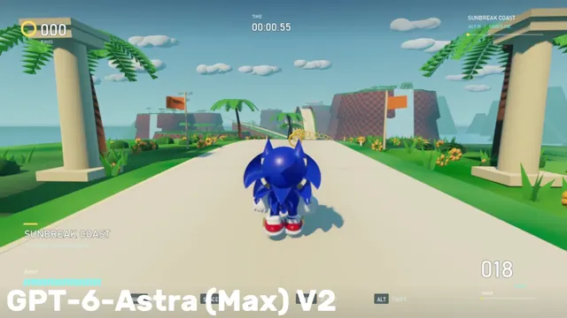</a>

**GPT-6 Astra** · 游戏 · 作者 [AiBattle](https://x.com/AiBattle_) · 2026-09-05

一条长提示词让 GPT-6 Astra 在 Godot 中做出带环形跑道、滑轨和终点门的平台游戏，作者称耗时 46 分钟。

<details>
<summary>提示词</summary>

```text
Create a visually spectacular, highly polished 3D Sonic the Hedgehog vertical slice in Godot. Do not use web search, external downloads, online assets, or internet resources. Build everything using only locally available tools, assets, and procedural/original content.

Sonic must be immediately recognizable: cobalt-blue quills, connected eyes, tan muzzle/torso, white gloves, oversized red shoes with white straps, compact athletic proportions, swept-back quills, expressive animation, iconic running posture, and spin form. Prioritize a polished character model, strong materials, expressive animation, smooth blending, and excellent lighting.

Focus the entire game on speed, momentum, responsive controls, and fluid traversal. Include high-speed running, acceleration, drifting, jumping, homing attacks, spin dash, rolling, boost-style acceleration, springs, dash pads, grind rails, loops, wall-running, ramps, launch sequences, enemies that can be chained with homing attacks, and rings placed along ideal racing lines. Preserve momentum and avoid sticky collisions or unnecessary stops.

Create one exceptional tropical coastal level rather than several smaller ones. Include ocean vistas, waterfalls, green cliffs, palms, flowers, checker-patterned rock, ruins, caves, loops, rails, bridges, tunnels, beaches, and dramatic vertical terrain. The world should feel large and continuous, with multiple routes and higher-skill shortcuts.

Structure the level around memorable moments:
- Cliffside opening overlooking the level
- Long downhill acceleration section
- Giant loop and corkscrew
- Rail grinding above the ocean
- Airborne homing-attack chain
- Cave or ancient-ruin section
- Vertical wall run
- Huge waterfall jump
- Final high-speed sprint

Make speed feel spectacular with restrained speed lines, wind trails, particles, grass/dust effects, camera banking, subtle FOV expansion, environmental reactions, and readable motion effects. Sonic's animation should evolve naturally from jogging into an iconic forward-leaning sprint while maintaining believable terrain contact on slopes, loops, rails, and walls.

Use polished animation for idle, walk, jog, sprint, boost, jump, fall, landing, spin, homing attack, grinding, drifting, spring launches, stumbling, and victory. Use squash, stretch, anticipation, and follow-through while keeping the presentation sophisticated.

Target the feel of a premium modern console platformer: vibrant stylized visuals, strong PBR materials, dynamic sunlight, soft shadows, fog, ocean reflections, spray, vegetation movement, particles, ambient occlusion, tasteful bloom, rich color, and cinematic composition. Keep the tone colorful, optimistic, energetic, and larger than life.

Include interactive cinematic moments such as collapsing terrain, dramatic loop camera pulls, rail grinding high above the ocean, waterfall jumps, scattering birds, debris during boosts, and huge aerial reveals without taking control away from the player for long.

The highest priority is joyful control and AAA Graphics. The player should constantly want to accelerate, discover faster routes, hit ramps, chain attacks, grind rails, and replay sections more cleanly. Favor responsive movement, spectacle, momentum, and traversal polish over unnecessary systems.

When details are unspecified, choose whatever produces the most impressive, energetic, polished, and unmistakably Sonic-like result possible in Godot.
```

</details>

[在 Wandy3D 查看 ↗](https://wandy3d.com/zh/prompts/3d-sonic-style-speed-platformer-on-a-tropical-coast-in-godot-2096056285896536086?utm_source=github&utm_medium=referral&utm_campaign=awesome_3d_prompts) · [原帖](https://x.com/AiBattle_/status/2096056285896536086)

---

### [用 Three.js 制作的 Zork 3D 动作冒险重制版](https://wandy3d.com/zh/prompts/3d-action-adventure-remake-of-zork-built-in-three-js-2096047660662722620?utm_source=github&utm_medium=referral&utm_campaign=awesome_3d_prompts)

<a href="https://wandy3d.com/zh/prompts/3d-action-adventure-remake-of-zork-built-in-three-js-2096047660662722620?utm_source=github&amp;utm_medium=referral&amp;utm_campaign=awesome_3d_prompts">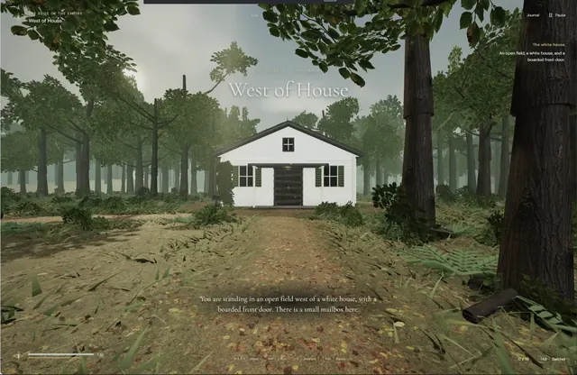</a>

**GPT-6 Astra** · 游戏 · 作者 [Ethan Mollick](https://x.com/emollick) · 2026-09-05

GPT-6 Astra 把经典文字冒险改成可玩的 3D 游戏，保留原谜题并新增战斗，所有场景都用 Three.js 构建。

<details>
<summary>Wandy3D 制作简报</summary>

```text
Build a browser-based 3D action-adventure game in Three.js that reimagines a classic 1970s text adventure. Keep the original story and puzzles, and add combat encounters. Model every environment and character procedurally in code: an open forest clearing with a white farmhouse and a boarded door, a dim living room with a rug, tables and bookcases, and a pitch-dark cellar. Use first-person movement and mouse look, an interaction prompt for items and doors, an inventory, and a text overlay that shows the location name and descriptive narration in a serif typeface. Use moody, realistic lighting with fog outdoors and near-black interiors that require a light source. Deliver a deployable web project that runs from a static host. Done means a player can walk from the house exterior inside, pick up items, descend to the cellar, and see the narration update by room.
```

</details>

[在 Wandy3D 查看 ↗](https://wandy3d.com/zh/prompts/3d-action-adventure-remake-of-zork-built-in-three-js-2096047660662722620?utm_source=github&utm_medium=referral&utm_campaign=awesome_3d_prompts) · [原帖](https://x.com/emollick/status/2096047660662722620)

---

### [关桥后卡车自动改道的等距 3D 配送模拟器](https://wandy3d.com/zh/prompts/isometric-3d-delivery-simulator-where-closed-bridges-reroute-2096042360513904742?utm_source=github&utm_medium=referral&utm_campaign=awesome_3d_prompts)

<a href="https://wandy3d.com/zh/prompts/isometric-3d-delivery-simulator-where-closed-bridges-reroute-2096042360513904742?utm_source=github&amp;utm_medium=referral&amp;utm_campaign=awesome_3d_prompts">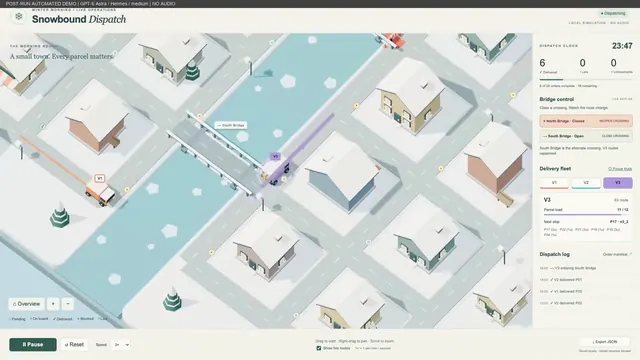</a>

**GPT-6 Astra** · 互动 · 作者 [AgentworkflowLab](https://x.com/AgentWorkflowLa) · 2026-09-05

GPT-6 Astra 在 Hermes 中做出雪镇物流模拟：关一座桥卡车改道，两座都关则无法送达，重开后恢复。

<details>
<summary>Wandy3D 制作简报</summary>

```text
Build an interactive 3D isometric delivery simulation of a small snowy town, running in the browser. Show houses, roads and two bridges in a pale blue and cream palette, with delivery trucks driving between a depot and addresses. Let the user close or reopen each bridge: trucks must reroute when one is closed, deliveries become unreachable when both are closed, and they recover when one reopens. Add a side panel with elapsed time, delivered, pending and unreachable counters, bridge toggles, a fleet speed control, a dispatch log and a delivery manifest dialog, plus pause, resume and reset buttons and a camera zoom view. Include an automated demo mode that plays the scenario. Write automated logic checks for routing and recovery. Done means all checks pass and the panel updates live.
```

</details>

[在 Wandy3D 查看 ↗](https://wandy3d.com/zh/prompts/isometric-3d-delivery-simulator-where-closed-bridges-reroute-2096042360513904742?utm_source=github&utm_medium=referral&utm_campaign=awesome_3d_prompts) · [原帖](https://x.com/AgentWorkflowLa/status/2096042360513904742)

---

### [单个 HTML 文件、原生 WebGL 实现的 3D 海洋进化生态系统](https://wandy3d.com/zh/prompts/evolving-3d-ocean-ecosystem-in-one-html-file-with-raw-webgl-2096040448477515874?utm_source=github&utm_medium=referral&utm_campaign=awesome_3d_prompts)

<a href="https://wandy3d.com/zh/prompts/evolving-3d-ocean-ecosystem-in-one-html-file-with-raw-webgl-2096040448477515874?utm_source=github&amp;utm_medium=referral&amp;utm_campaign=awesome_3d_prompts">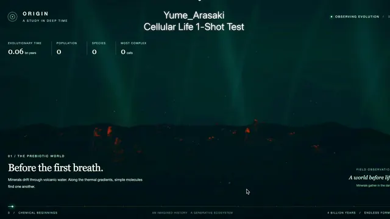</a>

**GPT-6 Astra** · 互动 · 作者 [Yume\_X](https://x.com/yume_arasaki) · 2026-09-05

Astra 用不依赖库的 WebGL 和 GLSL 写出模拟：发光细胞分裂、变异、结合成群体，并作为生物游动。

<details>
<summary>Wandy3D 制作简报</summary>

```text
Build a single self-contained HTML file with raw WebGL and GLSL, no libraries, that simulates an evolving 3D ocean ecosystem. Start from a primordial sea with thermal vents on a dark seabed, then let translucent bioluminescent cells appear, drift, divide and mutate in visible ways. Add predation, energy economics and natural selection, and let cells bond into multicellular colonies that grow appendages and swim as organisms. Write the full pipeline yourself: vertex and fragment shaders, procedural geometry, lighting and a volumetric fluid look. Use a slowly drifting camera like a submersible, a deep teal and green palette with glowing accents, and a minimal HUD showing elapsed time, population, species and most complex organism, plus short stage captions. Give only the vision, not implementation details. Done means life emerges unaided and runs without errors.
```

</details>

[在 Wandy3D 查看 ↗](https://wandy3d.com/zh/prompts/evolving-3d-ocean-ecosystem-in-one-html-file-with-raw-webgl-2096040448477515874?utm_source=github&utm_medium=referral&utm_campaign=awesome_3d_prompts) · [原帖](https://x.com/yume_arasaki/status/2096040448477515874)

---

### [可第一人称漫步探索的3D泰姬陵](https://wandy3d.com/zh/prompts/explorable-3d-taj-mahal-you-can-walk-through-in-first-person-2096035962824335798?utm_source=github&utm_medium=referral&utm_campaign=awesome_3d_prompts)

<a href="https://wandy3d.com/zh/prompts/explorable-3d-taj-mahal-you-can-walk-through-in-first-person-2096035962824335798?utm_source=github&amp;utm_medium=referral&amp;utm_campaign=awesome_3d_prompts">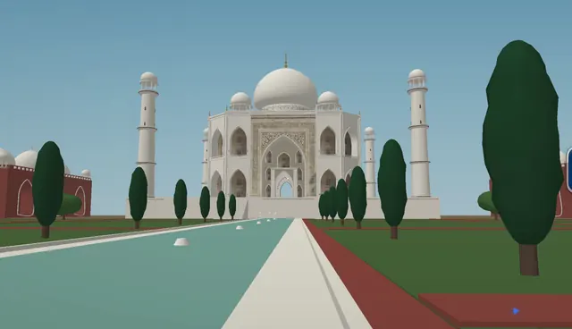</a>

**GPT-6 Astra** · 场景 · 作者 [vikas sabbi](https://x.com/vikassabbi) · 2026-09-05

GPT-6 Astra、Claude Fable 5.1 和 Muse Spark 1.3 的对比:各自把泰姬陵做成可行走的3D场景,这里展示的是 Astra 的版本。

<details>
<summary>Wandy3D 制作简报</summary>

```text
Build an explorable 3D recreation of the Taj Mahal that runs in the browser. Use Three.js and deliver a self-contained project that opens with one command. Show the white marble mausoleum with its central dome, four minarets, arched portals and inlaid facade detail, set on a raised platform with wide steps. Add a long reflecting pool down the middle, a flanking garden with tall dark cypress trees and red sandstone paths, and red gatehouse walls in the distance. Use a bright clear sky and soft daylight. Provide first-person walking controls with mouse look and WASD, simple collision so the visitor cannot leave the grounds, and the ability to walk up the steps and into the entrance arch. Keep proportions faithful to the real monument. It is done when a visitor can walk from the gate along the pool, climb to the platform and inspect the facade up close without glitches.
```

</details>

[在 Wandy3D 查看 ↗](https://wandy3d.com/zh/prompts/explorable-3d-taj-mahal-you-can-walk-through-in-first-person-2096035962824335798?utm_source=github&utm_medium=referral&utm_campaign=awesome_3d_prompts) · [原帖](https://x.com/vikassabbi/status/2096035962824335798)

---

### [带 Blender 角色和演讲地球仪的交互式3D作品集](https://wandy3d.com/zh/prompts/interactive-3d-portfolio-with-a-blender-character-and-talk-2096023793772998704?utm_source=github&utm_medium=referral&utm_campaign=awesome_3d_prompts)

<a href="https://wandy3d.com/zh/prompts/interactive-3d-portfolio-with-a-blender-character-and-talk-2096023793772998704?utm_source=github&amp;utm_medium=referral&amp;utm_campaign=awesome_3d_prompts"></a>

**GPT-6 Astra** · 互动 · 作者 [Shivay Lamba](https://x.com/HowDevelop) · 2026-09-04

GPT-6 Astra 做出了 WebGL 作品集:由照片生成的 Blender 角色,加上标记全球演讲地点的旋转地球仪。

<details>
<summary>Wandy3D 制作简报</summary>

```text
Build an interactive 3D personal portfolio website with an editorial look: warm cream background, large serif name heading, small navigation list and quiet sans-serif details. Place a stylized 3D cartoon character, modeled in Blender from a reference photo and exported for the web, in the hero area, with a gentle idle motion that follows the cursor. Add a second section called a speaking orbit: a slowly revolving Earth globe in soft green and white tones with markers for talk locations around the world. Selecting or cycling through a marker updates a side panel with the city, event title, a short description and a link. Use WebGL, for example Three.js, and keep transitions smooth between hero and globe. Deliver a runnable web project plus the exported character model. It is done when the character renders cleanly, the globe rotates, and every marker updates the panel correctly.
```

</details>

[在 Wandy3D 查看 ↗](https://wandy3d.com/zh/prompts/interactive-3d-portfolio-with-a-blender-character-and-talk-2096023793772998704?utm_source=github&utm_medium=referral&utm_campaign=awesome_3d_prompts) · [原帖](https://x.com/HowDevelop/status/2096023793772998704)

---

[← 上一页](catalog.zh.4.md) · 第 5 页，共 8 页 · [下一页 →](catalog.zh.6.md)

提示词、视频和图片的权利归原作者所有（[RIGHTS.md](../RIGHTS.md)）。我们撰写的文字采用 [CC BY 4.0](../LICENSE) 许可。知道有成果展示的好提示词？[推荐给我们](https://github.com/wornoxgames/awesome-3d-prompts/issues/new?template=suggest.md)。如果你是作者并希望修改或删除条目，请[联系我们](https://github.com/wornoxgames/awesome-3d-prompts/issues/new?template=removal.md)。
