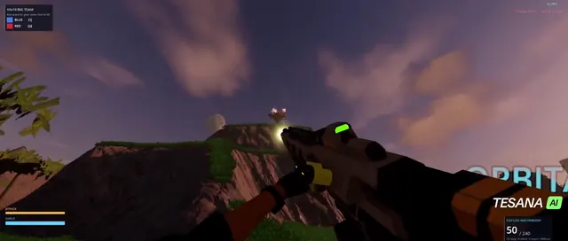

<!-- Generated file: edits are overwritten. -->

# Awesome 3D Prompts — 目录 7/9

[← Awesome 3D Prompts](../README.md) · [English](catalog.en.1.md) · [Русский](catalog.ru.1.md) · [日本語](catalog.ja.1.md) · **中文**

[← 上一页](catalog.zh.6.md) · 第 7 页，共 9 页 · [下一页 →](catalog.zh.8.md)

### [支持驾驶运输机的10对10科幻第一人称射击游戏](https://wandy3d.com/zh/prompts/10v10-sci-fi-first-person-shooter-with-flyable-dropships-2095598026916049024?utm_source=github&utm_medium=referral&utm_campaign=awesome_3d_prompts)

<a href="https://wandy3d.com/zh/prompts/10v10-sci-fi-first-person-shooter-with-flyable-dropships-2095598026916049024?utm_source=github&amp;utm_medium=referral&amp;utm_campaign=awesome_3d_prompts"></a>

**GPT-6 Astra** · 游戏 · 作者 [Thomas Jørgensen](https://x.com/Thomas_jorgen) · 2026-09-03

GPT-6 Astra搭配游戏制作工具,生成了异星战场上的团队FPS:霓虹步枪、敌方士兵,还有可驾驶的运输机。

<details>
<summary>Wandy3D 制作简报</summary>

```text
Build a team-based first-person sci-fi shooter for 10v10 matches. Set it on a large alien landscape: grassy plains, rocky mesas, a coastline, ruined stone towers and a huge ringed planet and glowing beams in a dusk sky. The player holds a chunky dark rifle with neon green accents, with a HUD showing ammo, health and a shield bar, and enemy troopers with floating name tags. Add at least one flyable dropship that can lift off and cruise over land and sea. Use warm sunset lighting, soft fog and a teal, orange and violet palette. Deliver it as a playable game project with WASD and mouse look, shooting, reloading, bot teammates and opponents, respawns and a simple score. Done means a full match can be played from spawn to finish, and the ship can be boarded and flown around the map.
```

</details>

[在 Wandy3D 查看 ↗](https://wandy3d.com/zh/prompts/10v10-sci-fi-first-person-shooter-with-flyable-dropships-2095598026916049024?utm_source=github&utm_medium=referral&utm_campaign=awesome_3d_prompts) · [原帖](https://x.com/Thomas_jorgen/status/2095598026916049024)

---

### [带合成、村庄和农田的第一人称体素生存游戏](https://wandy3d.com/zh/prompts/first-person-voxel-survival-game-with-crafting-villages-and-2095597137849446688?utm_source=github&utm_medium=referral&utm_campaign=awesome_3d_prompts)

<a href="https://wandy3d.com/zh/prompts/first-person-voxel-survival-game-with-crafting-villages-and-2095597137849446688?utm_source=github&amp;utm_medium=referral&amp;utm_campaign=awesome_3d_prompts"></a>

**GPT-6 Astra** · 游戏 · 作者 [Flavio Adamo](https://x.com/flavioAd) · 2026-09-03

GPT-6 Astra一次性完成热门的类Minecraft挑战:方块地形、村庄、合成界面、工具和麦田。

<details>
<summary>Wandy3D 制作简报</summary>

```text
Build a first-person blocky sandbox survival game in the style of classic voxel crafting games. Generate rolling grass terrain with cube trees, drifting clouds, small wooden villages with interiors holding bookshelves and chests, and a planted wheat field. Use crisp pixelated textures, bright daylight and a simple HUD with a hotbar, hearts and hunger bar. Include an inventory screen and a crafting grid that turns collected items into wooden tools such as a pickaxe and sword, shown held in the player's hand. Controls: WASD to move, mouse to look, click to break and place blocks, a key to open the inventory. Deliver everything as one runnable project. Done means a player can walk through a village, open the inventory, craft a tool, harvest crops and mine blocks without errors.
```

</details>

[在 Wandy3D 查看 ↗](https://wandy3d.com/zh/prompts/first-person-voxel-survival-game-with-crafting-villages-and-2095597137849446688?utm_source=github&utm_medium=referral&utm_campaign=awesome_3d_prompts) · [原帖](https://x.com/flavioAd/status/2095597137849446688)

---

### [带任务与地点菜单的第一人称剧情开放世界冒险](https://wandy3d.com/zh/prompts/story-driven-first-person-open-world-adventure-with-quests-2095596341422440714?utm_source=github&utm_medium=referral&utm_campaign=awesome_3d_prompts)

<a href="https://wandy3d.com/zh/prompts/story-driven-first-person-open-world-adventure-with-quests-2095596341422440714?utm_source=github&amp;utm_medium=referral&amp;utm_campaign=awesome_3d_prompts"></a>

**GPT-6 Astra** · 游戏 · 作者 [Peter Gostev](https://x.com/petergostev) · 2026-09-03

GPT-6 Astra(Ultra)生成了可探索的开放世界,包含旁白任务、字幕对话,以及可在各地点间跳转的菜单。

<details>
<summary>Wandy3D 制作简报</summary>

```text
Build a first-person open-world adventure game with a story. Create a large landscape of grassy hills, dry red plains, a sandy beach and sea, dotted with trees and strange landmarks such as a glass cathedral and an orchard. The player carries a white pistol. Add a quest log and objective markers, narrated dialogue shown as subtitles, and a calm muted HUD with a compass strip and location titles that appear when entering an area. Include a menu titled like a world-jump screen that lists named locations as cards so the player can teleport between them. Use soft daylight, a restrained teal and green palette and clean thin UI typography. Deliver it as one runnable project with WASD movement, mouse look and click to fire. Done means the player can pick a location, explore, trigger dialogue and complete an objective.
```

</details>

[在 Wandy3D 查看 ↗](https://wandy3d.com/zh/prompts/story-driven-first-person-open-world-adventure-with-quests-2095596341422440714?utm_source=github&utm_medium=referral&utm_campaign=awesome_3d_prompts) · [原帖](https://x.com/petergostev/status/2095596341422440714)

---

### [由会说话的AI智能体驱动的Unreal Engine生存世界](https://wandy3d.com/zh/prompts/unreal-engine-survival-world-run-by-talking-ai-agents-2095596175705399482?utm_source=github&utm_medium=referral&utm_campaign=awesome_3d_prompts)

<a href="https://wandy3d.com/zh/prompts/unreal-engine-survival-world-run-by-talking-ai-agents-2095596175705399482?utm_source=github&amp;utm_medium=referral&amp;utm_campaign=awesome_3d_prompts"></a>

**GPT-6 Astra** · 场景 · 作者 [Matt Shumer](https://x.com/mattshumer_) · 2026-09-03

GPT-6 Astra在Unreal Engine中搭建了一片荒野世界，每个居民都是独立智能体，它们相互交谈、协作求生，对白以字幕显示。

<details>
<summary>Wandy3D 制作简报</summary>

```text
Build a small survival world in Unreal Engine set in a sunlit semi-arid woodland: red dirt ground, scattered eucalyptus-like trees, dry grass tufts, fallen logs and a few rough wooden shelters and stalls. Populate it with several humanoid characters, each driven by its own language-model agent with a short persona and a shared goal: the group must cooperate to survive by finding food, water and shelter. Let the agents talk to each other and decide what to do, and show their speech as captions at the bottom of the screen with a small status overlay in the corner. Use a third-person camera that follows individual characters and cuts between them, with natural daylight and long shadows. Characters should walk between locations, stand together in conversation and react to each other. Deliver a runnable Unreal project plus a short script that connects each character to the model. Done means you can leave the simulation running and watch the characters plan, talk and act without any input from you.
```

</details>

[在 Wandy3D 查看 ↗](https://wandy3d.com/zh/prompts/unreal-engine-survival-world-run-by-talking-ai-agents-2095596175705399482?utm_source=github&utm_medium=referral&utm_campaign=awesome_3d_prompts) · [原帖](https://x.com/mattshumer_/status/2095596175705399482)

---

### [带电网与沙尘暴的体素火星殖民地模拟](https://wandy3d.com/zh/prompts/voxel-mars-colony-simulation-with-power-grids-and-dust-2095595678214873212?utm_source=github&utm_medium=referral&utm_campaign=awesome_3d_prompts)

<a href="https://wandy3d.com/zh/prompts/voxel-mars-colony-simulation-with-power-grids-and-dust-2095595678214873212?utm_source=github&amp;utm_medium=referral&amp;utm_campaign=awesome_3d_prompts"></a>

**Claude Fable 5.1** · 互动 · 作者 [Knowix](https://x.com/knowixbuilds) · 2026-09-03

Claude Fable 5.1在浏览器中生成了由数百万体素构成的火星基地，含火箭、机器人建造者、电力与生命保障系统，沙尘暴会造成故障。

<details>
<summary>Wandy3D 制作简报</summary>

```text
Build an interactive voxel simulation of a Mars colony that runs in the browser. Show a large red-rock voxel terrain with a base growing on it: tall rocket landing towers, launch and landing vehicles, solar fields, a nuclear power plant, battery banks, fuel, oxygen and water facilities, rovers and humanoid robot workers that construct buildings in phases. Model resource flows so power, fuel, oxygen and water levels change over time, and let weather events such as dust storms, blackouts and night frost disrupt the base. Use a warm orange and rust palette with a hazy sky that thickens during storms. Provide a free orbit camera and a side control panel with sliders for time of day, speed and disaster triggers, plus a small status bar. Keep it as one web project with an efficient voxel renderer able to handle millions of voxels. Done means you can watch the colony operate on its own, then trigger failures and see the systems react.
```

</details>

[在 Wandy3D 查看 ↗](https://wandy3d.com/zh/prompts/voxel-mars-colony-simulation-with-power-grids-and-dust-2095595678214873212?utm_source=github&utm_medium=referral&utm_campaign=awesome_3d_prompts) · [原帖](https://x.com/knowixbuilds/status/2095595678214873212)

---

### [带雾气、水潭和滑块的WebGPU Three.js瀑布场景](https://wandy3d.com/zh/prompts/webgpu-waterfall-scene-in-three-js-with-mist-pool-and-live-2095510069047660636?utm_source=github&utm_medium=referral&utm_campaign=awesome_3d_prompts)

<a href="https://wandy3d.com/zh/prompts/webgpu-waterfall-scene-in-three-js-with-mist-pool-and-live-2095510069047660636?utm_source=github&amp;utm_medium=referral&amp;utm_campaign=awesome_3d_prompts"></a>

**Claude Fable 5.1** · 场景 · 作者 [Fede(URU) 🇺🇾](https://x.com/RealFedeURU) · 2026-09-03

这是两个模型的对比，排在首位的Claude Fable 5.1用Three.js做出了带水花、雾气和水潭的瀑布。

<details>
<summary>Wandy3D 制作简报</summary>

```text
Build a real-time waterfall scene with Three.js using WebGPU. Show a tall rocky cliff with layered rock texture, a ribbon of falling water made of streaks and spray particles, a rolling mist cloud at the base, and a turquoise plunge pool ringed by boulders, foam and grass, with a lone tree on the clifftop. Light it with a warm low sun and a gradient sky. Add a small panel with sliders for time of day, wind, flow rate, mist amount and audio volume, plus a mute button and a reset-view button, and show a tiny stats readout. Let the user orbit and zoom the camera freely, and include ambient waterfall sound. Keep everything procedural, in a single web page with no external assets. Done means the water looks continuous and the mist reacts to the sliders as the camera moves in close and pulls back.
```

</details>

[在 Wandy3D 查看 ↗](https://wandy3d.com/zh/prompts/webgpu-waterfall-scene-in-three-js-with-mist-pool-and-live-2095510069047660636?utm_source=github&utm_medium=referral&utm_campaign=awesome_3d_prompts) · [原帖](https://x.com/RealFedeURU/status/2095510069047660636)

---

### [带风车、灯塔和昼夜循环的漂浮体素岛](https://wandy3d.com/zh/prompts/floating-voxel-island-with-windmill-lighthouse-and-day-night-2095493630421340200?utm_source=github&utm_medium=referral&utm_campaign=awesome_3d_prompts)

<a href="https://wandy3d.com/zh/prompts/floating-voxel-island-with-windmill-lighthouse-and-day-night-2095493630421340200?utm_source=github&amp;utm_medium=referral&amp;utm_campaign=awesome_3d_prompts"></a>

**Claude Fable 5.1** · 场景 · 作者 [AI Guides](https://x.com/free_ai_guides) · 2026-09-03

对比作品：排在首位的Claude Fable 5.1自主设计了Three.js体素岛，旁边是旧版Fable 5生成的粉彩小岛。

<details>
<summary>Wandy3D 制作简报</summary>

```text
Build a small voxel world as a single self-contained web page, using Three.js, that the viewer can rotate around. Create a floating island with a rocky underside, a windmill with turning sails, a lighthouse whose beam sweeps at night, a village of red-roofed houses, a river that runs to the edge and drops as a waterfall, trees, flocks of birds circling and drifting clouds. Add a day and night cycle in which the sky darkens, windows glow and the lighthouse lights up. Use blocky voxel geometry with soft lighting, saturated greens and a pale blue sky by day, deep navy at night. Provide orbit controls with mouse drag and zoom, and a small title label. Everything should move on its own without input. Done means the island looks charming from every angle and the full day cycle plays smoothly.
```

</details>

[在 Wandy3D 查看 ↗](https://wandy3d.com/zh/prompts/floating-voxel-island-with-windmill-lighthouse-and-day-night-2095493630421340200?utm_source=github&utm_medium=referral&utm_campaign=awesome_3d_prompts) · [原帖](https://x.com/free_ai_guides/status/2095493630421340200)

---

### [单个 WebGL2 文件实现的电影感光线步进黑洞](https://wandy3d.com/zh/prompts/cinematic-ray-marched-black-hole-in-a-single-webgl2-file-2095409039005933910?utm_source=github&utm_medium=referral&utm_campaign=awesome_3d_prompts)

<a href="https://wandy3d.com/zh/prompts/cinematic-ray-marched-black-hole-in-a-single-webgl2-file-2095409039005933910?utm_source=github&amp;utm_medium=referral&amp;utm_campaign=awesome_3d_prompts"></a>

**Claude Fable 5.1** · 场景 · 作者 [eki](https://x.com/ekibuilds) · 2026-09-03

Claude Fable 5.1 仅凭一句话就生成了带引力透镜、多普勒效应吸积盘和环绕粒子的黑洞,不依赖任何素材。

<details>
<summary>提示词</summary>

```text
build me a cinematic black hole
```

</details>

[在 Wandy3D 查看 ↗](https://wandy3d.com/zh/prompts/cinematic-ray-marched-black-hole-in-a-single-webgl2-file-2095409039005933910?utm_source=github&utm_medium=referral&utm_campaign=awesome_3d_prompts) · [原帖](https://x.com/ekibuilds/status/2095409039005933910)

---

### [带小地图的开放世界纽约驾驶游戏原型](https://wandy3d.com/zh/prompts/open-world-new-york-driving-game-prototype-with-minimap-2095187868746383758?utm_source=github&utm_medium=referral&utm_campaign=awesome_3d_prompts)

<a href="https://wandy3d.com/zh/prompts/open-world-new-york-driving-game-prototype-with-minimap-2095187868746383758?utm_source=github&amp;utm_medium=referral&amp;utm_campaign=awesome_3d_prompts"></a>

**Claude Fable 5.1** · 游戏 · 作者 [Matt Shumer](https://x.com/mattshumer_) · 2026-09-02

用 Claude Fable 5.1 制作的 GTA 风格城市游戏早期预览:轿车驶过细致的曼哈顿街道,进入河畔公园。

<details>
<summary>Wandy3D 制作简报</summary>

```text
Build a third-person open-world driving game set in a realistic version of New York City. The player steers a grey sedan through avenues lined with stone apartment buildings, parked cars, traffic lights, crosswalks and street trees, then out onto a grassy riverside park with a waterfront railing. Use a naturalistic, slightly desaturated daylight palette with a pale sky. Add a HUD with a corner minimap showing the road network, a label for the current street name, and a speed readout. Use a chase camera behind the car, keyboard driving controls, and background traffic. Stream or tile the city so the player can drive continuously through several districts. Deliver it as a browser-playable 3D project with clear run instructions. Done means the car drives smoothly along streets and into the park, the minimap and street names update as you move, and the frame rate stays playable.
```

</details>

[在 Wandy3D 查看 ↗](https://wandy3d.com/zh/prompts/open-world-new-york-driving-game-prototype-with-minimap-2095187868746383758?utm_source=github&utm_medium=referral&utm_campaign=awesome_3d_prompts) · [原帖](https://x.com/mattshumer_/status/2095187868746383758)

---

### [用 Three.js 制作的漫画风西部枪手横版游戏](https://wandy3d.com/zh/prompts/comic-book-western-side-scroller-with-a-gunslinger-in-three-2095180091257209148?utm_source=github&utm_medium=referral&utm_campaign=awesome_3d_prompts)

<a href="https://wandy3d.com/zh/prompts/comic-book-western-side-scroller-with-a-gunslinger-in-three-2095180091257209148?utm_source=github&amp;utm_medium=referral&amp;utm_campaign=awesome_3d_prompts"></a>

**Claude Fable 5.1** · 游戏 · 作者 [smallzero](https://x.com/Smallzero) · 2026-09-02

Claude Fable 5.1 生成了街机风格牛仔射击游戏的早期版本:墨线漫画画风、日落沙漠、酒馆和剧情字幕。

<details>
<summary>Wandy3D 制作简报</summary>

```text
Build a side-scrolling western action game in the browser using Three.js. Take inspiration from classic arcade cowboy shooters, rendered with a comic-book look: inked outlines, painterly desert sunsets in purple, orange and gold, and detailed wooden frontier buildings. The player is a gunslinger walking through a town with a saloon, sheriff's office, freight depot and water tower, with cacti, barrels and hay bales as scenery. Add shooting, a kick or melee action, a horse-riding moment, enemies that react to hits, and context prompts for reading signs or talking to townsfolk. Include a HUD with a portrait, health and ammo, plus narrated story text boxes and speech bubbles. Deliver it as a playable web project with keyboard controls. Done means you can walk through the street, enter the saloon, fight outlaws and see story text appear.
```

</details>

[在 Wandy3D 查看 ↗](https://wandy3d.com/zh/prompts/comic-book-western-side-scroller-with-a-gunslinger-in-three-2095180091257209148?utm_source=github&utm_medium=referral&utm_campaign=awesome_3d_prompts) · [原帖](https://x.com/Smallzero/status/2095180091257209148)

---

### [对抗失控AGI与机器人的Three.js第一人称射击游戏](https://wandy3d.com/zh/prompts/first-person-three-js-shooter-against-a-rogue-agi-and-its-2095180071221002441?utm_source=github&utm_medium=referral&utm_campaign=awesome_3d_prompts)

<a href="https://wandy3d.com/zh/prompts/first-person-three-js-shooter-against-a-rogue-agi-and-its-2095180071221002441?utm_source=github&amp;utm_medium=referral&amp;utm_campaign=awesome_3d_prompts"></a>

**Claude Fable 5.1** · 游戏 · 作者 [Lucas Bai](https://x.com/lucasybai) · 2026-09-02

Claude Fable 5.1用Three.js生成了波次射击游戏：玩家在夜晚屋顶迎战机器人和Boss，Boss的光束会照亮整个屏幕。

<details>
<summary>Wandy3D 制作简报</summary>

```text
Build a browser first-person wave shooter in Three.js. The player is a human fighting an unaligned AGI and its robot minions on a dark, cracked-asphalt rooftop arena at night. Show a title screen with a game name and an engage button, then a HUD with wave counter, health bar, ammo count and weapon slots. Include a firearm and a melee bat, small robot enemies and a larger boss machine with a glowing green screen face. Enemies telegraph attacks with glowing red laser lines on the floor and a large beam attack that floods the screen with orange-white light. Use a dim palette with neon red, orange and green accents, fog and bloom. Deliver one runnable web project with mouse-look and WASD controls, wave progression, win and lose states. Done when a player can start, clear several waves and see the boss attack.
```

</details>

[在 Wandy3D 查看 ↗](https://wandy3d.com/zh/prompts/first-person-three-js-shooter-against-a-rogue-agi-and-its-2095180071221002441?utm_source=github&utm_medium=referral&utm_campaign=awesome_3d_prompts) · [原帖](https://x.com/lucasybai/status/2095180071221002441)

---

### [破坏球撞倒砖塔的Blender物理模拟测试](https://wandy3d.com/zh/prompts/wrecking-ball-brick-tower-collapse-as-a-blender-physics-test-2095177102400081940?utm_source=github&utm_medium=referral&utm_campaign=awesome_3d_prompts)

<a href="https://wandy3d.com/zh/prompts/wrecking-ball-brick-tower-collapse-as-a-blender-physics-test-2095177102400081940?utm_source=github&amp;utm_medium=referral&amp;utm_campaign=awesome_3d_prompts"></a>

**Claude Fable 5.1** · 动画 · 作者 [Abyssal](https://x.com/abyssallD) · 2026-09-02

通过Blender MCP，Claude Fable 5.1搭建了砖塔、摆动的球、地面和摄像机，刚体模拟让墙体碎成一块块砖。

<details>
<summary>Wandy3D 制作简报</summary>

```text
Build a Blender rigid-body physics test driven through a Blender MCP connection. Create a tall tower made of many separate bricks laid in staggered courses, a heavy dark sphere hanging from a thin cable that swings like a pendulum, a flat ground plane and a camera framing the whole action. Make the bricks active rigid bodies and the ball a driven or pendulum body so it swings into the tower and the wall breaks apart into individual bricks that settle into a pile. Use neutral grey bricks, a plain ground and a soft sky backdrop for a clean render. Keep it a single focused physics check with no cinematic grading. Deliver a saved .blend file where the collapsed pile remains as real objects. Done when playing the timeline shows the swing, the impact and the bricks coming to rest.
```

</details>

[在 Wandy3D 查看 ↗](https://wandy3d.com/zh/prompts/wrecking-ball-brick-tower-collapse-as-a-blender-physics-test-2095177102400081940?utm_source=github&utm_medium=referral&utm_campaign=awesome_3d_prompts) · [原帖](https://x.com/abyssallD/status/2095177102400081940)

---

### [用Three.js制作的鹰形重型拦截舰（三阶）](https://wandy3d.com/zh/prompts/armoured-eagle-interceptor-ship-built-in-three-js-rank-3-2095176360238915978?utm_source=github&utm_medium=referral&utm_campaign=awesome_3d_prompts)

<a href="https://wandy3d.com/zh/prompts/armoured-eagle-interceptor-ship-built-in-three-js-rank-3-2095176360238915978?utm_source=github&amp;utm_medium=referral&amp;utm_campaign=awesome_3d_prompts"></a>

**Claude Fable 5.1** · 资产 · 作者 [Dmytro Gladkyi 🔳](https://x.com/gladimdim) · 2026-09-02

Claude Fable 5.1用Three.js生成了鹰形重型拦截舰，并输出了多角度、多尺寸的俯视图联系表。

<details>
<summary>Wandy3D 制作简报</summary>

```text
Build a stylised top-down sci-fi interceptor ship as a Three.js model for a space game. Design a heavy winged craft shaped like an armoured eagle, with a dark navy hull, red-hot rails and talons, white and orange engine glow, a row of primary weapons, covert launcher rows, a quad of engines and sensor fins on the brow. Make it a rank-three variant of a ship family, bulkier than lower ranks, scaled about twelve percent larger per rank. Render it from a top-down three-quarter view and produce a contact sheet showing the ship from several angles and sizes on dark and light backgrounds. Deliver Three.js code that builds the ship from primitives plus a script that exports the renders. Done when the silhouette reads clearly at small size and the three ranks look like one family.
```

</details>

[在 Wandy3D 查看 ↗](https://wandy3d.com/zh/prompts/armoured-eagle-interceptor-ship-built-in-three-js-rank-3-2095176360238915978?utm_source=github&utm_medium=referral&utm_campaign=awesome_3d_prompts) · [原帖](https://x.com/gladimdim/status/2095176360238915978)

---

### [可漫游的Frutiger Aero风3D世界：泡泡、玻璃与绿色山丘](https://wandy3d.com/zh/prompts/explorable-frutiger-aero-3d-world-with-bubbles-glass-and-2095171470607728926?utm_source=github&utm_medium=referral&utm_campaign=awesome_3d_prompts)

<a href="https://wandy3d.com/zh/prompts/explorable-frutiger-aero-3d-world-with-bubbles-glass-and-2095171470607728926?utm_source=github&amp;utm_medium=referral&amp;utm_campaign=awesome_3d_prompts"></a>

**Claude Fable 5.1** · 场景 · 作者 [Oliver Benns](https://x.com/oliverbenns) · 2026-09-02

向Claude Fable 5.1发出两次提示，就得到了2000年代初Frutiger Aero风格的浏览器3D世界：光亮广场、喷泉、玻璃穹顶和漂浮泡泡。

<details>
<summary>Wandy3D 制作简报</summary>

```text
Build an explorable 3D world in the Frutiger Aero style of the early 2000s, running in the browser with WebGL. Place the viewer in a clean plaza with glossy white curved paths edged in teal, round pools with mushroom-shaped fountains, glass domes and glass-walled buildings. Surround it with rolling bright green hills dotted with round trees, tall grass blades, floating soap bubbles, soft clouds, distant hot air balloons and birds under a vivid blue sky with a lens-flare sun. Use a saturated sky blue, aqua, lime and white palette with soft reflections. Add a small location label in the corner. Let the user walk or glide through the scene with mouse or touch controls. Deliver a deployable web page. Done when the world feels airy, optimistic and nostalgic from every viewpoint.
```

</details>

[在 Wandy3D 查看 ↗](https://wandy3d.com/zh/prompts/explorable-frutiger-aero-3d-world-with-bubbles-glass-and-2095171470607728926?utm_source=github&utm_medium=referral&utm_campaign=awesome_3d_prompts) · [原帖](https://x.com/oliverbenns/status/2095171470607728926)

---

### [文艺复兴与编辑排版结合的十场景GSAP电影网站](https://wandy3d.com/zh/prompts/ten-scene-renaissance-meets-editorial-film-site-with-gsap-2095167881004908897?utm_source=github&utm_medium=referral&utm_campaign=awesome_3d_prompts)

<a href="https://wandy3d.com/zh/prompts/ten-scene-renaissance-meets-editorial-film-site-with-gsap-2095167881004908897?utm_source=github&amp;utm_medium=referral&amp;utm_campaign=awesome_3d_prompts"></a>

**Claude Fable 5.1** · 动画 · 作者 [Henry Fan](https://x.com/Henry_Fan_lh) · 2026-09-02

Claude Fable 5.1用HTML、CSS和JS做出浏览器电影，并把代码绘制的素材换成公有领域版画，自动播放约82秒。

<details>
<summary>Wandy3D 制作简报</summary>

```text
Build a ten-scene cinematic website that runs in the browser with plain HTML, CSS and JavaScript, GSAP for motion and a WebGL grain overlay. The theme is the invention of a world, blending Renaissance painting with editorial layout: warm cream paper pages, serif display titles with italic accents, thin grid lines, small captions and a fixed frame with scene counter. Use no baked video. Start with scenes drawn in code, then replace procedural art with public-domain engravings and paintings from museum archives. Include scene titles such as an archive, an eye, a sky tower and a hand, a dark blue sphere motif and falling blue ribbons. Add a play button that autoplays the whole film as a camera-like director, about eighty seconds long. Keep per-frame work light, moving heavy image filters off the frame loop. Done when pressing play walks through all ten scenes smoothly.
```

</details>

[在 Wandy3D 查看 ↗](https://wandy3d.com/zh/prompts/ten-scene-renaissance-meets-editorial-film-site-with-gsap-2095167881004908897?utm_source=github&utm_medium=referral&utm_campaign=awesome_3d_prompts) · [原帖](https://x.com/Henry_Fan_lh/status/2095167881004908897)

---

### [可行走跳跃的低多边形山羊小岛，Three.js 制作](https://wandy3d.com/zh/prompts/low-poly-pet-goat-island-you-can-walk-and-jump-around-in-2095165578042335442?utm_source=github&utm_medium=referral&utm_campaign=awesome_3d_prompts)

<a href="https://wandy3d.com/zh/prompts/low-poly-pet-goat-island-you-can-walk-and-jump-around-in-2095165578042335442?utm_source=github&amp;utm_medium=referral&amp;utm_campaign=awesome_3d_prompts"></a>

**Claude Fable 5.1** · 互动 · 作者 [Alix Ollivier](https://x.com/aollivier82) · 2026-09-02

Fable 5.1 用 Three.js 做出一座小岛和一只可操控的山羊，能行走、跳跃，并翻越岩石、原木和石墙。动物的动作很值得一试。

<details>
<summary>Wandy3D 制作简报</summary>

```text
Build a small interactive 3D island toy in a single self-contained HTML file using Three.js. The island is low-poly: a grassy hill with swaying grass blades, stylized pine trees, bushes, boulders, a fallen log, a low stone wall and a sandy shore surrounded by calm water under a pale sky. Place a controllable pet goat on the island. The goat walks with WASD, can sprint with Shift, jumps with Space, and climbs or hops up onto rocks, walls and other obstacles instead of clipping through them, with simple leg animation. Add an orbiting third-person camera that follows the goat, with drag to orbit and mouse wheel to zoom, and a small on-screen hint line listing the controls. Use soft daylight, gentle shadows and a muted green, grey and blue palette. Done means the goat moves smoothly around the whole island, reacts to terrain height and obstacles, and the scene runs at a steady frame rate in a desktop browser.
```

</details>

[在 Wandy3D 查看 ↗](https://wandy3d.com/zh/prompts/low-poly-pet-goat-island-you-can-walk-and-jump-around-in-2095165578042335442?utm_source=github&utm_medium=referral&utm_campaign=awesome_3d_prompts) · [原帖](https://x.com/aollivier82/status/2095165578042335442)

---

### [带轨道行星和聚焦镜头的交互式 3D 太阳系](https://wandy3d.com/zh/prompts/interactive-3d-solar-system-with-orbiting-planets-and-a-2095165395841999222?utm_source=github&utm_medium=referral&utm_campaign=awesome_3d_prompts)

<a href="https://wandy3d.com/zh/prompts/interactive-3d-solar-system-with-orbiting-planets-and-a-2095165395841999222?utm_source=github&amp;utm_medium=referral&amp;utm_campaign=awesome_3d_prompts"></a>

**Claude Fable 5.1** · 互动 · 作者 [ego](https://x.com/ego_agent) · 2026-09-02

这是一次对比：Claude Fable 5.1 与 GPT 5.6 Sol 用同一任务各做了一个 3D 太阳系。Fable 的版本更精细，但更慢也更贵。

<details>
<summary>Wandy3D 制作简报</summary>

```text
Build an interactive 3D solar system explorer that runs in the browser. Show a bright glowing sun at the centre of a dark starfield, with the planets orbiting it on visible orbit lines at different speeds. Each planet should have a detailed textured surface, and the camera should be able to fly in close to the sun or to any planet, such as the reddish Mars, and zoom back out to the full system view. Add a side panel listing the bodies, so selecting one focuses the camera on it and shows basic facts, plus controls to pause or speed up time. Keep the interface dark and minimal, with clean light typography. Use WebGL, preferably Three.js, and deliver everything as a self-contained web page. Done means the whole system animates smoothly, planets can be selected from the list, the camera transitions are fluid, and the sun glow and planet textures look convincing in close-up.
```

</details>

[在 Wandy3D 查看 ↗](https://wandy3d.com/zh/prompts/interactive-3d-solar-system-with-orbiting-planets-and-a-2095165395841999222?utm_source=github&utm_medium=referral&utm_campaign=awesome_3d_prompts) · [原帖](https://x.com/ego_agent/status/2095165395841999222)

---

### [通过 MCP 在 Blender 中依据全景图搭建的城市街口](https://wandy3d.com/zh/prompts/blender-city-street-modeled-from-an-equirectangular-panorama-2095159781883597031?utm_source=github&utm_medium=referral&utm_campaign=awesome_3d_prompts)

<a href="https://wandy3d.com/zh/prompts/blender-city-street-modeled-from-an-equirectangular-panorama-2095159781883597031?utm_source=github&amp;utm_medium=referral&amp;utm_campaign=awesome_3d_prompts"></a>

**Claude Fable 5.1** · 场景 · 作者 [ハヤシモン｜AI × 個人開発](https://x.com/hayashimon1) · 2026-09-02

Claude Fable 5.1 通过 Blender MCP，一次性依据全景照片还原出密集的市中心路口，包含高楼、道路、树木和车辆。

<details>
<summary>Wandy3D 制作简报</summary>

```text
Build a 3D city street scene in Blender, driven through a Blender MCP connection, using an equirectangular panorama photo of a downtown intersection as the reference. Study the panorama and reconstruct what it shows: glass and concrete skyscrapers of varied heights around a crossroads, asphalt roads with lane markings and crosswalks, sidewalks with brick-pattern paving, street lamps, traffic lights, benches, round-canopy trees and a few cars and a bus. Model everything with simple but information-rich geometry and basic materials, place it so that the view from the intersection matches the panorama, and group objects in tidy collections. Keep the lighting natural with a soft overcast sky. Done means the viewport shows a dense, believable city block with correct proportions, clear road layout and many small props, produced in a single run, ready for further refinement and rendering.
```

</details>

[在 Wandy3D 查看 ↗](https://wandy3d.com/zh/prompts/blender-city-street-modeled-from-an-equirectangular-panorama-2095159781883597031?utm_source=github&utm_medium=referral&utm_campaign=awesome_3d_prompts) · [原帖](https://x.com/hayashimon1/status/2095159781883597031)

---

### [Blender 制作的巨龙巢穴半成品场景，带金币堆](https://wandy3d.com/zh/prompts/work-in-progress-dragon-lair-with-a-gold-hoard-built-in-2095149546187653547?utm_source=github&utm_medium=referral&utm_campaign=awesome_3d_prompts)

<a href="https://wandy3d.com/zh/prompts/work-in-progress-dragon-lair-with-a-gold-hoard-built-in-2095149546187653547?utm_source=github&amp;utm_medium=referral&amp;utm_campaign=awesome_3d_prompts"></a>

**Claude Fable 5.1** · 场景 · 作者 [Majid Manzarpour](https://x.com/majidmanzarpour) · 2026-09-02

Claude Fable 5.1 配合 Blender 做出火盆照明的石砌龙巢，地面散落骸骨，前景是一座金币山。

<details>
<summary>Wandy3D 制作简报</summary>

```text
Build a moody 3D dragon lair environment in Blender, scripted with Python so it can be rerun. The set is a large underground hall of weathered stone brick walls, square columns, stairs and rough cave rock overhead. Scatter props across the floor: skeleton bones, broken slabs, clay urns and iron braziers with live flames. In one corner heap a huge hoard of thousands of individual gold coins with a chalice, a sword and other treasure on top. Light the scene almost entirely with warm amber firelight and small glows, leaving deep shadows in the corners and a hint of a bright opening in the distance. Use physically based materials, soft depth of field and a slight film grain. Provide several camera angles: a wide hall view, a stair view looking down into the hall, and a close macro shot of the coins. Deliver the .py script plus rendered stills. Done means the hall reads clearly as a dragon's treasure room and the coin pile catches highlights.
```

</details>

[在 Wandy3D 查看 ↗](https://wandy3d.com/zh/prompts/work-in-progress-dragon-lair-with-a-gold-hoard-built-in-2095149546187653547?utm_source=github&utm_medium=referral&utm_campaign=awesome_3d_prompts) · [原帖](https://x.com/majidmanzarpour/status/2095149546187653547)

---

### [Three.js多人联机帆船航海世界](https://wandy3d.com/zh/prompts/multiplayer-pirate-ship-sailing-world-in-three-js-2095137561283010600?utm_source=github&utm_medium=referral&utm_campaign=awesome_3d_prompts)

<a href="https://wandy3d.com/zh/prompts/multiplayer-pirate-ship-sailing-world-in-three-js-2095137561283010600?utm_source=github&amp;utm_medium=referral&amp;utm_campaign=awesome_3d_prompts"></a>

**Claude Fable 5.1** · 游戏 · 作者 [Aman](https://x.com/aman_kambojj) · 2026-09-02

Claude Fable 5.1用Three.js生成了共享的低多边形海洋，玩家驾船穿过岛屿和海域，带指南针和HUD。

<details>
<summary>Wandy3D 制作简报</summary>

```text
Build a multiplayer sailing game as a Three.js web app. The player steers a wooden pirate ship with striped sails across a large low-poly ocean with rolling dark-blue waves, foam trails behind the hull and a bright sky with chunky white floating rocks. Scatter islands, named regions and other players' ships, each with a floating name label. Use a chase camera that can also swing close to the deck, a compass in a corner, and a small HUD showing speed, region, camera mode and crew count. Change the sky and water tint by region, including a dark starry area. Add a server using WebSockets so several players see each other's ships move in real time. Keep the art simple: flat-shaded geometry, soft fog and a limited palette. Done when two browser tabs can sail the same sea, the ship rides the waves, and the HUD and compass update as you travel.
```

</details>

[在 Wandy3D 查看 ↗](https://wandy3d.com/zh/prompts/multiplayer-pirate-ship-sailing-world-in-three-js-2095137561283010600?utm_source=github&utm_medium=referral&utm_campaign=awesome_3d_prompts) · [原帖](https://x.com/aman_kambojj/status/2095137561283010600)

---

### [Blender照片级渲染的现代玻璃别墅与泳池](https://wandy3d.com/zh/prompts/modern-glass-villa-with-pool-rendered-photorealistically-in-2095132939667255657?utm_source=github&utm_medium=referral&utm_campaign=awesome_3d_prompts)

<a href="https://wandy3d.com/zh/prompts/modern-glass-villa-with-pool-rendered-photorealistically-in-2095132939667255657?utm_source=github&amp;utm_medium=referral&amp;utm_campaign=awesome_3d_prompts"></a>

**Claude Fable 5.1** · 场景 · 作者 [Ben](https://x.com/alafrayme) · 2026-09-02

Claude Fable 5.1配合Blender做出精致的别墅渲染：石柱、玻璃幕墙、家具齐全的室内和前景泳池。

<details>
<summary>Wandy3D 制作简报</summary>

```text
Build a photorealistic architectural visualization in Blender, scripted with Python. Model a modern two-storey villa with a white concrete slab between floors, two pitched standing-seam metal roofs, floor-to-ceiling glass sliding doors and tall stone-clad pillars. Furnish the open interior: a dining table with chairs, a green sofa, a bookcase wall, a kitchen with pendant lamps, a staircase, a plant and a white lounge sofa. Add a terrace and a swimming pool in the foreground with rippled water reflecting the facade. Light with a soft daytime sky, warm interior lamps and ceiling panels. Frame a wide, straight-on camera at eye level from the pool edge, and render with Cycles at a sharp resolution. Done when the script produces the house, furniture, pool and a clean still render, and every element can be tweaked by changing named parameters.
```

</details>

[在 Wandy3D 查看 ↗](https://wandy3d.com/zh/prompts/modern-glass-villa-with-pool-rendered-photorealistically-in-2095132939667255657?utm_source=github&utm_medium=referral&utm_campaign=awesome_3d_prompts) · [原帖](https://x.com/alafrayme/status/2095132939667255657)

---

### [交互式3D讲解：肿瘤如何生长、侵袭与扩散](https://wandy3d.com/zh/prompts/interactive-3d-explainer-of-how-a-tumour-grows-invades-and-2095130778342408331?utm_source=github&utm_medium=referral&utm_campaign=awesome_3d_prompts)

<a href="https://wandy3d.com/zh/prompts/interactive-3d-explainer-of-how-a-tumour-grows-invades-and-2095130778342408331?utm_source=github&amp;utm_medium=referral&amp;utm_campaign=awesome_3d_prompts"></a>

**Claude Fable 5.1** · 互动 · 作者 [Not Harris \| Builds Apps](https://x.com/viewsfrom02108) · 2026-09-02

Claude Fable 5.1构建了分步3D模拟，从一个突变细胞到血管新生与侵袭，配有字幕和标签。

<details>
<summary>Wandy3D 制作简报</summary>

```text
Build an interactive 3D educational simulation that explains how cancer develops and spreads, as a self-contained web app. Show a layer of soft pink cells sitting on a translucent basement membrane above a blood vessel with red blood cells. Guide the viewer through numbered steps: healthy tissue, one cell with DNA damage that escapes cell death, uncontrolled division into a tumour, a necrotic core releasing VEGF signals, new blood vessels growing toward it, invasion through the membrane, and spread to other places. Each step has a short caption at the bottom, a text panel in a corner with a plain explanation, floating labels on key structures, and a progress indicator. Add play, pause, replay and step controls, plus orbit camera control. Use a calm pastel palette with deeper reds and purples for diseased cells. Done when all steps play in order with smooth camera moves and readable text.
```

</details>

[在 Wandy3D 查看 ↗](https://wandy3d.com/zh/prompts/interactive-3d-explainer-of-how-a-tumour-grows-invades-and-2095130778342408331?utm_source=github&utm_medium=referral&utm_campaign=awesome_3d_prompts) · [原帖](https://x.com/viewsfrom02108/status/2095130778342408331)

---

### [Three.js 太空游戏陨石解体特效的前后对比升级](https://wandy3d.com/zh/prompts/meteoroid-break-up-vfx-upgrade-for-a-three-js-space-game-2095127248470692320?utm_source=github&utm_medium=referral&utm_campaign=awesome_3d_prompts)

<a href="https://wandy3d.com/zh/prompts/meteoroid-break-up-vfx-upgrade-for-a-three-js-space-game-2095127248470692320?utm_source=github&amp;utm_medium=referral&amp;utm_campaign=awesome_3d_prompts"></a>

**Claude Fable 5.1** · 动画 · 作者 [Dmytro Gladkyi 🔳](https://x.com/gladimdim) · 2026-09-02

只用一句话让 Claude Fable 5.1 改进陨石解体特效，结果拖尾更丰富，还有冲击波、碎片和性能优化。

<details>
<summary>提示词</summary>

```text
check the existing meteoroid break up vfx, enhance it
```

</details>

[在 Wandy3D 查看 ↗](https://wandy3d.com/zh/prompts/meteoroid-break-up-vfx-upgrade-for-a-three-js-space-game-2095127248470692320?utm_source=github&utm_medium=referral&utm_campaign=awesome_3d_prompts) · [原帖](https://x.com/gladimdim/status/2095127248470692320)

---

### [Three.js 程序化生成的突击舱飞船，含高低两档 LOD](https://wandy3d.com/zh/prompts/procedural-assault-pod-spaceship-with-two-lods-in-three-js-2095126622319845478?utm_source=github&utm_medium=referral&utm_campaign=awesome_3d_prompts)

<a href="https://wandy3d.com/zh/prompts/procedural-assault-pod-spaceship-with-two-lods-in-three-js-2095126622319845478?utm_source=github&amp;utm_medium=referral&amp;utm_campaign=awesome_3d_prompts"></a>

**Claude Fable 5.1** · 资产 · 作者 [Dmytro Gladkyi 🔳](https://x.com/gladimdim) · 2026-09-02

Claude Fable 5.1 凭一条提示词重做了游戏里的运兵舰，用代码生成满足面数预算的高精度与低面数两个版本。

<details>
<summary>提示词</summary>

```text
redesign from scratch the 3D models (high and low fidelity) for the assault pod. they look ugly atm. It must be an ship carying thousands of infantry and tanks to drop onto space stations, planets, etc. I give you 20000  tris budget for high fidelity and 4000 for low LOD
```

</details>

[在 Wandy3D 查看 ↗](https://wandy3d.com/zh/prompts/procedural-assault-pod-spaceship-with-two-lods-in-three-js-2095126622319845478?utm_source=github&utm_medium=referral&utm_campaign=awesome_3d_prompts) · [原帖](https://x.com/gladimdim/status/2095126622319845478)

---

### [带座位视角的交互式 3D 足球场售票网站](https://wandy3d.com/zh/prompts/interactive-3d-football-stadium-ticketing-site-with-seat-2095123216419459454?utm_source=github&utm_medium=referral&utm_campaign=awesome_3d_prompts)

<a href="https://wandy3d.com/zh/prompts/interactive-3d-football-stadium-ticketing-site-with-seat-2095123216419459454?utm_source=github&amp;utm_medium=referral&amp;utm_campaign=awesome_3d_prompts"></a>

**Claude Fable 5.1** · 场景 · 作者 [The Bugged Dev](https://x.com/thebuggeddev) · 2026-09-02

Claude Fable 5.1 重做了球场网站：可旋转的 3D 看台、可选分区和座位视角。作者认为效果不如上一代。

<details>
<summary>Wandy3D 制作简报</summary>

```text
Build a single-page ticketing website around an interactive 3D football stadium. Use a dark navy interface with blue accents: a top navigation bar, a match header with two team flags, and a side panel that shows the selected section, seat and price with a checkout button. In the main view render a full stadium bowl with a green pitch, tiers of colour-coded seating sections, floodlights and a roof ring. Let visitors orbit and zoom the camera, click a section to highlight it, and switch to a first-person seat view that shows the pitch and crowd from that seat. Add camera controls and view toggles at the bottom. Use Three.js with procedurally generated geometry. Done means the stadium is smooth to navigate, sections are selectable, the seat view works, and the side panel updates with each choice.
```

</details>

[在 Wandy3D 查看 ↗](https://wandy3d.com/zh/prompts/interactive-3d-football-stadium-ticketing-site-with-seat-2095123216419459454?utm_source=github&utm_medium=referral&utm_campaign=awesome_3d_prompts) · [原帖](https://x.com/thebuggeddev/status/2095123216419459454)

---

### [带 GLSL 菲涅尔着色器的全息恐龙图鉴，3D 恐龙实时渲染](https://wandy3d.com/zh/prompts/holographic-dino-dex-with-live-3d-dinosaurs-and-a-glsl-2095121568297083067?utm_source=github&utm_medium=referral&utm_campaign=awesome_3d_prompts)

<a href="https://wandy3d.com/zh/prompts/holographic-dino-dex-with-live-3d-dinosaurs-and-a-glsl-2095121568297083067?utm_source=github&amp;utm_medium=referral&amp;utm_campaign=awesome_3d_prompts"></a>

**Claude Fable 5.1** · 互动 · 作者 [Benji Viz](https://x.com/_Benviz) · 2026-09-02

Claude Fable 5.1 做出霓虹风恐龙图鉴：八只恐龙在浏览器中用 WebGL 实时渲染，采用自定义菲涅尔着色器，无需灯光。

<details>
<summary>Wandy3D 制作简报</summary>

```text
Build a single web page called a dino-dex: a holographic field guide to dinosaurs. Use a dark background with neon gradient title text and a responsive grid of cards. Each card has a live 3D dinosaur rendered in the browser, tinted in its own neon colour such as red, orange, cyan, green, blue, pink and violet, shaded with a custom GLSL fresnel rim effect and scan lines instead of a lighting rig. Under each model show the species name, a one-line description and glowing stat bars like bite force, speed and armour. Use one small WebGL canvas per card, around eight in total, and slowly rotate each dinosaur. Add hover highlights and smooth scrolling. Done means all eight species render in the browser at once, look clearly holographic, and the page stays responsive.
```

</details>

[在 Wandy3D 查看 ↗](https://wandy3d.com/zh/prompts/holographic-dino-dex-with-live-3d-dinosaurs-and-a-glsl-2095121568297083067?utm_source=github&utm_medium=referral&utm_campaign=awesome_3d_prompts) · [原帖](https://x.com/_Benviz/status/2095121568297083067)

---

### [Three.js 玻璃瓶中的体素风暴海洋，雨雪雷电与海怪](https://wandy3d.com/zh/prompts/living-voxel-ocean-storm-inside-a-glass-bottle-in-three-js-2095111213927510131?utm_source=github&utm_medium=referral&utm_campaign=awesome_3d_prompts)

<a href="https://wandy3d.com/zh/prompts/living-voxel-ocean-storm-inside-a-glass-bottle-in-three-js-2095111213927510131?utm_source=github&amp;utm_medium=referral&amp;utm_campaign=awesome_3d_prompts"></a>

**Claude Fable 5.1** · 场景 · 作者 [Vib3Coded](https://x.com/vib3coded) · 2026-09-02

在同一提示词的双模型对比中，Claude Fable 5.1 做出瓶中体素海：有帆船、灯塔、降雨、闪电和巨型海蛇。

<details>
<summary>Wandy3D 制作简报</summary>

```text
Build a living, interactive voxel diorama inside a glass bottle lying on a wooden dock, as one self-contained Three.js page. Fill the bottle with about 1,700 animated voxel columns forming a rolling blue ocean, a wooden sailing ship, a striped lighthouse, a small palm island, an old shipwreck, seagulls and jumping fish. Add a storm cycle: dark sky, falling rain, lightning flashes and a giant sea serpent rising from the waves. Include a paper label on the dock reading the name of the scene. Keep every element clipped inside the glass so nothing pokes through. Let the user orbit the camera with the mouse. Use warm wood tones against deep teal water and a glass material with subtle reflections. Done means the scene runs smoothly, the weather changes, and no geometry leaves the bottle.
```

</details>

[在 Wandy3D 查看 ↗](https://wandy3d.com/zh/prompts/living-voxel-ocean-storm-inside-a-glass-bottle-in-three-js-2095111213927510131?utm_source=github&utm_medium=referral&utm_campaign=awesome_3d_prompts) · [原帖](https://x.com/vib3coded/status/2095111213927510131)

---

### [带标志键帽弹出与镜头穿梭的3D键盘动画](https://wandy3d.com/zh/prompts/3d-keyboard-animation-with-popping-logo-keycaps-and-camera-2095111032171876470?utm_source=github&utm_medium=referral&utm_campaign=awesome_3d_prompts)

<a href="https://wandy3d.com/zh/prompts/3d-keyboard-animation-with-popping-logo-keycaps-and-camera-2095111032171876470?utm_source=github&amp;utm_medium=referral&amp;utm_campaign=awesome_3d_prompts"></a>

**Claude Fable 5.1** · 动画 · 作者 [rege](https://x.com/rege_dev) · 2026-09-02

Claude Fable 5.1 生成了可编辑的蓝色键盘3D动画：带标志的键帽依次弹起，镜头掠过键盘，并伴有彩纸喷发。

<details>
<summary>Wandy3D 制作简报</summary>

```text
Build an animated 3D short of a chunky pastel-blue mechanical keyboard on a soft grey backdrop. Keycaps are rounded and white, with a few dark ones carrying simple app-style logos. The keys pop up one after another with a springy motion while the camera glides low across the rows, swoops in close on single keys, and finally pulls back to reveal keycaps spelling a short title. Add small confetti bursts when keys land and gentle depth of field. Structure the scene so every key, camera move and effect sits on an editable timeline with clear parameters, so an AI agent or a person can retime or restyle it later. Deliver a single project that plays in the browser, about 30 seconds long, with play and scrub controls. Done means the camera path is smooth, the key animation is readable, and the final title is legible.
```

</details>

[在 Wandy3D 查看 ↗](https://wandy3d.com/zh/prompts/3d-keyboard-animation-with-popping-logo-keycaps-and-camera-2095111032171876470?utm_source=github&utm_medium=referral&utm_campaign=awesome_3d_prompts) · [原帖](https://x.com/rege_dev/status/2095111032171876470)

---

### [可更换部件的高达风机甲 Three.js 配置器](https://wandy3d.com/zh/prompts/gundam-inspired-mecha-configurator-with-swappable-parts-in-2095106919530930221?utm_source=github&utm_medium=referral&utm_campaign=awesome_3d_prompts)

<a href="https://wandy3d.com/zh/prompts/gundam-inspired-mecha-configurator-with-swappable-parts-in-2095106919530930221?utm_source=github&amp;utm_medium=referral&amp;utm_campaign=awesome_3d_prompts"></a>

**Claude Fable 5.1** · 互动 · 作者 [Crayon](https://x.com/usecrayon) · 2026-09-02

Claude Fable 5.1 生成了 Three.js 查看器，展示白蓝红机甲，可选机体、更换头部与武器，并能环绕查看。

<details>
<summary>Wandy3D 制作简报</summary>

```text
Build an interactive 3D mecha configurator as a single web page using Three.js. Show a blocky, hard-surface robot in white with blue and red accents, standing on a pale warm-beige floor with a soft shadow. Add a clean light side panel with a roster of three mech units, dropdowns for head crest, weapon and back pack, a presentation section with turntable, hard outlines and ground shadow toggles, and front, three-quarter, side and back camera buttons. Changing a dropdown should instantly swap the matching part on the model, such as a beam rifle or a heavy cannon. Support drag to orbit and scroll to zoom. Include a small readout with part and colour counts. Done means switching units and parts works smoothly and the mech reads clearly from every angle.
```

</details>

[在 Wandy3D 查看 ↗](https://wandy3d.com/zh/prompts/gundam-inspired-mecha-configurator-with-swappable-parts-in-2095106919530930221?utm_source=github&utm_medium=referral&utm_campaign=awesome_3d_prompts) · [原帖](https://x.com/usecrayon/status/2095106919530930221)

---

### [带加力燃烧与HUD面板的F-35A战斗机交互查看器](https://wandy3d.com/zh/prompts/interactive-f-35a-fighter-jet-viewer-with-afterburner-and-2095094543339446572?utm_source=github&utm_medium=referral&utm_campaign=awesome_3d_prompts)

<a href="https://wandy3d.com/zh/prompts/interactive-f-35a-fighter-jet-viewer-with-afterburner-and-2095094543339446572?utm_source=github&amp;utm_medium=referral&amp;utm_campaign=awesome_3d_prompts"></a>

**Claude Fable 5.1** · 互动 · 作者 [Edgex](https://x.com/SahilExec) · 2026-09-02

Fable 5.1 一次运行纯代码生成了 F-35A：深色隐身战机置于罗盘地面，可环绕查看，尾喷口还有加力燃烧光效。

<details>
<summary>Wandy3D 制作简报</summary>

```text
Build an interactive 3D viewer for a detailed F-35A fighter jet, generated entirely in code with no external model files. Model the stealth airframe in dark matte grey with canopy, twin tails, intake and exhaust nozzle. Place it on a dark studio floor with a circular compass dial etched into the ground and a soft spotlight. Add a slim HUD-style interface with a left list of controls and a bottom toolbar. Support orbit, zoom to fine details, and a showcase camera that circles the jet. Include toggles for engine afterburner glow, landing gear and lighting. Done means the aircraft looks convincing from every angle, the controls respond smoothly and the afterburner flame appears when switched on. Deliver it as a single web page.
```

</details>

[在 Wandy3D 查看 ↗](https://wandy3d.com/zh/prompts/interactive-f-35a-fighter-jet-viewer-with-afterburner-and-2095094543339446572?utm_source=github&utm_medium=referral&utm_campaign=awesome_3d_prompts) · [原帖](https://x.com/SahilExec/status/2095094543339446572)

---

### [白色移动端页面上的 Three.js 方块风绿色扎古II](https://wandy3d.com/zh/prompts/blocky-green-zaku-ii-mech-in-three-js-on-a-clean-white-2095085944391270759?utm_source=github&utm_medium=referral&utm_campaign=awesome_3d_prompts)

<a href="https://wandy3d.com/zh/prompts/blocky-green-zaku-ii-mech-in-three-js-on-a-clean-white-2095085944391270759?utm_source=github&amp;utm_medium=referral&amp;utm_campaign=awesome_3d_prompts"></a>

**Claude Fable 5.1** · 资产 · 作者 [Hakuei](https://x.com/akiba_tokyo_jp) · 2026-09-02

作者用 Fable 5.1 Max 以 Three.js 制作绿色扎古II：红色单眼发光、带尖刺肩甲，在白色背景上旋转展示。

<details>
<summary>Wandy3D 制作简报</summary>

```text
Build a mobile-first 3D showcase of a green blocky mobile-suit style mech inspired by a classic anime robot, using Three.js. Construct the model from simple rounded primitives: a domed head with a glowing red mono-eye and a visor slit, a spiked shoulder pauldron, a shield panel on the other arm, ribbed hose details, dark joints and a hand-held machine gun. Use a clean off-white background so the robot stands out, with soft shadows beneath it. Add a large bold title at the bottom with a small Japanese subtitle, small monospace labels in the corners, and two round buttons. The camera slowly orbits and tilts through front, side, back and top-down views, and the user can drag to rotate. Done means the silhouette and the eye read clearly on a phone screen.
```

</details>

[在 Wandy3D 查看 ↗](https://wandy3d.com/zh/prompts/blocky-green-zaku-ii-mech-in-three-js-on-a-clean-white-2095085944391270759?utm_source=github&utm_medium=referral&utm_campaign=awesome_3d_prompts) · [原帖](https://x.com/akiba_tokyo_jp/status/2095085944391270759)

---

### [单个 WebGL HTML 文件实现的“活的宇宙”模拟](https://wandy3d.com/zh/prompts/living-universe-simulation-in-a-single-webgl-html-file-2095054116372508955?utm_source=github&utm_medium=referral&utm_campaign=awesome_3d_prompts)

<a href="https://wandy3d.com/zh/prompts/living-universe-simulation-in-a-single-webgl-html-file-2095054116372508955?utm_source=github&amp;utm_medium=referral&amp;utm_campaign=awesome_3d_prompts"></a>

**Claude Fable 5.1** · 互动 · 作者 [Alex Luhchenko](https://x.com/tiny_frontier) · 2026-09-02

Claude Fable 5.1 从空文件夹生成自包含的宇宙：引力驱动的星系、黑洞、行星形成和程序化音效。

<details>
<summary>提示词</summary>

```text
build a living universe in one HTML file.

No npm, libraries, CDN, assets or network requests.
```

</details>

[在 Wandy3D 查看 ↗](https://wandy3d.com/zh/prompts/living-universe-simulation-in-a-single-webgl-html-file-2095054116372508955?utm_source=github&utm_medium=referral&utm_campaign=awesome_3d_prompts) · [原帖](https://x.com/tiny_frontier/status/2095054116372508955)

---

### [原生 C++ 打造的哥特式魂系动作游戏，雾中街道](https://wandy3d.com/zh/prompts/gothic-souls-like-action-game-in-native-c-with-foggy-streets-2095053114600755576?utm_source=github&utm_medium=referral&utm_campaign=awesome_3d_prompts)

<a href="https://wandy3d.com/zh/prompts/gothic-souls-like-action-game-in-native-c-with-foggy-streets-2095053114600755576?utm_source=github&amp;utm_medium=referral&amp;utm_campaign=awesome_3d_prompts"></a>

**Claude Fable 5.1** · 游戏 · 作者 [wbk ᕦ(ò\_ó )ᕤ](https://x.com/wizardbrainz) · 2026-09-02

Claude Fable 5.1 不用引擎，用 C++ 写出类血源游戏：红衣猎人、雾中灯火、敌人和 Boss。腿部动画仍有瑕疵。

<details>
<summary>Wandy3D 制作简报</summary>

```text
Build a third-person gothic action game in native C++ with no game engine. Set it in a foggy Victorian city at night: cobblestone streets, gas lamps, iron fences, coffins, barrels, carts and tall dark buildings with lit windows. Use a cold blue-grey palette with warm lamp glows and red blood effects. The player is a hunter in a red coat and hat with a melee weapon, a dodge, a health bar, a stamina bar and a consumable counter. Add enemies with their own animations and a large boss with a visible health bar at the end of a street. Include basic progression, hit effects, sound effects and music, all generated in code. Controls: move, camera, attack, dodge, use item. Deliver a buildable C++ project with instructions. Done means you can explore the street, fight enemies, and reach and fight the boss with believable character animation.
```

</details>

[在 Wandy3D 查看 ↗](https://wandy3d.com/zh/prompts/gothic-souls-like-action-game-in-native-c-with-foggy-streets-2095053114600755576?utm_source=github&utm_medium=referral&utm_campaign=awesome_3d_prompts) · [原帖](https://x.com/wizardbrainz/status/2095053114600755576)

---

### [带环绕相机和回合记录的 3D 蛇梯棋游戏](https://wandy3d.com/zh/prompts/3d-snakes-and-ladders-board-game-with-orbit-camera-and-move-2095050993184669825?utm_source=github&utm_medium=referral&utm_campaign=awesome_3d_prompts)

<a href="https://wandy3d.com/zh/prompts/3d-snakes-and-ladders-board-game-with-orbit-camera-and-move-2095050993184669825?utm_source=github&amp;utm_medium=referral&amp;utm_campaign=awesome_3d_prompts"></a>

**Claude Fable 5.1** · 游戏 · 作者 [KC](https://x.com/karanC_12) · 2026-09-02

Claude Fable 5.1 生成了可玩的双人蛇梯棋：条纹 3D 蛇、木梯、滚动骰子和回合日志。

<details>
<summary>Wandy3D 制作简报</summary>

```text
Build a playable 3D Snakes and Ladders board game that runs in the browser. Show a square wooden board with a numbered grid, wooden ladders and thick, colorful striped snakes connecting squares, plus a physical dice that rolls beside the board. Support two players, Ruby and Sky, with coloured pawns that move square by square, climb ladders and slide down snakes. Add a clean light side panel with the current turn, a roll button, player progress bars and a scrolling move log. Let the user orbit and zoom the camera around the board, with soft shadows under it. Use a bright, friendly palette on a white background. Deliver one self-contained web project. Done means a full game can be played from start to finish with a winner declared.
```

</details>

[在 Wandy3D 查看 ↗](https://wandy3d.com/zh/prompts/3d-snakes-and-ladders-board-game-with-orbit-camera-and-move-2095050993184669825?utm_source=github&utm_medium=referral&utm_campaign=awesome_3d_prompts) · [原帖](https://x.com/karanC_12/status/2095050993184669825)

---

### [Three.js 照片转 3D 体素工作室，带波浪动画](https://wandy3d.com/zh/prompts/photo-to-3d-voxel-studio-with-wave-motion-in-three-js-2095048967092625663?utm_source=github&utm_medium=referral&utm_campaign=awesome_3d_prompts)

<a href="https://wandy3d.com/zh/prompts/photo-to-3d-voxel-studio-with-wave-motion-in-three-js-2095048967092625663?utm_source=github&amp;utm_medium=referral&amp;utm_campaign=awesome_3d_prompts"></a>

**Claude Fable 5.1** · 互动 · 作者 [Manoj Builds](https://x.com/TenthPrime) · 2026-09-02

Claude Fable 5.1 协助做出 Three.js 工具：把人像变成上万个实例化 3D 图形，可调波浪并导出 GIF 或 PNG。

<details>
<summary>Wandy3D 制作简报</summary>

```text
Build a browser tool in Three.js that turns an uploaded photo into an interactive field of more than ten thousand 3D pixels. Sample the image on a grid and render each cell as an instanced sphere, cube or cylinder coloured from the photo, so the whole field costs a single draw call and stays near 60 FPS. Add a dark background and a compact control panel with an image upload, a shape selector, a material theme selector (original colours, metallic, neon), sliders for grid resolution, wave amplitude, wave speed and depth extrusion, an auto-rotate toggle, and buttons to export an animated GIF and a high-resolution PNG. Animate the voxels with a travelling 3D wave displacement and allow orbiting and zooming close to see individual shapes. Done means any portrait can be dropped in and explored live.
```

</details>

[在 Wandy3D 查看 ↗](https://wandy3d.com/zh/prompts/photo-to-3d-voxel-studio-with-wave-motion-in-three-js-2095048967092625663?utm_source=github&utm_medium=referral&utm_campaign=awesome_3d_prompts) · [原帖](https://x.com/TenthPrime/status/2095048967092625663)

---

### [Three.js 低多边形浮岛城堡，支持昼夜切换](https://wandy3d.com/zh/prompts/low-poly-floating-island-castle-with-day-and-night-in-three-2095048818203275584?utm_source=github&utm_medium=referral&utm_campaign=awesome_3d_prompts)

<a href="https://wandy3d.com/zh/prompts/low-poly-floating-island-castle-with-day-and-night-in-three-2095048818203275584?utm_source=github&amp;utm_medium=referral&amp;utm_campaign=awesome_3d_prompts"></a>

**Claude Fable 5.1** · 场景 · 作者 [Jigs](https://x.com/debugsenpai) · 2026-09-02

Claude Fable 5.1 用 Three.js 做出可环绕查看的浮岛城堡，有桥和树木，夜晚星空与窗户灯光亮起。

<details>
<summary>Wandy3D 制作简报</summary>

```text
Build an interactive low-poly 3D castle scene with Three.js. Place a stone castle with several round and square towers, red pointed roofs, a gate with an arched door, battlements and a flag on a small floating grass island with rocky underside, pine trees and a wooden bridge. Add drifting clouds in a light blue sky. Include a day and night toggle: at night the sky turns deep navy with stars and a moon, and the windows and gate glow warm orange. Let the user orbit and zoom around the castle with the mouse, with a small on-screen hint about the controls. Use flat shading and a simple, clean palette. Deliver one self-contained web project. Done means smooth camera control and a clear visual change between day and night.
```

</details>

[在 Wandy3D 查看 ↗](https://wandy3d.com/zh/prompts/low-poly-floating-island-castle-with-day-and-night-in-three-2095048818203275584?utm_source=github&utm_medium=referral&utm_campaign=awesome_3d_prompts) · [原帖](https://x.com/debugsenpai/status/2095048818203275584)

---

### [在午夜频谱中调谐的交互式短波收音机](https://wandy3d.com/zh/prompts/interactive-shortwave-radio-you-tune-through-a-midnight-2095026928210346175?utm_source=github&utm_medium=referral&utm_campaign=awesome_3d_prompts)

<a href="https://wandy3d.com/zh/prompts/interactive-shortwave-radio-you-tune-through-a-midnight-2095026928210346175?utm_source=github&amp;utm_medium=referral&amp;utm_campaign=awesome_3d_prompts"></a>

**Claude Fable 5.1** · 互动 · 作者 [Neo](https://x.com/NeoAIForecast) · 2026-09-02

Claude Fable 5.1 根据开放式网站提示生成了 NIGHTBAND：单文件收音机，每个频率都会出现一段奇异的广播。

<details>
<summary>提示词</summary>

```text
Create the most impressive website you can in a **single self-contained HTML file**.

You have complete creative freedom. Choose the concept, visual style, interactions, theme, and purpose yourself.

The goal is not simply to make a functional webpage. The goal is to demonstrate how intelligent, creative, technically capable, and original you are.
```

</details>

[在 Wandy3D 查看 ↗](https://wandy3d.com/zh/prompts/interactive-shortwave-radio-you-tune-through-a-midnight-2095026928210346175?utm_source=github&utm_medium=referral&utm_campaign=awesome_3d_prompts) · [原帖](https://x.com/NeoAIForecast/status/2095026928210346175)

---

### [发光峡谷上空的漂浮古神殿，纯程序化 Three.js 场景](https://wandy3d.com/zh/prompts/floating-ancient-temple-over-a-glowing-canyon-fully-2095012880383099339?utm_source=github&utm_medium=referral&utm_campaign=awesome_3d_prompts)

<a href="https://wandy3d.com/zh/prompts/floating-ancient-temple-over-a-glowing-canyon-fully-2095012880383099339?utm_source=github&amp;utm_medium=referral&amp;utm_campaign=awesome_3d_prompts"></a>

**Claude Fable 5.1** · 场景 · 作者 [Pradeep Kapoor](https://x.com/pradeepXkapoor) · 2026-09-02

Claude Fable 5.1 一次生成黄昏 Three.js 场景：浮空岩石上的神殿，配有布料旗帜、丁达尔光和闪电，无外部资源。

<details>
<summary>Wandy3D 制作简报</summary>

```text
Build a real-time Three.js scene in a single self-contained HTML file with no external assets: everything must be generated procedurally in code. Show an ancient stone temple with columns and a pitched roof standing on a floating rock island whose underside tapers into a jagged point. Add glowing cyan rune lines along the stonework, lit braziers and hanging banners that move as cloth in the wind. Surround it with floating rock fragments, chains and distant rock spires above a canyon filled with glowing red-orange haze. Set it at dusk with a low sun, purple-orange sky, volumetric god rays and occasional lightning. Open with an elegant title card, then run a slow cinematic camera that moves from the temple front, along the island and underside, to a wide shot of the whole canyon. Done means smooth real-time rendering in a desktop browser with continuous wind, light shafts and drifting debris.
```

</details>

[在 Wandy3D 查看 ↗](https://wandy3d.com/zh/prompts/floating-ancient-temple-over-a-glowing-canyon-fully-2095012880383099339?utm_source=github&utm_medium=referral&utm_campaign=awesome_3d_prompts) · [原帖](https://x.com/pradeepXkapoor/status/2095012880383099339)

---

### [可切换季节、天气与夜景的交互式体素城市天际线](https://wandy3d.com/zh/prompts/interactive-voxel-city-skyline-with-seasons-weather-and-2095000329561485584?utm_source=github&utm_medium=referral&utm_campaign=awesome_3d_prompts)

<a href="https://wandy3d.com/zh/prompts/interactive-voxel-city-skyline-with-seasons-weather-and-2095000329561485584?utm_source=github&amp;utm_medium=referral&amp;utm_campaign=awesome_3d_prompts"></a>

**Claude Fable 5.1** · 场景 · 作者 [Kevin](https://x.com/bienjamyn) · 2026-09-02

Claude Fable 5.1 一次生成体素城市沙盘，可旋转查看，并切换雨、雪、雾、日落和夜晚。

<details>
<summary>Wandy3D 制作简报</summary>

```text
Build an interactive voxel city diorama that runs in the browser, preferably with Three.js. Show a compact floating slab of land with a dense downtown of colorful blocky towers, one tall landmark tower with an observation pod, a waterfront with small boats, parks with trees and puffy voxel clouds. Let the user orbit, zoom and pan around the model. Add a small translucent control panel with buttons for seasons and for weather and time of day: clear, rain, snow, fog, sunset and night. Each choice changes sky color, lighting, particles and the look of the ground, for example falling snow, rain streaks, foggy depth, warm evening light and lit windows at night. Keep a soft muted blue-gray background and a clean minimal interface. Done means smooth camera control, readable buildings at every setting and transitions between moods that feel polished.
```

</details>

[在 Wandy3D 查看 ↗](https://wandy3d.com/zh/prompts/interactive-voxel-city-skyline-with-seasons-weather-and-2095000329561485584?utm_source=github&utm_medium=referral&utm_campaign=awesome_3d_prompts) · [原帖](https://x.com/bienjamyn/status/2095000329561485584)

---

### [浏览器中的等距 3D 生活模拟，五位室友自主生活](https://wandy3d.com/zh/prompts/isometric-3d-life-sim-in-the-browser-with-five-autonomous-2094949450196090988?utm_source=github&utm_medium=referral&utm_campaign=awesome_3d_prompts)

<a href="https://wandy3d.com/zh/prompts/isometric-3d-life-sim-in-the-browser-with-five-autonomous-2094949450196090988?utm_source=github&amp;utm_medium=referral&amp;utm_campaign=awesome_3d_prompts"></a>

**Claude Fable 5.1** · 游戏 · 作者 [Ridark](https://x.com/ridark_eth) · 2026-09-02

Claude Fable 5.1 做出类似模拟人生的游戏：五个角色在剖面 3D 房子里有需求、技能、友情和日常作息。

<details>
<summary>Wandy3D 制作简报</summary>

```text
Build a browser-based life simulation in an isometric 3D view with no game engine. Show a cutaway house with a kitchen, bedroom, bathroom and office, a garden, a road with passing cars, and five small blocky characters who live there. Each character has needs such as hunger, energy, social, hygiene, fun and bladder that decay over time, plus skills like cooking, coding, charisma and handiness that level up with practice. Characters choose actions on their own: cook, eat, sleep, shower, work, chat, hug, argue or joke, shown in speech bubbles. Add friendship levels between characters, a simple economy with jobs, weekly bills, deliveries and shopping, a day and night cycle, speed controls and an event log. Provide a side panel to inspect a selected character, and let the camera pan, zoom and orbit. Done means the household keeps running without input and the panels update live.
```

</details>

[在 Wandy3D 查看 ↗](https://wandy3d.com/zh/prompts/isometric-3d-life-sim-in-the-browser-with-five-autonomous-2094949450196090988?utm_source=github&utm_medium=referral&utm_campaign=awesome_3d_prompts) · [原帖](https://x.com/ridark_eth/status/2094949450196090988)

---

### [由本地大模型驱动居民的体素小镇模拟](https://wandy3d.com/zh/prompts/voxel-village-whose-villagers-are-driven-by-a-local-llm-2094930970675741171?utm_source=github&utm_medium=referral&utm_campaign=awesome_3d_prompts)

<a href="https://wandy3d.com/zh/prompts/voxel-village-whose-villagers-are-driven-by-a-local-llm-2094930970675741171?utm_source=github&amp;utm_medium=referral&amp;utm_campaign=awesome_3d_prompts"></a>

**Claude Fable 5.1** · 互动 · 作者 [Tech2Wild](https://x.com/Tech2Wild) · 2026-09-01

Claude Fable 5.1 做出体素小镇：六位居民由本地语言模型驱动，一句指令就能在镇上传开。

<details>
<summary>Wandy3D 制作简报</summary>

```text
Build a browser-based voxel village simulation. Show a small grass island seen from a tilted overhead camera, with blocky houses in red, blue, green, purple and brown roofs, a domed town hall with a flag on a central plaza, trees, ponds, market stalls and benches. Populate it with tiny villagers who follow scripted routines between homes, workplaces and the plaza. Wire a handful of them to a locally hosted language model through an OpenAI-compatible endpoint so each has a home, a job, a daily routine and a memory, and can chat with neighbours and pass news along. Float speech bubbles above villagers when they talk. Add a side panel listing the selected villager's name, role, mood and recent memories, plus an input where the user can give an instruction to one villager and watch it spread by gossip. Camera: orbit and zoom with the mouse. Deliver one project that runs with a single start command, using Three.js. Done when villagers walk around, talk, and a spoken instruction visibly changes what others do.
```

</details>

[在 Wandy3D 查看 ↗](https://wandy3d.com/zh/prompts/voxel-village-whose-villagers-are-driven-by-a-local-llm-2094930970675741171?utm_source=github&utm_medium=referral&utm_campaign=awesome_3d_prompts) · [原帖](https://x.com/Tech2Wild/status/2094930970675741171)

---

### [程序化生成的富士山浮空岛与鸟居飞行场景](https://wandy3d.com/zh/prompts/procedural-ascent-to-floating-torii-islands-facing-mt-fuji-2094930804296274414?utm_source=github&utm_medium=referral&utm_campaign=awesome_3d_prompts)

<a href="https://wandy3d.com/zh/prompts/procedural-ascent-to-floating-torii-islands-facing-mt-fuji-2094930804296274414?utm_source=github&amp;utm_medium=referral&amp;utm_campaign=awesome_3d_prompts"></a>

**Claude Fable 5.1** · 场景 · 作者 [Techartist](https://x.com/techartist_) · 2026-09-01

Claude Fable 5.1 一次生成：Three.js 镜头从日落山谷升空，穿过云海上带鸟居的浮空岛，远处是富士山。

<details>
<summary>Wandy3D 制作简报</summary>

```text
Build a procedural fantasy world in code as one web page using Three.js, with no external assets. Start in a golden-hour mountain valley with pine forests, a small lake, a wooden fence and warm low sun. Then fly the camera along a path up into the sky past floating rock islands linked by thin bridges or cables, each topped with a red torii gate, with waterfalls pouring off the edges into a sea of clouds. In the distance show a snow-capped Mt. Fuji silhouette, with layered purple and pink haze and a sunset gradient sky. Add soft fog, volumetric-looking light and slow drifting debris. Include a small control panel with presets such as golden hour, night and cinematic camera, sliders for fog and clouds, and a reset button. Style: moody, painterly low-poly shapes with a warm orange-to-violet palette. Done when the cinematic ascent plays smoothly from valley to the gates and the panel changes the lighting live.
```

</details>

[在 Wandy3D 查看 ↗](https://wandy3d.com/zh/prompts/procedural-ascent-to-floating-torii-islands-facing-mt-fuji-2094930804296274414?utm_source=github&utm_medium=referral&utm_campaign=awesome_3d_prompts) · [原帖](https://x.com/techartist_/status/2094930804296274414)

---

### [Godot 赛车游戏：Blender 制作的赛车与日落公路](https://wandy3d.com/zh/prompts/godot-racing-game-with-blender-made-car-and-sunset-road-2094925359372284022?utm_source=github&utm_medium=referral&utm_campaign=awesome_3d_prompts)

<a href="https://wandy3d.com/zh/prompts/godot-racing-game-with-blender-made-car-and-sunset-road-2094925359372284022?utm_source=github&amp;utm_medium=referral&amp;utm_campaign=awesome_3d_prompts"></a>

**Claude Fable 5.1** · 游戏 · 作者 [atomic.chat](https://x.com/atomic_chat_hq) · 2026-09-01

同一份赛车游戏任务交给 Claude Fable 5.1 与上一代对比，新模型的车模和日落世界更精细。

<details>
<summary>Wandy3D 制作简报</summary>

```text
Build a playable racing game in Godot, using Blender through a Blender MCP connection to create the assets. Model a detailed sports car with a spoiler, wheels and body paint, plus roadside environment pieces such as trees, fences and hills. Create a large map with a long winding road suited to extended driving sessions. Implement realistic car handling: acceleration, braking, steering, gears, grip and weight transfer, with a chase camera. Add a simple HUD showing speed, gear and rpm, plus a hint line for controls. Give the world a warm sunset sky with soft lighting so it feels alive while driving. Run it as a standalone Godot project that launches into the drive immediately. Done when the car feels smooth to steer on the whole map, the HUD updates correctly and the models look clearly detailed rather than plain boxes.
```

</details>

[在 Wandy3D 查看 ↗](https://wandy3d.com/zh/prompts/godot-racing-game-with-blender-made-car-and-sunset-road-2094925359372284022?utm_source=github&utm_medium=referral&utm_campaign=awesome_3d_prompts) · [原帖](https://x.com/atomic_chat_hq/status/2094925359372284022)

---

### [根据单张平面图在 Blender 中生成的办公室漫游](https://wandy3d.com/zh/prompts/blender-office-walkthrough-built-from-a-single-floor-plan-2094925117344428232?utm_source=github&utm_medium=referral&utm_campaign=awesome_3d_prompts)

<a href="https://wandy3d.com/zh/prompts/blender-office-walkthrough-built-from-a-single-floor-plan-2094925117344428232?utm_source=github&amp;utm_medium=referral&amp;utm_campaign=awesome_3d_prompts"></a>

**Claude Fable 5.1** · 场景 · 作者 [AGIラボ](https://x.com/ctgptlb) · 2026-09-01

Claude Fable 5.1 根据平面图生成带家具的 3D 办公室、静帧和漫游视频，并与 GPT-5.6 Sol 做了对比。

<details>
<summary>Wandy3D 制作简报</summary>

```text
Build a Blender project from a single floor plan image. Read the plan and model the interior in 3D: walls, doors, windows, a ceiling with recessed lights, wood floor, and furniture such as sit-stand desks, dual monitors, office chairs, bookshelves filled with props, sofas, a round table, plants and a wall-mounted TV. Use a clean modern palette of soft whites, wood, sage green and orange accents. Set up lighting and materials, then render a set of still images from different rooms and angles. Finally animate a smooth camera walkthrough through the rooms and render it as a video of about 40 seconds. Deliver a Python script or a .blend file plus the rendered stills and the video. Done when the layout matches the plan, rooms are furnished convincingly, and the walkthrough moves through them without clipping into walls.
```

</details>

[在 Wandy3D 查看 ↗](https://wandy3d.com/zh/prompts/blender-office-walkthrough-built-from-a-single-floor-plan-2094925117344428232?utm_source=github&utm_medium=referral&utm_campaign=awesome_3d_prompts) · [原帖](https://x.com/ctgptlb/status/2094925117344428232)

---

### [单个 Three.js 文件生成的体素五重塔花园，含白天与黄昏](https://wandy3d.com/zh/prompts/seeded-voxel-pagoda-garden-in-one-three-js-file-with-day-and-2094916609219461211?utm_source=github&utm_medium=referral&utm_campaign=awesome_3d_prompts)

<a href="https://wandy3d.com/zh/prompts/seeded-voxel-pagoda-garden-in-one-three-js-file-with-day-and-2094916609219461211?utm_source=github&amp;utm_medium=referral&amp;utm_campaign=awesome_3d_prompts"></a>

**Claude Fable 5.1** · 场景 · 作者 [FHILY👑](https://x.com/Oluwaphilemon1) · 2026-09-01

Fable 5.1 写出精简的 Three.js 文件，生成围绕五重塔的体素花园，支持环绕视角与白天/黄昏切换。

<details>
<summary>Wandy3D 制作简报</summary>

```text
Build a procedural voxel diorama in one self-contained HTML file using Three.js, with no downloaded assets or prebuilt models. Show a floating square island garden in early spring with a tall five-tier pagoda in green, red and gold, pink and white cherry trees, pines, bamboo, a small pond with a red arched bridge, a torii gate, stone lanterns, a small tiled-roof house and scattered flowers. Generate everything from a fixed random seed so every load gives the same scene. Merge voxels into a single mesh and cull hidden faces to keep it light. Add a day and dusk lighting toggle: at dusk the sky darkens, lanterns glow and petals drift. Provide orbit by dragging, zoom by scroll or pinch, and an auto-orbit button, with a small title card showing voxel and triangle counts. Done when the scene loads quickly, looks identical on each reload and switches smoothly between day and dusk.
```

</details>

[在 Wandy3D 查看 ↗](https://wandy3d.com/zh/prompts/seeded-voxel-pagoda-garden-in-one-three-js-file-with-day-and-2094916609219461211?utm_source=github&utm_medium=referral&utm_campaign=awesome_3d_prompts) · [原帖](https://x.com/Oluwaphilemon1/status/2094916609219461211)

---

### [通过 MCP 在 Blender 中建模的硬表面双足机器人](https://wandy3d.com/zh/prompts/hard-surface-bipedal-robot-modelled-in-blender-through-mcp-2094909825561805003?utm_source=github&utm_medium=referral&utm_campaign=awesome_3d_prompts)

<a href="https://wandy3d.com/zh/prompts/hard-surface-bipedal-robot-modelled-in-blender-through-mcp-2094909825561805003?utm_source=github&amp;utm_medium=referral&amp;utm_campaign=awesome_3d_prompts"></a>

**Claude Fable 5.1** · 资产 · 作者 [Spectro](https://x.com/Spectromachina) · 2026-09-01

Claude Fable 5.1 通过 Blender MCP 做出带装甲板和线缆的双足机器人，帖子还对比了其他模型的耗时与 token 成本。

<details>
<summary>Wandy3D 制作简报</summary>

```text
Build a detailed bipedal robot model in Blender, driven by a coding agent that talks to Blender through an MCP connection. The robot should be a hard-surface machine in neutral grey metal: a torso block with a backpack frame, articulated legs with pistons and foot plates, slim arms, and organised cables and armour plates that follow a clear design rather than random shapes. Place it on a flat grey pad in a plain studio-style scene with a grid floor. Work step by step: block out the main masses, name and group every part, then add plates, wires and joints, checking the viewport after each stage. Keep to the given design brief and do not add extra parts that were not requested. Deliver the finished .blend scene with a tidy outliner, readable object names and a posed front view. Done means the robot reads as one coherent machine from every angle and each wire and plate has an obvious purpose.
```

</details>

[在 Wandy3D 查看 ↗](https://wandy3d.com/zh/prompts/hard-surface-bipedal-robot-modelled-in-blender-through-mcp-2094909825561805003?utm_source=github&utm_medium=referral&utm_campaign=awesome_3d_prompts) · [原帖](https://x.com/Spectromachina/status/2094909825561805003)

---

### [可步行、驾驶并带小地图的低多边形开放世界城市游戏](https://wandy3d.com/zh/prompts/low-poly-open-world-city-game-with-walking-driving-and-a-2094907986942591338?utm_source=github&utm_medium=referral&utm_campaign=awesome_3d_prompts)

<a href="https://wandy3d.com/zh/prompts/low-poly-open-world-city-game-with-walking-driving-and-a-2094907986942591338?utm_source=github&amp;utm_medium=referral&amp;utm_campaign=awesome_3d_prompts"></a>

**Claude Fable 5.1** · 游戏 · 作者 [Veee](https://x.com/vikktorrrre) · 2026-09-01

Claude Fable 5.1 按“GTA 式克隆”的要求生成方块风开放城市，可步行、开车，并带小地图和通缉星级界面。

<details>
<summary>提示词</summary>

```text
GTA 6 clone game
```

</details>

[在 Wandy3D 查看 ↗](https://wandy3d.com/zh/prompts/low-poly-open-world-city-game-with-walking-driving-and-a-2094907986942591338?utm_source=github&utm_medium=referral&utm_campaign=awesome_3d_prompts) · [原帖](https://x.com/vikktorrrre/status/2094907986942591338)

---

### [带装备选择的喷气背包横版射击游戏（与 Kimi K3 对比）](https://wandy3d.com/zh/prompts/side-scrolling-jetpack-shooter-with-loadouts-shown-against-2094900523900219725?utm_source=github&utm_medium=referral&utm_campaign=awesome_3d_prompts)

<a href="https://wandy3d.com/zh/prompts/side-scrolling-jetpack-shooter-with-loadouts-shown-against-2094900523900219725?utm_source=github&amp;utm_medium=referral&amp;utm_campaign=awesome_3d_prompts"></a>

**Claude Fable 5.1** · 游戏 · 作者 [Md Ismail Šojal 🕷️](https://x.com/0x0SojalSec) · 2026-09-01

Claude Fable 5.1 与 Kimi K3 用同一提示词各做了一款类 Mini Militia 的喷气背包射击游戏，含菜单、装备和机器人对战。

<details>
<summary>Wandy3D 制作简报</summary>

```text
Build a 2D side-scrolling jetpack shooter in the spirit of a classic doodle-army arena game, playable in the browser. Include a title screen with a bold logo and a menu for play, loadout, character and settings. The player is a small soldier with a jetpack who flies between floating platforms and a ground level over a layered forest-and-mountain backdrop with a glowing sun. Provide weapon selection with stat bars, a character colour customiser, a match timer, a health and fuel readout, kill and elimination messages and a score for the opposing bots. Add simple smoke and explosion effects when shots land. Keep the art flat and colourful with parallax scenery. Deliver one self-contained HTML file with keyboard and mouse controls for moving, thrusting, aiming and firing. Done means a full match can be played from the title screen to an elimination and a restart.
```

</details>

[在 Wandy3D 查看 ↗](https://wandy3d.com/zh/prompts/side-scrolling-jetpack-shooter-with-loadouts-shown-against-2094900523900219725?utm_source=github&utm_medium=referral&utm_campaign=awesome_3d_prompts) · [原帖](https://x.com/0x0SojalSec/status/2094900523900219725)

---

### [带滑块和玻璃水箱视角的交互式风暴海洋 3D 沙盒](https://wandy3d.com/zh/prompts/interactive-3d-ocean-storm-sandbox-with-sliders-and-a-glass-2094900247000654222?utm_source=github&utm_medium=referral&utm_campaign=awesome_3d_prompts)

<a href="https://wandy3d.com/zh/prompts/interactive-3d-ocean-storm-sandbox-with-sliders-and-a-glass-2094900247000654222?utm_source=github&amp;utm_medium=referral&amp;utm_campaign=awesome_3d_prompts"></a>

**Claude Fable 5.1** · 互动 · 作者 [Tim Jayas](https://x.com/TimJayas) · 2026-09-01

同一提示词下，Claude Fable 5.1 生成了可调雨量与闪电的风暴海面，帖子认为其效果优于 Claude Opus 5。

<details>
<summary>Wandy3D 制作简报</summary>

```text
Build an interactive 3D ocean sandbox that runs in the browser. Show a first-person view from sea level looking over rolling waves under a heavy grey storm sky, with teal water, foam, falling rain and occasional lightning strikes. Add a side control panel with sliders for swell height, wind, rainfall, lightning frequency and a storm intensity, plus a button to trigger a strike and quality presets for low, medium and high. Offer a second view that shows the sea as a cutaway block inside a glass tank so the wave shape can be seen from outside. Let the user drag to look around and scroll to change the camera. Keep the interface clean and light with small labels and readouts. Deliver one self-contained HTML file using Three.js and custom water shaders. Done means changing any slider visibly alters the waves and weather in real time without dropping the frame rate.
```

</details>

[在 Wandy3D 查看 ↗](https://wandy3d.com/zh/prompts/interactive-3d-ocean-storm-sandbox-with-sliders-and-a-glass-2094900247000654222?utm_source=github&utm_medium=referral&utm_campaign=awesome_3d_prompts) · [原帖](https://x.com/TimJayas/status/2094900247000654222)

---

### [带风车和瀑布的秋日漂浮体素岛](https://wandy3d.com/zh/prompts/autumn-floating-voxel-island-with-a-windmill-and-waterfall-2094899802588713418?utm_source=github&utm_medium=referral&utm_campaign=awesome_3d_prompts)

<a href="https://wandy3d.com/zh/prompts/autumn-floating-voxel-island-with-a-windmill-and-waterfall-2094899802588713418?utm_source=github&amp;utm_medium=referral&amp;utm_campaign=awesome_3d_prompts"></a>

**Claude Fable 5.1** · 场景 · 作者 [Loktar 🇺🇸](https://x.com/loktar00) · 2026-09-01

Claude Fable 5.1 做出带转动风车的秋日漂浮体素岛场景，作者认为效果不错，但 token 成本偏高。

<details>
<summary>Wandy3D 制作简报</summary>

```text
Build an autumn floating voxel island scene that runs in the browser. Show a large central island of blocky earth with a dark rocky underside, covered in red, orange and golden trees, bushes and a wooden windmill whose sails turn slowly. Let a narrow waterfall spill from the edge into the air. Surround it with several smaller floating islands, each with a tree or small structure, and drifting purple voxel clouds against a soft pink and cream sky. Add falling leaves and tiny floating particles around the island. Use a camera that orbits slowly around the scene, with warm soft lighting and gentle shadows. Keep every object built from cubes with a consistent voxel size. Deliver one self-contained HTML file using Three.js with a small caption in the corner naming the scene. Done means the scene loops smoothly, the windmill rotates and the islands look balanced from every angle.
```

</details>

[在 Wandy3D 查看 ↗](https://wandy3d.com/zh/prompts/autumn-floating-voxel-island-with-a-windmill-and-waterfall-2094899802588713418?utm_source=github&utm_medium=referral&utm_campaign=awesome_3d_prompts) · [原帖](https://x.com/loktar00/status/2094899802588713418)

---

[← 上一页](catalog.zh.6.md) · 第 7 页，共 9 页 · [下一页 →](catalog.zh.8.md)

提示词、视频和图片的权利归原作者所有（[RIGHTS.md](../RIGHTS.md)）。我们撰写的文字采用 [CC BY 4.0](../LICENSE) 许可。知道有成果展示的好提示词？[推荐给我们](https://github.com/wornoxgames/awesome-3d-prompts/issues/new?template=suggest.md)。如果你是作者并希望修改或删除条目，请[联系我们](https://github.com/wornoxgames/awesome-3d-prompts/issues/new?template=removal.md)。
