<!-- Generated file: edits are overwritten. -->

# Awesome 3D Prompts — 目录 8/8

[← Awesome 3D Prompts](../README.md) · [English](catalog.en.1.md) · [Русский](catalog.ru.1.md) · [日本語](catalog.ja.1.md) · **中文**

[← 上一页](catalog.zh.7.md) · 第 8 页，共 8 页

### [三个3D小游戏：粘球滚城、水豚漂流、饺子传送带闪避](https://wandy3d.com/zh/prompts/three-small-3d-games-sticky-ball-capybara-river-surf-2094895071304839400?utm_source=github&utm_medium=referral&utm_campaign=awesome_3d_prompts)

<a href="https://wandy3d.com/zh/prompts/three-small-3d-games-sticky-ball-capybara-river-surf-2094895071304839400?utm_source=github&amp;utm_medium=referral&amp;utm_campaign=awesome_3d_prompts">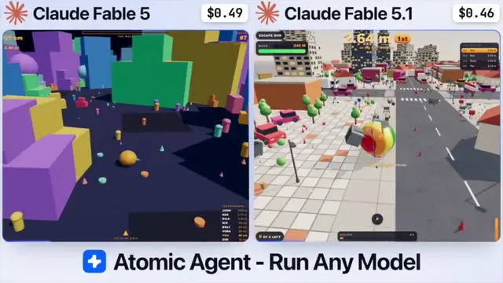</a>

**Claude Fable 5.1** · 游戏 · 作者 [Atomic Agent](https://x.com/atomicagent_io) · 2026-09-01

对比测试：Claude Fable 5.1与上一版收到相同的三个游戏指令，新版完成时花费更低。

<details>
<summary>Wandy3D 制作简报</summary>

```text
Build three small browser games, each as its own self-contained HTML file with a 3D look. Game one: a sticky ball rolling through a toy city that picks up everything in its path and grows, shown from a chase camera with a score and size readout. Game two: an endless-runner river course where a capybara surfs downstream, steering left and right around logs and buoys, with rings to pass through, a final stretch with a checkered finish line and a placement screen with a replay button. Game three: a dumpling dodging obstacles on an endless conveyor belt in a dim kitchen-like hall with hanging lamps, speeding up over time. Use bright, readable colours, simple keyboard or touch steering, a restart option, and a distance or timer HUD. Done means each game starts, scores and ends cleanly.
```

</details>

[在 Wandy3D 查看 ↗](https://wandy3d.com/zh/prompts/three-small-3d-games-sticky-ball-capybara-river-surf-2094895071304839400?utm_source=github&utm_medium=referral&utm_campaign=awesome_3d_prompts) · [原帖](https://x.com/atomicagent_io/status/2094895071304839400)

---

### [Three.js程序化机场：滑行的客机与地勤车辆](https://wandy3d.com/zh/prompts/procedural-three-js-airport-with-taxiing-planes-and-ground-2094893572617044439?utm_source=github&utm_medium=referral&utm_campaign=awesome_3d_prompts)

<a href="https://wandy3d.com/zh/prompts/procedural-three-js-airport-with-taxiing-planes-and-ground-2094893572617044439?utm_source=github&amp;utm_medium=referral&amp;utm_campaign=awesome_3d_prompts">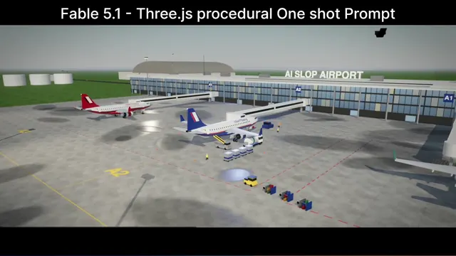</a>

**Claude Fable 5.1** · 场景 · 作者 [Alex - i do YouTube](https://x.com/AlexYTScaling) · 2026-09-01

Claude Fable 5.1一次性写出完全程序化的Three.js机场，含客机、加油车、航站楼和自动切换的镜头。

<details>
<summary>Wandy3D 制作简报</summary>

```text
Build a procedural airport simulation in Three.js, delivered as one self-contained HTML file with no external assets. Model everything in code: a tarmac apron, a runway with markings, grass surroundings, a glass terminal with a control tower, and airliners with blue-and-white liveries. Add working ground traffic such as a fuel tanker, baggage carts, tugs and small figures of ground crew moving around parked aircraft, and let planes taxi, take off and land on a loop. Provide several automatic camera views (gate level, runway end, wing close-up, tower view) that cut between each other, with soft daylight and a pale sky. Keep the style clean and slightly low poly. Done means the scene runs smoothly, vehicles and aircraft move without clipping, and the cameras show the whole airport cycle.
```

</details>

[在 Wandy3D 查看 ↗](https://wandy3d.com/zh/prompts/procedural-three-js-airport-with-taxiing-planes-and-ground-2094893572617044439?utm_source=github&utm_medium=referral&utm_campaign=awesome_3d_prompts) · [原帖](https://x.com/AlexYTScaling/status/2094893572617044439)

---

### [带高耸宝塔与樱花的3D漂浮日式城市](https://wandy3d.com/zh/prompts/floating-japanese-city-with-a-tall-pagoda-and-cherry-trees-2094886088963690607?utm_source=github&utm_medium=referral&utm_campaign=awesome_3d_prompts)

<a href="https://wandy3d.com/zh/prompts/floating-japanese-city-with-a-tall-pagoda-and-cherry-trees-2094886088963690607?utm_source=github&amp;utm_medium=referral&amp;utm_campaign=awesome_3d_prompts">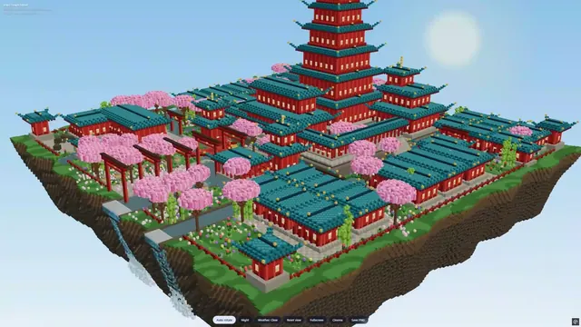</a>

**Claude Fable 5.1** · 场景 · 作者 [Vib3Coded](https://x.com/vib3coded) · 2026-09-01

Claude Fable 5.1在浏览器中生成了可旋转的漂浮岛：多层宝塔、青瓦房屋、鸟居和盛开的樱花。

<details>
<summary>Wandy3D 制作简报</summary>

```text
Build an interactive Japanese-style floating city that runs in the browser, as a single HTML file using Three.js. Create a square island of earth and grass hovering in a bright blue sky with a soft sun, with waterfalls pouring off its edges. On it place a tall multi-level red pagoda at the centre, dozens of teal-roofed buildings with red walls, stone pathways, gardens, torii gates and many blooming pink cherry trees. Use a blocky voxel look with crisp colours. Add orbit controls so the viewer can rotate, zoom and inspect the island from any angle, plus a small row of buttons at the bottom for view options. Keep details dense enough that each new angle reveals something different. Done means the whole island renders smoothly, the camera moves freely, and no part looks empty.
```

</details>

[在 Wandy3D 查看 ↗](https://wandy3d.com/zh/prompts/floating-japanese-city-with-a-tall-pagoda-and-cherry-trees-2094886088963690607?utm_source=github&utm_medium=referral&utm_campaign=awesome_3d_prompts) · [原帖](https://x.com/vib3coded/status/2094886088963690607)

---

### [Three.js 查看器中的程序化 Airbus H145 直升机模型](https://wandy3d.com/zh/prompts/procedural-airbus-h145-helicopter-model-in-a-three-js-viewer-2094882571083735351?utm_source=github&utm_medium=referral&utm_campaign=awesome_3d_prompts)

<a href="https://wandy3d.com/zh/prompts/procedural-airbus-h145-helicopter-model-in-a-three-js-viewer-2094882571083735351?utm_source=github&amp;utm_medium=referral&amp;utm_campaign=awesome_3d_prompts">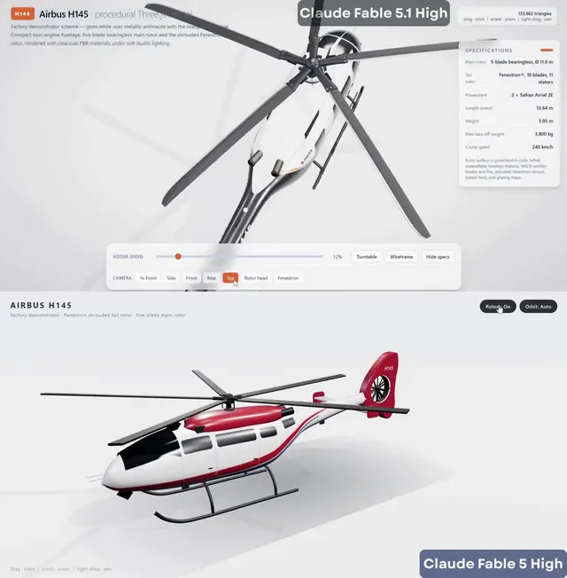</a>

**Claude Fable 5.1** · 资产 · 作者 [Harshith](https://x.com/HarshithLucky3) · 2026-09-01

Claude Fable 5.1 与 Fable 5 用同一条简短提示词对比。Fable 5.1 做出了旋翼转动、带视角预设的精细 H145。

<details>
<summary>提示词</summary>

```text
3D model of an Airbus H145 helicopter in Three js
```

</details>

[在 Wandy3D 查看 ↗](https://wandy3d.com/zh/prompts/procedural-airbus-h145-helicopter-model-in-a-three-js-viewer-2094882571083735351?utm_source=github&utm_medium=referral&utm_campaign=awesome_3d_prompts) · [原帖](https://x.com/HarshithLucky3/status/2094882571083735351)

---

### [含舰船、飞机与弹坑的体素版一战战场模拟](https://wandy3d.com/zh/prompts/voxel-ww1-battlefield-simulation-with-ships-planes-and-2094881469155914170?utm_source=github&utm_medium=referral&utm_campaign=awesome_3d_prompts)

<a href="https://wandy3d.com/zh/prompts/voxel-ww1-battlefield-simulation-with-ships-planes-and-2094881469155914170?utm_source=github&amp;utm_medium=referral&amp;utm_campaign=awesome_3d_prompts">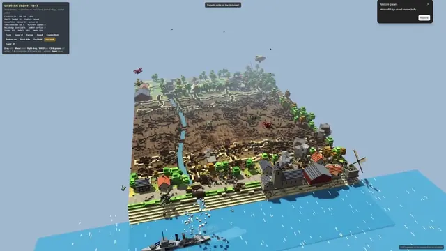</a>

**Claude Fable 5.1** · 互动 · 作者 [Tech2Wild](https://x.com/Tech2Wild) · 2026-09-01

Claude Fable 5.1 生成了一战战斗的体素沙盘：舰船、飞机和炮火不断改变地形，镜头可自由环绕观看。

<details>
<summary>Wandy3D 制作简报</summary>

```text
Build a World War One battlefield simulation in a voxel style that runs in the browser, preferably with Three.js. Show a square diorama of voxel terrain: muddy no-man's-land crossed by trenches, green fields, small villages with red roofs, a river and a coastline with a sea plane beside it. Populate it with warships, biplanes and ground forces that fight on their own, with shell impacts that blast voxels out of the ground and leave craters, smoke and debris particles. Provide an orbit camera the user can rotate and zoom, plus a small panel with a few simulation controls. Use a muted earthy palette against a pale blue sky. Deliver one self-contained HTML file. Done means the battle plays continuously, the terrain visibly changes under fire, and the frame rate stays smooth.
```

</details>

[在 Wandy3D 查看 ↗](https://wandy3d.com/zh/prompts/voxel-ww1-battlefield-simulation-with-ships-planes-and-2094881469155914170?utm_source=github&utm_medium=referral&utm_campaign=awesome_3d_prompts) · [原帖](https://x.com/Tech2Wild/status/2094881469155914170)

---

### [五个 Three.js 场景呈现未来感海岛豪宅，模型对比](https://wandy3d.com/zh/prompts/futuristic-island-mansion-in-five-three-js-scenes-model-2094879208304685524?utm_source=github&utm_medium=referral&utm_campaign=awesome_3d_prompts)

<a href="https://wandy3d.com/zh/prompts/futuristic-island-mansion-in-five-three-js-scenes-model-2094879208304685524?utm_source=github&amp;utm_medium=referral&amp;utm_campaign=awesome_3d_prompts">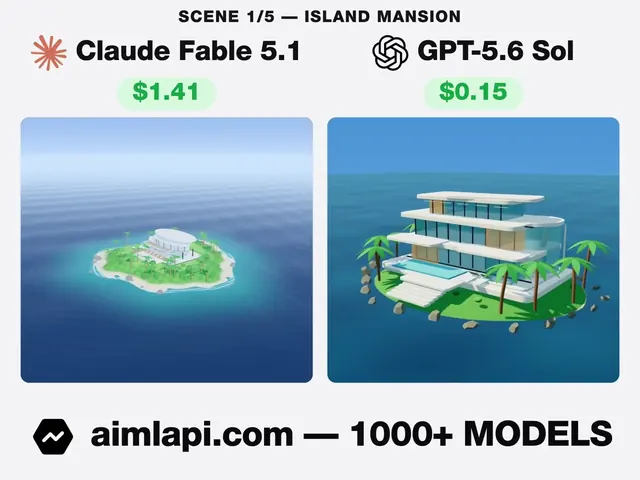</a>

**Claude Fable 5.1** · 场景 · 作者 [AI/ML API](https://x.com/aimlapi) · 2026-09-01

一次生成的对比：Claude Fable 5.1 对比 GPT-5.6 Sol，五个 Three.js 场景，从水晶吊灯大厅到日落时直升机降落。

<details>
<summary>Wandy3D 制作简报</summary>

```text
Build a connected set of five self-contained Three.js scenes that together present a futuristic mansion on a private island. Scene one is an exterior orbit around the island, with water, waves and a sand ring. Scene two is a grand hall with a large crystal chandelier made of many small pieces and tall glass walls. Scene three is a pool area with a multi-lane slide tower and water. Scene four is a dark garage with neon strips and ten sports cars on display. Scene five is a rooftop helipad at sunset where a helicopter descends and lands on the lit pad. Keep a consistent visual style and lighting across all scenes, and let the camera move on its own in each. Deliver as HTML files with Three.js, one per scene. Done means every scene loads, animates and looks finished, including the water.
```

</details>

[在 Wandy3D 查看 ↗](https://wandy3d.com/zh/prompts/futuristic-island-mansion-in-five-three-js-scenes-model-2094879208304685524?utm_source=github&utm_medium=referral&utm_campaign=awesome_3d_prompts) · [原帖](https://x.com/aimlapi/status/2094879208304685524)

---

### [程序化海岛上的穿门加速空中竞速游戏（Three.js）](https://wandy3d.com/zh/prompts/procedural-island-air-race-game-with-gates-and-boost-in-2094873862315843910?utm_source=github&utm_medium=referral&utm_campaign=awesome_3d_prompts)

<a href="https://wandy3d.com/zh/prompts/procedural-island-air-race-game-with-gates-and-boost-in-2094873862315843910?utm_source=github&amp;utm_medium=referral&amp;utm_campaign=awesome_3d_prompts">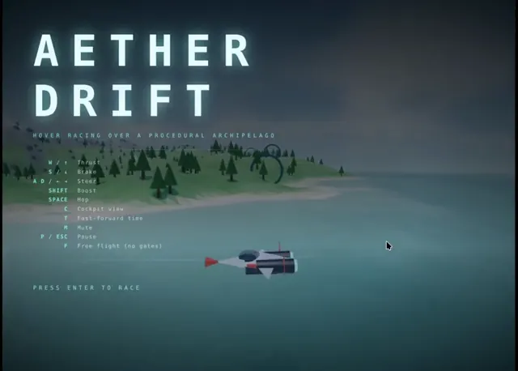</a>

**Claude Fable 5.1** · 游戏 · 作者 [Swarogan](https://x.com/swarogan) · 2026-09-01

Claude Fable 5.1 用 Three.js 生成了低多边形海岛上的飞行竞速：穿过光环门、使用加速，并有计时器和小地图。

<details>
<summary>Wandy3D 制作简报</summary>

```text
Build a browser flying game with Three.js on a procedurally generated low-poly island. The player pilots a small jet in third person through a series of glowing gates scattered over hills, beaches and lakes, against a timer. Generate the terrain, pine trees, rocks and water in code. Add a start countdown, a HUD with elapsed time, gates passed out of fourteen, speed and a boost meter, plus a circular minimap in a corner. Boost should leave bright exhaust trails and speed lines, and the camera should follow smoothly with soft sky haze and gentle lighting. Use a calm green and teal palette. Deliver one self-contained HTML file with keyboard controls. Done means the island is flyable, gates register, and the HUD updates correctly.
```

</details>

[在 Wandy3D 查看 ↗](https://wandy3d.com/zh/prompts/procedural-island-air-race-game-with-gates-and-boost-in-2094873862315843910?utm_source=github&utm_medium=referral&utm_campaign=awesome_3d_prompts) · [原帖](https://x.com/swarogan/status/2094873862315843910)

---

### [可交互的 3D 人脑图谱，追踪一句话在大脑中的传递](https://wandy3d.com/zh/prompts/interactive-3d-human-brain-atlas-that-traces-a-spoken-2094873080590225728?utm_source=github&utm_medium=referral&utm_campaign=awesome_3d_prompts)

<a href="https://wandy3d.com/zh/prompts/interactive-3d-human-brain-atlas-that-traces-a-spoken-2094873080590225728?utm_source=github&amp;utm_medium=referral&amp;utm_campaign=awesome_3d_prompts"></a>

**Claude Fable 5.1** · 互动 · 作者 [Greg](https://x.com/livelaughgreg) · 2026-09-01

Claude Fable 5.1 用代码雕刻出大脑皮层，并按已发表记录的时间演示一句听到的话如何依次经过各脑区。

<details>
<summary>Wandy3D 制作简报</summary>

```text
Build an interactive 3D atlas of the human brain for the browser. Generate the cortex procedurally in code, with sculpted folds, a cerebellum and brainstem, in warm pink tones, on a dark interface with serif headings. Let users drag to rotate and scroll to zoom, and click regions to highlight them in distinct colors with labels. Add a side panel listing stimuli such as hearing a sentence or seeing a familiar face; selecting one animates activity moving through the relevant regions in sequence, with a timeline showing milliseconds for each step and a short explanation of what each area does. Base the timings on published neuroscience findings. Deliver a self-contained web page, preferably with Three.js. Done means smooth orbit, readable panels, and activation that plays in the correct order.
```

</details>

[在 Wandy3D 查看 ↗](https://wandy3d.com/zh/prompts/interactive-3d-human-brain-atlas-that-traces-a-spoken-2094873080590225728?utm_source=github&utm_medium=referral&utm_campaign=awesome_3d_prompts) · [原帖](https://x.com/livelaughgreg/status/2094873080590225728)

---

### [Three.js 写实山谷风景:薄雾湖泊与松林](https://wandy3d.com/zh/prompts/photorealistic-mountain-valley-landscape-with-a-misty-lake-2094871858206191667?utm_source=github&utm_medium=referral&utm_campaign=awesome_3d_prompts)

<a href="https://wandy3d.com/zh/prompts/photorealistic-mountain-valley-landscape-with-a-misty-lake-2094871858206191667?utm_source=github&amp;utm_medium=referral&amp;utm_campaign=awesome_3d_prompts">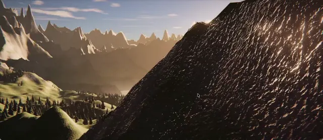</a>

**Claude Fable 5.1** · 场景 · 作者 [Alix Ollivier](https://x.com/aollivier82) · 2026-09-01

Claude Fable 5.1 用约 26 分钟生成了 Three.js 山谷风景,有松林、雾气笼罩的湖面和低垂的金色太阳。

<details>
<summary>Wandy3D 制作简报</summary>

```text
Build a photorealistic mountain landscape in Three.js as a single self-contained HTML file. Show a wide valley with a misty lake, forested hills covered in small pine trees, jagged distant peaks and a large rocky slope close to the camera. Light the scene with a low, warm sun that produces golden haze, soft atmospheric fog and long depth falloff, and add a pale sky with thin clouds. Use procedural terrain with detailed rock texturing and lighting that catches the surface grain. Animate a slow, steady camera drift through the valley so the parallax between foreground slope and distant ridges is clear, with a small bird or distant speck crossing the sky if possible. Keep the palette warm: ochre, brown, muted green and cream. Render at full window size and keep it smooth on a desktop GPU. Done when the scene loads without any external assets and the camera glides continuously over the terrain looking convincingly natural.
```

</details>

[在 Wandy3D 查看 ↗](https://wandy3d.com/zh/prompts/photorealistic-mountain-valley-landscape-with-a-misty-lake-2094871858206191667?utm_source=github&utm_medium=referral&utm_campaign=awesome_3d_prompts) · [原帖](https://x.com/aollivier82/status/2094871858206191667)

---

### [Three.js 霓虹竞技场尸潮射击游戏,支持瞄准与三种武器](https://wandy3d.com/zh/prompts/neon-arena-horde-shooter-with-ads-and-three-weapons-in-three-2094869490165039243?utm_source=github&utm_medium=referral&utm_campaign=awesome_3d_prompts)

<a href="https://wandy3d.com/zh/prompts/neon-arena-horde-shooter-with-ads-and-three-weapons-in-three-2094869490165039243?utm_source=github&amp;utm_medium=referral&amp;utm_campaign=awesome_3d_prompts">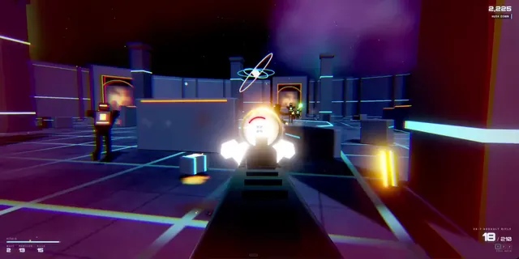</a>

**Claude Fable 5.1** · 游戏 · 作者 [Alexey Fateev](https://x.com/superalesha) · 2026-09-01

一条简短提示词,让 Claude Fable 5.1 做出第一人称网页射击游戏:敌人成波来袭,有后坐力、开镜瞄准和三种枪械。

<details>
<summary>提示词</summary>

```text
Make me the most insane and blast of a shooter you can possibly build on ThreeJS + Web shaders bro!

The most important things are shooting, dynamics, recoil, graphics, hit impact, gunplay. It's a beautifully designed arena where enemies swarm in hordes. Must have ADS aiming, weapon inertia/weight.

3 weapon types: assault rifle / submachine gun, shotgun, and a heavy-hitting marksman rifle. Red dot sight only on the rifle, iron sights on the rest.

This is a Call Of Duty Style AAA game in the browser. Do it right bro, I believe in you!
```

</details>

[在 Wandy3D 查看 ↗](https://wandy3d.com/zh/prompts/neon-arena-horde-shooter-with-ads-and-three-weapons-in-three-2094869490165039243?utm_source=github&utm_medium=referral&utm_campaign=awesome_3d_prompts) · [原帖](https://x.com/superalesha/status/2094869490165039243)

---

### [Three.js 夜海客轮游戏:驾驶泰坦尼克号避开冰山](https://wandy3d.com/zh/prompts/night-ocean-liner-game-steer-a-titanic-past-icebergs-in-2094867850355679617?utm_source=github&utm_medium=referral&utm_campaign=awesome_3d_prompts)

<a href="https://wandy3d.com/zh/prompts/night-ocean-liner-game-steer-a-titanic-past-icebergs-in-2094867850355679617?utm_source=github&amp;utm_medium=referral&amp;utm_campaign=awesome_3d_prompts">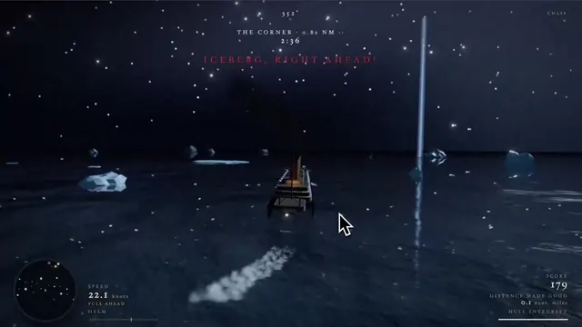</a>

**Claude Fable 5.1** · 游戏 · 作者 [Veee](https://x.com/vikktorrrre) · 2026-09-01

Claude Fable 5.1 只用两条提示词就做出 Three.js 船舶游戏,含追尾与电影视角、雷达、任务和奖励系统。

<details>
<summary>Wandy3D 制作简报</summary>

```text
Build a browser game in Three.js where the player steers a large early-twentieth-century ocean liner across a dark, starry North Atlantic night and must avoid icebergs. Render a reflective, rippling sea, drifting icebergs of varied size, a glowing beacon column in the distance, black smoke from the funnels, a foamy wake and a lit-up ship with rows of warm windows. Provide two camera modes: a chase view for gameplay and a cinematic orbit view. Add steering and speed controls, a small radar in the corner, a HUD with speed, distance travelled and warnings when an iceberg is near, plus a mission and reward system that scores safe distance. Use a deep navy and teal palette with warm yellow ship lights. Ship it as a static site that can be deployed to a free host. Done when the ship sails smoothly, collisions end the run and distance missions pay out rewards.
```

</details>

[在 Wandy3D 查看 ↗](https://wandy3d.com/zh/prompts/night-ocean-liner-game-steer-a-titanic-past-icebergs-in-2094867850355679617?utm_source=github&utm_medium=referral&utm_campaign=awesome_3d_prompts) · [原帖](https://x.com/vikktorrrre/status/2094867850355679617)

---

### [昏暗仓库第一人称射击游戏,单个 Three.js 模块实现](https://wandy3d.com/zh/prompts/dark-warehouse-first-person-shooter-built-in-one-three-js-2094855905678446777?utm_source=github&utm_medium=referral&utm_campaign=awesome_3d_prompts)

<a href="https://wandy3d.com/zh/prompts/dark-warehouse-first-person-shooter-built-in-one-three-js-2094855905678446777?utm_source=github&amp;utm_medium=referral&amp;utm_campaign=awesome_3d_prompts">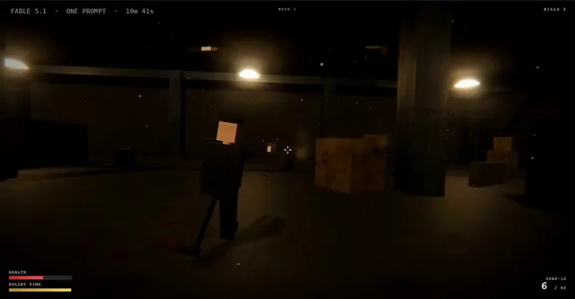</a>

**Claude Fable 5.1** · 游戏 · 作者 [Andrei](https://x.com/HangoutWHAndrei) · 2026-09-01

Claude Fable 5.1 用约十分钟做出阴暗风格的 Three.js 射击游戏并继续修改;视频含标题界面、枪战和 HUD。

<details>
<summary>Wandy3D 制作简报</summary>

```text
Build a realistic-feeling first-person shooter in Three.js as one compact JavaScript module with no build step and no external assets. Set it in a dim industrial warehouse lit by a few hanging lamps and a couple of cold blue strip lights, with crates and pillars for cover. Add a minimal title screen with a click-to-start prompt. Gameplay should centre on shooting that feels strong: weapon sway, muzzle flash, recoil, hit feedback, ammunition count and reload. Enemies are simple blocky figures that move and fire back. Include a HUD with health, stamina or armour bars and the magazine count. Use a near-black palette with warm orange and cold blue accents. Controls are mouse look, WASD movement and click to fire. Done when the game starts from the title screen, enemies spawn in waves and the player can shoot, take damage and keep playing in a stable frame rate.
```

</details>

[在 Wandy3D 查看 ↗](https://wandy3d.com/zh/prompts/dark-warehouse-first-person-shooter-built-in-one-three-js-2094855905678446777?utm_source=github&utm_medium=referral&utm_campaign=awesome_3d_prompts) · [原帖](https://x.com/HangoutWHAndrei/status/2094855905678446777)

---

### [Three.js 玻璃大脑与六个环绕能力演示节点](https://wandy3d.com/zh/prompts/glass-brain-with-six-orbiting-capability-demos-in-three-js-2094853472864682360?utm_source=github&utm_medium=referral&utm_campaign=awesome_3d_prompts)

<a href="https://wandy3d.com/zh/prompts/glass-brain-with-six-orbiting-capability-demos-in-three-js-2094853472864682360?utm_source=github&amp;utm_medium=referral&amp;utm_campaign=awesome_3d_prompts">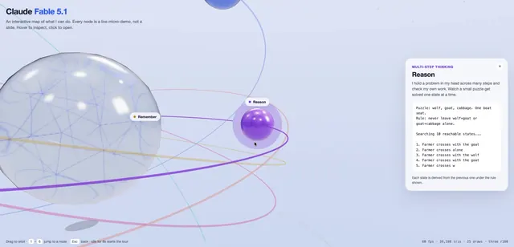</a>

**Claude Fable 5.1** · 互动 · 作者 [Not Harris \| Builds Apps](https://x.com/viewsfrom02108) · 2026-09-01

Claude Fable 5.1 凭一句话指令，用 Three.js 做出玻璃大脑，六个环绕节点各自打开一张迷你演示卡片。

<details>
<summary>提示词</summary>

```text
make a Three.js demo of your capabilities.
```

</details>

[在 Wandy3D 查看 ↗](https://wandy3d.com/zh/prompts/glass-brain-with-six-orbiting-capability-demos-in-three-js-2094853472864682360?utm_source=github&utm_medium=referral&utm_campaign=awesome_3d_prompts) · [原帖](https://x.com/viewsfrom02108/status/2094853472864682360)

---

### [带城堡、村庄、瀑布和飞艇的体素岛屿场景](https://wandy3d.com/zh/prompts/voxel-castle-island-with-village-waterfall-and-airship-2093690427849191855?utm_source=github&utm_medium=referral&utm_campaign=awesome_3d_prompts)

<a href="https://wandy3d.com/zh/prompts/voxel-castle-island-with-village-waterfall-and-airship-2093690427849191855?utm_source=github&amp;utm_medium=referral&amp;utm_campaign=awesome_3d_prompts">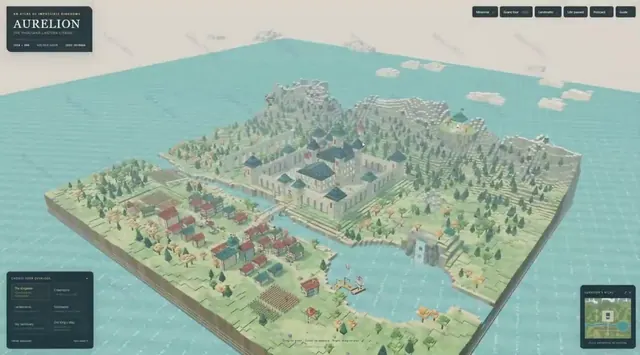</a>

**GPT-6 Astra** · 场景 · 作者 [Hakm](https://x.com/hakmgpt) · 2026-08-29

GPT-6 Astra 生成了体素岛屿场景：城堡俯瞰红顶村庄，另有森林、瀑布和飞艇，可用多种镜头浏览。

<details>
<summary>Wandy3D 制作简报</summary>

```text
Build an explorable voxel island scene featuring a medieval castle. Create a square block of terrain floating in a pale turquoise sea with blocky waves and white voxel clouds. Put a large stone castle with towers and banners at the center, a village of red, teal and blue gabled roofs around it, farm plots, an aqueduct-style wall, a river that ends in a waterfall, a harbor with a small boat, snowy gray mountains and dense voxel pine forests. Add a day-night cycle with lit windows at night, and a small airship drifting overhead. Provide free camera controls to fly above the island and drop to street level or enter buildings, a thin top bar of view presets, an info panel and a minimap in a corner. Use WebGL with instanced cubes for performance and deliver one self-contained HTML file. Done means the island renders smoothly from every camera view and the lighting changes believably.
```

</details>

[在 Wandy3D 查看 ↗](https://wandy3d.com/zh/prompts/voxel-castle-island-with-village-waterfall-and-airship-2093690427849191855?utm_source=github&utm_medium=referral&utm_campaign=awesome_3d_prompts) · [原帖](https://x.com/hakmgpt/status/2093690427849191855)

---

### [在 Blender 中逐个零件组装的吉普风格四驱车](https://wandy3d.com/zh/prompts/jeep-style-4x4-assembled-part-by-part-in-blender-2082845759452463405?utm_source=github&utm_medium=referral&utm_campaign=awesome_3d_prompts)

<a href="https://wandy3d.com/zh/prompts/jeep-style-4x4-assembled-part-by-part-in-blender-2082845759452463405?utm_source=github&amp;utm_medium=referral&amp;utm_campaign=awesome_3d_prompts">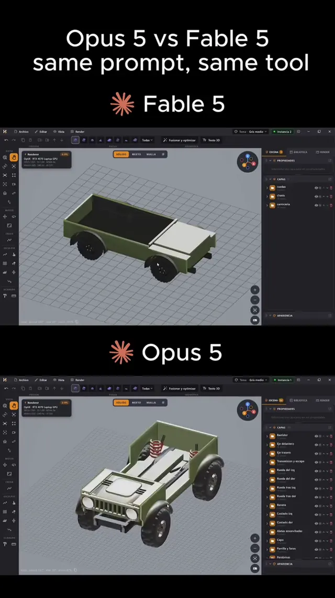</a>

**Claude Fable 5** · 资产 · 作者 [slash1s](https://x.com/slash1sol) · 2026-07-30

对比示例：Claude Fable 5 与 Claude Opus 5 收到同一句提示，在 Blender 中组装出按零件分组命名的绿色吉普风格四驱车。

<details>
<summary>提示词</summary>

```text
Design a Jeep-style 4x4 and assemble it in Blender part by part, without any manual modeling
```

</details>

[在 Wandy3D 查看 ↗](https://wandy3d.com/zh/prompts/jeep-style-4x4-assembled-part-by-part-in-blender-2082845759452463405?utm_source=github&utm_medium=referral&utm_campaign=awesome_3d_prompts) · [原帖](https://x.com/slash1sol/status/2082845759452463405)

---

### [在 Blender 中打造带真实布线与引擎的高达级机甲](https://wandy3d.com/zh/prompts/gundam-sized-mech-with-real-wiring-and-engines-in-blender-2082760534500188606?utm_source=github&utm_medium=referral&utm_campaign=awesome_3d_prompts)

<a href="https://wandy3d.com/zh/prompts/gundam-sized-mech-with-real-wiring-and-engines-in-blender-2082760534500188606?utm_source=github&amp;utm_medium=referral&amp;utm_campaign=awesome_3d_prompts">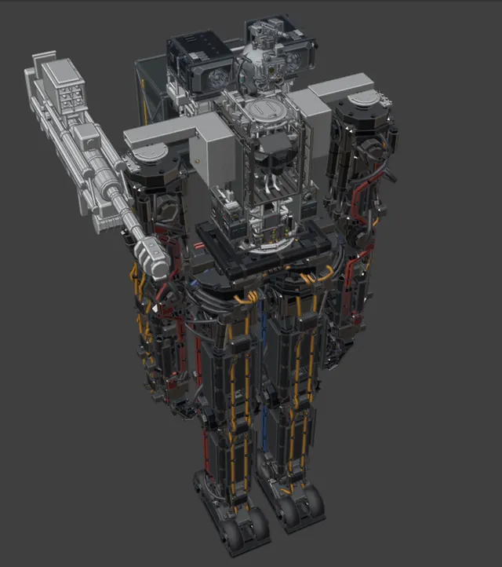</a>

**Claude Opus 5** · 资产 · 作者 [Spectro](https://x.com/Spectromachina) · 2026-07-30

Claude Opus 5 通过长对话操控 Blender，做出细节丰富的机甲：肩部引擎、布线腿部与轮足、驾驶舱躯干和一门大炮。

<details>
<summary>提示词</summary>

```text
lets think about the design of the mech, essentially he has 2 turboshaft engines and runs on electric motors + hydraulic power, he also has an apu, maybe  pneumatic system too,  he has strong bateries that help him coast a lil bit if things get messy, im think about having the 2 engines sit on the shoulders of the mech, with the service panel outwards so we can do maintennce on it. btw look at the systems of the mech again and then we're going create all of the systems physically.its gonna be awesome, set some agent to help you with this and rebuild the torso section, but leaving a large space in the middle for the cockpit + sleeping pod.
```

</details>

[在 Wandy3D 查看 ↗](https://wandy3d.com/zh/prompts/gundam-sized-mech-with-real-wiring-and-engines-in-blender-2082760534500188606?utm_source=github&utm_medium=referral&utm_campaign=awesome_3d_prompts) · [原帖](https://x.com/Spectromachina/status/2082760534500188606)

---

### [用 Godot 制作的霓虹夜城街头赛车游戏](https://wandy3d.com/zh/prompts/neon-night-city-street-racer-built-in-godot-2082714235373584582?utm_source=github&utm_medium=referral&utm_campaign=awesome_3d_prompts)

<a href="https://wandy3d.com/zh/prompts/neon-night-city-street-racer-built-in-godot-2082714235373584582?utm_source=github&amp;utm_medium=referral&amp;utm_campaign=awesome_3d_prompts">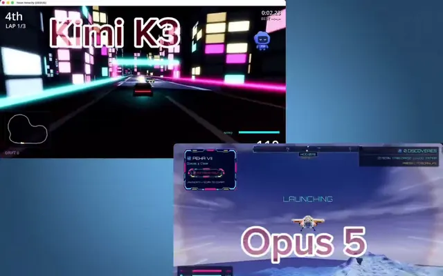</a>

**Kimi K3** · 游戏 · 作者 [FHILY👑](https://x.com/Oluwaphilemon1) · 2026-07-30

Kimi K3 仅凭一句简短提示，就在 Godot 中生成了类似极品飞车的可玩赛车游戏，带圈速计时、小地图和霓虹赛道。

<details>
<summary>提示词</summary>

```text
Make me an NFS-type game.
```

</details>

[在 Wandy3D 查看 ↗](https://wandy3d.com/zh/prompts/neon-night-city-street-racer-built-in-godot-2082714235373584582?utm_source=github&utm_medium=referral&utm_campaign=awesome_3d_prompts) · [原帖](https://x.com/Oluwaphilemon1/status/2082714235373584582)

---

### [玻璃出现裂纹后爆裂涌水的交互式水族箱](https://wandy3d.com/zh/prompts/interactive-aquarium-whose-glass-cracks-and-bursts-with-a-2082528683747873194?utm_source=github&utm_medium=referral&utm_campaign=awesome_3d_prompts)

<a href="https://wandy3d.com/zh/prompts/interactive-aquarium-whose-glass-cracks-and-bursts-with-a-2082528683747873194?utm_source=github&amp;utm_medium=referral&amp;utm_campaign=awesome_3d_prompts">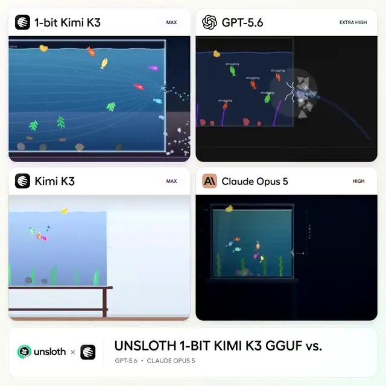</a>

**Kimi K3** · 互动 · 作者 [Unsloth AI](https://x.com/UnslothAI) · 2026-07-29

同一提示下四个模型的对比，首位是 Kimi K3：鱼群、蔓延的裂纹、爆裂涌水，并带重置按钮。

<details>
<summary>提示词</summary>

```text
Create a glass aquarium whose side panel develops a visible crack and then bursts.
```

</details>

[在 Wandy3D 查看 ↗](https://wandy3d.com/zh/prompts/interactive-aquarium-whose-glass-cracks-and-bursts-with-a-2082528683747873194?utm_source=github&utm_medium=referral&utm_campaign=awesome_3d_prompts) · [原帖](https://x.com/UnslothAI/status/2082528683747873194)

---

### [夕阳海面上的喷气战机空战游戏](https://wandy3d.com/zh/prompts/sunset-jet-dogfight-game-over-an-endless-sea-2082507403598373134?utm_source=github&utm_medium=referral&utm_campaign=awesome_3d_prompts)

<a href="https://wandy3d.com/zh/prompts/sunset-jet-dogfight-game-over-an-endless-sea-2082507403598373134?utm_source=github&amp;utm_medium=referral&amp;utm_campaign=awesome_3d_prompts">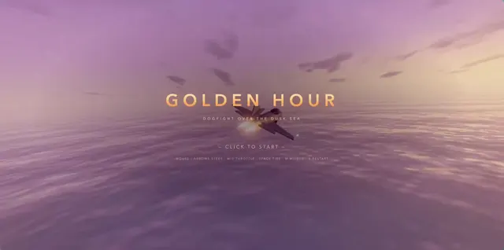</a>

**Kimi K3** · 游戏 · 作者 [Darshal Jaitwar](https://x.com/darshal_) · 2026-07-29

两个模型用同一战斗游戏提示对比，Kimi K3 胜出：其 Golden Hour 空战中敌机可被真正击落。

<details>
<summary>提示词</summary>

```text
build a playable combat game
```

</details>

[在 Wandy3D 查看 ↗](https://wandy3d.com/zh/prompts/sunset-jet-dogfight-game-over-an-endless-sea-2082507403598373134?utm_source=github&utm_medium=referral&utm_campaign=awesome_3d_prompts) · [原帖](https://x.com/darshal_/status/2082507403598373134)

---

### [单文件 1v1 MOBA：技能、防御塔与小兵](https://wandy3d.com/zh/prompts/one-file-1v1-moba-with-abilities-towers-and-minions-2082474707727581564?utm_source=github&utm_medium=referral&utm_campaign=awesome_3d_prompts)

<a href="https://wandy3d.com/zh/prompts/one-file-1v1-moba-with-abilities-towers-and-minions-2082474707727581564?utm_source=github&amp;utm_medium=referral&amp;utm_campaign=awesome_3d_prompts">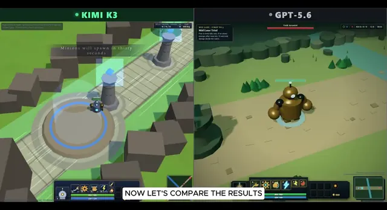</a>

**Kimi K3** · 游戏 · 作者 [Fokki](https://x.com/0x_fokki) · 2026-07-29

同一提示的模型对比，Kimi K3 排在首位：一个 HTML 文件即可玩的类 League 对决，含钩子技能、小兵和惩罚冒进的防御塔。

<details>
<summary>提示词</summary>

```text
BUILD A PLAYABLE LEAGUE OF LEGENDS STYLE 1V1 IN ONE HTML FILE
```

</details>

[在 Wandy3D 查看 ↗](https://wandy3d.com/zh/prompts/one-file-1v1-moba-with-abilities-towers-and-minions-2082474707727581564?utm_source=github&utm_medium=referral&utm_campaign=awesome_3d_prompts) · [原帖](https://x.com/0x_fokki/status/2082474707727581564)

---

### [星空中旋转的 3D 太阳，单个 HTML 文件](https://wandy3d.com/zh/prompts/spinning-3d-sun-in-a-starfield-in-one-html-file-2082461416049525077?utm_source=github&utm_medium=referral&utm_campaign=awesome_3d_prompts)

<a href="https://wandy3d.com/zh/prompts/spinning-3d-sun-in-a-starfield-in-one-html-file-2082461416049525077?utm_source=github&amp;utm_medium=referral&amp;utm_campaign=awesome_3d_prompts">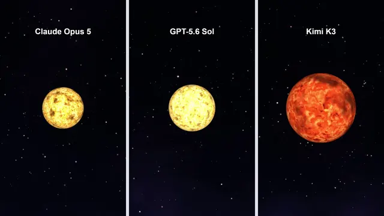</a>

**Claude Opus 5** · 场景 · 作者 [AlysisAI](https://x.com/AlysisAI) · 2026-07-29

三模型同提示对比中 Claude Opus 5 排首位：淡黄色带颗粒质感的太阳在星空中自转，旁边是另外两种效果。

<details>
<summary>提示词</summary>

```text
Build a 3D visualizer of the Sun spinning in space. One HTML file.
```

</details>

[在 Wandy3D 查看 ↗](https://wandy3d.com/zh/prompts/spinning-3d-sun-in-a-starfield-in-one-html-file-2082461416049525077?utm_source=github&utm_medium=referral&utm_campaign=awesome_3d_prompts) · [原帖](https://x.com/AlysisAI/status/2082461416049525077)

---

### [单个 HTML 文件的可探索程序化 3D 工作站房间](https://wandy3d.com/zh/prompts/explorable-procedural-3d-workstation-room-in-a-single-html-2082451081733591520?utm_source=github&utm_medium=referral&utm_campaign=awesome_3d_prompts)

<a href="https://wandy3d.com/zh/prompts/explorable-procedural-3d-workstation-room-in-a-single-html-2082451081733591520?utm_source=github&amp;utm_medium=referral&amp;utm_campaign=awesome_3d_prompts">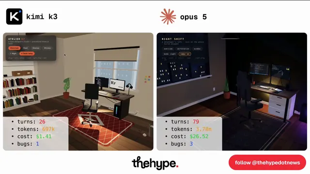</a>

**Kimi K3** · 场景 · 作者 [thehype.](https://x.com/thehypedotnews) · 2026-07-29

Kimi K3 用 Three.js 生成了带书桌、书架和昼夜切换的家庭办公室,帖子对比了两次由不同智能体驱动的构建。

<details>
<summary>Wandy3D 制作简报</summary>

```text
Build an explorable 3D room around a computer workstation as one self-contained HTML file using Three.js loaded through an import map. Use only procedural geometry: no imported meshes and no image textures. Furnish the room with a desk, a large monitor, a chair, a bookshelf, a rug, wall posters, a window onto a city skyline and a desk lamp. Give it a warm, lived-in palette and a toggle that switches between daylight and a dark night mood with lit windows. Add orbit-style camera controls with clamped angles and a small panel for lighting modes. Let the design choices be yours. Keep object placement coherent so nothing intersects, such as the lamp arm and the monitor, and make any rain or window animation move in the right direction. Done when the room can be orbited smoothly and both lighting modes look convincing.
```

</details>

[在 Wandy3D 查看 ↗](https://wandy3d.com/zh/prompts/explorable-procedural-3d-workstation-room-in-a-single-html-2082451081733591520?utm_source=github&utm_medium=referral&utm_campaign=awesome_3d_prompts) · [原帖](https://x.com/thehypedotnews/status/2082451081733591520)

---

### [Unreal Engine 5 中通往教室的非欧几里得传送门](https://wandy3d.com/zh/prompts/non-euclidean-door-portal-into-a-classroom-in-unreal-engine-2082436347113951333?utm_source=github&utm_medium=referral&utm_campaign=awesome_3d_prompts)

<a href="https://wandy3d.com/zh/prompts/non-euclidean-door-portal-into-a-classroom-in-unreal-engine-2082436347113951333?utm_source=github&amp;utm_medium=referral&amp;utm_campaign=awesome_3d_prompts">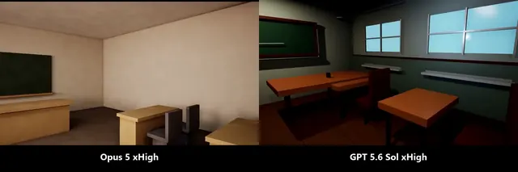</a>

**Claude Opus 5** · 场景 · 作者 [Ombrage](https://x.com/ombrageplays) · 2026-07-29

对比帖:Claude Opus 5 与另一模型用同一提示词,在虚空中做出一扇无缝通向远处教室的门。

<details>
<summary>提示词</summary>

```text
A door standing alone in a void, with nothing around it and nothing behind it, opening into a classroom located somewhere else in the level. Walk straight through - no cuts, fades, loading screens, or anything that feels like teleportation. It has to work from both sides and from every angle.
```

</details>

[在 Wandy3D 查看 ↗](https://wandy3d.com/zh/prompts/non-euclidean-door-portal-into-a-classroom-in-unreal-engine-2082436347113951333?utm_source=github&utm_medium=referral&utm_campaign=awesome_3d_prompts) · [原帖](https://x.com/ombrageplays/status/2082436347113951333)

---

### [Three.js 沙漠小镇第一人称射击游戏,含 HUD、敌人与手雷](https://wandy3d.com/zh/prompts/desert-first-person-shooter-in-three-js-with-hud-enemies-and-2082242351372599770?utm_source=github&utm_medium=referral&utm_campaign=awesome_3d_prompts)

<a href="https://wandy3d.com/zh/prompts/desert-first-person-shooter-in-three-js-with-hud-enemies-and-2082242351372599770?utm_source=github&amp;utm_medium=referral&amp;utm_campaign=awesome_3d_prompts">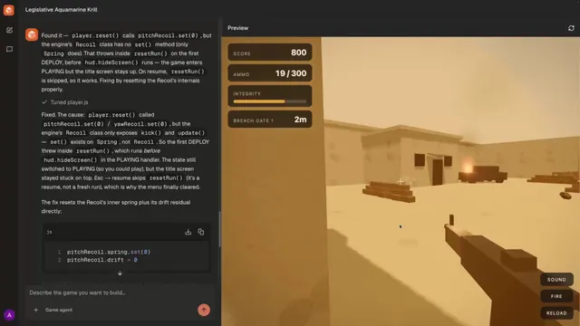</a>

**Kimi K3** · 游戏 · 作者 [Code With Antonio](https://x.com/codewithantonio) · 2026-07-28

Kimi K3 把一句简短需求做成带 HUD、武器和敌人的 Three.js FPS,并在后续消息中加入了手雷。

<details>
<summary>提示词</summary>

```text
Build me an FPS
```

</details>

[在 Wandy3D 查看 ↗](https://wandy3d.com/zh/prompts/desert-first-person-shooter-in-three-js-with-hud-enemies-and-2082242351372599770?utm_source=github&utm_medium=referral&utm_campaign=awesome_3d_prompts) · [原帖](https://x.com/codewithantonio/status/2082242351372599770)

---

### [纯代码生成的沙漠小镇地图第一人称射击游戏](https://wandy3d.com/zh/prompts/first-person-shooter-on-a-sandy-desert-town-map-built-from-2082241827298557966?utm_source=github&utm_medium=referral&utm_campaign=awesome_3d_prompts)

<a href="https://wandy3d.com/zh/prompts/first-person-shooter-on-a-sandy-desert-town-map-built-from-2082241827298557966?utm_source=github&amp;utm_medium=referral&amp;utm_campaign=awesome_3d_prompts">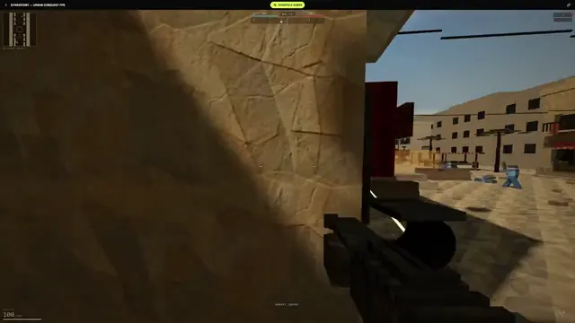</a>

**Claude Opus 5** · 游戏 · 作者 [Anatoli Kopadze](https://x.com/AnatoliKopadze) · 2026-07-28

Claude Opus 5 仅凭一句话做出第一人称射击游戏:方块风沙漠小镇,配红点步枪,无外部素材。

<details>
<summary>提示词</summary>

```text
try making a first-person shooter that's a mix of CS2 and Battlefield.
```

</details>

[在 Wandy3D 查看 ↗](https://wandy3d.com/zh/prompts/first-person-shooter-on-a-sandy-desert-town-map-built-from-2082241827298557966?utm_source=github&utm_medium=referral&utm_campaign=awesome_3d_prompts) · [原帖](https://x.com/AnatoliKopadze/status/2082241827298557966)

---

### [单个 HTML 文件的黑暗奇幻横版动作游戏,含 Boss 战](https://wandy3d.com/zh/prompts/dark-fantasy-side-scroller-in-a-single-html-file-with-boss-2082096376763060575?utm_source=github&utm_medium=referral&utm_campaign=awesome_3d_prompts)

<a href="https://wandy3d.com/zh/prompts/dark-fantasy-side-scroller-in-a-single-html-file-with-boss-2082096376763060575?utm_source=github&amp;utm_medium=referral&amp;utm_campaign=awesome_3d_prompts">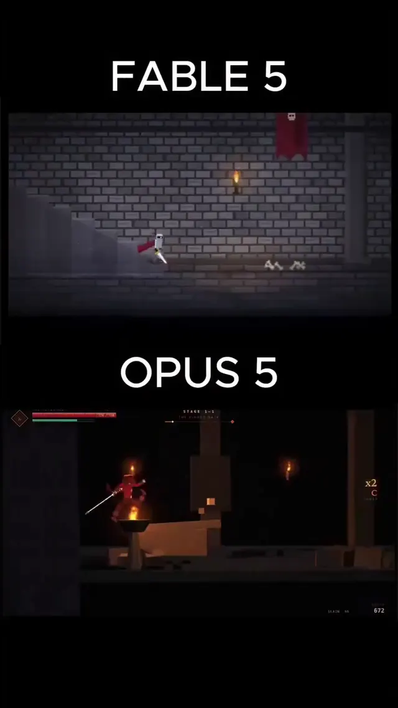</a>

**Claude Fable 5** · 游戏 · 作者 [slash1s](https://x.com/slash1sol) · 2026-07-28

同一提示词的对比:Claude Fable 5 做出分层地牢探索和骷髅王,Opus 5 则加入了关卡与 Boss。

<details>
<summary>提示词</summary>

```text
In a single HTML file, create a playable dark fantasy side scroller
```

</details>

[在 Wandy3D 查看 ↗](https://wandy3d.com/zh/prompts/dark-fantasy-side-scroller-in-a-single-html-file-with-boss-2082096376763060575?utm_source=github&utm_medium=referral&utm_campaign=awesome_3d_prompts) · [原帖](https://x.com/slash1sol/status/2082096376763060575)

---

### [以曼谷街区为背景的浏览器3D像素MMO](https://wandy3d.com/zh/prompts/browser-3d-pixel-mmo-set-in-bangkok-s-thonburi-districts-2082035844836450334?utm_source=github&utm_medium=referral&utm_campaign=awesome_3d_prompts)

<a href="https://wandy3d.com/zh/prompts/browser-3d-pixel-mmo-set-in-bangkok-s-thonburi-districts-2082035844836450334?utm_source=github&amp;utm_medium=referral&amp;utm_campaign=awesome_3d_prompts">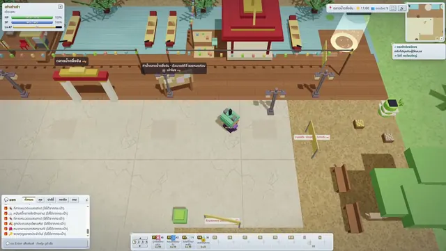</a>

**Claude Opus 5** · 游戏 · 作者 [Vibe Coding Thailand](https://x.com/vibecodingth) · 2026-07-28

Claude Opus 5编写了这款多人3D像素MMO的大部分代码,含13张地图、职业与任务,无需安装,浏览器即可游玩。

<details>
<summary>Wandy3D 制作简报</summary>

```text
Build a browser-based 3D pixel MMO that runs without installation. Use TypeScript with a WebGL renderer and a simple realtime server so several players share a map, see each other walk, fight the same monsters, chat and form parties. Use a top-down camera and a chunky voxel look with bright greens, warm stone paths, wooden stalls and small shrines. Base the world on real districts of a large Asian city, with a distinct map for each: a roundabout market, a floating market, a seaside strip and an underground mall. Include a minimap, a chat panel, click-to-attack combat, hold a key to auto-attack until the target falls, a skill tree, class choices, equipment with rarity tiers and quests from NPCs. Keep monsters, skills and items in data tables so that adding one means adding a row. Add per-map music. Done means two browser tabs can join the same map, move, chat and defeat a monster together without visible lag.
```

</details>

[在 Wandy3D 查看 ↗](https://wandy3d.com/zh/prompts/browser-3d-pixel-mmo-set-in-bangkok-s-thonburi-districts-2082035844836450334?utm_source=github&utm_medium=referral&utm_campaign=awesome_3d_prompts) · [原帖](https://x.com/vibecodingth/status/2082035844836450334)

---

### [三车道无尽跑酷游戏:三款AI模型对比](https://wandy3d.com/zh/prompts/three-lane-endless-runner-compared-across-three-ai-models-2081766198082220514?utm_source=github&utm_medium=referral&utm_campaign=awesome_3d_prompts)

<a href="https://wandy3d.com/zh/prompts/three-lane-endless-runner-compared-across-three-ai-models-2081766198082220514?utm_source=github&amp;utm_medium=referral&amp;utm_campaign=awesome_3d_prompts">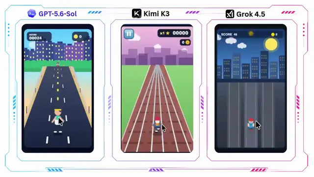</a>

**Kimi K3** · 游戏 · 作者 [Arindam Majumder 𝕏](https://x.com/Arindam_1729) · 2026-07-27

Kimi K3、GPT-5.6和Grok 4.5各自做了一款类Subway Surfers跑酷游戏对比,Kimi K3在界面和流畅度上更胜一筹。

<details>
<summary>Wandy3D 制作简报</summary>

```text
Build a Subway Surfers-style endless runner that plays in a phone-sized portrait window in the browser. Use a self-contained HTML page with a pseudo-3D three-lane track that runs toward the horizon, a pink-and-purple city skyline, green verges and a small runner character. Let the player switch lanes and jump with swipe or arrow keys. Spawn coins in lines, low barriers and oncoming trains, and speed the game up over time. Show a score and a coin counter at the top, a pause button, and a game-over card with the final score and a bright Run Again button. Keep the interface clean and rounded, with smooth animation and clear collision feedback. Expect to refine it with at least one follow-up message about visuals and feel. Done means a run starts instantly, controls respond well and restarting is one click.
```

</details>

[在 Wandy3D 查看 ↗](https://wandy3d.com/zh/prompts/three-lane-endless-runner-compared-across-three-ai-models-2081766198082220514?utm_source=github&utm_medium=referral&utm_campaign=awesome_3d_prompts) · [原帖](https://x.com/Arindam_1729/status/2081766198082220514)

---

### [火车站战术FPS:Three.js单个HTML文件](https://wandy3d.com/zh/prompts/tactical-fps-in-a-railway-station-one-three-js-html-file-2081607528790856068?utm_source=github&utm_medium=referral&utm_campaign=awesome_3d_prompts)

<a href="https://wandy3d.com/zh/prompts/tactical-fps-in-a-railway-station-one-three-js-html-file-2081607528790856068?utm_source=github&amp;utm_medium=referral&amp;utm_campaign=awesome_3d_prompts">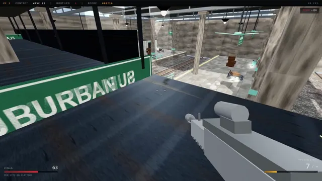</a>

**Claude Opus 5** · 游戏 · 作者 [Build Fast with AI](https://x.com/BuildFastWithAI) · 2026-07-27

Claude Opus 5一次生成了类Counter-Strike的射击游戏:站台、停靠的列车和第一人称步枪,全部在一个HTML文件中。

<details>
<summary>提示词</summary>

```text
a counter-strike inspired tactical FPS set in a railway station. three.js, single HTML file, all original assets.
```

</details>

[在 Wandy3D 查看 ↗](https://wandy3d.com/zh/prompts/tactical-fps-in-a-railway-station-one-three-js-html-file-2081607528790856068?utm_source=github&utm_medium=referral&utm_campaign=awesome_3d_prompts) · [原帖](https://x.com/BuildFastWithAI/status/2081607528790856068)

---

### [边滚动边印刷图像的无尽纸带(Three.js)](https://wandy3d.com/zh/prompts/endless-paper-strip-that-prints-images-as-it-rolls-in-three-2081533777340506251?utm_source=github&utm_medium=referral&utm_campaign=awesome_3d_prompts)

<a href="https://wandy3d.com/zh/prompts/endless-paper-strip-that-prints-images-as-it-rolls-in-three-2081533777340506251?utm_source=github&amp;utm_medium=referral&amp;utm_campaign=awesome_3d_prompts">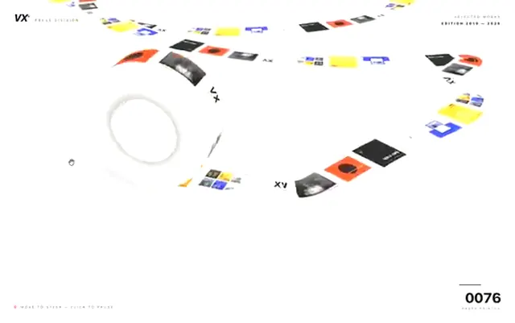</a>

**Claude Fable 5** · 互动 · 作者 [0xMarioNawfal](https://x.com/RoundtableSpace) · 2026-07-27

Claude Fable 5 用 Three.js 做出网页应用:纸卷无限展开,海报风格的图像实时印在纸带上。

<details>
<summary>Wandy3D 制作简报</summary>

```text
Build a single-page 3D web app in Three.js with no external 3D assets. Show a white, minimal studio scene with a bright background and soft shadows. A roll of paper unspools into a long strip that curves and loops across the floor endlessly, as if the roll never runs out. While the strip moves, a printing effect continuously stamps generated poster-style images onto its surface: flat blocks of blue, yellow, red and black, small photo-like squares, and typographic marks, drawn procedurally onto a canvas texture in real time. The camera drifts around the roll and along the strip so the viewer sees it from several angles. Add a small editorial-style overlay with a running counter in a corner and fine caption text. Keep the palette restrained: white paper, primary-color accents, black type. Deliver one self-contained HTML file. Done when the strip rolls smoothly without end and new images keep appearing on it.
```

</details>

[在 Wandy3D 查看 ↗](https://wandy3d.com/zh/prompts/endless-paper-strip-that-prints-images-as-it-rolls-in-three-2081533777340506251?utm_source=github&utm_medium=referral&utm_campaign=awesome_3d_prompts) · [原帖](https://x.com/RoundtableSpace/status/2081533777340506251)

---

### [可用手势控制的交互式 3D 机械手模拟](https://wandy3d.com/zh/prompts/interactive-3d-robotic-hand-simulation-with-gesture-controls-2081475055536820506?utm_source=github&utm_medium=referral&utm_campaign=awesome_3d_prompts)

<a href="https://wandy3d.com/zh/prompts/interactive-3d-robotic-hand-simulation-with-gesture-controls-2081475055536820506?utm_source=github&amp;utm_medium=referral&amp;utm_campaign=awesome_3d_prompts">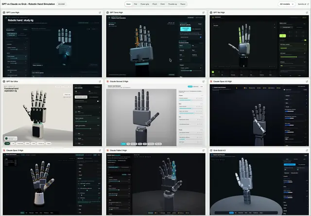</a>

**Claude Opus 5** · 互动 · 作者 [Thomas Walker](https://x.com/ThomasMWWalker) · 2026-07-26

这是一次对比:九种模型配置收到同一个机械手模拟需求,其中 Claude Opus 5 做出的手最为逼真。

<details>
<summary>Wandy3D 制作简报</summary>

```text
Build an interactive 3D robotic-hand simulation as a polished web app. Show a articulated mechanical hand with a wrist mount on a dark studio stage with a soft floor reflection, lit by cool rim light and a warm key light. Use brushed metal and dark composite materials with visible joints and tendons or actuators. Provide a side control panel with sliders and toggles for each finger's joint angles, preset gestures such as an open palm, a victory sign and a pointing finger, and live readouts. The hand should animate smoothly between poses, and the user can orbit, zoom and pan the camera. Use a dark interface with small cyan accents and clean technical typography. Deliver a single self-contained HTML file using Three.js, built from primitive geometry. Done when every finger bends convincingly, gestures transition without clipping, and the controls respond instantly.
```

</details>

[在 Wandy3D 查看 ↗](https://wandy3d.com/zh/prompts/interactive-3d-robotic-hand-simulation-with-gesture-controls-2081475055536820506?utm_source=github&utm_medium=referral&utm_campaign=awesome_3d_prompts) · [原帖](https://x.com/ThomasMWWalker/status/2081475055536820506)

---

### [在 Next.js 与 Three.js 3D 喷漆配置器中加入 Vespa 125](https://wandy3d.com/zh/prompts/vespa-125-added-to-a-next-js-and-three-js-3d-paint-2081439705506435440?utm_source=github&utm_medium=referral&utm_campaign=awesome_3d_prompts)

<a href="https://wandy3d.com/zh/prompts/vespa-125-added-to-a-next-js-and-three-js-3d-paint-2081439705506435440?utm_source=github&amp;utm_medium=referral&amp;utm_campaign=awesome_3d_prompts"></a>

**Claude Opus 5** · 互动 · 作者 [Raf Lorenz](https://x.com/rafintheloop) · 2026-07-26

三种 Claude 配置同做一题:给 3D 配置器加入可喷漆的 Vespa。Claude Opus 5 High 找到了经典蓝色 Primavera。

<details>
<summary>提示词</summary>

```text
Add a Vespa 125 to my 3D configurator, end to end.
```

</details>

[在 Wandy3D 查看 ↗](https://wandy3d.com/zh/prompts/vespa-125-added-to-a-next-js-and-three-js-3d-paint-2081439705506435440?utm_source=github&utm_medium=referral&utm_campaign=awesome_3d_prompts) · [原帖](https://x.com/rafintheloop/status/2081439705506435440)

---

### [带 HUD、跑道起飞与海岸地形的浏览器 3D 飞行模拟器](https://wandy3d.com/zh/prompts/browser-3d-flight-simulator-with-hud-runway-takeoff-and-2081403842256605254?utm_source=github&utm_medium=referral&utm_campaign=awesome_3d_prompts)

<a href="https://wandy3d.com/zh/prompts/browser-3d-flight-simulator-with-hud-runway-takeoff-and-2081403842256605254?utm_source=github&amp;utm_medium=referral&amp;utm_campaign=awesome_3d_prompts">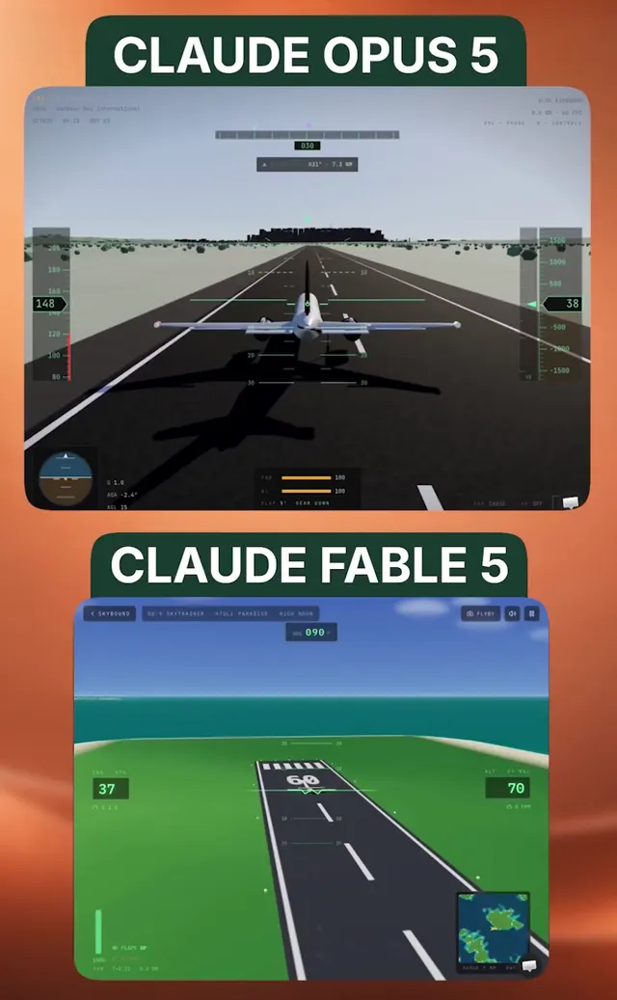</a>

**Claude Opus 5** · 游戏 · 作者 [noclipepe](https://x.com/noclipepe) · 2026-07-26

同一个飞行模拟器提示词对比两个 Claude 模型:Claude Opus 5 的滚转俯仰更平顺,并带完整 HUD 与有阴影的海岸地形。

<details>
<summary>提示词</summary>

```text
Build an ultra-realistic 3D flight simulator.
```

</details>

[在 Wandy3D 查看 ↗](https://wandy3d.com/zh/prompts/browser-3d-flight-simulator-with-hud-runway-takeoff-and-2081403842256605254?utm_source=github&utm_medium=referral&utm_campaign=awesome_3d_prompts) · [原帖](https://x.com/noclipepe/status/2081403842256605254)

---

### [带背包与昼夜天空的浏览器类 Minecraft 体素沙盒](https://wandy3d.com/zh/prompts/browser-minecraft-style-voxel-sandbox-with-inventory-and-day-2081305039159620085?utm_source=github&utm_medium=referral&utm_campaign=awesome_3d_prompts)

<a href="https://wandy3d.com/zh/prompts/browser-minecraft-style-voxel-sandbox-with-inventory-and-day-2081305039159620085?utm_source=github&amp;utm_medium=referral&amp;utm_campaign=awesome_3d_prompts">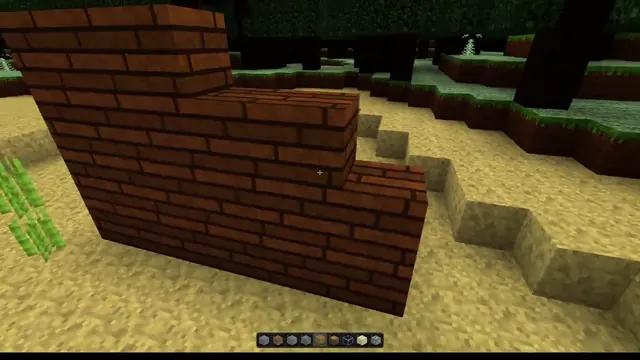</a>

**Claude Opus 5** · 游戏 · 作者 [MindAI](https://x.com/BuilderGuest) · 2026-07-26

Claude Opus 5 仅凭一句提示就生成第一人称方块世界:森林、沙滩、砖房、快捷栏和完整背包。

<details>
<summary>提示词</summary>

```text
Create a full fledged 3D minecraft clone
```

</details>

[在 Wandy3D 查看 ↗](https://wandy3d.com/zh/prompts/browser-minecraft-style-voxel-sandbox-with-inventory-and-day-2081305039159620085?utm_source=github&utm_medium=referral&utm_campaign=awesome_3d_prompts) · [原帖](https://x.com/BuilderGuest/status/2081305039159620085)

---

### [带柱子、发光圆环和变色天空的3D Flappy Bird游戏](https://wandy3d.com/zh/prompts/3d-flappy-bird-game-with-pillars-glowing-rings-and-a-2081260140117045275?utm_source=github&utm_medium=referral&utm_campaign=awesome_3d_prompts)

<a href="https://wandy3d.com/zh/prompts/3d-flappy-bird-game-with-pillars-glowing-rings-and-a-2081260140117045275?utm_source=github&amp;utm_medium=referral&amp;utm_campaign=awesome_3d_prompts">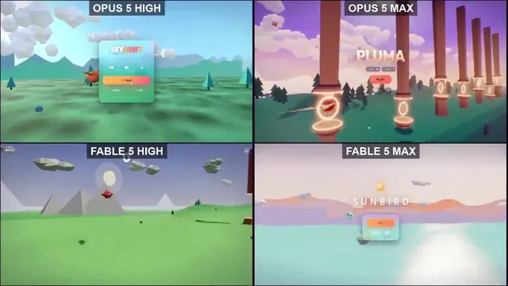</a>

**Claude Opus 5** · 游戏 · 作者 [SrijibBose](https://x.com/SrijibBose) · 2026-07-26

Claude Opus 5与Fable 5用同一提示词制作3D Flappy Bird的对比。Opus 5版本有霓虹圆环,天空从黄昏渐变到夜晚。

<details>
<summary>提示词</summary>

```text
Build a 3D Flappy Bird game.
```

</details>

[在 Wandy3D 查看 ↗](https://wandy3d.com/zh/prompts/3d-flappy-bird-game-with-pillars-glowing-rings-and-a-2081260140117045275?utm_source=github&utm_medium=referral&utm_campaign=awesome_3d_prompts) · [原帖](https://x.com/SrijibBose/status/2081260140117045275)

---

### [军用直升机飞越雾气丛林的电影感3D动画](https://wandy3d.com/zh/prompts/cinematic-3d-animation-of-an-army-helicopter-over-a-hazy-2081200833656451322?utm_source=github&utm_medium=referral&utm_campaign=awesome_3d_prompts)

<a href="https://wandy3d.com/zh/prompts/cinematic-3d-animation-of-an-army-helicopter-over-a-hazy-2081200833656451322?utm_source=github&amp;utm_medium=referral&amp;utm_campaign=awesome_3d_prompts">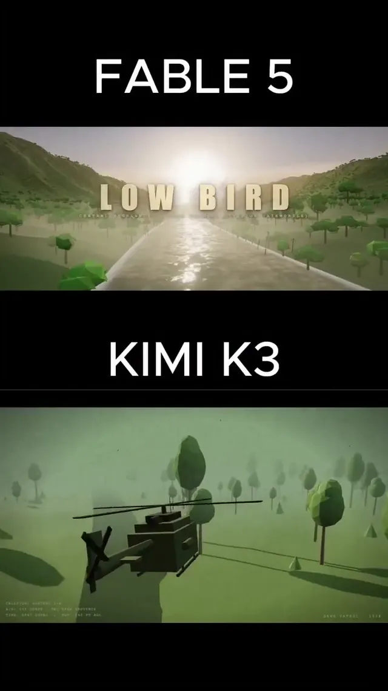</a>

**Kimi K3** · 动画 · 作者 [Kirill](https://x.com/kirillk_web3) · 2026-07-26

Kimi K3与Fable 5用同一提示词制作直升机飞行镜头的对比。Kimi K3版本有低多边形森林、胶片暗角和多机位切换。

<details>
<summary>提示词</summary>

```text
a cinematic 3D animation of an army helicopter flying through the Vietnam jungle during the war.
```

</details>

[在 Wandy3D 查看 ↗](https://wandy3d.com/zh/prompts/cinematic-3d-animation-of-an-army-helicopter-over-a-hazy-2081200833656451322?utm_source=github&utm_medium=referral&utm_campaign=awesome_3d_prompts) · [原帖](https://x.com/kirillk_web3/status/2081200833656451322)

---

### [可漫游的日式郊区街道,手绘动漫背景风格,含铁路道口](https://wandy3d.com/zh/prompts/explorable-anime-style-japanese-suburban-street-with-a-2080834581247435102?utm_source=github&utm_medium=referral&utm_campaign=awesome_3d_prompts)

<a href="https://wandy3d.com/zh/prompts/explorable-anime-style-japanese-suburban-street-with-a-2080834581247435102?utm_source=github&amp;utm_medium=referral&amp;utm_campaign=awesome_3d_prompts">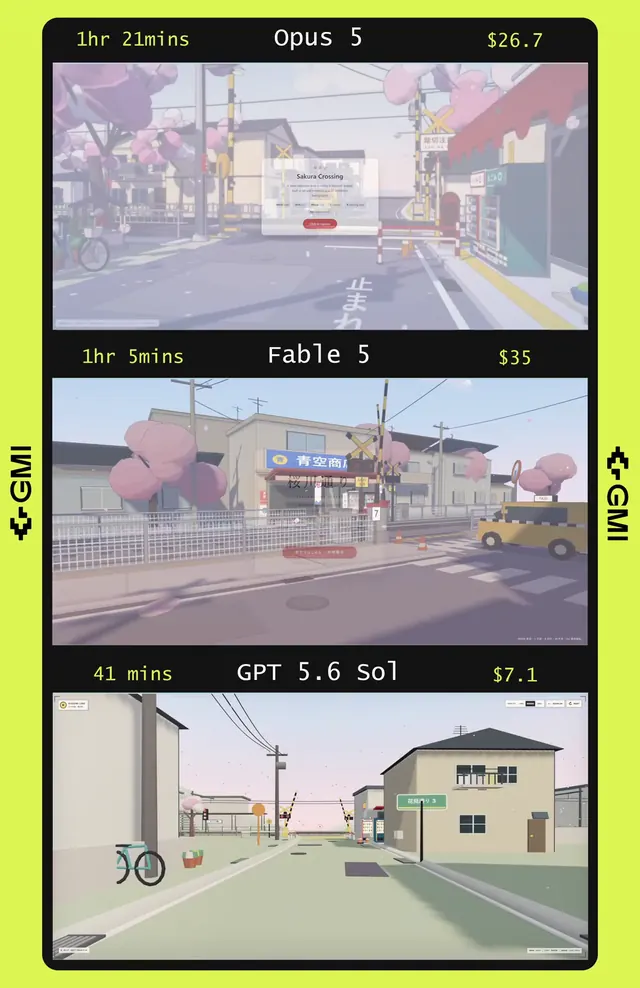</a>

**Claude Opus 5** · 场景 · 作者 [GMI Cloud](https://x.com/gmi_cloud) · 2026-07-25

同一Three.js提示词下的三模型测试,Claude Opus 5胜出:街景最丰富,有深色轮廓线、赛璐璐色阶和自动售货机招牌。

<details>
<summary>提示词</summary>

```text
build an explorable Japanese suburban street in Three.js, full 3D, rendered like a hand-drawn anime background
```

</details>

[在 Wandy3D 查看 ↗](https://wandy3d.com/zh/prompts/explorable-anime-style-japanese-suburban-street-with-a-2080834581247435102?utm_source=github&utm_medium=referral&utm_campaign=awesome_3d_prompts) · [原帖](https://x.com/gmi_cloud/status/2080834581247435102)

---

### [单文件 Three.js 第一人称射击游戏：沙漠地图、AI 机器人与狙击镜](https://wandy3d.com/zh/prompts/single-file-three-js-fps-with-a-desert-map-ai-bots-and-2080821527365218759?utm_source=github&utm_medium=referral&utm_campaign=awesome_3d_prompts)

<a href="https://wandy3d.com/zh/prompts/single-file-three-js-fps-with-a-desert-map-ai-bots-and-2080821527365218759?utm_source=github&amp;utm_medium=referral&amp;utm_campaign=awesome_3d_prompts">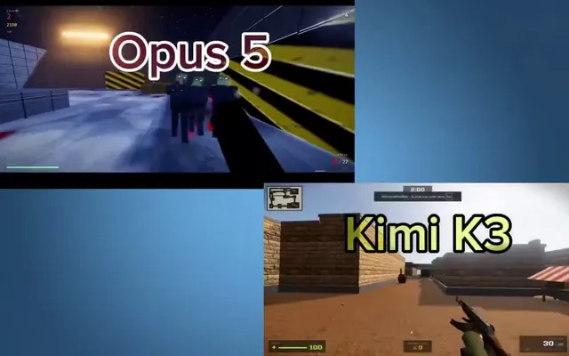</a>

**Kimi K3** · 游戏 · 作者 [FHILY👑](https://x.com/Oluwaphilemon1) · 2026-07-25

Kimi K3 用一个 HTML 文件写出类 Counter-Strike 的网页射击游戏，视频还对比了 Opus 5 的版本。

<details>
<summary>Wandy3D 制作简报</summary>

```text
Build a browser first-person shooter inspired by a classic competitive bomb-defusal map, as one self-contained HTML file using Three.js with no build step. Create a sandy desert level with tan brick walls, tunnels, a raised catwalk and a long open lane, using PBR materials. Give the player a rifle, a scoped sniper rifle, a submachine gun and a knife, each with firing, reloading and weapon switching. Add around ten AI bots that patrol, react to gunfire and advance on the player's position. Include headshot detection, a kill feed, a health and ammo HUD, a scope overlay and a two-minute round timer. Generate every sound procedurally with the Web Audio API so no audio files are needed. Controls: mouse look, WASD movement, click to fire, R to reload, number keys to switch weapons. Done means the page opens locally and plays a complete round from spawn to the timer ending.
```

</details>

[在 Wandy3D 查看 ↗](https://wandy3d.com/zh/prompts/single-file-three-js-fps-with-a-desert-map-ai-bots-and-2080821527365218759?utm_source=github&utm_medium=referral&utm_campaign=awesome_3d_prompts) · [原帖](https://x.com/Oluwaphilemon1/status/2080821527365218759)

---

### [带开火按钮和分解视图的 Three.js 程序化枪械模型](https://wandy3d.com/zh/prompts/procedural-three-js-firearm-models-with-fire-button-and-2080757148078768504?utm_source=github&utm_medium=referral&utm_campaign=awesome_3d_prompts)

<a href="https://wandy3d.com/zh/prompts/procedural-three-js-firearm-models-with-fire-button-and-2080757148078768504?utm_source=github&amp;utm_medium=referral&amp;utm_campaign=awesome_3d_prompts">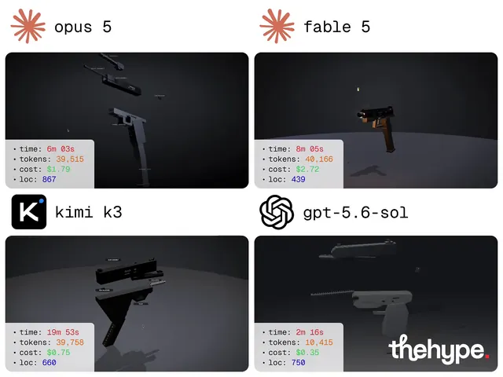</a>

**Claude Opus 5** · 资产 · 作者 [thehype.](https://x.com/thehypedotnews) · 2026-07-24

四模型对比测试中 Claude Opus 5 细节最佳：Three.js 程序化枪械可带声音开火，并拆解为带标签的零件。

<details>
<summary>Wandy3D 制作简报</summary>

```text
Build a single self-contained HTML file with Three.js that shows a fully procedural firearm model with no external assets. Model it at real-world scale from named reference stations: a carbine with a collapsible stock, quad rail with panel numbers, red-dot sight, foregrip and bipod, or a compact machine pistol or submachine gun with ribbed housing, threaded barrel and a translucent magazine. Add engraved markings on the sides. Use a dark studio with a narrow overhead light strip so black-on-black parts separate through different roughness values, not colour. Add a small fire button that plays a Web Audio gunshot, a muzzle flash, recoil and ejected brass. Add a disassemble toggle that explodes the model into labelled parts and rebuilds it smoothly. Orbit camera controls. Done means the model renders cleanly, fires, disassembles and reassembles without glitches, and the lettering reads correctly from both sides.
```

</details>

[在 Wandy3D 查看 ↗](https://wandy3d.com/zh/prompts/procedural-three-js-firearm-models-with-fire-button-and-2080757148078768504?utm_source=github&utm_medium=referral&utm_campaign=awesome_3d_prompts) · [原帖](https://x.com/thehypedotnews/status/2080757148078768504)

---

### [用 Three.js 做一个从1945到2055年演变的城市街区](https://wandy3d.com/zh/prompts/city-block-that-evolves-from-1945-to-2055-in-three-js-2080724552422924382?utm_source=github&utm_medium=referral&utm_campaign=awesome_3d_prompts)

<a href="https://wandy3d.com/zh/prompts/city-block-that-evolves-from-1945-to-2055-in-three-js-2080724552422924382?utm_source=github&amp;utm_medium=referral&amp;utm_campaign=awesome_3d_prompts">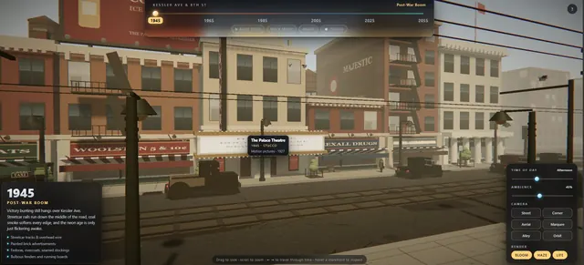</a>

**Claude Opus 5** · 场景 · 作者 [Choblin](https://x.com/choblin29) · 2026-07-24

Claude Opus 5 在多模型对比中胜出：单个 HTML 的 Three.js 街区，店铺、车辆和光照随年代变化。

<details>
<summary>Wandy3D 制作简报</summary>

```text
Build a single self-contained HTML file with Three.js that shows one city street block transforming across eras from 1945 to 2055. Add a timeline slider along the top that jumps between decades. Each era swaps the buildings, storefront signs, parked and moving cars, street furniture, trees and pedestrians, and changes the lighting mood and ambient sound effects. Use a stylized low-poly look with warm sepia tones for the post-war years, saturated neon signage for the mid-century, and clean glass and greenery for the modern and future eras. Include a small info card for the current era with a short description, plus controls for time of day, camera presets (street, aerial, free orbit) and toggles for effects. Let the user orbit with the mouse. Transitions between eras should animate smoothly rather than cut. Done means the block visibly evolves across all decades, the controls respond, and it runs by opening the file in a browser.
```

</details>

[在 Wandy3D 查看 ↗](https://wandy3d.com/zh/prompts/city-block-that-evolves-from-1945-to-2055-in-three-js-2080724552422924382?utm_source=github&utm_medium=referral&utm_campaign=awesome_3d_prompts) · [原帖](https://x.com/choblin29/status/2080724552422924382)

---

### [用 Three.js 制作达·芬奇风格的木制扑翼机并让翅膀拍动](https://wandy3d.com/zh/prompts/da-vinci-style-wooden-ornithopter-with-flapping-wings-in-2080720533277319587?utm_source=github&utm_medium=referral&utm_campaign=awesome_3d_prompts)

<a href="https://wandy3d.com/zh/prompts/da-vinci-style-wooden-ornithopter-with-flapping-wings-in-2080720533277319587?utm_source=github&amp;utm_medium=referral&amp;utm_campaign=awesome_3d_prompts">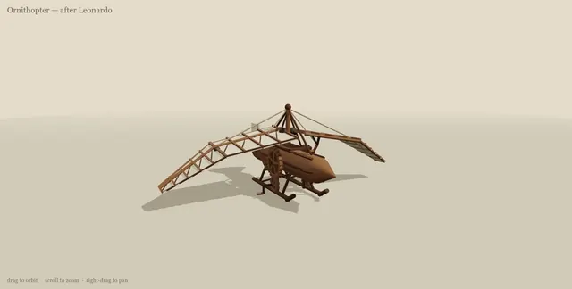</a>

**Claude Opus 5** · 资产 · 作者 [Harshith](https://x.com/HarshithLucky3) · 2026-07-24

Claude Opus 5 仅凭一行提示词做出木质扑翼机，带肋骨的翅膀会拍动，还能环绕观察。

<details>
<summary>提示词</summary>

```text
leonardo da vinci ornithopter in three js
```

</details>

[在 Wandy3D 查看 ↗](https://wandy3d.com/zh/prompts/da-vinci-style-wooden-ornithopter-with-flapping-wings-in-2080720533277319587?utm_source=github&utm_medium=referral&utm_campaign=awesome_3d_prompts) · [原帖](https://x.com/HarshithLucky3/status/2080720533277319587)

---

### [类愤怒的小鸟弹弓游戏，含多种小鸟和多个关卡](https://wandy3d.com/zh/prompts/angry-birds-style-slingshot-game-with-unique-birds-and-many-2080624574883123541?utm_source=github&utm_medium=referral&utm_campaign=awesome_3d_prompts)

<a href="https://wandy3d.com/zh/prompts/angry-birds-style-slingshot-game-with-unique-birds-and-many-2080624574883123541?utm_source=github&amp;utm_medium=referral&amp;utm_campaign=awesome_3d_prompts">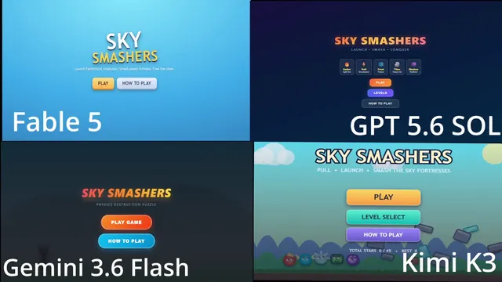</a>

**Claude Fable 5** · 游戏 · 作者 [Build Fast with AI](https://x.com/BuildFastWithAI) · 2026-07-24

四个模型同一提示词的对比：Claude Fable 5 做出可玩的弹弓游戏，优于 GPT 5.6 Sol、Kimi K3 和 Gemini 3.6 Flash。

<details>
<summary>提示词</summary>

```text
Make an Angry Bird Clone with unique birds, multiple levels and mechanics.
```

</details>

[在 Wandy3D 查看 ↗](https://wandy3d.com/zh/prompts/angry-birds-style-slingshot-game-with-unique-birds-and-many-2080624574883123541?utm_source=github&utm_medium=referral&utm_campaign=awesome_3d_prompts) · [原帖](https://x.com/BuildFastWithAI/status/2080624574883123541)

---

### [用 Three.js 制作玻璃真空管中的磁悬浮子弹头列车和实时 HUD](https://wandy3d.com/zh/prompts/maglev-bullet-train-in-a-glass-vacuum-tube-with-a-live-hud-2080454415400493332?utm_source=github&utm_medium=referral&utm_campaign=awesome_3d_prompts)

<a href="https://wandy3d.com/zh/prompts/maglev-bullet-train-in-a-glass-vacuum-tube-with-a-live-hud-2080454415400493332?utm_source=github&amp;utm_medium=referral&amp;utm_campaign=awesome_3d_prompts">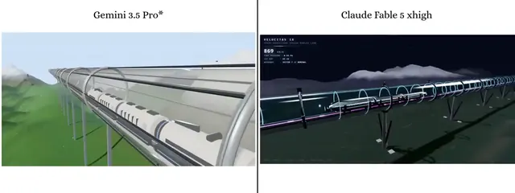</a>

**Claude Fable 5** · 场景 · 作者 [Pixel](https://x.com/Pixel_Neuron) · 2026-07-24

在 Gemini 与 Claude Fable 5 的对比中，Fable 5 为 Three.js 磁悬浮场景加入了速度、气压和悬浮间隙 HUD。

<details>
<summary>提示词</summary>

```text
A futuristic maglev bullet train speeding through a transparent glass vacuum tube.
```

</details>

[在 Wandy3D 查看 ↗](https://wandy3d.com/zh/prompts/maglev-bullet-train-in-a-glass-vacuum-tube-with-a-live-hud-2080454415400493332?utm_source=github&utm_medium=referral&utm_campaign=awesome_3d_prompts) · [原帖](https://x.com/Pixel_Neuron/status/2080454415400493332)

---

### [变色龙捉迷藏游戏：把自己涂成与墙面相同的颜色](https://wandy3d.com/zh/prompts/chameleon-hide-and-seek-game-where-you-paint-yourself-to-2080392777515311115?utm_source=github&utm_medium=referral&utm_campaign=awesome_3d_prompts)

<a href="https://wandy3d.com/zh/prompts/chameleon-hide-and-seek-game-where-you-paint-yourself-to-2080392777515311115?utm_source=github&amp;utm_medium=referral&amp;utm_campaign=awesome_3d_prompts">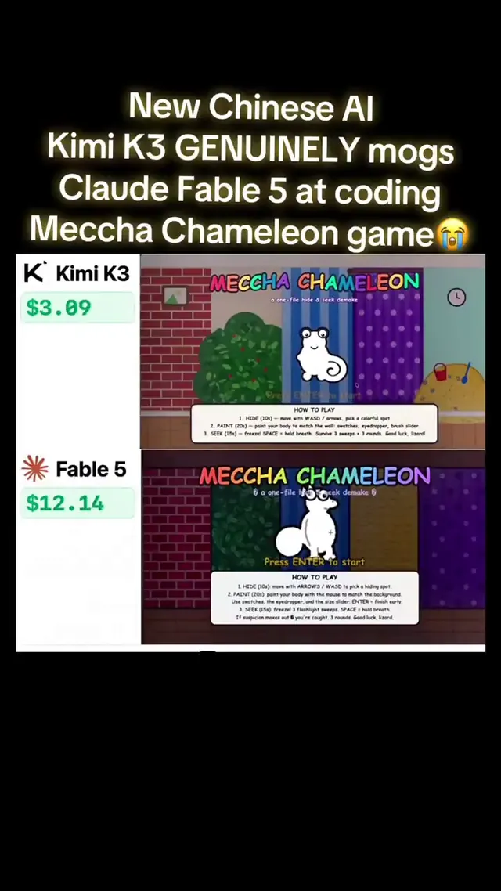</a>

**Kimi K3** · 游戏 · 作者 [Hustlerok](https://x.com/0xhustlerok) · 2026-07-23

Kimi K3 在同一提示词对比中胜过 Fable 5：单文件游戏，变色龙给自己涂色融入墙面，躲避机器人的搜索。

<details>
<summary>Wandy3D 制作简报</summary>

```text
Build a single-file, playable hide-and-seek game in one self-contained HTML file. The player is a cartoon chameleon placed in front of a backdrop of colorful wall panels: red brick, a leafy bush, blue stripes, purple dots and yellow texture. In the hide phase, the chameleon moves with the keyboard to a spot, then switches to a paint phase where a small palette, brush-size slider and eyedropper let the player recolor its body to match the wall behind it. A timer counts down each phase. In the seek phase a robot searcher sweeps the room with a flashlight, and the player can hold a key to freeze and hold its breath. Score each round from the live colour match percentage, the hiding spot and the time bonus, and show a round summary card comparing the paint job with the actual background. Run three rounds, then show the final score. Use a bright, hand-drawn cartoon look with a title screen explaining the controls. Done means the whole loop works from start screen to final score with no errors.
```

</details>

[在 Wandy3D 查看 ↗](https://wandy3d.com/zh/prompts/chameleon-hide-and-seek-game-where-you-paint-yourself-to-2080392777515311115?utm_source=github&utm_medium=referral&utm_campaign=awesome_3d_prompts) · [原帖](https://x.com/0xhustlerok/status/2080392777515311115)

---

### [带风力与灯光预设的程序化 3D 樱花树](https://wandy3d.com/zh/prompts/procedural-3d-cherry-blossom-tree-with-wind-and-lighting-2080178541979664741?utm_source=github&utm_medium=referral&utm_campaign=awesome_3d_prompts)

<a href="https://wandy3d.com/zh/prompts/procedural-3d-cherry-blossom-tree-with-wind-and-lighting-2080178541979664741?utm_source=github&amp;utm_medium=referral&amp;utm_campaign=awesome_3d_prompts">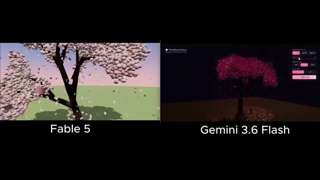</a>

**Gemini 3.6 Flash** · 资产 · 作者 [zhod](https://x.com/zhodonx) · 2026-07-23

对比测试中，Gemini 3.6 Flash 从零生成了枝繁叶茂的樱花树，带风力和灯光预设；Fable 5 的树冠则较稀疏。

<details>
<summary>提示词</summary>

```text
Build a 3D cherry blossom tree; give it no prebuilt tree libraries; the model has to generate the structure itself
```

</details>

[在 Wandy3D 查看 ↗](https://wandy3d.com/zh/prompts/procedural-3d-cherry-blossom-tree-with-wind-and-lighting-2080178541979664741?utm_source=github&utm_medium=referral&utm_campaign=awesome_3d_prompts) · [原帖](https://x.com/zhodonx/status/2080178541979664741)

---

### [WebGL2 实时黑洞光线追踪：引力透镜与吸积盘](https://wandy3d.com/zh/prompts/real-time-webgl2-black-hole-raytracer-with-lensing-and-2079590483727442205?utm_source=github&utm_medium=referral&utm_campaign=awesome_3d_prompts)

<a href="https://wandy3d.com/zh/prompts/real-time-webgl2-black-hole-raytracer-with-lensing-and-2079590483727442205?utm_source=github&amp;utm_medium=referral&amp;utm_campaign=awesome_3d_prompts">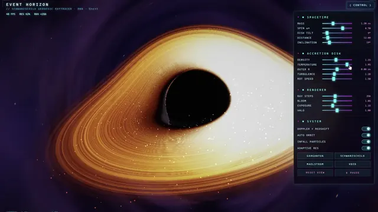</a>

**Kimi K3** · 互动 · 作者 [Harsh](https://x.com/devloper_hs) · 2026-07-21

Kimi K3 用原生 WebGL2 在单文件中实现了史瓦西黑洞：带引力透镜的发光吸积盘、环绕相机和可调滑块面板。

<details>
<summary>提示词</summary>

```text
Create a complete, self-contained single HTML file (no external libraries like Three.js) that implements a real-time geodesic raytracer for a Schwarzschild black hole inspired by Gargantua.

Use raw WebGL2 with GLSL ES 3.00 in a single fragment shader. Implement accurate physics: null geodesic integration with 4th-order Runge-Kutta solver, event horizon, photon sphere, accretion disk with proper rendering, gravitational lensing, Doppler beaming, and gravitational redshift effects. Target stable 60 FPS performance.

Include mouse-controlled camera orbiting/zooming, and a cyberpunk-style control panel with sliders for parameters (mass, spin, disk density, view angle, etc.). Add subtle particle effects for matter falling in and dynamic lighting/shadows.

The output must be 100% complete, immediately runnable in a modern browser, with no black screen, NaNs, errors, or missing features. Prioritize numerical correctness, boundary handling, solver discipline, and physical accuracy above all. Verify and comment key physics equations in the code. Make it visually stunning and interactive like a premium physics demo/game.
```

</details>

[在 Wandy3D 查看 ↗](https://wandy3d.com/zh/prompts/real-time-webgl2-black-hole-raytracer-with-lensing-and-2079590483727442205?utm_source=github&utm_medium=referral&utm_campaign=awesome_3d_prompts) · [原帖](https://x.com/devloper_hs/status/2079590483727442205)

---

### [用 Three.js 制作体素风足球进球庆祝动画](https://wandy3d.com/zh/prompts/voxel-soccer-goal-animation-with-celebration-particles-in-2079553757302710442?utm_source=github&utm_medium=referral&utm_campaign=awesome_3d_prompts)

<a href="https://wandy3d.com/zh/prompts/voxel-soccer-goal-animation-with-celebration-particles-in-2079553757302710442?utm_source=github&amp;utm_medium=referral&amp;utm_campaign=awesome_3d_prompts">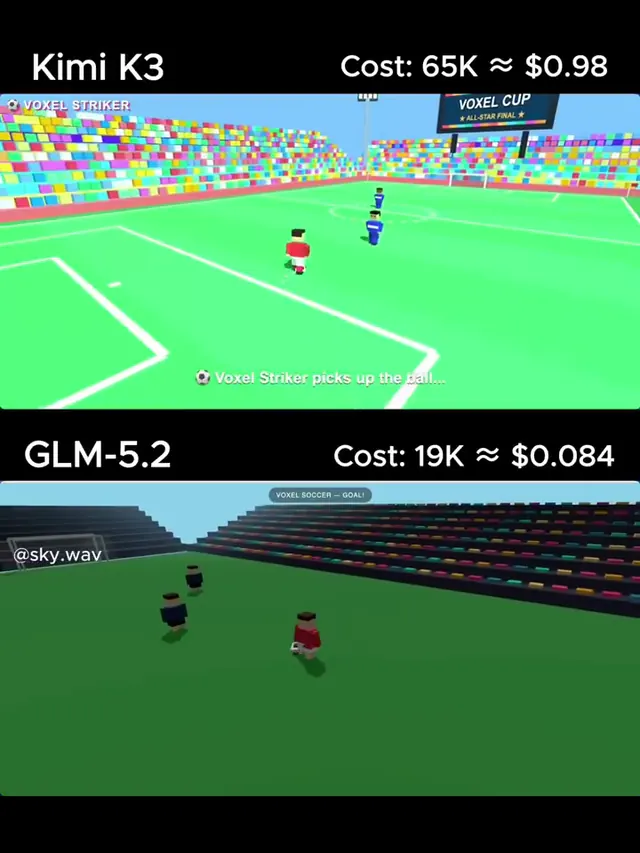</a>

**Kimi K3** · 动画 · 作者 [Thành](https://x.com/Zmthanh) · 2026-07-21

Kimi K3 在与 GLM-5.2 的对比中胜出:一条提示词生成体素球员过掉两名后卫,在彩色球场进球并撒出庆祝粒子。

<details>
<summary>提示词</summary>

```text
Create a single HTML file with Three.js (CDN) for a simple voxel-style soccer animation. A blocky player dribbles past 2 defenders and scores a spectacular goal with celebration particles. Colorful stadium look. Output ONLY the full HTML code.
```

</details>

[在 Wandy3D 查看 ↗](https://wandy3d.com/zh/prompts/voxel-soccer-goal-animation-with-celebration-particles-in-2079553757302710442?utm_source=github&utm_medium=referral&utm_campaign=awesome_3d_prompts) · [原帖](https://x.com/Zmthanh/status/2079553757302710442)

---

### [基于真实建筑数据,一条提示词在 Blender 中生成曼哈顿](https://wandy3d.com/zh/prompts/manhattan-built-in-blender-from-real-footprints-with-one-2079387760478073087?utm_source=github&utm_medium=referral&utm_campaign=awesome_3d_prompts)

<a href="https://wandy3d.com/zh/prompts/manhattan-built-in-blender-from-real-footprints-with-one-2079387760478073087?utm_source=github&amp;utm_medium=referral&amp;utm_campaign=awesome_3d_prompts">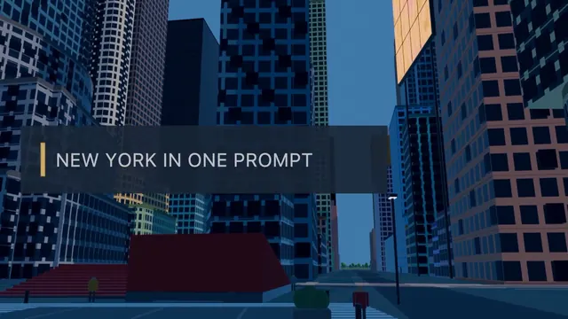</a>

**GPT 5.6 Sol** · 场景 · 作者 [Martin Puli](https://x.com/MartinPulitano) · 2026-07-21

GPT 5.6 Sol 通过 MCP 操控 Blender,用一句简短提示词生成按比例的曼哈顿,含中央公园与港口,并可飞行浏览。

<details>
<summary>提示词</summary>

```text
armá Nueva York
```

</details>

[在 Wandy3D 查看 ↗](https://wandy3d.com/zh/prompts/manhattan-built-in-blender-from-real-footprints-with-one-2079387760478073087?utm_source=github&utm_medium=referral&utm_campaign=awesome_3d_prompts) · [原帖](https://x.com/MartinPulitano/status/2079387760478073087)

---

### [用 Three.js 制作带记分牌与彩带的体素足球进球动画](https://wandy3d.com/zh/prompts/voxel-soccer-goal-animation-with-a-scoreboard-and-confetti-2079198084689723560?utm_source=github&utm_medium=referral&utm_campaign=awesome_3d_prompts)

<a href="https://wandy3d.com/zh/prompts/voxel-soccer-goal-animation-with-a-scoreboard-and-confetti-2079198084689723560?utm_source=github&amp;utm_medium=referral&amp;utm_campaign=awesome_3d_prompts">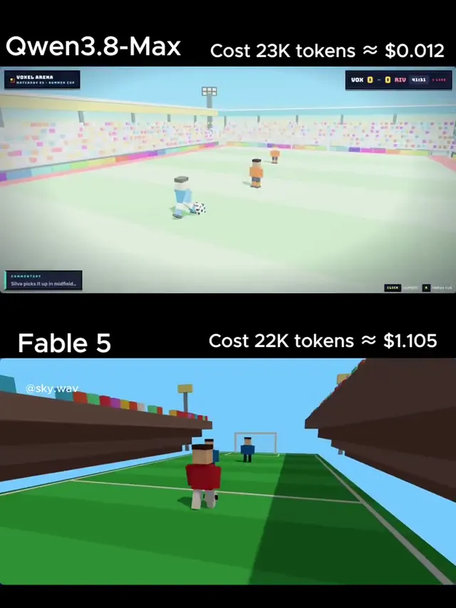</a>

**Qwen3.8-Max-Preview** · 动画 · 作者 [Thành](https://x.com/Zmthanh) · 2026-07-20

对比实验:被评为胜者的 Qwen3.8-Max-Preview 与 Fable 5 用同一提示词各生成一段带 GOAL 字样的体素足球进球场景。

<details>
<summary>提示词</summary>

```text
Create a single HTML file with Three.js (CDN) for a simple voxel-style soccer animation. A blocky player dribbles past 2 defenders and scores a spectacular goal with celebration particles. Colorful stadium look. Output ONLY the full HTML code.
```

</details>

[在 Wandy3D 查看 ↗](https://wandy3d.com/zh/prompts/voxel-soccer-goal-animation-with-a-scoreboard-and-confetti-2079198084689723560?utm_source=github&utm_medium=referral&utm_campaign=awesome_3d_prompts) · [原帖](https://x.com/Zmthanh/status/2079198084689723560)

---

### [可在机舱内行走的 Three.js 客机查看器](https://wandy3d.com/zh/prompts/three-js-airliner-viewer-with-a-walkable-passenger-cabin-2078806166122197132?utm_source=github&utm_medium=referral&utm_campaign=awesome_3d_prompts)

<a href="https://wandy3d.com/zh/prompts/three-js-airliner-viewer-with-a-walkable-passenger-cabin-2078806166122197132?utm_source=github&amp;utm_medium=referral&amp;utm_campaign=awesome_3d_prompts">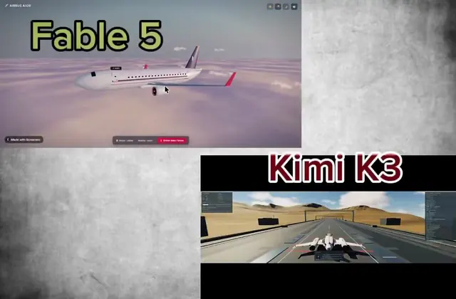</a>

**Claude Fable 5** · 互动 · 作者 [FHILY👑](https://x.com/Oluwaphilemon1) · 2026-07-19

在 Claude Code 中,Claude Fable 5 把一句提示词变成可绕机外观察、也能走进摆满座椅客舱的客机体验。

<details>
<summary>提示词</summary>

```text
Generate in Three.js an experience allowing me to visualize a 3D airplane model and walk inside it.
```

</details>

[在 Wandy3D 查看 ↗](https://wandy3d.com/zh/prompts/three-js-airliner-viewer-with-a-walkable-passenger-cabin-2078806166122197132?utm_source=github&utm_medium=referral&utm_campaign=awesome_3d_prompts) · [原帖](https://x.com/Oluwaphilemon1/status/2078806166122197132)

---

[← 上一页](catalog.zh.7.md) · 第 8 页，共 8 页

提示词、视频和图片的权利归原作者所有（[RIGHTS.md](../RIGHTS.md)）。我们撰写的文字采用 [CC BY 4.0](../LICENSE) 许可。知道有成果展示的好提示词？[推荐给我们](https://github.com/wornoxgames/awesome-3d-prompts/issues/new?template=suggest.md)。如果你是作者并希望修改或删除条目，请[联系我们](https://github.com/wornoxgames/awesome-3d-prompts/issues/new?template=removal.md)。
